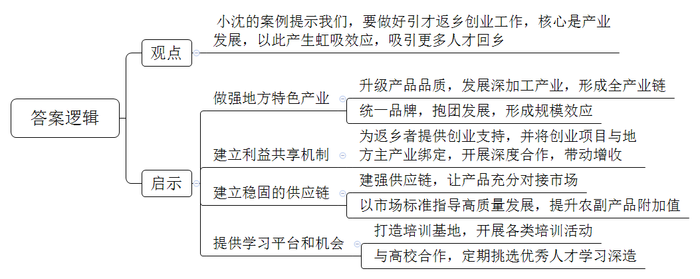
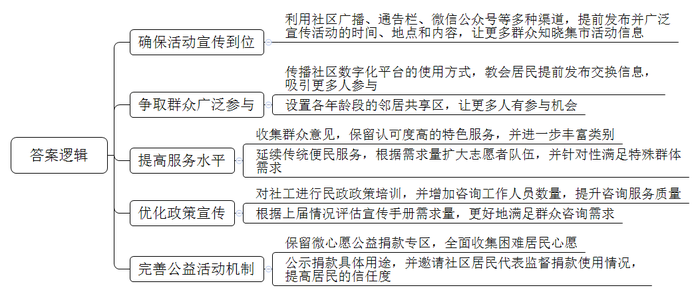
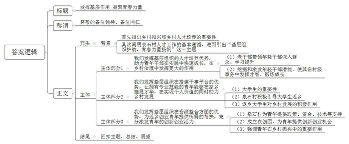

# 2023年江苏省公考《申论》题（C卷）

> 候选采集稿。参考答案及解析来自粉笔页面，不代表官方答案或真实高分答卷；来源使用许可与原卷对应关系仍需人工核实。

## 给定材料

### 材料 material-9568eff69bb2c104

乡村振兴从何来？靠山靠水靠人才。当下，随着乡村振兴的扎实推进，阡陌纵横的美丽乡村正成为各类人才大显身手的广阔舞台。

“村务员”听说过吗？近日，农业农村部、国家发改委、国家乡村振兴局发布第三批21个全国农村公共服务典型案例，H省G县“‘村务员’，巧织乡村公共服务‘网’”榜上有名。日前，记者走进该县龙溪村这个全县人口最多的行政村，倾听村务员们的故事。

傍晚时分，龙溪苗圃希望小学的孩子们三三两两走在放学路上，村务员老吴迎面走来，叮嘱孩子们留心脚下、注意安全。这条林间小路是老吴的岗位责任区，交通安全、卫生状况是他巡查的重点，早晚往返好几趟，“村务员履职以来，孩子们上学安全多了。”龙溪苗圃希望小学的方老师说，学校建在山腰处，每逢下大雨，雨水顺山势沿路面淌下来，在校门口进进出出，鞋子往往被浸湿。今夏的一天，方老师上班途中突遇暴雨，一路走来，他发现校门口的过水量比以往小了许多，仔细一看，路面多出了两条细长的水槽，雨水顺着水槽注入路边排水沟。有同事告诉方老师，水槽是由村务员老吴提议修建的，“事情有人干、问题有人管、责任有人担，村里有了村务员，就是不一样！”方老师感慨万分。

今年6月底，村民吴大姐和李大娘发生了争吵。原来，两家的梯田相邻，吴家田在上，李家田在下，多年来共用一处水源，吴家田埂上开个小口，水便流到李家田里。当时正处于水稻抽穗期，天旱多日，吴大姐担心自家稻田缺水，就堵住了田埂上的出水口。李大娘一看急了，拿起锄头就奔向田埂，吴大姐自然不肯退让。村务员老蔡是种田30多年的“老把式”。得知情况后，踩着田到吴家的梯田里探了探水深，心平气和地道出了自己的看法：“稻田里不能缺水，但水多了也容易滋生害虫，不利于水稻生长。稻田水深保持三指左右最好，你家稻田水过深了。”听了“老把式”的话，吴大姐的态度缓和下来，主动用锄头在田埂上挖开一个豁口，水哗啦啦地流进了李大娘家稻田，两家的矛盾也“顺水”而解。“村务员熟乡情、接地气，在处理乡村问题的时候往往能‘四两拨千斤’，是村情民意的‘第一触角’，在乡村治理中发挥着不可替代的作用。”龙溪村驻村第一书记小郭说。

### 材料 material-7e812ff941f1af75

乡村振兴，核心在人，重点在青年。乡村振兴战略的全面开展，需要青年群体积极参与。推动乡村振兴战略实施，既要科技人才，也要经营人才；既要产业带头人也要文化传播者，既要管理“领头雁”，也要生产开拓者。

为了推动乡村振兴战略的深入实施，X市委宣传部推出“青年创业先锋论坛”网络主题宣传活动，深入挖掘X市各地青年创业典型人物，用新媒体传播手段，充分展现新时代优秀青年扎根基层、脚踏实地、拼搏进取的良好精神风貌，吸引更多的优秀青年回乡创业，为乡村人才振兴、产业振兴，营造良好的舆论氛围。

4360家农户、175个企业、40多名创业青年，有一个共同的合作伙伴，他就是团中央、人社部表彰的“全国农村青年致富带头人”小沈。

小沈今年31岁，湖北孝昌县周巷镇人，2013年回乡创业，先后创立了益华农、创客中心、楠腾苗木等8家公司，公司资产近2亿元。他还牵头成立孝昌梦里花园花木专业合作社联合社（后称联合社），带领一帮创业青年，展现出强大活力，正激荡着乡村振兴的澎湃动能。

2月23日，小沈在他的创客中心接受了记者采访。一年前，小沈向记者描绘过的创业愿景，正在变为现实。他一手建立了乡村特色农产品的产业链和供应链，他的产业链接了千家万户。他是乡土产业的持“链”人。

孝昌县周巷镇资源禀赋深厚，形成茶叶、油茶、苗木三大绿色产业。但很长一段时间里，当地种植的苗木以“大路货”“低端货”为主，经营模式集中于买苗卖苗，粗放而单一；茶叶品牌分散，加工粗放；油茶只能卖果子，需送到黄陂、大悟代加工。

经过4年发展，联合社产业基地规模超过7万亩，年产值超过2亿元，年提供就业30万人次，发放工人工资超过3000多万元。小沈说，如今，孝昌县的苗木花卉已形成了园林设计、施工养护、园林资材一条龙服务，统一区域公共品牌“梦里花园花木”。

油茶精炼车间已建成，生产可供出口的二级山茶油，填补了孝昌无精炼油茶厂的空白，将油茶的产值由130万元提升到370多万元。同时，联合社还将全县11家油茶种植企业整合在一起，统一品牌“青谷驿”。联合社还通过组建茶叶联盟，将周巷及周边乡镇51家茶企业整合在一起，共同打造“楚天凤凰山茶”，并将茶叶生产设备由二代机升级到四代机，在茶叶提档升级、品种更新迭代、红绿茶加工形成全产业链。统一品牌，抱团发展，产业迅速壮大。小沈说，目前联合社已有1家国家级合作社、3家省级和3家市级龙头企业，为农副产品找出口，建强供应链。

黄峰是周巷镇的“苗二代”，他是加入联合社的创业青年之一。在周巷镇双观线旁，10个草莓大棚一字排开，前来摘草莓的人络绎不绝。黄峰说，这些大棚和10多亩土地是小沈提供的，免5年租金。

像这样的种养殖基地，联合社共流转土地640亩，种植了草莓、蓝莓、樱桃、黄桃、猕猴桃、翠冠（梨）、葡萄等品种。目前，与联合社产生合作的农户达4360家，合作的企业由成立之初的113家，增加到175家。

小沈说，他将从这4360户农户中，精选1300户与联合社的主产业“绑”在一起，在农村金融、产品统购统销等方面深度合作。他还将积极推动村企共建，将村集体特色产业与联合社主产业“链”在一起，带动农户和村集体增收。

“乡村振兴的核心是产业，建立稳固的供应链很关键。”小沈说，他将针对外地商会、城市消费、机关、学校、精准扶贫板块等，建强供应链，让农产品充分对接市场，同时增强农副产品附加值，以市场标准促进企业高质量发展。

小沈的创客中心，与华中农业大学乡村振兴研究院合作，成立了孝昌乡村振兴书院；省人社厅也授予创客中心“湖北省省级返乡创业示范园”，这里还是省市县农村党员实训基地。

领头雁和乡土人才，是乡村振兴的“生力军”。小沈说，孝昌乡村振兴书院每年从村支书、返乡创业青年、农村党员中，挑选50人送到华中农业大学去学习。中心每年还通过各类培训活动，培养乡土人才1650人次。

乡村振兴的核心是产业，人才振兴是关键。产业发展了，将会产生虹吸效应，吸引更多的人才回乡创业。小沈说，这是解决乡村“空心化”、产业“空心化”的有效手段。

### 材料 material-d6dbe2ac77ca201f

2022年11月12日，由双桥街道绿园社区青年干部设计的首届“邻里创意集市”火热开市。该创意集市由社区青年干部小谭、小张等人提议开设。不久前，小谭在社区的留言信箱看到了居民留言，“如今小区环境好了，但修把伞、补双鞋、磨把刀都找不到地方。”“孩子大了，玩具和书籍堆在家里很是头疼，丢了又可惜。”……居民的小事就是社区干部的大事，他们一合计，决定创办一个集市，集中解决居民们的细碎需求。以下是集市开张当日几个活动区的活动场景。

小邻居共享区：“大甩卖、大甩卖！八成新的各类图书买一送一啦！”“走过路过不要错过，抽奥特曼卡送毛绒玩具……”几个孩子兴高采烈地在集市上进行物品交换和售卖。在集市开始前，不少孩子家长已经通过社区数字化平台“友邻有伴”提前发布了“换一换”信息，所以当天来的孩子特别多，现场热闹非凡。“太过瘾啦，我昨天看好的玩具，今天‘换一换’成功啦！下次我还要来！”一位七八岁的小姑娘抱着毛茸茸的“大熊”兴奋地说。孩子们的热情吸引了不少家长的目光，“物尽其用，很好！不浪费，还能锻炼了孩子。”小区居民王爷爷说：“我家里也有些‘老物件’，什么时候集市也能有个‘老邻居’区，让我也来体验一把。”

义剪服务区：志愿者徐阿姨正在为一位老人理发，“我本来也不是专业的，都是退休后慢慢学的，太时尚的我不会，但给老人们服务服务还是可以的，能用一技之长为大家服务我感到很开心。”一上午，徐阿姨为18位居民修剪了头发。“剪的蛮好，只是只有一位师傅，如果以后能多来几位就好了，也省得我们排长队。”刚理好发的老张说。徐阿姨说：“没想到，今天来了这么多人，刚才还有一位居民说，家里有位卧床老人希望我们能上门服务。”

政府政策宣传区：“困境儿童及家庭遇到突发问题，应该找谁寻求助？”“想入住区社会福利院怎么申请”……在民政政策宣传摊位前，社工为居民答疑解惑，区民政局工作人员小朱说，居民们对民政方面的问题，咨询特别多，我们带来的50本宣传手册一会儿就发完了。

圆梦行动区：一块钱可以做什么？一块钱可以实现邻里的一个微心愿。前期，绿园社区通过摸排，收集了50多个困难居民的微心愿，希望通过在邻里创意集市中鼓励大家一块做公益，帮助邻里圆梦，进而带动全社区居民参与志愿服务。“捐一块钱不是啥大事，但用在了哪里，我们也不知道啊！”刚捐完钱的马大姐说。

本届集市上，儿童启蒙、非遗簪花、绿植养护等特色服务让人耳目一新，修伞、修鞋、磨刀等传统便民服务，也让居民日常“修补难”得到了解决，居民们纷纷“喊话”社区书记：这样的活动要经常搞啊！

一天的集市结束后，居民依然意犹未尽，大家在夸赞之余，也有期待。在集市美食区卖甜点的小马说：“这次集市的报名都快结束了，我才从小区公告栏上看到招募信息，差点就错过了。”

“本次邻里创意集市不仅为社区增添了‘人间烟火气’，也让参与活动的居民们沉浸式体验到了美好和谐的邻里场景，让大家幸福感倍增。”绿园社区书记说，“为了顺应居民们的‘呼声’，社区第二届邻里创意集市即将在下个月开市，目前各项工作正在筹备之中。”

## 题目

### 第 1 题

**“给定资料**1**\-**4**”中，列举了基层组织发挥各类人才的作用带来了乡村新变化，请用一段话对此加以概括。（20分）**

关联材料：材料 material-9568eff69bb2c104

作答要求：

要求：紧扣给定资料，准确全面，条理清晰，语言流畅。篇幅不超过250字。

### 第 2 题

**请你结合****“给定资料**5**”中小沈的创业成功案例，谈谈对基层政府做好引才返乡创业工作的启示。（20分）**

关联材料：材料 material-7e812ff941f1af75

作答要求：

要求：紧扣给定资料，观点正确，分析透彻。篇幅250字左右。

### 第 3 题

**假如你是****“给定资料**6**”中绿园社区的青年干部小谭，请你在总结第一届邻里创意集市经验的基础上，就如何办好第二届邻里创意集市提出建议。（20分）**

关联材料：材料 material-d6dbe2ac77ca201f

作答要求：

要求：全面具体，条理清晰，有针对性、可行性。篇幅350字左右。

### 第 4 题

**假如你是****“给定资料**7**”中泉石村驻村第一书记小高，要在全县乡村人才工作会议上作经验交流发言，请以“基层组织护航，青春力量扬帆”为主题，拟写一份发言稿。（40分）**

关联材料：材料 material-9568eff69bb2c104

作答要求：

要求：

（1）自选角度，自拟标题；

（2）结合给定资料但不拘于给定资料；

（3）内容充实，结构完整，语言流畅，有感召力；

（4）篇幅1000字左右。

## 答案与解析

第 1 题

**参考答案（粉笔题库参考内容）**

各类人才给乡村带来新变：发挥村务员熟乡情、接地气的优势，通过巡查及时发现问题、解决问题，确保村内交通安全、卫生整洁，化解村民间的矛盾，提升乡村治理水平；发挥博士“帮帮团”技术优势，推广农业技术，推动农业成果转化，提升农业现代化水平，通过实践和教学，培养更多农业技术人才；发挥乡村规划师设计专长，将乡村规划与村民需求、乡土文化相结合，兼顾美观与实用，打造美丽乡村；发挥基层文艺爱好者的热情，组成志愿者团队，自编自演节目，开展村村巡演，丰富村民文化生活，开展演艺培训，壮大基层文化队伍。

**解析**

**参考答案说明：**本参考答案按照“总结性引导语+各类人才的作用带来了乡村新变化”的结构，从“发挥村务员熟乡情、接地气的优势”“发挥博士‘帮帮团’技术优势”“发挥乡村规划师设计专长”“发挥基层文艺爱好者的热情”四类人才的作用及其带来的乡村变化展开，各条答案要点之间在内容上相互并列，没有交叉。

**考点**：考点影响类

**来源**：来源2023年江苏省公考《申论》题（C卷）

粉笔申论页面对本题只提供「解析视频」入口，该入口是会员推广位，页面无视频地址与文字解析。

第 2 题

**参考答案（粉笔题库参考内容）**

小沈的案例提示我们，要做好引才返乡创业工作，核心是产业发展，以此产生虹吸效应，吸引更多人才回乡。具体要：

1.做强地方特色产业。升级产品品质，发展深加工产业，形成全产业链；统一品牌，抱团发展，形成规模效应。2.建立利益共享机制。为返乡者提供创业支持，并将创业项目与地方主产业绑定，开展深度合作，带动增收。3.建立稳固的供应链。建强供应链，让产品充分对接市场；以市场标准指导高质量发展，提升农副产品附加值。4.提供学习平台和机会。打造培训基地，开展各类培训活动；与高校合作，定期挑选优秀人才学习深造。

**解析**

**参考答案说明**：本参考答案先介绍了对基层政府做好引才返乡创业工作的观点，接着从“做强地方特色产业”“建立利益共享机制”“建立稳固的供应链”“提供学习平台和机会”四个方面介绍了对基层政府做好引才返乡创业工作的启示，各条答案要点之间在内容上相互并列，没有交叉。

**考点**：考点经验启示类

**来源**：来源2023年江苏省公考《申论》题（C卷）

粉笔申论页面对本题只提供「解析视频」入口，该入口是会员推广位，页面无视频地址与文字解析。

第 3 题

**参考答案（粉笔题库参考内容）**

1.确保活动宣传到位。利用社区广播、通告栏、微信公众号等多种渠道，提前发布并广泛宣传活动的时间、地点和内容，让更多群众知晓集市活动信息。

2.争取群众广泛参与。传播社区数字化平台的使用方式，教会居民提前发布交换信息，吸引更多人参与；设置各年龄段的邻居共享区，让更多人有参与机会。

3.提高服务水平。收集群众意见，保留认可度高的特色服务，并进一步丰富类别；延续传统便民服务，根据需求量扩大志愿者队伍，并针对性满足特殊群体需求。

4.优化政策宣传。对社工进行民政政策培训，并增加咨询工作人员数量，提升咨询服务质量；根据上届情况评估宣传手册需求量，更好地满足群众咨询需求。

5.完善公益活动机制。保留微心愿公益捐款专区，全面收集困难居民心愿；公示捐款具体用途，并邀请社区居民代表监督捐款使用情况，提高居民的信任度。

**解析**

**参考答案说明：**本参考答案从“活动宣传”“群众参与”“服务水平”“政策宣传”“公益活动”五个方面进行了分条撰写，各条答案要点之间在内容上相互并列，没有交叉。

**考点**：考点提出对策类

**来源**：来源2023年江苏省公考《申论》题（C卷）

粉笔申论页面对本题只提供「解析视频」入口，该入口是会员推广位，页面无视频地址与文字解析。

第 4 题

**参考答案（粉笔题库参考内容）**

**发挥基层作用 凝聚青春力量**

尊敬的各位领导、各位同仁：

大家好！我是泉石村驻村第一书记小高，很荣幸能在全县乡村人才工作会议上发言。乡村振兴是我国重要的战略任务，而乡村人才的培养是推动乡村振兴的关键。泉石村认真贯彻落实乡村人才工作的决策部署，充分发挥基层组织作用，在乡村振兴道路上助力青年力量的成长。今天我想与大家分享我们所取得的经验和成果。

**我们发挥基层组织的人才培养优势，助力青年干部在实践中快速成长，在乡村治理中发挥更大的作用。**在泉石村，我们带领返乡大学生村官扎根田间地头，深入了解民情村情，不断学习充实自己；我们注重挖掘和激发年轻人的潜能，让他们参与到村级事务的决策与管理中，发挥出自己的才智和能力，让他们在实践中锻炼、成长，从而形成了一批优秀的青年骨干，助力村级事务高效运作。

**我们发挥基层组织在搭建干事平台的优势，让拥有专业技能的青年能够在家乡施展才华，在实现个人价值的同时****助力乡村发展****。**大学生是乡村振兴的宝贵资源，他们在专业知识和创新思维方面具有独特优势。在泉石村，我们积极引导大学生回归家乡，因势利导，量才而用，将他们的知识和能力充分投入到乡村发展中。正是借助他们的力量，我们推动了农村治理数字化、加快了产业升级，创造了就业岗位，全面推动乡村振兴。

**我们发挥基层组织在资源整合方面的优势，为返乡创业青年提供所需的帮扶，充分激发****青年的创新创业活力****。**在泉石村，我们为创业青年提供政策扶持、资金支持和技术指导，帮助他们解决创业过程中的困难，鼓励他们大胆尝试、敢为人先，带动更多的青年创业就业；我们成立农创园，大力发展农业产业，为年轻人提供了创新创业的可能。年轻人在乡村振兴中发挥了重要的作用，他们不仅创造了经济效益，更为村庄带来了新的活力和希望。

在乡村人才工作中，党组织是最坚强的领导核心，泉石村党总支始终坚持党建引领，通过党组织的组织力、凝聚力和引领力，我们培养了一大批乡土人才和外出能人，成为了乡村振兴中的中坚力量，也开创了产才融合的工作新格局。

乡村振兴的实践不断推进，也给了我们更多的启示。乡村人才工作不能只依赖于政府的政策扶持，更需要企业、社会组织和各界力量的积极参与。我期待着在此次会议上，我们能够更好地发挥各方优势，共同推动乡村人才工作取得更好的成果。我相信，在全县各个部门和乡村的共同努力下，我们一定能够把乡村人才工作推向新的高度，助力乡村振兴迈上新的台阶。谢谢大家！

**解析**

**文章分析**

**发挥基层作用** **凝聚青春力量**

【**标题的优点**：主题突出，简洁明快。】

尊敬的各位领导、各位同仁：

【**称谓的优点：**发言稿的称谓定位准确、格式正确。本次发言的对象是参与全县乡村人才工作经验交流会议的领导和同志，因此称谓可写为：尊敬的各位领导、各位同仁】

大家好！我是泉石村驻村第一书记小高，很荣幸能在全县乡村人才工作会议上发言。（1）乡村振兴是我国重要的战略任务，而乡村人才的培养是推动乡村振兴的关键。（2）泉石村认真贯彻落实乡村人才工作的决策部署，充分发挥基层组织作用，在乡村振兴道路上助力青年力量的成长。今天我想与大家分享我们所取得的经验和成果。

【**开头****的优点：**★内容方面。首先指出了乡村振兴和乡村人才培养的重要性，其次阐明了泉石村人才工作的基本遵循，进而引出“基层组织护航，青春力量扬帆”这一主题。★文字表达方面。衔接流畅，富有文采。】

**我们发挥基层组织的人才培养优势，助力青年干部在实践中快速成长，在乡村治理中发挥更大的作用。**（1）在泉石村，我们带领返乡大学生村官扎根田间地头，深入了解民情村情，不断学习充实自己；（2）我们注重挖掘和激发年轻人的潜能，让他们参与到村级事务的决策与管理中，发挥出自己的才智和能力，让他们在实践中锻炼、成长，从而形成了一批优秀的青年骨干，助力村级事务高效运作。

【**主体部分****1****的优点：**★核心句：紧扣“基层组织护航，青春力量扬帆”这一主题提出。形式上，它在段首处直接写出，位置突出。内容上，关键词突出，内容要点明确，可以明显看出它是从“注重人才培养，助力青年成长”这一方面展开论述。★具体展开：（1）先介绍了老干部带领年轻干部深入群众、学习提升；（2）接着介绍了挖掘和激发年轻干部潜能，使其在村级事务中发挥才智、锻炼成长。注意：以上两个方面的内容都是紧扣“我们发挥基层组织的人才培养优势，助力青年干部在实践中快速成长，在乡村治理中发挥更大的作用”这个核心句进行分析论述的，具体展开的内容针对性强，层次丰富。在具体内容的展开上采用了讲道理的方式，论述清晰深刻。】

**我们发挥基层组织在搭建干事平台的优势，让拥有专业技能的青年能够在家乡施展才华，在实现个人价值的同时助力乡村发展。**（1）大学生是乡村振兴的宝贵资源，他们在专业知识和创新思维方面具有独特优势。（2）在泉石村，我们积极引导大学生回归家乡，因势利导，量才而用，将他们的知识和能力充分投入到乡村发展中。（3）正是借助他们的力量，我们推动了农村治理数字化、加快了产业升级，创造了就业岗位，全面推动乡村振兴。

【**主体部分****2****的优点：**★核心句：紧扣“基层组织护航，青春力量扬帆”这一主题提出。形式上，它在段首处直接写出，位置突出。内容上，关键词突出，内容要点明确，可以明显看出它是从“为青年搭建干事平台”这一方面展开论述。★具体展开：（1）先指出了大学生的重要性；（2）其次介绍了泉石村积极引导大学生返乡；（3）接着阐述了返乡大学生对乡村发展的积极作用。注意：以上三个方面的内容都是紧扣“我们发挥基层组织在搭建干事平台的优势，让拥有专业技能的青年能够在家乡施展才华，在实现个人价值的同时助力乡村发展”这个核心句进行分析论述的，具体展开的内容针对性强，层次丰富。在具体内容的展开上采用了讲道理的方式，做到了说理透彻。】

**我们发挥基层组织在资源整合方面的优势，为返乡创业青年提供所需的帮扶，充分激发青年的创新创业活力。**（1）在泉石村，我们为创业青年提供政策扶持、资金支持和技术指导，帮助他们解决创业过程中的困难，鼓励他们大胆尝试、敢为人先，带动更多的青年创业就业；（2）我们成立农创园，大力发展农业产业，为年轻人提供了创新创业的可能。（3）年轻人在乡村振兴中发挥了重要的作用，他们不仅创造了经济效益，更为村庄带来了新的活力和希望。

【**主体部分****3****的优点：**★核心句：紧扣“基层组织护航，青春力量扬帆”这一主题提出。形式上，它在段首处直接写出，位置突出。内容上，关键词突出，内容要点明确，可以明显看出它是从“整合资源，助力创新创业”这一方面展开论述。★具体展开：（1）先介绍了泉石村为青年提供政策、资金、技术等支持；（2）接着介绍了成立农创园，为青年提供创新创业机会；（3）再强调青年在乡村振兴中的重要作用。注意：以上三个方面的内容都是紧扣“我们发挥基层组织在资源整合方面的优势，为返乡创业青年提供所需的帮扶，充分激发青年的创新创业活力”这个核心句进行分析论述的，具体展开的内容针对性强，层次丰富。在具体内容的展开上采用了讲道理的论证方法，做到了说理透彻。】

在乡村人才工作中，党组织是最坚强的领导核心，泉石村党总支始终坚持党建引领，通过党组织的组织力、凝聚力和引领力，我们培养了一大批乡土人才和外出能人，成为了乡村振兴中的中坚力量，也开创了产才融合的工作新格局。

【**过渡段****的优点：**★本段明确基层组织对乡村人才工作的重要作用，并对泉石村人才工作成果进行了总结。】

乡村振兴的实践不断推进，也给了我们更多的启示。乡村人才工作不能只依赖于政府的政策扶持，更需要企业、社会组织和各界力量的积极参与。我期待着在此次会议上，我们能够更好地发挥各方优势，共同推动乡村人才工作取得更好的成果。我相信，在全县各个部门和乡村的共同努力下，我们一定能够把乡村人才工作推向新的高度，助力乡村振兴迈上新的台阶。谢谢大家！

【**结尾****的优点：**回扣了“基层组织护航，青春力量扬帆”这一主题。总结了全文，做到了核心内容突出，结构完整。】

**考点**：考点总结类

**来源**：来源2023年江苏省公考《申论》题（C卷）

粉笔申论页面对本题只提供「解析视频」入口，该入口是会员推广位，页面无视频地址与文字解析。

