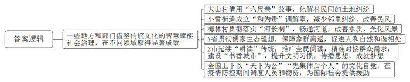
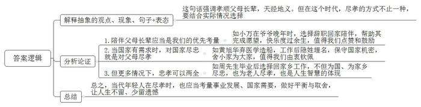
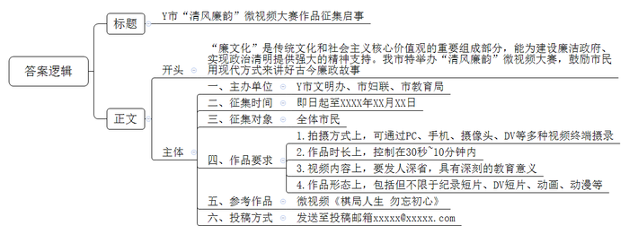
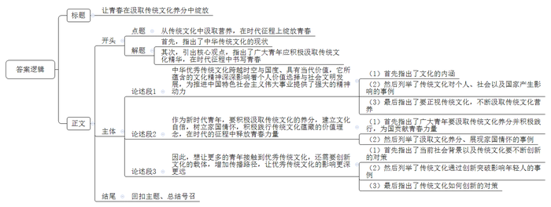

# 2023年江苏省公考《申论》题（A、乡镇选调卷）

<!-- gwy:overview:start -->
> **江苏 · 2023 · 申论 · A类** ｜ 4 题 · 图片 4 处 · 答案随题折叠

导航：[题目](#题目) · [材料 1](#材料-1)
<!-- gwy:overview:end -->

> 卷型说明：卷面标题为「A、普通选调卷」，粉笔题库按「选调生」收录（源试卷 ID 211730）；本库按官方卷型记为 A 类，选调生考试为同卷。

> 候选采集稿。参考答案及解析来自粉笔页面，不代表官方答案或真实高分答卷；来源使用许可与原卷对应关系仍需人工核实。

## 给定材料

### 材料 1

“千里家书只为墙，让他三尺又何妨。万里长城今犹在，不见当年秦始皇。”这首“让墙诗”出自一段历史典故。清康熙年间，张英担任文华殿大学士兼礼部尚书。他老家的宅院与吴家为邻，两家院落之间有条巷子，供双方出入使用。吴家要建新房，想占这条路，张家人不同意。双方争执不下，将官司打到当地县衙。县官考虑到两家人都是名门望族，不敢轻易了断。张家人一气之下写了封加急信送给张英，要求他出面解决。张英看信后，认为应该谦让邻里，这首“让墙诗”就是他的回信。家人阅罢，主动让出三尺空地；吴家见状，深受感动，也主动让出三尺房基地，“六尺巷”由此得名。

“六尺巷”的佳话在中华大地流传甚广。新中国成立后，毛主席在会见苏联驻华大使尤金时，曾经用这四句诗来表达两国之间应该谦让、平等。在新时代的基层社会治理中，“六尺巷”的故事仍然散发着持久的魅力与芬芳。在H省D县龙门镇大山村活动广场的一面墙上，诗画结合的民间故事“六尺巷”十分醒目。当地党员干部从“六尺巷”故事中得到启发，不久前成功化解了一起村民之间的土地纠纷。该村倪姓、莫姓两户人家一直为了一块六分大的土地权属问题争执不下。老倪说，这是自家祖地；老莫则称，父辈早就买下了这块地。双方都无凭无据，又都互不相让。久而久之，这块位置不错的地，硬是被搁置成了杂草丛生的撂荒地。“为了一块地，邻里间的情分都吵没了。”乡里乡亲都看在眼里，无奈又惋惜。2022年9月，大山村启动人居环境改造工程。为了这块地的归属，两家人再起争执，僵持不下。这时，有驻村干部提出，古有“六尺巷”美谈，如今两家能否也各让一步，商量将地一同用起来呢？村干部多次分头上门，动之以情、晓之以理。“你们两家吵了这么多年，谁得到了好处？”“邻里关系僵了，名声坏了，乡亲们都绕着走。”“村里环境变好了，受益的还不是咱自己吗？你们的小账和村里的大账，其实都是一本账。”在大家的劝解下，两家人终于想通了。看到倪、莫两家摒弃前嫌，相邻地块的村民们也主动让出了一部分土地，村里借此建成了公共绿地。如今，焕然一新的绿地广场成了村民运动休闲的好去处。“六尺巷”美谈，在新时代续写出新的篇章。

“礼之用，和为贵。”在Q市小雪街道的“和为贵”调解室，墙上鲜红的行楷字格外醒目，经典名句的点缀，营造出和谐温馨的氛围。“这张照片是岳大爷和他邻居为一只猫咪的归属发生纠纷来这里调解，这个是张大爷因为砌墙跟邻居发生纠纷前来调解……”街道党工委书记老邢拿出资料册，细数着在“和为贵”调解室里的成功案例。“2013年调解室刚成立时，居民来得还比较多，每个月大概处理三四起，后来越来越少，直到现在，已经近半年没人来了。”邻里纠纷的减少反映的是民风的改善，“老祖宗传下来的好方法很多，只要能善于活学活用，现代社会治理大有可为。”老邢感慨地说。

### 材料 2

河长制，听说过吧？新时代的河长，家喻户晓。那么，在我国几千年的历史长河中，曾经有过河长吗？在Z省S县水文博物馆里有六块石碑，碑上的文字告诉世人，“河长”官职古已有之：渠长，始见于唐代；堤长，始见于晚唐五代；湖长，始见于元代；坝长、河长……在古代，担任地方行政长官而兼任河长的官员不计其数，他们积极履职，为治水防汛抗洪做出了重要贡献。

唐宋八大家之一的苏轼就是古代众多“河长”中十分出色的一位。苏轼任杭州知州时发现，居民赖以饮水的“六井”近乎瘫痪。一番调查后发现，主要原因是西湖淤塞导致水源不足，于是苏轼便着手对西湖进行疏浚。针对西湖葑草横生、湖面萎缩的困局，苏轼结合当时稻田受灾、米价飞涨的实际，采取以工代赈的方式，招募饥民浚治西湖。并因势利导，利用葑草、淤泥等物，在湖中堆筑起一道便利南北通行的长堤，堤旁植垂柳，湖中种荷花，这便是今日著名的西湖“苏堤”。

新时代的“河长制”，由各级党政主要负责人担任“河长”，负责组织领导相应河湖的管护工作。2016年12月，中共中央办公厅、国务院办公厅印发了《关于全面推行河长制的意见》，要求各地区各部门结合实际认真贯彻落实。2017年元旦，主席在新年贺词中发出了“每条河流要有河长了”的号令。

河长一上岗，江河大变样。墩子河是流经J市B县梅林村的一条河流，村支书老陈担任村级河长。“每天出门我都先到河边走走看看。墩子河虽小，但通向长江，必须守好‘责任田’。”曾几何时，水质退化困扰村民。清淤泥、连水系、治污水，一套组合拳下来，河畅流、水碧清。目前墩子河水质由劣V类变为Ⅲ类。墩子河的变化，村民们看在眼里，赞在口边：“风景变好了，大家就都来河边遛弯、跳广场舞了。”5年多来的实践证明，全面推行河湖长制符合国情水情，具有强大的制度生命力。

### 材料 3

暮色苍茫，江水奔腾。14头亚洲象缓缓从老213国道跨江桥上走过，消失在元江南岸的丛林中……2021年8月8日20时许，当无人机监测的实时画面传回时，十多公里外的北移亚洲象群安全防范工作现场指挥部里爆发出一阵欢呼。大象走过元江桥，意味着一度北移近500公里的象群跨越了南归的最大障碍，栖息地适宜性从此大幅提升。

这群大象是2021年4月16日突然出现在元江县的一座山头上的。大象来了！大象从哪里来？遇到大象怎么办呢？公众一时紧张起来，有关部门和地方政府紧急成立各级指挥部，加强监测预警。亚洲象是现存最大和最具代表性的陆生脊椎动物。这群拖家带口的“巨无霸”，为啥要离开“老家”X市国家级自然保护区北移活动？它们的一举一动牵动着公众的心。

“考虑到象群离开栖息地后北移，气温降低、食物匮乏，不利于种群的长远发展。越往北，公众接触象群的经验越少，风险很大，我们一路上都在努力让象群南返。”国家林草局亚洲象研究中心于主任说，“无论如何，一定要保障人象两平安，这是我们一切工作的底线！”

“大象到我们这里啦！”听说大象快到村里了，49岁的村民老唐兴奋得像个孩子，“以前只在电视上见过大象。”他担心大象吃不饱，主动联系了乡政府，捐出自家种植的玉米投喂大象。“大象贪吃点儿没事儿，它想吃就吃。我们的庄稼被吃掉了明年可以再长，大象如果饿坏了就没有了。”大象所到之处，为了不惊扰象群，人们庆祝传统节日时，不搞庆典，不点火祈福。沿途企业在大象经过时，关灯停产，保持静默……一幕幕感人情景，刷爆网络，温暖了全球。

我国古代有许多可贵的保护生态的理念和做法，《孟子》中“数罟不入洿池，鱼鳖不可胜食也。斧斤以时入山林，材木不可胜用也。”的描述生动展现了儒家文化的生态理想。唐玄宗禁绝民间采捕百色鸟兽之风；明弘治年间朝廷多次放生野生虎、鹰等，并禁止各属国进献珍禽异兽；清雍正帝禁止进贡象牙制品……这样的事例举不胜举。“这次突发事件是一次人与大型野生动物的生动交流，也是宣传的绝好机遇。”Y省林草局王局长说，“我们利用大象北移事件加大生态保护宣传，受到沿途百姓的普遍欢迎，仿佛人与自然和谐相处的基因一直深藏在普通中国人的血脉里，一碰到合适的契机，就会被激发出来。这场罕见的亚洲象长距离北移，真是对我们野生动物保护理念、应急管理水平、人文素养等方面的一次全方位考查和检验。”

### 材料 4

“耕读传家久，诗书继世长。”“既耕亦已种，时还读我书。”……千百年来，这些古训被不少家族奉为家规家训，代代相承。如今，我们早已告别那个炊烟袅袅、鸡犬相闻的“乡土中国”，取而代之的是一个个高楼林立、车水马龙的信息都市。然而“耕读”的传统并未远走，“耕读”的内涵仍在延伸。

近年来，“全国文明典范城市”Z市不断推广全民阅读，精准对接城乡群众需求，在实践中探索出一条符合港城实际的“书香城市”建设新路子。百家桥村24小时图书馆驿站“百味书屋”开张已有两年，不少村民成为这里的常客。“两年来，通过阅读活动，村民的不良习惯改变了很多。下一步，我们将继续在提升村民文明习惯上下功夫。”村党委书记老徐说。坐落在沙洲湖畔的益空间·源书房是Z市打造的首个“捐赠图书馆”，现有市民捐赠图书8700多册。市委宣传部李部长介绍，通过制度引领，全民参与，阅读已成为Z市“传播思想、成就梦想”的文明实践新路径。

“岂曰无衣，与子同袍”“青山一道同云雨，明月何曾是两乡”，新冠肺炎疫情发生以来，这些源自中华文化的诗句，在不同的场合屡屡传诵，让人倍感温暖。5000多年风雨沧桑，中华民族孕育了一方有难、八方支援和团结一心、共克时艰的优良传统。疫情防控期间，全国一盘棋。兵“桂”神速、“湘”互扶持、竭“晋”全力、鼓足“赣”劲、力“皖”狂澜、“粵”来越好……武汉疫情、南京疫情、上海疫情……最优秀的人员、最急需的资源、最先进的设备总能义无反顾地千里驰援，在最短时间内实现医疗资源和物资供应的有序保障。为打赢疫情防控的人民战争，广大党员、干部带头拼搏，人民解放军指战员、武警官兵、公安民警奋勇当先，广大科研人员奋力攻关，数百万快递员冒疫奔忙，千千万万志愿者和普通人默默奉献……

不仅如此，我们在自身疫情防控面临巨大压力的情况下，积极履行国际义务，尽己所能为国际社会提供援助。在S大学儒学高等研究院季院长看来，中华优秀传统文化中这种“天下为公”“先集体后个人”的文化自觉，在构建人类命运共同体尤其是面对公共卫生危机时，有着不容抹杀的积极意义。

### 材料 5

“父母在，不远游，游必有方。”出自《论语·里仁》，几千年来一直是儒家文化的经典语录。孝顺父母长辈，天经地义，在当下文化多元的时代，经典的熏陶对不同的人的行为有着怎样的影响呢？

人物一：黄旭华

黄旭华出生于1924年，祖上世代行医，父母希望他长大后继承祖业。七七事变后，黄旭华目睹了山河沦陷、人民流离失所，立志要让国家免受他国欺辱。于是他放弃学医，改学造船，走上了一条与父辈完全不同的道路。21岁时，他以第一名的成绩考入上海交通大学造船系。1958年组织找他谈话，国家要建造核潜艇，这是国家机密，你愿意一辈子隐姓埋名参加吗？黄旭华毫不犹豫地答应了。从此，他开始了长达30年的艰难研发历程。

为了核潜艇，黄旭华30年没有回老家。父母多次写信问他在北京干什么工作？在哪一个单位？黄旭华能给出的回答，永远是沉默。黄爸爸因病住院期间牵挂着儿子，希望能见儿子一面，但黄旭华深知自己肩负任务的重要性，他强忍痛苦，继续坚守在岗位上。直到父亲去世，黄旭华也没有回家送父亲一程，父亲最终都不知道儿子到底是做什么工作的。在父母兄妹眼中，这样的黄旭华，就是个忘恩负义的不孝子。1987年，一篇题目为《赫赫而无名的人生》的长篇报告文学，详细介绍了这位中国核潜艇总设计师的人生经历。黄旭华把杂志寄给了母亲。黄妈妈一遍又一遍地仔细阅读着，老泪纵横，她终于知道，被亲人误解为大逆不道的儿子，这30年一直在做什么。“对国家的忠，就是对父母最大的孝敬。”如今，第一艘核潜艇已经退役，但年逾九旬的总设计师黄旭华仍在“服役”。

人物二：周先生

“我是恢复高考后的第三届大学生。那时包分配，我的同学都分配在城市，只有我，想到要为家里的老母亲尽孝，坚决要求回到了家乡。”刚从D市教育局领导岗位上退下来不久的老周回忆道，“在家乡我是高学历，工作上我得到了领导重用，入了党，成为了市级骨干教师，还走上了领导岗位；生活上，我陪伴老母亲安度晚年，让她幸福地度过了九十三岁。为国、为家乡尽忠，为老人尽孝，我心安无愧。论退休工资，我现在还高过留在大城市的同学，我觉得自己当初的选择是对的。生活中，我看到身边的一些老人，儿子、女儿光鲜，在外国挣大钱，在深圳当老板，在北京当干部……可老人在老家形影相吊，生活孤苦。为了儿女，他们奉献了一切，可儿女们由于相距遥远，即使有心也是远水解不了近渴。而那些有在本地工作的儿女陪伴在身边的老人们，则过得其乐融融。我觉得子女在做事业选择时首先要考虑父母晚年的生活安排，不能离太远。”

人物三：小万姑娘

95后女孩小万最近成了网红。小万2020年大学毕业后留在C市工作，由于父母长期在外打工，她自幼随爷爷奶奶长大，对两位老人的感情很深。今年5月的一天，她回家探望爷爷，推开门的一瞬间，看到爷爷独自一人在沙发上睡着了，被子也没有盖，心里酸酸的。再想起已去世6年的奶奶，什么有纪念价值的影像也没留下，她的心里更不是滋味。经过再三思考，小万决定辞职回家陪爷爷。她希望陪伴期间能帮助爷爷完成他的愿望，让他快乐地度过余生。一开始，父母并不支持小万的决定，后来看到小万拍摄的一件件感人的视频作品，他们才慢慢地理解了。今年国庆节前夕，小万为爷爷实现了“去北京”的心愿。在去北京的候机室，小万偶然看到爷爷放在钱包里的奶奶的照片。经询问，爷爷是想带着奶奶一起去北京看看，这让小万百感交集。她把这一段视频发布到抖音上，一时间，“孙女带独居爷爷游中国”的话题受到广泛关注，不少网友纷纷点赞：“很孝顺！”“祝福爷爷！”“爷爷尝过许多苦，你是爷爷晚年的糖。”……“开心，很开心。”84岁高龄的万爷爷说，有了孙女的陪伴，每天都很幸福。同时，他也希望孙女能规划好自己的事业和生活，“后辈们生活得好，我就开心”。

### 材料 6

微视频《棋局人生 勿忘初心》近日在Y市火了，这部用魔幻现实主义手法拍摄的廉政微视频受到网友的广泛好评，“这个视频虽短，但发人深省，教育意义很大！”该视频在廉政教育基地平台上广泛传播，经“廉洁人家”公众号展播后累计播放超过50000+。

视频以一名纪检监察干部与一名党员干部在一个象棋棋盘两端相互博弈为主线，讲述了这名党员干部在化身红衣美女的“心魔”的驱使下，收受了贿赂的事。在双方博弈中，棋子“金钱”吃掉了棋子“良知”，棋子“权力”吃掉了棋子“廉洁”，而躲在后面的红衣美女“心魔”则露出诡异的笑。触碰了纪律红线的违纪干部，陷入人生逆境。在廉政文化宣教氛围的感召下，违纪干部不断纠正偏差，找准人生棋局的方向，剧情发生了反转。棋盘上，“金钱”“权力”被赶走了，这名干部最终赢得了未来。

“廉文化在我国传统文化中源远流长，包拯、海瑞的故事家喻户晓；廉文化又是社会主义核心价值观的重要组成部分，我一直思考如何用现代方式来讲好廉政故事，近年来微视频的兴起给了我启示，试着制作了这部3分28秒的作品，没想到这么受欢迎。”该片制作人Y市文明办干部小胡说。

微视频是近年来火爆的视频短片的统称，由个体通过PC、手机、摄像头、DV等多种视频终端摄录、上传互联网播放共享；短则30秒，长的一般在10分钟以内；内容广泛，科学性、知识性、通俗性、艺术性兼具；形态多样，有纪录短片、DV短片、动画、动漫等。微视频“短、快、精”的特点与高频率、快节奏的信息社会相适应，“每个人都是生活的导演”“把自己对世界的新鲜感受说出来”，在微视频的制作、上传和评论中，激情饱满的年轻人是绝对的主角。

用新时代新方式讲好时代新故事，是Y市精神文明建设工作一直追求的目标。多年来，Y市各部门一直努力利用各类宣传载体讲好清廉“故事”，如市妇联开展的“最美清廉家庭”评选、教育局开展的“廉情寄语我来嘱”等活动深受群众好评。近日，《棋局人生 勿忘初心》微视频的火爆引起了相关部门的重视，决定由Y市文明办、市妇联、市教育局牵头，在新年来临之际举办一次以“清风廉韵”为主题的微视频大赛活动，活动计划以《棋局人生 勿忘初心》微视频为示例，面向全体市民征集作品并进行评比，鼓励参赛者用独具创意的方式讲述古今廉洁故事。“用最接地气的方式传递正能量，是践行‘把论文写在大地上’的实际行动。”该市文明办严主任如是说。

### 材料 7

传统文化如何进入现代生活、触动年轻人的心弦？近年来，随着《我在故宫修文物》《本草中华》等一批高质量国产纪录片的不断出现和走红，纪录片成为实现传统文化“创造性转化、创新性发展”的绝佳载体。

有鉴于一些文艺作品宣传传统文化总是浮光掠影，《本草中华》从第一季开始就坚持背靠“历史”，厚植文化底蕴。《本草中华》第二季着力探寻本草背后的“天人合一”思想，目前播出的六集节目标题《轻重》《刚柔》《黑白》《进退》《新陈》《甘苦》，就蕴含着深刻的辩证哲学，包含着中国人处世的中庸之道。生动传神的本草故事离不开新技术的加持，第二季《本草中华》加入了无人机航拍、超高速摄影等特殊拍摄手法，全程采用4K拍摄，趣味性地展现了本草的微观世界。这些从年轻受众的角度进行的创新突破，增进了传统文化的时代感、生活感，让传统文化离我们不再遥远。

剧本杀，你玩过吗？看到这名字，许多年轻人都会心一笑，这种以角色扮演、互动表演为特色的新文化产品，是时下许多年轻人的热门社交活动。近日，H市荆楚金石博物馆推出了一个大招——“非遗”剧本杀。

省级“非遗”项目“金石器物全形拓技艺”传承人、该馆张馆长介绍，他们从去年开始，在馆内推出“剧本杀”活动，将跌宕起伏的历史大戏与拓片艺术相结合，邀请参观者一起体验，寓教于乐，在游戏中感受传统文化的魅力。“目前已经推出了几十个剧本，从收到的反馈来看，大家都很喜欢这种自然不刻意、有文化底蕴的新传播手段，一边玩儿，一边沉浸式体验了咱们的传统文化。”张馆长说，该馆目前主打的“剧本杀”戏码是由敦煌研究院打造的《东方美人》，参与者可以化身为和亲的公主、母仪天下的皇后、一心救国的忠臣、卷入暗流的侍女等角色，通过剧情的推进穿越千年触摸历史，体悟保护文物的重要性。张馆长认为，“非遗”从来都不是一个高高在上的名词，作为“非遗”项目传承人，他们有责任紧跟时代步伐，用年轻人喜欢的语言和方式推广“非遗”品牌，讲好中国故事。

无独有偶，近日，在中国传媒大学国际交流中心，一场与众不同的中国传统文化体验活动精彩举行。来自意大利、美国、日本等地的年轻人，身着汉服，以剧本杀的形式体验了一场既时尚又充满乐趣的中国古代剧本故事。“太有趣了，玩完这个剧本杀之后，我能给你手画长安街地图。”意大利姑娘安琪的语气中带着得意。“我们的目的是要让来自世界各地的年轻人在参与活动中，感受中国传统文化的魅力。”主办方负责人朱教授介绍，“通过剧本杀，书本中的经典故事转化成妙趣横生的机智推理，在课堂中活起来，焕发出新的光彩。”据悉，该中心将在年底推出围绕重要节日的剧本，并随着一带一路项目推出多国语言版本。

### 材料 8

“问渠那得清如许？为有源头活水来。”中华民族灿若星河的优秀传统文化是当代中国文化自信的“源头活水”。总书记提出：“怎样对待本国历史？怎样对待本国传统文化？这是任何国家在实现现代化过程中都必须解决好的问题。”党的二十大报告明确指出：“坚持和发展马克思主义，必须同中华优秀传统文化相结合。”2022年10月28日，总书记来到位于安阳市西北郊的殷墟遗址，这是党的二十大后，总书记首次离京考察调研。在殷墟博物馆，总书记仔细观摩青铜器、玉器、甲骨文等出土文物。考察过程中，总书记指出，“殷墟我向往已久，这次来是想更深地学习理解中华文明，古为今用，为更好建设中华民族现代文明提供借鉴。”

近年来，随着中华优秀传统文化创造性转化和创新性发展深入推进，中华文明中跨越时空、超越国度、富有永恒魅力、具有当代价值的文化精神得到大力弘扬，为推进中国特色社会主义伟大事业提供了强大精神动力。新征程上，“请党放心，强国有我”的青春誓言激荡回响，“清澈的爱，只为中国”的深情告白令人动容。以优秀传统文化厚植家国情怀，从五千年文明中汲取成长的养分，当代青年定能走好自己的人生路，在时代发展的洪流中展现青春力量。

## 题目

### 第 1 题

**“给定资料1\-4”中，一些地方和部门借鉴传统文化中的相关智慧赋能现代社会治理，在不同领域取得了显著成效，请用一段话对此进行归纳概括。（20分）**

关联材料：材料 1、材料 2、材料 3、材料 4

作答要求：紧扣给定资料，全面、准确。篇幅不超过250字。

第 1 题 · 答案与解析

**参考答案（粉笔题库参考内容）**

一些地方和部门借鉴传统文化的智慧赋能社会治理，在不同领域取得显著成效：大山村借用“六尺巷”故事，化解村民间的土地纠纷；小雪街道成立“和为贵”调解室，减少邻里纠纷，改善民风；梅林村贯彻落实“河长制”，畅通河道，改善水质，美化风景；Y省贯彻儒家生态理想，保障象群南返，促进人和自然和谐相处；Z市延续“耕读”传统，推广全民阅读，精准对接群众需求，建设“书香城市”，提升文明习惯，传播思想、成就梦想；全国上下以“天下为公”“先集体后个人”的文化自觉，在疫情防控期间调度人员和物资，为国际社会提供援助。

**参考答案说明：**本参考答案按照“总结性引导语+一些地方和部门借鉴传统文化的智慧赋能社会治理，在不同领域取得显著成效”的结构，具体从大山村、小雪街道、梅林村、Y省、Z市、全国上下这六个层面，介绍了地方、部门将传统文化中的智慧赋能现代社会治理，取得的显著成效。答案用一段话的形式呈现，符合题目要求。

**解析**

**考点**：影响类

**来源**：2023年江苏省公考《申论》题（A、乡镇选调卷）

> 粉笔申论页面对本题只提供「解析视频」入口，该入口是会员推广位，页面无视频地址与文字解析。

### 第 2 题

**“父母在，不远游，游必有方。”是我国传统文化中的经典语录，请结合“给定资料5”中的事例，谈谈你对这句话当代内涵的理解和认识。（20分）**

关联材料：材料 5

作答要求：观点正确，分析透彻，见解深刻。篇幅250字左右。

第 2 题 · 答案与解析

**参考答案（粉笔题库参考内容）**

这句话强调孝顺父母长辈，天经地义。但在这个时代，尽孝的方式不止一种，要结合实际情况选择。

1.陪伴父母长辈应当是我们的优先考量。如小万在爷爷晚年时，选择辞职回家陪伴，帮助其完成愿望，快乐度过余生，值得我们点赞和鼓励。

2.当国家有需求时，对国家尽忠就是对父母尽孝。如黄旭华弃医学造船，工作后隐姓埋名，保守国家机密，舍小家为大家，值得我们由衷钦佩。

3.但更多情况下，忠孝可以两全。如周先生毕业后选择回家乡工作，不但为国、为家乡尽忠，也为老人尽孝，也是人生智慧的体现。

总之，当代年轻人在尽孝时，也应当考量事业发展、国家需要，做好平衡与取舍，让人生不留、少留遗憾。

**参考答案说明**：（1）思路方面，本参考答案按照观点现象分析题“解释抽象的观点、现象、句子+表态+分析论证+总结”的思路展开。（2）内容方面，本参考答案首先对“父母在，不远游，游必有方”进行了表态和总体解释；接着“分析论证”部分，从“陪伴父母长辈应当是我们的优先考量”“当国家有需求时，对国家尽忠就是对父母尽孝”“忠孝可以两全”三个方面分别进行分析；最后在“总结”部分，提出了对策。

**解析**

**考点**：观点现象分析类

**来源**：2023年江苏省公考《申论》题（A、乡镇选调卷）

> 粉笔申论页面对本题只提供「解析视频」入口，该入口是会员推广位，页面无视频地址与文字解析。

### 第 3 题

**假如你是“给定资料6”中Y市文明办的一名工作人员，请你为即将举办的“微视频大赛”拟写一则微视频作品征集启事。（20分）**

关联材料：材料 6

作答要求：符合给定资料情境，可行性强，要素齐全，条理清楚。篇幅350字左右。

第 3 题 · 答案与解析

**参考答案（粉笔题库参考内容）**

Y市“清风廉韵”微视频大赛作品征集启事

“廉文化”是传统文化和社会主义核心价值观的重要组成部分，能为建设廉洁政府、实现政治清明提供强大的精神支持。我市特举办“清风廉韵”微视频大赛，鼓励市民用现代方式来讲好古今廉政故事。征集启事如下：

一、主办单位：Y市文明办、市妇联、市教育局

二、征集时间：即日起至XXXX年XX月XX日

三、征集对象：全体市民

四、作品要求：1.拍摄方式上，可通过PC、手机、摄像头、DV等多种视频终端摄录；2.作品时长上，控制在30秒~10分钟内；3.视频内容上，要发人深省，具有深刻的教育意义；4.作品形态上，包括但不限于纪录短片、DV短片、动画、动漫等。

五、参考作品：微视频《棋局人生 勿忘初心》

六、投稿方式：发送至投稿邮箱xxxxx@xxxxx.com

**参考答案说明：**（1）格式方面，本参考答案写到了“标题”“正文”两个部分。（2）正文部分，一方面，内容上，围绕“Y市‘清风廉韵’微视频大赛”这一主题，本参考答案的开头先写到了“‘廉文化’的价值、微视频大赛的背景”；主体部分写到了“主办单位”“征集时间”“征集对象”“作品要求”“参考作品”“投稿方式”六个方面的内容。另一方面，形式上，本参考答案做到了分段、分条撰写，整体上条理较为清晰。

**解析**

**考点**：其他类

**来源**：2023年江苏省公考《申论》题（A、乡镇选调卷）

> 粉笔申论页面对本题只提供「解析视频」入口，该入口是会员推广位，页面无视频地址与文字解析。

### 第 4 题

**请结合你对“给定资料8”中习近平总书记考察殷墟时所作“学习理解中华文明，古为今用”指示精神的理解，围绕“从传统文化中汲取营养，在时代征程上绽放青春”这一主题，联系实际，写一篇文章。（40分）**

关联材料：材料 1、材料 2、材料 3、材料 4、材料 5、材料 6、材料 7、材料 8

作答要求：自选角度，自拟标题；参考给定资料，不拘于给定资料；观点明确，内容充实，结构完整；篇幅1000字左右。

第 4 题 · 答案与解析

**参考答案（粉笔题库参考内容）**

**让青春在汲取传统文化养分中绽放**

浩浩中华、泱泱大国，中华上下五千年文明源远流长，于历史的洪流中延绵至今，它所孕育的文化精神是民族之魂、精神之源，需要更好地传承与发展。在时代的殷殷嘱托下，广大青年应奋楫争先，不断汲取传统文化精华，古为今用、为我所用，传承文化、发展文化，让青春在全面建设社会主义现代化国家的火热实践中书写华丽篇章。

**中华优秀传统文化跨越时空与国度、具有当代价值，它所蕴含的文化精神深深影响着个人价值选择与社会文明发展，为推进中国特色社会主义伟大事业提供了强大的精神动力。**文化是时代鲜活的史料，是民族精神的核心。从处理人际关系“以和为贵”，到保护环境“天人合一”，再到儒家文化能处事、可治国的“仁爱思想”，无不体现着中华优秀传统文化在个人、社会以及国家中的渗透。为此，我们要正视传统文化，不断吸收传统文化蕴藏的无穷智慧，树立正确的价值理念，坚定不移地走好中国特色社会主义道路。

**作为新时代青年，要积极汲取传统文化的养分，建立文化自信，树立家国情怀，积极践行传统文化蕴藏的价值理念，在时代的征程中释放青春力量。**青年兴则国家兴，青年强则国家强。广大青年要挺膺担当，汲取传统文化精华，以身践行文化价值观，把个人小我与国家大我相结合，在时代的发展中定位人生方向，在国家的需要中贡献青春力量。譬如忧国忧民、奋勇担当的李大钊；一心为民、倾力扶贫的黄文秀；救死扶伤、以身犯险的“抗疫战士”……他们都在文化精神的影响下以身作则，在历史的洪流中书写自己的青春，不负时代，不负华年。

**但现实困境是，优秀传统文化虽然蕴含强大的精神力量，但由于其宣传渠道有限、形式僵化，对于年轻人而言，依然是神秘的、有距离感的，使得影响范围有限。**

**因此，想让更多的青年接触到优秀传统文化，还需要创新文化的载体，增加传播路径，让优秀传统文化的影响更深更远。**如今，现代化进程不断加快，社会发展日新月异，中华优秀传统文化只有与创新交融，与创造并举，才能不断释放出新的时代魅力。正如高质量国产纪录片《本草中华》、博物馆的“非遗”剧本杀，又如《千里江山图》数字展……传统文化都实现了创新突破，以丰富多元、喜闻乐见的形式融入现代生活，悄悄拨动着年轻人的心弦。因此，传统文化要站在年轻人的角度改良革新，让传统文化与时俱进、贴近生活，让传统文化与年轻人的距离不再遥远。

新的时代征程上，我们要深入学习中华传统文化，深刻领悟现代化建设与传统文化的关系，不断汲取营养精髓，古为今用，让中华文明焕发出新的生机与活力，让青春之花开得更加绚烂与精彩！

**文章分析**

**让青春在汲取传统文化养分中绽放**

【**标题的优点：**首先，范文的标题突出了“从传统文化中汲取营养，在时代征程上绽放青春”这一主题。其次，形式上，文字简洁明快。】

（1）浩浩中华、泱泱大国，中华上下五千年文明源远流长，于历史的洪流中延绵至今，它所孕育的文化精神是民族之魂、精神之源，需要更好地传承与发展。（2）在时代的殷殷嘱托下，广大青年应奋楫争先，不断汲取传统文化精华，古为今用、为我所用，传承文化、发展文化，让青春在全面建设社会主义现代化国家的火热实践中书写华丽篇章。

【**开头的优点：**★内容方面。范文的开头是紧扣“从传统文化中汲取营养，在时代征程上绽放青春”这一主题展开的。首先，指出了中华传统文化的现状；其次，引出核心观点，指出了广大青年应积极汲取传统文化精华，在时代征程中书写青春。★文字表达方面。长短句配合使用，使语言表达有节奏感。】

**中华优秀传统文化跨越时空与国度、具有当代价值，它所蕴含的文化精神深深影响着个人价值选择与社会文明发展，为推进中国特色社会主义伟大事业提供了强大的精神动力。**（1）文化是时代鲜活的史料，是民族精神的核心。（2）从处理人际关系“以和为贵”，到保护环境“天人合一”，再到儒家文化能处事、可治国的“仁爱思想”，无不体现着中华优秀传统文化在个人、社会以及国家中的渗透。（3）为此，我们要正视传统文化，不断吸收传统文化蕴藏的无穷智慧，树立正确的价值理念，坚定不移地走好中国特色社会主义道路。

【**论述段1的优点：**★观点句：范文的观点句是紧扣“从传统文化中汲取营养，在时代征程上绽放青春”这一文章主题提出的。形式上，它在段首处直接写出，位置突出，容易发现。内容上，关键词突出，内容要点明确，可以明显看出它是从“传统文化”的角度入手，指出了优秀传统文化的意义。★论述内容：（1）首先指出了文化的内涵；（2）然后列举了传统文化对个人、社会以及国家产生影响的事例；（3）最后指出了要正视传统文化，不断汲取传统文化营养。注意：以上三个方面的内容都是紧扣“中华优秀传统文化跨越时空与国度、具有当代价值，它所蕴含的文化精神深深影响着个人价值选择与社会文明发展，为推进中国特色社会主义伟大事业提供了强大的精神动力”这个观点句论述的，论述的针对性强，内容层次丰富。在论述方法上采用了讲道理、举例子相结合，做到了丰富多样。】

**作为新时代青年，要积极汲取传统文化的养分，建立文化自信，树立家国情怀，积极践行传统文化蕴藏的价值理念，在时代的征程中释放青春力量。**（1）青年兴则国家兴，青年强则国家强。广大青年要挺膺担当，汲取传统文化精华，以身践行文化价值观，把个人小我与国家大我相结合，在时代的发展中定位人生方向，在国家的需要中贡献青春力量。（2）譬如忧国忧民、奋勇担当的李大钊；一心为民、倾力扶贫的黄文秀；救死扶伤、以身犯险的“抗疫战士”……他们都在文化精神的影响下以身作则，在历史的洪流中书写自己的青春，不负时代，不负华年。

【**论述段2的优点：**★观点句：范文的观点句是紧扣“从传统文化中汲取营养，在时代征程上绽放青春”这一文章主题提出的。形式上，它在段首处直接写出，位置突出，容易发现。内容上，关键词突出，内容要点明确，可以明显看出它是从“广大青年”的角度入手，指出了广大青年如何对待传统文化的对策。★论述内容：（1）首先指出了广大青年要汲取传统文化养分并积极践行，为国贡献青春力量；（2）然后列举了汲取文化养分、展现家国情怀的事例。注意：以上两个方面的内容都是紧扣“作为新时代青年，要积极汲取传统文化的养分，建立文化自信，树立家国情怀，积极践行传统文化蕴藏的价值理念，在时代的征程中释放青春力量”这个观点句论述的，论述的针对性强，内容层次丰富。在论述方法上采用了讲道理、举例子相结合，做到了丰富多样。】

**但现实困境是，优秀传统文化虽然蕴含强大的精神力量，但由于其宣传渠道有限、形式僵化，对于年轻人而言，依然是神秘的、有距离感的，使得影响范围有限。**

【**过渡段的优点：**范文过渡段分析了优秀传统文化具有重大意义，但面临着现实困境，即影响范围有限，难以让更多的年轻人接触到传统文化。通过此困境引出下文应如何扩大传统文化的影响。】

**因此，想让更多的青年接触到优秀传统文化，还需要创新文化的载体，增加传播路径，让优秀传统文化的影响更深更远。**（1）如今，现代化进程不断加快，社会发展日新月异，中华优秀传统文化只有与创新交融，与创造并举，才能不断释放出新的时代魅力。（2）正如高质量国产纪录片《本草中华》、博物馆的“非遗”剧本杀，又如《千里江山图》数字展……传统文化都实现了创新突破，以丰富多元、喜闻乐见的形式融入现代生活，悄悄拨动着年轻人的心弦。（3）因此，传统文化要站在年轻人的角度改良革新，让传统文化与时俱进、贴近生活，让传统文化与年轻人的距离不再遥远。

【**论述段3的优点：**★观点句：范文的观点句是紧扣“从传统文化中汲取营养，在时代征程上绽放青春”这一文章主题提出的。形式上，它在段首处直接写出，位置突出，容易发现。内容上，关键词突出，内容要点明确，可以明显看出它是从“传统文化”的角度入手，指出了优秀传统文化如何扩大影响的对策。★论述内容：（1）首先指出了当前社会背景以及传统文化要不断创新的对策；（2）然后列举了传统文化通过创新突破影响年轻人的事例；（3）最后指出了传统文化如何创新的对策。注意：以上三个方面的内容都是紧扣“因此，想让更多的青年接触到优秀传统文化，还需要创新文化的载体，增加传播路径，让优秀传统文化的影响更深更远”这个观点句论述的，论述的针对性强，内容层次丰富。在论述方法上采用了讲道理、举例子相结合，做到了丰富多样。】

【**论述段之间的关系：**★内容的内在逻辑：范文的论述段之间是依照“要素”的逻辑展开的。论述段1先写了“优秀传统文化对个人、社会以及国家有重大意义”，论述段2接着写了“广大青年如何对待优秀传统文化的对策”，论述段3最后写了“优秀传统文化如何扩大影响的对策”。★段与段的外在衔接：论述段2之后的过渡段，起到了承接论述段1、段2、引出论述段3的作用。】

新的时代征程上，我们要深入学习中华传统文化，深刻领悟现代化建设与传统文化的关系，不断汲取营养精髓，古为今用，让中华文明焕发出新的生机与活力，让青春之花开得更加绚烂与精彩！

【**结尾的优点：**范文的结尾回扣了“从传统文化中汲取营养，在时代征程上绽放青春”这个主题，并且进行了总结号召。】

**解析**

**考点**：文章写作题

**来源**：2023年江苏省公考《申论》题（A、乡镇选调卷）

> 粉笔申论页面对本题只提供「解析视频」入口，该入口是会员推广位，页面无视频地址与文字解析。

