# 2023年江苏省公务员录用考试《行测》题（A类）（网友回忆版）

<!-- gwy:overview:start -->
> **江苏 · 2023 · 行测 · A类** ｜ 135 题 · 图片 158 处 · 答案随题折叠

| 题型模块 | 题量 | 题号 |
| --- | ---: | ---: |
| 常识判断 | 15 | 1–15 |
| 言语理解与表达 | 30 | 16–45 |
| 数量关系 | 20 | 46–65 |
| 判断推理 | 50 | 66–115 |
| 资料分析 | 20 | 116–135 |
| **合计** | **135** | |

导航：[题型与作答说明](#题型与作答说明) · [题目](#题目) · [材料 1](#材料-1)
<!-- gwy:overview:end -->

> 候选采集稿。参考答案及解析来自粉笔页面，不代表官方答案或真实高分答卷；来源使用许可与原卷对应关系仍需人工核实。

## 题型与作答说明

常识判断

（15题）

根据题目要求，从四个选项中选出一项最恰当的答案。

言语理解与表达

（30题）

根据题目要求，从四个选项中选出一项最恰当的答案。

数量关系

（20题）

本部分包含数字推理和数学运算两部分。

判断推理

（50题）

本部分包含类比推理、图形推理、逻辑判断和定义判断四个部分。

资料分析

（20题）

下列给出的文字、表格、图形资料均有五个问题要你回答，请根据资料提供的信息进行分析、计算、处理，然后从四个选项中选出一项正确的答案。

## 题目

### 第 1 题

新时代十年，党和国家事业取得历史性成就、发生历史性变革，推动我国迈上全面建设社会主义现代化国家新征程。关于新时代十年的历史性成就，下列表述正确的是（ ）。

①成为世界上森林资源增长最多和人工造林面积最大的国家

②水电、风电、太阳能发电、生物质发电装机均居世界第一

③全社会研发经费、研发投入强度、全球创新指数居世界首位

④建成了全球规模最大的教育体系、社保体系和医疗卫生体系

A. ①②③

B. ①②④

C. ①③④

D. ②③④

第 1 题 · 答案与解析

**参考答案（粉笔题库参考内容）**

B

**解析**

本题考查政治常识。

①正确，2022年10月21日，生态环境部有关工作人员在党的二十大记者招待会上介绍，我国是全球森林资源增长最多和人工造林面积最大的国家，是全球增绿的主力军。

②正确，2023年1月16日，国家能源局发布的2022年全国电力工业统计数据显示，2022年，全国可再生能源总装机超过12亿千瓦，水电、风电、太阳能发电、生物质发电装机均居世界首位。其中，风电装机容量约3.7亿千瓦，同比增长11.2%；太阳能发电装机容量约3.9亿千瓦，同比增长28.1%。

③错误，党的二十大报告中“一、过去五年的工作和新时代十年的伟大变革”部分指出：“十年来······我们加快推进科技自立自强，全社会研发经费支出从一万亿元增加到二万八千亿元，居世界第二位，研发人员总量居世界首位······”；2023年2月20日召开的国家创新调查制度实施10周年工作座谈会指出，2022年我国全社会研发（R&D）经费投入达到3.09万亿元，是2012年的3倍，稳居世界第二大研发投入国；我国在世界知识产权组织发布的《2022年全球创新指数报告》中排名为全球第11位。

④正确，党的二十大报告在“一、过去五年的工作和新时代十年的伟大变革”部分指出：“十年来，我们坚持马克思列宁主义、毛泽东思想、邓小平理论、‘三个代表’重要思想、科学发展观，全面贯彻新时代中国特色社会主义思想······建成世界上规模最大的教育体系、社会保障体系、医疗卫生体系，教育普及水平实现历史性跨越，基本养老保险覆盖十亿四千万人，基本医疗保险参保率稳定在百分之九十五······”

综上，①②④表述正确。

故正确答案为B。

**考点**：其他建设、重要文件

**来源**：2023年江苏省公务员录用考试《行测》题（A类）（网友回忆版）第1题

### 第 2 题

习近平总书记在党的二十大报告中，就推进国家安全体系和能力现代化，坚决维护国家安全和社会稳定，提出了新观点。下列属于党的二十大报告中提出的维护国家安全新观点的是（ ）。

A. 要完善国家安全战略和国家安全政策，加强国家安全体系建设

B. 人民安全是国家安全的宗旨，要始终把人民生命安全放在首位

C. 国家安全是民族复兴的根基，要以新安全格局保障新发展格局

D. 坚持总体国家安全观既要重视传统安全，又要重视非传统安全

第 2 题 · 答案与解析

**参考答案（粉笔题库参考内容）**

C

**解析**

本题考查政治常识。

A项错误，党的十九大报告中“八、提高保障和改善民生水平，加强和创新社会治理”部分指出：“（七）有效维护国家安全。国家安全是安邦定国的重要基石，维护国家安全是全国各族人民根本利益所在。要完善国家安全战略和国家安全政策，坚决维护国家政治安全，统筹推进各项安全工作。健全国家安全体系，加强国家安全法治保障，提高防范和抵御安全风险能力。······”

B项错误，2018年4月17日，习近平主席在十九届中央国家安全委员会第一次会议上发表重要讲话，强调“坚持人民安全、政治安全、国家利益至上的有机统一，人民安全是国家安全的宗旨，政治安全是国家安全的根本，国家利益至上是国家安全的准则，实现人民安居乐业、党的长期执政、国家长治久安；······”；2013年6月6日，习近平主席就安全生产工作作出重要指示，强调要始终把人民生命安全放在首位，以对党和人民高度负责的精神······把安全生产责任制落到实处，切实防范重特大安全生产事故的发生。

C项正确，党的二十大报告中“十一、推进国家安全体系和能力现代化，坚决维护国家安全和社会稳定”部分指出：“国家安全是民族复兴的根基，社会稳定是国家强盛的前提······我们要坚持以人民安全为宗旨、以政治安全为根本、以经济安全为基础、以军事科技文化社会安全为保障、以促进国际安全为依托，统筹外部安全和内部安全、国土安全和国民安全、传统安全和非传统安全、自身安全和共同安全，统筹维护和塑造国家安全，夯实国家安全和社会稳定基层基础，完善参与全球安全治理机制，建设更高水平的平安中国，以新安全格局保障新发展格局。”

D项错误，2014年4月15日，习近平总书记主持召开中央国家安全委员会第一次会议并发表重要讲话。习近平总书记指出，当前我国国家安全内涵和外延比历史上任何时候都要丰富，时空领域比历史上任何时候都要宽广······既重视传统安全，又重视非传统安全，构建集政治安全、国土安全、军事安全、经济安全、文化安全、社会安全、科技安全、信息安全、生态安全、资源安全、核安全等于一体的国家安全体系······

故正确答案为C。

**考点**：其他建设、重要文件

**来源**：2023年江苏省公务员录用考试《行测》题（A类）（网友回忆版）第2题

### 第 3 题

2022年11月30日，神舟十五号航天员乘组在“天宫”与神舟十四号航天员乘组胜利会师，接过中国空间站建造期的最后一棒。下列属于神舟十五号航天员乘组要完成的任务是（ ）。

A. 在轨转移、组装和测试舱外服

B. 安装梦天舱扩展泵组和载荷暴露平台设备

C. 安装机械臂悬挂装置与转接件

D. 在轨组装完成“T”字基本构型的空间站

第 3 题 · 答案与解析

**参考答案（粉笔题库参考内容）**

B

**解析**

本题考查科技常识。

A项错误，神舟十二号是空间站关键技术验证阶段第四次飞行任务，也是空间站阶段首次载人飞行任务。舱外服在轨转移、组装、测试是神舟十二号任务之一。

B项正确，神舟十五号是中国空间站建造阶段最后一次飞行任务。神十五乘组将重点开展6个方面工作：一是开展空间站三舱状态长期驻留验证工作；二是完成15个科学实验机柜解锁、安装与测试，开展涵盖空间科学研究与应用、航天医学、航天技术等领域的40余项空间科学实验和技术试验；三是实施3至4次出舱活动，完成梦天舱扩展泵组和载荷暴露平台设备安装等工作；四是验证货物气闸舱出舱工作模式，与地面协同完成6次货物出舱任务；五是开展常态化的平台测试、维护及站务管理工作；六是开展在轨健康防护锻炼、在轨训练与演练等工作。

C项错误，神舟十三号是中国空间站关键技术验证阶段第六次飞行，也是该阶段最后一次飞行任务。机械臂悬挂装置与转接件安装是神舟十三号任务之一。

D项错误，神舟十四号是中国空间站建造阶段第二次飞行任务，也是该阶段首次载人飞行任务。配合问天实验舱、梦天实验舱与核心舱的交会对接和转位，在轨组装完成“T”字基本构型的空间站是神舟十四号的任务之一。

故正确答案为B。

**考点**：科技理论与成就

**来源**：2023年江苏省公务员录用考试《行测》题（A类）（网友回忆版）第3题

### 第 4 题

以毛泽东同志为主要代表的中国共产党人，创造性地提出实行人民代表大会制度的构想。下列毛泽东著作中提出我国实行人民代表大会制度构想的是（ ）。

①《论联合政府》

②《论人民民主专政》

③《新民主主义论》

④《〈共产党人〉发刊词》

A. ①②

B. ①③

C. ②③

D. ②④

第 4 题 · 答案与解析

**参考答案（粉笔题库参考内容）**

B

**解析**

本题考查政治常识。

①正确，1945年4月，毛泽东同志在《论联合政府》中进一步指出：“新民主主义的政权组织，应该采取民主集中制，由各级人民代表大会决定大政方针，选举政府。它是民主的，又是集中的，就是说，在民主基础上的集中，在集中指导下的民主。”

②错误，1949年6月，毛泽东同志发表了《论人民民主专政》，全面阐述了建立人民民主专政的历史必然性、中国社会各阶级在人民民主专政政权中的地位、民主和专政的关系、人民民主专政的基本任务等问题，完整地阐述了人民民主专政理论。

③正确，1940年1月，毛泽东同志在《新民主主义论》中明确提出“人民代表大会”的构想。他指出：“没有适当形式的政权机关，就不能代表国家。中国现在可以采取全国人民代表大会、省人民代表大会、县人民代表大会、区人民代表大会直到乡人民代表大会的系统，并由各级代表大会选举政府。”

④错误，中共中央机关刊物《共产党人》创刊，毛泽东同志为其写了发刊词。在《〈共产党人〉发刊词》中，毛泽东同志指出统一战线、武装斗争、党的建设是中国共产党在中国革命中战胜敌人的三个法宝。毛泽东同志强调，要“建设一个全国范围的、广大群众性的、思想上政治上组织上完全巩固的布尔什维克化的中国共产党”，并将这一任务称为“伟大的工程”。

综上所述，提出我国实行人民代表大会制度构想的是①③。

故正确答案为B。

**来源**：2023年江苏省公务员录用考试《行测》题（A类）（网友回忆版）第4题

### 第 5 题

经过我国几代学者接续努力，中华文明探源工程取得了初步的阶段性成果。关于中华文明探源工程已有研究成果，下列说法正确的是（ ）。

①实证了我国百万年的人类史

②实证了我国五千多年的文明史

③实证了我国一万年的文化史

④实证了我国三千多年的城市史

A. ①②③

B. ①②④

C. ①③④

D. ②③④

第 5 题 · 答案与解析

**参考答案（粉笔题库参考内容）**

A

**解析**

本题考查政治常识。

①②③正确，④错误，2022年7月16日出版的第14期《求是》杂志发表了习近平总书记的重要文章《把中国文明历史研究引向深入，增强历史自觉坚定文化自信》。文章指出，经过几代学者接续努力，中华文明探源工程等重大工程的研究成果，实证了我国百万年的人类史、一万年的文化史、五千多年的文明史。

故正确答案为A。

**考点**：文化建设、重要会议讲话

**来源**：2023年江苏省公务员录用考试《行测》题（A类）（网友回忆版）第5题

### 第 6 题

我国是全球农业文化遗产类型最多、分布最广、传承最好的国家，也是世界农业文化遗产的倡导者、推动者、实践者和受益者。下列关于农业文化遗产说法不正确的是（ ）。

A. 是融经济、生物、技术、文化、景观为一体的复合系统

B. 具有自然遗产、物质文化遗产和非物质文化遗产多重属性

C. 是能普遍地直接推广应用的具体生产体系和知识技术体系

D. 虽生产在过去但至今仍是当地居民的生产方式和经济来源

第 6 题 · 答案与解析

**参考答案（粉笔题库参考内容）**

C

**解析**

本题考查科技常识。

A项正确，农业文化遗产是融经济、生物、技术、文化、景观为一体的复合系统。受自然条件的限制，保留了更多农耕文明的原始特质。

B项正确，综合性是农业文化遗产的特征，体现在农业文化遗产兼具农业经济、生态保护和文化传承多重功能，具有自然遗产、物质文化遗产和非物质文化遗产等多重属性。

C项错误，对于农业文化遗产，不能追求“一成不变”的“冷冻式保存”，而要根据自然条件和社会经济条件的变化适当调整。但是，遗产系统的基本结构、功能及重要的物种资源、农业景观、水土资源管理技术等不能变，与之相关的民族文化与传统知识也不应有大的改变。也就是说，具体生产体系是要根据自然条件和社会经济条件的变化适当调整的，而不能普遍地直接推广应用。

D项正确，与人们熟知的其他遗产相比，农业文化遗产最显著的特征在于，它是“活着的”。即，它虽然诞生在过去，但至今仍在使用，并且仍是当地居民的生产方式和主要经济来源。

本题为选非题，故正确答案为C。

**考点**：生活常识

**来源**：2023年江苏省公务员录用考试《行测》题（A类）（网友回忆版）第6题

### 第 7 题

我国要深入推进环境污染防治，加强土壤污染源头防控，开展新污染物治理。关于新污染物及其治理，下列说法正确的是（ ）。

A. 新污染物是指尚未纳入管理或现有管理措施不足以有效防控其风险的污染物

B. 新污染物包括被排放到环境中的有机污染物、内分泌干扰物、抗生素和塑料

C. 多数新污染物已经通过各种途径进入环境介质中，其短期和长期的危害明显

D. 新污染物的全过程环境风险管控的实现，应当主要采用达标排放的治理手段

第 7 题 · 答案与解析

**参考答案（粉笔题库参考内容）**

A

**解析**

本题考查科技常识。

A项正确，新污染物是指新近发现或被关注，对生态环境或人体健康存在风险，尚未纳入管理或者现有管理措施不足以有效防控其风险的污染物。新污染物具有生物毒性、环境持久性、生物累积性等特征，且现阶段尚未被有效监管，相对传统已经被监管的污染物而言较“新”。

B项错误，国际上广泛关注的新污染物有四大类：一是持久性有机污染物，二是内分泌干扰物，三是抗生素，四是微塑料。这四类在被排放到环境中后，被界定为新污染物。微塑料，是一种直径小于5毫米的塑料颗粒，其对环境的污染程度比塑料更大。

C项错误，新污染物有五个方面的特征：一是危害比较严重；二是风险比较隐蔽，多数新污染物的短期危害不明显，可是一旦发现其危害性时，污染物可能通过各种途径已经进入环境中；三是环境持久性；四是来源广泛性；五是治理复杂性。

D项错误，新污染物种类繁多、来源广泛、治理复杂，用过去以达标排放为主要手段的常规污染物治理方法，无法实现对新污染物的评估和风险管控。国务院办公厅于2022年5月印发的《新污染物治理行动方案》更加关注物质的评估和风险，要求制定化学物质环境风险筛查和评估方案，以高关注、高产（用）量、高环境检出率、分散式用途的化学物质为重点，开展环境与健康危害测试和风险筛查。

故正确答案为A。

**考点**：生活常识

**来源**：2023年江苏省公务员录用考试《行测》题（A类）（网友回忆版）第7题

### 第 8 题

2017-2021年，我国数字经济规模总量稳居世界前列，成为推动经济增长的主要引擎之一。下列关于我国数字经济的说法不正确的是（ ）。

A. 推动经济组织结构扁平化

B. 利用数据来引导资源发挥作用

C. 促进实体经济虚拟化发展

D. 引起社会经济活动的全局变化

第 8 题 · 答案与解析

**参考答案（粉笔题库参考内容）**

C

**解析**

本题考查经济常识。

A项正确，扁平化组织结构，就是一种通过减少管理层次、压缩职能机构、裁减人员而建立起来的一种紧凑而富有弹性的新型团体组织，它具有敏捷、灵活、快速、高效的优点。与传统层级式组织不同，数字化组织以扁平化、动态化为主要特征，通过不断打破部门边界，不断向服务型组织、平台型组织发展，成为企业数字化转型的重要支柱。

B项正确，数字经济是直接或间接利用数据来引导资源发挥作用进而推动生产力发展的经济形态。当今世界，数字经济发展速度之快、辐射范围之广、影响程度之深前所未有，正在成为重组全球要素资源、重塑全球经济结构、改变全球竞争格局的关键力量。

C项错误，党的二十大要求把发展经济的着力点放在实体经济上。从数字经济发展的角度，需要认识着力实体经济的重要，把数字经济作为着力实体经济的重要抓手，按照加快发展、深度融合、产业集群的策略，找准着力点，使数字经济更好地赋能实体经济，推动经济高质量发展。

D项正确，作为继农业经济和工业经济之后创新的经济发展范式，数字经济引起了生产要素、生产力和生产关系的全面变革。第一，在生产要素方面，数据成为关键的生产要素；第二，在生产力方面，数字技术使生产力极大程度地得到解放；第三，在生产关系方面，以新出现的依托数字技术的平台型企业为代表，表明数字经济时代生产力的变革正在推动生产关系的重大变化。作为新的经济发展范式，数字经济正在引发人类社会系统性、全局性的变化。

本题为选非题，故正确答案为C。

**考点**：宏观经济与调控政策

**来源**：2023年江苏省公务员录用考试《行测》题（A类）（网友回忆版）第8题

### 第 9 题

在现代法治社会中，司法是纠纷的最终裁决者，司法公正是社会正义的最后一道防线。下列古语所蕴含的法律思想与现代司法公正理念最契合的是：

A. 罚重可令凶人丧魄

B. 不别亲疏，不殊贵贱，一断于法

C. 居家戒争讼，讼则终凶

D. 父为子隐，子为父隐，直在其中矣

第 9 题 · 答案与解析

**参考答案（粉笔题库参考内容）**

B

**解析**

本题考查法律常识。

A项错误，“赏厚可令廉士动心，罚重可令凶人丧魄”出自唐代诗人韩愈的《论淮西事宜状》，指的是作战的胜败，与赏罚有直接关系。厚赏能让奉公守法的人感动，重罚可使凶恶违法的人恐惧。因此，此古语所蕴含的法律思想与现代司法公正理念无关。

B项正确，“法家不别亲疏，不殊贵贱，一断于法”出自《史记·太史公自序》，意思是法家不分别关系的亲疏，也不论高贵和贫贱，一切都根据法律来决断，人人平等。因此，此古语所蕴含的法律思想与现代司法公正理念最契合。

C项错误，“居家戒争讼，讼则终凶”指的是居家过日子，禁止争斗诉讼，一旦争斗诉讼，无论胜败，结果都不吉祥。因此，此古语所蕴含的法律思想与现代司法公正理念无关。

D项错误，“父为子隐，子为父隐，直在其中矣”意思是儿子犯了事，做错了事情，父亲应该帮助自己的儿子隐瞒，反过来，如果是自己的父亲犯了事，作为儿子也应该替父亲隐瞒，不要揭露父亲的行为，这就是一种正直的表现，因为这是替家人着想，所以这是正确的，正直的行为。因此，此古语所蕴含的法律思想与现代司法公正理念无关。

故正确答案为B。

**考点**：法理学

**来源**：2023年江苏省公务员录用考试《行测》题（A类）（网友回忆版）第9题

### 第 10 题

下列当事人提起的诉讼中，不属于行政诉讼受案范围的是：

A. 甲向县劳动争议仲裁委员会申请劳动仲裁，仲裁委以不符合条件为由不予受理，甲不服而起诉的

B. 乙外嫁后其原居住地进行改造，申请区政府责令居委会补发其居民待遇，因未获回复而起诉的

C. 丙根据与镇政府签订的关停养猪场协议，拆除了养猪场并领取了奖励金，后认为协议不公而起诉的

D. 丁向街道办申请公开所在小区被拆迁人的补偿信息，街道办以涉及个人隐私为由拒绝提供，丁不服而起诉的

第 10 题 · 答案与解析

**参考答案（粉笔题库参考内容）**

A

**解析**

本题考查法律常识。

A项错误，根据《中华人民共和国行政诉讼法》第二条规定：“公民、法人或者其他组织认为行政机关和行政机关工作人员的行政行为侵犯其合法权益，有权依照本法向人民法院提起诉讼。前款所称行政行为，包括法律、法规、规章授权的组织作出的行政行为。”选项中，仲裁委不属于行政机关，其所作出的不予受理的决定也不属于行政行为，因此，不属于行政诉讼的受案范围。

B项正确，根据《中华人民共和国行政诉讼法》第十二条第六项规定：“人民法院受理公民、法人或者其他组织提起的下列诉讼：（六）申请行政机关履行保护人身权、财产权等合法权益的法定职责，行政机关拒绝履行或者不予答复的。”选项中，乙申请区政府履行责令居委会补发其居民待遇的职责，区政府未回复，因此，属于行政诉讼的受案范围。

C项正确，根据《最高人民法院关于审理行政协议案件若干问题的规定》第二条规定：“公民、法人或者其他组织就下列行政协议提起行政诉讼的，人民法院应当依法受理：（一）政府特许经营协议；（二）土地、房屋等征收征用补偿协议；（三）矿业权等国有自然资源使用权出让协议；（四）政府投资的保障性住房的租赁、买卖等协议；（五）符合本规定第一条规定的政府与社会资本合作协议；（六）其他行政协议。”选项中的协议属于行政协议，丙对协议不服，认为侵犯其权益，因此，属于行政诉讼的受案范围。

D项正确，根据《中华人民共和国政府信息公开条例》第五十一条规定：“公民、法人或者其他组织认为行政机关在政府信息公开工作中侵犯其合法权益的，可以向上一级行政机关或者政府信息公开工作主管部门投诉、举报，也可以依法申请行政复议或者提起行政诉讼。”选项中，丁不服街道办不公开被拆迁人的补偿信息的决定，因此，属于行政诉讼的受案范围。

本题为选非题，故正确答案为A。

**考点**：行政法

**来源**：2023年江苏省公务员录用考试《行测》题（A类）（网友回忆版）第10题

### 第 11 题

某日，M公司收发员方某因家有急事，没有请假就提前半小时下班，在乘坐公交车回家途中，发生交通事故受伤，但公司没有为他办理工伤保险。下列关于本案的说法正确的是（ ）。

A. 方某在下班途中受伤，不构成工伤

B. 方某没有工伤保险，不能被认定为工伤

C. 方某未请假提前下班，不影响其工伤认定

D. 方某能否被认定为工伤，取决于公司的认定

第 11 题 · 答案与解析

**参考答案（粉笔题库参考内容）**

C

**解析**

本题考查法律常识。

A项错误，C项正确，根据《工伤保险条例》第十四条第六项规定：“职工有下列情形之一的，应当认定为工伤：（六）在上下班途中，受到非本人主要责任的交通事故或者城市轨道交通、客运轮渡、火车事故伤害的。”根据《最高人民法院关于审理工伤保险行政案件若干问题的规定》第六条第一项规定：“对社会保险行政部门认定下列情形为‘上下班途中’的，人民法院应予支持：（一）在合理时间内往返于工作地与住所地、经常居住地、单位宿舍的合理路线的上下班途中。”又根据《工伤保险条例》第十六条规定：“职工符合本条例第十四条、第十五条的规定，但是有下列情形之一的，不得认定为工伤或者视同工伤：（一）故意犯罪的；（二）醉酒或者吸毒的；（三）自残或者自杀的。”我国工伤认定一般不追究伤害事件的原因、程度和性质。除非工伤职工有《工伤保险条例》第十六条规定的，不得认定为工伤或者视同工伤情形，否则一般都不影响工伤的认定。题中，方某虽未请假提前下班，但仍然不影响其工伤认定。

B项错误，根据《中华人民共和国社会保险法》第四十一条第一款规定：“职工所在用人单位未依法缴纳工伤保险费，发生工伤事故的，由用人单位支付工伤保险待遇。用人单位不支付的，从工伤保险基金中先行支付。”题中，即使用人单位未缴纳工伤保险费，也不影响后期向职工支付工伤保险待遇。

D项错误，根据《工伤保险条例》第十七条第一款规定：“职工发生事故伤害或者按照职业病防治法规定被诊断、鉴定为职业病，所在单位应当自事故伤害发生之日或者被诊断、鉴定为职业病之日起30日内，向统筹地区社会保险行政部门提出工伤认定申请。······”因此，工伤认定由统筹地区社会保险行政部门负责，而非取决于公司。

故正确答案为C。

**考点**：劳动法和经济法

**来源**：2023年江苏省公务员录用考试《行测》题（A类）（网友回忆版）第11题

### 第 12 题

某市场监管部门接到多起投诉，称一些商家对售卖的水果并未明码标价或标价不清晰，结账时被收取了高价。针对这一乱象，市场监管部门可以采取的措施是（ ）。

A. 查没商家销售的高价水果

B. 鼓励消费者购买本地出产的平价水果

C. 限定商家销售水果的最高价格

D. 发布高价水果的明码标价提醒告诫书

第 12 题 · 答案与解析

**参考答案（粉笔题库参考内容）**

D

**解析**

本题考查法律常识。

A项错误，根据《中华人民共和国价格法》第四十二条规定：“经营者违反明码标价规定的，责令改正，没收违法所得，可以并处五千元以下的罚款。”选项中，高价水果并不属于违法所得，不得没收高价水果。

B项错误，根据《中华人民共和国反垄断法》第十条规定：“行政机关和法律、法规授权的具有管理公共事务职能的组织不得滥用行政权力，排除、限制竞争。”选项中，市场监管部门鼓励消费者购买本地出产的平价水果，会在一定程度上限制外地出产的水果在本地的竞争，存在滥用行政权力限制竞争的情况，涉嫌行政垄断。

C项错误，根据《中华人民共和国价格法》第六条规定：“商品价格和服务价格，除依照本法第十八条规定适用政府指导价或者政府定价外，实行市场调节价，由经营者依照本法自主制定。”第十八条规定：“下列商品和服务价格，政府在必要时可以实行政府指导价或者政府定价：（一）与国民经济发展和人民生活关系重大的极少数商品价格；（二）资源稀缺的少数商品价格；（三）自然垄断经营的商品价格；（四）重要的公用事业价格；（五）重要的公益性服务价格。”因此，商家售卖的水果并不属于实行政府指导价或者政府定价的商品，故商家的水果价格应实行市场调节价，由经营者依法自主制定。

D项正确，提醒告诫书是一种行政文书，是行政机关对违法行为人进行警告和告诫的一种书面形式，也是行政机关对违法行为人进行行政处罚前的一种警示和教育措施，旨在通过提醒和告诫，促使违法行为人自觉遵守法律法规，避免再次违法行为的发生。因此，面对商家未明码标价和高价售卖的行为，市场监管部门有权发布高价水果的明码标价提醒告诫书，若商家不听从提醒和告诫，继续违法行为，行政机关可以根据法律法规对其进行行政处罚。

故正确答案为D。

**考点**：其他法律法规

**来源**：2023年江苏省公务员录用考试《行测》题（A类）（网友回忆版）第12题

### 第 13 题

2022年10月，国务院办公厅印发《关于扩大政务服务“跨省通办”范围进一步提升服务效能的意见》，提出要更好满足企业和群众异地办事需求，进一步提升服务效能。下列影响政务服务“跨省通办”效能最关键的因素是（ ）。

A. 政务服务数据和电子证照的互认互享

B. 政务服务事项的多地代办和联办机制

C. 政务服务“跨省通办”事项的范围和领域

D. 政务服务事项“跨省通办”的途径和方法

第 13 题 · 答案与解析

**参考答案（粉笔题库参考内容）**

B

**解析**

本题考查政治常识。

《关于扩大政务服务“跨省通办”范围进一步提升服务效能的意见》以下简称《意见》。

A项错误，《意见》的“四、加强‘跨省通办’服务支撑”部分指出：“（八）增强‘跨省通办’数据共享支撑能力······依法依规有序推进常用电子证照全国互认共享，加快推进电子印章、电子签名应用和跨地区、跨部门互认，为提高‘跨省通办’服务效能提供有效支撑。”属于加强“跨省通办”服务支撑的因素。

B项正确，《意见》的“三、提升‘跨省通办’服务效能”部分指出：“（五）提升‘跨省通办’协同效率。依托全国一体化政务服务平台，完善‘跨省通办’业务支撑系统办件流转功能，推动优化‘跨省通办’事项异地代收代办、多地联办服务。”

C项错误，《意见》的“四、加强‘跨省通办’服务支撑”部分指出：“（八）增强‘跨省通办’数据共享支撑能力。充分发挥政务数据共享协调机制作用，强化全国一体化政务服务平台的数据共享枢纽功能，推动更多直接关系企业和群众异地办事、应用频次高的医疗、养老、住房、就业、社保、户籍、税务等领域数据纳入共享范围，提升数据共享的稳定性、及时性。”属于加强“跨省通办”服务支撑的因素。

D项错误，《意见》中未涉及政务服务事项“跨省通办”的途径和方法。

综上所述，影响政务服务“跨省通办”效能最关键的因素是政务服务事项的多地代办和联办机制。

故正确答案为B。

**考点**：社会建设

**来源**：2023年江苏省公务员录用考试《行测》题（A类）（网友回忆版）第13题

### 第 14 题

秦始皇统一六国后，规定“书同文”，在秦国文字的基础上整理规范通行文字，解决了文字书写不一致给国家治理造成的困难，这也给今天的公共服务标准化带来了借鉴。下图是“马”字统一的示例，该示例给公共服务标准化带来的借鉴是：

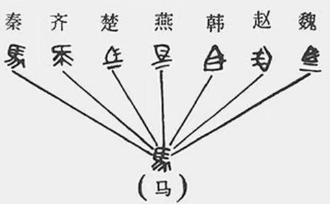

A. 字书写更复杂，表明增加服务环节是公共服务标准化的必经阶段

B. 字更易辨认，说明公共服务标准化要充分体现便利性这一根本导向

C. 字更加美观，表明公共服务标准化的最终目标是实现形式统一

D. 字以秦国文字为基础，说明公共服务标准化以规范服务内容为核心

第 14 题 · 答案与解析

**参考答案（粉笔题库参考内容）**

D

**解析**

本题考查管理常识。

A项错误，从图片上看，“马”字的书写的确更为复杂。但“增加服务环节是公共服务标准化的必经阶段”说法过于绝对，公共服务标准化制定的服务流程和服务标准，需要确保公共服务的质量和效率，增加服务环节并不必然会导致这一结果，甚至可能会降低公共服务的质量和效率。

B项错误，从图片上看，“马”的确更容易辨认，具有象形的特征。但公共服务标准化的根本导向应该是人民的需求，即公民导向，“以人为本”是构建我国公共服务体系的指导原则，而非便利性。

C项错误，公共服务的最终目标是满足公民基本公共需求，而非形成形式上的统一，后者过于片面。且形式上的统一与题干提到的例子也不相符，秦国统一文字是为了解决文字书写不一致给国家治理带来的困难，具有实质意义，而非仅是形式上的统一。

D项正确，从图片看，秦国统一后的“马”字与原秦国字示例的相似度很高，仅做了细微的调整。题干中也提到，秦国规定“书同文”，在秦国文字的基础上整理规范通行文字，解决了文字书写不一致给国家治理造成的困难，体现了规范性的意义。与选项中的“规范服务内容”相对应，说明公共服务标准化需要对服务内容进行规范，进而制定统一的标准。

故正确答案为D

**来源**：2023年江苏省公务员录用考试《行测》题（A类）（网友回忆版）第14题

### 第 15 题

下图所示为某地水患河段。专家调研发现可进行河道疏浚的有甲、乙、丙、丁四个点水位，最终选择点位丙进行疏浚。这一选择体现的管理思维是（ ）。

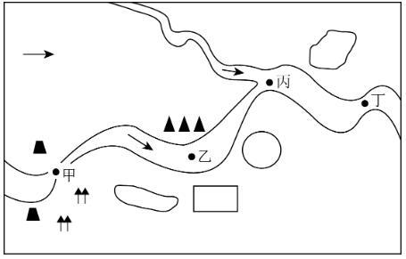

A. 系统思维

B. 权变思维

C. 底线思维

D. 创新思维

第 15 题 · 答案与解析

**参考答案（粉笔题库参考内容）**

A

**解析**

本题考查管理常识。

A项正确，系统思维就是人们运用系统观点，把对象的互相联系的各个方面及其结构和功能进行系统认识的一种思维方法。整体性原则是系统思维方式的核心。这一原则要求人们无论干什么事都要立足整体，从整体与部分、整体与环境的相互作用过程来认识和把握整体。题干中专家选择位于河流交叉口的丙处进行疏浚，即体现了把水患治理看作一个整体，注意各河段的联系和相互影响，抓关键部分的系统思维。

B项错误，权变思维是指企业管理者根据企业生产经营面临的不同情况，审时度势，权衡得失，随机应变的思维方式。题干没有体现。

C项错误，底线思维是指客观地设定最低目标，立足最低点，争取最大期望值的思维方法。题干没有体现。

D项错误，创新思维是指以新颖独创的方法解决问题的思维过程，通过这种思维能突破常规思维的界限，以超常规甚至反常规的方法、视角去思考问题，提出与众不同的解决方案，从而产生新颖的、独到的、有社会意义的思维成果。题干没有体现。

故正确答案为A。

**来源**：2023年江苏省公务员录用考试《行测》题（A类）（网友回忆版）第15题

### 第 16 题

中国是世界第二大经济体、世界第一制造业大国，拥有全球最完整且规模最大的工业体系、强大的生产能力、完善的配套能力。一方面，中国产业链供应链与全球生产网络高度融合，根据联合国贸易和发展会议发布的《全球贸易最新情况》报告，2021年，中国进出口总值居世界首位。另一方面，中国深度参与经济全球化，并形成巨大的经济规模效应、产业集群优势和物流网络体系，在几乎各类产业链中都扮演着重要角色。

这段文字意在强调：

A. 中国经济发展迅速体量规模稳居世界第一方阵

B. 中国在全球产业链供应链中发挥着压舱石作用

C. 中国产业链供应链已积极参与全球生产网络

D. 中国进出口贸易持续发展总值位居世界榜首

第 16 题 · 答案与解析

**参考答案（粉笔题库参考内容）**

B

**解析**

文段首先通过程度词强调中国在世界格局中的重要性，即引出话题，然后通过“一方面”指出中国产业链供应链与全球生产网络高度融合，并通过举例进行论证，接着通过“另一方面”指出中国深度参与经济全球化，在几乎各类产业链中都扮演着重要角色。故文段为并列结构，通过两个方面共同强调中国在全球产业链供应链中发挥着重要作用，对应B项。

A项，“体量规模”对应首句引入话题部分，非重点，排除；

C项“中国产业链供应链已积极参与全球生产网络”和D项“中国进出口贸易持续发展总值位居世界榜首”均对应“一方面”之后的内容，表述片面，排除。

故正确答案为B。

【文段出处】金台资讯《稳链补链强链赢得发展主动权 推进制造强国建设再上新台阶》

**考点**：关联词-并列

**来源**：2023年江苏省公务员录用考试《行测》题（A类）（网友回忆版）第16题

### 第 17 题

园林模糊了现实和再现之间的界限。现实是外部世界的自然，经由园林化改造，叠加了人文内容，在现实的材料元素上，创造了一个至高的、审美化的现实，从而实现了人类精神活动的空间再现。再现的过程就是对园林的不断创造和丰富，体现了人们心中对自然山水和理想家园的创造力，这是一个艺术化的过程。园林山水是实践活动中挪用和活用的自然，时常让它在主观判断里浮现，是人对这种空间实践的哲学和美学认知。

对这段文字的主旨，下列概括最恰当的是：

A. 园林反映了人类对精神家园的追求

B. 园林是自然山水的整体位移和再现

C. 园林体现了人类对哲学美学的认知

D. 园林是人对自然山水的艺术化表现

第 17 题 · 答案与解析

**参考答案（粉笔题库参考内容）**

C

**解析**

文段首先指出园林模糊了现实和再现之间的界限，随后具体解释什么是“现实”和“再现”，即“现实”是外部世界的自然，“再现”是对园林的不断创造和丰富，最后指出园林山水是人对空间实践的哲学和美学认知，故文段意在强调园林山水体现了人类对哲学和美学认知，对应C项。

A项，“人类对精神家园的追求”仅对应文中对“现实”进行解释说明的部分，表述片面，且非重点，排除；

B项，“整体位移和再现”文段未提及，无中生有，排除；

D项，“艺术化表现”仅对应文中对“再现”进行解释说明的部分，表述片面，且非重点，排除。

故正确答案为C。

【文段出处】澎湃新闻客户端《认知与再实践：苏州的园林社会与地理现实》

**考点**：分述句特征-引入铺垫

**来源**：2023年江苏省公务员录用考试《行测》题（A类）（网友回忆版）第17题

### 第 18 题

我国具有“多元一体”的语言文字体系。在此体系中，国家通用语言文字发挥基础和导向作用，其优先地位受到宪法和法律的保障；其他类型的语言文字起到辅助作用，仅处于从属地位，旨在为部分公民提供更为便捷的诉讼、仲裁和文化等公共服务，但其适用范围却受到限制。因而，“全国通用”不仅是个描述性概念，也具有规范性效力，即国家要采取各种措施保障国家通用语言文字在全国范围内（包括民族自治地方和少数民族聚居地方）通行适用。

这段文字重在说明：

A. 国家通用语言文字的应用范围

B. 国家通用语言文字的法律地位

C. 国家通用语言文字的学术概念

D. 国家通用语言文字的适用保障

第 18 题 · 答案与解析

**参考答案（粉笔题库参考内容）**

D

**解析**

文段开篇先引出我国具有“多元一体”的语言文字体系的话题，紧接着分别阐述了该体系中国家通用语言文字和其他类型语言文字的作用及受保障情况，尾句通过“因而”总结前文，得出结论，强调国家要采取措施以保障国家通用语言文字在全国范围内通行适用。故文段重在说明要采取措施保障国家通用语言文字的全国适用性，对应D项。

A、C两项，“应用范围”“学术概念”文段均未提及，无中生有，排除；

B项，“法律地位”对应结论之前的内容，非重点，排除。

故正确答案为D。

【文段出处】《国家通用语言文字制度的宪法逻辑——以铸牢中华民族共同体意识为视角》

**考点**：关联词-因果

**来源**：2023年江苏省公务员录用考试《行测》题（A类）（网友回忆版）第18题

### 第 19 题

在自然界中，形式对称性的生成，源自受到作用力的大小和方向始终一致。例如在二维情况下的雪花、花朵或水池中的波纹，三维空间中的球形。然此自然之大美却并非以美为美，而是一种实在的效用。正如牛顿所说，绝不浪费一丝一毫。这其中最典型的例子就是蜂巢的六边形网络，它是在把平面划分为很多面积相等的部分时，边界网所具有的总长度是最短的图形。

下列说法从文中无法推出的是：

A. 自然界众多形态其实具有经济性

B. 自然之美往往有现实的效用

C. 自然界从不追求华而不实的美感

D. 自然界对称性生成并非偶然

第 19 题 · 答案与解析

**参考答案（粉笔题库参考内容）**

C

**解析**

A项，“经济性”主要关注的是资源投入和使用过程中成本节约的水平和程度及资源使用的合理性。根据“正如牛顿所说，绝不浪费一丝一毫······边界网所具有的总长度是最短的图形”可知，“自然界众多形态具有经济性”可以推出，排除；

B项，根据“自然之大美却并非以美为美，而是一种实在的效用”可知，“自然之美往往有现实的效用”可以推出，排除；

C项，“自然界从不追求华而不实的美感”表述过于绝对，无法从原文推出，当选；

D项，根据“在自然界中，形式对称性的生成，源自受到作用力的大小和方向始终一致”可知，“自然界对称性生成并非偶然”可以推出，排除。

本题为选非题，故正确答案为C。

【文段出处】《对称性破缺与涌现——复杂科学与艺术之间的共鸣》

**考点**：细节判断题

**来源**：2023年江苏省公务员录用考试《行测》题（A类）（网友回忆版）第19题

### 第 20 题

古籍整理出版要避免低水平重复，同时要加强对基础古籍的深度整理出版。出版的目的是传播，一种文献该不该整理，要不要出版，首先得看它有没有传播价值，有些可能只有文物价值，对它们主要是做好防护。有些有文献价值，但关注的人极少，对这类文献可以考虑只做数字化处理。对于有传播价值的古代文献，也要根据其内容来判定出版方式，需求量小的可以影印，需求量大的就应该整理出版。支持资金要向深度整理的项目倾斜，推动古籍整理高质量发展。

这段文字意在说明：

A. 古籍整理出版首先要评估其传播价值

B. 数字化技术可以应用于古籍整理保护

C. 基础古籍整理出版资助需要精准实施

D. 古籍整理出版要有针对性地分类进行

第 20 题 · 答案与解析

**参考答案（粉笔题库参考内容）**

D

**解析**

文段开篇引出古籍整理出版的话题，紧接着指出文献是否要整理出版，首先要看其是否具有传播价值，接下来分别从没有传播价值只有文物价值、有文献价值但关注度低、有传播价值但需求量小、有传播价值且需求量大几个不同的角度论述应如何区别对待古籍的整理出版，故文段重在强调要有针对性地对不同类型的古籍进行整理出版，对应D项。

A、B两项，“要评估其传播价值”“数字化技术”分别对应古籍整理出版的一方面内容，表述片面，排除；

C项，“基础古籍”仅对应“需求量大”“深度整理出版”的古籍，表述片面，排除。

故正确答案为D。

【文段出处】光明网《汲古润今 传承创新》

**考点**：关联词-并列

**来源**：2023年江苏省公务员录用考试《行测》题（A类）（网友回忆版）第20题

### 第 21 题

取消农业税后，国家开始向农村转移大量资源用于建设农村公共品，农民从农村公共品供给的主要提供者成为受益人。最近十多年某市借助城乡统筹试验区建设，以村庄为单位，由财政提供村庄公共服务资金，鼓励农民通过村民议事会分配资源，建设村庄公共品，形成具有地方特色的分配型民主。该市的试验为中国农村基层治理提供了有益的启示，具体来说，国家可以将部分惠农资源按人均转移到村庄，作为村庄可以自由使用的公共服务资金，再经由村民自治的民主程序进行资源分配。

这段文字中提取的关键词最恰当的是：

A. 农村公共品 资源分配 分配型民主

B. 农村公共品 资源下乡 基层治理

C. 农村公共品 公共服务 分配型民主

D. 农村公共品 惠农经济 民主程序

第 21 题 · 答案与解析

**参考答案（粉笔题库参考内容）**

A

**解析**

文段开篇交代背景，即国家开始向农村转移大量资源用于建设农村公共品，随后介绍某市关于资源分配的优秀经验，形成具有地方特色的分配型民主。尾句强调通过某市的先进经验获得启示，即国家建设农村公共品时，可以通过民主程序进行资源分配，故文段关键词为农村公共品、资源分配、分配型民主，对应A项。

B项，缺少文段主题词“分配型民主”，排除；

C项，“公共服务”非重点，文段重点强调“资源分配”的方式，排除；

D项，缺少文段主题词“资源分配”，排除。

故正确答案为A。

【文段出处】开放时代《农村公共品性质与分配型动员》

**考点**：主题词

**来源**：2023年江苏省公务员录用考试《行测》题（A类）（网友回忆版）第21题

### 第 22 题

近年来，中国科技创新快速发展，面临的科技伦理挑战也日益增多。由于我国科技伦理问题治理工作起步较晚，体制机制还不健全，制度体系尚不完善，领域发展仍不均衡，无法适应我国科技创新快速发展的需要。特别是目前，中国一些领域的科技发展已经走在了国际前沿，部分科技工作已经到了“无人区”探索发展的阶段，存在很多未知领域。

这段文字接下来最有可能讨论的是：

A. 如何进一步认识科技伦理问题治理的重要意义

B. 如何步出“无人区”，引领国际科技发展

C. 如何更好地引导科技向善，规范科技创新行为

D. 如何群策群力，深度回应科技发展的现实需求

第 22 题 · 答案与解析

**参考答案（粉笔题库参考内容）**

C

**解析**

根据提问方式可知，本题为接语选择题。应当在通读全文的基础上，重点关注文段最后谈论的核心话题。文段开篇指出我国科技创新快速发展的同时，带来诸多科技伦理问题，紧接着展开介绍了我国科技伦理治理工作方面存在的问题，尾句指出我国科技发展还存在很多未知领域，结合前文可知其想要表达科技未知领域中的科技伦理更为一片空白。故接下来应该对文段中提出的问题给出相应对策，即围绕如何规范科技创新中的科技伦理问题展开讨论，C项虽未明确提及“科技伦理”，但根据内容可知“引导科技向善”中的“向善”、“规范科技创新行为”中的“规范”，均为伦理层面的表述，也是针对科技创新中科技伦理问题给出的对策，与前文衔接恰当，当选。

A项，接下来如果阐述“如何进一步认识······意义”，那么文段本身应该已经在围绕“认识······的意义”进行阐述，但显然文段重在阐述我国科技创新发展的同时应注意科技伦理问题，而非意义，与前文衔接不当，排除；

B项“引领国际科技发展”及D项“回应科技发展的现实需求”均与文段核心话题“科技伦理”不一致，与前文衔接不当，排除。

故正确答案为C。

【文段出处】《守好伦理底线 科技向善而行（科技自立自强）》

**考点**：接语选择题

**来源**：2023年江苏省公务员录用考试《行测》题（A类）（网友回忆版）第22题

### 第 23 题

法律或司法裁判的确应具备可预测性，但可预测性指的只是司法裁判应建立在事先已经被公布的一般法律规则的基础之上。它不是指法院或法官作出的判决实际上被某个公民或社会公众所预测到，无论是被他们自己偶然地预测到，还是借助于人工智能或算法系统被有规律地预测到。因此，基于技术对司法裁判的预测不等同于司法裁判的可预测性，前者涉及事实上的预测能力，而后者涉及法律上的可预测性。

根据这段文字，下列说法不正确的是：

A. 法院法官作出的司法裁判是不可被预测的

B. 基于人工智能预测的司法裁判不一定可靠

C. 司法裁判的可预测性建立在法律规则之上

D. 基于技术对裁判的预测不能等同法院裁判

第 23 题 · 答案与解析

**参考答案（粉笔题库参考内容）**

A

**解析**

A项，根据“法律或司法裁判的确应具备可预测性，但可预测性指的只是司法裁判应建立在事先已经被公布的一般法律规则的基础之上”可知，司法裁判是可被预测的，表述错误，当选；

B项，根据“它不是指法院或法官作出的判决实际上被某个公民或社会公众所预测到，无论是被他们自己偶然地预测到，还是借助于人工智能或算法系统被有规律地预测到”可知，表述正确，排除；

C项，根据“可预测性指的只是司法裁判应建立在事先已经被公布的一般法律规则的基础之上”可知，表述正确，排除；

D项，根据“基于技术对司法裁判的预测不等同于司法裁判的可预测性，前者涉及事实上的预测能力，而后者涉及法律上的可预测性”可知，表述正确，排除。

本题为选非题，故正确答案为A。

【文段出处】《司法人工智能能否实现司法公正？》

**考点**：细节判断题

**来源**：2023年江苏省公务员录用考试《行测》题（A类）（网友回忆版）第23题

### 第 24 题

生物多样性通常指物种多样性、遗传多样性和生态系统多样性。大自然与生物多样性相辅相成，不同地区的人类耕作、饮食、艺术等文化传统的多样性，也深受生物多样性影响。在工业化高度发达的今天，农村生态系统、城市生态系统等是大自然与人类社会交融的产物。生物多样性就像一个看不见的稳定器，有助于降低洪水、病虫害、山火等自然灾害带来的损失并提高复原的能力。

下列说法与文意不符的是：

A. 生物多样性决定了人类城乡生活的所有方面

B. 遭受自然灾害后复原过程需借助生物多样性

C. 人类文化的多样性反映出生物多样性

D. 生物多样性造就了大自然的丰富多彩

第 24 题 · 答案与解析

**参考答案（粉笔题库参考内容）**

A

**解析**

A项，根据文段“不同地区的人类耕作······是大自然与人类社会交融的产物”可知，文段只是论述深受生物多样性影响，且仅列举了生活的一些方面，故“决定”及“所有方面”表述过于绝对，与文意不符，当选；

B项，根据文段“生物多样性就像一个看不见······提高复原的能力”可知，表述正确，排除；

C项，根据文段“不同地区的人类耕作、饮食、艺术等文化传统的多样性，也深受生物多样性影响”可知，表述正确，排除；

D项，根据文段“生物多样性通常指物种多样性、遗传多样性和生态系统多样性”及“大自然与生物多样性相辅相成”可知，生物多样性与大自然的丰富多彩息息相关，表述正确，排除。

本题为选非题，故正确答案为A。

【文段出处】《恢复生物多样性，实现“自然向好”（科技大观）》

**考点**：细节判断题

**来源**：2023年江苏省公务员录用考试《行测》题（A类）（网友回忆版）第24题

### 第 25 题

科技成果转化是一个复杂的系统工程，面临着从实验室到产业化、从想法到市场的挑战。科技成果只有同国家需要、人民要求、市场需求相适应，完成从科学研究到实验开发再到推广应用的三级跳，才能真正转化为现实生产力、实现创新驱动发展。多年来，一些部门和领域存在着科技成果向现实生产力转化不力、不顺、不畅的痼疾，科研成果封闭自我循环的问题比较严重，创新和转化的各个环节衔接不够紧密。

作者认为加快科技成果向现实生产力转化，关键在于：

A. 充分考虑转化过程的复杂性

B. 破除科研成果自我循环障碍

C. 推动各部门各领域的协同配合

D. 注重实验开发与市场需求对接

第 25 题 · 答案与解析

**参考答案（粉笔题库参考内容）**

B

**解析**

由提问方式可知，需通过文段寻找“加快科技成果向现实生产力转化”的对策，即如何加快转化。文段首先指出科技成果转化面临的挑战，紧接着指出科技成果只有完成“三级跳”才能真正转化为现实生产力，最后介绍了一些部门和领域科技成果向现实生产力转化时遇到的问题，即科研成果封闭自我循环，创新和转化的各个环节衔接不够紧密。故需通过解决当前科技成果转化时遇到的问题，疏通阻碍，使其转化得以提速，即正确选项应该解决文段最后阐述的问题，破除封闭自我循环的阻碍，让各环节衔接更加紧密，对应B项。

A项，“转化过程的复杂性”为背景介绍，非重点，排除；

C项，“各部门各领域”表述过于宽泛，且文段还强调“科技成果必须同国家需要、人民要求、市场需求相适应”，“各部门各领域”之间的协同配合，无法包含“适应需求”这个重要方面，排除；

D项，“市场需求”表述片面，文段还表述了“国家需要”“人民要求”等方面的内容，排除。

故正确答案为B。

【文段出处】《加快科技成果向现实生产力转化》

**考点**：关联词-对策

**来源**：2023年江苏省公务员录用考试《行测》题（A类）（网友回忆版）第25题

### 第 26 题

人们常用一天中的最高气温与最低气温的差值代表昼夜温差。根据近10年的气象资料分析，霜降节气全国各地的昼夜温差均值为11.6摄氏度，与秋分、寒露节气的昼夜温差相近。人们之所以感觉霜降节气昼夜温差大，是因为在霜降来临前，我们经历了漫长的暑热，而随着霜降节气的来临，冷空气活动开始频繁，白天光照较强烈，夜间降温明显，放大了昼夜温差。

下列说法与文意相符的是：

A. 暑热的持续加大了霜降节气的昼夜温差

B. 全国各地霜降昼夜温差不超过12摄氏度

C. 霜降节气之前全国几乎没有冷空气的活动

D. 霜降的昼夜温差并不是所有节气中最大的

第 26 题 · 答案与解析

**参考答案（粉笔题库参考内容）**

D

**解析**

A项，根据文段“人们之所以感觉霜降节气昼夜温差大，······放大了昼夜温差”可知，暑热的持续只是让人们感觉霜降节气昼夜温差大，并非真的加大了霜降节气的昼夜温差，表述错误，排除；

B项，根据文段“霜降节气全国各地的昼夜温差均值为11.6摄氏度”可知，文段论述的是全国各地的均值，而非全国各地霜降昼夜温差不超过12摄氏度，表述错误，排除；

C项，根据文段“而随着霜降节气的来临，冷空气活动开始频繁”可知，文段论述霜降节气以后，冷空气活动开始频繁，无法得知霜降节气之前全国是否有冷空气的活动，表述错误，排除；

D项，根据文段“霜降节气全国各地的昼夜温差均值为11.6摄氏度，与秋分、寒露节气的昼夜温差相近”可知，“并不是所有节气中最大的”表述正确，当选。

故正确答案为D。

【文段出处】《“霜降”的“霜”从何而来？》

**考点**：细节判断题

**来源**：2023年江苏省公务员录用考试《行测》题（A类）（网友回忆版）第26题

### 第 27 题

人工智能应该以与人类智能相同的方式工作，在逻辑上是没有道理的，这也是用形容词“人工”的一个原因。然而，这些由电子电路体现的数学结构，和神经科学家开发的大脑认知模型有一些相似之处。因此，在人工智能和认知科学之间出现了一个创造性的反馈回路，它们彼此借鉴对方的思路。有时候在某种程度上，我们的大脑和人造大脑似乎是利用相似的结构原理来工作的。然而，从构成的材料和信号处理过程的方式来看，它们的差别当然是非常大的。

下列说法与文意不符的是：

A. 人工智能和人类大脑认知模式有类似之处

B. 人工智能与人类大脑利用相近的原理工作

C. 人工智能借鉴了认知科学的有关研究成果

D. 人工智能信号处理方式与人脑有很大差别

第 27 题 · 答案与解析

**参考答案（粉笔题库参考内容）**

B

**解析**

A项，根据“这些由电子电路体现的数学结构，和神经科学家开发的大脑认知模型有一些相似之处”可知，表述正确，排除；

B项，根据“有时候在某种程度上······它们的差别当然是非常大的”可知，人脑和人造大脑从构成材料和信号处理过程的方式来看差别是非常大的，故该项表述与文意相悖，当选；

C项，根据“在人工智能和认知科学之间出现了一个创造性的反馈回路，它们彼此借鉴对方的思路”可知，表述正确，排除；

D项，根据“从构成的材料和信号处理过程的方式来看，它们的差别当然是非常大的”可知，表述正确，排除。

本题为选非题，故正确答案为B。

【文段出处】《躲不开信息操纵，是人类的大脑过时了吗？》

**考点**：细节判断题

**来源**：2023年江苏省公务员录用考试《行测》题（A类）（网友回忆版）第27题

### 第 28 题

诗歌原本就是语言的艺术与游戏，最擅长的便是以简洁的话语勾勒复杂的图景，是一种在有限的措辞中努力实现无穷意蕴的文体。诗歌的创作与最终的呈现同样对其句子表达的精炼、准确，以及其中所使用的符号、修辞做出要求，与数字游戏对文字文本的要求不谋而合。因而从某种程度上来说，数字游戏与诗歌原本就是相互适配的：数字游戏适合以诗歌为其文字表达，诗歌也适合以数字游戏作为载体。

通过这段文字作者主要想表达：

A. 数字游戏与诗歌之间有密不可分的关系

B. 诗歌写作其实可以说是一种语言的游戏

C. 数字游戏选用诗歌作文字文本是适宜的

D. 诗歌表达方式其实与数字游戏相反相成

第 28 题 · 答案与解析

**参考答案（粉笔题库参考内容）**

C

**解析**

文段开篇指出诗歌是语言的艺术与游戏，其特点是用简洁话语勾勒复杂图景，在有限措辞中实现无穷意蕴，接着说明诗歌的创作和呈现对句子表达、符号、修辞有要求，且与数字游戏对文字文本的要求不谋而合，尾句通过“因而”总结前文，强调数字游戏与诗歌的适配性，无论是“数字游戏适合以诗歌为其文字表达”还是“诗歌也适合以数字游戏作为载体”，都在强调诗歌适合作为数字游戏的文字载体，对应C项。

A项，文段数字游戏与诗歌的适配性，而非两者不可分割，故“密不可分”表述错误，排除；

B项，偏离文段核心话题“数字游戏”，排除；

D项，“相反相成”意思是相互对立又相互统一，文段强调的是两者的相互适配，“相反相成”文段并未提及，无中生有，排除。

故正确答案为C。

【文段出处】《游戏论·表象的媒介丨诗歌与游戏：数字游戏中的一种文学可能》

**考点**：关联词-因果

**来源**：2023年江苏省公务员录用考试《行测》题（A类）（网友回忆版）第28题

### 第 29 题

科学家们成天经历的就是无知、疑惑、不确定，这种经历是极其重要的。当科学家不知道答案时，他是无知的；当他心中大概有了猜测时，他是不确定的；即便他满有把握时，他也会永远留下质疑的余地。承认自己的无知，留下质疑的余地，这两者对于任何发展都必不可少。科学知识本身是一个具有不同层次可信度的集合体：有的根本不确定，有的比较确定，但没有什么是完全确定的。

通过这段文字作者主要强调：

A. 科学就是在不断质疑的过程中发展的

B. 科学知识本身常常是充满不确定性的

C. 科学家并非永远对自己的工作有自信

D. 承认自己无知并不影响科学家的声誉

第 29 题 · 答案与解析

**参考答案（粉笔题库参考内容）**

A

**解析**

文段开篇介绍科学家们无知、疑惑、不确定的经历极其重要，接着通过并列的三方面具体说明这种经历，然后提出观点，承认无知和留下质疑的余地对于任何发展都必不可少，尾句介绍科学知识本身充满不确定性来论证前文观点。故文段为分总分结构，强调质疑对于科学发展的重要性，对应A项。

B项，“科学知识”对应尾句解释说明部分内容，非重点，排除；

C项，“并非永远对自己的工作有自信”即对工作存在无知、疑惑、不确定，对应首句引出话题部分内容，非重点，排除；

D项，“科学家的声誉”文段并未提及，无中生有，且缺少主题词“质疑”，排除。

故正确答案为A。

【文段出处】理查德·费曼《你干吗在乎别人怎么想？》

**考点**：分述句特征-其他、主题词、分述句特征-引入铺垫

**来源**：2023年江苏省公务员录用考试《行测》题（A类）（网友回忆版）第29题

### 第 30 题

①而纪录片恰恰可以充当人们走近非遗的“桥梁”

②以期给观众带来人文精神和审美体验的双重享受

③非物质文化遗产古老而传统，有些还有着较高的门槛，大众要深入了解并不容易

④最初，田野考察中拍摄影像的目的，主要是做好非遗的记录和留存工作，侧重真实性、准确性

⑤也因此被寄予了更多传播、普及非遗的期待

⑥而面向大众的影视纪录作品，在真实记录非遗技艺的同时，还努力追求镜头美、语言美、叙事美

将以上6个句子重新排列，语序正确的是：

A. ④⑤③⑥②①

B. ③⑤⑥④①②

C. ③①④⑥②⑤

D. ④③⑤⑥②①

第 30 题 · 答案与解析

**参考答案（粉笔题库参考内容）**

C

**解析**

对比选项，确定首句。③句指出非物质文化遗产门槛较高的问题，④句指出田野考察中拍摄影像的目的，均可以作首句，不易判断。

继续观察，⑤句出现并列关联词“也”，指出被寄予了更多期待，体现出一种期望，应该与前文句子表意相同，呈现并列关系，对比选项中的④⑤、③⑤、②⑤以确定捆绑，④句指出田野考察中拍摄影像的目的，③句指出非物质文化遗产门槛较高的问题，强调大众不易深入了解，均与期望无关，②句指出“以期”给观众带来双重享受，可与⑤句更多“期待”形成并列捆绑，锁定C项，排除A、B、D三项。

验证C项，③句指出非物质文化遗产门槛较高的问题，随即①句指出纪录片可帮助人们走近非遗，④⑥两句指出拍摄影像最初是为了做好非遗的记录和留存工作，现在也开始追求美，②⑤两句指出出现这样的变化是为了给观众带来双重享受，因此被寄予更多期待，语义完整流畅，逻辑恰当，验证无误。

故正确答案为C。

【文段出处】人民日报《在光影中感受非遗魅力》

**考点**：确定捆绑

**来源**：2023年江苏省公务员录用考试《行测》题（A类）（网友回忆版）第30题

### 第 31 题

当今世界，综合国力的竞争            是人才的竞争、劳动者素质的竞争。这些年来，中国制造、中国创造、中国建造共同        ，不断改变着中国的面貌。

依次填入画横线处最恰当的一项是：

A. 追本溯源 奋斗

B. 毋容置疑 努力

C. 归根到底 发力

D. 不言而喻 奋战

第 31 题 · 答案与解析

**参考答案（粉笔题库参考内容）**

C

**解析**

第一空，所填成语搭配“综合国力的竞争”和“人才的竞争、劳动者素质的竞争”，B项“毋容置疑”意为事实明显或理由充分，根本就没有怀疑的余地；C项“归根到底”意为归结到根本上，填入文段均符合文意，保留。A项“追本溯源”意为追究、查找事情的根源，文段未提及“查找事情的源头”这一语义，且“追本溯源”使用时，往往后面不接内容，排除；D项“不言而喻”意为不用说就能明白，用法一般为“······不言而喻”，往往后面不接内容，排除。

第二空，依据“中国制造、中国创造、中国建造······不断改变着中国的面貌”可知，文段强调将多方面的力量发挥出来从而让国家发展更好，C项“发力”指把聚集的力量集中使出来，跟前面多个主体形成对应，且“共同发力”为常见固定搭配，当选。B项“努力”指把力量尽量使出来，不如C项“发力”跟文段对应更准确，排除。

故正确答案为C。

【文段出处】《大力弘扬劳模精神、劳动精神、工匠精神》

**考点**：词的辨析-搭配对象、对应关系-前后呼应、混搭填空

**来源**：2023年江苏省公务员录用考试《行测》题（A类）（网友回忆版）第31题

### 第 32 题

不同时代的审美需求指向不同维度，在繁杂且快节奏的信息传递时代，设计需要概括、        且有视觉冲击力。像素风格的文字虽        了繁杂的设计，但相较于普通的文字字体显得别具一格，因此能够快速抓住受众眼球。

依次填入画横线处最恰当的一项是：

A. 直接 扬弃

B. 具体 舍弃

C. 直观 摒弃

D. 具象 放弃

第 32 题 · 答案与解析

**参考答案（粉笔题库参考内容）**

C

**解析**

第一空，搭配“设计”，且与“概括”“有视觉冲击力”构成并列关系，共同描述“设计”的特点。A项“直接”指不经过中间事物发生关系的，C项“直观”指用感观直接接受的或直接观察的，均可体现设计直接明了的特点，符合文意，保留。B项“具体”指细节方面很明确的，不抽象的，不笼统的，D项“具象”指具体的，不抽象的，均侧重具体，与“概括”无法构成并列关系，排除。

第二空，搭配“繁杂的设计”，且根据横线后“能够快速抓住受众眼球”可知，横线处体现像素风格的文字舍弃了复杂的设计之意，C项“摒弃”指舍弃，符合文意，当选。A项“扬弃”指发扬旧事物中的积极因素，抛弃旧事物中的消极因素，与“繁杂的设计”搭配不当，排除。

故正确答案为C。

【文段出处】《游戏论·表象的媒介丨诗歌与游戏：数字游戏中的一种文学可能》

**考点**：词的辨析-搭配对象、实词填空、对应关系-前后呼应、关联关系-因果关系、关联关系-并列关系

**来源**：2023年江苏省公务员录用考试《行测》题（A类）（网友回忆版）第32题

### 第 33 题

近几年，主打中华传统文化元素的动画电影            ，与之对应的产业链也日渐生成，创作与产业互相        ，呈现生机勃勃的气象。

依次填入画横线处最恰当的一项是：

A. 脱颖而出 砥砺

B. 蜂拥而出 激励

C. 层见叠出 呼应

D. 呼之欲出 推动

第 33 题 · 答案与解析

**参考答案（粉笔题库参考内容）**

A

**解析**

第一空，根据后文“也日渐生成”可知，横线处所填成语与“日渐生成”形成并列，且又根据后文“呈现生机勃勃的气象”可知，横线处所填成语不仅要表达出现的意思，也要能体现出具有中华传统文化元素的动画电影好的意思。A项“脱颖而出”比喻本领全部显露出来，符合文意，保留。B项“蜂拥而出”指像一窝蜂似地一拥而来，形容很多人乱哄哄地朝一个地方聚拢，感情色彩与文段不符，排除；C项“层见叠出”指一次又一次地出现，无法与“日渐生成”形成并列，排除；D项“呼之欲出”形容画像非常逼真，也形容文学作品中人物描写十分生动，与文意无关，排除。

第二空，代入验证，根据“与之对应的产业链也日渐生成”以及“呈现生机勃勃的气象”可知，横线处所填词语应体现出“创作与产业”可以相互配合，变得更好之意，A项“砥砺”指磨炼，勉励，符合文意，当选。

故正确答案为A。

【文段出处】《动画电影彰显中国韵味》

**考点**：词的辨析-感情色彩、对应关系-前后呼应、混搭填空、关联关系-并列关系

**来源**：2023年江苏省公务员录用考试《行测》题（A类）（网友回忆版）第33题

### 第 34 题

在服务上细致入微，在产品设计上            ，是商家为留住客源、促进消费做出的努力。往更深层次看，这些用心之处都为消费者带来了良好的情绪        ，提升了产品和服务的价值。

依次填入画横线处最恰当的一项是：

A. 匠心独运 感受

B. 别出心裁 体验

C. 自出机杼 效应

D. 标新立异 反映

第 34 题 · 答案与解析

**参考答案（粉笔题库参考内容）**

B

**解析**

第一空，形容“产品设计”，根据文意可知，横线处所填成语应体现商家在产品设计上花费了很多心思，A项“匠心独运”形容独特精巧的艺术构思，B项“别出心裁”指独出巧思，不同流俗，C项“自出机杼”比喻写文章、古诗的构思和布局别出心裁、独创新意，D项“标新立异”原意为表明自己新颖的义理，提出与众不同的见解，后来也指故意提出新奇的见解，表示自己与众不同，均符合文意，保留。

第二空，横线前出现指代词“这些”，指代前文“服务”和“产品设计”，故横线处所填词语应与“服务”和“产品设计”构成对应，体现其对消费者的影响，B项“体验”指在实践中认识事物、亲身经历，符合文意，当选。A项“感受”指受到（影响）或接受，并非侧重亲身经历，无法与指代内容形成对应，排除；C项“效应”指由某种动因或原因所产生的一种特定的科学现象，D项“反映”比喻表现出客观事物的本质，均与文意不符，排除。

故正确答案为B。

【文段出处】《以情绪共鸣促进买卖双赢》

**考点**：词的辨析-搭配对象、对应关系-前后呼应、混搭填空

**来源**：2023年江苏省公务员录用考试《行测》题（A类）（网友回忆版）第34题

### 第 35 题

法治与法制是既有区别又有联系的两个概念。法制是法律制度的简称，属于制度的        ；法治是法律统治的简称，是一种治国原则和方法，是相对于“人治”而言的。二者的联系在于：法制是法治的基础和前提条件，要实行法治，必须具有        的法制；法治是法制的立足点和归宿，法制的发展前途必然是最终        法治。

依次填入画横线处最恰当的一项是：

A. 层面 完善 体现

B. 范畴 完备 实现

C. 范围 完整 抵达

D. 领域 完全 达至

第 35 题 · 答案与解析

**参考答案（粉笔题库参考内容）**

B

**解析**

第一空，搭配“制度”，A项“层面”指范围、方面，B项“范畴”指类型、范围，C项“范围”指界限、限制，D项“领域”指一个国家行使主权的区域、学术思想或社会活动的范围，均搭配恰当，保留。

第二空，搭配“法制”，A项“完善”指完备良好，B项“完备”指健全、齐全，均搭配恰当，保留。C项“完整”指具有或保持着应有的各部分、没有损坏或残缺，侧重不缺少，常搭配主权、领土等，D项“完全”指全部，均与“法制”搭配不当，排除。

第三空，根据“法制是法治的基础和前提条件······的法制”可知，法制的发展前途应是实行法治。B项“实现”指使成为现实，符合文意，当选。A项“体现”指某种性质或现象通过某一事物具体表现出来，侧重于表现显出，而非实行，排除。

故正确答案为B。

【文段出处】《“四个全面”擘宏图（习近平新时代中国特色社会主义思想学习问答（19））》

**考点**：词的辨析-搭配对象、实词填空、对应关系-前后呼应

**来源**：2023年江苏省公务员录用考试《行测》题（A类）（网友回忆版）第35题

### 第 36 题

时至今日，人工智能已经在音乐、绘画、棋艺等方面取得了            的进步，之所以在文学创作领域比较        ，也从另一方面        了文学是人类最高智慧的结晶之一。人类读者对有意义的书面语中大量的句法和语义有更强的感知能力。

依次填入画横线处最恰当的一项是：

A. 叹为观止 滞缓 证实

B. 令人惊叹 滞后 验证

C. 令人瞩目 落伍 明确

D. 有目共睹 迟缓 证明

第 36 题 · 答案与解析

**参考答案（粉笔题库参考内容）**

B

**解析**

第一空，根据文意可知，横线处应体现人工智能取得的进步非常大，B项“令人惊叹”意为令人感到惊讶感叹，C项“令人瞩目”意为使人注视，均符合文意，保留。A项“叹为观止”常用用法为“令人叹为观止”或“使人叹为观止”，D项“有目共睹”常用用法为“······有目共睹”，后不接宾语，置于此处均用法错误，排除。

第二空，根据“人类读者对有意义的书面语中大量的句法和语义有更强的感知能力”可知，横线处应体现人工智能在文学创作领域取得的成就不如人类，B项“滞后”意为事物落在形势发展的后面，符合文意，保留。C项“落伍”侧重落在队伍、集体或时代之后，与文意不符，排除。

第三空，代入验证，横线处应体现从人工智能在文学上的滞后可以看出，文学是人类最高智慧的结晶之一，B项“验证”意为经过检验得到证实，符合文意，当选。

故正确答案为B。

【文段出处】《算法时代的情感与文学——由AI诗歌的AI分析谈起》

**考点**：词的辨析-搭配对象、对应关系-前后呼应、混搭填空

**来源**：2023年江苏省公务员录用考试《行测》题（A类）（网友回忆版）第36题

### 第 37 题

植物科学画和摄影是完全不同的门类。我们有时候称赞照片，说它美得像幅画，但其实绘画和摄影在艺术上            。哪怕再好的画师，也无法像摄影那样全面        那一瞬间的景象；而有时候，摄影又无法像植物科学画那样表达出一棵绿绒蒿盛开时那种对生命和繁衍的渴望。摄影当然可以呈现某一物种的全貌，但是乍一看，特征不会那么明显，植物科学画则可以着重呈现物种特征，更加            。

依次填入画横线处最恰当的一项是：

A. 相辅相成 捕获 纤毫毕现

B. 各擅胜场 凝固 栩栩如生

C. 大相径庭 定格 有的放矢

D. 各有千秋 还原 一目了然

第 37 题 · 答案与解析

**参考答案（粉笔题库参考内容）**

D

**解析**

第一空，“但”表示转折，横线处应与“我们有时候称赞照片，说它美得像幅画”语义相反，且根据“植物科学画和摄影是完全不同的门类”可知，横线处应体现出绘画和摄影在艺术上是不一样的、各自有各自擅长之处的意思，B项“各擅胜场”指各自擅长一行绝技，C项“大相径庭”指彼此相差很远或矛盾很大，D项“各有千秋”指各有各的存在的价值，各有所长，均符合文意，保留。A项“相辅相成”指两件事物互相配合，互相辅助，缺一不可，与文意无关，排除。

第二空，搭配“景象”，且对应“摄影”，故横线处应体现出“摄影”的特点，C项“定格”指确定在某种状态、格式、标准上，D项“还原”指事物恢复原状，均能体现出“摄影”的特点，且与“景象”搭配恰当，保留。B项“凝固”指由液体变成固体、固定不变，与文意无关，排除。

第三空，根据“摄影当然可以呈现某一物种的全貌，但是乍一看，特征不会那么明显”与“植物科学画则可以着重呈现物种特征”可知，横线处应体现出植物科学画能将物种特征明显的显示出来之意，D项“一目了然”指一眼就能看清楚，符合文意，当选。C项“有的放矢”比喻说话做事有针对性，文段强调的是明显，而非有针对性，与文意不符，排除。

故正确答案为D。

【文段出处】《植物科学画是种什么画？》

**考点**：词的辨析-搭配对象、对应关系-前后呼应、混搭填空、关联关系-转折关系

**来源**：2023年江苏省公务员录用考试《行测》题（A类）（网友回忆版）第37题

### 第 38 题

新一轮科技和产业革命风起云涌，席卷全球。各大科技强国的中心城市            ，力图摘取全球“科创策源地”这一        ，这是一个能够激起世界级城市管理者内心澎湃的宏伟目标。作为策源地，不仅意味着科学上的领先，还意味着最先进的高科技产业和最具创新能力的企业家的集聚，能够在城市中水乳交融，            ，向外源源不断地释放出能量。

依次填入画横线处最恰当的一项是：

A. 争先恐后 盛誉 交相辉映

B. 各显神通 美称 互通有无

C. 各尽所能 桂冠 相得益彰

D. 尽心尽力 殊荣 取长补短

第 38 题 · 答案与解析

**参考答案（粉笔题库参考内容）**

C

**解析**

本题可从第三空入手，横线处成语与“水乳交融”并列，且根据“意味着最先进的高科技产业和最具创新能力的企业家的集聚”及“向外源源不断地释放出能量”可知，横线处成语体现最先进的高科技产业和最具创新能力的企业家集聚，带来好的结果之意。C项“相得益彰”指相互帮助，相互补充，更能显出各自的好处，符合文意，保留。A项“交相辉映”指（各种光亮、色彩等）相互映照，无法修饰“高科技产业”和“企业家”，排除；B项“互通有无”指拿出自己多余的东西给对方，与之进行交换，以得到自己所缺少的东西，与文意不符，排除；D项“取长补短”指吸取别人的长处，来弥补自己的不足之处，文段只论述产业和企业家优秀的一面，并未指出其短处，与文意不符，排除。

第一空，代入验证。根据文意可知，横线处成语体现各大科技强国的中心城市努力摘取全球“科创策源地”的称号。C项“各尽所能”指各人把自身的能力毫无保留地施展或贡献出来，指每个人都尽了自己全力，可体现各大科技强国的中心城市努力摘取之意，保留。

第二空，代入验证。根据“这是一个能够激起世界级城市管理者内心澎湃的宏伟目标”可知，横线处词语体现全球“科创策源地”是一项荣誉。C项“桂冠”指某种光荣称号，符合文意，当选。

故正确答案为C。

【文段出处】《赵付春：求解全球科创策源地》

**考点**：词的辨析-搭配对象、对应关系-前后呼应、混搭填空、关联关系-并列关系

**来源**：2023年江苏省公务员录用考试《行测》题（A类）（网友回忆版）第38题

### 第 39 题

当下发展迅速的社会生活带来了多种多样的语言新现象。词语是时代变迁的监测器。新事物            ，新现象日新月异，词库便随之不断            。从融媒体到神经网络、区块链、多重体验、数据信托，各类新词新语            。

依次填入画横线处最恰当的一项是：

A. 应接不暇 推陈出新 不可胜数

B. 屡见不鲜 弃旧图新 俯拾即是

C. 接踵而至 去芜存菁 恒河沙数

D. 层出不穷 吐故纳新 不胜枚举

第 39 题 · 答案与解析

**参考答案（粉笔题库参考内容）**

D

**解析**

第一空，“新事物······新现象······”为并列关系，根据“日新月异”可知，横线处体现新事物不断出现，B项“屡见不鲜”指常常见到，并不新奇，C项“接踵而至”指接连不断地来，D项“层出不穷”形容事物连续出现，没有穷尽，均符合文意，保留。A项“应接不暇”原形容景物繁多，目不暇接，后多形容来人太多或事务繁杂，接待应付不过来，通常与“令人”连用，放在文段中用法不当，排除。

第二空，根据“新现象日新月异”可知，横线处与“日新月异”意思相近，体现词库也在不断更新，D项“吐故纳新”比喻扬弃旧的，吸收新的，用以形容词库的更新形象更准确，保留。B项“弃旧图新”指抛弃旧的，谋求新的，指由坏的转向好的或离开错误的道路走向正确的道路，该成语有非常明确的对错、好坏之分，而文中的词库并无明确的对错、好坏之分，而是要与时俱进、不断更新，置于此处不够准确，排除；C项“去芜存菁”指除去杂质，保留精华，文段只体现出词库在更新，并没有体现出去除杂质、保留精华，排除。

第三空，代入验证，D项“不胜枚举”形容同一类的人或事物很多，根据前文“从······到······”“各类”可以看出，横线处体现新词新语很多，符合语境，当选。

故正确答案为D。

【文段出处】《数字社会对语言治理提出新要求》

**考点**：对应关系-前后呼应、成语填空、关联关系-并列关系

**来源**：2023年江苏省公务员录用考试《行测》题（A类）（网友回忆版）第39题

### 第 40 题

在人文领域，人文学者担负的任务首先而且主要是“传承”人类文化，是理解、解释从而传播人文经典。评价一个人文学者学术水平的基本标准是，他熟悉多少经典著作，能在多大程度上        经典著作，本着当代人面临的问题开展与伟大经典的对话。至于创造性思想，那是一种            的事情，有些才能杰出者或许可以提出富有创造性的思想，甚至提出自己独特的理论体系，但那是人文学者“修炼”过程中            的事情，不应该是预先设立的目标。

依次填入画横线处最恰当的一项是：

A. 阐释 可遇不可求 水到渠成

B. 精通 难能可贵 功到自然成

C. 诠释 可望不可即 自然而然

D. 通晓 不可多得 铁杵磨成针

第 40 题 · 答案与解析

**参考答案（粉笔题库参考内容）**

A

**解析**

第一空，搭配“经典著作”，且根据“评价一个人文学者学术水平的基本标准是，他熟悉多少经典著作······本着当代人面临的问题开展与伟大经典的对话”可知，横线处应体现对经典著作足够熟悉并可以解读之意，A项“阐释”指阐述并解释，C项“诠释”指说明，解释，D项“通晓”指透彻地了解，均与“经典著作”搭配恰当，且符合文意，保留。B项“精通”指对学问、技术或业务有透彻的了解并熟练地掌握，与“经典著作”搭配不当，排除。

第二空，根据“有些才能杰出者或许可以提出富有创造性的思想······不应该是预先设立的目标”可知，横线处应体现创造性思想是一件不能强求的事情之意，A项“可遇不可求”指无意遇到的人或事不是有心而求得，D项“不可多得”形容人或事物很稀少、很难得到，均符合文意，保留。C项“可望不可即”比喻目前还不能实现的事物，文段并未强调创造性思想不能实现，与文意不符，排除。

第三空，根据“不应该是预先设立的目标”可知，横线处应体现人文学者提出自己的理论体系不是预先设立的目标，而是自然形成的之意，A项“水到渠成”指水流到的地方自然形成一条水道，比喻条件成熟，事情自然会成功，符合文意，当选。D项“铁杵磨成针”比喻有恒心肯努力，任何事情都能办成，文段并未体现有恒心肯努力，与文意不符，排除。

故正确答案为A。

【文段出处】《学术写作的三大意识》

**考点**：词的辨析-搭配对象、对应关系-前后呼应、混搭填空

**来源**：2023年江苏省公务员录用考试《行测》题（A类）（网友回忆版）第40题

## 材料 1

人类的信息需求有80%与地理空间位置有关，而在全球普遍面临日益严重的资源环境问题的形势下，遥感宏观、动态、精确等特点，在国民经济、社会发展和国防安全中起着越来越重要的作用。地球观测组织（GEO）确定的遥感9大应用领域，        了灾害、卫生、能源、气候、水、天气、生态系统、农业、生物多样性等，更是涉及了人类生活的方方面面。

人们对事物的认知，总是先看到表面，然后涉及实质，尤其是对自然科学研究而言，观察-总结-归纳-演绎推理-实证是通用的研究逻辑。研究者更注重用数学建立起自然世界的研究对象之间的映射关系，以便用数学方法解释自然规律并进一步预测规律。因此相较于定性的描述，定量的刻画和应用更是自然科学的关键所在。自然科学的分析、对规律现象的确定性描述，这都离不开“数据”或者“量化”这一研究基础。

20世纪70年代以来，卫星遥感主要采取垂直观测方式，以获得地表二维信息，对获取的数据则基于地面目标漫反射的假定，作一些简单校正后利用地面目标的光谱特性作地表分类或经验判读。早期遥感的应用，更多的是基于定性描述，也就是通过可视的地物颜色、纹理、形状、大小等要素来对地物的各种属性进行推断并进行运用。但是，随着需求的发展，定性遥感越来越难以满足科研和应用的需求。

例如，卫星遥感通过云图可以很直观地显示各种气团的运动趋势，但中、长期天气预报的准确性仍不令人满意。其主要原因之一就是在大气动力学模型中，需要知道影响地面和大气温度的大气下垫面反照率和影响气流运动的粗糙度这些量化的信息，而定性的分析显然不能满足这个需求。

很自然地，人们开始着眼于通过遥感的方式来获取地物更多量化信息的研究，并期望定量遥感能承载更多的应用需求。

对应于定性遥感而言，定量遥感是从地物反射或发射的电磁辐射里，来推演得到地物某些特征定量化描述的手段。通俗地说，就是在遥感获取的各项电磁辐射信号的基础上，通过数字的或者物理的模型，将遥感信息与观测地表目标联系起来，定量地反演或推算目标的各种自然属性信息。

我们以全球气候变化研究为例。在全球气候变化研究中，定量的遥感数据产品起着至关重要的作用。它们不仅能够作为输入参数集来驱动数值过程模型运行、评价和验证其模拟结果，还可以通过适时地输入更新结合数据同化的方法确定过程模型的某些状态变量或者参数，以提高不同时空尺度的碳、水、氮通量等模拟精度并进行预测。在行业部门的各种业务应用中，各种评估对量化指标的旺盛需求，也对遥感的定量化提出了更高要求。

### 第 41 题

填入文章第一段画横线处最恰当的一项是：（ ）

A. 覆盖

B. 涵盖

C. 囊括

D. 包含

第 41 题 · 答案与解析

**参考答案（粉笔题库参考内容）**

B

**解析**

根据后文程度词“更”可知，横线处与“涉及”语义相近，但程度更轻，需体现遥感技术可应用于灾害、卫生、能源等多个领域之意。B项“涵盖”指包容、覆盖，可体现可应用于多个领域之意，符合文意，当选。A项“覆盖”指遮盖，表示把物体或相关部分全部盖住，C项“囊括”指把全部包罗在内，均侧重强调遮盖或包含一切，程度比“涉及”更重，排除；D项“包含”指里边含有，灾害、卫生、能源等领域并不属于遥感技术，与文意不符，排除。

故正确答案为B。

【文段出处】光明日报《从定性到定量，遥感技术“进阶式”》

**考点**：逻辑填空题、普通篇章

**来源**：2023年江苏省公务员录用考试《行测》题（A类）（网友回忆版）第41题

### 第 42 题

根据文意，“定量的刻画和应用”的关键作用在于：

A. 用数学建立各研究对象之间的映射关系

B. 对事物的认识从表面进入到确定性描述

C. 是自然科学研究进入实证阶段的必要途径

D. 可以解释自然规律并进一步预测相关规律

第 42 题 · 答案与解析

**参考答案（粉笔题库参考内容）**

D

**解析**

根据“定量的刻画和应用”可定位文章第二段，由“研究者更注重用数学建立起自然世界的研究对象之间的映射关系，以便用数学方法解释自然规律并进一步预测规律。因此相较于定性的描述，定量的刻画和应用更是自然科学的关键所在”可知，“定量的刻画和应用”的关键作用在于解释自然规律并进一步预测规律，D项当选。

A项“用数学建立各研究对象之间的映射关系”、B项“对事物的认识从表面进入到确定性描述”、C项“是自然科学研究进入实证阶段的必要途径”均不是“定量的刻画和应用”的关键作用，排除。

故正确答案为D。

【文段出处】光明网《从定性到定量，遥感技术“进阶式”》

**考点**：细节判断题、普通篇章

**来源**：2023年江苏省公务员录用考试《行测》题（A类）（网友回忆版）第42题

### 第 43 题

关于早期遥感，下列说法不符合文意的是：

A. 早期遥感获取信息后依靠人类知识做有关推断

B. 遥感通过云图可以直观显示大气气团运动趋势

C. 卫星遥感主要是测定可视地物目标的各种属性

D. 对云图的观测不能给出中、长期的天气趋势预测

第 43 题 · 答案与解析

**参考答案（粉笔题库参考内容）**

D

**解析**

A、C两项，根据“早期遥感的应用，更多的是基于定性描述，也就是通过可视的地物颜色、纹理、形状、大小等要素来对地物的各种属性进行推断并进行运用”可知，均表述正确，排除；

B项，根据“例如，卫星遥感通过云图可以很直观地显示各种气团的运动趋势”可知，表述正确，排除；

D项，根据“例如，卫星遥感通过云图可以很直观地显示各种气团的运动趋势，但中、长期天气预报的准确性仍不令人满意”可知，“不能给出中、长期的天气趋势预测”表述错误，当选。

本题为选非题，故正确答案为D。

【文段出处】光明日报《从定性到定量，遥感技术“进阶式”》

**考点**：细节判断题、普通篇章

**来源**：2023年江苏省公务员录用考试《行测》题（A类）（网友回忆版）第43题

### 第 44 题

根据文意，下列有关定量遥感的说法不准确的是：

A. 定量遥感数据产品能够验证其模拟结果并进行评价

B. 通过定量遥感可以对地物某些特征进行定量化描述

C. 各行业均有使用遥感定量化指标的业务应用需求

D. 定量遥感切合了科研需要“量化”这一基础条件

第 44 题 · 答案与解析

**参考答案（粉笔题库参考内容）**

C

**解析**

A项，根据第七段“在全球气候变化研究中，定量的遥感数据产品起着至关重要的作用。它们不仅能够作为输入参数集来驱动数值过程模型运行、评价和验证其模拟结果”可知，表述正确，排除；

B项，根据第六段“对应于定性遥感而言，定量遥感是从地物反射或发射的电磁辐射里，来推演得到地物某些特征定量化描述的手段”可知，表述正确，排除；

C项，文章仅介绍了全球气候研究方面的定量遥感应用需求，“各行业均有”表述过于绝对，当选；

D项，根据第二段“自然科学的分析、对规律现象的确定性描述，这都离不开‘数据’或者‘量化’这一研究基础”以及第五段“人们开始着眼于通过遥感的方式来获取地物更多量化信息的研究”可知，表述正确，排除。

本题为选非题，故正确答案为C。

【文段出处】光明网《从定性到定量，遥感技术“进阶式”》

**考点**：细节判断题、普通篇章

**来源**：2023年江苏省公务员录用考试《行测》题（A类）（网友回忆版）第44题

### 第 45 题

这篇文章主要讨论的是：

A. 为什么需要定量遥感

B. 定量遥感的运用领域

C. 卫星遥感技术的发展趋势

D. 定量遥感与定性遥感的不同

第 45 题 · 答案与解析

**参考答案（粉笔题库参考内容）**

A

**解析**

文章第一段引出“遥感”的话题，并介绍其具有的特点以及涉及的领域，第二段指出定量的刻画和应用是自然科学的关键所在，第三四段指出定性遥感越来越难以满足科研和应用的需求，并进行举例说明，第五六七段引出“定量遥感”的话题，同时对其概念进行具体介绍，并以全球气候变化研究为例介绍定量遥感的作用，故文章重点讨论的是需要定量遥感的原因，对应A项。

B项，“定量遥感的运用领域”文段并未提及，无中生有，排除；

C项，缺少文段主题词“定量遥感”，排除；

D项，“定性遥感”非重点，且文段并非强调“定量遥感”与“定性遥感”的不同，排除。

故正确答案为A。

【文段出处】光明网《从定性到定量，遥感技术“进阶式”》

**考点**：中心理解题、普通篇章

**来源**：2023年江苏省公务员录用考试《行测》题（A类）（网友回忆版）第45题

### 第 46 题

\-3，-1，2，7，14，（ ）

A. 22

B. 23

C. 25

D. 26

第 46 题 · 答案与解析

**参考答案（粉笔题库参考内容）**

C

**解析**

数列无明显特征，考虑多级数列。后项-前项得到新数列：2，3，5，7，（ ），新数列为连续的质数数列，则下一项为11，故所求项=14+11=25。

故正确答案为C。

**考点**：多级数列

**来源**：2023年江苏省公务员录用考试《行测》题（A类）（网友回忆版）第46题

### 第 47 题

60，30，20，15，12，（ ）

A. 6

B. 8

C. 9

D. 10

第 47 题 · 答案与解析

**参考答案（粉笔题库参考内容）**

D

**解析**

题干数列相邻两项存在明显倍数关系，优先考虑作商数列。后项除以前项得到新数列：1/2，2/3，3/4，4/5，（ ），观察发现，分子部分与分母部分均是公差为1的等差数列，故新数列下一项应为5/6，则所求项。

故正确答案为D。

**考点**：作商数列

**来源**：2023年江苏省公务员录用考试《行测》题（A类）（网友回忆版）第47题

### 第 48 题

9，6，5，9/2，21/5，（ ）

A. 4

B. 18/5

C. 3

D. 27/10

第 48 题 · 答案与解析

**参考答案（粉笔题库参考内容）**

A

**解析**

数列部分为分数，且选项中有分数，考虑分数数列。对数列进行反约分可得：9/1，12/2，15/3，18/4，21/5，（ ），分子部分为：9，12，15，18，21，（ ），是公差为3的等差数列，则下一项为21+3=24；分母部分为连续自然数数列，则下一项为6，故所求项为。

故正确答案为A。

**考点**：分数数列

**来源**：2023年江苏省公务员录用考试《行测》题（A类）（网友回忆版）第48题

### 第 49 题

√3，4，√63，16，5√43，（ ）

A. 42

B. 6√59

C. 49

D. 12√31

第 49 题 · 答案与解析

**参考答案（粉笔题库参考内容）**

D

**解析**

观察数列特征，有整数和根号，优先考虑机械划分。将原数列统一形式，可转化为：1√3，2√4，3√7，4√16，5√43，（ ）。整数部分为：1，2，3，4，5，（ ），是连续自然数列，则所求项的整数部分应为6；根号内部分为：3，4，7，16，43，（ ），无明显规律，考虑作差，后项减前项得：1，3，9，27，是公比为3的等比数列，则下一项应为27×3=81，所求项的根号内部分应为43+81=124，故所求项。

故正确答案为D。

**考点**：机械划分

**来源**：2023年江苏省公务员录用考试《行测》题（A类）（网友回忆版）第49题

### 第 50 题

1.1，3.1，6.2，5.11，30.2，（ ）

A. 21.4

B. 56.8

C. 63.63

D. 124.4

第 50 题 · 答案与解析

**参考答案（粉笔题库参考内容）**

B

**解析**

数列各项均为小数，优先考虑机械划分。整数部分和小数部分分开看无规律，考虑整体看，小数部分+整数部分得到新数列：2，4，8，16，32，（ ），是公比为2的等比数列。则所求项小数部分+整数部分=32×2=64，只有B项56+8=64满足。

故正确答案为B。

**考点**：机械划分

**来源**：2023年江苏省公务员录用考试《行测》题（A类）（网友回忆版）第50题

### 第 51 题

已知食用西红柿、猪大排、油炸土豆片、牛奶各100克吸收的热量分别为20大卡、388大卡、612大卡、54大卡，快走每30分钟可以消耗热量132大卡。若小红午餐享用了西红柿84克、猪大排120克、油炸土豆片40克和牛奶120克，则她通过快走消耗掉午餐吸收的热量所需的时间是（ ）。

A. 1.5小时

B. 3小时

C. 4.5小时

D. 6小时

第 51 题 · 答案与解析

**参考答案（粉笔题库参考内容）**

B

**解析**

根据题意可知，每食用1克西红柿吸收的热量为大卡，1克猪大排吸收的热量为大卡，1克油炸土豆片吸收的热量为大卡，1克牛奶吸收的热量为大卡。故小红午餐吸收的热量=84×0.2＋120×3.88＋40×6.12＋120×0.54=792大卡。则通过快走消耗掉午餐吸收的热量所需的时间分钟＝3小时。

故正确答案为B。

**考点**：和差倍比问题

**来源**：2023年江苏省公务员录用考试《行测》题（A类）（网友回忆版）第51题

### 第 52 题

甲、乙、丙三个家庭去年的年收入比五年前分别增长了50%、60%、150%。这三个家庭去年的年收入总和为84万元，比五年前多35万元。若去年丙家庭的年收入为20万元，则五年前乙家庭的年收入为（ ）。

A. 16万元

B. 20万元

C. 25万元

D. 36万元

第 52 题 · 答案与解析

**参考答案（粉笔题库参考内容）**

C

**解析**

根据题意可知，五年前丙家庭的年收入为万元，设五年前甲家庭的年收入为x万元，乙家庭的年收入为y万元，根据题意，可列下表：

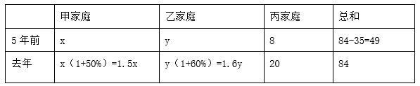

可列方程组：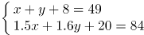，解得x=16，y=25，即五年前乙家庭的年收入为25万元。

故正确答案为C。

**考点**：和差倍比问题

**来源**：2023年江苏省公务员录用考试《行测》题（A类）（网友回忆版）第52题

### 第 53 题

一个A型4G基站的地面覆盖半径为1~3千米，一个B型5G基站的地面覆盖半径为100~200米。按此计算，一个A型4G基站的地面覆盖面积为B型5G基站的（ ）。

A. 100~225倍

B. 100~900倍

C. 25~225倍

D. 25~900倍

第 53 题 · 答案与解析

**参考答案（粉笔题库参考内容）**

D

**解析**

根据圆的面积公式：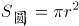，可得：一个A型4G基站的地面覆盖面积范围为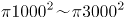平方米，一个B型5G基站的地面覆盖面积范围为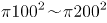平方米。则一个A型4G基站的地面覆盖面积最小是B型5G基站的倍，最大是倍 ，因此，一个A型4G基站的地面覆盖面积为B型5G基站的25~900倍。

故正确答案为D。

**考点**：几何公式类-平面图形

**来源**：2023年江苏省公务员录用考试《行测》题（A类）（网友回忆版）第53题

### 第 54 题

某高校机械学院有甲、乙、丙三个专业，学生人数之比是8：7：5。已知该学院三个专业学生的男女总人数之比是3：1，甲、乙两个专业学生的男女人数之比分别是7：3和6：1，则丙专业学生的男女人数之比是（ ）。

A. 7：2

B. 4：1

C. 15：4

D. 17：8

第 54 题 · 答案与解析

**参考答案（粉笔题库参考内容）**

D

**解析**

赋值该学院三个专业学生总人数为200人。根据题意可知，甲专业学生人数为人，乙专业学生人数为人，丙专业学生人数为200-80-70=50人。该学院三个专业的女生总人数为人，甲专业女生人数为人，乙专业女生人数为人。则丙专业女生人数为50-24-10=16人，丙专业男生人数=50-16=34人，则丙专业学生的男女人数之比=34：16=17：8。

故正确答案为D。

**考点**：和差倍比问题

**来源**：2023年江苏省公务员录用考试《行测》题（A类）（网友回忆版）第54题

### 第 55 题

某学校的运动场是椭圆形。边界椭圆上一点到中心距离的最小值是20米，两点间距离的最大值为80米。若学生在该运动场上排成方阵，则所排成方阵面积的最大值为（ ）。

A. 1280平方米

B. 1360平方米

C. 1440平方米

D. 1600平方米

第 55 题 · 答案与解析

**参考答案（粉笔题库参考内容）**

D

**解析**

如下图所示，20米为椭圆的短半轴OB（b），米为椭圆的长半轴OA（a），则椭圆方程应为：。要想让方阵面积最大，则方阵应内接椭圆，根据结论：椭圆内接矩形的面积最大为2ab，则所排成方阵面积的最大值为2×20×40=1600平方米。

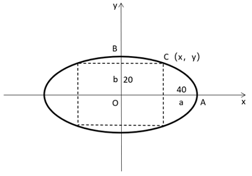

故正确答案为D。

**考点**：几何公式类-平面图形

**来源**：2023年江苏省公务员录用考试《行测》题（A类）（网友回忆版）第55题

### 第 56 题

小王经营一家鲜花网店，每位顾客均随机获赠一个装有一支康乃馨、玫瑰花或百合花的盲盒，3种盲盒的成本分别为3元、5元、8元。某日该鲜花网店共有顾客24人，赠送盲盒的总成本为127元，则获赠玫瑰花盲盒的顾客最多有：

A. 19人

B. 20人

C. 21人

D. 22人

第 56 题 · 答案与解析

**参考答案（粉笔题库参考内容）**

B

**解析**

设获赠康乃馨、玫瑰花、百合花盲盒的顾客分别有x人、y人、z人。根据题意可列式：x+y+z=24······①，3x+5y+8z=127······②，②-①×3可得：2y+5z=55。因为5z和55都是5的倍数，所以2y也应是5的倍数，则y是5的倍数，只有B项符合。

故正确答案为B。

**考点**：不定方程组

**来源**：2023年江苏省公务员录用考试《行测》题（A类）（网友回忆版）第56题

### 第 57 题

某食品企业为丰富产品造型，将一款甜点的外形由圆柱形改为半球形。若圆柱形甜点的底面半径是高的2倍，半球形甜点的体积缩小到圆柱形甜点的9/16，则半球形甜点的底面半径是圆柱形甜点底面半径的（ ）。

A. 1/4

B. 1/3

C. 2/3

D. 3/4

第 57 题 · 答案与解析

**参考答案（粉笔题库参考内容）**

D

**解析**

赋值圆柱形甜点的底面半径为4，则高为2，根据公式：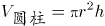，可得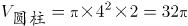。根据公式：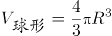，可得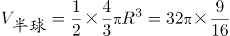，解得R=3，即半球形甜点的底面半径是圆柱形甜点底面半径的3/4。

故正确答案为D。

**考点**：几何公式类-立体图形

**来源**：2023年江苏省公务员录用考试《行测》题（A类）（网友回忆版）第57题

### 第 58 题

甲骑自行车，乙步行，同时从A地前往B地。已知A、B两地相距4000米，甲的速度是乙的3倍。途中自行车发生故障，甲修车耽误了一段时间。当乙到达B地时，甲离B地还有400米。在甲修车的时间段内，乙走过的路程为（ ）。

A. 3000米

B. 2800米

C. 2400米

D. 2000米

第 58 题 · 答案与解析

**参考答案（粉笔题库参考内容）**

B

**解析**

赋值乙的速度为1米/秒，则甲的速度为1×3=3米/秒，设甲修车的时间为t秒，当乙到达B地时，甲离B地还有400米，可知甲骑行的路程为4000-400=3600米。根据题意可知，乙从A地到B地的时间等于甲骑行与修车的时间之和，可列式，解得t=2800，故在甲修车的时间段内，乙走过的路程为2800×1=2800米。

故正确答案为B。

**考点**：普通行程

**来源**：2023年江苏省公务员录用考试《行测》题（A类）（网友回忆版）第58题

### 第 59 题

如图所示，纸片ABC的形状为直角三角形，AB=10厘米，BC=8厘米。若将纸片沿AD折叠，直角边AC恰好与斜边AB重叠，则的面积为（ ）。

A. 15平方厘米

B. 16平方厘米

C. 18平方厘米

D. 21平方厘米

第 59 题 · 答案与解析

**参考答案（粉笔题库参考内容）**

A

**解析**

根据题意可知，为直角三角形，则厘米。设CD为x厘米，由于纸片沿AD折叠且AC恰好与AB重叠，则厘米，。，可列方程：，解得x=3。因此平方厘米。

故正确答案为A。

**考点**：几何结论类-三角形相关、几何公式类-平面图形

**来源**：2023年江苏省公务员录用考试《行测》题（A类）（网友回忆版）第59题

### 第 60 题

某博物馆拟举办一次为期4天的文物展览活动，展出的文物共有5类：青铜器、瓷器、玉器、书法、国画。若要求每天仅展出2类文物，每类文物都要展出但不能连续2天展出，且玉器和国画这2类文物不在第1天展出，则不同的展出方式共有（ ）。

A. 72种

B. 120种

C. 216种

D. 360种

第 60 题 · 答案与解析

**参考答案（粉笔题库参考内容）**

A

**解析**

正向求解较复杂，考虑反向求解。玉器和国画不在第1天展出，不考虑每类文物都要展出的条件，不同的展出方式总情况共有种。不满足条件的情况可分为：①玉器和国画中有1类未展出，有种展出方式；②青铜器、瓷器、书法中有1类未展出，有种展出方式。故满足条件的情况数=总情况数-不满足条件的情况数=81-6-3=72种。

故正确答案为A。

备注：反向求解的总情况数为81种，则满足条件的情况数一定不超过81种，只有A项满足。

**考点**：基础排列组合

**来源**：2023年江苏省公务员录用考试《行测》题（A类）（网友回忆版）第60题

### 第 61 题

甲、乙两个工程队合作完成一项工程，甲每工作3天休息1天，乙每工作5天休息2天。若甲先工作，2天后乙加入，则再用21天完工；若乙先工作，12天后甲加入，则再用15天完工。甲单独完成该项工程需要的天数是（ ）。

A. 43

B. 44

C. 47

D. 48

第 61 题 · 答案与解析

**参考答案（粉笔题库参考内容）**

C

**解析**

第一种情况：甲工程队从开始到完工共经过2+21=23天，23÷（3+1）=5⋯⋯3，即5个周期还余3天，共工作了5×3+3=18天；乙工程队共经过21天，21÷（5+2）=3，即3个周期，共工作了3×5=15天。

第二种情况：乙工程队从开始到完工共经过12+15=27天，27÷（5+2）=3⋯⋯6，即3个周期还余6天，共工作了3×5+5=20天；甲工程队共经过15天，15÷（3+1）=3⋯⋯3，即3个周期还余3天，共工作了3×3+3=12天。

则根据题意可列式：18甲+15乙=12甲+20乙，整理可得：，赋值甲的效率为5，则乙的效率为6。则工作总量为18×5+15×6=180，甲单独完成该项工程需要工作的天数为180÷5=36天，36÷3=12，即需要11个周期再工作3天，所以共需11×（3+1）+3=47天。

故正确答案为C。

**考点**：工程问题-其他

**来源**：2023年江苏省公务员录用考试《行测》题（A类）（网友回忆版）第61题

### 第 62 题

浓度分别为68%、72%、78%的三种酒精溶液的总质量为240克。若将它们全部混合，则可得浓度为74%的酒精溶液；若只将浓度为72%和78%的酒精溶液混合，则可得浓度为76%的酒精溶液。这三种酒精溶液中，浓度为72%的酒精溶液质量为（ ）。

A. 30克

B. 40克

C. 48克

D. 60克

第 62 题 · 答案与解析

**参考答案（粉笔题库参考内容）**

D

**解析**

由于浓度为72%和78%的酒精溶液混合后的浓度为76%，则三种酒精溶液全部混合可以看成浓度为68%和76%的酒精溶液混合。根据线段法，浓度之差与酒精溶液质量成反比，则

，则浓度为76%的酒精溶液质量克。根据“若只将浓度为72%和78%的酒精溶液混合，则可得浓度为76%的酒精溶液”，可画如下线段：

，则浓度为72%的酒精溶液质量克。

故正确答案为D。

**考点**：多溶液混合

**来源**：2023年江苏省公务员录用考试《行测》题（A类）（网友回忆版）第62题

### 第 63 题

某公司实行弹性工作制，允许居家办公，但要求员工每周的周一到周五至少有两天在公司工作。小王、小李和小陈都是该公司的员工，若他们分别从下周的周一到周五中随机选2天、3天、4天去公司工作，则他们下周三都去公司工作的概率是（ ）。

A. 1/25

B. 6/125

C. 24/125

D. 3/250

第 63 题 · 答案与解析

**参考答案（粉笔题库参考内容）**

C

**解析**

小王、小李和小陈分别从下周的周一到周五中随机选2天、3天、4天去公司，分别有C_5^2、C_5^3、C_5^4种情况；满足要求的情况为小王、小李和小陈再从周一、周二、周四、周五中分别选1天、2天、3天去公司，分别有C_4^1、C_4^2、C_4^3种情况，根据分步用乘法，则所求概率。

故正确答案为C。

**考点**：给情况求概率

**来源**：2023年江苏省公务员录用考试《行测》题（A类）（网友回忆版）第63题

### 第 64 题

一个快递分发点的快递员某天人均送件量为220件，最少的送了200件。已知有一名快递员送了260件，除他之外的快递员人均送件量为218件。当天该快递分发点的一名快递员送件量最多为：

A. 542件

B. 560件

C. 582件

D. 596件

第 64 题 · 答案与解析

**参考答案（粉笔题库参考内容）**

B

**解析**

设该快递分发点共有x名快递员。根据总送件量一定，可列式为：220x=260+218×(x-1)，解得x=21，则这一天该快递分发点的总送件量为220×21=4620件。根据题意可知，若想当天一名快递员送件量最多，则其他快递员送件量应尽可能少。已知最少的送了200件，且有一名快递员送了260件，那么21人中有19人的送件量均为200件时，该快递员送件量达到最多，则最多为4620-260-200×19=4360-3800=560件。

故正确答案为B。

**考点**：构造数列、平均数问题

**来源**：2023年江苏省公务员录用考试《行测》题（A类）（网友回忆版）第64题

### 第 65 题

在下表中，小方格中的字母均为整数。若各行之和、各列之和、各对角线之和均相等，则a的值为：

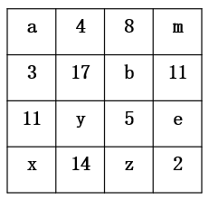

A. 17

B. 18

C. 19

D. 20

第 65 题 · 答案与解析

**参考答案（粉笔题库参考内容）**

D

**解析**

根据题干可知各行之和、各列之和、各对角线之和均相等。根据第一列之和对角线之和相等可列式：a+3+11+x=a+17+5+2，解得x=10。根据第二行和第三列相等可列式：3+17+b+11=8+b+5+z，解得z=18。可得第四行之和为10+14+18+2=44，第一列之和a+3+11+10=44，解得a=20。

故正确答案为D。

**来源**：2023年江苏省公务员录用考试《行测》题（A类）（网友回忆版）第65题

### 第 66 题

宇宙：元宇宙

A. 闺女：亲闺女

B. 消息：假消息

C. 计算：云计算

D. 化石：活化石

第 66 题 · 答案与解析

**参考答案（粉笔题库参考内容）**

D

**解析**

第一步：判断题干词语间逻辑关系。

元宇宙指人类运用数字技术构建的虚拟世界，元宇宙不是真正的宇宙，且“元宇宙”是从“宇宙”这个词衍生出来的虚拟科技词汇，二者是对应关系。

第二步：判断选项词语间逻辑关系。

A项：闺女可指女儿或年老者对女性表示慈爱的称呼，闺女的含义包括亲闺女，二者是包含关系，与题干逻辑关系不一致，排除；

B项：假消息是一种消息，二者是种属关系，与题干逻辑关系不一致，排除；

C项：云计算是计算的一种，二者是种属关系，与题干逻辑关系不一致，排除；

D项：活化石又称遗迹生物，是指相似物种只存在于化石中，而没有其他现存的相似物种的任何生物。活化石不是真正的化石，且“活化石”是从“化石”这个词衍生出来的词汇，与题干逻辑关系一致，当选。

故正确答案为D。

**考点**：逻辑关系-对应关系

**来源**：2023年江苏省公务员录用考试《行测》题（A类）（网友回忆版）第66题

### 第 67 题

挑战：应战

A. 报考：录取

B. 观察：评估

C. 抚养：扶养

D. 超速：限速

第 67 题 · 答案与解析

**参考答案（粉笔题库参考内容）**

A

**解析**

第一步：判断题干词语间逻辑关系。

先挑战，再应战，二者是动作先后顺序的对应关系，且发出这两个动作的主体不同。

第二步：判断选项词语间逻辑关系。

A项：先报考，再录取，二者是动作先后顺序的对应关系，且发出这两个动作的主体不同，与题干逻辑关系一致，当选；

B项：先观察，再评估，二者是动作先后顺序的对应关系，但观察和评估的主体相同，与题干逻辑关系不一致，排除；

C项：抚养主要指父母、祖父母、外祖父母等长辈对子女、孙子女、外孙子女等晚辈的抚育、教养，而扶养指的是对社会关系中的“弱者”所发生的经济供养和生活扶助，二者无明显逻辑关系，与题干逻辑关系不一致，排除；

D项：限速是为了预防车辆超速，二者不是动作先后顺序的对应关系，与题干逻辑关系不一致，排除。

故正确答案为A。

**考点**：逻辑关系-对应关系

**来源**：2023年江苏省公务员录用考试《行测》题（A类）（网友回忆版）第67题

### 第 68 题

布衣：百姓

A. 鸿雁：书信

B. 枢纽：关键

C. 须眉：男子

D. 巾帼：女子

第 68 题 · 答案与解析

**参考答案（粉笔题库参考内容）**

D

**解析**

第一步：判断题干词语间逻辑关系。

布衣指粗布衣服，借指平民百姓，二者构成比喻象征义。

第二步：判断选项词语间逻辑关系。

A项：鸿雁代指书信，二者构成比喻象征义，与题干逻辑关系一致，保留；

B项：枢纽比喻事物的关键，二者构成比喻象征义，与题干逻辑关系一致，保留；

C项：古时男子以胡须眉毛稠秀为美，故以须眉代指男子，二者构成比喻象征义，与题干逻辑关系一致，保留；

D项：巾帼是古代妇女戴的头巾和发饰，代指女子，二者构成比喻象征义，与题干逻辑关系一致，保留。

对比四个选项，题干中的“布衣”和D项中的“巾帼”都属于服饰，故D项和题干逻辑关系更为相似，当选。

故正确答案为D。

**考点**：语义关系-比喻象征义

**来源**：2023年江苏省公务员录用考试《行测》题（A类）（网友回忆版）第68题

### 第 69 题

南极洲：企鹅：北极熊

A. 空间站：种子：宇航员

B. 水浒传：李逵：沙和尚

C. 大数据：算法：字符串

D. 地雷战：工事：指战员

第 69 题 · 答案与解析

**参考答案（粉笔题库参考内容）**

B

**解析**

第一步：判断题干词语间逻辑关系。

企鹅和北极熊是两种不同的动物，二者为并列关系，企鹅生活在南极洲，但北极熊不是生活在南极洲的动物。

第二步：判断选项词语间逻辑关系。

A项：宇航员将种子带进空间站，种子和宇航员不是并列关系，与题干逻辑关系不一致，排除；

B项：李逵和沙和尚均是书籍中的人物，二者为并列关系，李逵是《水浒传》中的人物，但沙和尚不是《水浒传》中的人物，与题干逻辑关系一致，当选；

C项：算法指解决问题的有限运算序列，而字符串指编程语言中表示文本的数据类型，算法与字符串不是并列关系，与题干逻辑关系不一致，排除；

D项：工事指保障军队发扬火力和隐蔽安全的建筑物，工事和指战员是地雷战中涉及到的建筑物和人物，二者不是并列关系，与题干逻辑关系不一致，排除。

故正确答案为B。

**考点**：逻辑关系-并列关系、逻辑关系-对应关系

**来源**：2023年江苏省公务员录用考试《行测》题（A类）（网友回忆版）第69题

### 第 70 题

友善：诚信：价值观

A. 存量：增量：资产总量

B. 作揖：握手：行礼方式

C. 机场：车站：交通枢纽

D. 军舰：军机：舰载飞机

第 70 题 · 答案与解析

**参考答案（粉笔题库参考内容）**

B

**解析**

第一步：判断题干词语间逻辑关系。

友善和诚信都是价值观的一种，二者为并列关系，且均与价值观构成种属关系。

第二步：判断选项词语间逻辑关系。

A项：存量是指系统在某一时点时的所保有的数量，增量是指在某一段时间内系统中保有数量的变化，存量和增量均不是资产总量的一种，与题干逻辑关系不一致，排除；

B项：作揖和握手都是行礼方式的一种，二者为并列关系，且均与行礼方式构成种属关系，与题干逻辑关系一致，当选；

C项：交通枢纽是指一种或多种运输方式的交通干线相互交叉与衔接之处，以及为共同办理旅客与货物中转、发送、到达而兴建的多种运输设施的综合体，车站分为火车站、汽车站、公交车站等，有些单向且小型的公交车站不是交通枢纽，二者不是种属关系，与题干逻辑关系不一致，排除；

D项：军舰是指在海上执行战斗任务的船舶，军机是直接参加战斗、保障战斗行动和军事训练的飞机的总称，二者为并列关系，舰载飞机是以航空母舰或其他军舰为基地的海军飞机，是航空母舰的主要作战工具，舰载飞机是军机的一种，二者为种属关系，与题干逻辑关系不一致，排除。

故正确答案为B。

**考点**：逻辑关系-并列关系、逻辑关系-包容关系

**来源**：2023年江苏省公务员录用考试《行测》题（A类）（网友回忆版）第70题

### 第 71 题

登高：重阳：山坡

A. 赏菊：秋日：蓝天

B. 跳舞：冬日：篝火

C. 纳凉：夏日：庭院

D. 踏青：春日：细雨

第 71 题 · 答案与解析

**参考答案（粉笔题库参考内容）**

C

**解析**

第一步：判断题干词语间逻辑关系。

可以造句为：重阳在山坡上登高。其中登高是行为，重阳是时间，山坡是登高的地点，三者构成行为、时间和地点的对应关系。

第二步：判断选项词语间逻辑关系。

A项：可以造句为：秋日在蓝天下赏菊。其中赏菊是行为，秋日是时间，但蓝天不是赏菊的地点，与题干逻辑关系不一致，排除；

B项：可以造句为：冬日在篝火旁跳舞。其中跳舞是行为，冬日是时间，但篝火是事物，而非地点，与题干逻辑关系不一致，排除；

C项：可以造句为：夏日在庭院中纳凉。其中纳凉是行为，夏日是时间，庭院是纳凉的地点，三者构成行为、时间和地点的对应关系，与题干逻辑关系一致，当选；

D项：可以造句为：春日在细雨中踏青。其中踏青是行为，春日是时间，但细雨是天气，而非地点，与题干逻辑关系不一致，排除。

故正确答案为C。

**考点**：逻辑关系-对应关系

**来源**：2023年江苏省公务员录用考试《行测》题（A类）（网友回忆版）第71题

### 第 72 题

畅销书：精装书：电子书

A. 预选赛：选拔赛：友谊赛

B. 自由诗：叙事诗：抒情诗

C. 显微镜：放大镜：望远镜

D. 特效药：中成药：口服药

第 72 题 · 答案与解析

**参考答案（粉笔题库参考内容）**

B

**解析**

第一步：判断题干词语间逻辑关系。

有的畅销书是精装书，有的畅销书不是精装书，有的精装书是畅销书，有的精装书不是畅销书，前两词为交叉关系。精装书指装订精致的书，和电子书为反对关系。

第二步：判断选项词语间逻辑关系。

A项：预选赛是指为了进入大赛而在某个区域进行的选拔赛，前两词为种属关系，与题干逻辑关系不一致，排除；

B项：自由诗是没有规则的音节、韵律及其他正规设计的诗。有的自由诗是叙事诗，有的自由诗不是叙事诗，有的叙事诗是自由诗，有的叙事诗不是自由诗，前两词为交叉关系。诗歌按内容分为抒情诗、叙事诗、说理诗，因此叙事诗和抒情诗为反对关系，与题干逻辑关系一致，当选；

C项：显微镜、放大镜、望远镜是三种不同的光学器具，为并列关系，与题干逻辑关系不一致，排除；

D项：特效药是从药物疗效角度对药物进行的划分，中成药是从原材料角度对药物进行的划分，口服药是从用药方式的角度对药物进行的划分，三者互为交叉关系，与题干逻辑关系不一致，排除。

故正确答案为B。

**考点**：逻辑关系-并列关系、逻辑关系-交叉关系

**来源**：2023年江苏省公务员录用考试《行测》题（A类）（网友回忆版）第72题

### 第 73 题

蜘蛛 之于 （ ） 相当于 （ ） 之于 能力

A. 螃蟹；才干

B. 蛛网；成功

C. 动物；仁义

D. 蛛丝；人才

第 73 题 · 答案与解析

**参考答案（粉笔题库参考内容）**

D

**解析**

逐一代入选项。

A项：蜘蛛和螃蟹是两种不同的动物，二者为并列关系；才干指才能、办事的能力，能力指能胜任某项工作或事务的主观条件，二者为近义关系，前后逻辑关系不一致，排除；

B项：蛛网是蜘蛛所织成的丝网，二者为动物和产物的对应关系；拥有能力是成功的条件之一，二者为条件的对应关系，前后逻辑关系不一致，排除；

C项：蜘蛛是动物，二者为种属关系；仁义指仁爱和正义，与能力无明显逻辑关系，前后逻辑关系不一致，排除；

D项：蜘蛛有蛛丝，二者为对应关系；人才有能力，二者为对应关系，前后逻辑关系一致，当选。

故正确答案为D。

**考点**：逻辑关系-对应关系

**来源**：2023年江苏省公务员录用考试《行测》题（A类）（网友回忆版）第73题

### 第 74 题

（ ） 之于 句号 相当于 秋千 之于 （ ）

A. 语气 游戏

B. 问号 秋季

C. 句子 绳索

D. 符号 玩具

第 74 题 · 答案与解析

**参考答案（粉笔题库参考内容）**

C

**解析**

逐一代入选项。

A项：句号用于句子末尾，表示陈述语气，二者为对应关系；秋千是一种游戏用具，二者为工具的对应关系，但句号不是工具，前后逻辑关系不一致，排除；

B项：问号和句号都是标点符号，二者为并列关系；秋千是一种游戏用具，与秋天没有明显逻辑关系，前后逻辑关系不一致，排除；

C项：句号是句子的组成部分，二者为组成关系；绳索是秋千的组成部分，二者为组成关系，前后逻辑关系一致，当选；

D项：句号是标点符号，二者为种属关系；秋千是一种玩具，二者为种属关系，但词语前后顺序相反，前后逻辑关系不一致，排除。

故正确答案为C。

**考点**：逻辑关系-包容关系

**来源**：2023年江苏省公务员录用考试《行测》题（A类）（网友回忆版）第74题

### 第 75 题

无理数 整数 之于 （ ） 相当于 哲学 历史 之于 （ ）

A. 数据 大学

B. 理科 文科

C. 数学 典籍

D. 实数 学科

第 75 题 · 答案与解析

**参考答案（粉笔题库参考内容）**

D

**解析**

逐一代入选项。

A项：数据是事实或观察的结果，是对客观事物的逻辑归纳，是用于表示客观事物的未经加工的原始素材，无理数、整数与数据无必然联系，哲学、历史是两个不同的学科门类，大学是实施高等教育的学校，大学可能会开设哲学、历史学科专业，前后逻辑关系不一致，排除；

B项：理科是指形式科学与自然科学的统称，无理数、整数与理科无必然联系，哲学和历史都是文科，哲学、历史与文科均构成种属关系，前后逻辑关系不一致，排除；

C项：数学是研究数量、结构、变化、空间以及信息等概念的一门学科，无理数、整数是数学的研究对象，典籍是记载古今法令制度的重要文献，泛指古代的图书，典籍不是研究哲学、历史，而是记载哲学、历史的相关内容，前后逻辑关系不一致，排除；

D项：无理数和整数都是实数，因此无理数、整数与实数均构成种属关系，哲学、历史都是学科门类，因此哲学、历史与学科均构成种属关系，前后逻辑关系一致，当选。

故正确答案为D。

**考点**：逻辑关系-包容关系

**来源**：2023年江苏省公务员录用考试《行测》题（A类）（网友回忆版）第75题

### 第 76 题

从所给的四个选项中，选择最合适的一个填入问号处，使之呈现一定的规律性：

A. A

B. B

C. C

D. D

第 76 题 · 答案与解析

**参考答案（粉笔题库参考内容）**

D

**解析**

元素组成不同，优先考虑属性规律。观察发现，题干图形均为轴对称图形，排除A、C两项；继续观察发现，图①、图③、图⑤的对称轴均与图形中的一条线重合，图②、图④的对称轴均不与图形中的线条重合，故？处应选择一个对称轴不与图形中的线条重合的图形，只有D项符合。

故正确答案为D。

**考点**：属性规律-对称性

**来源**：2023年江苏省公务员录用考试《行测》题（A类）（网友回忆版）第76题

### 第 77 题

从所给的四个选项中，选择最合适的一个填入问号处，使之呈现一定的规律性：

A. A

B. B

C. C

D. D

第 77 题 · 答案与解析

**参考答案（粉笔题库参考内容）**

C

**解析**

元素组成不同，且无明显属性规律，优先考虑数量规律。观察发现，题干图形出现多个直角，优先考虑直角数，题干图形直角数依次为：1、2、3、4、5、？，故？处图形的直角数应为6。A项的直角数为8，B项的直角数为4，C项的直角数为6，D项的直角数为7，只有C项符合。

故正确答案为C。

**考点**：数量规律-角

**来源**：2023年江苏省公务员录用考试《行测》题（A类）（网友回忆版）第77题

### 第 78 题

请从四个选项中选出最恰当的一项填入问号处，使题干图形呈现一定的规律性。

A. A

B. B

C. C

D. D

第 78 题 · 答案与解析

**参考答案（粉笔题库参考内容）**

C

**解析**

元素组成不同，且无明显属性规律，考虑数量规律。观察发现，题干图形均分为上下两部分，排除A、D两项；继续观察发现，题干多幅图中存在“田”字变形图，优先考虑笔画数。题干图形均一部分为一笔画，另一部分为两笔画，所以？处图形也应该是一部分为一笔画，另一部分为两笔画，只有C项符合规律。

故正确答案为C。

**考点**：数量规律-线、数量规律-素

**来源**：2023年江苏省公务员录用考试《行测》题（A类）（网友回忆版）第78题

### 第 79 题

从所给的四个选项中，选择最合适的一个填入问号处，使之呈现一定的规律性：

A. A

B. B

C. C

D. D

第 79 题 · 答案与解析

**参考答案（粉笔题库参考内容）**

B

**解析**

元素组成不同，优先考虑属性规律。观察发现，题干中出现了等腰三角形、箭头等腰元素，优先考虑对称性。题干图形均只有1条对称轴，且对称轴的方向依次顺时针旋转45°，？处应用此规律，排除A项；继续观察发现，题干出现多个相切图形，切点数无规律，考虑笔画数。题干图形均为一笔画图形，？处应用此规律，只有B项符合。

故正确答案为B。

**考点**：数量规律-复合

**来源**：2023年江苏省公务员录用考试《行测》题（A类）（网友回忆版）第79题

### 第 80 题

请从四个选项中选出最恰当的一项填入问号处，使题干图形呈现一定的规律性。

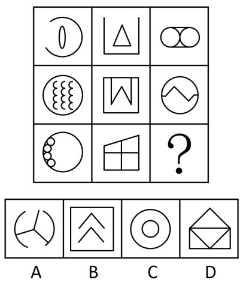

A. A

B. B

C. C

D. D

第 80 题 · 答案与解析

**参考答案（粉笔题库参考内容）**

A

**解析**

元素组成不同，优先考虑属性规律。观察发现，题干出现全直线图形、全曲线图形，优先考虑曲直性。九宫格优先横行看，第一行依次为全曲线图形、全直线图形、既有曲线又有直线图形；经验证，第二行满足此规律；第三行应用此规律，？处图形应该为既有曲线又有直线图形，只有A项符合规律。

故正确答案为A。

**考点**：属性规律-曲直性

**来源**：2023年江苏省公务员录用考试《行测》题（A类）（网友回忆版）第80题

### 第 81 题

请从所给的四个选项中，选出最恰当的一项填入问号处，使之呈现一定的规律性。

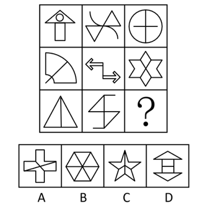

A. A

B. B

C. C

D. D

第 81 题 · 答案与解析

**参考答案（粉笔题库参考内容）**

D

**解析**

图形元素组成不同，优先考虑属性规律。观察发现，题干出现等腰元素、S变形图等，优先考虑对称性。九宫格优先看横行，第一行中，三幅图依次为轴对称图形、中心对称图形、既轴对称又中心对称图形；经验证，第二行满足此规律；第三行应用此规律，？处应该填入一个既轴对称又中心对称图形，排除A、C两项。继续观察发现，题干中的既轴对称又中心对称图形仅有2条相互垂直的对称轴，只有D项符合。

故正确答案为D。

**考点**：属性规律-对称性

**来源**：2023年江苏省公务员录用考试《行测》题（A类）（网友回忆版）第81题

### 第 82 题

下边四个图形中，只有一个是由上边的四个图形拼合（只能通过上、下、左、右平移）而成的，请把它找出来。

A. A

B. B

C. C

D. D

第 82 题 · 答案与解析

**参考答案（粉笔题库参考内容）**

D

**解析**

本题考查平面拼合，可采用平行且等长相消的方式解题。消去平行且等长的线段后进行组合可得到轮廓图，即为D项。平行且等长相消的方式如下图所示：

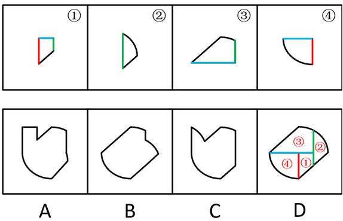

故正确答案为D。

**来源**：2023年江苏省公务员录用考试《行测》题（A类）（网友回忆版）第82题

### 第 83 题

下边四个图形中，只有一个是由上边的四个图形拼合（只能通过上、下、左、右平移）而成的，请把它找出来。

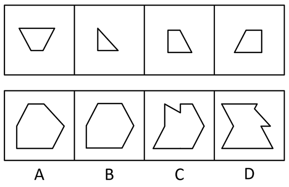

A. A

B. B

C. C

D. D

第 83 题 · 答案与解析

**参考答案（粉笔题库参考内容）**

A

**解析**

本题考查平面拼合，可采用平行且等长相消的方式解题。消去平行且等长的线段后进行组合即可得到轮廓图，即为A项。平行且等长相消的方式如下图所示：

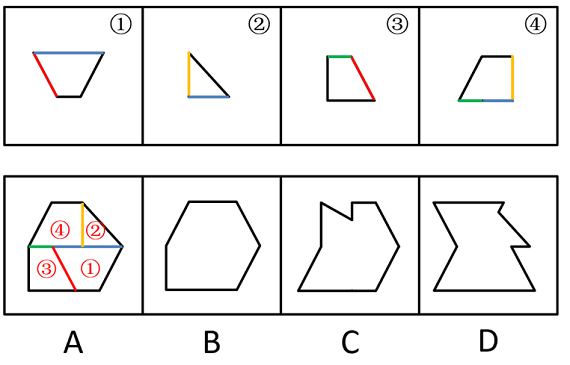

故正确答案为A。

**来源**：2023年江苏省公务员录用考试《行测》题（A类）（网友回忆版）第83题

### 第 84 题

下边四个图形中，只有一个是由上边的四个图形拼合（只能通过上、下、左、右平移）而成的，请把它找出来。

A. A

B. B

C. C

D. D

第 84 题 · 答案与解析

**参考答案（粉笔题库参考内容）**

B

**解析**

本题考查平面拼合，消去弯曲程度一致且等长的线条后进行拼合，即可得到轮廓图，即为B项。具体拼合方式如下图所示：

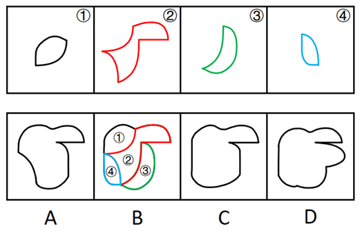

故正确答案为B。

**来源**：2023年江苏省公务员录用考试《行测》题（A类）（网友回忆版）第84题

### 第 85 题

从四个选项中选出一项填入问号处，使左边四个图形可以拼合（只能通过上、下、左、右平移）成右边的图形。

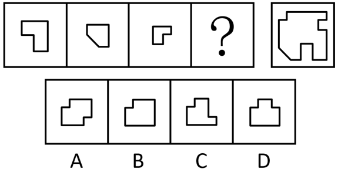

A. A

B. B

C. C

D. D

第 85 题 · 答案与解析

**参考答案（粉笔题库参考内容）**

A

**解析**

本题考查平面拼合，可采用拆分题干所给图形的方式解题，对应A项。拆分方式如下图所示：

故正确答案为A。

**来源**：2023年江苏省公务员录用考试《行测》题（A类）（网友回忆版）第85题

### 第 86 题

左边四张纸片，都是一面为白色，一面为黑色，在允许平移、旋转和翻转的条件下，可以拼合成多种图形。右边哪项不能由其拼合而成？

A. A

B. B

C. C

D. D

第 86 题 · 答案与解析

**参考答案（粉笔题库参考内容）**

B

**解析**

本题考查平面拼合，可以平移、旋转、翻转，且每张纸片一面是黑色，另一面是白色，需要考虑翻转后的颜色变化。将题干图形标上序号如下图所示，逐一进行分析。

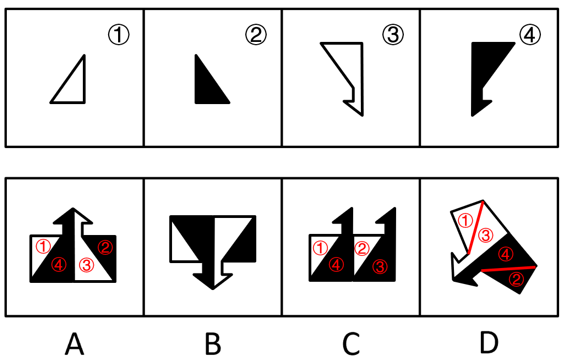

A项：可以由题干图形拼合而成，拼合方式如图所示，排除；

B项：存在多个错误，如果考虑直接平移拼合成选项图形，则四个题干图形颜色均错误；如果考虑翻转后拼合成选项图形，则四个题干图形颜色也均错误，当选；

C项：可以由题干图形拼合而成，拼合方式如图所示，排除；

D项：可以由题干图形拼合而成，拼合方式如图所示，排除。

本题为选非题，故正确答案为B。

**来源**：2023年江苏省公务员录用考试《行测》题（A类）（网友回忆版）第86题

### 第 87 题

左边给定的是一个四面体，右边哪一项可能是它的外表面展开图？

A. A

B. B

C. C

D. D

第 87 题 · 答案与解析

**参考答案（粉笔题库参考内容）**

B

**解析**

将题干立体图形的两个面标记为e、f，以题干中面e的唯一点（灰色与白色相交的点）为起点顺时针画边，边1挨着面e中的灰色三角形；以题干中面f的唯一点（黑色与白色相交的点）为起点顺时针画边，边1挨着面f中的白色三角形。且面e和面f的公共边为面内白色三角形的斜边，如下图所示，逐一进行分析。

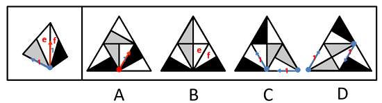

A项：以选项右下角图形的唯一点为起点顺时针画边，边1挨着面内的黑色三角形，故该面为无中生有面。不管哪个面为面e，它和面f的公共边并不都是白色三角形的斜边，选项与题干不一致，排除；

B项：如上图所示，选项与题干一致，当选；

C项：以选项灰色面中的唯一点为起点顺时针画边，边1都挨着面内的白色三角形，故选项中的2个灰色面均为无中生有面，选项与题干不一致，排除；

D项：以选项灰色面中的唯一点为起点顺时针画边，边1都挨着面内的白色三角形，故选项中的2个灰色面均为无中生有面，选项与题干不一致，排除。

故正确答案为B。

**考点**：空间类-空间重构-四面体

**来源**：2023年江苏省公务员录用考试《行测》题（A类）（网友回忆版）第87题

### 第 88 题

左边给定的是一个六面体的外表面展开图，右边哪一项能由它折叠而成？

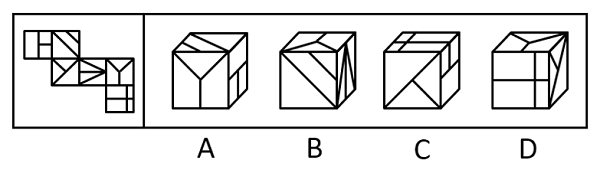

A. A

B. B

C. C

D. D

第 88 题 · 答案与解析

**参考答案（粉笔题库参考内容）**

B

**解析**

将展开图标上序号（如下图所示），逐一进行分析。

A项：选项由面e、面f与面i构成，在题干展开图中面f与面e的公共边挨着面e中的两个小正方形（如图所示），而在选项中两个面的公共边挨着面e中的一个长方形，选项与题干展开图不一致，排除；

B项：选项由面f、面h与面i构成，选项与题干展开图一致，当选；

C项：选项由面e、面g与面k构成，在题干展开图中面e中的两个小正方形挨着面f（如图所示），而在选项中面e中的两个小正方形挨着面k，选项与题干展开图不一致，排除；

D项：选项由面g、面i与面k构成，面g和面i是相对面，相对面不能同时在立体图中出现，选项与题干展开图不一致，排除。

故正确答案为B。

**考点**：空间类-空间重构-六面体

**来源**：2023年江苏省公务员录用考试《行测》题（A类）（网友回忆版）第88题

### 第 89 题

某立方体每个面上各有一种不同的图案，下列四个选项中有且仅有一个不是该立方体，请把它找出来。

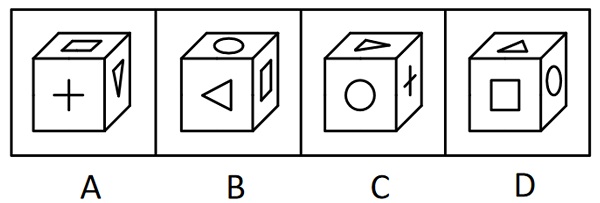

A. A

B. B

C. C

D. D

第 89 题 · 答案与解析

**参考答案（粉笔题库参考内容）**

A

**解析**

本题为空间重构题。将四个选项均以三角形面内三角形尖指向的边为起点，进行顺时针画边（如下图所示），逐一进行分析。

A项：此时边2对应十字面；

B项：此时边2对应圆形面；

C项：此时边2对应圆形面；

D项：此时边2对应圆形面。

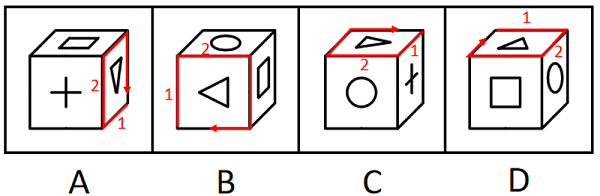

综上，只有A项与其他三项不同。

本题为选非题，故正确答案为A。

**考点**：空间类-空间重构-六面体

**来源**：2023年江苏省公务员录用考试《行测》题（A类）（网友回忆版）第89题

### 第 90 题

下列四个立方体的外表面展开图，其中一个展开图还原成立方体后，从能同时看到3个面的任一角度看（如），都可以至少看到一个圆，请把它找出来。

A. A

B. B

C. C

D. D

第 90 题 · 答案与解析

**参考答案（粉笔题库参考内容）**

A

**解析**

立方体共有6个面，两两一组构成3组相对面。当能同时看到3个面时，相对面能且只能出现一个，因此，要保证从能同时看到3个面的任一角度看，都可以至少看到一个圆，需要保证展开图中至少存在一组相对面中均为圆，只有A项符合。

故正确答案为A。

**考点**：空间类-空间重构-六面体

**来源**：2023年江苏省公务员录用考试《行测》题（A类）（网友回忆版）第90题

### 第 91 题

欲事立，须是心立。理想信念是中国共产党员精神上的“钙”，一个人理想信念坚定，“骨头”就硬；理想信念缺失或者不坚定，精神上就会“缺钙”，就会得“软骨病”，就容易在考验面前迷失方向。

以下哪项不能由以上陈述推出？

A. 一个人若不想事立，他就无须心立

B. 如果一个人“骨头”不硬，就说明他的理想信念不坚定

C. 一个人理想信念缺失，他就会得“软骨病”

D. 若一个人不容易在考验面前迷失方向，就说明他有坚定的理想信念

第 91 题 · 答案与解析

**参考答案（粉笔题库参考内容）**

A

**解析**

第一步：翻译题干。

①事立→心立；

②理想信念坚定→“骨头”硬；

③理想信念缺失 或 理想信念不坚定→精神上“缺钙”；

④理想信念缺失 或 理想信念不坚定→得“软骨病”；

⑤理想信念缺失 或 理想信念不坚定→容易在考验面前迷失方向。

第二步：逐一分析选项。

A项：该项翻译为“-事立→-心立”，是对①的否前，否前得不到确定性结论，无法推出，当选；

B项：该项翻译为“-‘骨头’硬→-理想信念坚定”，是对②的否后，否后必否前，可以推出，排除；

C项：该项翻译为“理想信念缺失→得‘软骨病’”，肯定了“或关系”其中一项，是对④的肯前，肯前必肯后，可以推出，排除；

D项：该项翻译为“-容易在考验面前迷失方向→理想信念坚定”，是对⑤的否后，否后必否前，可以得到“-理想信念缺失” 且 “-理想信念不坚定”，可以推出，排除。

本题为选非题，故正确答案为A。

**考点**：常规翻译

**来源**：2023年江苏省公务员录用考试《行测》题（A类）（网友回忆版）第91题

### 第 92 题

如今，利用网络检索信息、查阅资料非常方便，大多数人遇到生僻的字词需要检索、查找、求证时，第一选择是上网而不是翻检词典。有网友坦言：尽管《现代汉语词典》伴随自己的学生时代，但在互联网时代，它已经远离了我们的生活。

以下哪项如果为真，最能质疑上述网友的说法？

A. 《现代汉语词典》每隔几年就会推出修订版，收录近期产生的新词语

B. 网上查到的规范的字词解释是以《现代汉语词典》等工具书作为数据库提供的

C. 在网络流行语的冲击下，词语意义和用法的精准解释对国人尤为重要

D. 有些网络提供的字词解释不够准确，检索到的内容很容易出现错误

第 92 题 · 答案与解析

**参考答案（粉笔题库参考内容）**

B

**解析**

第一步：找出论点和论据。

论点：尽管《现代汉语词典》伴随自己的学生时代，但在互联网时代，它已经远离了我们的生活。

论据：如今，利用网络检索信息、查阅资料非常方便，大多数人遇到生僻的字词需要检索、查找、求证时，第一选择是上网而不是翻检词典。

本题论点和论据都在讨论在互联网时代词典已经远离了人们的生活，二者话题一致，削弱优先考虑削弱论点。

第二步：逐一分析选项。

A项：选项指出《现代汉语词典》每隔几年就会推出修订版，但《现代汉语词典》的修订情况与论点在互联网时代《现代汉语词典》是否已经远离了人们的生活无关，无法削弱，排除；

B项：选项指出网上查到的规范的字词解释是以《现代汉语词典》等工具书作为数据库提供的，说明即使在互联网时代通过网络检索字词所查阅内容的最终来源依旧是《现代汉语词典》，证明《现代汉语词典》并未远离人们的生活，削弱论点，可以削弱，当选；

C项：选项指出在互联网时代词语意义和用法的精准解释对国人尤为重要，与论点在互联网时代《现代汉语词典》是否已经远离了人们的生活无关，无法削弱，排除；

D项：选项指出有些网络提供的字词解释不够准确，说的是网络检索字词存在的问题，但无法判断人们是否会因为这一问题而去使用《现代汉语词典》，无法削弱，排除。

故正确答案为B。

**考点**：削弱论点

**来源**：2023年江苏省公务员录用考试《行测》题（A类）（网友回忆版）第92题

### 第 93 题

某市教育局派出由甲、乙、丙、丁、戊5名优秀教师组成的支教团支援西部。已知：

（1）有3人为青年教师，2人为中年教师；

（2）语文教师有2人，数学教师有3人；

（3）甲与丙同龄，丁与戊年龄相差最大；

（4）乙与戊所教课程相同，丙与丁所教课程不同；

（5）担任组长的是一名中年语文教师。

根据以上陈述，可以推出以下哪项？

A. 甲是组长

B. 乙是组长

C. 丙是组长

D. 丁是组长

第 93 题 · 答案与解析

**参考答案（粉笔题库参考内容）**

D

**解析**

第一步：分析题干条件。

（1）有3人为青年教师，2人为中年教师；

（2）语文教师有2人，数学教师有3人；

（3）甲与丙同龄，丁与戊年龄相差最大；

（4）乙与戊所教课程相同，丙与丁所教课程不同；

（5）担任组长的是一名中年语文教师。

第二步：根据题干条件进行推理。

根据条件（1）（3）可知，丁和戊中有1人与甲、丙同龄，因此甲和丙一定是青年教师，再根据条件（5）可知，甲和丙不能担任组长，排除A、C两项；再根据条件（2）（4）可知，丙和丁中有1人与乙、戊所教课程相同，因此乙和戊所教课程一定是数学，再根据条件（5）可知，乙和戊不能担任组长，因此，丁是组长，排除B项，D项当选。

故正确答案为D。

**考点**：框架题

**来源**：2023年江苏省公务员录用考试《行测》题（A类）（网友回忆版）第93题

### 第 94 题

①死海是淹不死人的。因为②死海海水含盐量很大。据统计，③死海海水中有135亿吨氯化钠，有64亿吨氯化钙，有20亿吨氯化钾······各种盐的质量加在一起占死海全部海水的23%~25%。由于④死海海水的比重超过了人体的比重，以致⑤人到死海里会自然漂起来，沉不下去。

若用“A←B”表示陈述B是陈述A的论据，则题干的论证关系应表示为（ ）。

A. ⑤←①←②←③←④

B. ①←⑤←③←④←②

C. ①←⑤←④←②←③

D. ⑤←①←④←③←②

第 94 题 · 答案与解析

**参考答案（粉笔题库参考内容）**

C

**解析**

本题提问方式特殊，需要由论据逐步推出论点，需梳理出论证过程。

第一步：先确定论证关系最为明显的陈述。

题干的五个陈述主要围绕死海为什么淹不死人展开。论证关系比较明显的是陈述④和陈述⑤，根据“由于④死海海水的比重超过了人体的比重，以致⑤人到死海里会自然漂起来，沉不下去”，可知陈述④是陈述⑤的直接论据，二者的论证关系应为：⑤←④，只有C项符合。

第二步：逐一对照选项并判断正确答案。

根据第一步的结果可以判断只有C项符合，故对C项进行验证。因为③死海海水中有135亿吨氯化钠，有64亿吨氯化钙，有20亿吨氯化钾······各种盐的质量加在一起占死海全部海水的23%~25%，得出②死海海水含盐量很大，再得出④死海海水的比重超过了人体的比重，进而得出⑤人到死海里会自然漂起来，沉不下去，最后得到①死海是淹不死人的，即论证关系表示为：①←⑤←④←②←③，C项论证关系成立。

故正确答案为C。

**来源**：2023年江苏省公务员录用考试《行测》题（A类）（网友回忆版）第94题

### 第 95 题

近两年，预制菜成为很多餐饮店的新宠，经过洗、切、搭配、烹制等步骤的预制菜，在餐饮店的后厨只需经过简单加工即可上桌。在这样的情形下，使用预制菜的规模化连锁餐饮店遍地开花。有专家据此指出，长此以往许多厨师将面临失业的风险。

以下哪项如果为真，最能支持上述专家的观点？

A. 用餐的客人越来越心急，点完菜恨不得立刻吃上，导致很多需要慢慢烹制的菜都得厨师预先处理

B. 高端的预制菜已经走进了许多家庭之中，人们不需要具备高超的厨艺即可化身大厨，为家人带来一份丰盛的大餐

C. 很多连锁餐饮店开在商场，而商场由于消防要求对明火管控严格，导致这些餐饮店只能使用预制菜

D. 规模化连锁餐饮店使用预制菜，方便快捷，成本比用厨师的中小餐馆要低得多，大多数中小餐馆无力与之竞争

第 95 题 · 答案与解析

**参考答案（粉笔题库参考内容）**

D

**解析**

第一步：找出论点和论据。

论点：长此以往许多厨师将面临失业的风险。

论据：使用预制菜的规模化连锁餐饮店遍地开花。

本题的论点讨论的是长此以往（使用预制菜）许多厨师将面临失业的风险，论据讨论的是使用预制菜的规模化连锁餐饮店遍地开花，二者话题不一致，加强优先考虑搭桥，即在“使用预制菜的规模化连锁餐饮店”和“厨师面临失业风险”之间建立联系。

第二步：逐一分析选项。

A项：选项讨论的是客人的心急导致很多需要慢慢烹制的菜都得厨师预先处理，与厨师是否将面临失业的风险无关，无法加强，排除；

B项：选项讨论的是高端的预制菜能为家人带来丰盛的大餐，只涉及了“高端的预制菜”，且针对的是在家做菜的情况，没有提及厨师是否将面临失业的风险，无法加强，排除；

C项：选项讨论的是为什么很多连锁餐饮店只能使用预制菜，没有提及厨师是否将面临失业的风险，无法加强，排除；

D项：选项讨论的是规模化连锁餐饮店使用预制菜方便快捷且成本低，证明预制菜比厨师存在很多优势，使用厨师的中小餐馆无力与之竞争，进而导致厨师失业，即在“使用预制菜的规模化连锁餐饮店”和“厨师面临失业风险”之间建立联系，为搭桥项，当选。

故正确答案为D。

**考点**：搭桥

**来源**：2023年江苏省公务员录用考试《行测》题（A类）（网友回忆版）第95题

### 第 96 题

手机APP为了获得一些读取信息和修改手机设置的权限， 都会提供用户协议并要求使用者同意。然而，据权威调查显示，大部分使用者很少或从没阅读过APP提供的用户协议,也不乐意APP有超出其功能的某些权限，但他们都会点击“我已阅读并同意用户协议”。

以下哪项如果为真，最能解释上述现象？

A. 如果用户不同意手机APP所提供的用户协议，就不能使用这款 APP

B. 通过正规平台下载的APP有平台审核其安全性，不需要下载者进行核查

C. 很多手机APP的用户协议冗长复杂，用户无法在短时间内读完或读懂

D. 对于某些APP来说，用户在使用过程中还能重新设定它获取的各种权限

第 96 题 · 答案与解析

**参考答案（粉笔题库参考内容）**

A

**解析**

第一步：找出题干矛盾。

大部分使用者很少或从没阅读过APP提供的用户协议，也不乐意APP有超出其功能的某些权限，但他们都会点击“我已阅读并同意用户协议”。

第二步：逐一分析选项。

A项：该项指出想要使用APP必须同意用户协议，因此即使使用者很少或从没阅读过APP提供的用户协议，也不乐意APP有超出其功能的某些权限，但为了能使用该款APP不得不点击“我已阅读并同意用户协议”，可以解释题干矛盾，当选；

B项：该项仅说明使用者无需担心通过正规平台下载的APP的安全性，题干中未涉及使用者下载APP的平台是否正规，也没有解释使用者为何在很少或从没阅读过APP提供的用户协议且不乐意APP有超出其功能的某些权限时会点击“我已阅读并同意用户协议”，不能解释题干矛盾，排除；

C项：该项指出用户无法在短时间内读完或读懂APP冗长复杂的用户协议，可以解释为什么大部分使用者很少或从没阅读过APP提供的用户协议，但不能解释为什么在不乐意APP有超出其功能的某些权限时，还是会点击“我已阅读并同意用户协议”，不能解释题干矛盾，排除；

D项：该项仅说明用户在使用过程中可以重新设定某些APP获取的各种权限，无法确定“某些APP”有多少，题干中针对的是手机APP这一整体，因此某些APP的情况不能解释题干矛盾，排除。

故正确答案为A。

**考点**：原因解释

**来源**：2023年江苏省公务员录用考试《行测》题（A类）（网友回忆版）第96题

## 材料 2

赵、钱、孙、李、周、吴和郑获得某职业技能大赛的前七名，7名选手有男有女，没有并列名次。已知：

（1）赵是第六名，郑的名次在孙之前；

（2）男选手的排名不相邻；

（3）吴的名次在钱和李之前，排名在吴之前的选手中有两名男性。

### 第 97 题

根据以上陈述，下列选手名次不可能相邻的是（ ）。

A. 孙和吴

B. 吴和郑

C. 吴和李

D. 周和吴

第 97 题 · 答案与解析

**参考答案（粉笔题库参考内容）**

B

**解析**

第一步：分析题干条件。

（1）赵是第六名，郑的名次在孙之前；

（2）男选手的排名不相邻；

（3）吴的名次在钱和李之前，排名在吴之前的选手中有两名男性。

第二步：根据题干条件分析选项。

根据条件（1）和（3）可知，赵是第六名，吴是第三名或第四名，再根据条件（2）可知，吴前面要至少有三个人才能保证男选手不相邻，那么吴只能是第四名，此时钱和李是第五名或第七名（如下图所示），此时第一到三名为郑、周、孙，但无法判断具体名次。

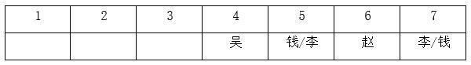

代入A项，如果孙和吴相邻，根据已知信息可知，孙是第三名，郑和周在前两名，具体名次无法确定，所有排名情况均符合题干条件（如下图所示），即孙和吴可以相邻，排除；

代入B项，如果吴和郑相邻，根据已知信息可知，郑只能是第三名，孙在前两名，即郑的名次在孙之后，与条件（1）矛盾，即吴和郑不能相邻，当选；

代入C项，如果吴和李相邻，根据已知信息可知，李是第五名，钱是第七名，郑、周、孙在前三名，具体名次无法确定，所有排名情况均符合题干条件（如下图所示），即吴和李可以相邻，排除；

代入D项，如果周和吴相邻，根据已知信息可知，周是第三名，再根据条件（1）和（3）可知，郑是第一名，孙是第二名，钱和李是第五名或第七名，具体名次无法确定，两种排名情况均符合题干条件（如下图所示），即周和吴可以相邻，排除。

本题为选非题，故正确答案为B。

**来源**：2023年江苏省公务员录用考试《行测》题（A类）（网友回忆版）第97题

### 第 98 题

如果周是第三名，以下哪位选手一定是女性？

A. 赵

B. 钱

C. 孙

D. 李

第 98 题 · 答案与解析

**参考答案（粉笔题库参考内容）**

C

**解析**

第一步：分析题干条件。

（1）赵是第六名，郑的名次在孙之前；

（2）男选手的排名不相邻；

（3）吴的名次在钱和李之前，排名在吴之前的选手中有两名男性；

（4）周是第三名。

第二步：根据题干条件分析选项。

根据条件（1）和（4）可知，周是第三名，赵是第六名。根据条件（3）可知，吴只能是第四名，钱和李是第五名或第七名，具体名次无法确定。根据条件（1）可知，郑是第一名，孙是第二名。再根据条件（2）和（3）可知，郑和周为男选手，孙和吴为女选手，其他人的性别无法确定（如下图所示）。

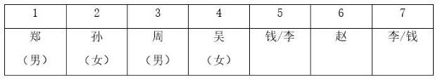

故正确答案为C。

**来源**：2023年江苏省公务员录用考试《行测》题（A类）（网友回忆版）第98题

### 第 99 题

据一项调查显示，对所学专业满意的大学生不到一半。某高校为了调动学生的学习主动性和积极性、提高学生对所学专业的满意度，允许在原专业中成绩名列年级前10%且不存在挂科的学生更换专业。有专家指出，这一成绩要求违背了该校制定转专业政策的初衷。

以下哪项如果为真，最能支持上述专家的观点？

A. 许多学生因为对原专业不感兴趣而缺乏学习的动力，导致学习成绩差

B. 一些学生对所学专业很感兴趣，但因为方法不对，学习成绩不是很理想

C. 不少学生考上大学后没有把心思花在学习上，即使更换专业也不会满意

D. 学校出台转专业政策时不仅要考虑学生因素，更要考虑专业的平衡发展

第 99 题 · 答案与解析

**参考答案（粉笔题库参考内容）**

A

**解析**

第一步：找出论点和论据。

论点：这一成绩要求违背了该校制定转专业政策的初衷（初衷为调动学生的学习主动性和积极性、提高学生对所学专业的满意度）。

论据：无。

本题只有论点，没有论据，加强优先考虑补充论据，即解释原因或者举例。

第二步：逐一分析选项。

A项：该项说的是许多对原专业不感兴趣的学生成绩差，但该高校规定在原专业中成绩名列年级前10%的学生才能更换专业，这就陷入了悖论——想转专业的学生对原专业不感兴趣导致学习成绩差，自然就很难考到前几名，转专业困难，只能留在原专业，痛苦地学下去，最终学习的积极性和主动性无法被调动，也不能提高对所学专业的满意度，违背了转专业政策的初衷，解释原因，补充论据，当选；

B项：该项说的是一些对所学专业感兴趣的学生成绩不理想，这些学生对所学专业感兴趣，即使他们不满足成绩要求对转专业政策也没有影响，无法加强，排除；

C项：该项说的是一些学生无论是否更换专业都不会满意，那他们是否满足成绩要求，是否转专业，对转专业政策也没有影响，无法加强，排除；

D项：该项说的是学校出台转专业政策时要考虑什么因素，没有提及成绩要求对转专业政策的影响，话题不一致，无法加强，排除。

故正确答案为A。

**考点**：补充论据

**来源**：2023年江苏省公务员录用考试《行测》题（A类）（网友回忆版）第99题

### 第 100 题

北方某市有甲、乙两条十字交叉的马路，每年冬季都有成群的乌鸦聚集于甲路边的树上，但乙路边的树上基本没有乌鸦。有鸟类爱好者发现，甲路两旁的杨树要比乙路多数倍。据此，该鸟类爱好者断言，乌鸦更喜欢停留在杨树多的地方过冬。

以下哪项如果为真，最能削弱上述鸟类爱好者的断言？

A. 在夏秋之交，甲、乙两条路旁的树上都会聚集大量的乌鸦

B. 近二十年来该市特别重视道路绿化，为鸟类提供了良好的栖息环境

C. 乙路是南北方向，凛冽的北风长驱直入，而甲路旁边的建筑能有效阻挡北风

D. 该市有一条与甲路平行的路，杨树的数量与乙路差不多，但冬季几乎没有乌鸦

第 100 题 · 答案与解析

**参考答案（粉笔题库参考内容）**

C

**解析**

第一步：找出论点和论据。

论点：乌鸦更喜欢停留在杨树多的地方过冬。

论据：北方某市有甲、乙两条十字交叉的马路，每年冬季都有成群的乌鸦聚集于甲路边的树上，但乙路边的树上基本没有乌鸦。有鸟类爱好者发现，甲路两旁的杨树要比乙路多数倍。

本题论点和论据都在讨论乌鸦更喜欢在杨树多的地方过冬，二者话题一致，削弱优先考虑削弱论点。且本题的论证过程可理解为：依据每年冬季乌鸦都成群聚集于杨树更多的甲路边的树上，得出乌鸦更喜欢停留在杨树多的地方过冬的论点，隐含因果关系，还可以考虑他因削弱。

第二步：逐一分析选项。

A项：选项说的是夏秋之交，甲、乙两条路旁树上的乌鸦聚集情况，而题干讨论的是乌鸦在冬季的聚集情况，话题不一致，为无关项，无法削弱，排除；

B项：选项说的是近二十年来该市特别重视道路绿化，与乌鸦是否更喜欢停留在杨树多的地方过冬无关，无法削弱，排除；

C项：选项说的是凛冽的北风能长驱直入乙路，而甲路旁边的建筑能有效阻挡北风，说明冬季乌鸦聚集于甲路旁边的树上不一定是因为甲路边杨树更多，也可能是因为甲路旁边的建筑更能避风，他因削弱，当选；

D项：选项说的是另一条与甲路平行的路，杨树的数量与乙路差不多，但冬季几乎没有乌鸦，说明在道路朝向相同的情况下，乌鸦依旧更喜欢停留在杨树多的地方过冬，排除了道路朝向对乌鸦的影响，为加强项，无法削弱，排除。

故正确答案为C。

**考点**：削弱-实验类、他因削弱

**来源**：2023年江苏省公务员录用考试《行测》题（A类）（网友回忆版）第100题

### 第 101 题

小朱：外星人一定存在

小李：没有任何有关外星人存在的证据，所以外星人一定不存在

以下哪项中乙的论证方式与小李最为相似？

A. 甲：明天可能下雨 乙：现在的天气状况特别好，所以明天很可能不下雨

B. 甲：老王一家今天应该都外出散步了 乙：我一直没看到他们出去，所以老王一家应该都没有外出散步

C. 甲：老赵有时聪明 乙：我只见过老赵不聪明的时候，所以老赵有时不聪明

D. 甲：小徐一定能晋级 乙：目前小徐在积分榜上排名靠后，所以小徐可能不会晋级

第 101 题 · 答案与解析

**参考答案（粉笔题库参考内容）**

B

**解析**

第一步：分析题干论证方式。

题干中小李的论证方式为：因为没有证据证明外星人存在，所以外星人一定不存在，即断定一件事物是错误的，只因为没有证据证明它是正确的，这种论证方式属于诉诸无知。

第二步：逐一分析选项。

A项：乙的论证方式为：因为现在的天气好，所以明天很可能不下雨，不是通过有无证据来证明事物正确与否，与题干论证方式不一致，排除；

B项：乙的论证方式为：因为我没看到他们，所以他们没有外出散步，即通过没有证据证明他们外出散步，来断定他们没有外出散步，属于诉诸无知的论证方式，与题干论证方式一致，当选；

C项：乙的论证方式为：因为只见过老赵不聪明的时候，所以老赵有时不聪明，即通过有证据证明老赵不聪明，来断定老赵有时不聪明，与题干论证方式不一致，排除；

D项：乙的论证方式为：因为小徐在积分榜上排名靠后，所以小徐可能不会晋级，即以小徐在积分榜上排名靠后为证据，来断定小徐可能不会晋级，与题干论证方式不一致，排除。

故正确答案为B。

**考点**：论证结构

**来源**：2023年江苏省公务员录用考试《行测》题（A类）（网友回忆版）第101题

### 第 102 题

甲对乙说：“没事，没事，我知道消费者不愿意配合。不过，我倒是很在意您对这件事的态度，请您把您的态度告诉我，因为您的态度会左右我下一步的选择。”

以下哪项不可能是甲在对话时的假设？

A. 甲不太在意消费者不愿意配合

B. 这件事乙是有自己态度的

C. 乙会把对事情的态度告诉甲

D. 甲对下一步的选择是有想法的

第 102 题 · 答案与解析

**参考答案（粉笔题库参考内容）**

C

**解析**

第一步：找出论点和论据。

论点：甲对乙说：“没事，没事，我知道消费者不愿意配合。不过，我倒是很在意您对这件事的态度，请您把您的态度告诉我，因为您的态度会左右我下一步的选择。”

论据：无。

本题为选非题，找出可以加强的选项排除即可。

第二步：逐一分析选项。

A项：该项说的是甲不太在意消费者不愿意配合，如果甲在意消费者不愿意配合，那么就不会说出“没事，没事，我知道消费者不愿意配合”，且“我倒是很在意您对这件事的态度”证明甲在意的是态度，而不是消费者是否愿意配合，该项是甲在对话时的假设，排除；

B项：该项说的是乙有自己的态度，如果乙没有自己的态度，那么乙就无法告诉甲，也不会左右甲下一步的选择，该项是对“我倒是很在意您对这件事的态度，请您把您的态度告诉我，因为您的态度会左右我下一步的选择”的假设，排除；

C项：该项说的是乙会把自己对事情的态度告诉甲，“请您把您的态度告诉我，因为您的态度会左右我下一步的选择”这句话证明甲试图说服乙，即甲不确定乙会不会把对事情的态度告诉自己，只能尽力说服他，因此“乙会把对事情的态度告诉甲”不是甲在对话时的假设，当选；

D项：该项说的是甲对下一步的选择是有想法的，如果甲没有想法，那么就不会说出“您的态度会左右我下一步的选择”，这证明甲已预设了下一步，需要根据乙的态度做出选择，该项是甲在对话时的假设，排除。

本题为选非题，故正确答案为C。

**考点**：加强选非题

**来源**：2023年江苏省公务员录用考试《行测》题（A类）（网友回忆版）第102题

### 第 103 题

有身高为1.65米、1.68米、1.70米和1.72米的四人，其中有两人体型偏瘦，两人体型偏胖。关于身高体型，这四个人有如下陈述：

甲：我身高不到1.70米；

乙：丙身高1.72米，偏瘦；

丙：丁身高1.68米，偏胖；

丁：乙身高1.65米，偏瘦。

如果体型偏瘦的说真话，体型偏胖的说假话，那么可以推出以下哪项？

A. 甲身高1.65米，偏胖

B. 乙身高1.70米，偏瘦

C. 丙身高1.72米，偏瘦

D. 丁身高1.68米，偏胖

第 103 题 · 答案与解析

**参考答案（粉笔题库参考内容）**

D

**解析**

第一步：分析题干条件。

（1）有两人体型偏瘦，两人体型偏胖；

（2）甲：我身高不到1.70米；

（3）乙：丙身高1.72米 且 偏瘦；

（4）丙：丁身高1.68米 且 偏胖；

（5）丁：乙身高1.65米 且 偏瘦；

（6）体型偏瘦的说真话，体型偏胖的说假话。

第二步：找关系。

根据条件（1）和（6）可知，四人中两人说真话，两人说假话。

题干条件不存在矛盾和反对关系，可考虑假设法。

解法一：乙、丙、丁的话均涉及到体型胖瘦，根据（6）可知，体型偏瘦的说真话，体型偏胖的说假话，故可以优先判定乙、丙、丁是否说真话。其中乙和丁都指出其他人说了真话，且丁指出乙说了真话，故优先假设丁说真话。

如果丁说真话，根据（5）可知，乙说了真话，再根据（3）可知，丙也说了真话，可以得出“丁真→乙真→丙真”，此时有三个人说真话与条件（1）矛盾，所以丁一定说假话。而丁说假话只可知”乙身高1.65米 且 偏瘦“为假，得不到身高和体型具体谁为假，得不到更确切信息。

所以再将“丁真→乙真→丙真”逆否得到更多信息，可得“丙假→乙假→丁假”。如果丙说假话，那么乙和丁也说假话，此时有三个人说假话与条件（1）矛盾，所以丙一定说真话，即“丁身高1.68米 且 偏胖”为真，对应D项。

解法二：

假设乙说的话为真，根据（2）可知，丙身高1.72米 且 偏瘦，根据（6）可知，体型偏瘦的说真话，所以丙也说真话，再根据条件（1）可知，有两人体型偏瘦，两人体型偏胖，故甲和丁体型偏胖（说假话），乙和丙体型偏瘦（说真话），分析条件（2）（3）（4）（5）中提到的身高可得，那么甲身高为1.70米或1.72米、丙身高1.72米、丁身高1.68米、乙身高不是1.65米，但这四个身高要求无法同时成立，因此乙说的话为假。

由乙说的话为假可知，乙体型偏胖，根据条件（5），丁说的话也为假。再根据条件（1）可知，甲和丙说的话为真，即“丁身高1.68米 且 偏胖”为真，对应D项。

故正确答案为D。

**考点**：两真两假

**来源**：2023年江苏省公务员录用考试《行测》题（A类）（网友回忆版）第103题

## 材料 3

某餐馆菜单上有芹菜肉丝、清蒸鲈鱼、毛豆仔鸡、糖醋排骨4道菜。甲、乙、丙、丁各点了其中的2道，没有一道菜四人都点，也没有一道菜四人都不点。已知：

（1）只有甲点清蒸鲈鱼，丁才点芹菜肉丝；

（2）如果丙点清蒸鲈鱼，则乙和丁也点清蒸鲈鱼；

（3）如果乙在芹菜肉丝和清蒸鲈鱼中至少点一道，则乙也点毛豆仔鸡；

（4）如果丙在芹菜肉丝和毛豆仔鸡中至少点一道，则丙也点清蒸鲈鱼。

### 第 104 题

根据以上陈述，可以推出以下哪项？

A. 甲在芹菜肉丝和毛豆仔鸡中至少点一道

B. 乙在芹菜肉丝和糖醋排骨中至少点一道

C. 丙在毛豆仔鸡和糖醋排骨中至少点一道

D. 丁在芹菜肉丝和毛豆仔鸡中至少点一道

第 104 题 · 答案与解析

**参考答案（粉笔题库参考内容）**

A

**解析**

第一步：分析题干条件。

（1）丁（芹菜肉丝）→甲（清蒸鲈鱼）；

（2）丙（清蒸鲈鱼）→乙和丁（清蒸鲈鱼）；

（3）乙（芹菜肉丝 或 清蒸鲈鱼）→乙（毛豆仔鸡）；

（4）丙（芹菜肉丝 或 毛豆仔鸡）→丙（清蒸鲈鱼）；

（5）甲、乙、丙、丁各点了其中的2道菜；

（6）没有一道菜四人都点，也没有一道菜四人都不点。

第二步：根据题干条件进行推理。

根据条件（4）可知，丙点芹菜肉丝或毛豆仔鸡，可以推出丙点清蒸鲈鱼，但如果丙不点芹菜肉丝也不点毛豆仔鸡，那么根据条件（5），可以推出丙点清蒸鲈鱼和糖醋排骨；

综合上述两种情况，可以推出丙一定要点清蒸鲈鱼。

根据丙点清蒸鲈鱼以及条件（2），可以推出乙和丁点清蒸鲈鱼；

此时已经有3人点清蒸鲈鱼了，根据条件（6），可以推出甲不点清蒸鲈鱼，那么甲只能在芹菜肉丝、毛豆仔鸡、糖醋排骨三道菜里面点两道菜，可以推出A项一定成立，当选。

故正确答案为A。

**来源**：2023年江苏省公务员录用考试《行测》题（A类）（网友回忆版）第104题

### 第 105 题

如果任意两人点的菜都不完全相同，则可以推出以下哪项？

A. 甲点芹菜肉丝和毛豆仔鸡

B. 乙点毛豆仔鸡和糖醋排骨

C. 丙点清蒸鲈鱼和芹菜肉丝

D. 丁点糖醋排骨和毛豆仔鸡

第 105 题 · 答案与解析

**参考答案（粉笔题库参考内容）**

C

**解析**

第一步：分析题干条件。

（1）丁（芹菜肉丝）→甲（清蒸鲈鱼）；

（2）丙（清蒸鲈鱼）→乙和丁（清蒸鲈鱼）；

（3）乙（芹菜肉丝 或 清蒸鲈鱼）→乙（毛豆仔鸡）；

（4）丙（芹菜肉丝 或 毛豆仔鸡）→丙（清蒸鲈鱼）；

（5）甲、乙、丙、丁各点了其中的2道；

（6）没有一道菜四人都点，也没有一道菜四人都不点；

（7）任意两人点的菜都不完全相同。

第二步：根据题干条件进行推理。

根据上题的结论可知，丙点清蒸鲈鱼，乙和丁点清蒸鲈鱼，甲不点清蒸鲈鱼。

根据乙点清蒸鲈鱼以及条件（3），可以推出乙点毛豆仔鸡；

根据甲不点清蒸鲈鱼以及条件（1），可以推出丁不点芹菜肉丝；

根据上述推理可知乙点清蒸鲈鱼和毛豆仔鸡，为了满足条件（7），要想和乙点的菜不同，丁不能点毛豆仔鸡，只能点糖醋排骨，即丁点清蒸鲈鱼和糖醋排骨；

为了满足条件（7），要想和乙、丁点的菜不同，丙不能点毛豆仔鸡和糖醋排骨，只能点芹菜肉丝，即丙点清蒸鲈鱼和芹菜肉丝，对应C项。

根据上述推理（如下图所示），甲在芹菜肉丝、毛豆仔鸡、糖醋排骨三道菜里面点两道菜均可满足条件（7）。

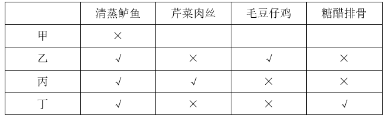

故正确答案为C。

**来源**：2023年江苏省公务员录用考试《行测》题（A类）（网友回忆版）第105题

### 第 106 题

红色研学：指以中国革命或社会主义建设时期的历史、事迹和精神为主题，以相关纪念地、标志物等为载体组织开展的旅游活动。

下列属于红色研学的是（ ）。

A. 每到节假日都有很多学生来到渡江胜利纪念馆，了解新中国诞生的历史，学习革命先辈的英勇献身精神，观赏长江美景

B. 某实验中学的近百名团员在老师带领下来到北大荒开发建设纪念馆，从讲解员的介绍中感受了北大荒建设的艰辛及辉煌成就

C. 寒假期间，市文化中心推出“培根铸魂颂中华”活动，组织青少年吟诵爱国主义诗词作品，增强对中华文化的自豪感

D. 清明节前夕，某大学组织学生党员到市郊革命烈士陵园开展义务宣讲活动，为外地游客讲述烈士事迹，受到游客的广泛赞誉

第 106 题 · 答案与解析

**参考答案（粉笔题库参考内容）**

B

**解析**

第一步：找出定义关键词。

“以中国革命或社会主义建设时期的历史、事迹和精神为主题”、“以相关纪念地、标志物等为载体”、“组织开展的旅游活动”。

第二步：逐一分析选项。

A项：每到节假日都有很多学生来到渡江胜利纪念馆，不明确是学生自发的行为还是组织开展的旅游活动，不符合“组织开展的旅游活动”，不符合定义，排除；

B项：团员们在老师带领下来到北大荒开发建设纪念馆，符合“以相关纪念地、标志物等为载体”、“组织开展的旅游活动”，团员们从讲解员的介绍中感受了北大荒建设的艰辛及辉煌成就，符合“以中国革命或社会主义建设时期的历史、事迹和精神为主题”，符合定义，当选；

C项：青少年吟诵爱国主义诗词作品的活动场所为市文化中心，且该活动不属于旅游活动，不符合“以相关纪念地、标志物等为载体”、“组织开展的旅游活动”，不符合定义，排除；

D项：大学组织学生党员到市郊革命烈士陵园开展义务宣讲活动，为外地游客讲述烈士事迹，说明学生党员来到烈士陵园的目的不是旅游，不符合“组织开展的旅游活动”，不符合定义，排除。

故正确答案为B。

**考点**：单定义-其他句式

**来源**：2023年江苏省公务员录用考试《行测》题（A类）（网友回忆版）第106题

### 第 107 题

形象转移：指消费者将对某品牌特定产品的认同感转移到该品牌的新产品上，也指企业利用旗舰产品的良好形象推出相关产品，以迅速占领市场的经营策略。

下列属于形象转移的是：

A. 某品牌洗衣机一直稳居市场占有率前三名。其公司乘势而上，最近又开发出了针对小件衣物的迷你型产品

B. 倪先生购买了某品牌的一款新手机。尽管价格很高，他还是买了经该品牌认证的耳机、充电器等配套产品

C. 某知名品牌电动自行车广受欢迎，为满足需要，厂家扩大生产规模，产量大幅增长，投放市场后仍然供不应求

D. 某知名玩具公司趁着世界杯的热度，推出了利用传统榫卯技艺制作、不用钉子胶水的木质足球玩具，很快就被小球迷抢购一空

第 107 题 · 答案与解析

**参考答案（粉笔题库参考内容）**

A

**解析**

第一步：找出定义关键词。

“企业利用旗舰产品的良好形象推出相关产品，以迅速占领市场”。

第二步：逐一分析选项。

A项：某品牌洗衣机一直稳居市场占有率前三名，说明该品牌洗衣机具有良好形象，消费者对其有认同感，该品牌由此开发出了迷你型产品，符合“企业利用旗舰产品的良好形象推出相关产品，以迅速占领市场”，符合定义，当选；

B项：倪先生购买了某品牌手机后还购买了经该品牌认证的耳机、充电器等配套产品，但并不清楚手机是否为该品牌旗舰产品、形象是否良好，不符合“企业利用旗舰产品的良好形象推出相关产品，以迅速占领市场”，不符合定义，排除；

C项：某知名电动自行车厂家只是扩大生产规模，其生产销售的产品仍然是电动自行车，没有推出相关产品，不符合“企业利用旗舰产品的良好形象推出相关产品，以迅速占领市场”，不符合定义，排除；

D项：某知名玩具公司利用的是世界杯的热度推出了足球玩具，不是利用其旗舰产品的良好形象，不符合“企业利用旗舰产品的良好形象推出相关产品，以迅速占领市场”，不符合定义，排除。

故正确答案为A。

**考点**：拆词

**来源**：2023年江苏省公务员录用考试《行测》题（A类）（网友回忆版）第107题

### 第 108 题

智慧城乡建设：指在城乡建设过程中，以大数据、物联网等数字化技术为基础，通过多领域数据的互联互通，提高政府治理效能及宜居度的举措。

下列属于智慧城乡建设的是（ ）。

A. 某县小商品市场利用物联网技术，强化产品质量溯源体系建设，所有商品实现了“带证上网、带码上线、带标上市”，交易额大幅提高

B. 某现代农业园采用多项“5G+农业”技术，通过上百个监测点实时监测作物生长情况，把各区域的温度、湿度等数据传输到控制中心，根据数据进行种苗选育、水肥管控

C. 某公司针对城区道路上下班高峰期的拥堵问题，研发出了一套新的智能信控系统，有望实现从“车看灯”到“灯看车”的转变

D. 某地依托城市洪涝数值模拟模型发布了市区积水地图，能直观展示低洼路段、下穿立交等区域的风险点位分布以及相应的避险提示。从此以后，市民雨天出行再也没有出现过安全问题

第 108 题 · 答案与解析

**参考答案（粉笔题库参考内容）**

D

**解析**

第一步：找出定义关键词。

“以大数据、物联网等数字化技术为基础”、“提高政府治理效能及宜居度”。

第二步：逐一分析选项。

A项：某县小商品市场利用物联网技术，强化产品质量溯源体系建设，是该小商品市场的行为，不涉及政府治理、城乡宜居，不符合“提高政府治理效能及宜居度”，不符合定义，排除；

B项：某现代农业园采用“5G+农业”技术是为了方便监测作物生长情况，不涉及政府治理、城乡宜居，不符合“提高政府治理效能及宜居度”，不符合定义，排除；

C项：某公司针对城区道路上下班高峰期的拥堵问题，研发出了新的智能信控系统，是该公司的行为，不涉及政府治理、城乡宜居，不符合“提高政府治理效能及宜居度”，不符合定义，排除；

D项：某地依托城市洪涝数值模拟模型发布了市区积水地图，符合“以大数据、物联网等数字化技术为基础”，方便市民雨天出行，可以提高政府的治理效能，也让城市更宜居，符合“提高政府治理效能及宜居度”，符合定义，当选。

故正确答案为D。

**考点**：方式目的

**来源**：2023年江苏省公务员录用考试《行测》题（A类）（网友回忆版）第108题

### 第 109 题

野性消费：指消费者在特定情形下，为了表达对相关企业产品的支持而有意忽略产品性能、个人消费能力或需求的情感性购买行为。

下列属于野性消费的是：

A. 陈女士自驾游时，看见一个孩子在路边卖土豆，得知他的父亲遭遇车祸后，毫不犹豫买下全部土豆，并开车把他送回了几公里外的家

B. 某地发生自然灾害后，某服装企业低调捐赠了数百万元赈灾物资，网友深受感动，涌入其直播间下单，很多人一买就是几十件

C. 老马包子铺多年来一直向每位进店消费的环卫工赠送两个包子。网友拍到后顶上了热搜，许多顾客纷纷前来购买

D. 刚工作的小邓喜欢“花明天的钱，圆今天的梦”，昨天手机碎屏后立马用分期付款的方式购买了一款心仪已久的折叠屏手机

第 109 题 · 答案与解析

**参考答案（粉笔题库参考内容）**

B

**解析**

第一步：找出定义关键词。

“消费者为了表达对相关企业产品的支持”、“有意忽略产品性能、个人消费能力或需求的情感性购买行为”。

第二步：逐一分析选项。

A项：孩子在路边卖的土豆，不属于企业产品，不符合“消费者为了表达对相关企业产品的支持”，不符合定义，排除；

B项：该服装企业的捐赠行为使网友深受感动，涌入其直播间下单，说明网友的购买行为是为了表达对该企业产品的支持，符合“消费者为了表达对相关企业产品的支持”，很多人一买就是几十件，说明在购买时有意忽略个人需求，符合“有意忽略产品性能、个人消费能力或需求的情感性购买行为”，符合定义，当选；

C项：老马包子铺不明确是否为企业，不符合“消费者为了表达对相关企业产品的支持”，且许多顾客纷纷前来购买包子不明确是否有意忽略产品性能、个人消费能力或需求，不符合“有意忽略产品性能、个人消费能力或需求的情感性购买行为”，不符合定义，排除；

D项：小邓购买了心仪已久的手机，说明是因喜爱该手机而购买，不符合“消费者为了表达对相关企业产品的支持”，且分期付款不代表有意忽视个人消费能力或需求，不符合“有意忽略产品性能、个人消费能力或需求的情感性购买行为”，不符合定义，排除。

故正确答案为B。

**考点**：方式目的

**来源**：2023年江苏省公务员录用考试《行测》题（A类）（网友回忆版）第109题

### 第 110 题

反向旅游：指节假日期间主动避开热点城市、景区，到消费低、游客少的冷门景点，追求个性化、高品质体验的小众旅游活动。

下列属于反向旅游的是（ ）。

A. 退休工程师老周打算在五一期间重游奉献三十年青春的林区，与阔别多年的老同事、老朋友相聚

B. 小陈夫妇新婚旅行没有去人挤人的热点景点，而是选择了一处幽静的民宿住了下来，结识了不少新朋友

C. 春节期间，赵先生全家来到东北一个无名小镇，滑冰、滑雪、看冰灯，没有花多少钱就度过了一个难忘的假期

D. 张先生周末约了几个摄影爱好者一起来到湿地公园，既拍摄到了很多珍稀鸟类，也拍下了各色各样游客的身影

第 110 题 · 答案与解析

**参考答案（粉笔题库参考内容）**

C

**解析**

第一步：找出定义关键词。

“节假日期间”、“主动避开热点城市、景区”、“到消费低、游客少的冷门景点”、“追求个性化、高品质体验”。

第二步：逐一分析选项。

A项：退休工程师五一期间重游奉献三十年青春的林区，不明确林区是否为景点或景区，不符合“到消费低、游客少的冷门景点”，不符合定义，排除；

B项：新婚旅行的时间不明确是否在节假日期间，不符合“节假日期间”，小陈夫妇只是住在幽静的民宿，并不明确是否去冷门景点，也不符合“到消费低、游客少的冷门景点”，不符合定义，排除；

C项：春节期间，符合“节假日期间”，赵先生全家来到东北一个无名小镇，符合“主动避开热点城市、景区”，没花多少钱就度过了一个难忘的假期，说明消费低、体验好，符合“到消费低、游客少的冷门景点”、“追求个性化、高品质体验”，符合定义，当选；

D项：张先生周末到湿地公园拍摄鸟类和游客的身影，周末不是法定节假日，不符合“节假日期间”，拍下各色各样游客的身影，说明到此地游玩的游客人数不少，不符合“到消费低、游客少的冷门景点”，不符合定义，排除。

故正确答案为C。

**考点**：大前提

**来源**：2023年江苏省公务员录用考试《行测》题（A类）（网友回忆版）第110题

### 第 111 题

情感预判：指文学创作中不是一味表现自我，而是以客观事实为依据，换位思考，设想对方的情感反应并作出判断的手法。

下列不属于情感预判的是（ ）。

A. 欲把西湖比西子，淡妆浓抹总相宜

B. 遥知兄弟登高处，遍插茱萸少一人

C. 洛阳亲友如相问，一片冰心在玉壶

D. 何当共剪西窗烛，却话巴山夜雨时

第 111 题 · 答案与解析

**参考答案（粉笔题库参考内容）**

A

**解析**

第一步：找出定义关键词。

“设想对方的情感反应并作出判断”。

第二步：逐一分析选项。

A项：“欲把西湖比西子，淡妆浓抹总相宜”的意思是：如果把西湖比作美女西施，那么无论淡妆浓抹，她总是显得那么美丽。诗人苏轼把西湖之美与西施之美相比，描绘了湖山的晴光雨色，写出了西湖的神韵与灵动的生命力，并不涉及设想对方的情感反应，不符合“设想对方的情感反应并作出判断”，不符合定义，当选；

B项：“遥知兄弟登高处，遍插茱萸少一人”的意思是：远远想到兄弟们身佩茱萸登上高处，也会因为少我一人而生遗憾之情。诗人王维设想了兄弟们对自己未到的遗憾之情，符合“设想对方的情感反应并作出判断”，符合定义，排除；

C项：“洛阳亲友如相问，一片冰心在玉壶”的意思是：洛阳的亲友若是问起我来，就说我的心依然像玉壶里的冰一样纯洁，未受功名利禄等世情的玷污。诗人王昌龄设想了洛阳的亲友对自己的关心，符合“设想对方的情感反应并作出判断”，符合定义，排除；

D项：“何当共剪西窗烛，却话巴山夜雨时”的意思是：什么时候才能回到家乡，在西窗下同你共剪烛花，相互倾诉今宵巴山夜雨中的思念之情。诗人李商隐设想了亲友对自己的思念，符合“设想对方的情感反应并作出判断”，符合定义，排除。

本题为选非题，故正确答案为A。

**考点**：单定义-其他句式

**来源**：2023年江苏省公务员录用考试《行测》题（A类）（网友回忆版）第111题

### 第 112 题

雪糕刺客现象：指原来价格不高的大众化商品由于产品升级、成本上涨或者营销策略等因素涨价幅度过大，造成消费者心理震撼或购买不便。

下列属于雪糕刺客现象的是：

A. 小张花二百多元网购了一盒网红冰淇淋。听到这个离谱的价格，心疼不已的父母足足唠叨了半个小时，直到他吃光了都没停下来

B. 小刘为儿子买了两个新款汽车玩具，几乎花掉了半个月工资。想起自己童年时代几块钱就能买到玩具，不禁感叹时代真的变了

C. 小严到附近花店选了二十几支百合想送给妈妈作为生日礼物，结账时发现竟要五百多元，只好请朋友微信转钱解围。后来才知道这些都是今年新品

D. 丁先生6年前购买了一辆小车，最近打算换车。他来到4S店后，发现同系列的最新款车价格居然是以前的2倍多，吓得赶紧从店里“逃”了出来

第 112 题 · 答案与解析

**参考答案（粉笔题库参考内容）**

B

**解析**

第一步：找出定义关键词。

“原来价格不高的大众化商品”、“由于产品升级、成本上涨或者营销策略等因素”、“涨价幅度过大”、“消费者心理震撼或购买不便”。

第二步：逐一分析选项。

A项：小张花二百多元网购了一盒网红冰淇淋，父母无法接受价格，购买商品的消费者是小张，而不是其父母，不符合“消费者心理震撼或购买不便”，不符合定义，排除；

B项：小刘童年时代几块钱就能买到玩具，而现在几乎花掉了半个月工资才能买到两个新款汽车玩具，不禁感叹时代真的变了，符合“原来价格不高的大众化商品”、“涨价幅度过大”、“消费者心理震撼或购买不便”，符合定义，当选；

C项：小严买花送给妈妈，结账时发现钱不够，没有体现花涨价幅度过大，不符合“涨价幅度过大”，不符合定义，排除；

D项：同系列的最新款车价格是6年前的2倍多，但车原来的价格并不低，不符合“原来价格不高的大众化商品”，不符合定义，排除。

故正确答案为B。

**考点**：原因结果

**来源**：2023年江苏省公务员录用考试《行测》题（A类）（网友回忆版）第112题

### 第 113 题

《现代汉语词典》（第7版）词条排列法如下：单词条目按拼音字母次序排列。同音字按笔画排列，笔画少的在前，笔画多的在后。笔画数相同的，按起笔笔形横（一）、竖（丨），撇（丿）、点（丶）、折（乛）的次序排列。起笔相同的按第二笔笔形的次序排列，以下类推。

据此，汉字：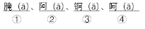在《现代汉语词典》（第7版）中的排列次序是：

A. ②④①③

B. ②④③①

C. ④②③①

D. ④②①③

第 113 题 · 答案与解析

**参考答案（粉笔题库参考内容）**

B

**解析**

第一步：找出定义关键词。

“单词条目按拼音字母次序排列”、“同音字按笔画排列，笔画少的在前，笔画多的在后”、“笔画数相同的，按起笔笔形横（一）、竖（丨），撇（丿）、点（丶）、折（乛）的次序排列”、“起笔相同的按第二笔笔形的次序排列，以下类推”。

第二步：逐一分析题干信息。

根据“单词条目按拼音字母次序排列”分析：①腌（ā）、②阿（ā）、③锕（ā）、④呵（ā）四个字为同音字，无法直接根据拼音字母次序排列，需继续逐一分析四个字的笔画；

再根据“同音字按笔画排列，笔画少的在前，笔画多的在后”分析：①腌：12笔画；②阿：7笔画；③锕：12笔画；④呵：8笔画，故“②阿”应排在第一个，“④呵”应排在第二个，剩下的“①腌”与“③锕”笔画相同，需继续分析二者的起笔笔形；

再根据“笔画数相同的，按起笔笔形横（一）、竖（丨），撇（丿）、点（丶）、折（乛）的次序排列”分析：“①腌”与“③锕”的起笔笔形均为“撇（丿）”，无法直接根据起笔笔形排列，需继续分析二者的第二笔笔形；

再根据“起笔相同的按第二笔笔形的次序排列，以下类推”分析：“①腌”与“③锕”的第二笔笔形分别为“折（乛）”与“横（一）”，故“③锕”排在“①腌”的前面，即“③锕”排在第三个，“①腌”排在第四个。

综上所述，四个字的排列次序应为：②④③①。

故正确答案为B。

**考点**：单定义-其他句式

**来源**：2023年江苏省公务员录用考试《行测》题（A类）（网友回忆版）第113题

### 第 114 题

社交称谓缺位：指面对面交往过程中，由于汉语本身对交际对象没有确切、得体的称呼词语而造成尴尬的现象。

下列属于社交称谓缺位的是（ ）。

A. 董先生在超市偶遇多年不见的高中同学，聊了半天也没想起他的名字，最后只好用“老同学”这个称呼混了过去

B. 小赵性格内向，又不擅长推测别人的年龄，每次在电梯间碰到邻居时都不知道怎样打招呼，生怕自己得罪了人

C. 刚读大学的小孙昨天在街上遇到小朋友喊她“阿姨”，听到这个称呼她当场就愣住了，因为她觉得自己也还是个孩子

D. 小丁第一次到汪老师家中做客，见到她丈夫时竟然找不到合适的称呼，情急之下憋出了“师爸”这个词，窘得真想找个地缝钻进去

第 114 题 · 答案与解析

**参考答案（粉笔题库参考内容）**

D

**解析**

第一步：找出定义关键词。

“面对面交往过程中”、“由于汉语本身对交际对象没有确切、得体的称呼词语”、“造成尴尬”。

第二步：逐一分析选项。

A项：偶遇多年不见的高中同学，没想起他的名字，只好称呼其为“老同学”，是因为时间久远忘记了如何称呼对方，不符合“由于汉语本身对交际对象没有确切、得体的称呼词语”，不符合定义，排除；

B项：小赵性格内向，又不擅长推测别人的年龄，碰到邻居时不知道怎么打招呼，是因为他个人的性格不知道如何称呼对方，不符合“由于汉语本身对交际对象没有确切、得体的称呼词语”，不符合定义，排除；

C项：小朋友喊刚读大学的小孙“阿姨”，该称呼对于二人的年龄来说是确切的，小孙听到称呼后愣住，觉得自己还是个孩子，是因为她个人心理上不适应、不习惯，不符合“由于汉语本身对交际对象没有确切、得体的称呼词语”，不符合定义，排除；

D项：小丁见到老师的丈夫时找不到合适的称呼，符合“面对面交往过程中”，情急之下称呼其为“师爸”，是因为汉语中没有专属女性老师配偶的称谓，符合“由于汉语本身对交际对象没有确切、得体的称呼词语”，窘得想找个地缝钻进去，符合“造成尴尬”，符合定义，当选。

故正确答案为D。

**考点**：原因结果

**来源**：2023年江苏省公务员录用考试《行测》题（A类）（网友回忆版）第114题

### 第 115 题

桔槔：指一种从井里往外打水的工具。其结构相当于普通的杠杆，横杆的中间由竖柱支撑或悬吊，横杆的一端用竖杆连接水桶，另一端悬绑重物。汲水时， 压竖杆则水桶向下灌水，灌满后压另一头，水桶就提升到井外。

下列属于桔槔的是：

A. 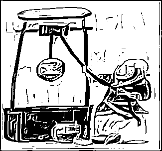

B. 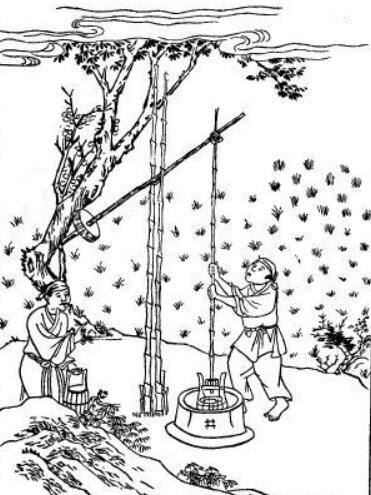

C. 

D. 

第 115 题 · 答案与解析

**参考答案（粉笔题库参考内容）**

B

**解析**

第一步：找出定义关键词。

“从井里往外打水的工具”、“横杆的中间由竖柱支撑或悬吊”、“横杆的一端用竖杆连接水桶，另一端悬绑重物”。

第二步：逐一分析选项。

A项：该图中的人物通过捯井绳从井中打水，符合“从井里往外打水的工具”，但该工具中横杆的两端由竖柱支撑，不符合“横杆的中间由竖柱支撑或悬吊”，且横杆的中间由井绳连接水桶，也未悬绑重物，不符合“横杆的一端用竖杆连接水桶，另一端悬绑重物”，不符合定义，排除；

B项：该图中的人物通过工具从井中打水，符合“从井里往外打水的工具”，且该工具中横杆的中间由竖柱支撑，符合“横杆的中间由竖柱支撑或悬吊”，该工具右侧的一端用竖杆连接水桶，左侧的一端悬绑重物，符合“横杆的一端用竖杆连接水桶，另一端悬绑重物”，符合定义，当选；

C项：该图工具中横杆的一端并未悬绑重物，也不明确另一端是否连接水桶，不符合“横杆的一端用竖杆连接水桶，另一端悬绑重物”，不符合定义，排除；

D项：该图工具中横杆的一端并未连接水桶，另一端也并未悬绑重物，不符合“横杆的一端用竖杆连接水桶，另一端悬绑重物”，不符合定义，排除。

故正确答案为B。

**考点**：单定义-其他句式

**来源**：2023年江苏省公务员录用考试《行测》题（A类）（网友回忆版）第115题

## 材料 4

2021年，我国国内生产总值114.4万亿元，占世界经济总值的比重达18.5%，比2012年提高了7.2个百分点。2013-2021年，我国国内生产总值年均增长6.6%；一般公共预算收入年均增长5.8%；制造业增加值年均增长6.4%，其中规模以上高技术制造业、装备制造业增加值年均分别增长11.6%、9.2%，分别快于规模以上工业增加值4.8个百分点、2.4个百分点，服务业增加值年均增长7.4%。

2021年，我国移动互联网接入流量2216亿GB，是2012年的252倍；互联网上网人数10.3亿人，比2012年增长83.0%。2021年末，累计建成并开通5G基站142.5万个，5G基站总量占全球的60.0%以上。

2021年，全国地级及以上城市平均空气质量优良天数占比为87.5%，比2015年提高6.3个百分点，PM2.5年均浓度为30毫克/立方米，比2015年下降34.8%；地表水考核断面中，水质优良（Ⅰ~Ⅲ类）断面占比为84.9%，比2012年提高23.2个百分点。2021年末，城市污水、生活垃圾无害化处理率分别为97.5%、99.9%，比2012年末分别提高10.2个百分点、15.1个百分点。

### 第 116 题

2012年末，全国城市污水处理率为（ ）。

A. 82.4%

B. 84.8%

C. 87.3%

D. 89.7%

第 116 题 · 答案与解析

**参考答案（粉笔题库参考内容）**

C

**解析**

定位文字材料第三段可得：2021年末全国城市污水处理率为97.5%，比2012年末提高10.2个百分点。则2012年末全国城市污水处理率=97.5%-10.2%=87.3%。

故正确答案为C。

**来源**：2023年江苏省公务员录用考试《行测》题（A类）（网友回忆版）第116题

### 第 117 题

下列各项中，2021年其增加值占我国国内生产总值的比重比2012年下降的是（ ）。

A. 制造业

B. 规模以上装备制造业

C. 服务业

D. 规模以上高技术制造业

第 117 题 · 答案与解析

**参考答案（粉笔题库参考内容）**

A

**解析**

根据题干“······2021年······占······的比重比2012年下降的是”，可判定本题为两期比重问题。定位文字材料第一段可得：2013-2021年，我国国内生产总值年均增长6.6%，制造业增加值年均增长6.4%，其中规模以上高技术制造业、装备制造业增加值年均分别增长11.6%、9.2%，服务业增加值年均增长7.4%。根据两期比重比较结论“当部分增长率<整体增长率时，比重下降”，结合年均增长率公式“”及一般增长率公式“”可知，当n一定，r_年均越大，r越大，则，可用r_年均代替r进行两期比重比较，因制造业增加值年均增长率（6.4%）<国内生产总值年均增长率（6.6%），则2021年增加值占我国国内生产总值的比重比2012年下降的是制造业。

故正确答案为A。

**来源**：2023年江苏省公务员录用考试《行测》题（A类）（网友回忆版）第117题

### 第 118 题

2015年全国地级及以上城市PM2.5年均浓度为（ ）。

A. 38毫克/立方米

B. 42毫克/立方米

C. 46毫克/立方米

D. 49毫克/立方米

第 118 题 · 答案与解析

**参考答案（粉笔题库参考内容）**

C

**解析**

根据题干“2015年······年均浓度为”，结合材料时间为2021年，可判定本题为基期计算问题。定位文字材料第三段可得：2021年，全国地级及以上城市PM2.5年均浓度为30毫克/立方米，比2015年下降34.8%。根据公式：基期量，则题干所求毫克/立方米。

故正确答案为C。

**来源**：2023年江苏省公务员录用考试《行测》题（A类）（网友回忆版）第118题

### 第 119 题

2021年我国互联网上网者人均移动互联网接入流量是2012年的（ ）。

A. 105倍

B. 114倍

C. 126倍

D. 138倍

第 119 题 · 答案与解析

**参考答案（粉笔题库参考内容）**

D

**解析**

根据题干“2021年······是2012年的”，结合选项为倍数及材料时间为2021年，可判定本题为基期倍数问题。定位文字材料第二段可得：2021年，我国移动互联网接入流量2216亿GB，是2012年的252倍；互联网上网人数10.3亿人，比2012年增长83.0%。根据公式：基期量，上网者人均移动接入流量，则题干所求倍数倍。

故正确答案为D。

**来源**：2023年江苏省公务员录用考试《行测》题（A类）（网友回忆版）第119题

### 第 120 题

能够从上述资料中推出的是（ ）。

A. 2021年全国一般公共预算收入同比增长5.8%

B. 2021年末全球5G基站总量超过250万个

C. 2012年我国国内生产总值占世界经济总量的比重为11.3%

D. 2015年全国地表水考核断面中，水质优良（Ⅰ~Ⅲ类）断面占比为61.6%

第 120 题 · 答案与解析

**参考答案（粉笔题库参考内容）**

C

**解析**

A项：定位文字材料第一段可得，2013-2021年我国一般公共预算收入年均增长5.8%。仅给出了2013-2021年我国一般公共预算收入年均增速，无法推出2021年全国一般公共预算收入同比增速，错误；

B项：定位文字材料第二段可得，2021年末我国累计建成并开通5G基站142.5万个，5G基站总量占全球的60.0%以上。根据公式：比重，则2021年末全球5G基站总量万个，即不到250万个，错误；

C项：定位文字材料第一段可得，2021年我国国内生产总值占世界经济总值的比重达18.5%，比2012年提高了7.2个百分点。则2012年我国国内生产总值占世界经济总量的比重=18.5%-7.2%=11.3%，正确；

D项：定位文字材料第三段可得，2021年全国地表水考核断面中，水质优良（Ⅰ~Ⅲ类）断面占比为84.9%，比2012年提高23.2个百分点。因所求比重时间为2015年，故无法推出，错误。

故正确答案为C。

**来源**：2023年江苏省公务员录用考试《行测》题（A类）（网友回忆版）第120题

## 材料 5

2021年，我国制作综艺益智类电视节目时长30.0万小时，比上年下降12.2%；播出综艺益智类电视节目时长109.5万小时，下降5.5%。制作广播剧类节目时长22.4万小时，比上年增长2.4%，播出广播剧类节目时长97.8万小时，增长0.4%。

### 第 121 题

2017-2021年我国播出影视剧类电视节目时长增加最多的年份是（ ）。

A. 2017年

B. 2018年

C. 2019年

D. 2021年

第 121 题 · 答案与解析

**参考答案（粉笔题库参考内容）**

A

**解析**

根据题干“2017-2021年······增加最多······”，可以判定本题为增长量比较问题。定位统计表可得：2016-2021年，我国播出影视剧类电视节目时长分别为：765.2万小时、798.8万小时、822.1万小时、848.5万小时、873.1万小时、884.3万小时。根据公式：增长量=现期量-基期量，可得选项中各年份我国播出影视剧类电视节目时长的增长量分别为：

2017年：万小时；

2018年：万小时；

2019年：万小时；

2021年：万小时；

则增长最多的年份是2017年。

故正确答案为A。

**来源**：2023年江苏省公务员录用考试《行测》题（A类）（网友回忆版）第121题

### 第 122 题

2017-2021年我国播出综艺益智类广播节目时长年平均减少（ ）。

A. 5.7万小时

B. 6.2万小时

C. 6.8万小时

D. 7.8万小时

第 122 题 · 答案与解析

**参考答案（粉笔题库参考内容）**

C

**解析**

根据题干“2017-2021年······年平均减少”，结合选项带单位，可判定本题为年均增长量问题。定位统计表可得：2016年我国播出综艺益智类广播节目时长为388.3万小时，2021年为354.3万小时。根据公式：年均增长量，可得所求万小时，即减少6.8万小时。

故正确答案为C。

**来源**：2023年江苏省公务员录用考试《行测》题（A类）（网友回忆版）第122题

### 第 123 题

下列各项中，2021年同比增速最小的是（ ）。

A. 制作综艺益智类电视节目时长

B. 制作影视剧类电视节目时长

C. 播出综艺益智类电视节目时长

D. 播出综艺益智类广播节目时长

第 123 题 · 答案与解析

**参考答案（粉笔题库参考内容）**

B

**解析**

根据题干“······2021年同比增速最小的是······”，可以判定本题为一般增长率问题。定位统计表可得：2020年，制作影视剧类电视节目时长为9.5万小时，播出综艺益智类广播节目时长为364.2万小时；2021年，制作影视剧类电视节目时长为7.5万小时，播出综艺益智类广播节目时长为354.3万小时；定位文字材料可得：2021年，我国制作综艺益智类电视节目时长比上年下降12.2%；播出综艺益智类电视节目时长下降5.5%。即制作综艺益智类电视节目时长的同比增速为-12.2%，播出综艺益智类电视节目时长的同比增速为-5.5%。根据公式：增长率，可知2021年，制作影视剧类电视节目时长的同比增速；播出综艺益智类广播节目时长的同比增速。比较可得，制作影视剧类电视节目时长的同比增速（-21.1%）最小，对应B项。

故正确答案为B。

**来源**：2023年江苏省公务员录用考试《行测》题（A类）（网友回忆版）第123题

### 第 124 题

2021年我国综艺益智类广播节目制作时长比“十三五”时期年均制作时长少（ ）。

A. 5.5%

B. 6.9%

C. 7.3%

D. 8.0%

第 124 题 · 答案与解析

**参考答案（粉笔题库参考内容）**

A

**解析**

根据题干“2021年······比······少”，结合选项为百分数，可以判定本题为一般增长率问题。定位统计表可得：2016-2021年，我国综艺益智类广播节目制作时长分别为210.4万小时、210.6万小时、208.0万小时、199.5万小时、197.8万小时、193.9万小时。则“十三五”时期，我国综艺益智类广播节目年均制作时长万小时。根据公式：增长率，可得所求，即少5.4%，与A项最接近。

故正确答案为A。

**来源**：2023年江苏省公务员录用考试《行测》题（A类）（网友回忆版）第124题

### 第 125 题

能够从上述资料中推出的是（ ）。

A. 2016-2021年我国播出影视剧类电视节目时长逐年增加

B. 2021年我国播出当年制作综艺益智类电视节目时长为30.0万小时

C. 2021年我国制作综艺益智类广播节目时长是制作影视剧类电视节目时长的25.9倍

D. “十三五”时期，我国制作综艺益智类广播节目时长与制作影视剧类节目时长之差逐年增大

第 125 题 · 答案与解析

**参考答案（粉笔题库参考内容）**

C

**解析**

A项：定位统计表可知，2016-2021年我国播出影视剧类电视节目的时长，但材料当中没有给出2015年的数据，因此无法确定2016年的时长是否增加，故无法推出，错误；

B项：定位文字材料可知，2021年，我国制作综艺益智类电视节目时长为30.0万小时，但当年制作的电视节目并非一定在当年播放，故无法推出，错误；

C项：定位统计表可知，2021年我国制作综艺益智类广播节目时长为193.9万小时，制作影视剧类电视节目时长为7.5万小时。则所求倍数倍，正确；

D项：定位统计表可知，“十三五”时期，我国制作综艺益智类广播节目时长与制作影视剧类节目时长。可知2016年二者之差为210.4-11.9=198.5万小时；2017年为210.6-15.3=195.3万小时，则2017年二者之差低于2016年，并非逐年增大，错误。

故正确答案为C。

**来源**：2023年江苏省公务员录用考试《行测》题（A类）（网友回忆版）第125题

## 材料 6

2021年和2022年某市统计局通过两次调查，分别获取了该市1181位和1107位60岁以上老年人使用智能手机的有关情况。其中，2022年受访者中，年龄在61~70岁的占71.2%，71~80岁的占24.2%，81岁及以上的占4.6%。

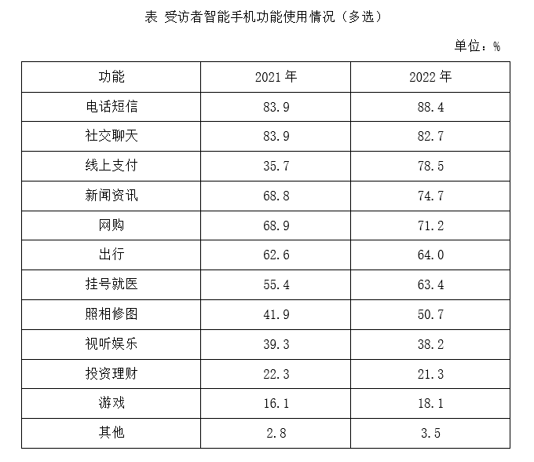

### 第 126 题

2021年受访者中，使用智能手机没有困难的有（ ）。

A. 393人

B. 401人

C. 419人

D. 428人

第 126 题 · 答案与解析

**参考答案（粉笔题库参考内容）**

D

**解析**

根据题干“2021年受访者中，使用智能手机没有困难的有”，结合材料给出2021年使用智能手机没有困难受访者的占比，可判定本题为现期比重问题。定位文字材料可得：2021年，该市统计局获取了该市1181位60岁以上老年人使用智能手机的有关情况。定位图1可得：2021年受访者中，使用智能手机没有困难的占36.2%。根据公式：部分=整体×比重，则所求人，与D项最接近。

故正确答案为D。

**来源**：2023年江苏省公务员录用考试《行测》题（A类）（网友回忆版）第126题

### 第 127 题

2022年71~80岁的受访者使用“线上支付”功能的人数有可能介于（ ）。

A. 11~15

B. 17~21

C. 23~28

D. 30~39

第 127 题 · 答案与解析

**参考答案（粉笔题库参考内容）**

D

**解析**

根据题干“2022年71~80岁的受访者使用‘线上支付’功能的人数······”，结合材料给出2022年受访者中年龄在71~80岁以及使用“线上支付”功能人数的占比，可判定本题为现期比重问题。定位文字材料可得：2022年，该市统计局获取了1107位60岁以上老年人使用智能手机的有关情况，年龄在71~80岁的占24.2%。定位表格材料可得：2022年，受访者使用“线上支付”功能的占78.5%。因为24.2%+78.5%=102.7%＞100%，故71~80岁的受访者和使用“线上支付”功能的受访者一定有交集，则2022年71~80岁的受访者使用“线上支付”功能的人数至少有人，仅D项满足。

故正确答案为D。

**来源**：2023年江苏省公务员录用考试《行测》题（A类）（网友回忆版）第127题

### 第 128 题

表中所列智能手机的12个功能项中，2022年受访者中使用人数多于2021年的功能项数占比为（ ）。

A. 41.7%

B. 50.0%

C. 58.3%

D. 75.0%

第 128 题 · 答案与解析

**参考答案（粉笔题库参考内容）**

B

**解析**

根据题干“······，2022年······占比为”，可判定本题为现期比重问题。定位文字材料可得：2021年、2022年分别获取了1181位和1107位60岁以上老年人使用智能手机的有关情况。定位表格材料可知，2021年、2022年受访者智能手机功能使用的占比情况。根据公式：部分=整体×比重，可得各项功能的使用人数=受访人数×各项功能使用人数占比，即所求需满足：1107×2022年各项功能使用人数占比>1181×2021年各项功能使用人数占比，整理可得≈1.07，则表中所列智能手机12个功能项2022年与2021年占比的比值分别为：

电话短信，，不满足；

社交聊天，，不满足；

线上支付，，满足；

新闻资讯，，满足；

网购，，不满足；

出行，，不满足；

挂号就医，，满足；

照相修图，，满足；

视听娱乐，，不满足；

投资理财，，不满足；

游戏，，满足；

其他，，满足。

比较可知，表中所列智能手机的12个功能项中，有6项功能满足2022年受访者中使用人数多于2021年，占比。

故正确答案为B。

**来源**：2023年江苏省公务员录用考试《行测》题（A类）（网友回忆版）第128题

### 第 129 题

图2所列的14个改进需求项目中，2022年受访者的人均需求（ ）。

A. 不足2项

B. 不少于2项但不足3项

C. 不少于4项

D. 不少于3项但不足4项

第 129 题 · 答案与解析

**参考答案（粉笔题库参考内容）**

C

**解析**

根据题干“······2022年······人均需求”，结合材料时间为2022年，可判定本题为现期平均数问题。定位图2可知2022年受访者对智能手机各项适老化改进需求的占比情况。根据公式：人均需求项数、部分=整体×比重，则所求\=68.8%+63.3%+55.6%+51.0%+44.5%+33.9%+32.2%+31.5%+31.3%+27.1%+24.0%+16.8%+12.2%+2.7%=4.949>4项，在C项范围内。

故正确答案为C。

**来源**：2023年江苏省公务员录用考试《行测》题（A类）（网友回忆版）第129题

### 第 130 题

能够从上述资料中推出的是（ ）。

A. 2022年受访者中，有“简化页面布局”需求的也有“增大音量”需求

B. 2022年受访者中，有“放大字体”但没有“放大图标”需求的不少于230人

C. 2022年受访者中，使用智能手机没有困难的比重下降是因为广告弹窗多

D. 除“线上支付”外，2022年调查中比上年提升百分点最多的智能手机使用功能是“挂号就医”

第 130 题 · 答案与解析

**参考答案（粉笔题库参考内容）**

B

**解析**

A项，定位图2可得：2022年，有简化页面布局、增大音量需求的受访者的占比分别为31.5%、31.3%。因为31.5%+31.3%=62.8%<100%，即有简化页面布局需求的受访者不一定有增大音量需求，错误；

B项，定位文字材料可得：2022年，该市统计局获取了1107位60岁以上老年人使用智能手机的有关情况。定位图2可得：2022年，有放大字体、放大图标需求的受访者的占比分别为55.6%、33.9%。假设有放大图标需求的受访者均有放大字体需求，此时有“放大字体”但没有“放大图标”需求的人最少，即同时有两类需求的占比为33.9%，有放大字体需求但没有放大图标需求的占比为55.6%-33.9%=21.7%。根据公式：部分=整体×比重，可得2022年受访者中，有“放大字体”但没有“放大图标”需求的人数至少为≈240人>230人，正确；

C项，整篇材料中均未给出2022年受访者中，使用智能手机没有困难比重下降的原因，故无法判断，错误；

D项，定位表格材料可得：2021、2022年受访者使用智能手机挂号就医功能的占比分别为55.4%、63.4%；照相修图功能的占比分别为41.9%、50.7%。故2022年调查中挂号就医功能比上年提升63.4%-55.4%=8%，即8个百分点；照相修图功能比上年提升50.7%-41.9%=8.8%，即8.8个百分点。则除“线上支付”外，2022年调查中比上年提升百分点最多的智能手机使用功能并非是“挂号就医”，错误。

故正确答案为B。

**来源**：2023年江苏省公务员录用考试《行测》题（A类）（网友回忆版）第130题

## 材料 7

2021年，我国对外贸易总额为6.9万亿美元，比上年增长30.2%，比2012年多2.5万亿美元，连续两年成为世界第一大贸易国。其中，服务贸易总额82.1百亿美元，占世界的比重升至7.2%，较2012年提高1.8个百分点。实际使用外商直接投资，由2012年的11.3百亿美元增加到2021年的17.4百亿美元，年均增长4.8%。

### 第 131 题

2020年我国对外贸易总额是：

A. 5.8万亿美元

B. 5.3万亿美元

C. 4.9万亿美元

D. 4.6万亿美元

第 131 题 · 答案与解析

**参考答案（粉笔题库参考内容）**

B

**解析**

根据题干“2020年我国对外贸易总额是”，结合材料时间为2021年，可判定本题为基期计算问题。定位文字材料可得：2021年，我国对外贸易总额为6.9万亿美元，比上年增长30.2%。根据公式：，则2020年我国对外贸易总额为万亿美元。

故正确答案为B。

**来源**：2023年江苏省公务员录用考试《行测》题（A类）（网友回忆版）第131题

### 第 132 题

表中所列的国家或地区中，2021年货物进出口总额增速最小的国家或地区是：

A. 英国

B. 德国

C. 日本

D. 意大利

第 132 题 · 答案与解析

**参考答案（粉笔题库参考内容）**

A

**解析**

根据题干“······增速最小的国家或地区是”，可判定本题为一般增长率问题。定位表格可得：2020年与2021年英国、德国、日本、意大利的货物进出口总额。根据公式：增长率，则选项中所示国家和地区中，2021年货物进出口总额同比增速分别为：

英国：；

德国：；

日本：；

意大利：。

综上可得，表中所列的国家或地区中2021年货物进出口总额增速最小的国家或地区是英国。

故正确答案为A。

**来源**：2023年江苏省公务员录用考试《行测》题（A类）（网友回忆版）第132题

### 第 133 题

2012年我国服务贸易总额占世界的比重为：

A. 7.2%

B. 6.8%

C. 6.3%

D. 5.4%

第 133 题 · 答案与解析

**参考答案（粉笔题库参考内容）**

D

**解析**

根据题干“2012年······占······的比重为”，结合材料时间为2021年，可判定本题为基期比重问题。定位文字材料可得：2021年，我国服务贸易总额82.1百亿美元，占世界的比重升至7.2%，较2012年提高1.8个百分点。则2012年我国服务贸易总额占世界的比重为7.2%-1.8%=5.4%。

故正确答案为D。

**来源**：2023年江苏省公务员录用考试《行测》题（A类）（网友回忆版）第133题

### 第 134 题

表中所列的国家或地区中，2021年货物进出口总额较2012年增加的国家或地区有：

A. 6个

B. 7个

C. 8个

D. 9个

第 134 题 · 答案与解析

**参考答案（粉笔题库参考内容）**

C

**解析**

定位表格可知2012年、2021年表中所列的国家或地区货物进出口总额。比较可得，2021年货物进出口总额较2012年增加的国家或地区有：中国（605.2百亿美元>386.7百亿美元）、美国（469.2百亿美元>388.2百亿美元）、德国（305.1百亿美元>255.6百亿美元）、荷兰（159.3百亿美元>124.2百亿美元）、中国香港（138.2百亿美元>104.6百亿美元）、法国（129.9百亿美元>124.3百亿美元）、韩国（125.0百亿美元>106.8百亿美元）、意大利（116.1百亿美元>99.0百亿美元），共8个。

故正确答案为C。

**来源**：2023年江苏省公务员录用考试《行测》题（A类）（网友回忆版）第134题

### 第 135 题

从上述资料中不能推出的是：

A. 2021年中国香港货物进出口总额比2012年多33.6百亿美元

B. 2021年中国货物进出口总额比上年增加139.6百亿美元

C. 2021年我国实际使用外商直接投资比2012年多7.0百亿美元以上

D. 表中所列国家或地区中，2012、2020和2021年货物进出口总额位次不变的有2个

第 135 题 · 答案与解析

**参考答案（粉笔题库参考内容）**

C

**解析**

A项：定位表格可得：2021年中国香港货物进出口总额为138.2百亿美元，2012年为104.6百亿美元。138.2-104.6=33.6百亿美元，即2021年中国香港货物进出口总额比2012年多33.6百亿美元，正确；

B项：定位表格可得：2021年中国货物进出口总额为605.2百亿美元，2020年为465.6百亿美元。605.2-465.6=139.6百亿美元，即2021年中国货物进出口总额比上年增加139.6百亿美元，正确；

C项：定位文字材料可得：（我国）实际使用外商直接投资，由2012年的11.3百亿美元增加到2021年的17.4百亿美元。17.4-11.3=6.1百亿美元，即2021年我国实际使用外商直接投资比2012年多不到7.0百亿美元，错误；

D项：定位表格可知，2012、2020和2021年表中货物进出口总额位次不变的国家（地区）有德国、意大利，共2个，正确。

本题为选非题，故正确答案为C。

**来源**：2023年江苏省公务员录用考试《行测》题（A类）（网友回忆版）第135题

