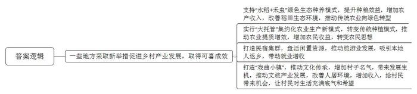
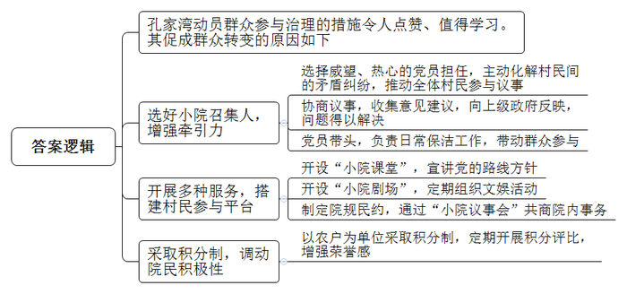
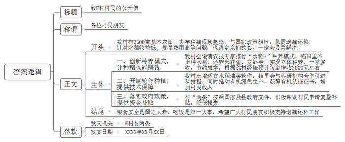
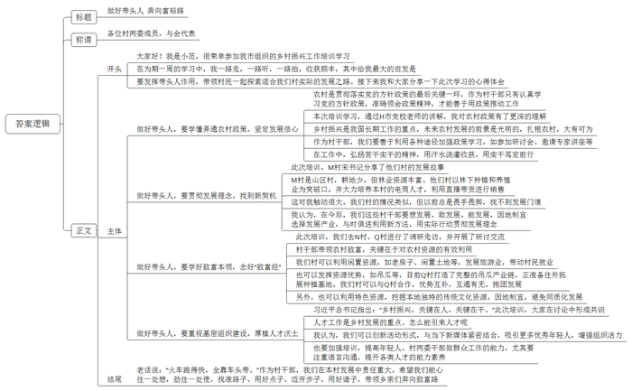

# 2024年江苏省公考《申论》题（C卷）

<!-- gwy:overview:start -->
> **江苏 · 2024 · 申论 · C卷** ｜ 4 题 · 图片 4 处 · 答案随题折叠

导航：[题目](#题目) · [材料 1](#材料-1)
<!-- gwy:overview:end -->

> 候选采集稿。参考答案及解析来自粉笔页面，不代表官方答案或真实高分答卷；来源使用许可与原卷对应关系仍需人工核实。

## 给定材料

### 材料 1

稻田里竟然养起了虫子！这桩新鲜事成了W县Z镇村头巷尾热议的话题。什么样的虫子如此受人关注？原来它叫禾虫，学名疣吻沙蚕，因富含蛋白质，被称为水中的“冬虫夏草”。禾虫既是美食，又是食疗保健佳品。在我国东南沿海和东南亚等地大受追捧，价格不菲。养禾虫的是人称“肥胆儿”的老王，当地有名的种田大户。前些年，他一次性流转来500亩水田，种植高端丝苗米香稻。如今，他的胆儿更“肥”了，在稻田里养起了禾虫。

“‘水稻+禾虫’是一种绿色生态种养模式，不能用除草剂，农药、化肥也都不能用。”正在察看水稻长势的老王向围观的村民介绍说，“禾虫会吃掉腐烂的稻根和茎叶、田里的浮游生物，减少水稻病害。它爱钻洞，可松动土壤，粪便是优质有机肥料。”有村民问：“你以前没养过，出现了问题怎么办呢？”“放心，县里很重视，专门给我配备了农技专家，一对一指导！”老王自信地说。

村民最关心的还是收入问题，老王给大家算了一笔账：不用化肥、农药，稻米产量要低一些，每亩净产大米300斤左右，但这样的大米质优价高，每斤能卖20元，而且供不应求，单这一项算下来就不比以前低。养禾虫的收入就更不用说了，一亩稻田可产出禾虫200到300斤，目前市场价每斤180元左右。“你们自己算算，看合不合算吧！”听了老王的介绍，不少村民跃跃欲试。

作为新当选的全国人大代表，老王准备明年“两会”期间提交一份建议，希望推广“高端香稻+禾虫”绿色生态种养模式。

### 材料 2

材料5

孔家湾是个“同心小院”，远近闻名。“同心小院”不是普通院子，它是T县推出的创新惠民工程。“同心小院”的组建，综合考虑村民聚居程度、亲缘关系和党员分布等情况，按照便于组织、便于服务的原则，以10-20户的传统院落为中心，吸纳周边散居农户参与。W村的孔家湾是首批试点之一，小院内有18户人家，近70人。经院民集体推选、村党支部同意，有威望又热心肠的退休党员老章被选为小院召集人。不过，第一次召开“小院议事会”老章就碰到了“钉子”：老唐和另外两户院民，因为老一辈之间的矛盾纠纷，见面招呼都不打，更不用说坐在一起开会了。“这样可不行！”老章和其他热心院民反复劝说，三家人终于解开了心结，“小院议事会”也顺利召开了。

按下葫芦浮起瓢，没过几天，老罗又来诉苦了。老罗家外面有条露天污水沟，过往村民无不抱怨味道大，老罗一家更是苦不堪言，但污水沟属于公共区域，改造费用大，大家你看我、我看你，都拿不出好主意。怎么办？老章组织了好几次议事会来商议，最终小院汇合大家的意见建议并反映给了上级。镇里研究后，决定结合正在全镇开展的美丽小院环境整治行动，重新铺设暗渠，困扰老罗的问题和小院的卫生死角问题一并得到了解决，老章还和其他两位党员商议，创设3个公共卫生责任区，分别牵头负责日常保洁工作，看到几位党员带头了，老罗和其他院民都坐不住了，纷纷报名加入，每天把小院打扫得干干净净。

在有关部门的指导下，孔家湾开设了“小院课堂”，及时宣讲党的路线方针政策；开设“小院剧场”，定期组织文娱活动；制定院规民约，通过“小院议事会”共商院内大小事务。为了调动院民积极性，“同心小院”以农户为单位采取积分制，每月开展积分评比。积分制实施后，院民的荣誉感空前增强。孔家湾小院的变化可谓有目共睹。“现在，小院就像个大家庭，群众都由‘旁边看’转变为‘共同干’了。”老章开心地说。

### 材料 3

材料6

G县W镇F村有3300亩基本农田，以前全种水稻。去年开始，陆续有村民改种莲藕。前年全村自种和出租种植面积达1200多亩，去年又新增了600多亩，基本农田种藕现象蔓延之势与国家政策相悖，亟待遏制。近日，驻村第一书记小余主持召开了基本农田“非粮化”问题整改座谈会，邀请了村民代表、邻村种粮大户代表参加，镇里有关领导也应邀出席指导。以下是座谈会的部分记录：

村民梁大姐：我明白保护耕地的重要性，毕竟吃饭是第一大事嘛，要是种粮食赚钱，不用动员，大家都会抢着种。之所以种莲藕，无非是因为收益高，我家种了四五年的莲藕，有7亩多，正常年景下每亩利润6000多元，现在叫我改种水稻，我的损失谁来补？

村民沈大伯：一熟稻一熟麦，种到胡子白。我今年69岁，孩子都进了城，老两口种5亩田挺吃力的，前年把其中3亩租给外地老板种水稻，租金每亩每年800元。去年听说莲藕种植户给的租金更高，就把剩下的全租给他们了。省力气不说，收入也多不少，我都这把年纪了，要退你们退吧，别折腾我了。

村民韩大嫂：我家10亩地都种了莲藕，现在不让种了，那复垦的钱谁出？

邻村种粮大户老四：我们村以前大面积推广种植瓜蒌，现在都改种了水稻，为了让大家种稻也能赚钱，镇上请来农技专家推行“水稻+”种养模式。刚开始，大多数农户是犹豫观望的，我和另一名党员率先采用新模式，稻田里不只是种水稻，还养了禾花鱼、龙虾、泥鳅，水稻为鱼遮阳、泥鳅净化水质，实现了“立体种养、一田多用、一举多得、一季多收”，节省农药、化肥等成本不说，收入也不低，每年亩产增收3000元左右。

W镇农办雷主任：根据我们掌握的情况，你们村的土壤非常适宜水稻油菜轮作，这样既能保证作物的产量和品质，又能提高土地生产能力。附近D村的条件与你们村相似，他们采用水稻油菜轮作，与中科院合作引进了小种米、紫米等科技稻，同时坚持施用有机绿色肥料，采用物理除草方式，病虫防治也用的是生物农药。今年，他们出产的稻米、菜油都取得了有机转换认证证书，行情看涨。如果你们有意轮作，镇里会给予技术支持和保障。

W镇孙副镇长：粮食安全是“国之大者”，守住耕地红线是政治责任。党的二十大报告强调“全方位夯实粮食安全根基，牢牢守住十八亿亩耕地红线”，今年中央一号文件要求“坚决守牢确保粮食安全底线”“严格控制耕地转为其他农用地”，县里也出台了《防止耕地“非粮化”稳定粮食生产工作方案》等文件。F村耕地非粮化问题比较突出，退藕还稻工作相对滞后，希望干部群众深刻理解党和政府的方针、政策，统一思想，协调好各方利益，积极借鉴其他村子的成功做法，确保退藕还稻工作的圆满完成。

### 材料 4

材料7

为进一步提升驻村第一书记的政治素养、工作能力和组织执行力，更好地发挥他们在乡村振兴中的作用。J市选派30名驻村第一书记到国家乡村振兴工作示范单位H市，参加为期一周的培训学习。行前动员会上，J市委组织部许副部长围绕“出去学什么”“到了怎么学”“回来怎么办”三个方面做了部署。

K村驻村第一书记小范参加了本次培训，以下是小范日记的部分内容。

12月4日 晴 开班第一课，是时事政策解读。H市委党校任教授敏锐地抓住时事热点，深入解读了习近平总书记从浙江到山东枣庄一路考察的深意，展望了未来农村发展的趋势，专家的分析很有道理，看来乡村振兴是我们国家长期工作的重点。扎根农村，大有可为。下午观看电影《卒迹》，这部电影讲的是河南濮阳县西辛庄村党支部书记李连成的故事，他16年苦干实干，带领村民把一个落后贫困的盐碱地村落建成了资产过5亿的企业型村落。李书记的事迹深深地打动了我，值得我终身学习。

12月5日 多云 今天主要是听课学习。上午，H市委党校薛教授的专题讲座“发展壮大新型农村经济，全面推进乡村振兴实现新突破”，讲得特别精彩，让我见识了名家的风采，也加深了对农村政策的理解。下午，讲课的是M村宋书记，他是H市的优秀村党支部书记，发展理念特别接地气，让我深受启发。他们村是个山区村，没有多少耕地，但林业资源丰富，就把发展方向集中在大力发展林下种植业和养殖业上，找到了山区产业发展的突破口。在销售环节，宋书记通过多种方式培养了一批本村的电商人才，甚至亲自上阵直播带货。我们村的情况类似，但以前总是缩手缩脚，找不到发展门道，真得出来长长见识，换换脑子。今天最有趣的课是“村支书实用沟通技巧”，在课上，通过角色扮演，我体会到什么叫“一句话让人跳，一句话让人笑”，做群众工作，语言沟通很重要。

12月6日 晴 今天参观了N村和Q村。空房子、印花布、吊瓜、纺车……这些寻常之物在人家那儿都成了宝贝。N村收储和租赁闲置民房建起了民宿，既发展了乡村旅游，又解决了村民就业；把印花布、葛粉等特色产品做成精致的伴手礼，仅这一项一年就赚了100多万。Q村是有名的吊瓜村，村支书老董抓住吊瓜大做文章。组织种植户与食品公司、合作社联盟，打造种植、加工、展销一体的产业链，使吊瓜成了全村的致富瓜。Q村的吊瓜产业越做越大，正准备往外地拓展种植基地。我们那儿也产吊瓜，我加了董书记的微信，回去后就跟村“两委”汇报商量，争取也能在这个产业上分一杯羹。一路走，一路听，一路拍。我把这里的乡村新面貌分享到村“两委”工作群里，同事们纷纷点赞。

12月7日 阴转小雨 今天培训的内容是研讨交流，现场气氛热烈。谈到美丽乡村建设时，S村贾书记认为，应因地制宜，挖掘本地独特的传统文化资源，不能一个模子套下去，“千村千貌”才是我们社会主义新农村应有的样子。谈到基层组织建设时，R村林书记说，要创新活动形式，与当下新媒体紧密结合，这样才能吸引更多优秀年轻人，增强组织活力。谈到乡村协作时，P村钟书记认为，乡村发展需要优势互补，互通有无，抱团发展，彼此的负担都能减轻，又都能从中受益……大家的见解给了我很大的启发。在探讨村干部如何带领村民致富这个话题时，我在发言中把它概括为“四子”，即找准路子、用好点子、迈开步子，还要用好“诸子”，“诸子”指的是各类人才，我的发言得到大家的一致认可。

12月8日 晴 培训结束，返程。短短几天的学习，我收获满满，很多场景让人流连忘返，很多话语让人回味思考。返程中，我一直在想，人家为什么发展得这么好？我想关键在于带头人。接下来，我要好好总结这次培训学习的收获，与村“两委”的同事们一起探讨如何发挥带头人的作用，带领村民一起探索适合我们村实际的发展之路。

## 题目

### 第 1 题

**“给定资料**1**\-**4**”中，一些地方采取新举措促进乡村产业发展，取得了可喜成效，请用一段话对此进行归纳概括。（20分）**

关联材料：材料 1

作答要求：

要求：紧扣给定资料，全面、准确。篇幅不超过250字。

第 1 题 · 答案与解析

**参考答案（粉笔题库参考内容）**

一些地方采取新举措促进乡村产业发展，取得可喜成效：支持“水稻+禾虫”绿色生态种养模式，提升种粮效益，增加农户收入，改善稻田生态环境，推动传统农业向绿色转型；实行“大托管”集约化农业生产新模式，转变传统种植模式，推动农业提质增效，增加农民收益，转变农民思想；打造民宿集群，盘活闲置资源，推动旅游业发展，吸引本地人返乡，带动就业增收；打造“戏曲小镇”，推动文化传承，增加村子名气，带来发展生机，推动文旅产业发展，改善人居环境，增加收入，给村民带来机会，让村民对生活充满底气和希望。

**参考答案说明**：本答案在开头部分添加适当引导语，然后围绕“促进乡村产业发展”这一主题，分别介绍了“支持‘水稻+禾虫’绿色生态种养模式”“实行‘大托管’集约化农业生产新模式”“打造民宿集群，推动旅游业发展”“打造‘戏曲小镇’，推动文旅产业发展”这四个新举措和取得的成效，并按照资料顺序进行罗列。

**解析**

**考点**：影响类

**来源**：2024年江苏省公考《申论》题（C卷）

> 粉笔申论页面对本题只提供「解析视频」入口，该入口是会员推广位，页面无视频地址与文字解析。

### 第 2 题

**“给定资料**5**”中画线句说“群众都由‘旁边看’转变为‘共同干’了”，请对促成这一转变的原因加以分析。（15分）**

关联材料：材料 2

作答要求：

要求：观点正确，分析透彻，见解深刻。篇幅250字左右。

第 2 题 · 答案与解析

**参考答案（粉笔题库参考内容）**

孔家湾动员群众参与治理的措施令人点赞、值得学习。其促成群众转变的原因如下：1.选好小院召集人，增强牵引力。选择威望、热心的党员担任，主动化解村民间的矛盾纠纷，推动全体村民参与议事；协商议事，收集意见建议，向上级政府反映，问题得以解决；党员带头，负责日常保洁工作，带动群众参与。2.开展多种服务，搭建村民参与平台。开设“小院课堂”，宣讲党的路线方针；开设“小院剧场”，定期组织文娱活动；制定院规民约，通过“小院议事会”共商院内事务。3.采取积分制，调动院民积极性。以农户为单位采取积分制，定期开展积分评比，增强荣誉感。

**参考答案说明：**本参考答案先对“群众由‘旁边看’转变为‘共同干’”进行解释及亮明观点，接着从“选好小院召集人，增强牵引力”“开展多种服务，搭建村民参与平台”“采取积分制，调动院民积极性”这三个方面进行了分条撰写。各条要点之间在内容上相互并列，没有交叉。

**解析**

**考点**：原因类

**来源**：2024年江苏省公考《申论》题（C卷）

> 粉笔申论页面对本题只提供「解析视频」入口，该入口是会员推广位，页面无视频地址与文字解析。

### 第 3 题

**假如你是****“给定资料**6**”中的F村驻村第一书记小余，请以村“两委”的名义拟写一封致村民的公开信，动员村民退藕还稻。（25分）**

关联材料：材料 3

作答要求：

要求：主题明确，结构完整；有针对性，有感召力。篇幅400字左右。

第 3 题 · 答案与解析

**参考答案（粉笔题库参考内容）**

致F村村民的公开信

各位村民朋友：

我村有3300亩基本农田，去年种藕现象蔓延，与国家政策相悖，急需退藕还粮。针对水稻收益低、复垦费用高等问题，也请乡亲们放心，一定会妥善解决。

一、创新种养模式，让种稻也能赚钱。我村会邀请农技专家推行“水稻+”种养模式，稻田里不止种水稻，还养禾花鱼、龙虾等，实现立体种养、一季多收，节约成本，根据邻村经验预计每亩增收3000元左右。

二、开展轮作种植，提供技术保障。我村土壤适宜水稻油菜轮作，镇里会与科研机构合作引进科技稻，同时推动有机绿色生产，获得有机认证证书，增加村民收入。

三、落实政府政策，提供资金补贴。村“两委”按照国家及县政府文件，积极帮助村民申请复垦补贴，降低损失。

粮食安全是国之大者，吃饭是第一大事，希望广大村民朋友积极支持退藕还稻工作！

F村村两委

XXXX年XX月XX日

**参考答案说明：**（1）格式方面，本参考答案写到了“标题”“称谓”“正文”“落款”四个部分。（2）正文部分，一方面，内容上，围绕“动员村民退藕还稻”这一主题，本参考答案的开头先交代F村推行退藕还稻的缘由、村民不支持的原因，并表明了坚决遏制耕地非粮化以及会妥善解决问题的态度；接着主体部分针对开头中村民不支持的原因，提出了相应的解决对策，以打消村民疑虑；最后结尾升华主题，发出号召。另一方面，形式上，本参考答案做到了分段、分条撰写，整体上条理清晰，逻辑顺畅。最后，语言上，本参考答案做到了对象明确，通俗易懂，有感召力。

**解析**

**考点**：宣传类

**来源**：2024年江苏省公考《申论》题（C卷）

> 粉笔申论页面对本题只提供「解析视频」入口，该入口是会员推广位，页面无视频地址与文字解析。

### 第 4 题

**假如你是****“给定资料**7**”中的J市K村驻村第一书记小范，培训结束回村后，将在村“两委”联席会上汇报培训学习的心得体会，请拟写一篇发言稿。（40分）**

关联材料：材料 4

作答要求：

要求：

（1）自选角度，自拟标题；

（2）结合给定资料，符合情境和身份；

（3）内容充实，结构完整，语言流畅；

（4）篇幅1000字左右。

第 4 题 · 答案与解析

**参考答案（粉笔题库参考内容）**

做好带头人 奔向富裕路

各位村两委成员，与会代表：

大家好！我是小范，很荣幸参加我市组织的乡村振兴工作培训学习。在为期一周的学习中，我一路走，一路听，一路拍，收获颇丰，其中给我最大的启发是：要发挥带头人作用，带领村民一起探索适合我们村实际的发展之路。接下来我和大家分享一下此次学习的心得体会。

做好带头人，要学懂弄通农村政策，坚定发展信心。农村是贯彻落实党的方针政策的最后关键一环，作为村干部只有认真学习党的方针政策，准确领会政策精神，才能善于用政策推动工作。本次培训学习，通过H市党校老师的讲解，我对农村政策有了更深的理解。乡村振兴是我国长期工作的重点，未来农村发展的前景是光明的，扎根农村，大有可为。作为村干部，我们要善于利用各种途径加强政策学习，如参加研讨会、邀请专家讲座等。在工作中，弘扬苦干实干的精神，用汗水浇灌收获，用实干笃定前行。

做好带头人，要贯彻发展理念，找到新契机**。**此次培训，M村宋书记分享了他们村的发展故事。M村是山区村，耕地少，但林业资源丰富。他们村以林下种植和养殖业为突破口，并大力培养本村的电商人才，利用直播带货进行销售。这对我触动很大，我们村的情况类似，但以前总是畏手畏脚，找不到发展门道。我认为，在今后，我们这些村干部要想发展、敢发展、能发展，因地制宜选择发展产业，与时俱进利用新方法，用实际行动贯彻发展理念。

做好带头人，要学好致富本领，念好“致富经”**。**此次培训，我们去N村、Q村进行了调研走访，并开展了研讨交流。村干部带领农村致富，关键在于对农村资源的有效利用。我们村可以利用闲置资源，如老房子、闲置土地等，发展旅游业，带动村民就业；也可以发挥资源优势，如吊瓜等，目前Q村打造了完整的吊瓜产业链，正准备往外拓展种植基地，我们村可以与Q村合作，优势互补，互通有无，抱团发展；另外，也可以利用特色资源，挖掘本地独特的传统文化资源，因地制宜，避免同质化发展。

做好带头人，要重视基层组织建设，厚植人才沃土**。**习近平总书记指出：“乡村振兴，关键在人、关键在干。”此次培训，大家在讨论中形成共识：人才工作是乡村发展的重点。怎么能引来人才呢？我认为，我们可以创新活动形式，与当下新媒体紧密结合，吸引更多优秀年轻人，增强组织活力；也要加强培训，提高年轻人、村两委干部做群众工作的能力，尤其要注重语言沟通，提升各类人才的能力素养。

老话说：“火车跑得快，全靠车头带。”作为村干部，我们在本村发展中责任重大。希望我们能心往一处想，劲往一处使，找准路子、用好点子、迈开步子、用好诸子，带领乡亲们奔向致富路。

**参考答案说明：**（1）格式方面，本参考答案写到了“标题”“称谓”“正文”三个部分。（2）正文部分，一方面从内容上来看，本参考答案的开头先写到了培训的背景和基层干部的重要作用；主体部分从“政策”“理念”“产业”“人才”这四个方面给出了心得体会；结尾部分进行总结经验和展望。另一方面，形式上，本参考答案做到了分段、分条撰写，整体上条理较为清晰。

**解析**

**考点**：总结类

**来源**：2024年江苏省公考《申论》题（C卷）

> 粉笔申论页面对本题只提供「解析视频」入口，该入口是会员推广位，页面无视频地址与文字解析。

