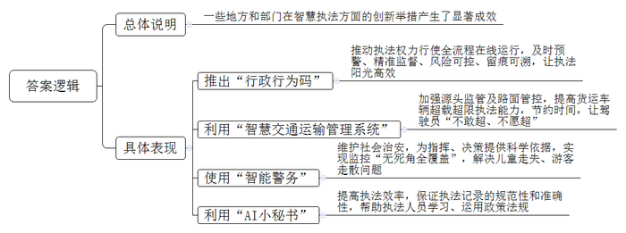
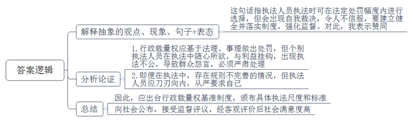
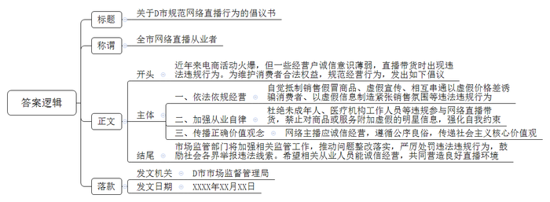
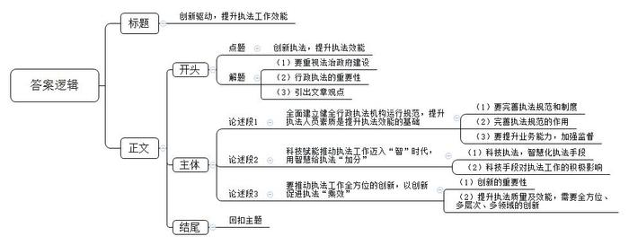

# 2024年江苏省公考《申论》题（B卷）

> 候选采集稿。参考答案及解析来自粉笔页面，不代表官方答案或真实高分答卷；来源使用许可与原卷对应关系仍需人工核实。

## 给定材料

### 材料 material-63e80979a6bc4a11

“行政行为码”你听说过吗？这是Z省智慧执法的新举措。该省依托“大综合一体化”执法监管数字应用系统，开发了行政执法自动生成监管代码的功能。这个代码就是“行政行为码”，是行政行为全周期的唯一标识。该码2月1日起在全省推行，目前已覆盖了全省4700余个执法主体以及行政许可、行政检查、行政处罚等应用环节。它包含行政行为类型码（2位）、部门代码（9位）、日期（6位）、序号（4位）、自定义码（5位）和校验码（1位），是行政执法不可篡改的“身份码”。

近日，H市某景区综合行政执法队员在日常巡查过程中，发现有人在国有山林中堆放建筑垃圾。经核实，当事人违反了《城市建筑垃圾管理规定》第十五条，依规予以简易程序处罚。执法队员使用掌上执法端操作，在生成电子处罚决定书的同时，27位数值的“行政行为码”同步产生。“当事人可以通过扫码来获取相关文书，了解自己所违反的法律法规、所受到的处罚内容及相关执法流程；执法人员扫描该码，整个案件的办理和进展情况也一目了然。”执法队王队长介绍，“小到遛狗不拴绳，大到无视燃气安全隐患、污染公共环境，各类违法行为的执法都可以通过‘行政行为码’快速查询、实时回溯案件办理情况，全流程相关信息明明白白。”

目前，Z省已经完成了对全省相关业务主管部门和业务骨干的“行政行为码”使用专题培训。接下来，该省将以“大综合一体化”行政执法改革、整体智治现代法治政府建设等一系列重点工作为抓手，加快“行政行为码”的推广应用，努力实现行政行为赋码率、电子签章使用率、平台出件率、执法线索处置率4个100%。

Z大学公共政策研究院周研究员认为，“行政行为码”将行政执法所涉及的人员、行政行为及其类型、时间等全要素一律数字化、格式化、标准化，通过“一码关联”“一码查询”“一码追踪”，能有效推动执法权力行使全流程在线运行，及时预警、精准监督、风险可控、留痕可溯，让执法变得更加阳光高效。

### 材料 material-1a51f0e25d8421bd

“心里的疙瘩解开了，罚款也及时缴清了，我以后一定吸取教训，规规矩矩做生意。”近日，G省J市检察院检察官对客运经营者老韩有关案件办结情况进行电话回访时，老韩诚恳地说。

2021年1月，老韩在未取得道路旅客运输经营许可的情况下，驾驶面包车载客运营，被J市交通运输执法部门查获，同年4月，被处以3.2万元罚款。面对高额罚款，他后悔莫及。后来，在与其他有相同违法行为的人交流时，老韩得知他们的罚款均在1万元左右，非常不服气，于是拒绝缴纳罚款，后被行政机关申请法院强制执行。

“都是一样的违法行为，凭什么罚别人1万元，罚我3万多元，这太不公平了！”因不服法院强制执行裁定，老韩向J市检察院申请监督。J市检察院审查后认为，该案处罚金额偏高，存在显失公平的情形。从妥善化解该案争议出发，经听证评议和综合研判，市检察院建议行政机关与当事人达成执行和解协议。市交通运输执法部门表示将查明案情，据实判定处罚金额。在对该案的深入调查中发现，经办人沈某因曾被当事人辱骂而心存芥蒂，于是钻了不同时段上下层级有关文件之间的漏洞，有意加重了处罚。该部门进行专题研究，最终作出处罚1万元的决定，并对沈某及相关人员进行了严肃的组织处理。

“此案在执法实践中具有一定的代表性。”G省社科院法学研究所何研究员有感而发，“虽然行政裁量权是法律赋予执法者的权力，行政机关在其职权范围内，基于法理或事理做出行政处罚，可在法定处罚幅度内进行选择，但在实践中，个别执法机关、执法人员将行政裁量权视为‘如意棒’，使用时随心所欲，甚或与利益挂钩，一旦缺乏有力监督，行政裁量就有可能变成自我裁决，于是该严不严、该宽不宽、畸轻畸重、类案不同罚，以致行政相对人不能信服，多有怨言。”

“我们坚决支持处理‘害群之马’，但是正常执法过程中，其实我们也有苦衷。”市交通运输局法制科秦科长说，“我们执法中用到不少涉及行政裁量权规范的文件，有的仅仅规定由有执法权的机关予以行政处罚，而处罚种类与幅度却没有明确说明；有的尽管规定了一系列的处罚种类，但这些处罚种类的选择权却完全交由执法机关；有的规定了具体处罚种类及相应幅度，但处罚幅度过于宽泛；有的以情节严重、情节特别严重作为细分处罚幅度的依据，但对于情节如何定性又缺乏必要的例示或指引……所以，实施中容易出现这样或那样的问题。当然，我们首先应该刀刃向内，从严要求自己。”

“我们应该深刻吸取教训，杜绝执法不公、任性执法。”在J市交通运输行政执法整顿工作大会上，市交通运输局张局长语气坚定。他说：“近期，我省积极贯彻落实国务院《关于进一步规范行政裁量权基准制定和管理工作的意见》精神，率先出台了《G省行政裁量权基准制定和管理办法》。省交通运输部门结合本行业实际，对原则性规定以及具有一定弹性的执法权限、裁量幅度等进行了细化量化，颁行了具体执法尺度和标准，已向社会公布，让行政执法活动接受监督和评议。”

“最近，我们作为第三方，受托对J市交通运输系统行政执法情况随机开展问卷调查，结果显示社会评价满意率达到98.4%。以前，同样的违法行为，同样的法律条款，在这里罚1000元，在那里可能就罚500元；现在，逐步建立健全并严格落实行政裁量权基准制度，最大限度地避免‘类案不同罚’，值得点赞。”何研究员说，“使用‘如意棒’时不忘还有‘紧箍咒’，行政裁量才能宽严相济、令人信服。”

### 材料 material-3eb646ae41292795

近年来，随着电商活动的日益火爆，在直播间购物正成为广大消费者的一个重要选择。然而，这背后也暗藏风险。今年“双11”期间，中消协利用互联网舆情监测系统，对10月20日-11月13日期间的消费维权情况进行了网络大数据舆情分析。监测期内，共收集到“直播销售”负面信息50.9万条，“从监测数据看，以往大家熟知的‘规则难倒尾款人’‘套路渐欲迷人眼’等乱象有所改善，消费者对电商平台简化促销规则、提升消费体验的评价总体趋向正向，但一些经营户的诚信意识还比较淡薄，一些平台在提升消费者满意度和获得感方面做得还不够。”中消协相关负责人介绍说。

近日，为以案释法、震慑不法商家、规范经营行为、切实维护消费者的合法权益，D市市场监管局公布了一批直播带货违法违规典型案例：

案例1 以超低价销售多款假冒知名品牌服装

2023年8月，T区市场监管局依据监测线索，会同公安机关对B服装有限公司突击执法检查。经查，当事人在直播带货中以超低价销售多款知名品牌服装，价格仅为数十元，而官方正品最低价格也要近千元。现场查获侵权服装59件，根据直播销量初步计算当事人非法经营额约5.5万元，当事人已涉嫌构成“销售假冒注册商标的商品”罪。

案例2 直播间背景标示“专研抗老”构成虚假宣传

2023年5月，M区市场监管局依据举报线索，对C护肤品有限公司虚假宣传行为立案调查。经查，当事人在某平台直播间推荐、销售化妆品时，直播背景中标示了“专研抗老”等字样。另外，当事人在某平台旗舰店主页面及23款产品陈列背景上宣称“专研抗老”。经查明，上述化妆品均无抗老功能，当事人存在虚假宣传的违法行为。

案例3 相互串通以虚假价格差诱骗消费者

2023年2月，D市市场监管局根据相关线索，对该市F文化传媒有限公司和E电子商务有限公司共同价格欺诈行为立案调查。经查，F文化传媒有限公司主播在直播期间，以E电子商务有限公司在某平台同款商品的页面展示价作为比较价格进行宣传。另查，两公司商定在不同平台上架同一商品，并标示相差悬殊的价格，供直播带货比价使用。执法人员表示，这种通过虚假折价或者价格比较的手段，诱骗消费者与其交易的行为，严重侵犯了消费者的合法权益。该行为构成价格欺诈，两公司为共同违法主体。

案例4 以虚假信息制造紧张销售氛围

2023年3月，T区市场监管局根据相关线索，对K厨具有限公司虚假宣传和价格欺诈行为立案调查。经查，当事人在直播销售商品时，主播重复利用“大礼包还剩最后几单现货”“大礼包马上没有了”等宣传话术，在直播间内传递赠品“大礼包”所剩不多的不实信息，诱导消费者下单购买。同时，当事人在直播中传递亏本让利的虚假信息。执法机关依据相关规定，责令当事人停止违法行为。

D市市场监管局还对未成年人和医疗机构工作人员违规参与网络直播带货、直播带货时对商品或服务附加虚假的明星信息等问题进行了通报。

“依法监管带货直播，正当时。”相关行业专家指出，随着直播带货的日益盛行，“泥沙俱下”的现象屡见不鲜，消费者在直播中处于被动接受的地位，如果主播利用自己的影响力进行虚假宣传，不仅会误导消费者、造成损失，甚至还可能产生违背公序良俗、与社会主义核心价值观相背离的严重问题。

“针对直播带货这样的新模式、新业态，市场监管部门将着力加强相关工作。”D市市场监管局曹局长介绍说，“为规范网络直播经营行为、引导直播从业人员自律，我们将加大对相关法规政策的宣传力度；对屡屡出现问题的，将通过约谈、责令改正等方式督促其整改落实；对明显违法违规或损害消费者权益的，将依法严厉处罚。”曹局长表示，广大网民和社会各界如发现网络直播营销中的违法线索，可以向市各级市场监管部门反映或拨打12315进行举报。

## 题目

### 第 1 题

**“给定资料**1**\-**4**”中，一些地方和部门在智慧执法方面的创新举措产生了显著成效，请用一段话对此进行归纳概括。（15分）**

关联材料：material-63e80979a6bc4a11

作答要求：

要求：紧扣给定资料，全面、准确，篇幅不超过250字。

### 第 2 题

**“给定资料**5**”中的画线句说“使用‘如意棒’时不忘还有‘紧箍咒’，行政裁量才能宽严相济、令人信服”，请你谈谈对这句话的理解和认识。（20分）**

关联材料：material-1a51f0e25d8421bd

作答要求：

要求：观点正确，分析透彻，见解深刻，篇幅250字左右。

### 第 3 题

**“给定资料**6**”中的D市市场监管局拟向全市网络直播从业人员发出倡议。假设你是该局的一名工作人员，请以D市市场监管局的名义，撰写一份倡议书。（25分）**

关联材料：material-3eb646ae41292795

作答要求：

要求：内容充实，针对性强；结构完整，符合文体要求。篇幅400字左右。

### 第 4 题

**请结合你对****“给定资料**7**”中“用智慧给执法‘加分’，以创新促执法‘乘效’”这句话的理解，联系实际，写一篇文章。（40分）**

关联材料：material-63e80979a6bc4a11

作答要求：

要求：

（1）自选角度，自拟标题；

（2）参考给定资料，不拘于给定资料；

（3）观点明确，内容充实，结构完整；

（4）篇幅1000字左右。

## 答案与解析

第 1 题

**参考答案（粉笔题库参考内容）**

一些地方和部门在智慧执法方面的创新举措产生了显著成效：推出“行政行为码”，推动执法权力行使全流程在线运行，及时预警、精准监督、风险可控、留痕可溯，让执法阳光高效；利用“智慧交通运输管理系统”，加强源头监管及路面管控，提高货运车辆超载超限执法能力，节约时间，让驾驶员“不敢超、不愿超”；使用“智能警务”，维护社会治安，为指挥、决策提供科学依据，实现监控“无死角全覆盖”，解决儿童走失、游客走散问题；利用“AI小秘书”，提高执法效率，保证执法记录的规范性和准确性，帮助执法人员学习、运用政策法规。

**解析**

**参考答案说明：**本参考答案按照“总结性引导语+各类创新举措产生的具体成效”的结构，具体介绍了“推出‘行政行为码’”“利用‘智慧交通运输管理系统’”“使用‘智能警务’”“利用‘AI小秘书’”四个方面的创新举措及其成效。答案用一段话的形式呈现，符合题目要求。

**考点**：考点影响类

**来源**：来源2024年江苏省公考《申论》题（B卷）

粉笔申论页面对本题只提供「解析视频」入口，该入口是会员推广位，页面无视频地址与文字解析。

第 2 题

**参考答案（粉笔题库参考内容）**

这句话指执法人员执法时可在法定处罚幅度内进行选择，但会出现自我裁决，令人不信服，要建立健全并落实制度，强化监督。对此，我表示赞同。

具体体现在：1.行政裁量权应基于法理、事理做出处罚，但个别执法人员在执法中随心所欲，与利益挂钩，出现执法不公，导致群众怨言，必须严肃处理。2.即便在执法中，存在规则不完善的情况，但执法人员应刀刃向内，从严要求自己。

因此，应出台行政裁量权基准制度，颁布具体执法尺度和标准；向社会公布，接受监督评议，经客观评价后社会满意度高。

**解析**

**参考答案说明**：（1）思路方面，本参考答案按照观点现象分析题“解释抽象的观点、现象、句子+表态+分析论证+总结”的思路展开。（2）内容方面，本参考答案先解释了画线句的总体含义并表明了观点，然后分别从行政裁量的“如意棒”和“紧箍咒”两个方面进行分析论证，最后在“总结”部分提出了对策。（3）词句表达方面，本参考答案加上了“具体体现在”“因此”等连接词来承接上下文。

**考点**：考点观点现象分析类

**来源**：来源2024年江苏省公考《申论》题（B卷）

粉笔申论页面对本题只提供「解析视频」入口，该入口是会员推广位，页面无视频地址与文字解析。

第 3 题

**参考答案（粉笔题库参考内容）**

关于D市规范网络直播行为的倡议书

全市网络直播从业者：

近年来电商活动火爆，但一些经营户诚信意识薄弱，直播带货时出现违法违规行为。为维护消费者合法权益，规范经营行为，发出如下倡议：

一、依法依规经营。自觉抵制销售假冒商品、虚假宣传、相互串通以虚假价格差诱骗消费者、以虚假信息制造紧张销售氛围等违法违规行为。

二、加强从业自律。杜绝未成年人、医疗机构工作人员等违规参与网络直播带货，禁止对商品或服务附加虚假的明星信息，强化自我约束。

三、传播正确价值观念。网络主播应诚信经营，遵循公序良俗，传递社会主义核心价值观。

市场监管部门将加强相关监管工作，推动问题整改落实，严厉处罚违法违规行为，鼓励社会各界举报违法线索。希望相关从业人员能诚信经营，共同营造良好直播环境！

D市市场监督管理局

XXXX年XX月XX日

**解析**

**参考答案说明：**（1）格式方面，本参考答案写到了“标题”“称谓”“正文”“落款”四个部分。（2）正文部分，一方面从内容上来看，本参考答案的开头先写到了“D市规范网络直播行为”的背景、目的；主体部分从“依法依规经营”“加强从业自律”“传播正确价值观念”三个方面介绍了具体做法；结尾部分介绍了市场监管部门的监管工作并发出呼吁号召。另一方面，形式上，本参考答案做到了分段、分条撰写，整体上条理较为清晰。

**考点**：考点宣传类

**来源**：来源2024年江苏省公考《申论》题（B卷）

粉笔申论页面对本题只提供「解析视频」入口，该入口是会员推广位，页面无视频地址与文字解析。

第 4 题

**参考答案（粉笔题库参考内容）**

**创新驱动，提升执法工作效能**

“立善法于天下，则天下治；立善法于一国，则一国治。”推进国家治理体系和治理能力现代化，要高度重视法治政府建设。行政执法一头连着各级政府，一头连着群众切身利益，每一次执法本身，都关乎人民群众对党和政府的信任、对我国法治建设的信心。如何才能提升执法质量及效能？

从根本上说，在建立健全执法规范，提升执法人员全面素质的基础上，还要以科技赋能执法，推动执法工作创新。

**全面建立健全行政执法机构运行规范，提升执法人员素质是提升执法效能的基础。**习近平总书记说“法治体系是国家治理体系的骨干工程”，建立健全执法机构运行规范，明确执法细则及处罚幅度，是提升执法效能的“始发站”，也是执法过程中的“说明书”。有了操作规范，执法人员才能更精准地依法行政，群众也能更清晰地了解执法过程及结果，避免出现处罚不公现象。仅有执法能力是不够的，还要约束个别随心所欲，公权私用的执法人员。“自我监督是世界性难题，是国家治理的‘哥德巴赫猜想’。”一方面要建立标准化制度化培训机制，开展分级分类分层培训，提升业务能力，另一方面，还要全方位监管，落实持证上岗制度，同时畅通投诉渠道，发挥社会监督力量。

**科****技赋能推动执法工作迈入****“智”时代，用智慧给执法“加分”。**加强科技创新法治建设是贯彻落实习近平总书记关于科技创新论述的重要举措。空中侦查的“隐形翅膀”、地面监管的“火眼金睛”、案情研判的“最强大脑”……各类执法新手段代表执法工作迈入“智”时代，也意味着科技执法是执法工作的发展大趋势。利用科技手段，不仅能提升执法效率，还能助力实现执法者的“奇思妙想”。如：南京交通执法部门在高淳区完成了内河航道首座无人机机场的部署工作，帮助执法人员能够随时掌握航道动态，及时发现违法行为。

**除此之外，还要推动执法工作全方位的创新，以创新促进执法****“乘效”。**创新是推动社会进步的源泉，没有创新就没有竞争力。提升执法质量及效能，需要全方位、多层次、多领域的创新，让曾经的“不可能”变为“无限可能”。如创新执法思维，突破传统观念；协调推进行政执法体制改革，清理交叉重复的行政执法事项；持续推进乡镇、街道赋权有关工作；推进行政执法协作，创新监督工作体系……只有多措并举、齐头并进推进执法工作多方面的创新，方可实现执法工作异彩纷呈。

“言出为箭，执法如山”，提升法律效能不仅要追求执法效率，更要追求质量，全方位改革，全系统推动，方可给群众带来更多安全感、幸福感！

**解析**

**文章分析**

**创新驱动，提升执法工作效能**

【**标题的优点：**标题中含有主题词，使文章主题更突出、清晰。】

（1）“立善法于天下，则天下治；立善法于一国，则一国治。”推进国家治理体系和治理能力现代化，要高度重视法治政府建设。（2）行政执法一头连着各级政府，一头连着群众切身利益，每一次执法本身，都关乎人民群众对党和政府的信任、对我国法治建设的信心。（3）如何才能提升执法质量及效能？

从根本上说，在建立健全执法规范，提升执法人员全面素质的基础上，还要以科技赋能执法，推动执法工作创新。

【**开头的优点：**★内容方面。范文的开头是紧扣“创新执法，提升执法效能”这一主题展开的。首先，介绍了要重视法治政府建设；其次，介绍了行政执法的重要性；最后，引出文章观点，指出如何提升执法质量及效能。★文字表达方面。引用了名言，并使用了设问的修辞手法，使文字表达更加有力。】

**全面建立健全行政执法机构运行规范，提升执法人员素质是提升执法效能的基础。**（1）习近平总书记说“法治体系是国家治理体系的骨干工程”，建立健全执法机构运行规范，明确执法细则及处罚幅度，是提升执法效能的“始发站”，也是执法过程中的“说明书”。（2）有了操作规范，执法人员才能更精准地依法行政，群众也能更清晰地了解执法过程及结果，避免出现处罚不公现象。仅有执法能力是不够的，还要约束个别随心所欲，公权私用的执法人员。（3）“自我监督是世界性难题，是国家治理的‘哥德巴赫猜想’。”一方面要建立标准化制度化培训机制，开展分级分类分层培训，提升业务能力，另一方面，还要全方位监管，落实持证上岗制度，同时畅通投诉渠道，发挥社会监督力量。

【**论述段****1的优点：**★观点句：范文的观点句是紧扣“创新执法，提升执法效能”这一文章主题提出的。形式上，它在段首处直接写出，位置突出，容易发现。内容上，关键词突出，内容要点明确，可以明显看出主要从“健全执法机构运行规范，提升执法人员素质”的角度进行论述。★论述内容：（1）指出了要完善执法规范和制度；（2）指出了完善执法规范的作用；（3）指出了要提升业务能力，加强监督。注意：以上三个方面的内容都是紧扣“全面建立健全行政执法机构运行规范，提升执法人员素质是提升执法效能的基础”这个观点句进行分析论述的，论述的针对性强，内容层次丰富。在论述方法上主要采用了讲道理的方式，论述清晰透彻。】

**科技赋能推动执法工作迈入****“智”时代，用智慧给执法“加分”。**（1）加强科技创新法治建设是贯彻落实习近平总书记关于科技创新论述的重要举措。空中侦查的“隐形翅膀”、地面监管的“火眼金睛”、案情研判的“最强大脑”……各类执法新手段代表执法工作迈入“智”时代，也意味着科技执法是执法工作的发展大趋势。（2）利用科技手段，不仅能提升执法效率，还能助力实现执法者的“奇思妙想”。如：南京交通执法部门在高淳区完成了内河航道首座无人机机场的部署工作，帮助执法人员能够随时掌握航道动态，及时发现违法行为。

【**论述段****2的优点：**★观点句：范文的观点句是紧扣“创新执法，提升执法效能”这一文章主题提出的。形式上，它在段首处直接写出，位置突出，容易发现。内容上，关键词突出，内容要点明确，可以明显看出主要从“科技赋能智慧化执法”的角度进行论述。★论述内容：（1）介绍了科技执法，智慧化执法手段；（2）介绍了科技手段对执法工作的积极影响。注意：以上两个方面的内容都是紧扣“科技赋能推动执法工作迈入‘智’时代，用智慧给执法‘加分’”这个观点句进行分析论述的，论述的针对性强，内容层次丰富。在论述方法上采用了讲道理、举例子相结合的方式，论述充实透彻。】

**除此之外，还要推动执法工作全方位的创新，以创新促进执法****“乘效”。**（1）创新是推动社会进步的源泉，没有创新就没有竞争力。（2）提升执法质量及效能，需要全方位、多层次、多领域的创新，让曾经的“不可能”变为“无限可能”。如创新执法思维，突破传统观念；协调推进行政执法体制改革，清理交叉重复的行政执法事项；持续推进乡镇、街道赋权有关工作；推进行政执法协作，创新监督工作体系……只有多措并举、齐头并进推进执法工作多方面的创新，方可实现执法工作异彩纷呈。

【**论述段****3的优点：**★观点句：范文的观点句是紧扣“创新执法，提升执法效能”这一文章主题提出的。形式上，它在段首处直接写出，位置突出，容易发现。内容上，关键词突出，内容要点明确，可以明显看出主要从“全方位创新执法”的角度进行论述。★论述内容：（1）指出了创新的重要性；（2）指出了提升执法质量及效能，需要全方位、多层次、多领域的创新。注意：以上两个方面的内容都是紧扣“要推动执法工作全方位的创新，以创新促进执法‘乘效’”这个观点句进行分析论述的，论述的针对性强，内容层次丰富。在论述方法上主要采用了讲道理的方式，论述清晰透彻。】

【**论述段之间的关系：**范文的论述段之间是依照“并列”的逻辑展开的。论述段1介绍了要健全执法机构运行规范，提升执法人员素质；论述段2介绍了利用科技赋能，进行智慧化执法；论述段3介绍了要全方位创新执法。整体论述逻辑清晰。】

“言出为箭，执法如山”，提升法律效能不仅要追求执法效率，更要追求质量，全方位改革，全系统推动，方可给群众带来更多安全感、幸福感！

【**结尾的优点：**范文的结尾回扣了“创新执法，提升执法效能”这个主题，并且进行了总结提升。】

**考点**：考点文章写作题

**来源**：来源2024年江苏省公考《申论》题（B卷）

粉笔申论页面对本题只提供「解析视频」入口，该入口是会员推广位，页面无视频地址与文字解析。

