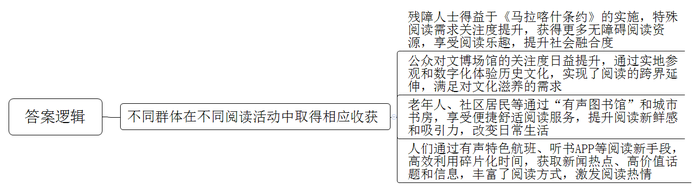
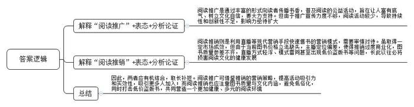
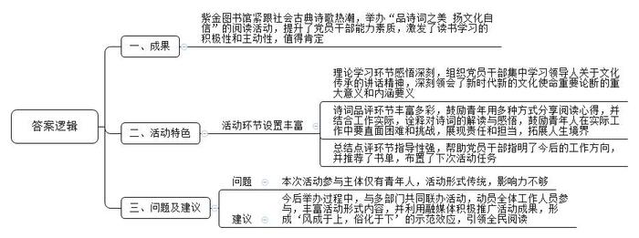
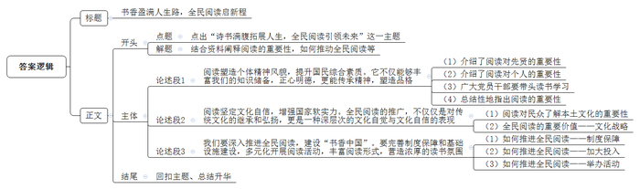

# 2024年江苏省公考《申论》题（A、乡镇选调卷）

> 候选采集稿。参考答案及解析来自粉笔页面，不代表官方答案或真实高分答卷；来源使用许可与原卷对应关系仍需人工核实。

## 给定材料

### 材料 material-48089f1fb3b060f9

“我看不见这个世界，但我想让世界看见我。”纪录片《让世界看见我》讲述的是中国盲人登山第一人张洪成功登顶珠穆朗玛峰的经历。2023年4月23日，在第二届全民阅读大会的阅读权益保障论坛上，导演范立欣带来的这部电影深深打动了观众。普通人很难想象，“让世界看见我”对很多残障人士而言，是一种多么大的幸福。《马拉喀什条约》的生效实施，让这种幸福来得特别强烈。

《马拉喀什条约》全称是《关于为盲人、视力障碍者或其他印刷品阅读障碍者获得已出版作品提供便利的马拉喀什条约》。2023年5月5日，是《马拉喀什条约》对中国生效一周年，在电影《长空之王》无障碍公益专场首映礼之后，一位视障观众激动地说，以前从没想过能比普通观众更早看到一部电影，感觉特别满足。视障儿童小禹说，因为有了《马拉喀什条约》，今后她会听到更多精彩的故事，欣赏到更多的有声读物。

“这里有盲文书和听书机吗？”“当然，请跟我去视障阅览室吧！”2023年5月21日，第33个全国助残日，来自新疆阿克苏地区的20位盲童走进杭州图书馆。在青年馆员小王的引领下，盲童与机器人无障碍沟通，在视障阅览室开展文化体验和交流活动。《飞天英雄》《女生贾梅全传》《哈利波特》……一进入视障阅览室，小读者们顺利地找到了自己喜欢的书籍，开始了津津有味地阅读。二楼音乐分馆HIFI室内，盲童小读者们双手捧起清茶和桂花干，细嗅杭州的特有味道。“今天我们就随着这沁人心脾的茶香，走进杭州的一年四季吧！”在娓娓讲述的四季古诗词中，盲童小读者们通过文字“游览”杭州。据了解，本次走进杭州图书馆活动作为“启明行动”的第一站，由浙江省对口支援新疆阿克苏地区和兵团第一师指挥部、中共阿克苏地委教育工委等单位联合主办。

“自从《马拉喀什条约》生效以来，各级媒体的报道、相关部门的宣传使得大家对视障者、听障者等阅读障碍者的特殊阅读需求有了更多了解。”作为一名视障人士，清华大学社会工作专业硕士研究生小梁有着更深刻的感受。他说，在社会大众关注条约、关注阅读障碍者需求的氛围中，社会的无障碍软硬件发展都得到了更多支持，障碍人群尤其是残障者的社会融合也更多提升。“未来，《马拉喀什条约》一定会为相关障碍群体获得文化产品提供更多便利，这个世上不幸有盲人，但阅读不应该有盲区。”

### 材料 material-37b81ccf78327318

阅读推广人，你听说过吗？让我们走进他们的生活，听听这些阅读推广人的心里话。

苏州《月月书房》主理人孙月月：我的家乡苏州很有意思，从小我就被苏州文化所浸润。我家在沧浪亭街2号，左边是沧浪亭，五百名贤祠所在的地方；右边是公元1035年范仲淹创办的千年府学。后来我在苏州广电开始做文化类节目，越来越觉得苏州就是一座天然的“图书馆”。《月月书房》从我和女儿的一封家书开始，最初只是“月月姐姐”我一个人写公众号，后来慢慢发展成为一群人围炉而坐的读书会。接着，我们又把“指尖的阅读”变成了用脚步去丈量的“走读”。我们和专家学者带领读者一起走进苏州园林街巷、古镇乡村，实地打开苏州悠久浩瀚的文脉，以现场直播、短视频推送、推文分享等丰富形式，向更多读者隔屏传播姑苏书香。我觉得，读书不是为了装点门面、附庸风雅，而是让人成为一个有底气的人、文化自信的人。

深圳阅读推广人李黎众：我是从参加图书馆组织的亲子阅读活动开始的，那时类似的活动还不够多，名额“秒抢”都不一定能获得。后来听说报名做义工就可以参加活动，我就从此走上了作为阅读推广践行者的公益之路。我之前从事过人力资源方面的工作，参与阅读推广之后，我广泛学习了心理知识、文学知识和沟通技巧，几乎成了一个“杂学家”。在面向孩子们阅读推广的课堂上，绘画、戏剧、吟诵、创作以及盒子剧场，都是我擅长的。很快我就认识到，阅读是陪伴人一生的，并不只是小的时候才需要阅读。如今，我的推广活动从图书馆、学校课堂，延伸到许多社区。现在基本一年要进行几百场推广活动，在深圳有许多“守阅人”跟我一样，为了打造文化之城、阅读之城，大家在一起努力着。

### 材料 material-0f2f933f8103a98f

最是书香能致远，从来善政不离书。各级领导干部带头读书、勤于读书，不仅是丰富自己、提升能力素质的有效途径，也必然会激发干部、党员和群众读书学习的积极性和主动性，对于书香社会建设有着巨大的推动作用。

2023年的夏天，国产动画电影《长安三万里》火爆出圈，大唐盛世中的李白、杜甫、高适等伟大诗人一一登上大银幕，不仅带我们感受群星闪耀的大唐风华，也让我们看到大唐诗人们追逐理想、实现人生抱负的恢宏故事。影片一上映便很快成为社会热门话题，影片中的48首诗歌也引发了全社会的古典诗歌热。8月中旬，J省文旅厅紫金图书馆党支部利用这一热点契机，组织全体党员干部开展“品诗词之美 扬文化自信”主题党日活动。

理论学习环节，全体党员集中学习了习近平总书记关于弘扬中华优秀传统文化的重要论述和在文化传承发展座谈会上的重要讲话，深刻领会了新时代新的文化使命重要论断的重大意义和内涵要义。诗词品评环节，青年党员代表以演讲、角色表演、PPT展示等方式分享自己钟爱的诗词篇章，并联系图书馆工作实际，诠释自己对诗词的解读与感悟。

文献部小戴：“大鹏一日同风起，扶摇直上九万里……宣父犹能畏后生，丈夫未可轻年少。”影片中李白的这首《上李邕》通过对大鹏形象的刻画与颂扬，表达了李白的凌云壮志和强烈的用世之心，全诗语气直率，充满了初生牛犊不怕虎的锐气。我觉得这首诗讲出了工作中我们年轻人常想说的心里话，我们生逢伟大年代啊，应当学习诗人这种不畏困难、勇于进取的勇气，实际工作中要敢于啃硬骨头，直面困难和挑战，展现青年人的责任和担当。

借阅部小吕：“莫听穿林打叶声，何妨吟啸且徐行。竹杖芒鞋轻胜马，谁怕？一蓑烟雨任平生。料峭春风吹酒醒，微冷，山头斜照却相迎。回首向来萧瑟处，归去，也无风雨也无晴。”宋代文学大家苏轼的《定风波·莫听穿林打叶声》一词，通过野外途中偶遇风雨这一生活中的小事，于简朴中见深意，于寻常处生奇景，表现出一种旷达超脱的胸襟，寄寓着超凡脱俗的人生理想。上片着眼于雨中，下片着眼于雨后，全词表现了一位正直文人在坎坷人生中的力求解脱之道，篇幅虽短，但意境深邃，内蕴丰富，诠释着作者的人生信念，展现着作者的精神追求。这首词我一直很喜欢，对于我们拓展人生境界、正确对待工作生活中的风风雨雨有着很大的启示。

“遥望历史风尘中的大唐气象，是无数中国人萦绕心头的文化乡愁。一部《长安三万里》，重现的不仅是昔日的时光，更是奔流在中华民族血脉中的诗情回望……”辅导部小万的激情演讲赢得了一片掌声。

“诵读唐诗宋词，是一代又一代中国人的个体经验与集体记忆，它是日常性的也是仪式性的。今天各位青年同志选取的诗词极富代表性，既有表现青年人伟大抱负的杰作，也有反映人生、仕途变迁感悟的名篇，各位同志不仅能对诗词本身丰富的文化蕴含深入阐发，而且能将古今对接，把个人对传统诗词文化的理解融入真切的现实生活中……”此次活动特邀嘉宾N大学胡教授对各位青年党员代表的表现进行了精彩点评。活动最后，党支部朱书记借《长安三万里》中的台词进行了总结：“‘诗在，长安就在’，我想他实际上说的是——文化在，人在，家国就在。中华民族历经五千年生生不息，盖源于此。当前广大文艺工作者在习近平总书记关于文艺工作的重要论述指引下，充分彰显文化自信，不断推出精品力作。这对于我们文化服务战线也是极大的鼓舞和鞭策，我们唯有不断学习、终生学习，人生道路才能更广，社会贡献才能更大。”朱书记还向大家推荐了《唐诗三百首》《习近平用典》两本书，并要求在下次活动中大家交流读书心得。

“这样的活动在我们文旅系统各部门、各单位比比皆是，我厅每年都会组织‘书香支部 品质阅读’活动，活动中会评比‘最美阅读案例’，发布‘最受党员干部欢迎的10本书’书单，目前已连续举办了8届。党员干部读书所产生的‘风成于上，俗化于下’的强烈示范效应，已成为引领全民阅读的重要力量。”J省文旅厅机关党委陈书记说。

## 题目

### 第 1 题

**“给定资料**1**\-**4**”列举了阅读活动中的一些新现象，展现了不同群体采用不同方式在阅读活动中取得的相应收获，请用一段话对此进行归纳概括。（20分）**

关联材料：material-48089f1fb3b060f9

作答要求：

要求：紧扣给定资料，全面、准确。篇幅不超过250字。

### 第 2 题

**“给定资料**5**\-**6**”中提到的“阅读推广”与“阅读推销”是现实生活中的常见现象，这两类现象涉及哪些问题？请围绕这些问题谈谈你的认识。（20分）**

关联材料：material-37b81ccf78327318

作答要求：

要求：归类合理，观点正确，分析透彻，见解深刻。篇幅300字左右。

### 第 3 题

**在****J省文旅厅2023年度“书香支部品质阅读”活动中，紫金图书馆党支部以“‘品诗词之美** **扬文化自信****’主题党日活动”申报了“最美阅读案例”评比。假如你是J省文旅厅评比活动的一名评委，将对该案例进行点评，请根据“给定资料**7**”，草拟点评的主要内容。（20分）**

关联材料：material-0f2f933f8103a98f

作答要求：

要求：突出特色，内容全面；建议切当，条理清楚。篇幅350字左右。

### 第 4 题

**请根据****“给定资料**8**”中习近平总书记对全民阅读的要求，围绕“诗书满腹拓展人生，全民阅读引领未来”这一主题，写一篇文章。（40分）**

关联材料：material-48089f1fb3b060f9

作答要求：

要求：

（1）自选角度，自拟标题；

（2）参考给定资料，不拘于给定资料；

（3）观点明确，内容充实，结构完整；

（4）篇幅1000字左右。

## 答案与解析

第 1 题

**参考答案（粉笔题库参考内容）**

不同群体在不同阅读活动中取得相应收获：残障人士得益于《马拉喀什条约》的实施，特殊阅读需求关注度提升，获得更多无障碍阅读资源，享受阅读乐趣，提升社会融合度；公众对文博场馆的关注度日益提升，通过实地参观和数字化体验历史文化，实现了阅读的跨界延伸，满足对文化滋养的需求；老年人、社区居民等通过“有声图书馆”和城市书房，享受便捷舒适阅读服务，提升阅读新鲜感和吸引力，改变日常生活；人们通过有声特色航班、听书APP等阅读新手段，高效利用碎片化时间，获取新闻热点、高价值话题和信息，丰富了阅读方式，激发阅读热情。

**解析**

**参考答案说明：**本参考答案以“总结性引导语+不同群体在阅读活动中采用不同方式取得的收获”的结构呈现，具体收获分别从残障人士通过《马拉喀什条约》取得的收获、公众通过实地参观和数字化体验文博场馆取得的收获、老年人和社区居民等通过“有声图书馆”和城市书房取得的收获、人们通过有声特色航班和听书APP等阅读新手段取得的收获四个方面展开，各条答案要点之间在内容上相互并列，没有交叉，并以一段话的形式进行呈现。

**考点**：考点影响类

**来源**：来源2024年江苏省公考《申论》题（A、乡镇选调卷）

粉笔申论页面对本题只提供「解析视频」入口，该入口是会员推广位，页面无视频地址与文字解析。

第 2 题

**参考答案（粉笔题库参考内容）**

阅读推广是通过丰富的形式向读者传播书香，普及阅读的公益活动，旨在让人富有底气、树立文化自信，要大力支持。但由于推广宣传力度不够，阅读活动较少，导致持续性和创新性不足，影响力亟待扩大。

阅读推销则是利用直播等现代营销手段快速售书的营销模式，需要审慎对待。虽取得一定市场成效，但由于当前图书价格立法缺失，主播定位偏差，使得推销过度商业化，图书质量参差不齐，直播方式轻浮、模式雷同，甚至出现低价盗版书等问题，长此以往必将损害阅读文化的健康发展。

因此，两者应有机结合，取长补短。阅读推广可借鉴推销的营销策略，提高活动吸引力和实效性，吸引更多人加入；而阅读推销也应注重图书质量与文化内涵，避免低俗化，同时打击低价盗版书，共同营造一个更加健康、多元的阅读环境。

**解析**

**参考答案说明：**思路方面，本参考答案按照观点现象分析题“解释抽象观点、现象+表态+分析论证+总结”的一般答题思路展开。内容方面，本参考答案先阐释了“阅读推广”“阅读推销”的含义，再分别对两者表态；“分析论证”部分，按照题干要求重点分析了“问题”，此外，“阅读推销”中也根据资料写入了成绩；最后对“阅读推广”“阅读推销”进了总结，突出了改进措施。词句表达方面，本答案加上了“但”“因此”等连接词来承接上下文。

**考点**：考点观点现象分析类

**来源**：来源2024年江苏省公考《申论》题（A、乡镇选调卷）

粉笔申论页面对本题只提供「解析视频」入口，该入口是会员推广位，页面无视频地址与文字解析。

第 3 题

**参考答案（粉笔题库参考内容）**

一、成果：紫金图书馆紧跟社会古典诗歌热潮，举办“品诗词之美 扬文化自信”的阅读活动，提升了党员干部能力素质，激发了读书学习的积极性和主动性，值得肯定。

二、活动特色：活动环节设置丰富，理论学习环节感悟深刻，组织党员干部集中学习领导人关于文化传承的讲话精神，深刻领会了新时代新的文化使命重要论断的重大意义和内涵要义；诗词品评环节丰富多彩，鼓励青年用多种方式分享阅读心得，并结合工作实际，诠释对诗词的解读与感悟，鼓励青年人在实际工作中要直面困难和挑战，展现责任和担当，拓展人生境界；总结点评环节指导性强，帮助党员干部指明了今后的工作方向，并推荐了书单，布置了下次活动任务。

三、问题及建议：但本次活动参与主体仅有青年人，活动形式传统，影响力不够。建议今后举办过程中，与多部门共同联办活动，动员全体工作人员参与，丰富活动形式内容，并利用融媒体积极推广活动成果，形成“风成于上，俗化于下”的示范效应，引领全民阅读。

**解析**

**参考答案说明：**本参考答案从“成果”“活动特色”“问题及建议”三个方面展开，各条答案要点之间在内容上相互并列，没有交叉。

**考点**：考点评论类

**来源**：来源2024年江苏省公考《申论》题（A、乡镇选调卷）

粉笔申论页面对本题只提供「解析视频」入口，该入口是会员推广位，页面无视频地址与文字解析。

第 4 题

**参考答案（粉笔题库参考内容）**

**书香盈满人生路，全民阅读启新程**

在浩瀚的历史长河中，中华民族以阅读为舟，穿越时间的波涛，传承千年的智慧与文明。时至今日，“全民阅读”已成为国家文化战略的重要组成部分。习近平总书记在《致首届全民阅读大会举办的贺信》中，更是对全民阅读寄予厚望，希望广大党员、干部、孩子乃至全社会都能积极参与，形成浓厚的阅读氛围，这不仅是对个人成长的期许，更是对国家发展的深刻展望。

**阅读塑造个体精神风貌，提升国民综合素质。****它不仅能够丰富我们的知识储备，正心明德，更能传承精神，塑造品格。**古人云：“书犹药也，善读之可以医愚。”历史的长河中，无数先贤通过阅读汲取前人的智慧，进而在各自领域取得了卓越的成就。对于个人而言，坚持阅读，意味着不断学习新知识，掌握新技能，从而在竞争激烈的社会中立于不败之地。正如习近平总书记所言，广大党员、干部应带头读书学习，修身养志，增长才干，这不仅是对党员干部的要求，也是对每一个追求成长的人的鞭策。通过阅读，我们可以更好地认识世界，理解人生，实现自我价值的升华。

**阅读坚定文化自信，增强国家软实力****。全民阅读的推广，不仅仅是对传统文化的继承和弘扬，更是一种深层次的文化自觉与文化自信的表现。**“阅读，是心灵的粮食，也是文化的灯塔。”通过广泛而深入的阅读，民众能够更全面地了解本土文化的丰富内涵和独特价值，从而在内心深处生发出对本土文化的强烈认同感和自豪感，这是文化自信的重要基石，它使得民众在面对外来文化时，能够更加坚定地站在本土文化的立场上，展现出更加深厚和坚定的文化自信。因此，全民阅读不仅是一项文化活动，更是一种文化战略，它对于提升国家文化软实力、增强国际文化影响力具有不可估量的价值。

**故此，我们要深入推进全民阅读，建设****“****书香中国****”。要完善****制度保障****和****基础设施建设，****多元化开展阅读活动，丰富阅读形式，营造浓厚的读书氛围。**在制度保障方面，我们可以制定更加完善的阅读推广政策，为全民阅读提供坚实的制度支撑。同时，加大对图书馆、阅览室等公共场所的投入，为民众提供更加便捷、舒适的阅读环境。此外，可以通过举办各种形式的读书会、讲座、展览等，吸引不同年龄段、不同兴趣爱好的人群参与。而除了传统的纸质书籍，我们还可以推广电子阅读、有声阅读等多种形式，满足不同人群的阅读需求。如此，方能营造出浓厚的读书氛围，让阅读成为每个人生活中不可或缺的一部分，共同铸就“书香中国”的美好图景。

在书香袅袅中，我们共绘“书香中国”的壮美画卷。每一颗热爱阅读的心灵，都是这幅画卷上最动人的笔触。让阅读成为生活的常态，让书香盈满每一个角落，不仅滋养个人的心灵，也丰盈国家的文化底蕴。在这书香四溢的旅程中，我们共同前行，共创一个智慧与希望并蓄的未来。

**解析**

**文章分析**

**书香盈满人生路，全民阅读启新程**

【**标题的优点：**首先，范文的标题“书香盈满人生路，全民阅读启新程”突出了“诗书满腹拓展人生，全民阅读引领未来”这一主题。其次，在形式上采用对称式结构，使标题更有亮点。】

（1）在浩瀚的历史长河中，中华民族以阅读为舟，穿越时间的波涛，传承千年的智慧与文明。**时至今日**，“全民阅读”已成为国家文化战略的重要组成部分。（2）习近平总书记在《致首届全民阅读大会举办的贺信》中，更是对全民阅读寄予厚望，希望广大党员、干部、孩子乃至全社会都能积极参与，形成浓厚的阅读氛围，这不仅是对个人成长的期许，更是对国家发展的深刻展望。

【**开头的优点：**★内容方面。范文的开头是紧扣题目给定的“诗书满腹拓展人生，全民阅读引领未来”这一主题展开的。首先，介绍了自古至今中华民族都重视阅读；其次，指出了习近平总书记重视阅读，并希望全社会有浓厚的阅读氛围。★文字表达方面。使用了“不仅”“更是”等连接词，使语言表达有逻辑性。】

**阅读塑造个体精神风貌，提升国民综合素质。它不仅能够丰富我们的知识储备，正心明德，更能传承精神，塑造品格。**（1）古人云：“书犹药也，善读之可以医愚。”历史的长河中，无数先贤通过阅读汲取前人的智慧，进而在各自领域取得了卓越的成就。（2）对于个人而言，坚持阅读，意味着不断学习新知识，掌握新技能，从而在竞争激烈的社会中立于不败之地。（3）正如习近平总书记所言，广大党员、干部应带头读书学习，修身养志，增长才干，这不仅是对党员干部的要求，也是对每一个追求成长的人的鞭策。通过阅读，我们可以更好地认识世界，理解人生，实现自我价值的升华。

【**论述段****1的优点：**★观点句：范文的观点句是紧扣“诗书满腹拓展人生，全民阅读引领未来”这一文章主题提出的。形式上，它在段首处直接写出，位置突出，容易发现。内容上，关键词突出，内容要点明确，可以明显看出它是围绕“阅读塑造个体精神风貌，提升国民综合素质”展开。★论述内容：（1）介绍了阅读对先贤的重要性；（2）介绍了阅读对个人的重要性；（3）广大党员干部要带头读书学习；（4）总结性地指出阅读的重要性。注意：以上四个方面的内容都是紧扣“阅读塑造个体精神风貌，提升国民综合素质。它不仅能够丰富我们的知识储备，正心明德，更能传承精神，塑造品格”这个观点句论述的，论述的针对性强，内容层次丰富。在论述方法上采用了讲道理、举例子相结合，做到了丰富多样。】

**阅读坚定文化自信，增强国家软实力。全民阅读的推广，不仅仅是对传统文化的继承和弘扬，更是一种深层次的文化自觉与文化自信的表现**。（1）“阅读，是心灵的粮食，也是文化的灯塔。”通过广泛而深入的阅读，民众能够更全面地了解本土文化的丰富内涵和独特价值，从而在内心深处生发出对本土文化的强烈认同感和自豪感，这是文化自信的重要基石，它使得民众在面对外来文化时，能够更加坚定地站在本土文化的立场上，展现出更加深厚和坚定的文化自信。（2）因此，全民阅读不仅是一项文化活动，更是一种文化战略，它对于提升国家文化软实力、增强国际文化影响力具有不可估量的价值。

【**论述段****2的优点：**★观点句：范文的观点句是紧扣“诗书满腹拓展人生，全民阅读引领未来”这一文章主题提出的。形式上，它在段首处直接写出，位置突出，容易发现。内容上，关键词突出，内容要点明确，可以明显看出它是围绕“阅读坚定文化自信，增强国家软实力”展开。★论述内容：（1）阅读对民众了解本土文化的重要性；（2）全民阅读的重要价值——文化战略。注意：以上两个方面的内容都是紧扣“阅读坚定文化自信，增强国家软实力。全民阅读的推广，不仅仅是对传统文化的继承和弘扬，更是一种深层次的文化自觉与文化自信的表现”这个观点句论述的，论述的针对性强，内容层次丰富。在论述方法上采用了讲道理、举例子相结合，做到了丰富多样。】

**故此，我们要深入推进全民阅读，建设****“书香中国”。要完善制度保障和基础设施建设，多元化开展阅读活动，丰富阅读形式，营造浓厚的读书氛围。**（1）在制度保障方面，我们可以制定更加完善的阅读推广政策，为全民阅读提供坚实的制度支撑。（2）**同时**，加大对图书馆、阅览室等公共场所的投入，为民众提供更加便捷、舒适的阅读环境。（3）此外，可以通过举办各种形式的读书会、讲座、展览等，吸引不同年龄段、不同兴趣爱好的人群参与。而除了传统的纸质书籍，我们还可以推广电子阅读、有声阅读等多种形式，满足不同人群的阅读需求。如此，方能营造出浓厚的读书氛围，让阅读成为每个人生活中不可或缺的一部分，共同铸就“书香中国”的美好图景。

【**论述段****3的优点：**★观点句：范文的观点句是紧扣“诗书满腹拓展人生，全民阅读引领未来”这一文章主题提出的。形式上，它在段首处直接写出，位置突出，容易发现。内容上，关键词突出，内容要点明确，可以明显看出它是围绕“如何推进全民阅读”展开。★论述内容：（1）如何推进全民阅读——制度保障；（2）如何推进全民阅读——加大投入；（3）如何推进全民阅读——举办活动。注意：以上三个方面的内容都是紧扣“我们要深入推进全民阅读，建设‘书香中国’。要完善制度保障和基础设施建设，多元化开展阅读活动，丰富阅读形式，营造浓厚的读书氛围”这个观点句论述的，论述的针对性强，内容层次丰富。在论述方法上采用了讲道理、举例子相结合，做到了丰富多样。】

【**论述段之间的关系：**★内容的内在逻辑：范文的论述段之间是依照“意义-对策”的逻辑展开的。论述段1和论述段2分别从“塑造个体精神风貌，提升国民综合素质”“坚定文化自信，增强国家软实力”两个方面论述了阅读的意义；论述段3通过“建设书香中国”论述了如何推动全面阅读的对策。】

在书香袅袅中，我们共绘“书香中国”的壮美画卷。每一颗热爱阅读的心灵，都是这幅画卷上最动人的笔触。让阅读成为生活的常态，让书香盈满每一个角落，不仅滋养个人的心灵，也丰盈国家的文化底蕴。在这书香四溢的旅程中，我们共同前行，共创一个智慧与希望并蓄的未来。

【**结尾的优点：**范文的结尾回扣了“诗书满腹拓展人生，全民阅读引领未来”这个主题，并且进行了总结提升。】

**考点**：考点文章写作题

**来源**：来源2024年江苏省公考《申论》题（A、乡镇选调卷）

粉笔申论页面对本题只提供「解析视频」入口，该入口是会员推广位，页面无视频地址与文字解析。

