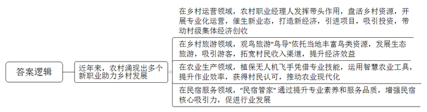
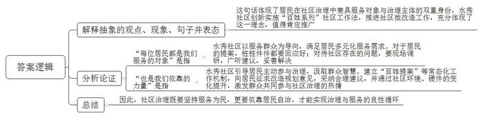
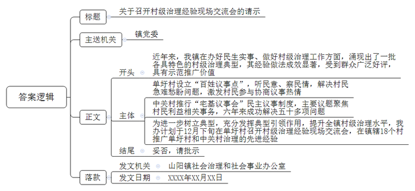
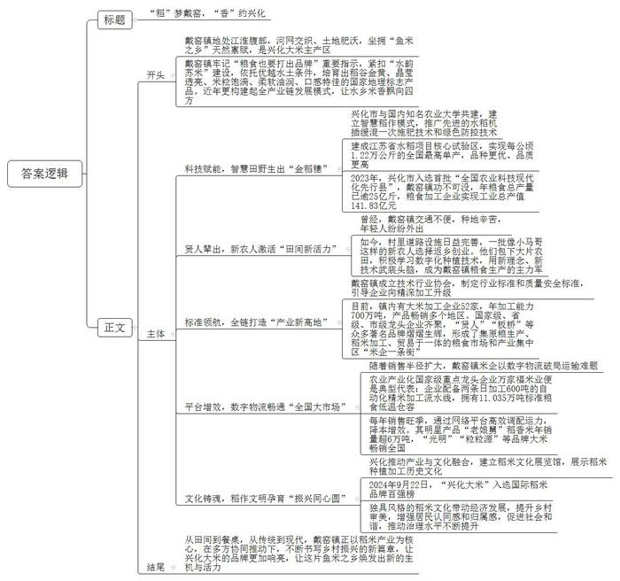

# 2025年江苏省公考《申论》题（C卷）

<!-- gwy:overview:start -->
> **江苏 · 2025 · 申论 · C卷** ｜ 4 题 · 图片 4 处 · 答案随题折叠

导航：[题目](#题目) · [材料 1](#材料-1)
<!-- gwy:overview:end -->

> 候选采集稿。参考答案及解析来自粉笔页面，不代表官方答案或真实高分答卷；来源使用许可与原卷对应关系仍需人工核实。

## 给定材料

### 材料 1

英雄辈出今如何，请看“乡村CEO”。近年来，在H市Y区活跃着一批农村职业经理人，他们被乡亲们亲切称为“乡村CEO”。他们有理想、有学历、有技能，应Y区“英雄帖”的召唤而来，为乡村建设发展进行专业化运营。在乡亲们看来，他们就是一群帮助乡村做生意的带头人。截至目前，该区共有27名农村职业经理人活跃在一线。在他们及其运营团队的努力下，永安村、青山村、新港村等一批乡村纷纷“出圈”，乡村发展被注入了新动能。

在“乡村CEO”小王总看来，“Y区有着丰富的农村文旅资源，多项现代化农业建设成果和多个政府项目在此落地，这些优势对于我们开展乡村运营起到了关键作用。”小王总和他的团队负责北洋镇“长潭湖畔旅发”项目的运营，他们是全镇的“乡村CEO”，全镇的老百姓都是股东。

在乡亲们眼里，“他们不是村干部，但起着村干部的作用”。这些“乡村CEO”干起活来风风火火，效率特别高。永安村的小周总结合村情实际，带动村民做好老字号的新文章，在传统土特产梨膏糖的基础上，开发出新品种梨膏棒棒糖系列产品，作为伴手礼亮相巴黎奥运会；青山村的小韩总有从事旅游业的经验，更有浓厚的乡村情怀，她聘请专业团队规划村里的旅游设施，投资建设了童玩区、戏水区、休闲露营区、骑行驿站等，还与高校合作，吸引了一批大学生志愿者参加到自己的团队中来。

“随着‘乡村运营’的理念日渐成熟，谁来经营、如何经营成为乡村发展的关键所在。发展乡村经济、增强农村造血功能，需要专业人才的加入，以此催生新业态，打造新经济。探索推行农村职业经理人来运营发展乡村意义重大。”Y区农业农村局杨局长表示。据统计，近年来Y区累计引进各类项目122个，吸引有效投资2.99亿元，为村级集体经济创收超1亿元。今后，该区还将加大本土农村职业经理人培养力度，让更多“乡村CEO”在Y区不断涌现，助力乡村振兴。

### 材料 2

材料5

微改造，新面貌。原先乱糟糟的小花园改造成了党员花圃、友邻花坛，几十盆各式花草都是居民从家中搬来的；粉刷一新的楼道里，带有装饰图案的挂钩，让居民大包小包回家时可以腾出手来开家门；角落里生机盎然的绿植代替了过去堆放的杂物；道路边刚刷的座椅上贴着“油漆未干，请勿靠近”的温馨提示……W市水秀社区的这些“微观景观”，其改造建议、改造创意都来自居民，既暖心又实用，无声诉说着“百姓提案师”“百姓规划师”们的努力。

水秀社区是一个30多年的老社区，区域面积近20万平方米，有1.3万多居民，具有新老居民混杂、人员流动频繁、生活方式多样等特征，在环境、空间等诸多方面与居民多元化服务需求难以匹配。

“早在2017年，就有居民要求对社区进行环境改造，当时社区党委推出了‘百姓提案大赛’活动，第一件‘提案’是居民老张随手写在一份报纸的空白处的建议——在居民区放置‘安全文明上网’的宣传牌，我们至今还珍藏着。”水秀社区党委徐书记说。从被动接受管理，到主动参与治理，这份提案可以说见证了水秀居民参与治理从蹒跚学步到规范成熟的过程。如今“百姓提案”已经成为水秀社区的常态化机制。走进水秀社区党群服务中心的“友邻客厅”，你会立即被密密麻麻写满字的黑板所吸引，停下脚步细细打量，足有二十多条，建议还全都不重样。徐书记指着其中几条打上记号的内容说：“社区治理没有小事，你看，停车位紧张、房屋渗水、环卫设施改造，哪怕再琐碎的，只要是居民的提案，我们桩桩都要回应好。”

在社区辖区内的稻香路上，老牛咸豆浆、凌阿姨粢饭团、飞白咖啡馆等“网红店”经常大排长队，带来十足的烟火气。“人多了，车流量就特别大，买菜的市民、吃饭的食客图便利，就把车违停在路边，不但影响环境，店里的生意也大受影响。”稻香路上的老商户刘老板说。为了解决这个问题，社区干部都不知跑了多少趟，到现场调研，广泛听取居民建议。恰逢市里“水秀·记——老新村活化项目”启动，水秀社区创新实施“百姓规划师”项目，想方设法激发商户与居民共同参与社区治理的热情。项目开展后，社区联合有关商户设立了四个便民箱，征求到100多条规划改造意见，其中不少合理建议被采纳。“改造后社区有直达稻香市场的小巴士，路边居然还能腾出几十个车位，现在我们商户交通顺畅，心情畅快。”刘老板说。

“从最初的一条建议到如今的一呼百应，我们通过‘百姓提案师’‘百姓规划师’‘百姓营造师’等百姓系列社区工作法，从楼道微治理、公共空间微改造、院落微美化到社区微更新，居民切切实实地看到了硬件设施的提升，感受到了生活环境的变化，参与治理的积极性大大提高。”一位社区干部感慨地说，“在社区，每位居民都是我们服务的对象，也是我们依靠的力量。”

### 材料 3

材料6

近年来，N县山阳镇在办好民生实事、做好村级治理工作方面，涌现出了一批各具特色的村级治理典型。前不久，N县电视台的记者来到山阳镇进行实地采访。让我们跟随记者的镜头，走进两个先进村去看一看。

镜头一 单圩村党群服务中心

单圩村党群服务中心旁边的巷子里热闹非凡，村干部和村民们围坐在一起，你一言，我一句，为建设乡村献计献策。“我们村现在这么漂亮，接下来要怎么保持好，我觉得村里要多考虑。”“现在村里年轻人越来越多，能不能再修建一个篮球场，增加一些娱乐活动场所。”……

“这里原本只是一个普通的亭子，村民们有事无事都喜欢到这里坐坐，聊聊‘柴米油盐’，说一说‘家长里短’，久而久之这里就变成了我们村的‘百姓议事点’。”村党总支委员老胡笑着对记者说，“对我们村干部来说，这里是个听民意、察民情的好地方，不仅可以了解村民关注的热点、难点、堵点问题，探索乡村治理新经验，征集基层治理‘金点子’，还可以让群众参与到基层治理中来，大家的事大家商量着办，我们村变得越来越和谐了。”

为了激发村民参与协商议事的热情，确保他们的声音可以被听到。单圩村还将“百姓议事点”议事事程、解决方案、办理过程、最终结果全程向村民公开。通过走访询问、电话回访等方式及时跟踪落实，确保每件事情都能得到回应，每个问题都能妥善解决。村民的“问题清单”一个个地被转化为“满意清单”“幸福清单”。“百姓议事点”成为“群众办事点”，村民们赞不绝口，“村里对老百姓真的用心用情用力，我们心里都暖洋洋的。”

单圩村党支部书记老陈说：“我们村秉承‘有事好商量，众人的事情由众人说了算’的理念，想方设法解决村民的急难愁盼问题。今后，我们村将继续发挥‘百姓议事点’作用，让更多村民参与到村庄治理中来。”

镜头二 中关村某村民民宅

在中关村的杨大伯家里，村民们围坐在一起，村支书老马正在主持“宅基议事会”。老马指着杨大伯家正在充电的电动自行车说：“乡亲们，今天主要是想和大家说说怎么解决电动自行车充电的事情。你们看看，我们村不少人像老杨家一样，将电动自行车放在家里充电，这样很容易引起严重火灾事故。”老马说，“一些村民向村委会反映过这个情况，提出过建议，我们经过前期调查和协商，打算在每个村民居住点建公共充电桩，充电桩建设完成后，将大大降低电动自行车充电的安全风险，并且价格也不贵，大家看看，对这个问题有什么想法和意见？”在场的村民纷纷表示同意，还对充电桩的选址、充电服务商选择等问题提出了建议。

“宅基议事会”是中关村从2018年开始推行探索的一项民主议事制度，主要议题聚焦于河道治理、村级道路拓宽、美丽宅基地建设、消防安全等跟村民利益相关的事务，六年来成功解决了五十多项问题，得到了村民们的广泛支持。

为进一步树立典型，山阳镇社会治理和社会事业办公室计划于今年12月下旬在单圩村召开村级治理经验现场交流会，在镇辖18个村推广单圩村和中关村治理的先进经验。

### 材料 4

材料7

近年来，江苏始终牢记习近平总书记“粮食也要打出品牌”的重要指示，聚力用情推动“水韵江苏”建设。“兴化大米”作为“水韵苏米”建设的一个重要品牌，以其稻谷金黄、晶莹透亮、米粒饱满、柔软油润、口感特佳成为国家地理标志产品。

“积雨如膏土脉滋，春来民事颇相宜。”“宿麦渐看青遍野，新秧初见绿盈池。”兴化地处江淮之间，境内河湖港汊纵横交错，与水相伴而生的环境让这里有着得天独厚的地理优势，是名副其实的“鱼米之乡”。兴化名人郑板桥“些小吾曹州县吏，一枝一叶总关情”的为民理念与乡土情怀在当地流传甚广，培养了一代又一代的兴化人。多年来，在这片沃土上，兴化探索出了一条优质大米种植、加工、销售全产业链的发展之路。

为了从“会种田”到“慧种田”，兴化市与国内知名农业大学进行共建，建立适宜兴化的智慧稻作模式，推广最先进的水稻机插缓混一次施肥技术和绿色防控技术，在兴化钓鱼村建立了国家粮食丰产工程——江苏省水稻项目核心试验区。该试验区以每公顷1.22万公斤的产量，居全国各试验区之首，品种更优、品质也更高。农业科学技术的进步和运用，让兴化粮食生产由“望天收”变成了“丰产方”，为兴化大米插上了腾飞的翅膀。2023年，兴化市入选首批“全国农业科技现代化先行县”，年粮食总产量已逾25亿斤，粮食加工企业实现工业总产值141.83亿元。

戴窑，人杰地灵、贤人辈出，如今戴窑镇是兴化大米的主产区，“贤人”也已成为著名的大米品牌。从前，戴窑流传着一句话：“车子摇一摇，到了戴家窑，晴天一身灰，雨天一身泥。”对这句话，土生土长的戴窑人小马哥深有感触。小马哥从小就帮助父亲一起干农活，但退伍后的他并没有像父亲一样选择种地，而是在当地做起了泥瓦匠。“一年以前我们这里还没有修路和桥，每次播种时需要把农机、农资等物品用船运到田里，收成时再用船把粮食从田里运出来，很不方便，太苦太累了。”2018年，小马哥所在的村通上了水泥路，也建起了大桥，让他对种地重拾了信心，借着村里土地流转的机会，他包下了600亩农田，开始新农人之路。小马哥在种地之余，还特别喜欢鼓捣鼓捣“黑科技”，研究研究数字化种植技术。“时代在发展，我们种地的人也要跟上时代的步伐。”他说。现在，兴化已有一大批种植大米的新农人，成为兴化市粮食生产的主力军。

随着大米产量和质量实效不断扩大，他们成立了技术行业协会，制定大米行业标准和质量安全标准，引导食品加工企业向精深加工升级。目前，戴窑镇有大米加工企业52家，年加工能力700万吨，产品畅销江、浙、沪、广东、福建等10个地区，占全国大米市场的5%左右。该行业协会还制定了大中小企业发展规划，推动大中小企业共同高质量发展。2019年戴窑镇成功入选全国农业产业强镇建设名单，2021年又成功入选江苏省“味稻小镇”推介名单。2024年祥兴米业有限公司、万家福米业有限公司入选江苏省智能制造车间名单。目前，戴窑镇有国家级龙头企业2家、省级6家、市级17家，有“贤人”“板桥”“祥兴”等多个江苏省级著名品牌，已形成了集原粮生产、稻米加工、贸易于一体的粮食市场和粮食加工产业集中区“米企一条街”。

戴窑的万家福米业成立于2010年，历经十多年的发展，已成长为当地规模最大的米企之一、农业产业化国家级重点龙头企业，拥有日加工600吨自动化精米加工流水线两条，标准粮食低温仓容达11.035万吨，获得ISO9001质量管理体系、ISO22000食品安全管理体系等认证，主导产品“老娘舅”“光明”“粒粒源”等类型大米销往全国各地。“每年的11月到第二年的1月，是大米加工产业的旺季，原粮运进来，成品米运出去，每天需要大量的运力，除了跟我们厂合作的车辆，我们还通过网络平台找车。”万家福米业办公室韦主任说，“最初万家福的销售只是集中在长三角地区，2018年之后，企业销售半径扩大，开始往全国辐射，由于旺季时的短期运输需求激增，使用平台是一件省时又省钱的方法。”据韦主任介绍，去年“老娘舅”稻香米年销售量超过6万吨，成为企业的明星产品和主打品牌。

仓廪实，天下安。近年来，兴化特别注重产业发展与文化传承相结合，将民族文化与稻米文化交融交汇，通过建立稻米文化展览馆，展示稻米种植加工的历史和文化，提升粮食市场影响力。2024年9月22日，兴化大米入选国际稻米品牌百强榜。绵远流长的文化底蕴、独具风格的稻米文化，在带动农业经济飞速发展的同时，提升了乡村建设的审美品位，也增强了居民的认同感和归属感，在浓浓的文化氛围中，有效促进了社会和谐幸福稳定，推动社会治理水平不断提升。

## 题目

### 第 1 题

**“给定资料1\-4”列举了近年来农村不同领域出现的一些新职业及其对乡村发展的推动作用，请用一段话对此归纳概括。（20分）**

关联材料：材料 1

作答要求：

要求：紧扣给定资料，全面、准确，篇幅不超过250字。

第 1 题 · 答案与解析

**参考答案（粉笔题库参考内容）**

近年来，农村涌现出多个新职业助力乡村发展，具体有：在乡村运营领域，农村职业经理人发挥带头作用，盘活乡村资源，开展专业化运营，催生新业态，打造新经济，引进项目，吸引投资，带动村级集体经济创收；在乡村旅游领域，观鸟旅游“鸟导”依托当地丰富鸟类资源，发展生态旅游，吸引游客，拓宽村民收入渠道，提升经济效益；在农业生产领域，植保无人机飞手凭借专业技能，运用智慧农业工具，提升作业效率，获得村民认可，推动农业现代化；在民宿服务领域，“民宿管家”通过提升专业素养和服务品质，增强民宿核心吸引力，促进行业发展。

**参考答案说明**：本参考答案按照“农村不同领域出现的新职业及其推动作用”的结构，具体介绍了“农村职业经理人”“观鸟旅游‘鸟导’”“植保无人机飞手”“民宿管家”四个新职业其作用，各条答案要点之间在内容上相互并列，没有交叉，并以一段话的形式进行呈现。

**解析**

**考点**：影响类

**来源**：2025年江苏省公考《申论》题（C卷）

> 粉笔申论页面对本题只提供「解析视频」入口，该入口是会员推广位，页面无视频地址与文字解析。

### 第 2 题

**请结合“给定资料5”中水秀社区的“‘百姓系列’社区工作法”，谈谈你对“每位居民都是我们服务的对象，也是我们依靠的力量”这句话的理解和认识。（20分）**

关联材料：材料 2

作答要求：

要求：观点正确，分析透彻，层次分明，篇幅300字左右。

第 2 题 · 答案与解析

**参考答案（粉笔题库参考内容）**

这句话体现了居民在社区治理中兼具服务对象与治理主体的双重身份，水秀社区创新实施“百姓系列”社区工作法，推进社区微改造工作，充分体现了这一理念，值得肯定推广。

“每位居民都是我们服务的对象”是指：水秀社区以服务群众为导向，满足居民多元化服务需求。对于居民的提案，桩桩件件都要回应好；对待社区存在的问题，要现场调研，广听建议，妥善解决。

“也是我们依靠的力量”是指：水秀社区引导居民主动参与治理，汲取群众智慧。建立“百姓提案”等常态化工作机制，向居民征求改造规划意见，采纳合理建议，并通过社区环境、硬件的变化提升，激发群众共同参与社区治理的热情。

因此，社区治理既要坚持服务为民，更要依靠居民自治，才能实现治理与服务的良性循环。

**参考答案说明：**（1）思路方面，本参考答案按照词句解释题“解释抽象的观点、现象、句子+表态+分析论证+总结”的一般答题思路展开。（2）内容方面，本参考答案先解释了画线句子的总体含义并表明了观点，然后分别从行政裁量的“每位居民都是我们服务的对象”和“也是我们依靠的力量”两个方面进行分析论证，最后在“总结”部分提出了对策。（3）词句表达方面，本参考答案加上了“是指”“因此”等连接词来承接上下文。

**解析**

**考点**：观点现象分析类

**来源**：2025年江苏省公考《申论》题（C卷）

> 粉笔申论页面对本题只提供「解析视频」入口，该入口是会员推广位，页面无视频地址与文字解析。

### 第 3 题

**请根据“给定资料6”，以山阳镇社会治理和社会事业办公室的名义，给镇党委写一份请示，提请召开“村级治理经验现场交流会”。（20分）**

关联材料：材料 3

作答要求：

要求：主题明确，理由充分，措辞妥帖，基本要素齐全，篇幅350字左右。

第 3 题 · 答案与解析

**参考答案（粉笔题库参考内容）**

关于召开村级治理经验现场交流会的请示

镇党委：

近年来，我镇在办好民生实事、做好村级治理工作方面，涌现出了一批各具特色的村级治理典型，其经验做法成效显著，受到群众广泛好评，具有示范推广价值。

单圩村设立“百姓议事点”，听民意、察民情，解决村民急难愁盼问题，激发村民参与协商议事热情；中关村推行“宅基议事会”民主议事制度，主要议题聚焦村民利益相关事务，六年来成功解决五十多项问题。

为进一步树立典型，充分发挥典型引领作用，提升全镇村级治理水平，我办计划于12月下旬在单圩村召开村级治理经验现场交流会，在镇辖18个村推广单圩村和中关村治理的先进经验。

妥否，请批示。

山阳镇社会治理和社会事业办公室

XXXX年XX月XX日

**参考答案说明：**（1）格式方面，本参考答案写到了“标题”“主送机关”“正文”“落款”四个部分。（2）正文部分，一方面从内容上来看，本参考答案的开头先写到了山阳镇开展村级治理工作的概况；主体部分介绍了单圩村和中关村的经验做法及其成效，以及山阳镇社会治理和社会事业办公室的工作计划；结尾部分征询上级部门的意见。另一方面，形式上，本参考答案做到了分段、分条撰写，整体上条理较为清晰。

**解析**

**考点**：总结类

**来源**：2025年江苏省公考《申论》题（C卷）

> 粉笔申论页面对本题只提供「解析视频」入口，该入口是会员推广位，页面无视频地址与文字解析。

### 第 4 题

**假如你是“给定资料7”中戴窑镇政府机关的一名工作人员，请围绕戴窑镇稻米产业特色，给兴化市政府网站“今日兴化”栏目写一篇宣传稿。（40分）**

关联材料：材料 4

作答要求：

要求：

（1）结合给定资料，自选角度，自拟标题；

（2）内容充实，结构完整；

（3）篇幅1000字左右。

第 4 题 · 答案与解析

**参考答案（粉笔题库参考内容）**

**“稻”梦戴窑，“香”约兴化**

戴窑镇地处江淮腹部，河网交织、土地肥沃，坐拥“鱼米之乡”天然禀赋，是兴化大米主产区。戴窑镇牢记“粮食也要打出品牌”重要指示，紧扣“水韵苏米”建设，依托优越水土条件，培育出稻谷金黄、晶莹透亮、米粒饱满、柔软油润、口感特佳的国家地理标志产品。近年更构建起全产业链发展模式，让水乡米香飘向四方。

**科技赋能，智慧田野生出“金稻穗”。**兴化市与国内知名农业大学共建，建立智慧稻作模式，推广先进的水稻机插缓混一次施肥技术和绿色防控技术。建成江苏省水稻项目核心试验区，实现每公顷1.22万公斤的全国最高单产，品种更优、品质更高。2023年，兴化市入选首批“全国农业科技现代化先行县”，戴窑镇功不可没，年粮食总产量已逾25亿斤，粮食加工企业实现工业总产值141.83亿元。

**贤人辈出，新农人激活“田间新活力”。**曾经，戴窑镇交通不便，种地辛苦，年轻人纷纷外出。如今，村里道路设施日益完善，一批像小马哥这样的新农人选择返乡创业。他们包下大片农田，积极学习数字化种植技术，用新理念、新技术武装头脑，成为戴窑镇粮食生产的主力军。

**标准领航，全链打造“产业新高地”。**戴窑镇成立技术行业协会，制定行业标准和质量安全标准，引导企业向精深加工升级。目前，镇内有大米加工企业52家，年加工能力700万吨，产品畅销多个地区。国家级、省级、市级龙头企业齐聚，“贤人”“板桥”等众多著名品牌熠熠生辉，形成了集原粮生产、稻米加工、贸易于一体的粮食市场和产业集中区“米企一条街”。

**平台增效，数字物流畅通“全国大市场”。**随着销售半径扩大，戴窑镇米企以数字物流破局运输难题。农业产业化国家级重点龙头企业万家福米业便是典型代表：企业配备两条日加工600吨的自动化精米加工流水线，拥有11.035万吨标准粮食低温仓容。每年销售旺季，通过网络平台高效调配运力，降本增效。其明星产品“老娘舅”稻香米年销量超6万吨，“光明”“粒粒源”等品牌大米畅销全国。

**文化铸魂，稻作文明孕育“振兴同心圆”。**兴化推动产业与文化融合，建立稻米文化展览馆，展示稻米种植加工历史文化。2024年9月22日，“兴化大米”入选国际稻米品牌百强榜。独具风格的稻米文化带动经济发展，提升乡村审美，增强居民认同感和归属感，促进社会和谐，推动治理水平不断提升。

从田间到餐桌，从传统到现代，戴窑镇正以稻米产业为核心，在多方协同推动下，不断书写乡村振兴的新篇章，让兴化大米的品牌更加响亮，让这片鱼米之乡焕发出新的生机与活力。

**参考答案说明：**（1）格式方面，本参考答案写到了“标题+正文”。（2）正文部分，一方面从内容来看，开头部分先介绍了戴窑镇优越的水土条件及稻米产业发展的总体情况；主体部分从“科技赋能，智慧田野生出‘金稻穗’”“贤人辈出，新农人激活‘田间新活力’”“标准领航，全链打造‘产业新高地’”“平台增效，数字物流畅通‘全国大市场’”“文化铸魂，稻作文明孕育‘振兴同心圆’”五个方面介绍了戴窑镇发展稻米产业的做法、成效等；结尾部分进行了总结。另一方面，形式上，本参考答案做到了分段、分条撰写，整体上条理较为清晰。

**解析**

**考点**：宣传类

**来源**：2025年江苏省公考《申论》题（C卷）

> 粉笔申论页面对本题只提供「解析视频」入口，该入口是会员推广位，页面无视频地址与文字解析。

