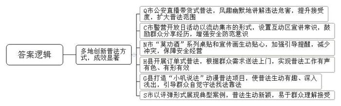
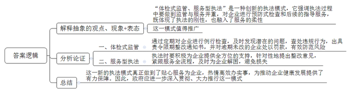
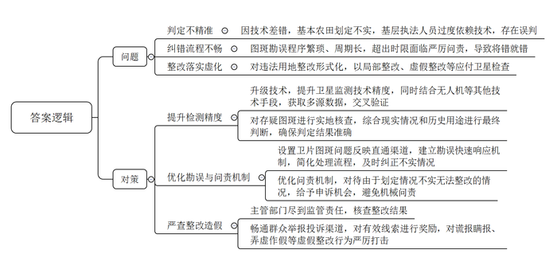
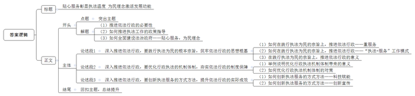

# 2025年江苏省公考《申论》题（B卷）

> 候选采集稿。参考答案及解析来自粉笔页面，不代表官方答案或真实高分答卷；来源使用许可与原卷对应关系仍需人工核实。

## 给定材料

### 材料 material-fb9d5c18d4631824

社会发展日新月异，服务创新层出不穷。随着依法行政的深入推进，普法的“打开方式”也越来越“潮”。

“欢迎宝子们来到我市公安直播间！今天由我来给大家送福利！价值5000块，九成新华为手机，想偷？三年以下有期徒刑，值不值？”近日，Q市公安“直播带货式”普法爆火。直播中，穿着制服的主播用轻松诙谐的话术开场，一下子就吸引了观众的眼球。这种风趣幽默的“直播带法”吸引了众多网民的围观：“一看就是00后上岗了。法律知识点就这么水灵灵地进入了我的脑袋。”从热闹程度上看，这种“直播带货式”普法与普通带货直播人气相当，而内容却都与法律有关。比如，主播拿出不少“买家秀”的照片，展示吸食毒品多年后的不同状态：“吸毒时间越长，人越憔悴，吸毒5年人直接吸没了。”从盗窃到吸毒，主播在直播间里逐一展示这些违法行为的危害。网友纷纷留言：“好，涨知识了！”“太燃了，普法还可以这样搞，真没想到！”话题“Q市公安的直播间”曾多次冲上热搜榜，据相关数据显示，视频在全网已有2亿以上播放量。

“见义勇为排排塔”“识诈反诈套圈圈”“食药安全猜猜看”……9月28日，在警营开放日活动现场，来自C市公安机关7个分局、八大警种的民警以“流动集市”的形式，设置了反诈、打谣、食品药品安全、交通安全、长江大保护、防范非法集资等宣传防范互动区，向广大群众宣传安全防范常识。“我接到一个电话，听着像外孙的声音，说自己在外面惹事了，要我帮他赔钱。一听就是骗子，之前社区民警在小区广场就跟我们说过。想骗我老太太，可没那么容易！”在反诈中心的摊位前，家住花园新村的钱婆婆和民警分享着自己的经历。“奶奶您真棒！希望您回去跟身边人分享这个故事。”C市反诈中心民警在为老人的反诈意识点赞的同时，还给她和围观的群众讲解了如何识别“刷单”“投资理财”等多种诈骗手段。

每晚7点，N市爱华路一带的烧烤摊、大排档就开始热闹起来。近日，刘先生和朋友相约到爱华路上一家熟悉的烧烤店聚餐，在扫码点餐时，餐桌角上的“温馨提示”桌贴引起了他们的注意。仔细一看，原来是一幅“莫劝酒”漫画，并配有一首小诗：“相聚饮酒莫相劝，醉酒出事同桌担。劝君少喝一杯酒，相互提醒都平安。”刘先生说：“吃烧烤时喜欢喝酒助兴，有时架不住朋友的热情，不知不觉就喝多了。这个‘莫劝酒’桌贴提示很贴心，漫画也很生动，起到了很好的引导和提醒效果。”据了解，“莫劝酒”“莫贪杯”等系列桌贴是当地警方精心设计的一种普法形式。在烧烤店的墙面上，还张贴了印有“饮酒小酌莫贪杯，酒后滋事罚相随”的蓝白色宣传画。“小桌贴和宣传画的效果还是杠杠的，现代人普遍素质高、爱面子，有时默默地提醒比当面劝阻效果要好，现在我们店酗酒闹事的明显少了，生意也好做多了。”店老板张先生由衷地说。

### 材料 material-30bf7d9e8e722053

被执法查处、责令限期整改的企业，反而给执法者送去锦旗和感谢信，你说意外不意外？今年5月，L区市场监管局在一次特种设备例行检查中发现，R公司有一处天然气管道未注册，被抓了“现行”，执法人员当场出具了责令限期整改通知书。不过，其后的整改过程却一波三折，L区市场监管局执法人员也深度“卷了进去”。

“本来是一个环保升级的好项目，谁知道负责施工的公司在项目竣工验收时，把天然气管道注册这项工作给遗漏了。”谈起被查处的经历，R公司蒋经理很是懊恼。2019年，R公司投资9000万元推动设备环保升级，把生产尾气处理方式由活性炭吸附改为效果更好、更清洁的天然气燃烧。这项改造进行得很顺利，当年就成功投用。在之后的生产中，这处天然气管道一切正常，公司每年还定期请相关检测机构对其进行检测，均未发现问题。没想到，该处天然气管道竟然是个“黑户”，没有按照规定在市场监管局注册。按照有关法规，区市场监管局给予其责令30日内限期整改的通知，若逾期未改，将处以1万至10万元罚款。

然而，整改刚刚开始，蒋经理就傻眼了：由于天然气管道施工单位内部发生变更，当时的天然气管道设计图纸、施工材料和人员都找不到了。“这可怎么办？被罚款不说，关键是遭遇处罚会给企业信用留下污点。幸亏这次市场监管部门的例行检查发现了这个问题，要不然我们还不知道呢！”蒋经理说，公司每年与某知名大型跨国公司有近千万元订单合作，跨国公司选择合作对象非常看重企业信用，一旦企业信用有了污点，很可能会被踢出供应商名单。“当时我能够想到的唯一办法，就是向市场监管部门求助，希望他们能帮忙解决这个难题。”

得知这一情况后，L区市场监管局立即选派有经验的执法人员前往R公司。根据完善整改所需的材料做出妥善安排：区市场监管局给天然气管道施工单位发函，要求他们全力配合查找当时的施工资料；执法人员和R公司的人员一起，到天然气管道检测机构调取检测记录；对实在找不到的材料，执法人员则指导如何进行补充。经过这一番“贴身紧逼”的帮忙，R公司在规定期限内补齐了材料，完成了天然气管道注册，不仅免于罚款，还避免了因信用出现污点损失订单。“通过这件事，我们切身感受到，他们既是执法者，更是‘服务员’。”蒋经理对此赞不绝口。

贴心服务为企业，热情高效办实事。“‘体检式监管、服务型执法’是我们推行的执法新模式，其目的是为了更好地帮助企业健康发展。”L区市场监管局负责人说。

### 材料 material-8d207d1167168ce3

为遏制耕地“非农化”，防止“非粮化”，近年来，自然资源部门充分利用卫星技术手段，持续开展土地卫星遥感影像图片（简称“卫片”）执法检查，督促各地对问题图斑开展排查整治。遥感卫星技术具有区域覆盖性强、监测精度高等特点，通过比对不同时间点的照片，可以发现土地利用的变化，从而圈注出疑似违法用地形成的图斑，在发现土地违法行为方面具有常规监察手段无法比拟的优势。通过技术赋能，基层执法渠道得到拓宽，极大提升了土地资源管理水平和效率。然而，记者在多地采访发现，卫片执法在执行过程中仍存在一些问题。

“近年来，我们村大力发展乡村旅游，利用荒山荒坡开发旅游设施，并通过国家4A级景区验收。可是，前不久我们突然接到自然资源部门的整改通知，要求立即拆除旅游设施，恢复耕地，依据就是卫片执法发现的问题图斑。”S县一名村干部无奈地说。对此类问题，另一名乡镇干部遇到了更不可思议的一件事：一户村民的窑洞顶被划为基本农田，执法部门还开出数十万元的罚款。

长期研究卫片执法问题的W大学王博士调研发现，卫片执法结果显示，H县某乡镇近3000亩土地存在“非粮化”现象，但经当地干部核实后发现，要求整改的土地有六成存在划定基本农田不实的情况。多名乡镇干部表示，发现图斑有问题要想勘误，需要一级一级往上反映，还需要派人核查，提供证据，证明这个地方以前确实是何种性质的土地，程序走下来至少要90天。但在现实中，如果在一定时限内无法按卫星结果恢复土地性质，上级就会对下级进行严厉问责。“即便图斑存在技术差错，也只能将错就错。可这样，村民肯定就不干了，为避免激化干群矛盾，搞出了不少荒唐事。”一名乡镇党委书记说，一户村民的闲置宅基地被错划为一般农田后，为避免被卫星拍到，只能在建好的地基上覆盖一层植被，再经由规划部门重新上交土地农转非手续。

一些地方通过各种变通手段应付来自卫星视角的检查，A县分管领导说，在今年的耕地“非农化”检查中，他所在的县有2000多亩问题图斑需要排查整改，“很担心不少违法占地行为最终不了了之。”有些地方在整改时，不动真碰硬，存在局部整改甚至虚假整改的情况。比如，某企业建设厂房时多占了周边土地，被卫片执法发现后，只拆除违法占地上方的部分屋顶，露出地面，并在相应区域临时种上绿植，“只要从天上看到变绿了，应付了卫星就行。”另一位乡镇干部反映，有一个地方五口鱼塘都属于违法占地，但是卫星只生成了其中一口鱼塘的违法图斑，最后也只对那一口鱼塘进行了执法。

一些受访基层干部反映，用卫片执法遏制耕地“非农化”，防止“非粮化”的效果显著，多数问题图斑确实存在违法占地情况，基层执法人员只要依法办事即可，最担心的是，对违法占地的判定不精准。比如，有的农民常年在外打工，其闲置的宅基地被家人种上了农作物，但在第三次全国国土调查中，工作人员依据土地现状，将此类地块认定为耕地。“耕地红线谁也不敢碰，但凡被认定为耕地，就得按照耕地处理。”一名工作人员说。

## 题目

### 第 1 题

**“给定资料**1**\-**3**”列举了一些地方“花式”普法的做法及其成效，请用一段话对此加以归纳概括。（20分）**

关联材料：material-fb9d5c18d4631824

作答要求：

要求：紧扣给定资料，全面、准确。篇幅不超过250字。

### 第 2 题

**请根据****“给定资料**4**”，谈谈你对“体检式监管****、****服务型执法****”这一执法新模式的理解和认识。（15分）**

关联材料：material-30bf7d9e8e722053

作答要求：

要求：观点正确，分析透彻。篇幅300字左右。

### 第 3 题

**请对****“给定资料**5**”中“卫片执法”存在的问题进行梳理并提出相应的解决对策。（25分）**

关联材料：material-8d207d1167168ce3

作答要求：

要求：条理清晰，有针对性、可行性。篇幅350字左右。

### 第 4 题

**请根据****“给定资料**7**”中党的二十届三中全会关于“深入推进依法行政”方面的要求，围绕“贴心服务提升行政执法质效 为民理念激发社会发展活力”这一主题，联系实际，写一篇文章。（40分）**

关联材料：material-fb9d5c18d4631824

作答要求：

要求：

（1）自选角度，自拟标题；

（2）参考给定资料，不拘于给定资料；

（3）观点明确，内容充实，结构完整；

（4）篇幅1000字左右。

## 答案与解析

第 1 题

**参考答案（粉笔题库参考内容）**

多地创新普法方式，成效显著：Q市公安直播带货式普法，风趣幽默地讲解违法危害，提升接受度，扩大普法范围；C市警营开放日活动以流动集市的形式，设置互动区宣讲常识，鼓励群众分享经历，增强安全防范意识；N市“莫劝酒”系列桌贴和宣传画生动贴心，加强引导提醒，减少冲突，保障安全经营；H县开展订单式普法，根据群众需求送法上门，实现普法工作有声有色、有形有效；G县打造“小叽说法”动漫普法项目，使普法生动有趣、深入浅出，引导群众自觉守法找法靠法；S市以评弹形式展现典型案例，普法生动新颖，易于群众理解接受。

**解析**

**参考答案说明：**本参考答案在开头部分添加适当衔接句，然后从Q市、C市、N市、H县、G县、S市这六个地方，介绍了“花式”普法的做法及其成效。答案用一段话的形式呈现，符合题目要求。

**考点**：考点影响类

**来源**：来源2025年江苏省公考《申论》题（B卷）

粉笔申论页面对本题只提供「解析视频」入口，该入口是会员推广位，页面无视频地址与文字解析。

第 2 题

**参考答案（粉笔题库参考内容）**

“体检式监管、服务型执法”是一种创新的执法模式，它强调执法过程中要做到监管与服务并重，对企业进行预防式检查和后续的指导服务，既体现了执法的刚性，也融入了服务的柔性。这一模式值得推广。

这种模式具体体现为：一、体检式监管。通过定期对企业进行例行检查，及时发现潜在的问题，查处违规行为，出具责令限期整改通知书，并对逾期未改的企业处以罚款，有效防范风险。二、服务型执法。执法时要积极为企业提供全方位的支持，针对性地提出整改意见，紧跟服务全流程，及时为企业解困，避免损失。

这一新的执法模式真正做到了贴心服务为企业，热情高效办实事，为推动企业健康发展提供了有力保障。因此，政府应进一步深入贯彻、大力推行这一模式。

**解析**

**参考答案说明：**（1）思路方面，本参考答案按照观点现象分析题“解释抽象的观点、现象+表态+分析论证+总结”的一般答题思路展开。（2）内容方面，本参考答案先对“体检式监管、服务型执法”的含义进行了解释并表态；接着“分析论证”部分介绍了这种模式的具体体现；最后对这种执法模式进行总结。（3）词句表达方面，本参考答案加上了“这种模式具体体现为”等连接词句来承接上下文。

**考点**：考点观点现象分析类

**来源**：来源2025年江苏省公考《申论》题（B卷）

粉笔申论页面对本题只提供「解析视频」入口，该入口是会员推广位，页面无视频地址与文字解析。

第 3 题

**参考答案（粉笔题库参考内容）**

问题：1.判定不精准。因技术差错，基本农田划定不实，基层执法人员过度依赖技术，存在误判。2.纠错流程不畅。图斑勘误程序繁琐、周期长，超出时限面临严厉问责，导致将错就错。3.整改落实虚化。对违法用地整改形式化，以局部整改、虚假整改等应付卫星检查。

对策：1.提升检测精度。升级技术，提升卫星监测技术精度，同时结合无人机等其他技术手段，获取多源数据，交叉验证；对存疑图斑进行实地核查，综合现实情况和历史用途进行最终判断，确保判定结果准确。2.优化勘误与问责机制。设置卫片图斑问题反映直通渠道，建立勘误快速响应机制，简化处理流程，及时纠正不实情况；优化问责机制，对待由于划定情况不实无法整改的情况，给予申诉机会，避免机械问责。3.严查整改造假。主管部门尽到监管责任，核查整改结果；畅通群众举报投诉渠道，对有效线索进行奖励，对谎报瞒报、弄虚作假等虚假整改行为严厉打击。

**解析**

**参考答案说明：**本参考答案先从“判定不精准”“纠错流程不畅”“整改落实虚化”三个方面介绍了“卫片执法”存在的问题，再从“提升检测精度”“优化勘误与问责机制”“严查整改造假”三个方面介绍了解决对策。各条要点之间在内容上相互并列，没有交叉。

**考点**：考点提出对策类

**来源**：来源2025年江苏省公考《申论》题（B卷）

粉笔申论页面对本题只提供「解析视频」入口，该入口是会员推广位，页面无视频地址与文字解析。

第 4 题

**参考答案（粉笔题库参考内容）**

**贴心服务彰显执法温度** **为民理念激活发展动能**

依法行政乃政治文明之要，法治建设之核。党的二十届三中全会明确提出要“深入推进依法行政”，并且要求促进政务服务标准化、规范化、便利化，这为执法工作指明了方向。在全面建设法治政府的新征程上，唯有将贴心服务融入执法全过程，以为民理念创新执法方式，才能真正提升执法质效，才能在法治中国的宏伟蓝图上，绘制出浓墨重彩且意义深远的新画卷。

**深入推进依法行政，要践行执法为民的根本宗旨，筑牢依法行政的思想根基。**时代在不断发展，行政执法工作应顺势而为，改变过去“重管理”的思维模式，把“重服务”作为执法工作的重心，它强调的是严格执法的同时，提供高效、便捷、人性化的服务。市场监管部门在检查天然气管道时，推行“执法+服务”工作模式，贴心服务为企业、热情高效办实事，这种服务型执法体现了执法部门执法为民的服务理念，促进了经济社会的和谐稳定发展。可以说，坚持以人民为中心的发展思想，让执法工作既有力度又有温度。

**深入推进依法行政，要优化行政执法的机制体制，夯实依法行政的制度保障。**“综合查一次”联合执法机制通过多部门联合执法，并且加强执法过程智慧化监管，为企业“远程把脉”；“三书同送”制度则在处罚的同时，提供信用修复和合规建议……这些创新机制不仅规范了执法行为，又提升了服务精度，既体现了法律的刚性，又展现了执法的温度。因此，要提升行政执法质效，必须注重制度机制的完善，通过构建科学合理的执法流程、强化跨部门执法协作、优化执法资源配置等措施，确保执法活动既公正高效，又能激发社会经济发展的活力。

**深入推进依法行政，要创新执法服务的方式方法，提升依法行政的实际成效。**一方面，利用科技赋能执法工作，提高执法效率。譬如用好互联网、大数据、人工智能等技术，广泛应用智能监控系统、移动执法终端，对城市交通、社会治安、食品安全、生态环境等领域进行实时监控、精准管理。另一方面，创新宣传方式，增强法治的传播力。譬如“直播带货”式普法，用网络语言讲解法律知识；打造动漫普法品牌，让法律条文“活”起来；改编评弹剧目，用传统艺术形式讲述法治故事……总之，执法工作要以创新为引领，充分利用科技手段，将执法与普法相结合，才能实现良法善治的目标。

新时代呼唤新作为，新使命需要新担当。让我们以党的二十届三中全会精神为指引，持续推动执法理念创新、机制创新、方式创新，让法治成为护航发展、温暖民心的坚实力量，在全面建设社会主义现代化国家的新征程上谱写更加绚丽的法治篇章！

**解析**

**文章分析**

**贴心服务彰显执法温度 为民理念激活发展动能**

【**标题的优点：**标题突出了“贴心服务提升行政执法质效 为民理念激发社会发展活力”这一主题，形式上采用对称式结构，使标题更加完整、饱满。】

（1）依法行政乃政治文明之要，法治建设之核。（2）党的二十届三中全会明确提出要“深入推进依法行政”，并且要求促进政务服务标准化、规范化、便利化，这为执法工作指明了方向。（3）在全面建设法治政府的新征程上，唯有将贴心服务融入执法全过程，以为民理念创新执法方式，才能真正提升执法质效，才能在法治中国的宏伟蓝图上，绘制出浓墨重彩且意义深远的新画卷。

【**开头的优点：**★内容方面。范文的开头是紧扣“贴心服务提升行政执法质效 为民理念激发社会发展活力”这一主题展开的。首先，开头点出主题，做到了主题明确。其次，对“贴心服务提升行政执法质效 为民理念激发社会发展活力”这一主题进行了分析阐述，指出了：（1）推进依法行政的必要性；（2）如何推进执法工作的政策指导；（3）如何全面建设法治政府——贴心服务，为民理念。★文字表达方面。使用了“唯有……才能……”等关联词，使语言表达有逻辑性；长短句配合使用，使语言表达有节奏感。】

**深入推进依法行政，要践行执法为民的根本宗旨，筑牢依法行政的思想根基。**（1）时代在不断发展，行政执法工作应顺势而为，改变过去“重管理”的思维模式，把“重服务”作为执法工作的重心，它强调的是严格执法的同时，提供高效、便捷、人性化的服务。（2）市场监管部门在检查天然气管道时，推行“执法+服务”工作模式，贴心服务为企业、热情高效办实事，（3）这种服务型执法体现了执法部门执法为民的服务理念，促进了经济社会的和谐稳定发展。可以说，坚持以人民为中心的发展思想，让执法工作既有力度又有温度。

【**论述段****1的优点：**★观点句：范文的观点句是紧扣“贴心服务提升行政执法质效 为民理念激发社会发展活力”这一文章主题提出的。形式上，它在段首处直接写出，位置突出，容易发现。内容上，关键词突出，内容要点明确，可以明显看出主要围绕“执法为民”展开论述。★论述内容：（1）如何在践行执法为民的宗旨上，推进依法行政——重服务；（2）如何在践行执法为民的宗旨上，推进依法行政——“执法+服务”工作模式；（3）在践行执法为民的宗旨上，推进依法行政的意义。注意：以上几个方面的内容都是紧扣“深入推进依法行政，要践行执法为民的根本宗旨，筑牢依法行政的思想根基”这个观点句进行分析论述的，论述的针对性强，内容层次丰富。在论述方法上采用了讲道理与举例子相结合的方式，论述充实深刻。】

**深入推进依法行政，要优化行政执法的机制体制，夯实依法行政的制度保障。**（1）“综合查一次”联合执法机制通过多部门联合执法，并且加强执法过程智慧化监管，为企业“远程把脉”；“三书同送”制度则在处罚的同时，提供信用修复和合规建议……这些创新机制不仅规范了执法行为，又提升了服务精度，既体现了法律的刚性，又展现了执法的温度。因此，（2）要提升行政执法质效，必须注重制度机制的完善，通过构建科学合理的执法流程、强化跨部门执法协作、优化执法资源配置等措施，确保执法活动既公正高效，又能激发社会经济发展的活力。

【**论述段****2的优点：**★观点句：范文的观点句是紧扣“贴心服务提升行政执法质效 为民理念激发社会发展活力”这一文章主题提出的。形式上，它在段首处直接写出，位置突出，容易发现。内容上，关键词突出，内容要点明确，可以明显看出主要围绕“优化行政执法的机制体制”展开论述。★论述内容：（1）举例说明优化行政执法机制体制带来的意义；（2）如何优化行政执法机制体制的对策。注意：以上几个方面的内容都是紧扣“深入推进依法行政，要优化行政执法的机制体制，夯实依法行政的制度保障”这个观点句进行分析论述的，论述的针对性强，内容层次丰富。在论述方法上采用了讲道理与举例子相结合的方式，论述充实深刻。】

**深入推进依法行政，要创新执法服务的方式方法，提升依法行政的实际成效。**（1）一方面，利用科技赋能执法工作，提高执法效率。譬如用好互联网、大数据、人工智能等技术，广泛应用智能监控系统、移动执法终端，对城市交通、社会治安、食品安全、生态环境等领域进行实时监控、精准管理。（2）另一方面，创新宣传方式，增强法治的传播力。譬如“直播带货”式普法，用网络语言讲解法律知识；打造动漫普法品牌，让法律条文“活”起来；改编评弹剧目，用传统艺术形式讲述法治故事……总之，执法工作要以创新为引领，充分利用科技手段，将执法与普法相结合，才能实现良法善治的目标。

【**论述段****3的优点：**★观点句：范文的观点句是紧扣“贴心服务提升行政执法质效 为民理念激发社会发展活力”这一文章主题提出的。形式上，它在段首处直接写出，位置突出，容易发现。内容上，关键词突出，内容要点明确，可以明显看出主要围绕“创新执法服务的方式方法”展开论述。★论述内容：（1）如何创新执法服务的方式方法——科技赋能；（2）如何创新执法服务的方式方法——创新宣传。注意：以上几个方面的内容都是紧扣“深入推进依法行政，要创新执法服务的方式方法，提升依法行政的实际成效”这个观点句进行分析论述的，论述的针对性强，内容层次丰富。在论述方法上采用了讲道理与举例子相结合的方式，论述充实深刻。】

【**论述段之间的关系：**★内容的内在逻辑：范文的论述段之间是依照“并列”的逻辑展开的。论述段1先写了“要践行执法为民的根本宗旨”，论述段2再写了“要优化行政执法的机制体制”，论述段3最后写了“要创新执法服务的方式方法”。文章整体思路清晰。】

新时代呼唤新作为，新使命需要新担当。让我们以党的二十届三中全会精神为指引，持续推动执法理念创新、机制创新、方式创新，让法治成为护航发展、温暖民心的坚实力量，在全面建设社会主义现代化国家的新征程上谱写更加绚丽的法治篇章！

【**结尾的优点：**范文的结尾回扣了“贴心服务提升行政执法质效 为民理念激发社会发展活力”这个主题，并且进行了总结提升。】

**考点**：考点文章写作题

**来源**：来源2025年江苏省公考《申论》题（B卷）

粉笔申论页面对本题只提供「解析视频」入口，该入口是会员推广位，页面无视频地址与文字解析。

