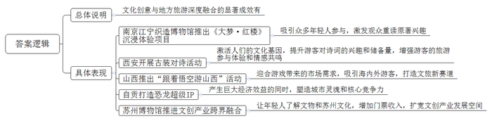
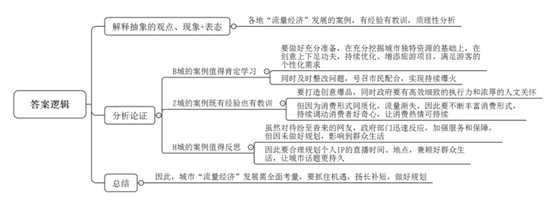
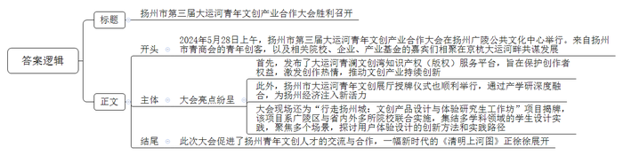
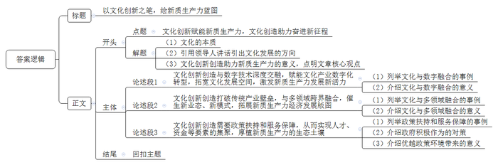

# 2025年江苏省公考《申论》题（A、乡镇选调卷）

> 候选采集稿。参考答案及解析来自粉笔页面，不代表官方答案或真实高分答卷；来源使用许可与原卷对应关系仍需人工核实。

## 给定材料

### 材料 material-3d4d57f527ea6f09

开谈不说《红楼梦》，读尽诗书也枉然。文学巨匠曹雪芹用一部怀金悼玉的《红楼梦》，写尽世间盛衰荣辱、人生悲欢离合，绵延二百余年而长盛不朽。如今，在“世界文学之都”南京的江宁织造博物馆——红楼文化滥觞之地，又有了打开《红楼梦》的另一种方式。

“没想到能通过如此独特的方式进入曹雪芹笔下的世界！”2024年8月9日晚，00后观众小田走出南京江宁织造博物馆，仍沉浸在深深的震撼之中，特别是在“宝钗”为她披上披风的一刹那，她真切地感受到了文学的力量与温度。

小田所体验的是《大梦·红楼》沉浸式展陈空间，这场设置在世界文学之都的别出心裁的文化盛宴，吸引着众多年轻市民和游客参与。“仅仅开放两周就已经有观众五刷了，市场展现出的热情远超我们预期！”南京W数字科技公司陈经理感慨道，“这便是经典作品独有的魅力。”

《大梦·红楼》是全国首个以《红楼梦》为主题的全场域行进式近景沉浸体验项目。它从曹雪芹的视角，引领观众以第一人称开启60分钟的太虚幻境之旅。项目采用多线并行、穿插叙事的方式，在2000平方米的空间内设置了3大沉浸展区、4条不同的观众动线以及20个原著经典情节的还原。观众先领取披风，依据对应的“木石前盟”（黛玉）、“金玉良缘”（宝钗）等主题选择探索路径。体验过程中没有固定座位，观众可以跟随喜爱的角色自由行走并近距离互动。“仿佛看着这些角色在自己眼前真实地活了一遍。”有观众在社交平台分享自己的感受。

“在2019年南京申报世界文学之都的最后环节，需提交一份300字以内的介绍，其中唯一提及的文学作品就是《红楼梦》，而江宁织造府又是曹雪芹的诞生地，我们期望通过数字化的方式、沉浸式的玩法以及艺术化的表现形式，让《红楼梦》以全新面貌展现在世人面前。”陈经理表示。自7月20日试运营以来，《大梦·红楼》吸引了众多参与者，一些原本对《红楼梦》了解不深的年轻人体验后也决定回去重读原著。目前，该项目在各大平台上均获得较高评分，在多个榜单中名列前茅。

“您好，我们可以对首诗吗？”当你行走在西安时，遇到有人身着汉服跟你这样打招呼，请不必吃惊，这是古都正在兴起的一种“潮玩”方式。只需调动知识储备，你便可与对方来一场酣畅淋漓的诗词比拼。

西安，一座诗歌之城。唐代时，无数文人骚客到访长安，或吟诗作赋，或对酒当歌，留下了数不胜数的诗词名篇。如今，在西安大唐不夜城、钟鼓楼广场等地，身着古装的“对诗人”不时可见。他们与路人以诗歌之名相逢，共赴诗意盎然的时光，激活了心中日用而不觉的文化基因。

随着越来越多游客慕名而来，一些西安市民也开始走上街头，自发加入“对诗人”的行列。自去年8月起，原本在一家饭店打工的小赵拿起手机，每晚来到大唐不夜城开启对诗直播。他为自己的直播账号取名“小陕西”，希望让游客感受三秦大地和古都长安的别样魅力。

“向南望，秦岭巍巍，向北看，大雁塔就在眼前。站在这里，和游客一起吟诵‘慈恩塔下题名处，十七人中最少年’‘云横秦岭家何在？雪拥蓝关马不前’等诗句，就像古人来到了我们身边，这种感觉非常美妙。”小赵说。

“以前，很少有游客知道‘兰陵美酒郁金香’的下句，而现在能回答的人越来越多。有小朋友这次对不上来，会相约再来找我对第二次。”扮演李白的演员小董说。据他观察，游客对诗词的兴趣和储备量在显著增长。“诗词能带给人智慧与启迪，在快节奏的当下，人们越来越珍视传统文化的力量。”某大学社会学院肖教授说，“对诗贴近年轻人、更接地气，让诗词走出课本、活了起来，‘跟着书本去旅行’正成为潮流，诗词文化内涵丰富了旅游的参与与体验，增强了游客的情感共鸣。”

### 材料 material-d87574d10a1679d0

网络时代，每一个“出圈”“爆火”的现象，似乎都在挑战着普通人的传统认知，演绎着大街小巷层出不穷的话题。近年来接连出现的网红城市现象，其背后都活跃着一串串文化创意的影子。

城市一：B城

2024年伊始，全国冰雪游进入旺季，冰雪B城凭着各种“掏兜待客”的创意“出圈”了。从中央大街上表演的驯鹿、滚烫的红糖姜水到持续接送游客的爱心车队、红专街早市的免费“投喂”，再到“砂糖橘”和“蔓越莓”的双向奔赴，B城的“宠粉城设”为文旅市场的“开门红”打了个样。

为满足广大游客个性化需求，B城在创意上可谓下足了功夫。为彰显“音乐之都”的底蕴，直接将交响音乐会搬进了商场；游客想拍带月亮的雪景，就在圣索菲亚大教堂上空升起了一轮圆圆的人造月亮；游客想看雪后的飞马踏冰，直接给整出了带翅膀的飞马，一秒穿越到“凛冬之城”；飞马不够，极地馆的“逃学企鹅”、鸵鸟都给安排上；更令人惊叹的是，还把鄂伦春族人请到了中央大街表演驯鹿。你以为这就完了吗？松花江冰面升起热气球，让冰城秒变“浪漫土耳其”；怕游客在江面上玩耍吹到风，立马安排气垫船，上演冰上“速度与激情”；因让游客长时间排队而诚恳退票，连夜整改，随后发布《致全市人民的一封信》，号召市民让路、让景、让利给远道而来的朋友……

该省文旅厅负责人表示，B城的爆火不是偶然，已经做了一年的准备。“冰雪世界是我们的独特资源和魅力源泉！哪里不满意我们就调整哪里，需要什么我们就上什么。”

城市二：Z城

2023年春天，Z城彻底火了！当地“烧烤”关键词搜索量同比增长超370%，“Z城烧烤”关键词全平台搜索量，则同比增长770%，不少网友表示：“上次Z城这么热闹，还是在齐国……”

该市文旅局负责人表示，Z城是一个工业城市，能在烧烤上火起来很不容易。Z城烧烤火就火在“创意”上。“小串+小饼+小葱”的灵魂吃法，加上“一桌一炉一卷饼”的独特仪式感，让Z城烧烤给人一种强烈的视觉冲击，其具有超强仪式感的吃法迅速红遍各个社交媒体，网友们纷纷将自己的花样吃法发布到网络中，很快掀起一阵“烧烤DIY”的热潮。

专门开通的“烧烤专列”“烧烤公交”广受好评，一路上还被“投喂”当地特产，附赠旅游攻略；3天修好一条路，20天新建一座烧烤城；规范商户行为，惩处违法乱象……Z城相关部门细致、高效的执行力和浓厚的人文关怀，书写了有温度、有力量的高分答卷。

一年过去，以Z城烧烤为代表的“流量经济”现状如何？今年7月28日至31日，复旦大学新闻学院“记录中国”团队来到Z城实地走访发现，去年火爆之后新开张的网红店已经几乎没流量了。流量狂欢后，留下的是同质化的小吃一条街，放弃本行改做炒锅饼和紫米糕等网红产品，成为小吃一条街商家的普遍选择。“繁华过后，能有多少家店铺坦然面对冷清的结局”成为萦绕在团队成员脑海中的问题。

“烧烤作为一种美食体验，没有什么技术门槛，虽然在初期能够吸引大量游客，但毕竟消费形式相对单一，当人们的好奇心得到满足后，很难持续保持热情。”相关行业专家表示。

城市三：H城

今年5月，“H城树哥”和已废弃的H南站火爆全网。在“H城树哥”的直播间，背景是建于20世纪70年代的南站，“树哥”梳着大背头，身着帅气西装，戴着皮手套，造型致敬电影《Hello！树先生》中的“树”，边上停着一辆老款宝马，有时候他还将老式手机别在腰间，再叠加一层昏黄复古的滤镜，唱着老歌《诺言》。网友们听了他唱的歌，纷纷表示：“太上头了！”“后劲太大！”

粉丝们从天南地北赶到H城听他唱歌与他合影，H南站变得熙熙攘攘。为了迎接全国各地纷至沓来的“客人”，H城火速反应，直接把沥青车开到了南站，连夜修缮路面，保障大家的出行体验，并安排志愿者提供服务。

不过，H南站的火爆只持续了12天。H南站附近有多所学校，还有多个居民小区。“H城树哥”爆火后，全国各地的主播们蜂拥而至，给当地居民的生活带来了不小的困扰。5月20日，H城文旅发布公告：“鉴于2024年5-7月份春季高考、夏季高考、中考等考试比较集中，且H南站附近学校设有考点，为给广大考生营造良好的学习、生活和考试环境，H南站将不再举办各类文娱活动。”

“就目前形势来看，H城想借力此次流量，一举带火当地旅游似乎并不容易。”专家表示。

### 材料 material-d66aa6dea45d2dcf

2024年5月28日上午，扬州市第三届大运河青年文创产业合作大会在扬州广陵公共文化中心举行。来自扬州市青商会的青年创客，以及相关院校、企业、产业基金的嘉宾们相聚在京杭大运河畔共谋发展。

10年前，中国大运河入选世界文化遗产名录。这条世界上里程最长、工程最大、历史最悠久的人工运河，让世人再次领略中华文明的博大精深，感受中国人民的创新创造。大运河申遗成功10年来，文化力量转化为强大的发展能量。京津、燕赵、齐鲁、中原、淮扬、吴越文化在大运河沿线区域争奇斗艳，在发展经济上各展所长，在美美与共中优势互补，一幅自古繁华、于今尤甚的新时代《清明上河图》正徐徐展开。

扬州广陵区2021年开始打造“大运河青年文创”品牌，构建“运河青创”生态体系，打造青年文创集聚区，为青年文创企业在广陵发展提供政策支持和服务保障，形成了产业集聚、协同发展的良好态势。本届大会活动现场发布了大运河青澜文创湾知识产权（版权）服务平台。随着越来越多的青年人才投身于文创产业，他们带来了新鲜的思想和创意，但同时也面临着知识产权保护的难题。大运河青澜文创湾知识产权（版权）服务平台致力于保护创作者的权益，激发他们的创作热情，推动文创产业的持续创新。活动现场，扬州市大运河青年文创展厅授牌仪式同时顺利举行。通过产学研的深度融合，为扬州经济发展注入新的活力。

上午10点，“行走扬州城：文创产品设计与体验研究生工作坊”在合作大会现场启动，该项目系广陵区与南京艺术学院、武汉理工大学、广州美术学院、北京师范大学、扬州大学联合实施，将集结不同学科背景、不同专业领域的学生设计实践，聚焦文旅、交通、健康医疗、智慧服务、社区邻里、低碳产业等场景塑造，共同探讨用户体验设计的创新方法和实践路径。启动仪式上，广陵区团委负责人介绍了设立工作坊的初衷和功能，高校代表和研究生代表做了发言，在热烈的掌声中，双方代表共同为工作坊揭牌。

## 题目

### 第 1 题

**“给定资料**1**\-**4**”中，一些地区将各具特色的文化创意与地方旅游深度融合取得了显著成效，请用一段话对此进行归纳概括。（20分）**

关联材料：material-3d4d57f527ea6f09

作答要求：

要求：紧扣给定资料，全面、准确。篇幅不超过250字。

### 第 2 题

**“给定资料**5**”中列举的“出圈”“爆火”现象都不乏创意，但效果不一，请结合给定资料，就如何让“流量经济”健康发展，谈谈你的理解和认识。（20分）**

关联材料：material-d87574d10a1679d0

作答要求：

要求：观点正确，分析透彻，见解深刻。篇幅300字左右。

### 第 3 题

**请就****“给定资料**6**”中“扬州市第三届大运河青年文创产业合作大会”的举行，写一则简讯。（20分）**

关联材料：material-d66aa6dea45d2dcf

作答要求：

要求：要素齐全，突出亮点、意义，条理清楚。篇幅350字左右。

### 第 4 题

**请根据****“给定资料**7**”中习近平总书记“要着力激发全民族文化创新创造活力”的重要指示，围绕“文化创新赋能新质生产力****，****文化创造助力奋进新征程****”这一主题，写一篇文章。（40分）**

关联材料：material-3d4d57f527ea6f09

作答要求：

要求：

（1）自选角度，自拟标题；

（2）参考给定资料，不拘泥于给定资料；

（3）观点明确，内容充实，结构完整；

（4）篇幅1000字左右。

## 答案与解析

第 1 题

**参考答案（粉笔题库参考内容）**

文化创意与地方旅游深度融合的显著成效有：南京江宁织造博物馆推出《大梦·红楼》沉浸体验项目，吸引众多年轻人参与，激发观众重读原著兴趣；西安开展古装对诗活动，激活人们的文化基因，提升游客对诗词的兴趣和储备量，增强游客的旅游参与体验和情感共鸣；山西推出“跟着悟空游山西”活动，迎合游戏带来的市场需求，吸引海内外游客，打造文旅新赛道；自贡打造恐龙超级IP，产生巨大经济效益的同时，塑造城市灵魂和核心竞争力；苏州博物馆推进文创产业跨界融合，让年轻人了解文物和苏州文化，增加门票收入，扩宽文创产业发展空间。

**解析**

**参考答案说明：**本参考答案按照“总结性引导语+各地区将文化创意与地方旅游深度融合的成效”的结构，具体介绍了“南京江宁织造博物馆推出《大梦·红楼》沉浸体验项目”“西安开展古装对诗活动”“山西推出‘跟着悟空游山西’活动”“自贡打造恐龙超级IP”“苏州博物馆推进文创产业跨界融合”五个方面的文化创意与地方旅游深度融合取得的显著成效。答案用一段话的形式呈现，符合题目要求。

**考点**：考点影响类

**来源**：来源2025年江苏省公考《申论》题（A、乡镇选调卷）

粉笔申论页面对本题只提供「解析视频」入口，该入口是会员推广位，页面无视频地址与文字解析。

第 2 题

**参考答案（粉笔题库参考内容）**

各地“流量经济”发展的案例，有经验有教训，须理性分析：

1.B城的案例值得肯定学习。要做好充分准备，在充分挖掘城市独特资源的基础上，在创意上下足功夫，持续优化、增添旅游项目，满足游客的个性化需求；同时及时整改问题，号召市民配合，实现持续爆火。

2.Z城的案例既有经验也有教训。要打造创意爆品，同时政府要有高效细致的执行力和浓厚的人文关怀。但因为消费形式同质化，流量渐失，因此要不断丰富消费形式，持续调动消费者好奇心，让消费热情可持续。

3.H城的案例值得反思。虽然对待纷至沓来的网友，政府部门迅速反应，加强服务和保障，但因未做好规划，影响到群众生活，因此要合理规划个人IP的直播时间、地点，兼顾好群众生活，让城市话题更持久。

因此，城市“流量经济”发展需全面考量，要抓住机遇，扬长补短，做好规划。

**解析**

**参考答案说明**：（1）思路方面，本参考答案按照观点现象分析题“解释抽象的观点、现象+表态+分析论证+总结”的一般答题思路展开。（2）内容方面，本参考答案先对“流量经济”这一话题进行了表态；接着“分析论证”部分，分析了各地“流量经济”发展的优点、经验及存在的问题、不足等；最后在“总结”部分提出了对策。（3）词句表达方面，本参考答案加上了“因此”等连接词来承接上下文。

**考点**：考点观点现象分析类

**来源**：来源2025年江苏省公考《申论》题（A、乡镇选调卷）

粉笔申论页面对本题只提供「解析视频」入口，该入口是会员推广位，页面无视频地址与文字解析。

第 3 题

**参考答案（粉笔题库参考内容）**

扬州市第三届大运河青年文创产业合作大会胜利召开

2024年5月28日上午，扬州市第三届大运河青年文创产业合作大会在扬州广陵公共文化中心举行。来自扬州市青商会的青年创客，以及相关院校、企业、产业基金的嘉宾们相聚在京杭大运河畔共谋发展。

大会亮点纷呈。首先，发布了大运河青澜文创湾知识产权（版权）服务平台，旨在保护创作者权益，激发创作热情，推动文创产业持续创新。此外，扬州市大运河青年文创展厅授牌仪式也顺利举行，通过产学研深度融合，为扬州经济注入新活力。大会现场还为“行走扬州城：文创产品设计与体验研究生工作坊”项目揭牌，该项目系广陵区与省内外多所院校联合实施，集结多学科领域的学生设计实践，聚焦多个场景，探讨用户体验设计的创新方法和实践路径。

此次大会促进了扬州青年文创人才的交流与合作，一幅新时代的《清明上河图》正徐徐展开。

**解析**

**参考答案说明：**（1）格式方面，本参考答案写到了“标题”“正文”两个部分。（2）正文部分，一方面从内容上来看，围绕“扬州市第三届大运河青年文创产业合作大会”这一主题，本参考答案的开头先介绍了此次大会举办的背景；主体部分介绍了此次大会的三个亮点及意义；结尾进行了总结。另一方面，形式上，本参考答案做到了分段、分条撰写，整体上条理较为清晰。

**考点**：考点总结类

**来源**：来源2025年江苏省公考《申论》题（A、乡镇选调卷）

粉笔申论页面对本题只提供「解析视频」入口，该入口是会员推广位，页面无视频地址与文字解析。

第 4 题

**参考答案（粉笔题库参考内容）**

**以文化创新之笔，绘新质生产力蓝图**

“求木之长者，必固其根本；欲流之远者，必浚其泉源。”文化，作为民族的精神内核，国家的灵魂血脉，在时代的浪潮中奔腾不息。习近平总书记强调“要着力激发全民族文化创新创造活力”，为文化发展指明方向。在新质生产力蓬勃发展的当下，以文化创新赋能，用文化创造助力，方能在奋进新征程中奏响华彩乐章。

**文化创新创造与数字技术深度交融，赋能文化产业数字化转型，拓宽文化发展空间，激发新质生产力发展新活力。**从“数字兵马俑”借3D建模技术让游客近距离感受秦代雕塑的精妙绝伦，到“线上国博展”凭高清直播带领观众探索国家宝藏的前世今生，数字技术正重塑文化产业形态。当古老的敦煌壁画借助数字技术“飞”出洞窟，以高清影像、VR体验等形式呈现在全球观众眼前，不仅让文化瑰宝重焕生机，更开拓了线上文化消费市场，这正是文化与数字融合的生动注脚。数字技术打破了时空局限，为文化创新提供无限可能，催生新的文化业态和消费模式，让文化产业成为新质生产力发展的重要增长极。

**文化创新创造打破传统产业壁垒，与多领域跨界融合，催生新业态、新模式，拓展新质生产力经济发展版图。**文化的魅力在于其强大的渗透力和融合力。如今，文化与旅游深度融合，西安的“对诗潮玩”让诗词文化与古城旅游相得益彰；文化与体育融合，天津河西•哪吒文化体育嘉年华将体育赛事、文娱活动、商业消费联动，以“体育+文化”赋能经济；“文创+”模式遍地开花，故宫文创产品将传统文化与现代创意结合，年销售额屡创新高，带动相关产业发展。这种跨界融合为各行业注入文化内涵，提升产品附加值，推动产业结构优化升级，形成了新质生产力新的经济增长点。

**文化创新创造需要政策扶持和服务保障，从而实现人才、资金等要素的集聚，厚植新质生产力的生态土壤。**在现实发展进程中，诸多地区已然深刻认识到这一关键要点，以扬州市为例，当地着力打造“大运河青年文创”品牌，精心构建“运河青创”生态体系，为青年文创企业量身定制政策支持与服务保障，成功吸引众多人才投身文创产业。政府积极作为，出台利好政策，搭建知识产权保护平台，全力营造良好的营商环境，促使资本不断流入，加速人才汇聚。人才倾献智慧，资金注入动力，在优越政策环境的催化下，文化创新创造活力充分涌流，为新质生产力发展夯实根基，助力其结出累累硕果。

“满眼生机转化钧，天工人巧日争新。”在新时代的征程上，以文化创新为笔，饱蘸新质生产力的墨汁，以文化创造为纸，承载奋进的力量，定能绘就中华民族伟大复兴的壮丽画卷。

**解析**

**文章分析**

**以文化创新之笔，绘新质生产力蓝图**

【**标题的优点：**首先，范文的标题突出了“文化创新赋能新质生产力，文化创造助力奋进新征程”这一主题。其次，形式上，文字简洁明快，不拖沓。】

“求木之长者，必固其根本；欲流之远者，必浚其泉源。”（1）文化，作为民族的精神内核，国家的灵魂血脉，在时代的浪潮中奔腾不息。（2）习近平总书记强调“要着力激发全民族文化创新创造活力”，为文化发展指明方向。（3）在新质生产力蓬勃发展的当下，以文化创新赋能，用文化创造助力，方能在奋进新征程中奏响华彩乐章。

【**开头的优点：**★内容方面：范文的开头是紧扣“文化创新赋能新质生产力，文化创造助力奋进新征程”这一主题展开的。首先，开头点出主题，做到了主题明确。其次，对“文化创新赋能新质生产力，文化创造助力奋进新征程”这一主题进行了分析阐述：（1）指出文化的本质；（2）引用领导人讲话引出文化发展的方向；（3）指出文化创新创造助力新质生产力的意义，点明文章核心观点。★文字表达方面：长短句配合使用，使语言表达有节奏感。】

**文化创新创造与数字技术深度交融，赋能文化产业数字化转型，拓宽文化发展空间，激发新质生产力发展新活力。**（1）从“数字兵马俑”借3D建模技术让游客近距离感受秦代雕塑的精妙绝伦，到“线上国博展”凭高清直播带领观众探索国家宝藏的前世今生，数字技术正重塑文化产业形态。当古老的敦煌壁画借助数字技术“飞”出洞窟，以高清影像、VR体验等形式呈现在全球观众眼前，不仅让文化瑰宝重焕生机，更开拓了线上文化消费市场，这正是文化与数字融合的生动注脚。（2）数字技术打破了时空局限，为文化创新提供无限可能，催生新的文化业态和消费模式，让文化产业成为新质生产力发展的重要增长极。

【**论述段****1的优点：**★观点句：范文的观点句是紧扣“文化创新赋能新质生产力，文化创造助力奋进新征程”这一文章主题提出的。形式上，它在段首处直接写出，位置突出，容易发现。内容上，关键词突出，内容要点明确，可以明显看出它是从“文化创新创造与数字技术融合”这个角度入手，指出了文化创新创造促进新质生产力发展的对策。★论述内容：（1）首先列举了文化与数字融合的事例；（2）接着介绍了文化与数字融合的意义。注意：以上两个方面的内容都是紧扣“文化创新创造与数字技术深度交融，赋能文化产业数字化转型，拓宽文化发展空间，激发新质生产力发展新活力”这个观点句进行分析论述的，论述的针对性强，内容层次丰富。最后，在论述方法上主要采用了讲道理与举例子结合，做到了丰富多样。】

**文化创新创造打破传统产业壁垒，与多领域跨界融合，催生新业态、新模式，拓展新质生产力经济发展版图。**（1）文化的魅力在于其强大的渗透力和融合力。如今，文化与旅游深度融合，西安的“对诗潮玩”让诗词文化与古城旅游相得益彰；文化与体育融合，天津河西•哪吒文化体育嘉年华将体育赛事、文娱活动、商业消费联动，以“体育+文化”赋能经济；“文创+”模式遍地开花，故宫文创产品将传统文化与现代创意结合，年销售额屡创新高，带动相关产业发展。（2）这种跨界融合为各行业注入文化内涵，提升产品附加值，推动产业结构优化升级，形成了新质生产力新的经济增长点。

【**论述段****2****的优点：**★观点句：范文的观点句是紧扣“文化创新赋能新质生产力，文化创造助力奋进新征程”这一文章主题提出的。形式上，它在段首处直接写出，位置突出，容易发现。内容上，关键词突出，内容要点明确，可以明显看出它是从“文化创新创造与多领域融合”这个角度入手，指出了文化创新创造促进新质生产力发展的对策。★论述内容：（1）首先列举了文化与多领域融合的事例；（2）接着介绍了文化与多领域融合的意义。注意：以上两个方面的内容都是紧扣“文化创新创造打破传统产业壁垒，与多领域跨界融合，催生新业态、新模式，拓展新质生产力经济发展版图”这个观点句进行分析论述的，论述的针对性强，内容层次丰富。最后，在论述方法上主要采用了讲道理与举例子结合，做到了丰富多样。】

**文化创新创造需要政策扶持和服务保障，从而实现人才、资金等要素的集聚，厚植新质生产力的生态土壤。**（1）在现实发展进程中，诸多地区已然深刻认识到这一关键要点，以扬州市为例，当地着力打造“大运河青年文创”品牌，精心构建“运河青创”生态体系，为青年文创企业量身定制政策支持与服务保障，成功吸引众多人才投身文创产业。（2）政府积极作为，出台利好政策，搭建知识产权保护平台，全力营造良好的营商环境，促使资本不断流入，加速人才汇聚。（3）人才倾献智慧，资金注入动力，在优越政策环境的催化下，文化创新创造活力充分涌流，为新质生产力发展夯实根基，助力其结出累累硕果。

【**论述段****3****的优点：**★观点句：范文的观点句是紧扣“文化创新赋能新质生产力，文化创造助力奋进新征程”这一文章主题提出的。形式上，它在段首处直接写出，位置突出，容易发现。内容上，关键词突出，内容要点明确，可以明显看出它是从“政策扶持和服务保障”这个角度入手，指出了文化创新创造促进新质生产力发展的对策。★论述内容：（1）首先列举了政策扶持和服务保障的事例；（2）接着介绍了政府积极作为的对策；（3）最后介绍了优越政策环境带来的意义。注意：以上三个方面的内容都是紧扣“文化创新创造需要政策扶持和服务保障，从而实现人才、资金等要素的集聚，厚植新质生产力的生态土壤”这个观点句进行分析论述的，论述的针对性强，内容层次丰富。最后，在论述方法上主要采用了讲道理与举例子结合，做到了丰富多样。】

【**论述段之间的关系：**★内容的内在逻辑：范文的论述段之间是依照并列的逻辑展开的。论述段1先写了“文化创新创造与数字技术融合”，论述段2接着写了“文化创新创造与多领域融合”，论述段3最后写了“文化创新创造需要政策扶持和服务保障”。这三个论述段之间相互并列，逻辑清晰。】

“满眼生机转化钧，天工人巧日争新。”在新时代的征程上，以文化创新为笔，饱蘸新质生产力的墨汁，以文化创造为纸，承载奋进的力量，定能绘就中华民族伟大复兴的壮丽画卷。

【**结尾的优点：**范文的结尾回扣了“文化创新赋能新质生产力，文化创造助力奋进新征程”这个主题，并且进行了展望。】

**考点**：考点文章写作题

**来源**：来源2025年江苏省公考《申论》题（A、乡镇选调卷）

粉笔申论页面对本题只提供「解析视频」入口，该入口是会员推广位，页面无视频地址与文字解析。

