# 2025年江苏省公务员录用考试《行测》题（B类）（网友回忆版）

<!-- gwy:overview:start -->
> **江苏 · 2025 · 行测 · B类** ｜ 135 题 · 图片 32 处 · 答案随题折叠

| 题型模块 | 题量 | 题号 |
| --- | ---: | ---: |
| 政治理论 | 10 | 1–10 |
| 常识判断 | 10 | 11–20 |
| 言语理解与表达 | 30 | 21–50 |
| 数量关系 | 20 | 51–70 |
| 判断推理 | 45 | 71–115 |
| 资料分析 | 20 | 116–135 |
| **合计** | **135** | |

导航：[题型与作答说明](#题型与作答说明) · [题目](#题目) · [材料 1](#材料-1)
<!-- gwy:overview:end -->

> 候选采集稿。参考答案及解析来自粉笔页面，不代表官方答案或真实高分答卷；来源使用许可与原卷对应关系仍需人工核实。

## 题型与作答说明

政治理论

（10题）

根据题目要求，从四个选项中选出一项最恰当的答案。

常识判断

（10题）

根据题目要求，从四个选项中选出一项最恰当的答案。

言语理解与表达

（30题）

本部分包括表达与理解两方面的内容。请根据题目要求，在四个选项中选出一个最恰当的答案。

数量关系

（20题）

在这部分试题中，每道题呈现一段表述数字关系的文字，要求你迅速、准确地计算出答案。

判断推理

（45题）

本部分包括图形推理、定义判断、类比推理与逻辑判断四种类型的试题，在四个选项中选出一个最恰当的答案。

资料分析

（20题）

下列给出的文字、表格、图形资料均有五个问题要你回答，请根据资料提供的信息进行分析、计算、处理，然后从四个选项中选出一项正确的答案。

## 题目

### 第 1 题

习近平新时代中国特色社会主义思想从理论和实践结合上，科学地回答了新时代坚持和发展什么样的中国特色社会主义、怎样坚持和发展中国特色社会主义，建设什么样的社会主义现代化强国、怎样建设社会主义现代化强国，建设什么样的长期执政的马克思主义政党、怎样建设长期执政的马克思主义政党等重大时代课题，提出一系列原创性的治国理政新理念新思想新战略。关于习近平新时代中国特色社会主义思想的历史地位，下列表述正确的是：

①继承和发展马克思列宁主义、毛泽东思想、邓小平理论、“三个代表”重要思想、科学发展观，是马克思主义在当代中国发展最新理论成果，开辟了马克思主义中国化时代化的新境界

②把马克思主义基本原理同中国具体实际相结合，同中华优秀传统文化相结合，使马克思主义这个魂脉和中华优秀传统文化这个根脉内在贯通、相互成就，是中华民族的文化主体性最有力的体现，是中华文化和中国精神的时代精华

③确立了社会主义市场经济体制的改革目标和基本构架，确立了社会主义初级阶段的基本经济制度和分配制度，开创了全面深化改革新局面，推进党的建设新的伟大工程

④是全党全国各族人民为实现中华民族伟大复兴而奋斗的行动指南，是新时代党和国家发展事业的根本遵循

A. ①②③

B. ①②④

C. ①③④

D. ②③④

第 1 题 · 答案与解析

**参考答案（粉笔题库参考内容）**

B

**解析**

本题考查理论与政策。

①正确，党的十九大报告指出，习近平新时代中国特色社会主义思想，是对马克思列宁主义、毛泽东思想、邓小平理论、“三个代表”重要思想、科学发展观的继承和发展，是马克思主义中国化最新成果，是党和人民实践经验和集体智慧的结晶，是中国特色社会主义理论体系的重要组成部分，是全党全国人民为实现中华民族伟大复兴而奋斗的行动指南，必须长期坚持并不断发展。党的二十大报告提出的“六个必须坚持”，即必须坚持人民至上、坚持自信自立、坚持守正创新、坚持问题导向、坚持系统观念、坚持胸怀天下，集中体现了习近平新时代中国特色社会主义思想的世界观和方法论，是马克思主义世界观方法论中国化时代化的最新成果。

②正确，习近平新时代中国特色社会主义思想既坚持了马克思主义的根本立场和基本原理，又从中华优秀传统文化中汲取了丰富营养，实现了马克思主义与中华优秀传统文化的有机融合，推动了中华文化的创造性转化和创新性发展。所以，它把马克思主义基本原理同中国具体实际相结合，同中华优秀传统文化相结合，使马克思主义这个魂脉和中华优秀传统文化这个根脉内在贯通、相互成就，是中华民族的文化主体性最有力的体现，是中华文化和中国精神的时代精华。

③错误，“确立了社会主义市场经济体制的改革目标和基本构架，确立了社会主义初级阶段的基本经济制度和分配制度”等主要是邓小平理论、三个代表重要思想、科学发展观的重要成果，并不是习近平新时代中国特色社会主义思想的特定贡献。习近平新时代中国特色社会主义思想主要是推进全面深化改革向广度和深度进军，而不是确立社会主义市场经济体制等的最初阶段的内容。

④正确，习近平新时代中国特色社会主义思想为实现中华民族伟大复兴的中国梦提供了科学理论指引和行动纲领，从思想上、理论上、战略上、行动上为党和国家事业发展指明了方向，对于团结带领全国各族人民全面建成社会主义现代化强国、全面推进中华民族伟大复兴具有重大而深远的意义。因此，可以说它是全党全国各族人民为实现中华民族伟大复兴而奋斗的行动指南，是新时代党和国家发展事业的根本遵循。

故①②④说法正确。

故正确答案为B。

**考点**：新思想总论

**来源**：2025年江苏省公务员录用考试《行测》题（C类）（网友回忆版）第1题

### 第 2 题

党的十八大以来以习近平同志为核心的党中央把全面从严治党纳入“四个全面”战略布局，深入推进新时代党的建设新的伟大工程，提出一系列新理念新思想新战略，形成习近平总书记关于党的建设的重要思想。党在革命性锻造中更加坚强有力、更加充满活力。全面从严治党开辟了百年大党自我革命的新境界。关于新时代全面从严治党取得的历史性开创性成就，下列表述正确的是：

①牢牢抓住“关键少数”，坚持从领导干部抓起，以上率下

②提出让人民监督政府是跳出历史周期率第一个答案

③开展了史无前例的反腐败斗争，取得压倒性胜利并全面巩固

④把制度建设贯穿党的政治各方面，形成比较完善的党内法规体系

⑤以党的政治建设统领党的建设的各项工作，不断增强党组织政治功能

A. ①②③⑤

B. ①②④⑤

C. ①③④⑤

D. ②③④⑤

第 2 题 · 答案与解析

**参考答案（粉笔题库参考内容）**

C

**解析**

本题考查理论与政策。

①正确，党的十八大以来，全面从严治党过程中，始终强调抓住领导干部这个 “关键少数”，以上率下，要求领导干部以身作则、率先垂范，带头遵守党纪国法，执行党的各项规定，以实际行动引领广大党员干部廉洁从政、担当作为。

②错误，毛泽东同志在延安的窑洞里给出了跳出历史周期率的第一个答案，即让人民监督政府。而在新时代，习近平总书记给出了第二个答案，这就是自我革命。

③正确，2023年1月9日，中共中央总书记、国家主席、中央军委主席习近平在中国共产党第二十届中央纪律检查委员会第二次全体会议上发表重要讲话。讲话指出：“新时代10年，我们党不断深化对自我革命规律的认识，不断推进党的建设理论创新、实践创新、制度创新，在构建全面从严治党体系上积累了丰富成果······我们开展史无前例的反腐败斗争，坚持无禁区、全覆盖、零容忍，不敢腐、不能腐、不想腐一体推进，‘打虎’、‘拍蝇’、‘猎狐’多管齐下，查处一大批腐败分子，消除党内严重政治隐患，反腐败斗争取得压倒性胜利并全面巩固，成功走出一条中国特色反腐败之路······”

④正确，2023年1月9日，中共中央总书记、国家主席、中央军委主席习近平在中国共产党第二十届中央纪律检查委员会第二次全体会议上发表重要讲话。讲话指出：“新时代10年，我们党不断深化对自我革命规律的认识，不断推进党的建设理论创新、实践创新、制度创新，在构建全面从严治党体系上积累了丰富成果······我们把制度建设贯穿党的各项建设，与时俱进完善党章，聚焦加强党的领导和党的建设推进制度创新，形成比较完善的党内法规体系，搭建起党和国家监督体系‘四梁八柱’，把权力关进制度的笼子，为新时代党的建设提供了根本性、全局性、稳定性、长期性保障······”

⑤正确，党的十八大以来，全面从严治党强调以党的政治建设为统领，把政治标准和政治要求贯穿党的思想建设、组织建设、作风建设、纪律建设以及制度建设、反腐败斗争始终，不断增强党组织政治功能和组织功能，确保党的团结统一和行动一致。

故①③④⑤表述正确。

故正确答案为C。

**考点**：其他建设

**来源**：2025年江苏省公务员录用考试《行测》题（C类）（网友回忆版）第2题

### 第 3 题

2023年7月，习近平总书记在江苏考察时强调，江苏有能力也有责任在推进中国式现代化进程中走在前、做示范，希望江苏在科技创新上取得新突破，在强链补链延链上展现新作为，在建设中华民族现代文明上探索新经验，在推进社会治理现代化上实现新提升。为贯彻落实总书记赋予江苏“四个新”的重大任务，下列做法正确的有：

①打造全国重要的产业科技创新高地，使高质量发展更多依靠创新驱动的内涵型增长，强化企业科技创新主体地位，深化科技体制改革和人才发展体制机制改革

②巩固传统产业领先地位，加快打造具有国际竞争力的战略性新兴产业集群，全面提升产业基础高级化和产业链现代化水平，加快构建以先进制造业为骨干的现代化产业体系

③加强优秀传统文化的保护传承和创新发展，大力发展现代科技、教育事业，全面提升人民群众的科学文化素质，繁荣发展文化事业和文化产业，持续推进城乡公共文化服务标准化、均等化

④加快健全社会保障体系，健全就业促进机制和就业公共服务体系，完善社会治理体系，推进社会治理数字化，推进应急管理体系和能力现代化

A. 1项

B. 2项

C. 3项

D. 4项

第 3 题 · 答案与解析

**参考答案（粉笔题库参考内容）**

D

**解析**

本题考查理论与政策。

①正确，习近平总书记指出，中国式现代化关键在科技现代化。江苏要在科技创新上率先取得新突破，打造全国重要的产业科技创新高地，使高质量发展更多依靠创新驱动的内涵型增长。要强化企业科技创新主体地位，促进创新要素向企业集聚，不断提高科技成果转化和产业化水平。要深化科技体制改革和人才发展体制机制改革······

②正确，习近平总书记强调，要把坚守实体经济、构建现代化产业体系作为强省之要，巩固传统产业领先地位，加快打造具有国际竞争力的战略性新兴产业集群，推动数字经济与先进制造业、现代服务业深度融合，全面提升产业基础高级化和产业链现代化水平，加快构建以先进制造业为骨干的现代化产业体系。

③正确，习近平总书记指出，建设中华民族现代文明，是推进中国式现代化的必然要求，是社会主义精神文明建设的重要内容。江苏要加强优秀传统文化的保护传承和创新发展，积极参与建设长江和大运河两大国家文化公园。要大力发展现代科技、教育事业，全面提升人民群众的科学文化素质。要繁荣发展文化事业和文化产业，持续推进城乡公共文化服务标准化、均等化······

④正确，习近平总书记强调，江苏必须在保障和改善民生、推进社会治理现代化上走在前列。要加快健全社会保障体系，健全就业促进机制和就业公共服务体系，做好重点群体就业工作。要坚持和发展新时代“枫桥经验”、“浦江经验”，完善社会治理体系，健全城乡基层治理体系和乡村治理协同推进机制，推进社会治理数字化。要推进应急管理体系和能力现代化······

故做法正确的有①②③④，共4项。

故正确答案为D。

**考点**：重要会议讲话、其他建设

**来源**：2025年江苏省公务员录用考试《行测》题（C类）（网友回忆版）第3题

### 第 4 题

习近平总书记指出，中华民族有着五千多年的悠久历史和灿烂文化，而且中华文化从远古一直延续发展到今天，是世界上唯一绵延不断，且以国家形态发展至今的伟大文明，具有突出的连续性。关于中华文化为何具有突出的连续性，下列说法正确的是：

①强大的文化主体性，夯实了中华文明连续性的内在支撑

②浩如烟海的文化典籍成为中华文明连续性的天然载体

③独特又稳定的地理环境，筑牢了中华文明连续性的自然基础

④中华文化“中和”的文化价值诉求奠定了中华文明连续性的价值底蕴

A. ①②③

B. ①②④

C. ①③④

D. ②③④

第 4 题 · 答案与解析

**参考答案（粉笔题库参考内容）**

D

**解析**

本题考查理论与政策。

①错误，《中华文明源远流长的连续性》中指出：“厚重的文化积累是中华文明突出连续性的内在支撑。一个文明能够从不断裂、历久弥新，其中决定连续性的深层次原因必与既有的文化密切相关。换言之，同一个国家‘不断裂’状态的维持，一是其国民的人类遗传基因延续不辍，二是其国家文化基因世代传承。”

②正确，《习近平总书记这样谈中华文明的连续性》中指出：“中华民族创造了浩如烟海的文化典籍，中华文明在这些代代相传的典籍中得以记载和传承，如四书五经等儒家典籍向来是历代儒家学子首要研学之书，从未中断。······在我国出土的大量考古成果充分展示着中华文明起源和发展的历史脉络，从中可见中华文明传承悠久且从未中断。”由此可见，浩如烟海的文化典籍成为中华文明连续性的天然载体。

③正确，《中华文明源远流长的连续性》中指出：“独特的地理气候是中华文明突出连续性的自然基础。”《连续性：中华文明的首要特性》中指出：“中华文明成为人类历史上唯一一个绵延5000多年至今未曾中断的灿烂文明。而这主要得益于以下三个因素：第一，独特稳定的地理环境。”

④正确，《连续性：中华文明的首要特性》中指出：“第二，‘中和’的文化价值诉求。中华文明源远流长、博大精深，其中儒家、道家成为中华文明的主流思想······‘中’就是要把握适当的限度，使自己的言行合乎标准。‘中和’所代表的中性智慧强调的是事物双方的相辅相成、共生共存，从而做到不偏不倚、执两用中······总而言之，‘中和’的文化价值诉求成就了‘贵和持中、自强不息’的中华文明，奠定了中华文明源远流长的价值底蕴。”

故②③④表述正确。

故正确答案为D。

**考点**：文化建设

**来源**：2025年江苏省公务员录用考试《行测》题（C类）（网友回忆版）第4题

### 第 5 题

习近平总书记指出，全面依法治国是国家治理的一场深刻革命。我们要坚持走中国特色社会主义法治道路、建设中国特色社会主义法治体系、建设社会主义法治国家。关于中国特色社会主义法治道路的核心要义，下列理解正确的是：

①中国特色社会主义制度是中国特色社会主义法治体系的根本制度基础

②党的领导是中国特色社会主义最本质的特征，是社会主义法治最根本的保证

③中国特色社会主义法治理论是法治体系的理论指导，是全面推进依法治国的行动指南

④弘扬社会主义法治精神、传承中华优秀传统法律文化是社会主义法治建设的首要任务

A. ①②③

B. ①②④

C. ①③④

D. ②③④

第 5 题 · 答案与解析

**参考答案（粉笔题库参考内容）**

A

**解析**

本题考查理论与政策。

①②③正确，《习近平新时代中国特色社会主义思想学习纲要》中“八、全面推进依法治国”部分指出：“中国特色社会主义法治道路的核心要义，就是要坚持党的领导，坚持中国特色社会主义制度，贯彻中国特色社会主义法治理论。党的领导是中国特色社会主义最本质的特征，是社会主义法治最根本的保证。坚持中国特色社会主义法治道路，最根本的是坚持党的领导。中国特色社会主义制度是中国特色社会主义法治体系的根本制度基础，是全面推进依法治国的根本制度保障。中国特色社会主义法治理论是中国特色社会主义法治体系的理论指导和学理支撑，是全面推进依法治国的行动指南。”

④错误，《法治中国建设规划（2020－2025年）》中“二、全面贯彻实施宪法，坚定维护宪法尊严和权威”部分指出：“建设法治中国，必须高度重视宪法在治国理政中的重要地位和作用，坚持依宪治国、依宪执政，把全面贯彻实施宪法作为首要任务，健全保证宪法全面实施的体制机制，将宪法实施和监督提高到新水平。”

故①②③表述正确。

故正确答案为A。

**考点**：其他建设

**来源**：2025年江苏省公务员录用考试《行测》题（C类）（网友回忆版）第5题

### 第 6 题

习近平总书记在党的二十届三中全会上提出，到2035年，全面建成高水平社会主义市场经济体制，为中国式现代化提供重要保障。下列做法属于构建高水平社会主义市场经济体制举措的是：

①培育壮大先进制造业集群，推进制造业高端化、智能化、绿色化发展

②推动市场基础制度规则统一、市场监管公平统一、市场设施高标准联通

③坚持和落实“两个毫不动摇”，促进各种所有制经济优势互补、共同发展

④依法平等长久保护各种所有制经济产权，建立高效的知识产权综合管理体制

A. ①②③

B. ①②④

C. ①③④

D. ②③④

第 6 题 · 答案与解析

**参考答案（粉笔题库参考内容）**

D

**解析**

本题考查理论与政策。

2024年7月18日，中国共产党第二十届中央委员会第三次全体会议审议通过了《中共中央关于进一步全面深化改革、推进中国式现代化的决定》（以下简称《决定》）。

①错误，《决定》在“三、健全推动经济高质量发展体制机制”部分指出“（9）健全促进实体经济和数字经济深度融合制度。加快推进新型工业化，培育壮大先进制造业集群，推动制造业高端化、智能化、绿色化发展······”故此举措说法无误，但不属于构建高水平社会主义市场经济体制。

②正确，《决定》在“二、构建高水平社会主义市场经济体制”部分指出“（6）构建全国统一大市场。推动市场基础制度规则统一、市场监管公平统一、市场设施高标准联通。加强公平竞争审查刚性约束，强化反垄断和反不正当竞争，清理和废除妨碍全国统一市场和公平竞争的各种规定和做法······”

③正确，《决定》在“二、构建高水平社会主义市场经济体制”部分指出“（5）坚持和落实‘两个毫不动摇’。毫不动摇巩固和发展公有制经济，毫不动摇鼓励、支持、引导非公有制经济发展，保证各种所有制经济依法平等使用生产要素、公平参与市场竞争、同等受到法律保护，促进各种所有制经济优势互补、共同发展。”

④正确，《决定》在“二、构建高水平社会主义市场经济体制”部分指出“（7）完善市场经济基础制度。完善产权制度，依法平等长久保护各种所有制经济产权，建立高效的知识产权综合管理体制······”

综上，②③④正确。

故正确答案为D。

**考点**：经济建设、重要文件

**来源**：2025年江苏省公务员录用考试《行测》题（C类）（网友回忆版）第6题

### 第 7 题

习近平总书记多次深刻阐释“以人民为中心”的执政理念。党的二十届三中全会将这一执政理念确定为进一步全面深化改革必须遵循的原则，强调坚持以人民为中心，尊重人民主体地位和首创精神，人民有所呼、改革有所应，做到改革为了人民、改革依靠人民、改革成果由人民共享。某市的下列举措符合“以人民为中心”的原则的是：

①创办共富市集，减免低收入群众和灵活就业收入人员摊位费

②建立“百姓会客厅”机制，密切联系群众，问计于民、问需于民

③全国推进公用事业市场化改革提升，提升资源配置效率，减轻财政负担

④持续完善积分落户制，促进有稳定就业的外来人口有序实现市民化

A. ①②③

B. ①②④

C. ①③④

D. ②③④

第 7 题 · 答案与解析

**参考答案（粉笔题库参考内容）**

B

**解析**

本题考查理论与政策。

“以人民为中心的发展思想”是习近平总书记于2015年10月26日至29日，党的十八届五中全会提出的治国方针理论。所谓以人民为中心，就是要抓住人民最关心最直接最现实的利益问题，不断保障和改善民生，促进社会公平正义，在更高水平上实现幼有所育、学有所教、劳有所得、病有所医、老有所养、住有所居、弱有所扶，让发展成果更多更公平惠及全体人民，不断促进人的全面发展，朝着实现全体人民共同富裕不断迈进。

①正确，“创办共富市集，减免低收入群众和灵活就业收入人员摊位费”能够增加这部分人的收入，有利于共同富裕的实现，是符合“以人民为中心”原则的举措。

②正确，“建立‘百姓会客厅’机制，密切联系群众，问计于民、问需于民”可以更好地抓住人民最关心最直接最现实的利益问题，以便解决这些问题，是符合“以人民为中心”原则的举措。

③错误，“全国推进公用事业市场化改革提升，提升资源配置效率，减轻财政负担”更多强调为财政减负，和人民并无直接联系。

④正确，“持续完善积分落户制，促进有稳定就业的外来人口有序实现市民化”能够更好解决外来人口养老育幼、买房医疗等问题，提高这一群体的幸福感，是符合“以人民为中心”原则的举措。

综上，①②④正确。

故正确答案为B。

**考点**：社会建设

**来源**：2025年江苏省公务员录用考试《行测》题（C类）（网友回忆版）第7题

### 第 8 题

习近平总书记强调，就业是最基本的民生，事关人民群众切身利益，事关经济社会健康发展，事关国家长治久安。要实施就业优先战略，促进高质量充分就业。关于促进高质量充分就业，下列表述正确的是：

①在宏观层面，高质量充分就业主要包括就业机会充分、就业环境公平、就业结构优化、人岗匹配高效、劳动关系和谐等

②在微观层面，高质量充分就业主要表现为每个公民不仅有活干，而且工作稳定、收入合理、保障可靠、职业安全等

③高质量充分就业是一个很高的要求，也是一个循序渐进的过程，必须尽力而为、量力而行；必须充分调动人民群众的积极性主动性创造性，引导大家依靠努力奋斗创造幸福生活

④促进高质量充分就业。要始终坚持就业优先，着力解决结构性就业矛盾，完善重点群体就业支持政策，深化就业体制机制改革，加强劳动者权益保障

A. ①②③

B. ①②④

C. ①③④

D. ②③④

第 8 题 · 答案与解析

**参考答案（粉笔题库参考内容）**

C

**解析**

本题考查理论与政策。

2024年11月1日出版的第21期《求是》杂志发表了中共中央总书记、国家主席、中央军委主席习近平的重要文章《促进高质量充分就业》。

①③正确，②错误，文章指出，党的二十大科学把握就业形势新变化，顺应人民群众新期待，着眼扎实推进高质量发展和全体人民共同富裕，作出了促进高质量充分就业的重大部署。在宏观层面，高质量充分就业主要包括就业机会充分、就业环境公平、就业结构优化、人岗匹配高效、劳动关系和谐等；在微观层面，高质量充分就业主要表现为劳动者不仅有活干，而且工作稳定、收入合理、保障可靠、职业安全等。当然，这是一个很高的要求，也是一个循序渐进的过程，必须尽力而为、量力而行；必须充分调动人民群众的积极性主动性创造性，引导大家依靠努力奋斗创造幸福生活，不能不劳而获、坐享其成。

④正确，文章指出，促进高质量充分就业，是新时代新征程就业工作的新定位、新使命·····这里，我着重强调5点。第一，始终坚持就业优先······第二，着力解决结构性就业矛盾······第三，完善重点群体就业支持政策······第四，深化就业体制机制改革······第五，加强劳动者权益保障······

综上，①③④表述正确。

故正确答案为C。

**考点**：重要会议讲话、社会建设

**来源**：2025年江苏省公务员录用考试《行测》题（C类）（网友回忆版）第8题

### 第 9 题

习近平总书记对江苏生态文明建设念兹在兹，反复叮嘱江苏要“把保护生态环境摆在更加突出的位置”“走出一条生态优先、绿色发展的新路子”。为贯彻落实总书记的重要指示精神，江苏全面加快推进美丽江苏建设，推动实现人与自然和谐共生的现代化。关于全面推进美丽江苏建设的举措，下列说法正确的是：

①加强苏北海岸带的国土空间管控，一律不得新增围海和填海

②建设黄河故道千里生态富民廊道，构建江淮生态经济区湖群绿心

③推动江河湖海各展所长，统筹推进长江和大运河国家文化公园建设

④增强省域森林、湿地、土壤、海洋等生态系统固碳作用，支持里下河地区提升生态系统碳汇能力

A. ①②③

B. ①②④

C. ①③④

D. ②③④

第 9 题 · 答案与解析

**参考答案（粉笔题库参考内容）**

D

**解析**

本题考查理论与政策。

①错误，《国务院关于<江苏省国土空间规划（2021—2035年）>的批复》在“二、筑牢安全发展的空间基础”部分指出：“······除国家重大项目外，全面禁止围填海；严格无居民海岛管理。”

②③正确，《中共江苏省委江苏省人民政府关于全面推进美丽江苏建设的实施意见》在“四、打造美丽江苏建设示范样板”部分“（十二）塑造‘水韵江苏’品牌”中指出：“以水为脉，推动江河湖海各展所长，统筹推进长江和大运河国家文化公园建设，着力打造太湖全国湖泊治理标杆，构筑蓝湾百里生态百里缤纷百里沿海岸线，建设黄河故道千里生态富民廊道，构建江淮生态经济区湖群绿心，彰显各具特色、各现其美的‘水韵江苏’风采。”

④正确，《中共江苏省委江苏省人民政府关于全面推进美丽江苏建设的实施意见》在“二、加快发展方式绿色低碳转型”部分“（二）积极稳妥推进碳达峰碳中和”中指出：“落实碳达峰碳中和‘1+N’政策体系，推动能耗双控逐步转向碳排放双控······增强省域森林、湿地、土壤、海洋等生态系统固碳作用，支持里下河地区提升生态系统碳汇能力。深入推进减污降碳协同创新。”

故②③④说法正确。

故正确答案为D。

**考点**：重要文件、生态文明建设

**来源**：2025年江苏省公务员录用考试《行测》题（C类）（网友回忆版）第9题

### 第 10 题

习近平总书记指出，法治政府建设是全面依法治国的重点任务和主体工程，要扎实推进依法行政，深化行政执法体制改革，全面推进严格规范公正文明执法。下列做法属于深化行政执法体制改革举措的是：

A. 完善重大行政决策审查机制，未经合法性审查或经审查不合法的，不得提交讨论

B. 完善行政组织法，依法依规设立机构、配置职能、明确权限和责任、规范运行程序

C. 完善垂直管理体制和地方分级管理体制，确保党中央集中统一领导和国家制度统一、政令统一，理顺中央和地方职责关系，更好发挥两个积极性

D. 完善行政处罚等领域行政裁量权基准制度，裁量权基准的设定要符合法律、法规、规章有关行政执法事项、条件、程序、种类、幅度的规定

第 10 题 · 答案与解析

**参考答案（粉笔题库参考内容）**

D

**解析**

本题考查理论与政策。

A项错误，坚持科学决策、民主决策、依法决策，对于加快建设法治政府、深入推进依法行政至关重要。要完善重大决策合法性审查机制，未经合法性审查或经审查不合法的，不得提交讨论。该项属于健全政府机构职能体系，提升依法决策和政务服务水平的举措。

B项错误，机构职能法定化是加快建设法治政府、深入推进依法行政的重要内容。要进一步完善相关党内法规和国家法律法规，依法依规设立机构、配置职能、明确权限和责任、规范运行程序，推动改革成果制度化法定化。该项属于健全政府机构职能体系，提升依法决策和政务服务水平的举措。

C项错误，我国作为单一制国家，实行垂直管理和地方分级管理相结合的体制由来已久。完善垂直管理体制和地方分级管理体制，要确保党中央集中统一领导和国家制度统一、政令统一，理顺中央和地方职责关系，更好发挥两个积极性。该项属于完善政府管理体制机制，提高政府治理效能的举措。

D项正确，完善行政处罚等领域行政裁量权基准制度。规范行政裁量权基准制定和管理，对保障法律、法规、规章有效实施，规范行政执法行为，维护社会公平正义具有重要意义。要坚持法制统一，裁量权基准的设定要符合法律、法规、规章有关行政执法事项、条件、程序、种类、幅度的规定。该项属于深化行政执法体制改革，促进严格规范公正文明执法的举措。

故正确答案为D。

**考点**：其他建设

**来源**：2025年江苏省公务员录用考试《行测》题（B类）（网友回忆版）第10题

### 第 11 题

2024年是中国人民政治协商会议成立75周年。实践充分证明，人民政协是中国共产党把马克思列宁主义基本原理同中华优秀传统文化相结合的伟大成果。人民政协体现的中华优秀传统文化精神是：

①“大道之行、天下为公”的大同理想

②“明于庶物、察于人伦”的精神追求

③“兼容并包、求同存异”的政治智慧

④“民惟邦本、本固邦宁”的民本思想

A. ①②③

B. ①②④

C. ①③④

D. ②③④

第 11 题 · 答案与解析

**参考答案（粉笔题库参考内容）**

C

**解析**

本题考查理论与政策。

①③④正确，②错误，《论我国政治协商制度的中华优秀传统文化根脉》指出，协商民主为什么产生于中国、中国为什么能够独创政治协商制度、为什么会有人民政协这一具有鲜明中国特色的组织形式，习近平总书记作出了科学回答：“社会主义协商民主在我国有根、有源、有生命力”，“它源自中华民族长期形成的天下为公、兼容并蓄、求同存异等优秀政治文化”。“人民政协植根于中国历史文化”。具体来说，主要是以下三个核心理念。（一）“大道之行、天下为公”的大同理想；（二）“民惟邦本、本固邦宁”的民本思想；（三）“兼容并包、求同存异”的政治智慧。

故正确答案为C。

**考点**：政治建设、重要文件

**来源**：2025年江苏省公务员录用考试《行测》题（B类）（网友回忆版）第11题

### 第 12 题

我国要推进国有经济布局优化和结构调整，推动国有资本和国有企业做强做优做大，增强核心功能，提升核心竞争力。国有企业的核心功能不包括：

A. 维护国家安全

B. 引领科技创新

C. 服务国计民生

D. 促进城乡融合

第 12 题 · 答案与解析

**参考答案（粉笔题库参考内容）**

D

**解析**

本题考查理论与政策。

2023年12月25日至26日，国务院国资委召开中央企业负责人会议，全面贯彻落实党的二十大精神和中央经济工作会议精神，总结2023年国资央企工作，研究部署2024年重点任务。会议强调，要深化落实习近平总书记关于国有企业改革发展和党的建设的重要论述，落实党中央、国务院领导同志部署要求，坚持和加强党对国资央企的全面领导，围绕增强核心功能、提高核心竞争力，深入实施国有企业改革深化提升行动，着力提高中央企业创新能力和价值创造能力，推动国有资本“三个集中”，加快建设现代化产业体系、实现高质量发展，更好发挥科技创新、产业控制、安全支撑作用，为持续推动经济实现质的有效提升和量的合理增长，以中国式现代化全面推进强国建设、民族复兴伟业作出新贡献。国务院国资委党委成员出席会议。

A项正确，国有企业是保障国家经济安全和国防安全的重要力量。它们在关键领域和行业保持一定的控制力，以确保国家的经济安全和稳定。

B项正确，国有企业在很多重大科技创新领域发挥着引领作用。例如在航空航天、高铁、5G通信等领域，并突破了一系列关键核心技术，推动了我国科技水平的提升。

C项正确，国有企业广泛分布在能源、交通、金融、公用事业等关系国计民生的重要行业和关键领域，为国民经济的平稳运行和人民生活的正常进行提供了有力支撑。

D项错误，促进城乡融合主要是通过一系列政策举措及多方面力量协同作用，推动城乡之间在经济、社会、文化等各个方面的融合发展，并不是国有企业的核心功能。

本题为选非题，故正确答案为D。

**考点**：其他建设

**来源**：2025年江苏省公务员录用考试《行测》题（B类）（网友回忆版）第12题

### 第 13 题

2024年2月，经推荐遴选，中央组织部、中央宣传部确定20名“最美公务员”，他们从乡村振兴一线到驻外前线，从乡镇街道到产业园区，在强国建设、民族复兴新征程上作表率，他们坚定拥护“两个确立”，坚持做到“两个维护”，在重大任务、重大斗争中担苦担难担重担险，在日常工作中恪尽职守，善作善成，以实际行动彰显出新时代人民公仆本色。这一新时代人民公仆本色所体现的公务员职业道德是：

A. 信仰坚定，担当作为，竭诚为民，无私奉献

B. 爱国敬业，遵纪守法，创业创新，服务社会

C. 胸怀祖国，追求真理，淡泊名利，勇攀高峰

D. 执着专注，精益求精，一丝不苟，追求卓越

第 13 题 · 答案与解析

**参考答案（粉笔题库参考内容）**

A

**解析**

本题考查毛中特。

A项正确，信仰坚定要求公务员坚定对马克思主义的信仰，坚定对社会主义和共产主义的信念，坚持中国共产党的领导，最美公务员“坚定拥护‘两个确立’，坚持做到‘两个维护’”即体现了这一点；担当作为要求公务员兢兢业业做好本职工作，同时坚持原则、敢于担当、认真负责，面对矛盾敢于迎难而上，面对危机敢于挺身而出，最美公务员“在重大任务、重大斗争中担苦担难担重担险，在日常工作中恪尽职守，善作善成”即体现了这一点；竭诚为民，无私奉献要求公务员坚持以人为本、执政为民，全心全意为人民服务，永做人民公仆，最美公务员们大多来自基层“从乡村振兴一线到驻外前线，从乡镇街道到产业园区”，身处与民生联系最紧密、对民情民意最了解的基层一线，他们自觉将为人民服务的理念融入到工作实践中，“以实际行动彰显出新时代人民公仆本色”即体现了这一点。

B项错误，“爱国敬业，遵纪守法，创业创新，服务社会”属于企业家精神的内容。

C项错误，“胸怀祖国，追求真理，淡泊名利，勇攀高峰”属于科学家精神的内容。

D项错误，“执着专注，精益求精，一丝不苟，追求卓越”属于工匠精神的内容。

故正确答案为A。

**来源**：2025年江苏省公务员录用考试《行测》题（B类）（网友回忆版）第13题

### 第 14 题

下图为敦煌地区出土的汉代竹简残片，下列对其记载内容判断正确的是：

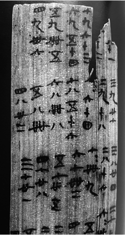

①竹简上记载的内容到现在仍在广泛使用

②竹简记载了当时河流水位的季节变化情况

③竹简上的内容表明我国很早开始使用十进制计数法

④竹简上的内容可能在汉代通过“丝绸之路”传播到西方

A. ①③

B. ①④

C. ②③

D. ②④

第 14 题 · 答案与解析

**参考答案（粉笔题库参考内容）**

A

**解析**

本题考查人文常识。

①正确，从图片中可以看出，竹简上记载的是九九乘法口诀。九九乘法表是数学中的乘法口诀，别名有九九歌，产生年代是春秋战国，出自《算法大成》，到现在仍在广泛使用。

②错误，图片中竹简上明确记载的是九九乘法口诀，并没有任何关于当时河流水位季节变化情况的相关信息，所以不能得出竹简记载了当时河流水位的季节变化情况这一结论。

③正确，竹简上的九九乘法口诀使用了从一到九的数字，这表明我国已经熟练地使用十进制计数法。十进制计数法是一种以10为基数的计数方法，至迟在商代时，中国已采用了十进位值制。

④错误，虽然“丝绸之路”在汉代已经开通，促进了东西方的文化交流，但目前并没有确凿的证据表明九九乘法口诀在汉代通过“丝绸之路”传播到了西方。据记载，九九乘法口诀13世纪才传入西方。

故①③判断正确。

故正确答案为A。

**考点**：文化常识

**来源**：2025年江苏省公务员录用考试《行测》题（B类）（网友回忆版）第14题

### 第 15 题

我国科学家攻克石墨高温纯化关键技术，成功开发出超高纯石墨产品，标志着我国超高纯石墨产品达到国际领先水平。下列关于石墨的说法正确的是：

A. 是由碳元素组成的有色金属矿物

B. 在自然界分布广泛，不存在人造石墨

C. 属于战略性物资，我国禁止出口石墨产品

D. 在工业生产中应用广泛，被誉为“工业黑金”

第 15 题 · 答案与解析

**参考答案（粉笔题库参考内容）**

D

**解析**

本题考查科技常识。

A项错误，石墨又名黑铅，是碳的一种同素异形体，不透明且触感油腻，颜色由铁黑到钢铁灰不等，形状可呈晶体状、薄片状、鳞状、条纹状、层状体。石墨是一种非金属矿物，并不是有色金属矿物。

B项错误，石墨是一种天然形成的矿物，它常见于火成岩、变质岩中的矿床或伴生矿物中，也可以在沉积岩中发现。石墨既存在于自然界中，也可以通过人工制备得到。天然石墨的生产成本相对较高，而人工合成的石墨可以达到更高的质量和纯度要求。

C项错误，石墨是多个国家的战略性矿产资源，其在新能源、航天航空、核能、军工等战略性新兴产业中具有重要应用。中国作为全球最大的石墨生产国和出口国，长期以来，坚定履行防扩散等国际义务，根据维护国家安全和利益需要，依法对特定石墨物项实施出口管制，对部分石墨物项实施临时管制。故“禁止出口石墨产品”说法错误。

D项正确，石墨由于其特殊的结构，具有耐高温性、抗热震性、导电性、润滑性、化学稳定性以及可塑性等众多特性，广泛应用于冶金、机械、电子、军工、国防、航天航空等领域，被称为“工业黑金”。

故正确答案为D。

**考点**：化学常识

**来源**：2025年江苏省公务员录用考试《行测》题（B类）（网友回忆版）第15题

### 第 16 题

公正司法是维护社会公平正义的最后一道防线，规范司法权力的运行，建设公正高效权威的社会主义司法制度，才能让人民群众在每一个案件中感受公平正义。下列说法与公正司法精神相契合的是：

A. 人民法院独立行使审判权，不受任何机关或组织的制约

B. 在案件事实无法查清的情况下，人民法院不应作出终局裁判

C. 在司法活动中，应重视发挥司法政策的导向作用和解释功能

D. 审判过程一律公开，人民法院应以人民看得见的方式裁判案件

第 16 题 · 答案与解析

**参考答案（粉笔题库参考内容）**

C

**解析**

本题考查法律常识。

A项错误，根据《中华人民共和国宪法》第一百三十一条和《中华人民共和国人民法院组织法》第四条规定：“人民法院依照法律规定独立行使审判权，不受行政机关、社会团体和个人的干涉。”因此，人民法院独立行使审判权，并不是不受任何机关或组织的制约，表述过于绝对，与公正司法精神不相契合。

B项错误，根据《中华人民共和国民事诉讼法》第六十七条规定：“当事人对自己提出的主张，有责任提供证据。当事人及其诉讼代理人因客观原因不能自行收集的证据，或者人民法院认为审理案件需要的证据，人民法院应当调查收集。人民法院应当按照法定程序，全面地、客观地审查核实证据。”《最高人民法院关于民事诉讼证据的若干规定》第八十五条第一款规定：“人民法院应当以证据能够证明的案件事实为根据依法作出裁判。”《中华人民共和国刑事诉讼法》第二百条第三项规定：“（三）证据不足，不能认定被告人有罪的，应当作出证据不足、指控的犯罪不能成立的无罪判决。”《中华人民共和国行政诉讼法》第三十四条第一款规定：“被告对作出的行政行为负有举证责任，应当提供作出该行政行为的证据和所依据的规范性文件。”由此说明，在案件事实无法查清的情况下，人民法院审理民事案件时应依据证据能够证明的案件事实作出裁判，审理刑事案件时应依法作出无罪判决。因此，审理行政案件时应依据证据能够证明的案件事实作出终局裁判，而不是不应作出终局裁判，表述不符合法律规定，与公正司法精神不相契合。

C项正确，根据《关于统一法律适用加强类案检索的指导意见》要求：“检索到的类案为指导性案例的，人民法院应当参照作出裁判；检索到其他类案的，人民法院可以作为作出裁判的参考。”由此说明，司法政策通过明确裁判标准，解决了法律适用中的模糊性问题，体现了司法政策的导向作用。此外，司法政策还可以通过解释法律条文，弥补法律规定的不足，例如《关于适用〈关于民事诉讼证据的若干规定〉中有关举证时限规定的通知》，对举证时限作了释明与补充，体现了司法政策的解释功能。因此，在司法活动中，应重视发挥司法政策的导向作用和解释功能，有助于实现司法公正和统一，与公正司法精神相契合。

D项错误，根据《中华人民共和国民事诉讼法》第一百三十七条规定：“人民法院审理民事案件，除涉及国家秘密、个人隐私或者法律另有规定的以外，应当公开进行。离婚案件，涉及商业秘密的案件，当事人申请不公开审理的，可以不公开审理。”《中华人民共和国刑事诉讼法》第十一条规定：“人民法院审判案件，除本法另有规定的以外，一律公开进行。被告人有权获得辩护，人民法院有义务保证被告人获得辩护。”《中华人民共和国行政诉讼法》第五十四条规定：“人民法院公开审理行政案件，但涉及国家秘密、个人隐私和法律另有规定的除外。涉及商业秘密的案件，当事人申请不公开审理的，可以不公开审理。”因此，人民法院审判过程不是一律公开，表述过于绝对，与公正司法精神不相契合。

故正确答案为C。

**考点**：法理学

**来源**：2025年江苏省公务员录用考试《行测》题（B类）（网友回忆版）第16题

### 第 17 题

M公司在网络购物平台销售一款智能门锁，宣称该门锁具有“生成临时密码”功能，韩某购买安装该款门锁后，发现并不具备所宣称的功能，该公司回复说需要额外付费升级系统后才能安装该功能。对此，下列说法不正确的是：

A. M公司对产品的不实宣传构成欺诈

B. M公司与韩某之间的买卖合同无效

C. 韩某有权向M公司主张惩罚性赔偿

D. 韩某有权请求M公司承担违约责任

第 17 题 · 答案与解析

**参考答案（粉笔题库参考内容）**

B

**解析**

本题考查法律常识。

A项正确，一方当事人故意告知对方虚假情况，或者故意隐瞒真实情况，诱使对方当事人作出错误意思表示的，可以认定为欺诈行为。题中，M公司宣称其销售的门锁具有“生成临时密码”功能，但韩某购买安装后发现并不具备所宣称的功能，因此，M公司对产品的不实宣传构成欺诈。

B项错误，根据《中华人民共和国民法典》第一百四十八条规定：“一方以欺诈手段，使对方在违背真实意思的情况下实施的民事法律行为，受欺诈方有权请求人民法院或者仲裁机构予以撤销。”因此，M公司与韩某之间的买卖合同并不是无效的，而是可撤销的。

C项正确，根据《中华人民共和国消费者权益保护法》第五十五条第一款规定：“经营者提供商品或者服务有欺诈行为的，应当按照消费者的要求增加赔偿其受到的损失，增加赔偿的金额为消费者购买商品的价款或者接受服务的费用的三倍；增加赔偿的金额不足五百元的，为五百元。法律另有规定的，依照其规定。”因此，韩某有权向M公司主张惩罚性赔偿。

D项正确，根据《中华人民共和国民法典》第一百八十六条规定：“因当事人一方的违约行为，损害对方人身权益、财产权益的，受损害方有权选择请求其承担违约责任或者侵权责任。”违约行为，是指当事人一方不履行合同义务或履行合同义务不符合约定条件的行为。题中，韩某购买安装的M公司销售的智能门锁，并不具备约定的“生成临时密码”功能，M公司的行为构成违约，因此，韩某有权请求M公司承担违约责任。

本题为选非题，故正确答案为B。

**考点**：民法典

**来源**：2025年江苏省公务员录用考试《行测》题（B类）（网友回忆版）第17题

### 第 18 题

秦某驾车在F市某丁字路口右转行驶30米后，道路左侧和地上出现“禁止驶入”的交通标志和标线。秦某进退两难，遂驶入了禁行路段。F市交巡警支队作出处罚决定，认定秦某驾车在该路段逆向行驶违法，予以200元罚款、记3分的处理。秦某不服，向F市公安局提起行政复议。下列关于本案的说法正确的是：

A. 该交通标志标线设置符合比例原则中的适当性要求

B. 秦某不可以将该路段其他车辆的违章信息申请公开

C. F市交巡警支队实施行政处罚遵循的是无过错原则

D. 秦某可举证证明自己机动车逆向行驶没有主观过错

第 18 题 · 答案与解析

**参考答案（粉笔题库参考内容）**

D

**解析**

本题考查法律常识。

A项错误，根据《城市道路交通标志和标线设置规范》4.3.1规定：“交通标志应设置在车辆行进方向上易于看到的地方，并宜设置在车辆前进方向的右侧或车行道上方。当路段单向车道数大于4条、道路交通量大、大车比例高时，宜分别在车辆前进方向左、右两侧设置相同的交通标志。”因此，F市交巡警支队将案涉禁行标志设置在道路的左侧，符合规范，但交通标志标线设置除了应当符合相关规范外，还应当考虑相关通行设计的合理性等因素。秦某驾车行至该丁字路口时，路口前方或其他相应位置并未设置“禁止右转”等相关提示标志。此种情况下，一般人的反应是此处可以右转，既然可以右转，右转后的道路一般情况下均可以通行。本案F市交巡警支队虽然将禁行标志设置在禁行道路的起点，但没有在起点位置之前的适当位置设置相应的提示标志，致使机动车驾驶人驶入顺行路段后，容易越过禁行道路，造成违章。因此，该处的交通标志标线设置存在不合理之处，不符合比例原则中的适当性要求。

B项错误，根据《中华人民共和国政府信息公开条例》第十三条规定：“除本条例规定的行政机关主动公开的政府信息外，公民、法人或者其他组织还可以根据自身生产、生活、科研等特殊需要，向国务院部门、地方各级人民政府及县级以上地方人民政府部门申请获取相关政府信息。”第二条规定：“本条例所称政府信息，是指行政机关在履行行政管理职能过程中制作或者获取的，以一定形式记录、保存的信息。”因此，秦某可以将该路段其他车辆的违章信息申请公开。

C项错误，D项正确，根据《中华人民共和国行政处罚法》第三十三条第二款规定：“当事人有证据足以证明没有主观过错的，不予行政处罚。法律、行政法规另有规定的，从其规定。”因此，当事人无过错的，行政机关不得进行处罚，F市交巡警支队实施行政处罚没有遵循无过错原则，秦某可举证证明自己机动车逆向行驶没有主观过错。

故正确答案为D。

**考点**：行政法

**来源**：2025年江苏省公务员录用考试《行测》题（B类）（网友回忆版）第18题

### 第 19 题

某县自然资源和规划局向县政府请示回收某地块的土地使用权。县政府批复同意后，县自然资源和规划局并未制作回收决定书，也未通知该地块的使用权人，而是直接将回收事项交由县土地储备中心付诸实施。韩某合法的房屋位于该地块内，对回收土地使用权的决定不服，遂提起行政诉讼。对此，下列说法不正确的是：

A. 县政府的批复属于内部行政行为，并没有对韩某的权益产生影响

B. 县自然资源和规划局虽未制作回收决定书，但回收土地的决定已生效

C. 县自然资源和规划局直接将县政府批复付诸实施的行为具有可诉性

D. 韩某提起行政诉讼应列的被告是县政府而不是县自然资源和规划局

第 19 题 · 答案与解析

**参考答案（粉笔题库参考内容）**

D

**解析**

本题考查法律常识。

A、C两项正确，根据《中华人民共和国行政诉讼法》第十二条第一款第四项规定：“人民法院受理公民、法人或者其他组织提起的下列诉讼：（四）对行政机关作出的关于确认土地、矿藏、水流、森林、山岭、草原、荒地、滩涂、海域等自然资源的所有权或者使用权的决定不服的。”内部行政行为是指行政主体在内部行政组织管理过程中所作的只对行政组织内部产生法律效力的行政行为。这种行为通常基于行政隶属关系，只影响行政组织内部的事务。然而，当内部行政行为对外部相对人的权利义务产生实际影响并被付诸实施，出现“内部行政行为外部化”的情形时，则具有可诉性。题干中，县政府的批复本身属于内部行政行为，不具有处分性，并没有对韩某的权益产生直接影响。然而，后期县自然资源和规划局直接将县政府批复付诸实施的行为对韩某的土地使用权益产生了影响，具有可诉性。

B项正确，公定力是指行政行为一经成立，不论是否合法，即具有被推定为合法而要求所有机关、组织、个人予以尊重的一种法律效力。公定力是一种推定或假定的法律效力。行政行为在因为违法而被有关机关撒销或变更以前，被推定为合法的，要求公众予以尊重。因此，县自然资源和规划局回收该地块的土地使用权虽未严格依照法定程序，但行政行为具有公定力，一经成立，则对相对人产生效力，需要所有机关、组织、个人予以尊重。

D项错误，根据《最高人民法院关于适用〈中华人民共和国行政诉讼法〉的解释》第十九条规定：“当事人不服经上级行政机关批准的行政行为，向人民法院提起诉讼的，以在对外发生法律效力的文书上署名的机关为被告。”《中华人民共和国行政诉讼法》第二十六条第一款：“公民、法人或者其他组织直接向人民法院提起诉讼的，作出行政行为的行政机关是被告。”题干中，并未表明谁是在对外发生法律效力的文书上署名的机关，然而题干中表明是由县自然资源和规划局直接将回收事项交由县土地储备中心付诸实施，可见该行政行为的作出机关为县自然资源和规划局，因此本案被告应为县自然资源和规划局。

本题为选非题，故正确答案为D。

**考点**：行政法

**来源**：2025年江苏省公务员录用考试《行测》题（B类）（网友回忆版）第19题

### 第 20 题

某炒货店的食品经营许可证即将到期，向所在县的市场监督管理局申请延续经营许可，县市场监督管理局经审核确认，炒货店经营许可的案件与原发证条件相比无本质变化，但周边的居民反映炒货店开业以来，人流量大，有噪声污染和用电安全隐患。对此，县市场监督管理局的合法处理方式应是：

A. 可对炒货店提出的延续申请作出暂停许可

B. 按照原标准对炒货店的延续申请进行审查

C. 按照初次许可申请要件重新审核延续申请

D. 将相邻关系因素作为延续申请的考量因素

第 20 题 · 答案与解析

**参考答案（粉笔题库参考内容）**

B

**解析**

本题考查法律常识。

A项错误，根据《中华人民共和国行政许可法》第五十条第二款规定：“行政机关应当根据被许可人的申请，在该行政许可有效期届满前作出是否准予延续的决定；逾期未作决定的，视为准予延续。”对于被许可人的延续申请，行政机关的决定只有是否准予，“暂停许可”不属于行政许可延续的法定处理方式。

B项正确，D项错误，根据《食品经营许可和备案管理办法》第三十四条第三款规定：“申请变更或者延续食品经营许可时，申请人声明经营条件未发生变化、经营项目减项或者未发生变化的，市场监督管理部门可以不进行现场核查，对申请材料齐全、符合法定形式的，当场作出准予变更或者延续食品经营许可决定。”可见，延续申请的审查范围仅限经营条件、经营项目与行政许可直接相关的条件，噪声污染、用电安全隐患并非本案中与食品安全直接相关的条件，行政机关无需将相邻关系因素作为延续申请的考量因素。

C项错误，根据《食品经营许可和备案管理办法》第三十三条规定：“食品经营者申请延续食品经营许可的，应当提交食品经营许可延续申请书，以及与延续食品经营许可事项有关的其他材料。食品经营者取得纸质食品经营许可证正本、副本的，应当同时提交。”行政许可延续与初次许可的法律性质、审查强度、材料要求存在法定差异，二者不能等同。延续申请无需按照初次许可申请要件重新审核。

故正确答案为B。

**考点**：行政法

**来源**：2025年江苏省公务员录用考试《行测》题（B类）（网友回忆版）第20题

### 第 21 题

在江苏，自动驾驶已成为创新技术重塑物流运输产业的重要载体。搭载多类型传感器的智慧重型卡车，一旦切换到智能辅助驾驶状态，驾驶员就变身为安全员，只需坐在车上监管，智慧重型卡车会根据实时路况减速、避让或变道。除了智慧重型卡车，应用于港口的自动驾驶集装箱卡车也已完成技术验证的初始阶段，驶入了大规模商业应用的快车道。行驶在物流园区与制造业企业之间的自动驾驶物流车，则在智驾系统助力下，实现了物流业与制造业的深度融合。

这段文字重在说明：

A. 自动驾驶在江苏的应用场景已经越来越广阔

B. 物流车应用智能技术使得驾驶员获得了解放

C. 自动驾驶促进了江苏物流运输业的发展升级

D. 物流车因智能技术的加持应用范围不断扩大

第 21 题 · 答案与解析

**参考答案（粉笔题库参考内容）**

C

**解析**

文段开篇指出自动驾驶成为江苏地区创新技术重塑物流运输产业的重要载体，接着通过智慧重型卡车、自动驾驶集装箱卡车、自动驾驶物流车的例子，对前文进行举例论证，具体说明自动驾驶在江苏物流运输领域的应用和积极影响。故文段重点强调自动驾驶促进江苏地区重塑物流运输产业，对应C项。

A项：“应用场景已经越来越广阔”表述不明确，文段强调自动驾驶在江苏物流运输业的应用，排除。

B项：“驾驶员获得了解放”对应举例论证的部分内容，非重点，排除。

D项：“智能技术”范围扩大，文段的主题词为“自动驾驶”，排除。

故正确答案为C。

【文段出处】人民日报《自动驾驶，让货运更智慧》

**考点**：分述句特征-举例子、主题词

**来源**：2025年江苏省公务员录用考试《行测》题（C类）（网友回忆版）第21题

### 第 22 题

司法建议最初源于行政诉讼。近年来，司法建议的适用范围不断拓展，从保障法院裁判执行措施，进阶升级为社会矛盾纠纷的预防性机制。司法建议既是对传统“治未病”理念的继承，也是对新时代“枫桥经验”的一项创新性实践。通过司法建议，对案件审理过程中发现的可能影响社会和谐的隐患或因素提出建议，以预防纠纷再次发生。有效的司法建议不仅能预先准确找出矛盾纠纷产生的原因，还能进一步提升法院的权威，彰显司法的人文关怀。

下列关于司法建议的说法，与文意不符的是：

A. 适用范围正在逐步地扩大

B. 不会弱化司法机关的权威

C. 可有效避免社会矛盾产生

D. 是一种更柔性的治理方式

第 22 题 · 答案与解析

**参考答案（粉笔题库参考内容）**

C

**解析**

A项：根据“近年来，司法建议的适用范围不断拓展”可知，该项表述正确，排除。

B项：根据“有效的司法建议不仅能预先准确找出矛盾纠纷产生的原因，还能进一步提升法院的权威”可知，该项表述正确，排除。

C项：根据“近年来，司法建议的适用范围不断拓展，从保障法院裁判执行措施，进阶升级为社会矛盾纠纷的预防性机制”“通过司法建议，对案件审理过程中发现的可能影响社会和谐的隐患或因素提出建议，以预防纠纷再次发生”可知，司法建议目前只能起到“预防社会矛盾纠纷”“预防纠纷再次发生”的作用，“有效避免社会矛盾产生”表述过于绝对，当选。

D项：根据“有效的司法建议不仅能······还能······彰显司法的人文关怀”可知，该项表述正确，排除。

本题为选非题，故正确答案为C。

【文段出处】光明日报《司法建议：为柔性治理提供一副“良方”》

**考点**：细节判断题

**来源**：2025年江苏省公务员录用考试《行测》题（C类）（网友回忆版）第24题

### 第 23 题

口口相传的经验是讲故事的人的灵感来源。在劳动的氛围中讲故事，是一种交流方式。每一个讲故事的人都会在故事中留下自己的痕迹，就像制陶人会在陶器上留下自己的印记一样。人在放松的状态下听故事，内心会想记下这些故事，并有对他人转述故事的愿望，这就构成了听故事的人与讲故事的人之间的关系。讲故事的人就像智者一样，能讲出自己的人生经验，也能讲出他人的经验、历史的经验，他们能让故事的火把生活的灯芯点燃。

这段文字中“在故事中留下自己的痕迹”的含义最有可能是：

A. 每个故事都会被讲故事的人加入一些自身经历

B. 讲故事的人会结合个人阅历对故事进行再加工

C. 讲故事的人会向听故事的人讲自己的人生经验

D. 每个故事在被多个人讲述之后内容会发生变化

第 23 题 · 答案与解析

**参考答案（粉笔题库参考内容）**

B

**解析**

文段开篇表明讲故事的人的灵感源于口口相传的经验，接着指出讲故事的人会在故事中留下自己的痕迹，并用制陶人做类比，强调讲故事的人会在故事中留下属于自己的印记，然后从听故事的人的角度，阐述听故事的人与讲故事的人之间的互动关系，最后把讲故事的人比作智者，强调他们既能讲出自己的人生经验，也能传达他人的经验和历史的经验，进一步说明讲故事的人会在故事中留下属于自己的独特印记。故“在故事中留下自己的痕迹”指的是讲故事的人会在故事中加入自己的人生经验，或者自己对他人经验、历史经验的理解，对应B项。

A、D两项：“每个故事”主体错误，文段中“留下自己的痕迹”的主体应该是“讲故事的人”，均排除。

C项：“讲自己的人生经验”表述片面，文段提到讲故事的人还能讲他人的经验和历史的经验，排除。

故正确答案为B。

【文段出处】网易《火与灯芯》

**考点**：句子

**来源**：2025年江苏省公务员录用考试《行测》题（C类）（网友回忆版）第23题

### 第 24 题

不同于单车智能技术路线，“车路云一体化”可以理解为“聪明的车+智慧的路+强大的云”，实现车端、路端双数据感知相互补充，在复杂场景下形成协同决策。通过数据共享与实时交互，路侧基础设施获取的实时感知信息弥补了车端传感器的感知短板，极大地提升了自动驾驶的安全性与效率。近期入选试点的南京、无锡、苏州等20个城市，都具备汽车产业发展或智能网联汽车运行的基础，在政策突破、产业聚集、场景应用等方面具有优势，能够为“车路云一体化”提供实践经验和数据支持。

下列关于“车路云一体化”的说法，与文意不符的是：

A. 车端传感器感知技术取得关键性突破

B. 车端、路端双数据能够形成协同决策

C. 有助于提升自动驾驶的安全性和效率

D. 试点城市都已具备一定的基础和优势

第 24 题 · 答案与解析

**参考答案（粉笔题库参考内容）**

A

**解析**

A项：根据“路侧基础设施获取的实时感知信息弥补了车端传感器的感知短板”可知，文段强调的是路侧基础设施对车端传感器的补充作用，而非车端传感器感知技术自身取得关键性突破，该项与文意不符，当选。

B项：根据“‘车路云一体化’可以理解为‘聪明的车+智慧的路+强大的云’，实现车端、路端双数据感知相互补充，在复杂场景下形成协同决策”可知，车端、路端双数据能够形成协同决策，该项与文意相符，排除。

C项：根据“‘车路云一体化’可以理解为······极大地提升了自动驾驶的安全性与效率”可知，“车路云一体化”有助于提升安全性和效率，该项与文意相符，排除。

D项：根据“近期入选试点的南京、无锡、苏州等20个城市，都具备汽车产业发展或智能网联汽车运行的基础，在政策突破、产业聚集、场景应用等方面具有优势”可知，试点城市都已具备一定的基础和优势，该项与文意相符，排除。

本题为选非题，故正确答案为A。

【文段出处】人民日报《推动新能源汽车智能化发展》

**考点**：细节判断题

**来源**：2025年江苏省公务员录用考试《行测》题（B类）（网友回忆版）第24题

### 第 25 题

有关数据显示：2024年1—7月，高端装备制造业销售收入同比增长8.3%，占制造业总销售收入的比重为16.5%，较上年同期提高0.5个百分点；智能设备制造业销售收入同比增长12.4%；高耗能制造业销售收入占制造业比重为30.7%，较上年同期下降0.8个百分点，节能降耗工作有序推进；制造业企业采购环境治理服务金额同比增长6.2%，增速较2023年加快2.4个百分点，治污投入不断加大。

这段文字重在说明：

A. 制造业持续不断在国民经济发展中起领跑作用

B. 经济发展亮点频现呈现出持续向好的发展态势

C. 制造业正向高端化智能化绿色化发展扎实推进

D. 经济发展与生态治理齐头并进为实现双赢努力

第 25 题 · 答案与解析

**参考答案（粉笔题库参考内容）**

C

**解析**

文段首先列举了2024年1—7月高端装备制造业销售收入增长的数据，接着通过分号进行衔接，列举了智能设备制造业销售收入增长、高耗能制造业销售收入降低的数据，以及制造业企业采购环境治理服务金额增长的数据。故文段为由分号衔接的并列结构，需全面概括，强调制造业正在向着高端、智能、低耗能、少污染的方向发展，对应C项。

A项：“领跑作用”文段并未提及，无中生有，排除。

B、D两项：均缺少文段核心话题“制造业”，排除。

故正确答案为C。

【文段出处】人民日报《透过增值税发票看经济亮点》

**考点**：关联词-并列、主题词

**来源**：2025年江苏省公务员录用考试《行测》题（C类）（网友回忆版）第25题

### 第 26 题

在何尊的铭文中，有一句话是“恭德裕天”。其中的“德”字，相较甲骨文，底部多出“心”字部首。有专家认为，有“心”方为“德”，表明在三千多年前“德政”这一政治理念业已出现，这为人们理解中国的政治传统提供了有益启示。不同时代、地域青铜器之间的关系“图谱”，青铜器的材质分析、工艺重建和产地溯源，青铜器不同器型与纹饰的来源、演变······亟待破译的“青铜密码”还有很多，需要我们拓宽视野，运用多种研究方法、技术手段进行综合分析，进一步推动相关学科发展。

这段文字意在强调：

A. 青铜器的研究领域十分广阔

B. 青铜器亟待进一步深入研究

C. 青铜器研究有益于挖掘传统文化

D. 青铜器研究具有极其重要的价值

第 26 题 · 答案与解析

**参考答案（粉笔题库参考内容）**

B

**解析**

文段开篇以何尊的铭文中“德”字的变化引出“德政”理念，阐述了青铜器研究对理解中国政治传统的意义，接着介绍了一些亟待破译的“青铜密码”，并提出对策，强调需要运用多种方法、手段进行综合分析，从而推动相关学科发展。故文段重在强调青铜器亟待进一步深入研究，对应B项。

A项：文段重点强调要对青铜器进行深入研究，而非强调青铜器的研究领域广阔，该项偏离文段重点，排除。

C、D两项：C项“有益于挖掘传统文化”，D项“具有极其重要的价值”均为意义表述，文段重点强调对策，排除。

故正确答案为B。

【文段出处】人民网《打开青铜器这本“大书”》

**考点**：关联词-对策

**来源**：2025年江苏省公务员录用考试《行测》题（B类）（网友回忆版）第26题

### 第 27 题

在众多用于建筑的保温材料中，蛭石因其良好的保温性能而广受青睐。蛭石是一种含镁的水铝硅酸盐次生变质矿物，具有二维层状结构，受热时会失水膨胀，因形状类似水蛭而得名。经高温煅烧后，蛭石体积能瞬间膨胀十几倍，每块膨胀蛭石里有很多毛细孔，且每个毛细孔都是微纳米级孔径。这些小空隙就是一个个保温空间。蛭石膨胀倍数越高，空隙越发达，保温性能也就越好。更重要的是，蛭石在生产加工过程中对生态环境污染很小，产品废弃后还能回收再利用，非常符合建筑领域十分推崇的可持续发展理念。

最适合做这段文字标题的是：

A. 蛭石为什么可以保温

B. 蛭石：一种神奇的矿石

C. 你所不知道的“蛭石”真面貌

D. 蛭石：让建筑物更加绿色节能

第 27 题 · 答案与解析

**参考答案（粉笔题库参考内容）**

D

**解析**

文段首先引出“蛭石”的话题，并说明蛭石是广受青睐的建筑保温材料，接着介绍蛭石的成分、性状和名称的由来，然后介绍了蛭石保温的原理，尾句通过“更重要的是”引出重点，强调蛭石具有环保的特性，符合建筑领域的可持续发展理念，对应D项。

A项：“为什么可以保温”对应前文内容，非重点，且未体现文段核心话题“建筑”，排除。

B项：“神奇的矿石”表述不明确，未体现蛭石节能环保的特点，且未体现文段核心话题“建筑”，排除。

C项：“你所不知道的‘蛭石’真面貌”侧重与普遍认知不相符的实际情况，而文段未提及对“蛭石”的普遍认知，该项无中生有，排除。

故正确答案为D。

【文段出处】响水日报《蛭石：让建筑物更加绿色节能》

**考点**：标题填入题

**来源**：2025年江苏省公务员录用考试《行测》题（B类）（网友回忆版）第27题

### 第 28 题

近年来，网购发展势头迅猛，各类购物节层出不穷。每到大促销那几天，网络延迟、抢不到货、运力紧张等问题会直接影响消费者购物体验。为此，商家和平台想出了很多应对方法，预售便是其中之一。预售最直接的好处，就是提前知道能卖多少。通过预售，能对未来销售量作出较为精准的预测，从而解决备货和周转问题。如果遇到购物节，预售还能提前制造话题、增加活动曝光度，唤醒消费者的潜在需求。预售打了个时间差，也缓解了平台在购物节期间的流量压力。

这段文字意在说明：

A. 网络商家和平台选择预售模式的原因

B. 网络购物节期间预售发挥的重要作用

C. 预售能提升消费者促销期间购物体验

D. 预售的好处是能刺激消费者购物需求

第 28 题 · 答案与解析

**参考答案（粉笔题库参考内容）**

A

**解析**

文段开篇指出在大促销的时候会出现一些影响消费者购物体验的问题，接着通过“应对方法”给出对策，即预售，然后从多个方面详细解释了预售的好处。故文段重点在于对策，强调商家和平台选择预售的模式来解决大促销期间购物产生的问题，对应A项。

B项：“预售发挥的重要作用”对应解释说明的内容，非重点，排除。

C项：“提升消费者促销期间购物体验”表述片面，文段说的是除了消费者获得好处外，商家和平台也获得了好处，排除。

D项：“刺激消费者购物需求”对应解释说明的内容，非重点，且表述片面，排除。

故正确答案为A。

【文段出处】经济日报《商家为什么爱预售》

**考点**：分述句特征-多角度论述、关联词-对策

**来源**：2025年江苏省公务员录用考试《行测》题（C类）（网友回忆版）第22题

### 第 29 题

“N无”的极简婚礼已成为年轻人婚礼的新趋势，包括“三无”“四无”“五无”婚礼。具体指的是无早起、无接亲、无仪式、无车队、无煽情、无主持、无婚纱、无接亲堵门、无场地布置、无伴娘伴郎等各种“无”的随意搭配组合。他们取消有当众表演之嫌的过度煽情催泪环节，使用简单环保的装饰，将婚礼上布置场地的鲜花送给宾客，直接用蔬果布置现场和婚车，结束后作为伴手礼赠予亲朋。这些对婚礼的“整顿”，实则是年轻人追求“实用主义”与自我满足在婚礼中的表现。

下列关于极简婚礼的说法，与文意不符的是：

A. 让传统、现代和个性在婚礼中更好融合

B. 是对固有的婚礼模式和长辈安排的反抗

C. 年轻人在婚礼中的消费越来越回归理性

D. 年轻人在婚礼中的表现越来越尊重内心

第 29 题 · 答案与解析

**参考答案（粉笔题库参考内容）**

B

**解析**

A项：根据“具体指的是······各种‘无’的随意搭配组合。他们取消有当众表演之嫌的过度煽情催泪环节，使用简单环保的装饰，将婚礼上布置场地的鲜花送给宾客，直接用蔬果布置现场和婚车”可知，“随意搭配组合”体现出个性，结合“使用简单环保的装饰，将婚礼上布置场地的鲜花送给宾客，直接用蔬果布置现场和婚车”可知，既有对传统环节的沿用，也体现出现代性，该项表述正确，排除。

B项：“对固有的婚礼模式和长辈安排的反抗”文段未提及，无中生有，当选。

C项：根据“使用简单环保的装饰，将婚礼上布置场地的鲜花送给宾客，直接用蔬果布置现场和婚车”可知，“使用简单环保的装饰”及“用蔬果布置”体现出年轻人在婚礼消费中的理性，该项表述正确，排除。

D项：根据“这些对婚礼的‘整顿’，实则是年轻人追求‘实用主义’与自我满足在婚礼中的表现”可知，“尊重内心”表述正确，排除。

本题为选非题，故正确答案为B。

【文段出处】中国青年报《“整顿”的风吹到了婚礼》

**考点**：细节判断题

**来源**：2025年江苏省公务员录用考试《行测》题（C类）（网友回忆版）第28题

### 第 30 题

当滑雪者因雪崩被困在厚厚的雪层之下，由于雪很轻，他可以将双手交叉，形成一个气囊用于呼吸，但沙洞坍塌时的情况就有所不同。在沙洞坍塌事故中救人往往非常困难，因为沙子沉重且极其不稳定。当救援人员舀走沙子，并试图解救被困者时，救援人员的重力作用会导致沙洞继续塌陷，并重新填满空隙。因此，消防员等专业人员从坍塌的沙洞救人时，通常会在洞口横放一些木板。这样，他们就可以使用工具移除沙子，而不会将任何重量直接压在洞口边缘。

根据文意，“因此”中的“此”是指：

A. 沙洞坍塌与雪崩的情形不同

B. 沙洞坍塌救援时需将洞口沙子移除

C. 沙洞坍塌救人具有不可控性

D. 沙洞坍塌救援时可能带来新的坍塌

第 30 题 · 答案与解析

**参考答案（粉笔题库参考内容）**

D

**解析**

本题为代词指代题，“因此”中的“此”位于文段中间，可结合前文理解代词含义。文段开篇对比了雪崩与沙洞坍塌的情况，指出在沙洞坍塌事故中救人往往非常困难，接着指出沙洞坍塌救援时救援人员的重力作用会导致沙洞继续塌陷，随后通过“因此”进行总结，故“此”指的是沙洞坍塌救援时救援人员的重力作用会导致沙洞继续塌陷，对应D项。

A项：“沙洞坍塌与雪崩的情形不同”对应文段引出话题的内容，并非代词指代的对象，排除。

B项：“需将洞口沙子移除”对应代词之后的内容，并非代词指代的对象，排除。

C项：“不可控性”与D项“可能带来新的坍塌”相比，表述不明确，排除。

故正确答案为D。

【文段出处】微信公众号《沙滩上不要随便挖洞，里面暗藏着杀机》

**考点**：代词

**来源**：2025年江苏省公务员录用考试《行测》题（B类）（网友回忆版）第30题

### 第 31 题

近年来，随着科技的发展，AI已经深入到文艺创作的各个领域，并逐渐兴起一场艺术创作模式革命。在流行音乐领域，一批AI作曲软件快速迭代升级，有效推动了新作品的结构优化，增强了旋律扩写能力，一定程度上促进了流行音乐作品的优胜劣汰。AI创作门槛越来越低，使得“全民制作人”成为可能。此种背景下，                    ，成为热门话题。

填入画横线部分最恰当的一项是：

A. AI对流行音乐创作影响几何

B. 流行音乐人应如何利用AI创作

C. AI作曲软件如何促成全民制作人

D. 流行音乐领域未来如何与AI共生

第 31 题 · 答案与解析

**参考答案（粉笔题库参考内容）**

A

**解析**

横线出现在文段结尾，且为尾句的分句，故需结合横线前内容以及横线所在尾句内容进行分析。文段开篇提到AI深入文艺创作的各个领域，并带来一场艺术创作模式革命，接着具体阐述AI在流行音乐领域所带来的影响，指出AI作曲软件的升级促进了流行音乐作品的优胜劣汰以及AI创作门槛低使“全民制作人”成为可能，尾句通过“此种背景下”总结前文，横线后指出“成为热门话题”。故横线处应继续围绕“AI”和“流行音乐创作”进行论述，概括AI对流行音乐创作产生的影响，对应A项。

B项：“流行音乐人应如何利用AI创作”表述错误，文段重点论述AI对流行音乐创作整体产生的影响，排除。

C项：“AI作曲软件如何促成全民制作人”只是AI影响流行音乐创作的一个方面，表述片面，排除。

D项：“流行音乐领域未来如何与AI共生”强调的是未来的共生关系，而文段更多是在论述当下AI对流行音乐创作已经产生的影响，排除。

故正确答案为A。

【文段出处】光明网《AI作曲：会给流行音乐带来什么》

**考点**：横线在结尾

**来源**：2025年江苏省公务员录用考试《行测》题（C类）（网友回忆版）第31题

### 第 32 题

数字货币利用大数据与区块链技术，能够高效记录并存储交易信息及货币流向。这种技术的应用使得货币的创造、流通和监控过程变得更加透明和高效。具体来说，大数据技术的运用使得货币政策的制定者可以快速获取大量实时的经济活动数据，极大提高了数据的准确性和政策制定的针对性。区块链技术的特性——分布式账本，为货币流通提供了一个安全可靠的环境，确保了交易信息的不可篡改和实时追踪，降低了监控成本并减少了实施滞后。此类技术革新为中央银行在制定和实施货币政策时提供了强大的数据支撑，使政策更加精准地匹配经济情况的实际需求。

这段文字重在说明：

A. 数字货币使货币政策的制定实施更精准和高效

B. 数字货币在金融监管方面具有较大的应用价值

C. 大数据与区块链技术有利于推动宏观经济发展

D. 大数据与区块链技术为货币流通提供安全保障

第 32 题 · 答案与解析

**参考答案（粉笔题库参考内容）**

A

**解析**

文段开篇引出“数字货币”这一概念，指出其利用大数据与区块链技术使得货币的创造、流通和监控过程变得更加透明和高效，接下来通过“具体来说”分别从大数据技术可提高数据的准确性、政策制定的针对性以及区块链技术能降低监控成本并减少实施滞后这两方面对数字货币的作用进行解释说明，尾句通过指代词“此类技术革新”指代前文内容，得出结论，强调数字货币能为中央银行制定和实施货币政策时提供数据支撑，让政策更精准匹配需求。故文段重点强调数字货币对货币政策的正向作用，主题词为“数字货币”与“货币政策”，对应A项。

B项：“在金融监管方面具有较大的应用价值”对应文段中数字货币的一项作用，除此之外，数字货币还有“创造”“流通”等方面的作用，选项表述片面，且选项并未提及文段主题词“货币政策”，偏离文段重点，排除。

C项：“推动宏观经济发展”概念范围扩大，文段仅论述“货币政策”，且选项并未提及文段主题词“数字货币”与“货币政策”，排除。

D项：“安全保障”对应文段解释说明中“区块链技术”的作用，属于数字货币中的一项技术运用，非重点且表述片面，另外选项并未提及文段主题词“数字货币”与“货币政策”，排除。

故正确答案为A。

**考点**：分述句特征-多角度论述、主题词

**来源**：2025年江苏省公务员录用考试《行测》题（C类）（网友回忆版）第30题

### 第 33 题

作为一类代谢功能多样的特殊微生物，光合细菌具有强大的生化催化能力和营养益生功能，可以制备多种多样的生物制剂。目前国内科研院所和医药厂商对光合细菌在医药产品开发领域的研究仍处于起步阶段。随着科学技术水平不断进步，研究者对光合细菌类群特殊代谢能力的理解将进一步加深，有助于持续激发该类细菌的产业化潜力。除生产新式治疗药物外，还可利用光合细菌适应极端环境的生存优势，结合基因工程技术，设计开发工程菌株，通过微生物催化作用实现分子结构重组，用以大量生产重要原料药物，或可替代化学制药技术。总体而言，深度拓展光合细菌在医药研究领域的研究，具有良好的应用前景与实践意义，有望推动微生物制药工程可持续发展。

从这段文字提取关键词最恰当的一项是：

A. 特殊微生物 光合细菌 生物制药

B. 特殊微生物 代谢能力 产业化

C. 光合细菌 产业化 制药技术

D. 光合细菌 代谢功能 医药应用

第 33 题 · 答案与解析

**参考答案（粉笔题库参考内容）**

D

**解析**

文段开篇引出“光合细菌”这一话题，指出其可以制备多种多样的生物制剂，接着指出虽然目前国内对光合细菌在医药产品开发领域的研究处于起步阶段，但是随着科技水平的进步，研究者对光合细菌的代谢能力的理解将进一步加深，有助于激发其产业化潜力，其可用于生产药物或替代化学制药技术，最后通过“总体而言”进行总结，强调拓展光合细菌在医药研究领域的研究有良好的应用前景与实践意义。故文段围绕光合细菌在医药方面的应用展开论述，D项“光合细菌”“代谢功能”“医药应用”能够很好地概括文段重点，当选。

A项：“特殊微生物”非重点，排除。

B项：缺少文段主题词“光合细菌”，偏离文段中心，排除。

C项：“制药技术”表述片面，无法全面概况光合细菌在医药方面的应用，且“产业化”非重点，排除。

故正确答案为D。

【文段出处】知网《光合细菌代谢与其在医药领域的应用》

**来源**：2025年江苏省公务员录用考试《行测》题（C类）（网友回忆版）第34题

### 第 34 题

日常生活中，用来加工米饭、馒头等主食的原料，几乎都来自禾本科植物。在成为主食重要来源的过程中，禾本科植物经历了漫长的进化和选择阶段。在长期的物种进化中，野生种经过天然杂交、遗传物质自然加倍，以及异常气候及环境胁迫导致的自然选择，逐步形成了人类可以作为食物进行种植的禾本科植物类型。禾本科植物适应性强，易于推广种植，其籽粒便于储藏、加工，且营养丰富。禾本科植物分布范围广，抗逆性比较强，遗传多样性丰富，因此在不同类型环境中都能种植，并获得较理想的产量。

这段文字重在说明：

A. 禾本科植物适应性强且便于种植

B. 禾本科植物成为主食主要原料的缘由

C. 禾本科植物籽粒的营养十分丰富

D. 禾本科植物经历的进化和选择的过程

第 34 题 · 答案与解析

**参考答案（粉笔题库参考内容）**

B

**解析**

文段开篇指出禾本科植物是主食的主要原料，接着说明禾本科植物在成为主食重要来源的过程中，经历了漫长的进化和选择阶段，并具体说明了其形成人类可以作为食物进行种植的禾本科植物类型的进化过程，随后论述禾本科植物自身的特点和种植优势。故文段重在强调禾本科植物成为主食主要原料的原因，对应B项。

A、C两项：均对应禾本科植物优势中的一部分，表述片面，排除。

D项：“禾本科植物经历的进化和选择的过程”非重点，排除。

故正确答案为B。

【文段出处】人民网《主食为何大多来自禾本科？》

**考点**：分述句特征-其他

**来源**：2025年江苏省公务员录用考试《行测》题（C类）（网友回忆版）第33题

### 第 35 题

①因为声波是一种机械波，声波的传播依赖于机械振动在介质中的传递

②花样游泳比赛时，水上水下都要有音响设备

③因此，当声波入射到水和空气的交界面时，仅有0.1%的声能量能透过水-气交界面

④为什么空气中和水下难以共享一个声音世界呢

⑤在不同介质中，声波的传递能力会因介质声阻抗的差异而有所不同，常温下，空气与水的声阻抗相差约3600倍

⑥声音在水和空气之间的极低透射，使得潜入水中的花样游泳运动员难以听到岸上音乐，所以需要水上和水下同时布置音响设备

将以上6个句子重新排列，语序正确的是：

A. ②①④⑥⑤③

B. ②④①⑤③⑥

C. ④①⑤③②⑥

D. ④①②⑤⑥③

第 35 题 · 答案与解析

**参考答案（粉笔题库参考内容）**

B

**解析**

对比选项，确定首句。选项中首句分别为②句和④句。②句指出花样游泳比赛时水上水下都要有音响设备，④句提出“为什么空气中和水下难以共享一个声音世界”的问题，根据逻辑顺序可知，④句是围绕②句内容进行的进一步论述，故②句应在④句之前，排除C、D两项，保留A、B两项。

继续观察选项，②句后分别衔接①句与④句，①句指出声波的传播依赖于机械振动在介质中的传递，是对④句“为什么空气中和水下难以共享一个声音世界”的回答，故④句应在①句之前，排除A项，B项当选。

故正确答案为B。

【文段出处】科普中国网《“我是你的破壁人！”空气&水：······》

**考点**：确定顺序

**来源**：2025年江苏省公务员录用考试《行测》题（B类）（网友回忆版）第35题

### 第 36 题

在发展新质生产力的当下，江苏高端制造不断刷新纪录，取得创新成果。近日，工信部公布了2024年先进制造业集群“国家队”名单，全国共有35个先进制造业集群            ，其中江苏有4个入选，在这场国家级的选拔赛中，江苏            ，有何过人之处？

依次填入画横线部分最恰当的一项是：

A. 上榜 一路凯歌

B. 入围 一枝独秀

C. 荣膺 技压群芳

D. 胜出 独占鳌头

第 36 题 · 答案与解析

**参考答案（粉笔题库参考内容）**

A

**解析**

第一空，根据“工信部公布了2024年先进制造业集群‘国家队’名单”“其中江苏有4个入选”可知，横线处应体现全国共有35个先进制造业集群进入名单之意。A项“上榜”、B项“入围”都有进入名单之意，符合文意，保留。D项“胜出”指在比赛或竞争中胜过对手，符合文意，保留；C项“荣膺”指光荣地接受或承当，一般搭配“称号”“荣誉”等，与“名单”搭配不当，排除。

第二空，根据“江苏高端制造不断刷新纪录，取得创新成果”“其中江苏有4个入选，在这场国家级的选拔赛中，江苏······有何过人之处”可知，横线处应体现江苏表现突出、成绩不凡。A项“一路凯歌”形容在前进的过程中不断取得成功和胜利，充满了喜悦和荣耀，符合文意，当选。B项“一枝独秀”形容在同类事物中最为突出，最为优秀，文段没有强调江苏是最出色的，只是强调江苏自身表现出色，与文意不符，排除；D项“独占鳌头”指在竞争中夺得首位，文段并未强调江苏排名第一，与文意不符，排除。

故正确答案为A。

【文段出处】现代快报《先进制造业集群“国家队”，江苏+4》

**考点**：词的辨析-搭配对象、对应关系-前后呼应、混搭填空

**来源**：2025年江苏省公务员录用考试《行测》题（B类）（网友回忆版）第36题

### 第 37 题

哺乳动物稍晚于恐龙出现在演化舞台上。在中生代与恐龙相伴的演化过程中，哺乳动物一直是身形娇小的类群，根本无法与“巨无霸”恐龙            。但在新生代，虽然        出许多高大威猛的动物，哺乳动物却成为生物界的王者。

依次填入画横线部分最恰当的一项是：

A. 相提并论 突现

B. 等量齐观 进化

C. 分庭抗礼 涌现

D. 同日而语 繁衍

第 37 题 · 答案与解析

**参考答案（粉笔题库参考内容）**

C

**解析**

第一空，根据“但在新生代，虽然······哺乳动物却成为生物界的王者”可知，横线处应体现在中生代，身形娇小的哺乳动物并非王者，不具备与“巨无霸”恐龙平起平坐、相互抗衡的实力和地位。C项“分庭抗礼”指双方平起平坐，实力相当，可以抗衡，符合文意，保留。A项“相提并论”指把不同事物不加区别地混在一起来谈论或对待，文段并非强调哺乳动物和恐龙是否可以放在一起谈论，而是强调在中生代两者的地位和实力差距很大，与文意不符，排除。B项“等量齐观”指对有差别的事物同等看待，强调看待事物的态度是同等的、没有差别的，无法体现两者地位的高低及是否能抗衡，与文意不符，排除。D项“同日而语”指放在同一时间谈论，通常是同一事物在不同时间的比较，而文段是哺乳动物和恐龙两个不同事物在同一时间的对比，与文意不符，排除。

第二空，代入验证。C项“涌现”指在同一时期大量地出现，置于此处能体现出许多高大威猛的动物大量出现之意，符合文意，当选。

故正确答案为C。

【文段出处】科普时报《早期小型哺乳动物长得慢活得久》

**考点**：对应关系-前后呼应、混搭填空、关联关系-转折关系

**来源**：2025年江苏省公务员录用考试《行测》题（B类）（网友回忆版）第37题

### 第 38 题

当前，人力资源供需还存在不        的现象，发展新职业有利于解决这一问题。积极挖掘、培育新职业，开发好这个就业增长点，将有效促进更高质量更充分就业。各级政府需            、创造条件，引导新职业健康发展。

依次填入画横线部分最恰当的一项是：

A. 平衡 齐头并进

B. 和谐 多管齐下

C. 协调 齐抓共管

D. 匹配 多措并举

第 38 题 · 答案与解析

**参考答案（粉笔题库参考内容）**

D

**解析**

第一空，搭配“人力资源供需”，且根据后文可知，横线所在分句应体现人力资源的供应无法满足需求之意。A项“平衡”指对立的各方面在数量或质量上相等或相抵，D项“匹配”指两个或多个事物在某些方面相适应、相符合或相配合，均与“人力资源供需”搭配恰当，且符合文意，保留。B项“和谐”指配合得适当，和睦协调，常与“音调”“社会”等搭配，C项“协调”指配合得适当，常与“色彩”“动作”等搭配，均与“人力资源供需”搭配不当，排除。

第二空，根据顿号可知，横线处应与“创造条件”构成近义并列关系，体现各级政府针对人力资源供需问题应采取一定的措施、对策之意。D项“多措并举”指一起行动、同时实施，符合文意，当选。A项“齐头并进”形容有几个事情或一个事情的多个方面不分先后地同时进行，侧重同时进行，无法体现政府应想办法解决人力资源供需问题之意，与文意不符，排除。

故正确答案为D。

【文段出处】人民网《把握新职业带来的新机遇》

**考点**：词的辨析-搭配对象、混搭填空、关联关系-并列关系

**来源**：2025年江苏省公务员录用考试《行测》题（B类）（网友回忆版）第38题

### 第 39 题

在全世界地质学家和古生物学家的共同努力下，地球演化史的时间框架已经建立，国际年代地层表也就            ，并且国际地层委员会每年都会对其进行优化更新。随着国际年代地层表的            ，世界各国的地质学家可以更好地研究地球的构造与变化，为保护地球、服务人类生态文明建设做出贡献。

依次填入画横线部分最恰当的一项是：

A. 水到渠成 精益求精

B. 呼之欲出 大功告成

C. 应运而生 日臻完善

D. 瓜熟蒂落 精雕细琢

第 39 题 · 答案与解析

**参考答案（粉笔题库参考内容）**

C

**解析**

本题可从第二空入手。根据前文“国际地层委员会每年都会对其进行优化更新”可知，横线处所填成语应体现不断优化更新之意。C项“日臻完善”指一天天逐步达到完美的境地，符合文意，保留。A项“精益求精”比喻已经很好了，还要求更好，主语通常为人，与“国际年代地层表”搭配不当，排除。B项“大功告成”指巨大工程或重要任务宣告完成，侧重完成，与文意不符，排除。D项“精雕细琢”形容做事仔细用心，与“国际年代地层表”搭配不当，排除。

第一空，代入验证。根据“在全世界地质学家······时间框架已经建立”可知，横线处所填成语应体现在地球演化史的时间框架建立这一背景下，国际年代地层表随之产生。C项“应运而生”指随着某种形势而产生，符合文意，当选。

故正确答案为C。

【文段出处】《地球的年龄怎么算？》

**考点**：词的辨析-搭配对象、对应关系-前后呼应、成语填空

**来源**：2025年江苏省公务员录用考试《行测》题（C类）（网友回忆版）第39题

### 第 40 题

金秋十月，正是新疆最美的时节。天山南北片片胡杨林叠翠流金，城市间平坦宽敞的马路            ，现代化建筑            ，一座座现代化城市吸引着来自四面八方的游客。

依次填入画横线部分最恰当的一项是：

A. 参差交错 比比皆是

B. 整齐划一 巍然挺立

C. 纵横交错 鳞次栉比

D. 秩序井然 错落有致

第 40 题 · 答案与解析

**参考答案（粉笔题库参考内容）**

C

**解析**

第一空，搭配“马路”，且根据文意与选项内容可知，横线处需体现城市间平坦宽敞的马路的布局。C项“纵横交错”指横的、竖的交叉在一起，能形象地体现出马路横竖交叉的布局，与实际情况相符，且符合语境，保留。A项“参差交错”指各种不同的事物错综复杂地交织在一起，用于此处表示马路规划不整齐、交叉混乱，与“平坦宽敞”的马路规划不符，排除；B项“整齐划一”指有条有理，全都一样，用于形容马路的分布情况程度过重，马路的铺设无法做到完全一致，与实际不符，排除；D项“秩序井然”形容有次序、条理分明的样子，多用于形容管理有序的场景，而非马路的分布情况，排除。

第二空，代入验证。横线处搭配“现代化建筑”。C项“鳞次栉比”形容房屋等密集整齐地排列，符合现代化建筑排列紧密有序的特点，符合文意，当选。

故正确答案为C。

【文段出处】新华网《天山长城 大漠华章——新疆生产建设兵团成立70周年综述》

**考点**：词的辨析-搭配对象、词的辨析-程度轻重、成语填空

**来源**：2025年江苏省公务员录用考试《行测》题（C类）（网友回忆版）第40题

### 第 41 题

目前，我国快递业务已经达到了前所未有的新高度，业务量已突破1000亿件大关。快递物流是经济活力            的“风向标”，不仅            出行业的蓬勃跃升，更彰显了我国经济的繁荣活力与无限潜能。

依次填入画横线部分最恰当的一项是：

A. 毋庸置疑 显示

B. 名副其实 映照

C. 当之无愧 折射

D. 理所当然 展示

第 41 题 · 答案与解析

**参考答案（粉笔题库参考内容）**

B

**解析**

本题所给选项较为接近，需对比择优。第一空，根据“目前，我国快递业务已经达到了前所未有的新高度，业务量已突破1000亿件大关”与“快递物流是经济活力······的‘风向标’”可知，横线处应体现快递物流作为经济活力的“风向标”这个名称与实际是相符的。B项“名副其实”指名称或名声与实际相符合，符合文意，保留。A项“毋庸置疑”指无须怀疑，侧重强调确定性，D项“理所当然”指从道理上讲应该这样，侧重强调合理性，C项“当之无愧”指完全当得起，没有惭愧和不足的地方，多用于积极的语境，而“风向标”能够反映事物发展的趋势与方向，感情色彩为中性，且文段中“业务量已突破1000亿件大关”仅为客观事实的陈述，侧重于客观和名称相符合，故三项均不符合文意，均排除。

第二空，代入验证。根据“更彰显了我国经济的繁荣活力与无限潜能”可知，快递行业的业务量能够体现出行业的蓬勃发展。B项“映照”指照射，能形象地表达出快递物流映射出行业的蓬勃跃升，当选。

故正确答案为B。

【文段出处】红网《快递业务突破千亿件：“小包裹”跑出“大经济”》

**考点**：词的辨析-词义侧重、词的辨析-感情色彩、对应关系-前后呼应、混搭填空

**来源**：2025年江苏省公务员录用考试《行测》题（C类）（网友回忆版）第38题

### 第 42 题

中华法系形成于秦朝，至隋唐日趋成熟，宋元明清时期        形成了影响深远的成文法典，在历史发展中        而成的中华法系彰显了中华优秀传统法律文化自我发展、回应挑战的主体性与生命力，也反映了中华文明            的延续性。

依次填入画横线部分最恰当的一项是：

A. 陆续 积淀 源远流长

B. 相继 淬炼 一脉相承

C. 渐次 聚集 薪火相传

D. 稳步 嬗变 生生不息

第 42 题 · 答案与解析

**参考答案（粉笔题库参考内容）**

B

**解析**

第一空，根据“中华法系形成于秦朝······形成了影响深远的成文法典”“延续性”可知，横线处所填词语应体现时间的连续性。A项“陆续”表示前后相继，时断时续，B项“相继”指一个跟着一个，连续不断，C项“渐次”指逐步、渐渐，均符合文意，保留。D项“稳步”比喻有把握地按一定步骤进行，与文意不符，排除。

第二空，根据文意可知，横线处所填词语应体现中华法系不断完善的形成过程。A项“积淀”指积累沉淀，B项“淬炼”指反复经受考验，磨炼，均符合文意，保留。C项“聚集”指集合、凑在一起，多指不同空间的事物聚合在一块儿，无法体现前文所述的不断完善的过程，与文意不符，排除。

第三空，根据“中华法系形成于秦朝······形成了影响深远的成文法典”“中华法系彰显了中华优秀传统法律文化自我发展······的延续性”可知，横线处所填成语应体现连贯性，连续性。B项“一脉相承”指从同一个血统或派别世代承接流传下来，符合文意，当选。A项“源远流长”比喻历史悠久，根底深厚，与文意不符，排除。

故正确答案为B。

【文段出处】光明日报《从优秀传统法律文化看中华文明的突出特性》

**考点**：对应关系-前后呼应、混搭填空

**来源**：2025年江苏省公务员录用考试《行测》题（C类）（网友回忆版）第41题

### 第 43 题

人工智能浪潮来袭，新一轮科技革命和产业变革正在深刻改变着人们的生产生活        ，也带来发展新机遇。新能源汽车产业潜力巨大，近年来中国汽车产业“换道超车”步伐提速。如新能源汽车产业发展        人工智能技术，将给交通出行        无限可能。

依次填入画横线部分最恰当的一项是：

A. 态度 引入 带来

B. 观念 融合 给予

C. 形态 采用 创造

D. 方式 叠加 注入

第 43 题 · 答案与解析

**参考答案（粉笔题库参考内容）**

D

**解析**

第一空，根据“人工智能浪潮来袭，新一轮科技革命和产业变革正在深刻改变着人们的生产生活······”及“将给交通出行······无限可能”可知，横线处所填词语应体现科技革命和产业变革正改变着人们的生产生活模式。C项“形态”指事物的形式与状态，D项“方式”指说话做事所采取的方法和形式，均符合文意，保留。A项“态度”指人的举止神情或对于事情的看法和采取的行动，B项“观念”指客观事物在人脑里留下的概括的形象，均侧重强调想法层面，文段论述的是科技革命和产业变革正改变着人们的生产生活模式，并非想法层面，排除。

第二空，根据“人工智能浪潮来袭”及“新能源汽车产业潜力巨大”可知，人工智能技术在不断升级，新能源汽车产业也在快速壮大，故横线处所填词语应体现两个主体共同发展、发挥作用。D项“叠加”指重叠增加，可体现双方都在迅猛发展，共同助力交通出行，符合文意，保留。C项“采用”指认为合适而使用，仅能体现新能源汽车产业使用了人工智能技术，无法体现人工智能技术与新能源汽车产业共同发挥作用，排除。

第三空，代入验证。D项“注入”指泵入、灌入或流入，置于此处可以体现新能源汽车产业和人工智能技术两者结合给交通出行带来积极作用，符合文意，当选。

故正确答案为D。

【文段出处】光明网《看，未来交通这个样》

**考点**：实词填空、对应关系-前后呼应

**来源**：2025年江苏省公务员录用考试《行测》题（B类）（网友回忆版）第43题

### 第 44 题

中国探月20年，拉近了            与普通公众生活的距离。当一粒棉花种子在月球上生根发芽，当月球车玉兔微博下满是网友的祝福，当中小学教材换上了崭新的中国月面图······越来越多的人与探月工程的某项成果、某个侧面            ，一个共识在人们心中不断        ：我们离月球并不遥远！

依次填入画横线部分最恰当的一项是：

A. 碧海青天 邂逅相逢 汇集

B. 浩瀚苍穹 心心相印 回响

C. 星辰大海 不期而遇 凝聚

D. 蟾宫折桂 情投意合 激荡

第 44 题 · 答案与解析

**参考答案（粉笔题库参考内容）**

C

**解析**

第一空，根据后文可知，中国探月20年拉近了太空与普通公众生活的距离。B项“浩瀚苍穹”形容广阔的宇宙，符合文意，保留。C项“星辰大海”比喻未知的领域或遥远的目标，置于此处可用来形容人们所知甚少的太空，符合文意，保留。A项“碧海青天”指碧绿的海，湛蓝的天，形容水天一色，旷远无边；也形容嫦娥在广寒宫夜夜看着空阔的碧海青天，心情孤寂凄凉，后比喻女子对爱情的坚贞，D项“蟾宫折桂”的意思是在月宫中攀折桂花，比喻科举应试得中，均无法用来形容太空，排除。

第二空，根据“当一粒棉花种子······换上了崭新的中国月面图”可知，横线处应体现越来越多的人接触到了探月成果。C项“不期而遇”指未经约定而意外相遇，可以体现人们接触到了探月工程的某项成果或某个侧面，符合文意，保留。B项“心心相印”形容彼此心意一致，无法与“成果”“侧面”搭配，排除。

第三空，代入验证。横线处搭配“共识”。C项“凝聚”指聚集、积聚，“凝聚共识”为常见搭配，当选。

故正确答案为C。

【文段出处】《一场跨越时空的征途（新语）》

**考点**：词的辨析-搭配对象、对应关系-前后呼应、混搭填空

**来源**：2025年江苏省公务员录用考试《行测》题（C类）（网友回忆版）第44题

### 第 45 题

在新中国科技史和工业史上，中国核事业的奠基之作、            的“一堆一器”，作为我国建设的第一项原子能设施，彰显了新中国的硬实力。从基础研究，到“两弹一艇”研制，再到和平利用原子能，“一堆一器”            。虽然，通过报刊书本、影视荧屏，我们对“一堆一器”并不完全陌生。然而，当它们“活生生”地出现在眼前时，惊喜与感动依旧            ，关于它们的故事与传奇、过往与现状，依然牵动人心。

依次填入画横线部分最恰当的一项是：

A. 闻名遐迩 举足轻重 情不自胜

B. 声名显赫 劳苦功高 不期而至

C. 大名鼎鼎 功不可没 油然而生

D. 举世无双 功勋卓著 汹涌澎湃

第 45 题 · 答案与解析

**参考答案（粉笔题库参考内容）**

C

**解析**

第一空，根据“奠基之作”“作为我国建设的第一项原子能设施，彰显了新中国的硬实力”“我们对‘一堆一器’并不完全陌生”可知，横线处应体现“一堆一器”具有重要地位，能够对外彰显我国实力，大家都有所了解。A项“闻名遐迩”形容名声很大，B项“声名显赫”形容名声盛大，C项“大名鼎鼎”形容名气很大，极其有名，均符合文意，保留。D项“举世无双”指世界上再没有第二个这样的人或物，形容极其罕见稀有，强调独特性，文段没有对“一堆一器”的唯一性和独特性进行介绍，与文意不符，排除。

第二空，根据“奠基之作”可知，横线处应体现“一堆一器”在基础研究等过程中的重要作用。A项“举足轻重”形容身份或地位特殊，一举一动足以影响全局，C项“功不可没”指功劳极大，不可抹灭，均符合文意，保留。B项“劳苦功高”形容做事勤苦，功劳很大，多用以慰问和赞颂别人，文段并未体现“一堆一器”在基础研究等过程中劳累勤苦，与文意不符，排除。

第三空，根据“关于它们的故事与传奇、过往与现状，依然牵动人心”可知，横线处应体现人们看到“一堆一器”出现在眼前时，还是会惊喜、感动。C项“油然而生”形容某种好的思想感情自然而然地产生，符合文意，当选。A项“情不自胜”指感情悲痛得无法忍受，与文意不符，排除。

故正确答案为C。

【文段出处】人民日报《把“历史数据”转化为“当代记忆”》

**考点**：对应关系-前后呼应、成语填空

**来源**：2025年江苏省公务员录用考试《行测》题（C类）（网友回忆版）第45题

## 材料 1

①近年来，利用碎片时间“听读”成为流行趋势，伴随这条小众的内容赛道走向大众化，                    。“耳朵经济”包括播客、听书、有声读物等，具有便捷化、阅读碎片化、互动性强等特点。数据显示，我国现有相关企业4万余家，三成以上公众有听书习惯，35.4%的用户选择付费订阅，预计2028年在线音频市场收入将增长至510亿元。

②“耳朵经济”发展，不仅丰富了阅读方式和阅读体验，推动构建全民阅读新生态，也激活了消费新“声”机，为经济带来新机遇和新活力。推动有声市场的高质量发展，需从内容创新、技术创新、模式创新三个维度持续发力。

③当前，音频平台用户对内容的需求越来越多元化和个性化，这就要求内容创作者和市场主体积极关注市场动态、做好市场调研，有针对性地发掘新的创作领域，丰富创作题材的“内容池”。分析研判用户阅读消费场景与用途类别，了解其需求偏好，根据各自市场定位开发差异化、垂直性的优质内容，布局和深耕个性化细分领域，加快树立具有辨识度的市场品牌。音频以听觉为传导途径，其播出效果还取决于播讲者对文本的诠释能力、声音感染力及背景音效的信息密度。如何提升作品内容品质，将文字符号升华为带有亲密感和人情味的对话，为用户带来独特的情感体验将是市场主体面临的考验。要在激烈的市场竞争中胜出，搭建一支集编剧、配音、导演、后期制作等多方面人才于一体的强有力的团队就显得必要而重要。

④“耳朵经济”的崛起得益于科技的创新发展，数智技术在音频生产过程中必将发挥越来越重要的作用。随着大数据、云计算等技术运用于内容生产、流量预测、分发推荐等环节，音频平台可以获取用户的点击流量、付费习惯、评论内容、分享频次等数据，并根据算法机制建立用户画像，精准预测其行为习惯和偏好，为个性化内容生产提供支撑，从而提升用户黏性。人工智能、语音合成技术等将使生成的语音更加自然、流畅，传递更丰富的情感温度，系统性提高用户的收听体验。同时，无线耳机、智能音箱、智能汽车等各类智能硬件的日益普及提供了多终端、沉浸式、全场景覆盖的接收渠道，在满足用户不同需求的同时，也为“耳朵经济”的提质增效开辟了新的空间。

⑤“耳朵经济”以听觉为主要内容形态，可以很好地解放双手、双眼。因此，音频可以渗透到不同场景中，和其他应用共享碎片化时间，这为构建“音频+”的多元业务生态提供了可能。如“音频+直播”模式可实现实时互动，用户可通过音频参与直播，获得即时反馈；“音频+游戏”模式可通过声音引导创造出全新的游戏体验；“音频+出版社”模式可通过有声书和播客等形式拓宽传统出版传播渠道，使阅读变得更加便捷和生动。如此来看，以模式创新不断延伸产业链条，将为推动“耳朵经济”健康发展拓展更多有效路径。

### 第 46 题

填入文章第①段画横线部分最恰当的一项是：

A. “耳朵经济”进入快速发展阶段

B. “耳朵经济”一跃成为市场的主流

C. “耳朵经济”开始进入消费者视野

D. “耳朵经济”越来越受企业的关注

第 46 题 · 答案与解析

**参考答案（粉笔题库参考内容）**

A

**解析**

横线出现在文章第①段开头，且为首句的分句，应结合本句及后文内容进行分析。首句开头指出利用碎片时间“听读”开始变得大众化，横线后论述了“耳朵经济”的具体内容及特点，并通过具体数据展示“耳朵经济”较好的发展势头。结合首句以及后文内容可知，横线处应体现“耳朵经济”具有迅猛发展的态势，对应A项。

B项：“主流”表述过于绝对，文段仅体现了“耳朵经济”发展状况较好，与文意不符，排除。

C项：横线前已经指出“这条小众的内容赛道走向大众化”，所以“开始进入消费者视野”与前文衔接不当，排除。

D项：“企业”仅能对应尾句举例论证的一部分，表述片面，并且后文列举相关数据的目的是强调“耳朵经济”的发展状况较好，与后文话题衔接不当，排除。

故正确答案为A。

【文段出处】光明日报《发展“耳朵经济” 激活生产消费生机》

**考点**：语句填空题、普通篇章

**来源**：2025年江苏省公务员录用考试《行测》题（B类）（网友回忆版）第46题

### 第 47 题

下列关于音频内容生产的说法，与文意不符的是：

A. 应按用户需求偏好开发多元化、个性化的内容

B. 应为用户提供沉浸式、全场景覆盖的接收渠道

C. 播讲者需具有好的文本诠释能力和声音感染力

D. 播讲内容应该能够给用户带去独特的情感体验

第 47 题 · 答案与解析

**参考答案（粉笔题库参考内容）**

B

**解析**

A项：根据第③段“当前，音频平台用户对内容的需求越来越多元化和个性化，这就要求内容创作者和市场主体······丰富创作题材的‘内容池’”可知，该项表述正确，排除。

B项：根据第④段“无线耳机、智能音箱、智能汽车等各类智能硬件的日益普及提供了多终端、沉浸式、全场景覆盖的接收渠道，在满足用户不同需求的同时，也为‘耳朵经济’的提质增效开辟了新的空间”可知，提供接收渠道的是“各类智能硬件的日益普及”而非“音频内容生产”，该项偷换概念，当选。

C项：根据第③段“音频以听觉为传导途径，其播出效果还取决于播讲者对文本的诠释能力、声音感染力及背景音效的信息密度”可知，该项表述正确，排除。

D项：根据第③段“如何提升作品内容品质，将文字符号升华为带有亲密感和人情味的对话，为用户带来独特的情感体验将是市场主体面临的考验”可知，该项表述正确，排除。

本题为选非题，故正确答案为B。

【文段出处】光明日报《发展“耳朵经济” 激活生产消费生机》

**考点**：细节判断题、普通篇章

**来源**：2025年江苏省公务员录用考试《行测》题（B类）（网友回忆版）第47题

### 第 48 题

文章第⑤自然段重在说明：

A. “耳朵经济”因可渗透到各种场景中而具有很好的发展前景

B. “音频+”多元业务生态是“耳朵经济”未来的主要发展方向

C. 可通过模式创新拓展更多有效路径促进“耳朵经济”健康发展

D. “音频”的形态特点为“耳朵经济”多元化发展提供了可能性

第 48 题 · 答案与解析

**参考答案（粉笔题库参考内容）**

C

**解析**

文章第⑤段首先介绍“耳朵经济”是以听觉为主要内容形态，其能解放双手和双眼，因此音频可以渗透到不同场景中，这为构建“音频+”的多元业务生态提供了可能，随后通过“音频+直播”“音频+游戏”“音频+出版社”的例子具体说明了“耳朵经济”的多元化创新应用，最后通过“如此来看”进行总结，强调通过模式创新可以为推动“耳朵经济”健康发展拓展更多有效路径，对应C项。

A项：文段重点强调通过模式创新可以推动“耳朵经济”发展，而非其“发展前景”，该项偏离文段核心，排除。

B项：文段虽然提到“‘音频+’多元业务生态”，但未强调其为“未来的主要发展方向”，无中生有，排除。

D项：“‘音频’的形态特点为‘耳朵经济’多元化发展提供了可能性”为文段开头引出话题的内容，非重点，排除。

故正确答案为C。

【文段出处】光明日报《发展“耳朵经济” 激活生产消费生机》

**考点**：中心理解题、普通篇章

**来源**：2025年江苏省公务员录用考试《行测》题（B类）（网友回忆版）第48题

### 第 49 题

关于“耳朵经济”，文中未提及的是：

A. 便捷化、阅读碎片化、互动性强是其特点

B. 进一步推动了视听电子产业的高质量发展

C. 其崛起得益于数字技术等科技的创新和发展

D. 内容创新是决定其后续发展状况的重要因素

第 49 题 · 答案与解析

**参考答案（粉笔题库参考内容）**

B

**解析**

A项：根据第①段“‘耳朵经济’包括播客、听书、有声读物等，具有便捷化、阅读碎片化、互动性强等特点”可知，该项在文章中有所提及，排除。

B项：“进一步推动了视听电子产业的高质量发展”文章并未提及，无中生有，当选。

C项：根据第④段“‘耳朵经济’的崛起得益于科技的创新发展，数智技术在音频生产过程中必将发挥越来越重要的作用”可知，该项在文章中有所提及，排除。

D项：根据第②段“推动有声市场的高质量发展，需从内容创新、技术创新、模式创新三个维度持续发力”可知，该项在文章中有所提及，排除。

本题为选非题，故正确答案为B。

【文段出处】光明日报《发展“耳朵经济” 激活生产消费生机》

**考点**：细节判断题、普通篇章

**来源**：2025年江苏省公务员录用考试《行测》题（B类）（网友回忆版）第49题

### 第 50 题

下列最适合做这篇文章标题的是：

A. “耳朵经济”走进你我他

B. “耳朵经济”：科技创新的宠儿

C. 经济发展的新路径——“耳朵经济”

D. 发展“耳朵经济”激活生产消费生机

第 50 题 · 答案与解析

**参考答案（粉笔题库参考内容）**

D

**解析**

文章第①段提出了“耳朵经济”的话题，第②段指出“耳朵经济”的发展为经济带来了新机遇和新活力，并指出推动有声市场高质量发展要从内容创新、技术创新、模式创新三个维度发力，接下来第③④⑤段分别从内容创新、技术创新、模式创新三个方面具体论述如何发展“耳朵经济”。故文章重点强调发展“耳朵经济”激活了生产消费新“声”机，为经济带来新机遇和新活力，对应D项。

A项：“走进你我他”对应文章第①段，仅指出“耳朵经济”目前已成为流行趋势，非重点，排除。

B项：“科技创新”仅对应文章第④段，非重点，且表述片面，排除。

C项：“经济发展的新路径”文章并未体现，与文章的对应不及D项准确，排除。

故正确答案为D。

【文段出处】光明日报《发展“耳朵经济” 激活生产消费生机》

**考点**：标题填入题、普通篇章

**来源**：2025年江苏省公务员录用考试《行测》题（B类）（网友回忆版）第50题

### 第 51 题

2，5，14，35，74，（ ）

A. 88

B. 105

C. 126

D. 137

第 51 题 · 答案与解析

**参考答案（粉笔题库参考内容）**

D

**解析**

数列无明显特征，优先考虑多级数列。后项减前项得到新数列：3，9，21，39，（ ），无明显特征，再次作差，后项减前项得到数列：6，12，18，（ ），是公差为6的等差数列，下一项为18+6=24，则新数列下一项为39+24=63。故所求项=74+63=137。

故正确答案为D。

**考点**：多级数列

**来源**：2025年江苏省公务员录用考试《行测》题（B类）（网友回忆版）第51题

### 第 52 题

515，526，539，556，572，（ ）

A. 586

B. 588

C. 606

D. 608

第 52 题 · 答案与解析

**参考答案（粉笔题库参考内容）**

A

**解析**

数列各项均为多位数，考虑机械划分。观察发现：515+5+1+5=526，526+5+2+6=539，539+5+3+9=556，556+5+5+6=572，即递推规律为：前一项+该项的各位数字=后一项，则所求项=572+5+7+2=586。

故正确答案为A。

**考点**：机械划分、递推数列

**来源**：2025年江苏省公务员录用考试《行测》题（B类）（网友回忆版）第52题

### 第 53 题

2.32，8.48，18.72，32.108，50.162，（ ）

A. 72.243

B. 72.339

C. 81.243

D. 81.339

第 53 题 · 答案与解析

**参考答案（粉笔题库参考内容）**

A

**解析**

数列各项均为小数，优先考虑机械划分。整数部分形成数列：2，8，18，32，50，（ ），作差后得到新数列：6，10，14，18，（ ），是公差为4的等差数列，则整数部分下一项为50+18+4=72，排除C、D两项；小数部分形成数列：32，48，72，108，162，（ ），是公比为1.5的等比数列，则小数部分下一项为162×1.5=243，故所求项为72.243。

故正确答案为A。

**考点**：机械划分

**来源**：2025年江苏省公务员录用考试《行测》题（C类）（网友回忆版）第53题

### 第 54 题

0，2/5，1/2，9/17，1/2，（ ）

A. 5/12

B. 15/37

C. 4/9

D. 16/37

第 54 题 · 答案与解析

**参考答案（粉笔题库参考内容）**

D

**解析**

数列大部分为分数且选项均为分数，考虑分数数列。对数列进行反约分可得：0/2，2/5，5/10，9/17，13/26，（ ）。分母部分为：2，5，10，17，26，（ ），可分别表示为1^2+1，2^2+1，3^2+1，4^2+1，5^2+1，（ ），数列底数为：1，2，3，4，5，为连续自然数列，则所求项底数为6，指数均为2，修正项均为+1，则所求项分母部分为6^2 + 1 = 37；分母部分减去分子部分得到数列：2，3，5，8，13，（ ），是简单递推和数列，下一项为8+13=21，则所求项分子部分为37-21=16。故所求项为16/37。

故正确答案为D。

备注：原数列也可反约分为：0/2，2/5，5/10，9/17，14/28，（ ），分子部分为：0，2，5，9，14，（ ），后项减前项可得：2，3，4，5，（ ），为连续自然数列，下一项为6，则所求项分子部分为14+6=20；分母部分为：2，5，10，17，28，（ ），后项减前项可得：3，5，7，11，（ ），观察发现，3+5-1=7，5+7-1=11，即第一项+第二项-1=第三项，下一项为7+11-1=17，则所求项分母部分为28+17=45。故所求项为20/45 = 4/9。若按此思路答案为C。

按照就简原则和江苏命题规律，粉笔建议选D项。

**考点**：分数数列

**来源**：2025年江苏省公务员录用考试《行测》题（B类）（网友回忆版）第54题

### 第 55 题

5+√6，7+2√2，14，13+√10，17+2√3，（ ）

A. 17+√13

B. 18+√15

C. 19 + √14

D. 23

第 55 题 · 答案与解析

**参考答案（粉笔题库参考内容）**

C

**解析**

观察数列，有特殊符号“+”，考虑机械划分。原数列可转化为：5+√6，7 + √8，11+√9，13+√10，17+√12，（ ）。“+”之前部分：5，7，11，13，17，（ ），是质数数列，则下一项为19；“+”之后部分：√6，√8，√9，√10，√12，（ ），根号下是合数数列，则下一项为√14。故所求项为19 + √14。

故正确答案为C。

**考点**：机械划分

**来源**：2025年江苏省公务员录用考试《行测》题（C类）（网友回忆版）第55题

### 第 56 题

2024年11月17日，我国自主设计建造的首艘大洋钻探船“梦想”号正式入列，船上建有基础地质、海洋科学、地球物理等实验室。假设这三个实验室各有1项实验需连续重复进行40次。3项科学实验同时开始，且各实验室单次实验时长不变，若基础地质实验结束时，海洋科学实验还有8次未进行，地球物理实验还有16次未进行，则海洋科学实验结束时，地球物理实验尚需进行（ ）。

A. 4次

B. 8次

C. 10次

D. 12次

第 56 题 · 答案与解析

**参考答案（粉笔题库参考内容）**

C

**解析**

由题意可知，基础地质实验结束时，海洋科学实验完成了40-8=32次，地球物理实验完成了40-16=24次，则在相同时间内海洋科学、地球物理两个实验室完成的实验次数之比为32：24=4：3。当海洋科学实验结束时，地球物理实验已完成40/4 × 3 = 30次，尚需进行40-30=10次。

故正确答案为C。

**考点**：和差倍比问题

**来源**：2025年江苏省公务员录用考试《行测》题（C类）（网友回忆版）第56题

### 第 57 题

在巴黎奥运会男子10米气步枪射击决赛中，江苏选手以252.2环的成绩夺得金牌并打破奥运会记录。10米气步枪射击比赛用的靶纸上有10个同心圆，其中最大圆的直径为45.5mm，相邻两个圆的直径均相差5mm（10环直径为0.5mm）。如果随机向靶纸射击且成绩不为零，那么命中6环及以上的概率：

A. 小于0.15

B. 介于0.15～0.25之间

C. 介于0.25～0.35之间

D. 介于0.35～0.45之间

第 57 题 · 答案与解析

**参考答案（粉笔题库参考内容）**

B

**解析**

根据题意，靶纸上10个同心圆的直径构成首项为45.5mm、公差为-5mm的等差数列。根据等差数列通项公式：a_n = a_1 + (n − 1)d，则6环所处同心圆的直径为45.5+（6-1）×（-5）=20.5mm，半径为20.5/2mm。根据公式：概率= 满足条件的情况数/总情况数，总情况为随机向靶纸射击且未脱靶，其面积为(45.5/2)^2π（mm^2）；满足条件的情况为命中6环到10环，即处在6环所处同心圆中，其面积为(20.5/2)^2π（mm^2），则命中6环及以上的概率= ((20.5/2)^2π)/((45.5/2)^2π)= 20.5^2/45.5^2 ≈ 0.45^2 ≈ 0.2，在B项范围内。

故正确答案为B。

**考点**：几何公式类-平面图形、数列问题、给情况求概率

**来源**：2025年江苏省公务员录用考试《行测》题（B类）（网友回忆版）第57题

### 第 58 题

今年3月初，小李以月租1万元（月付）的价格租下店面，经营绿色节能家电，店面装修两个月花费11万元。第三个月开始营业，当月纯利润为3万元，若此后每月纯利润都比上月增长10%，则开始盈利的月份是：

A. 6月

B. 7月

C. 8月

D. 9月

第 58 题 · 答案与解析

**参考答案（粉笔题库参考内容）**

C

**解析**

根据题意可知3月和4月未营业，租金和装修共花费1+1+11=13万元。5月开始营业，纯利润为3万元，且此后每月纯利润都比上月增长10%，所以6月纯利润=3×(1+10%)=3.3万元、7月纯利润=3.3×(1+10%)=3.63万元、8月纯利润=3.63×(1+10%)=3.993万元。3+3.3+3.63+3.993=13.923万元>13万元，则从8月开始盈利。

故正确答案为C。

**考点**：经济利润问题

**来源**：2025年江苏省公务员录用考试《行测》题（B类）（网友回忆版）第58题

### 第 59 题

举办一次菊花展，将42盆某品种的菊花摆放成若干排。若从第二排开始，每一排的菊花盆数都比前一排多1盆，则摆放的方案有：

A. 2种

B. 3种

C. 4种

D. 5种

第 59 题 · 答案与解析

**参考答案（粉笔题库参考内容）**

B

**解析**

方法一：根据题意，花盆的摆放盆数构成公差为1的等差数列。若数列项数为奇数，则中位数和项数都是正整数，根据公式：S_n = 中位数 × 项数。将42进行因数分解，42=2×3×7=14×3=6×7=2×21。当项数为3时，中位数为14，可推出每排摆放的数量分别为13盆、14盆、15盆，满足题意；当项数为7时，中位数为6，可推出每排摆放的数量分别为3盆、4盆、5盆、6盆、7盆、8盆、9盆，满足题意；当项数为21时，中位数为2，但数列前几项有负数项，不满足题意。若数列项数为偶数，则中位数 = (奇数 + 偶数)/2 = 奇数/2，中位数非整数，根据S_n = 中位数 × 项数 = (中间两项之和)/2 × 项数 = 42，整理得：中间两项之和×项数=84，将84进行因数分解，84=2×2×3×7=21×4=7×12=3×28。当项数为4时，中间两项之和为21，数列中间两项为10、11，可推出每排摆放数量分别为9盆、10盆、11盆、12盆，满足题意；当项数为12时，中间两项之和为7，数列中间两项为3、4，但数列前几项有负数项，不满足题意；当项数为28时，中间两项之和为3，数列中间两项为1、2，但数列前几项有负数项，不满足题意。

综上，摆放的方案共有3种。

方法二：设第一排摆放a_1盆，一共摆了n排（n>1），则每排摆放数量分别为：a_1，a_1+1，a_1+2，······，a_1+(n-1)，根据等差数列求和公式：S_n = ((a_1+a_n)×n)/2，可列式：42 = ([a_1 + a_1 + (n-1)] × n)/2，整理得：84 = (2a1 + n - 1) × n······①，由题意可知n和a_1均为正整数，则n一定是84的因子，84的因子有1、2、3、4、6、7、12、14、21、28、42、84。除1外分别代入①式验证：

若n=2，a_1不是整数，排除；

若n=3，a_1 = 13，即摆放3排，每排的盆数分别为13、14、15，满足题意；

若n=4，a_1=9，即摆放4排，每排的盆数分别为9、10、11、12，满足题意；

若n=6，a_1不是整数，排除；

若n=7，a_1=3，即摆放7排，每排的盆数分别为3、4、5、6、7、8、9，满足题意；

若n取12或更大值时，可得a_1为负数，均排除。

综上，摆放的方案共有3种。

故正确答案为B。

注释：题干中“若干排”指的是2排及以上，故n≠1。

**考点**：数列问题

**来源**：2025年江苏省公务员录用考试《行测》题（B类）（网友回忆版）第59题

### 第 60 题

引导车引导运输车队前往某地，途经一座桥梁和一个隧道，引导车与运输车队速度一致，引导车的长度忽略不计。匀速通过800米长的桥梁，引导车需36秒，运输车队需45秒。通过隧道时车速比通过桥梁时下降25%，若引导车需60秒，则运输车队需：

A. 69秒

B. 70秒

C. 72秒

D. 75秒

第 60 题 · 答案与解析

**参考答案（粉笔题库参考内容）**

C

**解析**

根据火车过桥公式：S桥 + S车 = v × t，可得通过桥梁时车速为800/36 = 200/9米/秒，S_运输车 = 200/9 × 45 − 800 = 200米。通过隧道时车速为200/9 × (1 - 25%) = 50/3米/秒，则S_隧道 = 50/3 × 60 = 1000米，运输车队通过隧道需要(1000+200)÷50/3=1200×3/50=72秒。

故正确答案为C。

**考点**：火车过桥

**来源**：2025年江苏省公务员录用考试《行测》题（B类）（网友回忆版）第60题

### 第 61 题

某农场使用M、N两架无人机喷洒农药，先由M无人机工作2小时，再由N无人机工作5小时，可喷洒完整片农田；两架无人机同时工作1小时后，有三分之二的农田尚未喷洒。如果仅由M无人机喷洒农药，那么喷洒完整片农田需要（ ）。

A. 3.5小时

B. 4.5小时

C. 5小时

D. 5.5小时

第 61 题 · 答案与解析

**参考答案（粉笔题库参考内容）**

B

**解析**

用M、N分别表示两架无人机的工作效率，根据题意可得：2M+5N = ((M+N)×1)/(1-2/3)，化简得M：N=2：1。赋值M无人机的工作效率为2，N无人机的工作效率为1，则喷洒整片农田的工作量为2×2+5×1=9，仅由M无人机喷洒农药，那么喷洒完整片农田需要9÷2=4.5小时。

故正确答案为B。

**考点**：给效率比例型

**来源**：2025年江苏省公务员录用考试《行测》题（C类）（网友回忆版）第61题

### 第 62 题

某单位在边长为200米的正方形广场上组织一场招聘会，计划安排若干名工作人员提供咨询服务，每名工作人员入场后将分别随机站在一个位置上，其服务半径不超过50√2米。若要确保咨询服务全覆盖，则至少需要安排工作人员：

A. 4名

B. 5名

C. 6名

D. 7名

第 62 题 · 答案与解析

**参考答案（粉笔题库参考内容）**

A

**解析**

如下图所示，正方形广场ABCD边长为200米，则对角线AC、BD长度均为200√2米，由于每名工作人员服务半径不超过50√2米，要想安排的工作人员最少，则每名工作人员服务范围要尽量大，服务半径最大为50√2米，则服务范围最大是一个直径为50√2 × 2 = 100√2米的圆。将正方形广场分为4个完全相等的正方形区域，以左上正方形AEOF为例，其对角线AO为100√2米。若1名工作人员站在AO的中点G上，其服务的范围为正方形AEOF的外接圆，恰好覆盖了4个顶点以及4条边。同理，再将3名工作人员分别安排在BO、CO、DO的中点上，就能确保咨询服务全覆盖，则至少需要安排4名工作人员。

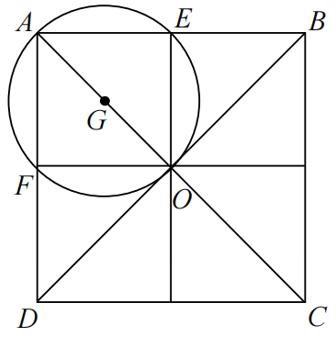

故正确答案为A。

**考点**：几何结论类-三角形相关、几何公式类-平面图形

**来源**：2025年江苏省公务员录用考试《行测》题（B类）（网友回忆版）第62题

### 第 63 题

某单位组织45名员工参观第十五届中国国际航空航天博览会。其中，21人参观了新一代隐身战斗机歼-35A，22人参观了嫦娥六号取回的月背月壤样品，19人参观了大型无人机战舰“虎鲸”。所有员工中，这三种展览都未参观的有5人，至少参观两种的有12人，则这三种展览都参观的有（ ）。

A. 7人

B. 8人

C. 9人

D. 10人

第 63 题 · 答案与解析

**参考答案（粉笔题库参考内容）**

D

**解析**

根据题意，设参观两种展览的员工有x人，参观三种展览的员工有y人。根据三集合容斥原理非标准型公式：A+B+C-满足两项-2×满足三项=总数-都不，可列式：21+22+19-x-2y=45-5，整理得：x+2y=22······①；根据“至少参观两种的有12人”，可得：x+y=12······②，①式减②式可得：y=10，故这三种展览都参观的有10人。

故正确答案为D。

**考点**：三集合

**来源**：2025年江苏省公务员录用考试《行测》题（C类）（网友回忆版）第58题

### 第 64 题

一场演出的节目有舞蹈《水韵江苏》、歌曲《让世界充满爱》和《绣红旗》、小品《幸福一家人》、魔术《奇幻之旅》、杂技《力量》。若要求两首歌曲分别作为开头曲和结尾曲，舞蹈与杂技相邻演出，小品和魔术不能相邻演出，则节目演出的排列顺序有（ ）。

A. 8种

B. 12种

C. 18种

D. 24种

第 64 题 · 答案与解析

**参考答案（粉笔题库参考内容）**

A

**解析**

根据题意，要求两首歌曲分别作为开头曲和结尾曲，有A_2^2=2种情况；要求舞蹈与杂技相邻演出，故可先将舞蹈和杂技捆绑起来，由于演出有先后顺序，有A_2^2=2种情况；要求小品和魔术不能相邻演出，可用插空法，先将舞蹈和杂技作为整体安排到两首歌曲中间，再将小品和魔术插入中间的2个空中，有A_2^2=2种情况。分步用乘法，则共有2×2×2=8种节目演出的排列顺序。

故正确答案为A。

**考点**：相邻问题、不相邻问题

**来源**：2025年江苏省公务员录用考试《行测》题（C类）（网友回忆版）第64题

### 第 65 题

某配送中心负责若干个货箱的分配，如果将货箱平均分配给6个配送点，有3个无法分配；如果将货箱平均分配给11个配送点，恰好分完；如果将货箱平均分配给13个配送点，有2个无法分配。该配送中心负责分配的货箱总共可能有：

A. 231个

B. 429个

C. 561个

D. 759个

第 65 题 · 答案与解析

**参考答案（粉笔题库参考内容）**

C

**解析**

根据题意可知，该配送中心负责分配的货箱总数减3后是6的整数倍，又是11的整数倍，减2后是13的整数倍，观察选项可知，均为11的整数倍，依次代入选项验证即可：

代入A项：(231 − 3)/6 = 38；(231 − 2)/13 ≠整数，不符合题意，排除；

代入B项：(429−3)/6 = 71；(429-2)/13 ≠整数，不符合题意，排除；

代入C项：(561-3)/6 = 93；(561 − 2)/13 = 43，符合题意，当选。无需验证剩余选项。

故正确答案为C。

**考点**：和差倍比问题

**来源**：2025年江苏省公务员录用考试《行测》题（B类）（网友回忆版）第65题

### 第 66 题

用若干玫瑰花制作玫瑰花束，若每束8枝余3枝，9枝余5枝，如果将这些玫瑰花全部用完，制成数量各不相同的3束玫瑰花，那么数量最多的那一束至少有玫瑰花（ ）。

A. 18枝

B. 20枝

C. 21枝

D. 23枝

第 66 题 · 答案与解析

**参考答案（粉笔题库参考内容）**

C

**解析**

设每束8枝有a束，每束9枝有b束，根据玫瑰花总枝数相同可列式：8a+3=9b+5，整理可得：8a=9b+2。根据奇偶特性可知，8a和2均为偶数，则9b为偶数，即b为偶数。根据要求数量最多的一束玫瑰花最少，那么玫瑰花总枝数要最少，即b取值要尽量小，分情况讨论：

若b=2，则a=2.5，不是整数，不符合题意；

若b=4，则a=4.75，不是整数，不符合题意；

若b=6，则a=7，符合题意，则此时玫瑰花总枝数最少为8×7+3=59枝。要使数量最多的一束玫瑰花枝数最少，则另外两束玫瑰花枝数要尽可能多，设数量最多的一束玫瑰花最少有x枝，又因3束玫瑰花枝数各不相同，可得玫瑰花枝数如下：

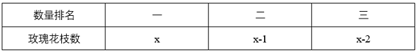

根据玫瑰花总共有59枝，可列式：x+x-1+x-2=59，解得x≈20.7，问最少，向上取整21枝。

故正确答案为C。

**考点**：构造数列、普通不定方程

**来源**：2025年江苏省公务员录用考试《行测》题（C类）（网友回忆版）第67题

### 第 67 题

某地考古出土了一种呈长方体的青铜器，测得其长、宽、高分别为60cm、40cm、60cm。为了防止氧化，有关部门为其做个半球形的保护罩，则该保护罩（厚度忽略不计）的表面积至少为（ ）。

A. 1.47πm^2

B. 1.02πm^2

C. 0.98πm^2

D. 0.68πm^2

第 67 题 · 答案与解析

**参考答案（粉笔题库参考内容）**

C

**解析**

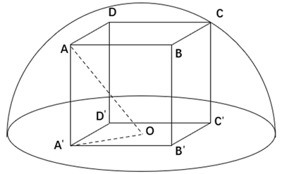

如图所示，使半球形保护罩既能罩住长方体又表面积最小，则长方体顶点A、B、C、D均与球面相切，O为底面中点，连接OA即为球体的半径。连接OA'，则OA'是长方形A'B'C'D'对角线A'C'的一半，且A'B'=60cm，B'C'=40cm，则根据勾股定理，A'C'= √(A'B'^2+B'C'^2) = √(60^2+40^2)=20√13cm，OA' = 10√13cm。因为三角形AA'O为直角三角形，且AA'=60cm，则根据勾股定理，OA = √(AA'^2 + OA'^2) = √(60^2 + (10√13)^2)= 70cm = 0.7m。根据公式：球体表面积=4πr^2，可得该保护罩的表面积为(1/2)×4π×0.7^2=0.98πm^2。

故正确答案为C。

备注： ①本题所求保护罩的表面积不包含底面。因为通常所说的“罩子”是没有底面的，即使罩子有底面，往往底面材质和罩子材质也不一样，会更厚一些，和题目中厚度忽略不计矛盾，故本题答案不能为A。

②由于本题的长方体是文物，因此不能随意调整摆放的情况，即不能以40cm为高算最值，故本题答案不能为D。

**考点**：几何结论类-三角形相关、几何公式类-立体图形

**来源**：2025年江苏省公务员录用考试《行测》题（C类）（网友回忆版）第65题

### 第 68 题

为了丰富居民的业余生活，区政府拟在花苑小区西面围墙外的空地上，修建一个矩形文化广场，广场的一边为小区围墙。现沿广场周边植树，相邻两棵树、最东边的树与围墙的间隔最多为4m，且远离围墙的两个角上都植树。已知围墙一侧无需植树，最终共植树63棵，那么文化广场的最大面积为：

A. 7442

B. 7848

C. 8192

D. 8498

第 68 题 · 答案与解析

**参考答案（粉笔题库参考内容）**

C

**解析**

由题意可知，相邻两棵树、最东边的树与围墙的间隔取最大值4m时，文化广场的边长最大，此时文化广场的面积最大。设与围墙相垂直的两条边均植树x棵，则与围墙相垂直的边长均为4xm。由于围墙一侧无需植树且最终共植树63棵，则与围墙相平行的边植树63-2x+2=（65-2x）棵，则与围墙相平行的边长为(65-2x-1)×4=4(64-2x)m。设文化广场的面积为ym^2，则y = 4(64 − 2x) × 4x = 16x × (64 − 2x)，令y=0，解得x_1=0，x_2=32，当x = (x_1 + x_2)/2 = (0 + 32)/2 = 16时，y取最大值。则文化广场的最大面积为16 × 16 × (64 − 2 × 16) = 8192m^2。

故正确答案为C。

**考点**：植树问题、函数最值问题

**来源**：2025年江苏省公务员录用考试《行测》题（B类）（网友回忆版）第68题

### 第 69 题

某5A级景区门票90元/人，教师免票、大学生半票，乘坐索道另付70元/人。某校教师和大学生共110人到该景区研学，若支付的门票和索道费共11750元，则参与研学的教师有（ ）。

A. 6人

B. 10人或20人

C. 10人

D. 6人或20人

第 69 题 · 答案与解析

**参考答案（粉笔题库参考内容）**

D

**解析**

设参与研学的教师有x人，则参与研学的大学生有（110-x）人；设乘坐索道的有y人，则未乘坐索道的有（110-y）人。根据题意，大学生半票后为90 × 1/2 = 45元/人，则门票费共45×(110-x)元；索道费共70y元。根据“若支付的门票和索道费共11750元”，可列方程45×（110-x）+70y=11750，整理得14y-9x=1360。优先考虑代入选项进行验证，代入x=6，解得y=101，符合题意；代入x=10，解得y = 725/7，为非整数，不符合题意，排除；代入x=20，解得y=110，符合题意。综上，参与研学的教师有6人或20人。

故正确答案为D。

备注：此题表述不太严谨，可以选择乘坐索道也可以选择不乘坐索道，若更改表述为“若乘坐索道另付70元/人”，会更加严谨。

**考点**：普通不定方程

**来源**：2025年江苏省公务员录用考试《行测》题（C类）（网友回忆版）第68题

### 第 70 题

某科技园区计划铺设电缆联通A、B、C、D、E、F六栋办公楼，可以铺设电缆的线路如下图所示，每条边上的数字表示两栋楼之间线路的长度（单位：10米），则铺设电缆的总长度最短是（ ）。

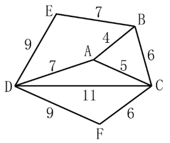

A. 280米

B. 290米

C. 310米

D. 350米

第 70 题 · 答案与解析

**参考答案（粉笔题库参考内容）**

B

**解析**

若要铺设电缆总长度最短，则铺设的线路应尽量少且每条线路的长度应尽量短。六栋办公楼，最少需要5条线路即可联通。最短路径优先，选择AB、AC、CF、BE、AD，此时六栋楼均被连通且铺设电缆的总长度最短，故所求为（4+5+6+7+7）×10=290米。

故正确答案为B。

**考点**：统筹规划问题

**来源**：2025年江苏省公务员录用考试《行测》题（C类）（网友回忆版）第70题

### 第 71 题

柿子：柿饼

A. 土豆：土豆泥

B. 花生：花生糖

C. 椰子：椰子汁

D. 葡萄：葡萄干

第 71 题 · 答案与解析

**参考答案（粉笔题库参考内容）**

D

**解析**

第一步：判断题干词语间逻辑关系。

“柿子”是制作“柿饼”的原材料，二者为原材料与成品的对应关系。

第二步：判断选项词语间逻辑关系。

A项：“土豆”是制作“土豆泥”的原材料，二者为原材料与成品的对应关系，与题干逻辑关系一致，保留；

B项：“花生”是制作“花生糖”的原材料，二者为原材料与成品的对应关系，与题干逻辑关系一致，保留；

C项：“椰子”是制作“椰子汁”的原材料，二者为原材料与成品的对应关系，与题干逻辑关系一致，保留；

D项：“葡萄”是制作“葡萄干”的原材料，二者为原材料与成品的对应关系，与题干逻辑关系一致，保留。

对比A、B、C、D四项，题干“柿子”制成“柿饼”和D项“葡萄”制成“葡萄干”的过程中都需要经过“晾晒”，而A项“土豆”制成“土豆泥”、B项“花生”制成“花生糖”、C项“椰子”制成“椰子汁”均不需要经过“晾晒”，故D项与题干逻辑关系更为一致，当选。

故正确答案为D。

**考点**：逻辑关系-对应关系

**来源**：2025年江苏省公务员录用考试《行测》题（C类）（网友回忆版）第72题

### 第 72 题

舍本：逐末

A. 买椟：还珠

B. 取长：补短

C. 避重：就轻

D. 趋炎：附势

第 72 题 · 答案与解析

**参考答案（粉笔题库参考内容）**

C

**解析**

第一步：判断题干词语间逻辑关系。

“舍本逐末”指舍弃事物的根本的、主要的部分，而去追求细枝末节，指轻重倒置。“舍本”和“逐末”是并列关系，且“舍”和“逐”、“本”和“末”均是反义关系。

第二步：判断选项词语间逻辑关系。

A项：“买椟还珠”指买了装了珍珠的木匣退还了珍珠。“买椟”和“还珠”是并列关系，但“买”和“还”、“椟”和“珠”均不是反义关系，与题干逻辑关系不一致，排除；

B项：“取长补短”指吸取别人的长处，弥补自己的短处。“取长”是为了“补短”，二者是方式目的的对应关系，且“取”和“补”不是反义关系，与题干逻辑关系不一致，排除；

C项：“避重就轻”指避开重要的而拣次要的来承担，也指回避主要的问题，只谈无关紧要的方面。“避重”和“就轻”是并列关系，其中“就”指凑近、靠近，“避”和“就”、“重”和“轻”均是反义关系，与题干逻辑关系一致，当选；

D项：“趋炎附势”指奉承、依附有权有势的人。“趋炎”和“附势”是并列关系，但“趋”和“附”、“炎”和“势”均不是反义关系，与题干逻辑关系不一致，排除。

故正确答案为C。

**考点**：逻辑关系-并列关系、拆分思维

**来源**：2025年江苏省公务员录用考试《行测》题（B类）（网友回忆版）第72题

### 第 73 题

热极生风：穷极思变

A. 鼓空声高：人狂话大

B. 绳锯木断：水滴石穿

C. 人闲生病：石闲生苔

D. 得道多助：失道寡助

第 73 题 · 答案与解析

**参考答案（粉笔题库参考内容）**

C

**解析**

第一步：判断题干词语间逻辑关系。

“热极生风”意思是一个地方热得太厉害，不久便会产生大风；“穷极思变”意思是在穷困艰难的时候，就要想办法改变现状。二者无明显语义关系，考虑拆分。因为“热极”所以“生风”，因为“穷极”所以“思变”，二者拆分之后均为因果关系，且“热极生风”和“穷极思变”均可指“事物在极端状态下会发生变化”。

第二步：判断选项词语间逻辑关系。

A项：“鼓空声高”意思是鼓里面是空的时候声音反而大；“人狂话大”意思是没有真才实学的人往往狂妄自大，好说大话，喜欢吹牛。因为“鼓空”所以“声高”，因为“人狂”所以“话大”，二者拆分之后均为因果关系，但“鼓空声高”无法指“事物在极端状态下会发生变化”，与题干逻辑关系不一致，排除；

B项：“绳锯木断”意思是以绳当锯，也能锯断木头；“水滴石穿”意思是水滴不断地滴，可以滴穿石头。因为“绳锯”所以“木断”，因为“水滴”所以“石穿”，二者拆分之后均为因果关系，但“绳锯木断”和“水滴石穿”均无法指“事物在极端状态下会发生变化”，与题干逻辑关系不一致，排除；

C项：“人闲生病”意思是人闲得无聊就容易生病；“石闲生苔”意思是闲置的石头很容易长出青苔。因为“人闲”所以“生病”，因为“石闲”所以“生苔”，二者拆分之后均为因果关系，且“人闲生病”和“石闲生苔”均可指“事物在极端状态下会发生变化”，与题干逻辑关系一致，当选；

D项：“得道多助”意思是坚持正义就能得到多方面的支持与帮助；“失道寡助”意思是违背正义必然陷于孤立。因为“得道”所以“多助”，因为“失道”所以“寡助”，二者拆分之后均为因果关系，但“得道多助”和“失道寡助”均无法指“事物在极端持续状态下会发生变化”，与题干逻辑关系不一致，排除。

故正确答案为C。

本题为争议题。若看题干第一个词“热极生风”与物有关，第二个词“穷极思变”与人有关；A项第一个词“鼓空声高”与物有关，第二个词“人狂话大”与人有关，C项刚好顺序反了，也有同学会选择A项，此考法历年真题也确实考过。两种理解方式均有合理之处，考生无需过于纠结不严谨的题，重点学习此类题的解题思路即可，这种同时涉及物和人的成语或诗句可能会考查的两个角度，一是具体意思的类似，二是由物到人或由人到物的类比。

**考点**：拆分思维、逻辑关系-对应关系

**来源**：2025年江苏省公务员录用考试《行测》题（C类）（网友回忆版）第73题

### 第 74 题

石刻：石头：木头

A. 版画：铁板：竹板

B. 根雕：树根：草根

C. 茶道：茶具：餐具

D. 剧本：小说：评说

第 74 题 · 答案与解析

**参考答案（粉笔题库参考内容）**

B

**解析**

第一步：判断题干词语间逻辑关系。

“石刻”是运用雕刻的技法在石质材料上创造出具有实在体积的各类艺术品，“石刻”是在“石头”上进行雕刻，前两词是原材料与成品的对应关系，“石头”和“木头”是并列关系。

第二步：判断选项词语间逻辑关系。

A项：“版画”是以刀或化学药品等在木、石、麻胶、铜、锌等版面上雕刻或蚀刻后印刷出来的图画，“版画”可以在“铁板”上雕刻，也可以在“竹板”上雕刻，第二词和第三词均可以是第一词的原材料，与题干逻辑关系不一致，排除；

B项：“根雕”是在“树根”上进行雕刻，前两词是原材料与成品的对应关系，且“树根”和“草根”是并列关系，与题干逻辑关系一致，当选；

C项：“茶具”和“餐具”是并列关系，但“茶具”是“茶道”中使用的工具，前两词是工具的对应关系，与题干逻辑关系不一致，排除；

D项：“剧本”是戏剧作品，“小说”是一种叙事性的文学体裁，“评说”是指评论、评价，前两词不是原材料与成品的对应关系，且后两词并非并列关系，与题干逻辑关系不一致，排除。

故正确答案为B。

**考点**：逻辑关系-并列关系、逻辑关系-对应关系

**来源**：2025年江苏省公务员录用考试《行测》题（B类）（网友回忆版）第74题

### 第 75 题

压舱石：就业：社会稳定

A. 先手棋：专利：科技创新

B. 基本盘：耕地：粮食生产

C. 晴雨表：管理：人才培养

D. 主阵地：学校：知识传播

第 75 题 · 答案与解析

**参考答案（粉笔题库参考内容）**

B

**解析**

第一步：判断题干词语间逻辑关系。

“压舱石”本意为船舶、飞机等交通工具上为了保持平衡和稳定而放置的重物，后比喻对事物发展起到稳定、支撑作用的关键因素、重要力量或基础保障。“就业”是“社会稳定”的“压舱石”，三者为对应关系。

第二步：判断选项词语间逻辑关系。

A项：“先手棋”本来指围棋、象棋等棋类游戏中，先走的一方所下的第一步棋，具有争取主动的优势，后引申为在竞争、行动等过程中，为了占据主动地位而采取的第一步或关键的起始行动、策略等。“专利”不是“科技创新”的“先手棋”，三者不构成对应关系，与题干逻辑关系不一致，排除；

B项：“基本盘”指事物最基础、最根本的部分。“耕地”是“粮食生产”的“基本盘”，三者为对应关系，与题干逻辑关系一致，保留；

C项：“晴雨表”比喻能敏锐地反映某种变化或在事情发生前出现征兆的事物。“管理”不是“人才培养”的“晴雨表”，三者不构成对应关系，与题干逻辑关系不一致，排除；

D项：“主阵地”指在军事作战中，军队主要据守和作战的地区或位置，现在常用来指在某个领域、行业或工作中，起主导、核心作用，集中力量进行主要活动或发挥主要作用的地方、领域或平台等。“学校”是“知识传播”的“主阵地”，三者为对应关系，与题干逻辑关系一致，保留。

对比B、D两项，题干的“压舱石”强调“就业”是维持“社会稳定”的重要基础和关键因素，对“社会稳定”起着支撑作用，B项的“基本盘”强调“耕地”是“粮食生产”的根本和基础，对“粮食生产”起着支撑作用，而D项的“主阵地”没有体现这种基础和支撑作用。且题干的“压舱石”和B项的“基本盘”都是物品，而D项的“主阵地”为地点，故B项与题干逻辑关系更为一致，当选。

故正确答案为B。

**考点**：逻辑关系-对应关系

**来源**：2025年江苏省公务员录用考试《行测》题（C类）（网友回忆版）第76题

### 第 76 题

沿海港口：上海港：国际大港

A. 跨境班列：中欧班列：长途班列

B. 舆情监测：风险监测：环境监测

C. 纳米技术：纳米科学：前沿科学

D. 纸媒广告：传单广告：杂志广告

第 76 题 · 答案与解析

**参考答案（粉笔题库参考内容）**

A

**解析**

第一步：判断题干词语间逻辑关系。

“上海港”位于中国大陆海岸线中部，长江与东海交汇处，是中国沿海的主要枢纽港，也是中国对外开放，参与国际经济大循环的重要口岸。“上海港”既是“沿海港口”，又是“国际大港”，第二词分别与第一词、第三词构成种属关系，第一词和第三词构成交叉关系。

第二步：判断选项词语间逻辑关系。

A项：“中欧班列”既是“跨境班列”，又是“长途班列”，第二词分别与第一词、第三词构成种属关系，第一词和第三词构成交叉关系，与题干逻辑关系一致，当选；

B项：“舆情监测”和“环境监测”是两种不同类型的监测，二者为并列关系，与题干逻辑关系不一致，排除；

C项：“纳米科学”是“纳米技术”的基础，二者为对应关系，与题干逻辑关系不一致，排除；

D项：“传单广告”和“杂志广告”是广告的不同形式，二者为并列关系，与题干逻辑关系不一致，排除。

故正确答案为A。

**考点**：逻辑关系-交叉关系、逻辑关系-包容关系

**来源**：2025年江苏省公务员录用考试《行测》题（B类）（网友回忆版）第76题

### 第 77 题

温室效应：冰山融化：海面上升

A. 博览群书：视野开阔：见解深刻

B. 连日降雪：道路结冰：出行困难

C. 电闪雷鸣：狂风大作：沙尘肆虐

D. 刻苦训练：技能提高：获得金牌

第 77 题 · 答案与解析

**参考答案（粉笔题库参考内容）**

B

**解析**

第一步：判断题干词语间逻辑关系。

因为“温室效应”，所以“冰山融化”；因为“冰山融化”，所以“海面上升”，三者为连续因果对应关系。

第二步：判断选项词语间逻辑关系。

A项：因为“博览群书”，所以“视野开阔”；因为“视野开阔”，所以“见解深刻”，三者为连续因果对应关系，与题干逻辑关系一致，保留；

B项：因为“连日降雪”，所以“道路结冰”；因为“道路结冰”，所以“出行困难”，三者为连续因果对应关系，与题干逻辑关系一致，保留；

C项：“电闪雷鸣”“狂风大作”“沙尘肆虐”是不同的天气现象，三者不是连续因果对应关系，与题干逻辑关系不一致，排除；

D项：因为“刻苦训练”，所以“技能提高”；因为“技能提高”，所以“获得金牌”，三者为连续因果对应关系，与题干逻辑关系一致，保留。

对比A、B、D三项，题干和B项的初始原因均为自然原因，带来的均为消极结果，但A、D两项初始原因为人为原因，带来的为积极结果，B项与题干逻辑关系更为一致，当选。

故正确答案为B。

**考点**：逻辑关系-对应关系

**来源**：2025年江苏省公务员录用考试《行测》题（B类）（网友回忆版）第77题

### 第 78 题

苍鹰：鸿雁：书信

A. 加油：注水：鼓劲

B. 下海：上岸：录取

C. 须眉：巾帼：围脖

D. 疆域：河山：国土

第 78 题 · 答案与解析

**参考答案（粉笔题库参考内容）**

B

**解析**

第一步：判断题干词语间逻辑关系。

“苍鹰”和“鸿雁”都是鸟类，二者为并列关系；“鸿雁”是书信的代称，可以比喻“书信”，第二词与第三词构成比喻象征义，且第一词与第三词无必然逻辑关系。

第二步：判断选项词语间逻辑关系。

A项：“加油”和“注水”都是动作，二者为并列关系；“加油”可用于支持，指勉励他人或自己，可以比喻“鼓劲”，第一个词与第三个词构成比喻象征义，词语顺序与题干不一致，与题干逻辑关系不一致，排除；

B项：“下海”和“上岸”都是动作，二者为并列关系；“上岸”指舍舟登陆，也指考生被录取，可以比喻“录取”，第二词与第三词构成比喻象征义，且第一词与第三词无必然逻辑关系，与题干逻辑关系一致，当选；

C项：“须眉”指胡须和眉毛，也可以比喻男子，“巾帼”指古代妇女的头巾和发饰，也可以比喻女子，二者为并列关系；但“巾帼”不能比喻“围脖”，与题干逻辑关系不一致，排除；

D项：“疆域”指国家领土，“河山”指国家的疆土，“国土”指国家的领土，第一个词和第三个词意思一致，二者为全同关系，与题干逻辑关系不一致，排除。

故正确答案为B。

**考点**：语义关系-比喻象征义、逻辑关系-并列关系

**来源**：2025年江苏省公务员录用考试《行测》题（C类）（网友回忆版）第74题

### 第 79 题

生肖 之于 （ ） 相当于 （ ） 之于 禁行

A. 飞禽 路口

B. 走兽 信号

C. 天干 通行

D. 地支 红灯

第 79 题 · 答案与解析

**参考答案（粉笔题库参考内容）**

D

**解析**

逐一代入选项。

A项：飞禽指会飞的鸟类，也泛指鸟类。有的生肖是飞禽（如，鸡），有的生肖不是飞禽，有的飞禽是生肖，有的飞禽不是生肖，二者为交叉关系；在路口可以禁行，二者为对应关系，前后逻辑关系不一致，排除；

B项：走兽泛指兽类。有的生肖是走兽（如，牛），有的生肖不是走兽，有的走兽是生肖，有的走兽不是生肖，二者为交叉关系；禁行是一种信号，二者为种属关系，前后逻辑关系不一致，排除；

C项：天干是对甲、乙、丙、丁、戊、己、庚、辛、壬、癸的统称，传统用作表示次序的符号，和生肖无明显逻辑关系；通行和禁行为反义关系，前后逻辑关系不一致，排除；

D项：地支是对子、丑、寅、卯、辰、巳、午、未、申、酉、戌、亥的统称，生肖是代表十二地支而用来记人的出生年的十二种动物，子属鼠、丑属牛、寅属虎、卯属兔、辰属龙、巳属蛇、午属马、未属羊、申属猴、酉属鸡、戌属狗、亥属猪，二者有紧密的对应关系；红灯指红色的交通信号灯，红灯亮时表示禁止通行，二者有紧密的对应关系，前后逻辑关系一致，当选。

故正确答案为D。

**考点**：逻辑关系-对应关系

**来源**：2025年江苏省公务员录用考试《行测》题（B类）（网友回忆版）第79题

### 第 80 题

月饼 之于 （ ） 相当于 旅游 之于 （ ）

A. 传统节日 高速公路

B. 中式糕点 休闲活动

C. 手工食品 异国风情

D. 家庭团圆 探索自然

第 80 题 · 答案与解析

**参考答案（粉笔题库参考内容）**

B

**解析**

逐一代入选项。

A项：“月饼”是“传统节日”中秋节的时节食品，二者是食品与节日场景的对应关系；“旅游”途中可能会经过“高速公路”，二者是休闲活动与道路建设的对应关系，前后逻辑关系不一致，排除；

B项：“月饼”是一种“中式糕点”，二者为种属关系；“旅游”是一种“休闲活动”，二者为种属关系，前后逻辑关系一致，当选；

C项：有的“月饼”是“手工食品”，有的“月饼”不是“手工食品”，有的“手工食品”是“月饼”，有的“手工食品”不是“月饼”，二者为交叉关系；“旅游”可以感受“异国风情”，二者是休闲活动与感受的对应关系，前后逻辑关系不一致，排除；

D项：“月饼”象征“家庭团圆”，二者为比喻象征义，“旅游”是为了“探索自然”，二者为方式目的的对应关系，前后逻辑关系不一致，排除。

故正确答案为B。

**考点**：逻辑关系-包容关系

**来源**：2025年江苏省公务员录用考试《行测》题（B类）（网友回忆版）第80题

### 第 81 题

请从四个选项中选出最恰当的一项填入问号处，使题干图形呈现一定的规律性。

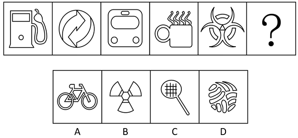

A. A

B. B

C. C

D. D

第 81 题 · 答案与解析

**参考答案（粉笔题库参考内容）**

A

**解析**

元素组成不同，且无明显属性规律，考虑数量规律。题干均为封闭区域明显的生活化图形，考虑数面数量，面数量依次为3、4、5、6、7，故？处图形的面数量应为8，只有A项符合。

故正确答案为A。

**考点**：数量规律-面

**来源**：2025年江苏省公务员录用考试《行测》题（B类）（网友回忆版）第81题

### 第 82 题

请从四个选项中选出最恰当的一项填入问号处，使题干图形呈现一定的规律性。

A. A

B. B

C. C

D. D

第 82 题 · 答案与解析

**参考答案（粉笔题库参考内容）**

B

**解析**

元素组成不同，且属性规律无答案，考虑数量规律。观察发现，题干图形中的曲线和直线均有明显相交，考虑曲直交点数。题干图形的曲直交点数均为1，故？处应选择有1个曲直交点的图形，只有B项符合。

故正确答案为B。

**考点**：数量规律-点

**来源**：2025年江苏省公务员录用考试《行测》题（C类）（网友回忆版）第82题

### 第 83 题

请从四个选项中选出最恰当的一项填入问号处，使题干图形呈现一定的规律性。

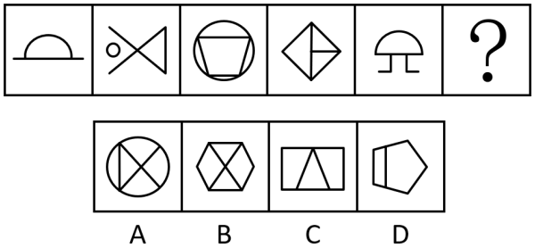

A. A

B. B

C. C

D. D

第 83 题 · 答案与解析

**参考答案（粉笔题库参考内容）**

D

**解析**

元素组成不同，优先考虑属性规律。观察发现，题干图形出现明显等腰元素，优先考虑对称性。题干图形均只有一条对称轴，且对称轴方向依次为竖向、横向、竖向、横向、竖向，故“？”处图形应只有一条对称轴，且为横向，排除B、C两项；继续观察发现，题干图形线条交叉明显，考虑交点数，题干图形的交点数依次为2、3、4、5、6，故“？”处图形的交点数应为7，只有D项符合。

故正确答案为D。

**考点**：数量规律-复合

**来源**：2025年江苏省公务员录用考试《行测》题（B类）（网友回忆版）第83题

### 第 84 题

请从四个选项中选出最恰当的一项填入问号处，使题干图形呈现一定的规律性。

A. A

B. B

C. C

D. D

第 84 题 · 答案与解析

**参考答案（粉笔题库参考内容）**

C

**解析**

元素组成不同，且无明显属性规律，考虑数量规律。观察发现，题干出现多个 “日”字变形图，考虑笔画数。题干图形均为一笔画图形，？处应用规律，排除A、B两项；继续观察发现，题干每幅图形均存在两个三角形面，故？处应选一个存在两个三角形面的图形，只有C项符合。

故正确答案为C。

**考点**：数量规律-复合

**来源**：2025年江苏省公务员录用考试《行测》题（C类）（网友回忆版）第84题

### 第 85 题

请从四个选项中选出最恰当的一项填入问号处，使题干图形呈现一定的规律性。

A. A

B. B

C. C

D. D

第 85 题 · 答案与解析

**参考答案（粉笔题库参考内容）**

C

**解析**

元素组成相似，优先考虑样式规律。观察发现，题干图形轮廓和分割区域相同，考虑黑白运算。九宫格优先看横行，第一行运算规律为：黑+白=黑，白+黑=黑，黑+黑=白，白+白=白；第二行经验证符合此规律；第三行应用此规律，只有C项符合。

故正确答案为C。

**考点**：样式规律-黑白运算

**来源**：2025年江苏省公务员录用考试《行测》题（B类）（网友回忆版）第85题

### 第 86 题

左边给定的图形是由右边哪些图形拼合（只可平移，不可旋转和翻转）而成的？

A. ①②③④

B. ①②③⑤

C. ②③④⑤

D. ①③④⑤

第 86 题 · 答案与解析

**参考答案（粉笔题库参考内容）**

B

**解析**

本题考查平面拼合，可采用平行且等长相消的方式解题。左边给定的图形是由右边①②③⑤拼合而成的。平行且等长相消的方式如下图所示：

故正确答案为B。

**来源**：2025年江苏省公务员录用考试《行测》题（B类）（网友回忆版）第86题

### 第 87 题

上边四张纸片，每张纸片一面是黑色，另一面是白色，下边仅有一项能由它们拼合（可以平移、旋转、翻转）而成，请把它找出来。

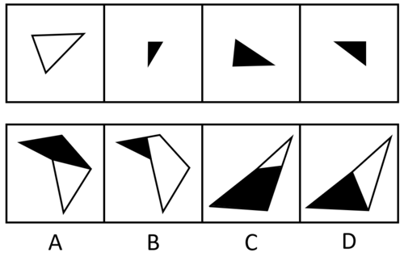

A. A

B. B

C. C

D. D

第 87 题 · 答案与解析

**参考答案（粉笔题库参考内容）**

A

**解析**

本题考查平面拼合，可以平移、旋转、翻转，且每张纸片一面是黑色，另一面是白色，需要考虑翻转后的颜色变化。将题干图形标上序号，如下图所示，逐一进行分析。

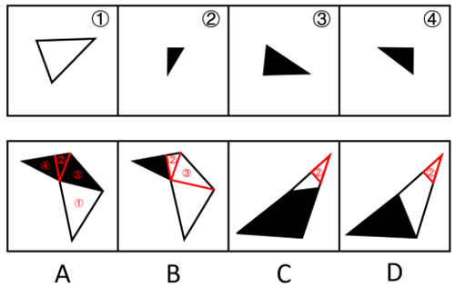

A项：可以由题干图形拼合而成，拼合方式如图所示，当选；

B项：右上角的两个三角形是由图②和图③旋转后平移过去的，颜色都应该是黑色，而选项是白色，排除；

C项：右上角的三角形是图②，颜色无误，但其下方的白块与题干图形的形状均不相同，无法由题干图形拼合而成，排除；

D项：右上角的三角形是图②，颜色无误，但其下方的白块无法由题干图形拼合而成，排除。

故正确答案为A。

**来源**：2025年江苏省公务员录用考试《行测》题（B类）（网友回忆版）第87题

### 第 88 题

左边给定的是六面体的外表面展开图，右边哪一项能由它折叠而成?

A. A

B. B

C. C

D. D

第 88 题 · 答案与解析

**参考答案（粉笔题库参考内容）**

C

**解析**

将题干展开图标上序号，如下图所示，逐一进行分析。

A项：选项的正面和顶面来自面e、面f、面i、面k，题干展开图中面e、面f、面i、面k任意面中的线条均与另一个面中的线条相交于公共边的中点，而选项中正面中的线条与顶面中的线条不相交，选项与题干展开图不一致，排除；

B项：选项一定有面g与面h，且选项中三个面的公共点挨着顶面中的线条，故选项由面f、面g与面h构成。题干展开图中面g中的直角三角形挨着面f中的直角梯形，而选项中面g中的直角三角形挨着面f中的直角三角形，选项与题干展开图不一致，排除；

C项：选项由面g、面i与面k构成，选项与题干展开图一致，当选；

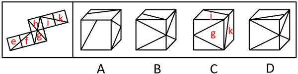

D项：选项一定有面g与面h，且选项中三个面的公共点不挨着顶面中的线条，故选项由面g、面h与面i构成。题干展开图中这三个面的公共点挨着面i中的直角梯形，而选项中这三个面的公共点挨着面i中的直角三角形，选项与题干展开图不一致，排除。

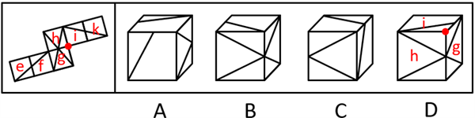

故正确答案为C。

**考点**：空间类-空间重构-六面体

**来源**：2025年江苏省公务员录用考试《行测》题（B类）（网友回忆版）第88题

### 第 89 题

左边给定的是六面体的外表面展开图，右边哪一项能由它折叠而成？

A. A

B. B

C. C

D. D

第 89 题 · 答案与解析

**参考答案（粉笔题库参考内容）**

B

**解析**

本题考查六面体。将展开图中右下角的面移动，并给每个面标号，如下图所示，逐一进行分析。

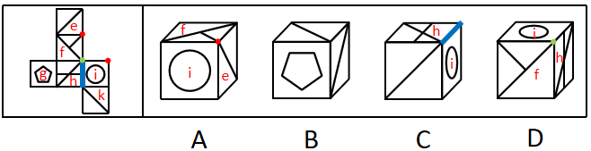

A项：选项一定有面i和面f，右面为面e或面k，展开图中面f和面k为相对面，无法同时出现，故右面为面e。展开图中面e、面f和面i的公共点引出一条线，而选项中三个面的公共点引出两条线，选项与题干展开图不一致，排除；

B项：选项由面e、面g与面k构成，选项与题干展开图一致，当选；

C项：选项一定有面h和面i，展开图中面h与面i的公共边挨着面h中的两条线，而选项中两个面的公共边只挨着面h中的一条线，选项与题干展开图不一致，排除；

D项：选项由面f、面h和面i构成，展开图中三个面的公共点引出两条线，而选项中三个面的公共点只引出一条线，选项与题干展开图不一致，排除。

故正确答案为B。

**考点**：空间类-空间重构-六面体

**来源**：2025年江苏省公务员录用考试《行测》题（C类）（网友回忆版）第89题

### 第 90 题

下面4个立体图形均由大小相同的8个白色小立方体和4个灰色小立方体堆叠而成，其中一个立体图形的某一视图可能是由纯白小方格组成的，请把它找出来。

A. A

B. B

C. C

D. D

第 90 题 · 答案与解析

**参考答案（粉笔题库参考内容）**

D

**解析**

本题考查三视图。A、B、C三项中的立体图形不可能某一视图由纯白小方格组成，排除。D项中，立体图形的正面能看到7个白色小立方体和3个灰色小立方体，所以其背面应还有1个白色小立方体和1个灰色小立方体。如下图所示，当灰色小立方体在最下层摆放，白色小立方体摆放在该灰色小立方体的上方时，其俯视图由纯白小方格组成。

故正确答案为D。

**考点**：空间类-三视图

**来源**：2025年江苏省公务员录用考试《行测》题（C类）（网友回忆版）第90题

### 第 91 题

只有为了人民的现代化，才有意义；只有依靠人民的现代化，才有动力。新时代以来，我们坚持民生为大，书写了经济快速发展和社会长期稳定两大奇迹新篇章。只要坚持一切为了人民、一切依靠人民，就能充分调动广大人民的积极性。

根据以上信息，可以推出以下哪项？

A. 不是为了人民的现代化，就是没有意义的现代化

B. 不坚持民生为大，就不能创造经济快速发展和社会长期稳定两大奇迹

C. 如果没能调动广大人民的积极性，则没有坚持一切为了人民

D. 只有坚持一切依靠人民，才能充分调动广大人民的积极性

第 91 题 · 答案与解析

**参考答案（粉笔题库参考内容）**

A

**解析**

第一步：翻译题干。

①现代化有意义→为了人民的现代化；

②现代化有动力→依靠人民的现代化；

③坚持一切为了人民 且 坚持一切依靠人民→充分调动广大人民的积极性。

第二步：逐一分析选项。

A项：翻译为“-为了人民的现代化→-现代化有意义”，是对①的否后，否后必否前，可以推出，当选；

B项：翻译为“-坚持民生为大→-创造经济快速发展和社会长期稳定两大奇迹”，二者不存在逻辑关系，无法推出，排除；

C项：翻译为“-调动广大人民的积极性→-坚持一切为了人民”，是对③的否后，否后必否前，即“-充分调动广大人民的积极性→-坚持一切为了人民 或 -坚持一切依靠人民”，无法得出“-坚持一切为了人民”一定为真，无法推出，排除；

D项：翻译为“充分调动广大人民的积极性→坚持一切依靠人民”，是对③的肯后，但肯后得不到确定性的结论，无法推出，排除。

故正确答案为A。

**考点**：常规翻译

**来源**：2025年江苏省公务员录用考试《行测》题（C类）（网友回忆版）第91题

### 第 92 题

“露从今夜白，月是故乡明。”唐代诗人杜甫这一千古名句表达了诗人在秋天对故乡的思念和对亲人的牵挂。在国人心中，秋天总是和思乡联系在一起。对此，有学者称，相对于其他季节，秋天人们很容易想起家乡的种种美好，更容易产生思乡情绪。

以下哪项如果为真，最能支持上述学者的观点？

A. 秋天大自然由生机勃勃转向秋风萧瑟，让人感受到时间的流逝和生命的脆弱

B. 秋天正是收获的时节，那些从小经历的美好场景深深刻在每个人的心底

C. 中国历史上有无数文人骚客在秋天写下思乡的千古名篇，影响着一代又一代国人

D. 每逢中秋，在外漂泊的游子会意识到已经离家很久，渴望和家人团聚

第 92 题 · 答案与解析

**参考答案（粉笔题库参考内容）**

B

**解析**

第一步：找出论点和论据。

论点：相对于其他季节，秋天人们很容易想起家乡的种种美好，更容易产生思乡情绪。

论据：无。

本题只有论点，没有论据，加强优先考虑补充论据。

第二步：逐一分析选项。

A项：该项指出秋天让人感受到“时间的流逝和生命的脆弱”，但并未说明此种感受是否会引发“思乡情绪”，话题不一致，无法加强，排除；

B项：该项指出秋天正是收获的时节，那些“从小经历的美好场景”深深刻在每个人的心底，解释了为什么秋天容易让人们想起“家乡的种种美好”，更容易让人们产生“思乡情绪”，补充论据，可以加强，保留；

C项：该项指出国人思乡是因为受到文人骚客写下的关于思乡的千古名篇的影响，解释了一代又一代国人思乡的原因，补充论据，可以加强，保留；

D项：该项指出“中秋”会触发游子的“思乡情绪”，“中秋”是秋天的一个节日，无法判断是节日还是秋天这个季节容易让人们产生思乡情绪，为不明确项，无法加强，排除。

对比B、C两项，B项解释了为什么每个人会发自心底的产生思乡之情，而C项只是在说思乡是受到了文人骚客的影响，但是发自心底的原因比他人带来的影响更为关键，因此B项加强力度更强。

故正确答案为B。

**考点**：补充论据

**来源**：2025年江苏省公务员录用考试《行测》题（B类）（网友回忆版）第92题

### 第 93 题

有些作家不用电脑写作，所有作家都不喜欢喧嚣。所以，有些用电脑写作的人喜欢喧嚣。

以下哪项与上述推理的结构和错误最为相似？

A. 有些医生热爱运动，所有医生都不想损害健康。所以，有些不热爱运动的人不想损害健康

B. 有些中年人不爱喝咖啡，所有中年人都不愿意频繁更换手机。所以，有些爱喝咖啡的人愿意频繁更换手机

C. 有些世界文学名著没有汉译本，所有世界文学名著都不是脱离现实的作品。所以，有些没有脱离现实的作品没有汉译本

D. 有些网球运动员不是职业运动员，所有网球运动员都想获得冠军。所以，有些职业运动员想获得冠军

第 93 题 · 答案与解析

**参考答案（粉笔题库参考内容）**

B

**解析**

第一步：分析题干推理形式。

题干推理形式为：有些a（作家）→非b（用电脑写作），所有a（作家）→非c（喜欢喧嚣）。所以，有些b（用电脑写作）→c（喜欢喧嚣）。

第二步：逐一分析选项。

A项：推理形式为：有些a（医生）→b（热爱运动），所有a（医生）→非c（损害健康）。所以，有些非b（热爱运动）→非c（损害健康），与题干推理结构不同，排除；

B项：推理形式为：有些a（中年人）→非b（爱喝咖啡），所有a（中年人）→非c（愿意频繁更换手机）。所以，有些b（爱喝咖啡）→c（愿意频繁更换手机），与题干推理结构相同，当选；

C项：推理形式为：有些a（世界文学名著）→非b（有汉译本），所有a（世界文学名著）→非c（脱离现实的作品）。所以，有些非c（脱离现实的作品）→非b（有汉译本），与题干推理结构不同，排除；

D项：推理形式为：有些a（网球运动员）→非b（职业运动员），所有a（网球运动员）→c（想获得冠军）。所以，有些b（职业运动员）→c（想获得冠军）”，与题干推理结构不同，排除。

故正确答案为B。

**考点**：推理形式

**来源**：2025年江苏省公务员录用考试《行测》题（B类）（网友回忆版）第93题

### 第 94 题

某品牌奶茶十年前以黑糖珍珠奶茶为招牌，赢得年轻顾客的青睐，在众多茶饮品牌中挣得相当大的市场份额。近年来，随着门店不断扩张，营收也不断增长，但是其招牌黑糖珍珠奶茶的销量却下降了。

以下除哪项外，均能解释上述现象？

A. 该品牌的黑糖珍珠奶茶十年来未更新配方，味道没有变化

B. 黑糖珍珠奶茶现在已不是一款新颖且受到消费者欢迎的产品

C. 由于熬制黑糖珍珠的人工成本增加，商家提高了这一产品的价格

D. 近几年茶饮市场火爆，大多数品牌都推出了自己的黑糖珍珠奶茶

第 94 题 · 答案与解析

**参考答案（粉笔题库参考内容）**

A

**解析**

第一步：找出题干矛盾。

某品牌奶茶门店不断扩张，营收不断增长，但是其招牌黑糖珍珠奶茶的销量却下降了。

第二步：逐一分析选项。

A项：该项指出该品牌的黑糖珍珠奶茶十年来味道未变，但味道喜好因人而异，不确定现在消费者是否喜爱该口味，无法解释为何门店不断扩张、营收不断增长，但其招牌黑糖珍珠奶茶的销量却下降，无法解释题干矛盾，当选；

B项：该项指出黑糖珍珠奶茶现在不再新颖且不再受消费者欢迎，这会导致该品牌的黑糖珍珠奶茶销量下降，而门店不断扩张会带来其他产品营收的增长，从而整体营收依然增长，可以解释题干矛盾，排除；

C项：该项指出商家提高了黑糖珍珠奶茶的价格，这会导致该品牌的黑糖珍珠奶茶销量下降，而门店不断扩张会带来其他产品营收的增长，从而整体营收依然增长，可以解释题干矛盾，排除；

D项：该项指出大多数品牌都推出了自己的黑糖珍珠奶茶，市场竞争会更加激烈，这会导致该品牌的黑糖珍珠奶茶销量下降，而门店不断扩张会带来其他产品营收的增长，从而整体营收依然增长，可以解释题干矛盾，排除。

本题为选非题，故正确答案为A。

**考点**：原因解释

**来源**：2025年江苏省公务员录用考试《行测》题（B类）（网友回忆版）第94题

### 第 95 题

甲、乙、丙三人毕业后同时进入某单位实习，由于表现较好，实习结束后他们将分到人事处、财务处、办公室正式入职。有人对他们各自的工作部门进行了如下猜测：

（1）甲入职的部门是人事处；

（2）乙入职的部门不是财务处；

（3）丙入职的部门不是人事处。

实际上，上述三个猜测只有一个是对的。

根据上述信息，可以推出甲、乙、丙入职的部门依次为：

A. 人事处 财务处 办公室

B. 办公室 财务处 人事处

C. 财务处 办公室 人事处

D. 人事处 办公室 财务处

第 95 题 · 答案与解析

**参考答案（粉笔题库参考内容）**

C

**解析**

第一步：分析题干条件。

（1）甲入职的部门是人事处；

（2）乙入职的部门不是财务处；

（3）丙入职的部门不是人事处；

（4）三个猜测只有一个是对的。

题干条件没有矛盾关系，也没有反对关系，考虑题干假设或选项代入，选项信息充分，优先考虑代入法。

第二步：逐一代入选项。

代入A项：条件（1）为真，条件（2）为假，条件（3）为真，有两个猜测为真，与条件（4）矛盾，排除；

代入B项：条件（1）为假，条件（2）为假，条件（3）为假，三个猜测均为假，与条件（4）矛盾，排除；

代入C项：条件（1）为假，条件（2）为真，条件（3）为假，只有一个猜测为真，符合条件（4），当选；

代入D项：条件（1）为真，条件（2）为真，条件（3）为真，三个猜测均为真，与条件（4）矛盾，排除。

故正确答案为C。

**考点**：真假推理-其他

**来源**：2025年江苏省公务员录用考试《行测》题（C类）（网友回忆版）第98题

### 第 96 题

地名是一个社会的基本公共信息，是自然地理、生产生活、历史文化的重要载体，在经济社会发展中发挥着基础性作用。民政部印发通知，提出以乡村地名采集上图标注为牵引，全面推进乡村地名命名管理、地名标志设置维护。对此，有专家称这一举措有助于传承中华民族悠久的历史文化。

以下哪项如果为真，最能支持上述专家的论断？

A. 地名作为一种蕴含丰富价值的资源，融入了人们的价值取向、文化思想观念等内容

B. 地名属于专有名词，每个地名都有对应的读音和含义，体现了人们对美好生活的期盼

C. 地名是人类历史“活化石”，在中华民族千百年的传承中被赋予更多含义，成为中华文明的独特载体

D. 一些地方存在着地名不规范的现象，给基层治理、公共服务以及人们的生产生活带来诸多困扰

第 96 题 · 答案与解析

**参考答案（粉笔题库参考内容）**

C

**解析**

第一步：找出论点和论据。

论点：这一举措（以乡村地名采集上图标注为牵引，全面推进乡村地名命名管理、地名标志设置维护）有助于传承中华民族悠久的历史文化。

论据：无。

本题只有论点，没有论据，加强优先考虑补充论据。

第二步：逐一分析选项。

A项：该项指出地名融入了人们的价值取向、文化思想观念等内容，人们的价值取向、文化思想观念等内容是中华民族历史文化的具体体现，补充论据，可以加强，保留；

B项：该项指出每个地名都有对应的读音和含义，体现了人们对美好生活的期盼，但无法证明地名命名管理是否有助于传承中华民族悠久的历史文化，无法加强，排除；

C项：该项指出地名在中华民族千百年的传承中被赋予更多含义，成为中华文明的独特载体，解释了为什么地名命名管理有助于传承中华民族悠久的历史文化，补充论据，可以加强，保留；

D项：该项指出一些地方存在着地名不规范的现象以及由此带来的困扰，而论点说的是地名命名管理有助于传承中华民族悠久的历史文化，话题不一致，无法加强，排除。

对比A、C两项，题干论点的关键词为“有助于传承中华民族悠久的历史文化”，A项说的是具体体现即“人们的价值取向、文化思想观念等内容”，而C项指出“地名在中华民族千百年的传承中被赋予更多含义”，C项表述的范围比A项更大、更全面，C项当选。

故正确答案为C。

**考点**：补充论据

**来源**：2025年江苏省公务员录用考试《行测》题（C类）（网友回忆版）第92题

### 第 97 题

海草是由陆地植物演化到适应海洋环境的高等植物。一种或几种海草连片生长，共同形成广袤柔软的“海草床”。海草床是最高效的碳捕获和碳封存系统之一，贮存碳的效率比森林高90倍，碳封存时间可达上千年。然而海草床是脆弱的生态系统，受自然环境变化和人类活动影响较大，全球范围内海草床正面临严峻退化趋势。基于如上原因，有专家建议，亟需开展“海底种草”生态修复工作，加强对海草床的保护。

以下哪项如果为真，最能支持上述专家的建议？

A. 当前全球气候变暖日益加剧，科学家已发现人类生产生活排放的碳化合物是变暖的主要元凶

B. 海草床可以通过光合作用吸收环境中的无机碳，将其高效地固定、转化为有机碳并进行积累

C. 有些地方海岸线侵蚀严重，加强海草床保护和修复，能有效防止或减缓海滩和海岸遭受侵蚀

D. 海草床具有水质净化和调控功能，能吸收水体中的营养盐和重金属，降低海水悬浮物的浓度

第 97 题 · 答案与解析

**参考答案（粉笔题库参考内容）**

A

**解析**

第一步：找出论点和论据。

论点：亟需开展“海底种草”生态修复工作，加强对海草床的保护。

论据：海草床是最高效的碳捕获和碳封存系统之一，贮存碳的效率比森林高90倍，碳封存时间可达上千年。然而海草床是脆弱的生态系统，受自然环境变化和人类活动影响较大，全球范围内海草床正面临严峻退化趋势。

本题论点说的是亟需修复和保护海草床，论据说的是海草床是最高效的碳捕获和碳封存系统之一，但正面临严峻退化趋势，二者话题基本一致，加强优先考虑补充论据。

第二步：逐一分析选项。

A项：该项说的是全球气候变暖日益加剧，而其主要元凶是人类生产生活排放的碳化合物，那么固碳就显得尤为重要，而海草床可以固碳，故应亟需开展“海底种草”生态修复工作，该项指出目前碳排放问题较严重是填补了论据推出论点过程中的漏洞，补充论据，保留；

B项：该项说的是海草床可以将无机碳高效地固定、转化为有机碳并进行积累，说明海草床贮存碳的效率较高，是对论据的重复，可以加强，保留；

C项：该项说有些地方海岸线侵蚀严重，加强海草床保护和修复，能有效防止或减缓海滩和海岸遭受侵蚀，但未提及其与碳化合物的关系，话题不一致，无法加强，排除；

D项：该项说的是海草床具有水质净化和调控功能，但没有体现这些功能对碳化合物的作用，无法证明“亟需”修复和保护海草床，无法加强，排除。

对比A、B两项，A项填补了论据推出论点过程中的漏洞，而B项只是重复论据，因此A项的加强力度更强。

故正确答案为A。

**考点**：补充论据

**来源**：2025年江苏省公务员录用考试《行测》题（C类）（网友回忆版）第95题

### 第 98 题

一直以来，患者在初诊后第二天拿着检查报告找医生复诊时需要再挂号，这大大增加患者的就医负担。针对这一情况，某医院开始实施“一次挂号管三天”的做法，让当天不能完成检查或不能领取检查报告的患者，在三天内可携带报告到同一科室复诊，无需再次挂号。对此，有初诊患者担心，医院此举会延长他们的等待时间，挤压他们的就诊机会。

以下哪项如果为真，最能说明上述患者的担心是不必要的？

A. 该做法实施后，医院将根据医生的接诊情况，合理安排初诊患者与复诊患者的接诊次序，尽量避免出现长时间排队现象

B. 无论是否需要再次挂号，患者都会去同一科室进行复诊，该做法的实施不会导致科室接诊的患者明显增多

C. 该做法实施前，医生也会接待手持检查报告的复诊患者，但他们需要重新挂号，与初诊患者一起按挂号次序就诊

D. 该做法实施后，患者可在挂号三天有效期内从容完成检查、治疗等就医环节，保障诊治的连续性和有效性

第 98 题 · 答案与解析

**参考答案（粉笔题库参考内容）**

A

**解析**

第一步：找出论点和论据。

论点：有初诊患者担心，医院此举（实施“一次挂号管三天”的做法）会延长他们的等待时间，挤压他们的就诊机会。

论据：无。

本题只有论点，没有论据，削弱优先考虑削弱论点。

第二步：逐一分析选项。

A项：该项说的是该做法实施后医院将根据情况合理安排初诊患者与复诊患者的接诊次序，这样就可以尽量避免出现长时间排队现象，不会延长初诊患者的等待时间，说明了他们的担心是不必要的，削弱论点，当选；

B项：该项说的是该做法不会导致科室接诊的患者明显增多，但在患者数量不增加的情况下，初诊患者与复诊患者的排队次序和等待时间不明确，复诊患者的就诊次序可能都排在初诊患者之前，仍然会延长初诊患者的等待时间，不能证明他们的担心是不必要的，无法削弱，排除；

C项：该项说的是该做法实施前的情况，无法判断实施后是否会延长初诊患者的等待时间，无法削弱，排除；

D项：该项说的是该做法对患者的好处，但与初诊患者等待时间和就诊机会无关，话题不一致，无法削弱，排除。

故正确答案为A。

**考点**：削弱论点

**来源**：2025年江苏省公务员录用考试《行测》题（B类）（网友回忆版）第98题

### 第 99 题

对某项调查的“同意”票进行计数，甲、乙、丙、丁四人给出的结果分别是：9472、9496、9480、9502张。四人计数结果不一致后重新计数，发现有三人分别少计了17张、少计了9张、多计了13张，还有一人仅粗略估计出一个票数。

根据上述信息，可以推出粗略估计票数的人是：

A. 甲

B. 乙

C. 丙

D. 丁

第 99 题 · 答案与解析

**参考答案（粉笔题库参考内容）**

B

**解析**

第一步：分析题干条件。

（1）甲9472、乙9496、丙9480、丁9502；

（2）1个人少计了17张；

（3）1个人少计了9张；

（4）1个人多计了13张；

（5）1个人仅粗略估计出一个票数。

第二步：根据题干条件进行推理。

根据条件（1）（2）可以推出四个人中数量最少的人少计了17张，即甲9472少计了17张，那正确票数应为9472+17=9489，排除A项；

结合条件（1）（3）可以推出丙9480少计了9张，排除C项；

结合条件（1）（4）可以推出票数最多的丁9502多计了13张，排除D项。

综上，乙9496是仅粗略估计出的一个票数，B项当选。

故正确答案为B。

**考点**：从确定信息开始推

**来源**：2025年江苏省公务员录用考试《行测》题（B类）（网友回忆版）第99题

### 第 100 题

某单位员工参加了光明区组织的一些活动。已知：

（1）所有不参加敬老院义工活动的员工都没参加运动会；

（2）所有参加读书会的员工都没有参加敬老院义工活动；

（3）员工张梅参加了敬老院义工活动，也参加了知识竞赛。

根据上述信息，可以推出以下哪项?

A. 没有员工参加运动会

B. 张梅没有参加运动会

C. 参加读书会的员工没参加运动会

D. 有员工参加了读书会和知识竞赛

第 100 题 · 答案与解析

**参考答案（粉笔题库参考内容）**

C

**解析**

第一步：翻译题干。

（1）-参加敬老院义工活动→参加运动会；

（2）参加读书会→参加敬老院义工活动；

（3）张梅参加了敬老院义工活动 且 参加了知识竞赛。

将（1）（2）串联可得：（4）参加读书会→参加敬老院义工活动→参加运动会。

第二步：逐一分析选项。

A项：该项为“没有员工参加运动会”，题干没有所有员工是否参加运动会的表述，无法推出，排除；

B项：该项为“张梅没有参加运动会”，条件（3）中“张梅参加敬老院义工活动”是对条件（1）的否前，否前无法推出确定性结论，是对条件（2）的否后，可以推出张梅没有参加读书会，均无法推出“张梅没有参加运动会”，无法推出，排除；

C项：翻译为“参加读书会→参加运动会”，“参加读书会”是对条件（4）的肯前，肯前必肯后，可以推出“-参加运动会”，当选；

D项：翻译为“有的员工→参加读书会 且 参加知识竞赛”，根据条件（3）“张梅参加了知识竞赛”可以推出“有的员工参加了知识竞赛”，但无法推出参加了知识竞赛的人也同时参加了读书会，无法推出，排除。

故正确答案为C。

**考点**：集合推理

**来源**：2025年江苏省公务员录用考试《行测》题（B类）（网友回忆版）第100题

### 第 101 题

近年来，AI在世界范围内掀起一波接一波的热潮，它的颠覆性应用让许多行业受益。然而，今年4月发布的一份研究报告显示，近一年来，经济与企业类AI谣言量增速达99.91%。某权威调查机构称，生成虚假文章的网站数量自2023年5月以来激增1000%以上，涉及15种语言。据此，有专家预测，如果任由这种情况发展下去，AI输出内容的质量会呈现断崖式下降。

以下哪项如果为真，最能支持上述专家的预测？

A. AI输出的内容虽然形式上非常合理，但是一旦深入分析，就会发现很多地方站不住脚

B. 缺乏批判性思维的情况下，AI可能让人陷入认知幻觉，扭曲公众对现实和科学共识的集体理解

C. AI生成的大量虚假、垃圾内容会源源不断地回流互联网，“污染”训练AI模型的数据

D. AI生成、伪造或篡改文本、图片、音频和视频的现象越来越普遍，产生了大量信息垃圾

第 101 题 · 答案与解析

**参考答案（粉笔题库参考内容）**

C

**解析**

第一步：找出论点和论据。

论点：如果任由这种情况发展下去，AI输出内容的质量会呈现断崖式下降。

论据：今年4月发布的一份研究报告显示，近一年来，经济与企业类AI谣言量增速达99.91%。某权威调查机构称，生成虚假文章的网站数量自2023年5月以来激增1000%以上，涉及15种语言。

本题论据和论点都在讨论AI输出质量的情况，话题一致，加强优先考虑补充论据。

第二步：逐一分析选项。

A项：该项指出AI输出的内容深入分析后就会发现很多地方站不住脚，说的是AI输出的内容存在问题，但没有提及“AI谣言、虚假信息”对“AI输出内容的质量”的影响，话题不一致，无法加强，排除；

B项：该项指出AI可能对人产生的负面影响，但没有提及“AI谣言、虚假信息”对“AI输出内容的质量”的影响，话题不一致，无法加强，排除；

C项：该项指出AI生成的大量虚假、垃圾内容会源源不断地回流互联网，“污染”训练AI模型的数据，进而导致AI输出内容的质量变差，补充论据，可以加强，当选；

D项：该项指出AI生成、伪造或篡改文本、图片、音频和视频的现象越来越普遍，产生了大量信息垃圾，属于重复论据，没有提及“AI输出内容的质量断崖式下降”，无法加强，排除。

故正确答案为C。

**考点**：补充论据

**来源**：2025年江苏省公务员录用考试《行测》题（C类）（网友回忆版）第97题

### 第 102 题

滨海大学选派小赵、小钱、小孙、小李、小周组成辩论队，参加滨海市组织的大学生辩论赛。已知：

（1）如果小赵是哲学专业的，那么小周就不是经济学专业的；

（2）或者小钱是法医专业的，或者小赵是哲学专业的；

（3）小李和小孙至少有一人是计算机专业的；

（4）如果小孙是计算机专业的，那么小钱不是法医专业的。

增加以下哪项作为前提，可以推出“小李是计算机专业的”？

A. 小钱不是法医专业的

B. 小孙是计算机专业的

C. 小赵是哲学专业的

D. 小周是经济学专业的

第 102 题 · 答案与解析

**参考答案（粉笔题库参考内容）**

D

**解析**

第一步：翻译题干。

①小赵哲学→-小周经济学；

②小钱法医 或 小赵哲学；

③小李计算机 或 小孙计算机；

④小孙计算机→-小钱法医。

第二步：根据题干条件进行推理。

提问为“推出‘小李是计算机专业的’”，本题给出了结论，需要从结论出发倒推条件。

根据条件③可知：想要推出“小李是计算机专业的”，根据“否一推一”，需要“小孙不是计算机专业的”成立；

根据条件④可知：想要推出“小孙不是计算机专业的”，根据“逆否等价”，需要“小钱是法医专业的”成立；

根据条件②可知：想要推出“小钱是法医专业的”，根据“否一推一”，需要“小赵不是哲学专业的”成立；

根据条件①可知：想要推出“小赵不是哲学专业的”，根据“逆否等价”，需要“小周是经济学专业的”成立，对应D项。

故正确答案为D。

**考点**：常规翻译

**来源**：2025年江苏省公务员录用考试《行测》题（B类）（网友回忆版）第102题

### 第 103 题

在某校法学院的一次模拟竞赛中，冯明、范华、朱丽、赵刚、吴勇等5位同学参加模拟民事诉讼、刑事诉讼、行政诉讼和劳动争议仲裁4项比赛，每位同学参加1项比赛，每项比赛都有1-2位同学参加。已知：

（1）如果冯明和朱丽之中至少有1位同学参加模拟劳动争议仲裁，那么范华参加模拟民事诉讼，而赵刚参加模拟劳动争议仲裁；

（2）如果范华和赵刚之中至少有1位同学参加模拟劳动争议仲裁，那么朱丽和吴勇都参加模拟民事诉讼。

若吴勇未参加模拟劳动争议仲裁，则可以推出以下哪项?

A. 范华参加模拟行政诉讼

B. 赵刚参加模拟刑事诉讼

C. 冯明参加模拟劳动争议仲裁

D. 朱丽参加模拟民事诉讼

第 103 题 · 答案与解析

**参考答案（粉笔题库参考内容）**

D

**解析**

第一步：分析题干条件。

（1）冯明劳动争议仲裁 或 朱丽劳动争议仲裁→范华民事诉讼 且 赵刚劳动争议仲裁；

（2）范华劳动争议仲裁 或 赵刚劳动争议仲裁→朱丽民事诉讼 且 吴勇民事诉讼；

（3）5位同学每位同学参加1项比赛，4项比赛每项比赛都有1-2位同学参加，即仅有1项比赛有2位同学参加；

（4）-吴勇劳动争议仲裁。

第二步：根据题干条件进行推理。

根据条件（3）、（4）可知，吴勇未参加模拟劳动争议仲裁，则参加模拟劳动争议仲裁的是冯明、范华、朱丽、赵刚中的1-2人。

假设冯明或朱丽参加模拟劳动争议仲裁，根据条件（1）可以推出，范华参加模拟民事诉讼，赵刚参加模拟劳动争议仲裁；再根据条件（2）以及赵刚参加模拟劳动争议仲裁，可以推出朱丽和吴勇都参加模拟民事诉讼，此时参加模拟民事诉讼的有3人，与条件（3）矛盾，故假设不成立，即冯明和朱丽都没有参加模拟劳动争议仲裁，那么参加模拟劳动争议仲裁的是范华或赵刚，再根据条件（2）可以推出朱丽和吴勇都参加模拟民事诉讼，D项为真，当选。

故正确答案为D。

**考点**：假设

**来源**：2025年江苏省公务员录用考试《行测》题（B类）（网友回忆版）第103题

## 材料 2

在环太湖自行车比赛中，冲刺阶段排在前四位的是甲、乙、丙、丁四名选手（如图，圆圈表示选手），他们来自江苏、上海、浙江和安徽，所骑自行车颜色是蓝色、灰色、白色和黄色。已知：

（1）江苏选手在选手丙的东南面；

（2）上海选手在赛道的东部位置，他所骑自行车是蓝色的；

（3）骑灰色自行车的选手不是排在第四位；

（4）选手丁排在第三位，选手乙来自浙江；

（5）安徽选手排在骑黄色自行车的选手之前，排在选手甲之后。

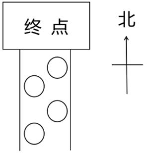

### 第 104 题

根据上述信息，可以推出以下哪项？

A. 甲来自江苏，排第二位

B. 乙来自浙江，排第四位

C. 丙来自安徽，排第一位

D. 丁来自上海，排第三位

第 104 题 · 答案与解析

**参考答案（粉笔题库参考内容）**

B

**解析**

第一步：分析题干条件。

（1）江苏选手在选手丙的东南面；

（2）上海选手在赛道的东部位置，他所骑自行车是蓝色的；

（3）骑灰色自行车的选手不是排在第四位；

（4）选手丁排在第三位，选手乙来自浙江；

（5）安徽选手排在骑黄色自行车的选手之前，排在选手甲之后。

第二步：根据题干条件进行推理。

根据条件（1）江苏选手在丙的东南面，可以推出丙是第2名，江苏选手是第3名；

根据条件（2）上海选手在赛道东部以及江苏选手是第3名，可以推出上海选手是第1名，且自行车是蓝色的；

根据条件（3）以及第1名自行车是蓝色的，可以推出灰色自行车的选手不是第2名，就是第3名；

根据条件（4）以及江苏选手是第3名，可以推出丁是江苏选手；

根据条件（5）、上海选手是第1名以及江苏选手是第3名，可以推出安徽选手是第2名，甲是第1名，具体如下表所示。

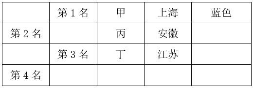

综合上述结论，可以推出第4名是乙，来自浙江，B项当选。

故正确答案为B。

**来源**：2025年江苏省公务员录用考试《行测》题（C类）（网友回忆版）第99题

### 第 105 题

如果丙所骑自行车是白色，则可以推出以下哪项？

A. 选手甲所骑自行车不是蓝色的

B. 选手乙所骑自行车是灰色的

C. 安徽选手所骑自行车是黄色的

D. 江苏选手所骑自行车是灰色的

第 105 题 · 答案与解析

**参考答案（粉笔题库参考内容）**

D

**解析**

第一步：分析题干条件。

（1）江苏选手在选手丙的东南面；

（2）上海选手在赛道的东部位置，他所骑自行车是蓝色的；

（3）骑灰色自行车的选手不是排在第四位；

（4）选手丁排在第三位，选手乙来自浙江；

（5）安徽选手排在骑黄色自行车的选手之前，排在选手甲之后；

（6）丙的自行车是白色的。

第二步：根据题干条件进行推理。

根据上一题的结论，第1名为选手甲，来自上海，自行车是蓝色的，排除A项；

根据条件（6）丙的自行车是白色的，结合上一题的结论可以推出第2名为选手丙，来自安徽，自行车是白色的，排除C项；

再根据条件（3）骑灰色自行车的选手不是排在第四位，结合上一题的结论可以推出第3名选手丁来自江苏，自行车是灰色的，那么第4名选手乙来自浙江，自行车是黄色的（具体如下表所示），D项当选。

故正确答案为D。

**来源**：2025年江苏省公务员录用考试《行测》题（C类）（网友回忆版）第100题

### 第 106 题

多元共治：指针对社会运行中的复杂问题，由政府、社会组织、公民等主体共同参与，多方合作的社会治理模式。

下列属于多元共治的是：

A. 针对辖区内河道持续多年的污染问题，某县水利、环保等部门成立联合工作小组，决心打赢河道污染治理的攻坚战

B. 针对居民停车位、充电桩严重不足的问题，某街道统筹规划电动自行车停放充电区域，优化地下非机动车库安全设施，消除电动自行车“上楼入户”的隐患

C. 某区政府在老旧小区改造、公共服务等社区工作中，鼓励业委会、志愿者充分发挥各自作用，遇到问题加强沟通，满足居民的合理诉求

D. 某村两面临山，农林交错，靠近交通要道，火灾防治压力巨大。村民自发组织巡查队，检测上报森林火情，有效遏制了火灾多发的势头

第 106 题 · 答案与解析

**参考答案（粉笔题库参考内容）**

C

**解析**

第一步：找出定义关键词。

“政府、社会组织、公民等主体共同参与”、“多方合作的社会治理模式”。

第二步：逐一分析选项。

A项：某县水利、环保等部门联合治理河道污染，不涉及社会组织和公民等主体，不符合“政府、社会组织、公民等主体共同参与”，不符合定义，排除；

B项：某街道统筹规划电动自行车停放充电区域，优化地下非机动车库安全设施，不涉及社会组织和公民等主体，不符合“政府、社会组织、公民等主体共同参与”、“多方合作的社会治理模式”，不符合定义，排除；

C项：某区政府在社区工作中，鼓励业委会、志愿者充分发挥各自作用，符合“政府、社会组织、公民等主体共同参与”、“多方合作的社会治理模式”，符合定义，当选；

D项：村民自发组织巡查队，检测上报森林火情，不涉及政府等主体，不符合“政府、社会组织、公民等主体共同参与”、“多方合作的社会治理模式”，不符合定义，排除。

故正确答案为C。

**考点**：主客体

**来源**：2025年江苏省公务员录用考试《行测》题（C类）（网友回忆版）第104题

### 第 107 题

预期管理：指政府部门通过发布会、社交媒体等方式，与社会公众进行互动性交流，以提高政策接受度，塑造稳定的运行环境，确保预期目标实现的管理方式。

下列属于预期管理的是：

A. 进入冬季后，市生态环境局每天通过电视台实时发布空气质量监测数据，市民出门前都会随时收看

B. 县文旅局为了促进旅游业发展，制作了上百个短视频，在多个社交平台上宣传当地的美景和特色文化

C. 针对野猪频繁出没危害居民生命财产安全的事件，区农业农村局出台了补偿规定，并在听证会上答复了广大市民的提问

D. 某电商平台公布了平台补贴与政府“以旧换新”补贴叠加使用的申领方案，收到网民提出的各种建议后，又进行了多处修改

第 107 题 · 答案与解析

**参考答案（粉笔题库参考内容）**

C

**解析**

第一步：找出定义关键词。

“政府部门”、“通过发布会、社交媒体等方式”、“与社会公众进行互动性交流”、“提高政策接受度，塑造稳定的运行环境，确保预期目标实现”。

第二步：逐一分析选项。

A项：市生态环境局通过电视台发布空气质量监测数据，只是市生态环境局发布信息的方式，并未体现与社会公众的互动性交流，不符合“与社会公众进行互动性交流”，不符合定义，排除；

B项：县文旅局制作了上百个短视频，在多个社交平台上宣传当地的美景和特色文化，未体现与社会公众的互动性交流，不符合“与社会公众进行互动性交流”，不符合定义，排除；

C项：区农业农村局针对野猪危害居民生命财产安全的事件出台了补偿规定，并在听证会上答复了广大市民的提问，符合“政府部门”、“通过发布会、社交媒体等方式”、“与社会公众进行互动性交流”、“提高政策接受度，塑造稳定的运行环境，确保预期目标实现”，符合定义，当选；

D项：某电商平台公布了平台补贴及政府补贴的申领方案，但电商平台不属于政府部门，不符合“政府部门”，不符合定义，排除。

故正确答案为C。

**考点**：方式目的

**来源**：2025年江苏省公务员录用考试《行测》题（C类）（网友回忆版）第101题

### 第 108 题

达人探店：指网络博主为了打通商品与消费者的信息隔膜，以直播、视频等形式展示真实的产品体验和消费场景，并在网络平台上发布个人评价的行为。

下列属于达人探店的是：

A. 高先生是网上小有名气的食评家，直播时常常让老板和大厨当场下不了台，被网友称为“六亲不认”，收获了大量粉丝，很多餐馆因此改进了菜品和服务

B. 某知名穿搭博主经常购买各品牌的当季新款时装，在各种社交媒体发布变装视频，其穿搭风格被一些网友模仿

C. 健身教练石先生录制了健身教学网课，为提升课程销量，在社交平台上发布了包含大量学员体验及评价的推介视频

D. 带爸妈外出游玩时，胡女士有时会对当地景点的适老性设施情况进行评价，拍摄成攻略短视频，被网民赞誉为史上最靠谱的老年旅游活地图

第 108 题 · 答案与解析

**参考答案（粉笔题库参考内容）**

A

**解析**

第一步：找出定义关键词。

“网络博主”、“为了打通商品与消费者的信息隔膜”、“以直播、视频等形式展示真实的产品体验和消费场景”、“在网络平台上发布个人评价”。

第二步：逐一分析选项。

A项：高先生是网上小有名气的食评家，符合“网络博主”、“在网络平台上发布个人评价”，他在直播时常常让老板和大厨当场下不了台，符合“以直播、视频等形式展示真实的产品体验和消费场景”，符合定义，当选；

B项：某知名穿搭博主经常购买各品牌的当季新款时装，并在各种社交媒体发布变装视频，这属于自身穿搭风格的展示，并非为了让消费者了解商品本身的情况，不符合“为了打通商品与消费者的信息隔膜”，不符合定义，排除；

C项：健身教练石先生在社交平台上发布包含大量学员体验及评价的推介视频是为了提升课程销量，不符合“为了打通商品与消费者的信息隔膜”，不符合定义，排除；

D项：带爸妈外出游玩时，胡女士会拍摄攻略短视频，并对当地景点的适老性设施情况进行评价，主要针对的是适老性设施而非景点本身，并非为了让消费者了解商品本身的情况，不符合“为了打通商品与消费者的信息隔膜”，不符合定义，排除。

故正确答案为A。

**考点**：拆词

**来源**：2025年江苏省公务员录用考试《行测》题（C类）（网友回忆版）第108题

### 第 109 题

精神股东：指对特定企业或产品没有实际投资，也不追求实质性回报，却长期关注企业经营发展状况，为其成败感到骄傲或失落的客户群体。

下列属于精神股东的是：

A. 乔先生五年前买入了某药企的股票后，三天两头登录该公司网站浏览企业发展的各种信息，每次看到企业的利好消息就会感到很开心

B. 郑先生是一位太空探索迷，十多年来时刻关注着某公司的火星移民计划，收集了所有的火箭发射视频，哪怕看到一点点进展都会非常兴奋

C. 周女士喜欢某品牌手机，多年来一直关注、购买它的各种新产品，提出改进建议，最近该品牌又推出了一款十分先进的新手机，周女士逢人就夸

D. 刘女士很早以前就关注了某景区推出的影视体验项目，打算国庆假期去游玩，但由于节日游客爆满，她没有买到票，最终无法成行，有些郁闷

第 109 题 · 答案与解析

**参考答案（粉笔题库参考内容）**

B

**解析**

第一步：找出定义关键词。

“对特定企业或产品没有实际投资，也不追求实质性回报”、“长期关注企业经营发展状况，为其成败感到骄傲或失落”。

第二步：逐一分析选项。

A项：乔先生五年前买入了某药企的股票，说明乔先生对该企业有实际投资，不符合“对特定企业或产品没有实际投资，也不追求实质性回报”，不符合定义，排除；

B项：郑先生“时刻关注”某公司的火星移民计划，只是关注，没有体现实际投资，符合“对特定企业或产品没有实际投资”，哪怕看到一点点进展都会非常兴奋，符合“长期关注企业经营发展状况，为其成败感到骄傲或失落”，符合定义，当选；

C项：周女士多年来一直关注、购买该品牌的各种新产品，对特定企业的产品有实际的消费与投资，不符合“对特定企业或产品没有实际投资”，不符合定义，排除；

D项：刘女士因想去游玩而关注了某景区推出的影视体验项目，并非是对企业经营发展状况的长期关注，不符合“长期关注企业经营发展状况，为其成败感到骄傲或失落”，不符合定义，排除。

故正确答案为B。

**考点**：单定义-其他句式

**来源**：2025年江苏省公务员录用考试《行测》题（B类）（网友回忆版）第109题

### 第 110 题

平台自我优待：指商业平台主体借助自身技术或数据优势地位，通过特定手段取得优惠待遇以获得竞争优势的行为。

下列不属于平台自我优待的是：

A. 某电商平台利用从卖家经营过程中收集到的海量销售数据，优化了自家产品的推荐策略，并在平台搜索引擎中把它们排列在前面

B. 某在线旅游平台在用户自行预订车票、门票时，默认搭售自己代理的旅游保险产品，却没有在显著位置提醒用户可以取消这项服务

C. 某应用商店运营商对自家程序软件给了更高的评分星级，对第三方开发者则设置了更为严格的审核评级标准

D. 某供水公司利用在区域供水市场的支配地位，要求用水单位必须邀请己方对供水工程进行勘察、施工和安装

第 110 题 · 答案与解析

**参考答案（粉笔题库参考内容）**

D

**解析**

第一步：找出定义关键词。

“商业平台主体借助自身技术或数据优势地位”、“通过特定手段取得优惠待遇以获得竞争优势”。

第二步：逐一分析选项。

A项：相比其他卖家，该电商平台利用从卖家经营过程中收集到的海量销售数据，优化了自家产品的推荐策略，并在平台搜索引擎中把它们排列在前面，是借助自身技术和数据优势获得竞争优势，符合“商业平台主体借助自身技术或数据优势地位”、“通过特定手段取得优惠待遇以获得竞争优势”，符合定义，排除；

B项：相比其他的保险产品，该在线旅游平台默认搭售自己代理的旅游保险产品，却没有在显著位置提醒用户可以取消这项服务，是借助自身技术优势获得竞争优势，符合“商业平台主体借助自身技术或数据优势地位”、“通过特定手段取得优惠待遇以获得竞争优势”，符合定义，排除；

C项：该应用商店运营商对自家程序软件给了更高的评分星级，对第三方开发者则设置了更为严格的审核评级标准，是借助自身技术优势获得竞争优势，符合“商业平台主体借助自身技术或数据优势地位”、“通过特定手段取得优惠待遇以获得竞争优势”，符合定义，排除；

D项：该供水公司利用在区域供水市场的支配地位，要求用水单位必须邀请己方做事，是借助市场优势，不是借助自身技术或数据优势，不符合“商业平台主体借助自身技术或数据优势地位”，不符合定义，当选。

本题为选非题，故正确答案为D。

**考点**：方式目的

**来源**：2025年江苏省公务员录用考试《行测》题（B类）（网友回忆版）第110题

### 第 111 题

情感虹吸：指现实生活中难以得到心理慰藉的中老年人，在网络世界中因为受到情感诱导而盲目消费，导致个人钱财严重受损的现象。

下列属于情感虹吸的是：

A. 在外地工作的朱先生发现母亲退休后将退休金的一大半都用于购买一种“三无”保健品，原来该产品的推销员几乎每周都会来陪母亲聊家常

B. 酒店大厨赵先生在网络平台上免费教授烹饪知识，因其手艺精湛，说话幽默，嘴巴又甜，受到了无数妈妈级粉丝的喜爱，每天都能得到不少打赏

C. 儿子考上大学后，刘女士每天晚上都会定时打开手机，在主播们的嘘寒问暖中感受一丝安慰，偶尔也为他们刷一些小礼物

D. 独居的李奶奶每天都泡在“50后时光”直播间，为主播刷“火箭”“跑车”等礼物，成为了“榜一大哥”，两个月内花掉了多年的积蓄

第 111 题 · 答案与解析

**参考答案（粉笔题库参考内容）**

D

**解析**

第一步：找出定义关键词。

“现实生活中难以得到心理慰藉的中老年人”、“在网络世界中”、“受到情感诱导而盲目消费”、“导致个人钱财严重受损”。

第二步：逐一分析选项。

A项：母亲退休后购买“三无”保健品，该产品的推销员几乎每周都会来陪母亲聊家常，没有体现利用“网络”，不符合“在网络世界中”，不符合定义，排除；

B项：赵先生每天都能得到不少来自妈妈级粉丝的打赏，但未提到这些妈妈级粉丝的钱财是否严重受损，不符合“导致个人钱财严重受损”，不符合定义，排除；

C项：刘女士每天晚上都会定时打开手机，偶尔为主播们刷一些小礼物，未提到刘女士的钱财是否严重受损，不符合“导致个人钱财严重受损”，不符合定义，排除；

D项：独居的李奶奶每天都泡在“50后时光”直播间，符合“现实生活中难以得到心理慰藉的中老年人”、“在网络世界中”，为主播刷礼物，两个月内花掉了多年的积蓄，符合“受到情感诱导而盲目消费”、“导致个人钱财严重受损”，符合定义，当选。

故正确答案为D。

**考点**：原因结果

**来源**：2025年江苏省公务员录用考试《行测》题（C类）（网友回忆版）第109题

### 第 112 题

正向情绪价值：指通过积极性的言语或行动，为他人带来舒服、愉悦、安全等良性感受的人际交往能力。

下列属于正向情绪价值的是：

A. 林女士是一位经验丰富的住家月嫂，看到自己照护的孩子健康成长和新手父母们满意的笑容，她体会到了自己的价值

B. 陈先生大学毕业后当过游戏主播、网络写手、保险推销员，不久前又在酒吧驻唱。父母很尊重他的选择，从不横加干涉

C. 秦女士到时装店买衣服，刚一进门，几个营业员就围了上来，拼命夸她身材好，穿什么都好看。她虽然半信半疑，还是忍不住买了几件

D. 赵先生是同事心目中的“显眼包”，每次聚会的时候，只要他一开口，大家就会笑得前仰后合，工作中的压力一扫而空

第 112 题 · 答案与解析

**参考答案（粉笔题库参考内容）**

D

**解析**

第一步：找出定义关键词。

“通过积极性的言语或行动”、“为他人带来良性感受”、“人际交往能力”。

第二步：逐一分析选项。

A项：林女士是一位经验丰富的住家月嫂，她照护的孩子健康成长和新手父母们的满意说明林女士具备一定的专业能力，但没有体现“人际交往能力”，不符合定义，排除；

B项：陈先生大学毕业后做过多种工作，父母尊重他的选择而不加干涉，不符合“通过积极性的言语或行动”、“为他人带来良性感受”，不符合定义，排除；

C项：营业员拼命夸秦女士身材好，秦女士对此半信半疑，说明营业员的话没有给秦女士带来良性感受，不符合“为他人带来良性感受”，不符合定义，排除；

D项：赵先生在每次与同事的聚会中，都能让大家笑得前仰后合，工作压力一扫而空，体现了赵先生良好的人际交往能力，符合“通过积极性的言语或行动”、“为他人带来良性感受”、“人际交往能力”，符合定义，当选。

故正确答案为D。

**考点**：拆词

**来源**：2025年江苏省公务员录用考试《行测》题（C类）（网友回忆版）第106题

### 第 113 题

零糖社交：有意降低社交期望值，在互动过程中保持距离感和独立性，尽量减轻双方的精神负担，使心情更加轻松愉悦的社交方式。

下列属于零糖社交的是：

A. 吴女士和好友多年未见，平时只是逢年过节发条问候短信。前几天，得知她生病的消息后，好友立刻放下工作赶了过来

B. 李先生经常周末约上三五个骑友到附近城市游玩，每次当天往返，所有费用AA制，虽然大家只知道彼此的微信昵称，却玩得非常开心

C. 小王每天晚上都要和自家的AI对话机器人闲聊半个多小时，就像交往多年亲密无间的好友，他很享受这样的交流，没有一点心理包袱

D. 小赵工作很忙，日常生活中也是个“独行侠”。收到母校的校庆邀请后，他毫不犹豫就婉言谢绝了。因为他不想跑去给人家增加招待负担

第 113 题 · 答案与解析

**参考答案（粉笔题库参考内容）**

B

**解析**

第一步：找出定义关键词。

“有意降低社交期望值”、“在互动过程中保持距离感和独立性”、“使心情更加轻松愉悦的社交方式”。

第二步：逐一分析选项。

A项：吴女士和好友虽多年未见，但在得知她生病的消息后，好友立刻放下工作赶了过来，说明双方互动过程中并未保持距离感和独立性，不符合“在互动过程中保持距离感和独立性”，不符合定义，排除；

B项：李先生经常周末约骑友游玩，当天往返且所有费用AA制，大家只知道彼此的微信昵称，说明李先生与骑友之间进行社交主要是为了游玩，互相保持着距离感和独立性，符合“有意降低社交期望值”、“在互动过程中保持距离感和独立性”，玩得非常开心，符合“使心情更加轻松愉悦的社交方式”，符合定义，当选；

C项：小王每天晚上都要和AI对话机器人闲聊，其中AI对话机器人不是人，不涉及人与人之间的社交，不符合“使心情更加轻松愉悦的社交方式”，不符合定义，排除；

D项：小赵因工作繁忙日常生活是“独行侠”，收到母校的校庆邀请，为了不增加招待负担便婉言谢绝了，未体现小赵的心情状态，不符合“使心情更加轻松愉悦的社交方式”，不符合定义，排除。

故正确答案为B。

**考点**：方式目的

**来源**：2025年江苏省公务员录用考试《行测》题（B类）（网友回忆版）第113题

### 第 114 题

数字意境：指通过数字技术赋能将优秀传统文化以沉浸式的艺术形式进行创新表达，凸显视觉效果呈现，以展现其文化韵味和审美意境。

下列属于数字意境的是：

A. 某电视台文化节目中，大学生们来到文化古迹现场，与考古专家互动，在诵读、观察、探究中加深对中华传统文化的理解

B. 某景区排练的舞蹈节目中，以当地石窟为真实背景，利用三维动画技术复原了壁画中飞天与金刚的舞蹈，使静止的文化符号变成了动感的形象

C. 某艺术研究院和多家企业合作，对古代编钟复制件进行高精细度的音源采集，最终实现对这一传统瑰宝的数字化复原

D. 某博物馆从古代名画《千里江山图》《百花图卷》中选取“意象”元素，实景搭建了沉浸式体验展厅，观众犹如身临其境

第 114 题 · 答案与解析

**参考答案（粉笔题库参考内容）**

B

**解析**

第一步：找出定义关键词。

“通过数字技术赋能”、“将优秀传统文化以沉浸式的艺术形式进行创新表达”、“凸显视觉效果呈现”。

第二步：逐一分析选项。

A项：某电视台文化节目中，大学生们来到文化古迹现场，与考古专家互动，未体现数字技术，不符合“通过数字技术赋能”，不符合定义，排除；

B项：利用三维动画技术，体现了数字技术，符合“通过数字技术赋能”，复原了石窟壁画中飞天与金刚的舞蹈，使静止的文化符号变成了动感的形象，符合“将优秀传统文化以沉浸式的艺术形式进行创新表达”、“凸显视觉效果呈现”，符合定义，当选；

C项：对古代编钟复制件进行高精细度的音源采集，最终实现对这一传统瑰宝的数字化复原，只是对其音源进行复原，不涉及创新表达，不符合“将优秀传统文化以沉浸式的艺术形式进行创新表达”、“凸显视觉效果呈现”，不符合定义，排除；

D项：某博物馆从古代名画中选取“意象”元素，实景搭建了沉浸式体验展厅，观众犹如身临其境，不明确是否使用了数字技术，不符合“通过数字技术赋能”，不符合定义，排除。

故正确答案为B。

**考点**：方式目的

**来源**：2025年江苏省公务员录用考试《行测》题（C类）（网友回忆版）第102题

### 第 115 题

错位沟通：指在日常交流中，由于对彼此的意图和情感理解不一致，导致沟通效果不佳或产生误解。

下列属于错位沟通的是：

A. 小杨希望给同事留下沉稳的印象，在单位总是言辞谨慎，很少和同事闲聊，大家都以为他不愿意和人接触

B. 李老师在公开课上讲解一道专业难题，由于相应的背景知识不足，听众始终无法听明白李老师的意思

C. 小张夫妇就孩子的教育问题发生了激烈的争吵，小张认为孩子应该多做课外习题提升成绩，而妻子认为童年就该无忧无虑尽情玩耍

D. 小王打电话告诉女友，临时又要加班，没法一起去看电影。女友冷淡地回复“你去工作吧，我不重要的”，小王一下子就无心工作了

第 115 题 · 答案与解析

**参考答案（粉笔题库参考内容）**

D

**解析**

第一步：找出定义关键词。

“在日常交流中”、“对彼此的意图和情感理解不一致”、“导致沟通效果不佳或产生误解”。

第二步：逐一分析选项。

A项：小杨希望给同事留下沉稳的印象，在单位总是很少和同事交流，而同事都以为他不愿意和人接触，这个误解并不是在日常交流中产生的误会，不符合“在日常交流中”，不符合定义，排除；

B项：李老师在公开课上讲解专业难题，听众因相应的背景知识不足而无法听懂，听不懂是听众的知识储备不足导致的，不符合“在日常交流中”、“对彼此的意图和情感理解不一致”，不符合定义，排除；

C项：小张夫妇就孩子的教育问题发生了激烈的争吵，是夫妻二人对于孩子教育观念的不同，不符合“对彼此的意图和情感理解不一致”，不符合定义，排除；

D项：小王打电话告诉女友，临时又要加班，没法一起去看电影，女友冷淡地回复“你去工作吧，我不重要的”，说明双方在沟通中产生了误解，符合“在日常交流中”、“对彼此的意图和情感理解不一致”、“导致沟通效果不佳或产生误解”，符合定义，当选。

故正确答案为D。

**考点**：原因结果

**来源**：2025年江苏省公务员录用考试《行测》题（C类）（网友回忆版）第107题

## 材料 3

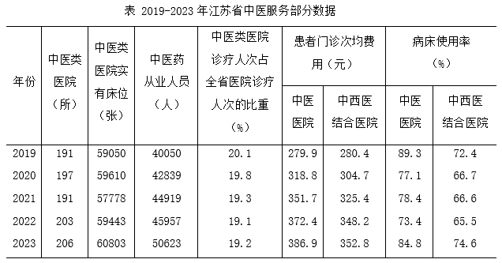

| 年份 | 中医类医院（所） | 中医类医院实有床位（张） | 中医药从业人员（人） | 中医类医院诊疗人次占全省医院诊疗人次的比重（%） | 患者门诊次均费用（元） 中医医院 | 患者门诊次均费用（元） 中西医结合医院 | 病床使用率（%） 中医医院 | 病床使用率（%） 中西医结合医院 |
| --- | ---: | ---: | ---: | ---: | ---: | ---: | ---: | ---: |
| 2019 | 191 | 59050 | 40050 | 20.1 | 279.9 | 280.4 | 89.3 | 72.4 |
| 2020 | 197 | 59610 | 42839 | 19.8 | 318.8 | 304.7 | 77.1 | 66.7 |
| 2021 | 191 | 57778 | 44919 | 19.3 | 351.7 | 325.4 | 78.4 | 66.6 |
| 2022 | 203 | 59443 | 45957 | 19.1 | 372.4 | 348.2 | 73.4 | 65.5 |
| 2023 | 206 | 60803 | 50623 | 19.2 | 386.9 | 352.8 | 84.8 | 74.6 |

### 第 116 题

2020-2023年，江苏省中医类医院实有床位的年均增长量约是：

A. 239张

B. 298张

C. 351张

D. 438张

第 116 题 · 答案与解析

**参考答案（粉笔题库参考内容）**

D

**解析**

根据题干“2020-2023年······年均增长量约是”，可判定本题为年均增长量问题。定位统计表可得：江苏省2019年中医类医院实有床位59050张，2023年中医类医院实有床位60803张。根据公式：年均增长量= (现期量-基期量)/年份差，可得题干所求= (60803 − 59050)/4= 1753/4 ≈ 438张。

故正确答案为D。

**来源**：2025年江苏省公务员录用考试《行测》题（B类）（网友回忆版）第116题

### 第 117 题

已知2022年、2023年江苏省医院诊疗人次分别为26015万人次、30002万人次，则可算出2023年江苏省中医类医院诊疗人次比上年增加了：

A. 438万人次

B. 624万人次

C. 792万人次

D. 912万人次

第 117 题 · 答案与解析

**参考答案（粉笔题库参考内容）**

C

**解析**

根据题干“······2023年······比上年增加了”，结合选项带单位，可判定本题为增长量计算问题。定位统计表可得：2022年、2023年江苏省中医类医院诊疗人次占全省医院诊疗人次的比重分别为：19.1%、19.2%。根据题干：2022年、2023年江苏省医院诊疗人次分别为26015万人次、30002万人次。根据公式：部分=整体×比重，增长量=现期量-基期量，则题干所求=30002×19.2%-26015×19.1%≈ (30000 − 26000) × 0.19=4000×0.19≈800万人次，与C项最接近。

故正确答案为C。

**来源**：2025年江苏省公务员录用考试《行测》题（B类）（网友回忆版）第117题

### 第 118 题

2020-2023年，江苏全省中西医结合医院患者门诊次均费用增速最快的年份是：

A. 2020年

B. 2021年

C. 2022年

D. 2023年

第 118 题 · 答案与解析

**参考答案（粉笔题库参考内容）**

A

**解析**

根据题干“2020-2023年······增速最快的年份是”，可判定本题为一般增长率问题。定位统计表可得：2019-2023年江苏省中西医结合医院患者门诊次均费用分别为：280.4元、304.7元、325.4元、348.2元、352.8元。根据公式：增长率= (现期量 − 基期量)/基期量，则2020-2023年，江苏省中西医结合医院患者门诊次均费用同比增速分别为：

2020年，(304.7-280.4)/280.4 ≈ 24.3/280 = 8%^+；

2021年，(325.4−304.7)/304.7 ≈ 20.7/305 = 6%^+；

2022年，(348.2-325.4)/325.4≈22.8/325=7%^+；

2023年，(352.8−348.2)/348.2≈4.6/348=1%^+。

比较可知，同比增速最快的年份是2020年。

故正确答案为A。

**来源**：2025年江苏省公务员录用考试《行测》题（B类）（网友回忆版）第118题

### 第 119 题

按2023年的增长率估算，江苏省中医服务的下列指标率先达到2019年水平2倍的是：

A. 中医类医院数

B. 中医药从业人员数

C. 中医类医院实有床位数

D. 中医医院患者门诊次均费用

第 119 题 · 答案与解析

**参考答案（粉笔题库参考内容）**

B

**解析**

根据题干“按2023年的增长率估算······率先达到2019年水平2倍的是“，可判定本题为现期追赶问题。定位统计表可知2019年、2022年、2023年中医类医院数、中医药从业人员数、中医类医院实有床位数、中医医院患者门诊次均费用。根据公式：增长率= (现期量 − 基期量)/基期量、现期量= 基期量 × (1 + r)^n，可得题干所求为2023年指标 × (1 + 2023年增长率)^n ≥ 2019年指标 × 2，即(1+2023年增长率)^n ≥ (2019年指标×2)/2023年指标。

A项：中医类医院数，2023年增长率= (206 - 203)/203= 3/203 ≈ 1.5%，则(1+1.5%)^n≥(191×2)/206≈1.85；

B项：中医药从业人员数，2023年增长率= (50623 - 45957)/45957≈ 4666/46000 ≈ 10%，则(1+10%)^n≥(40050×2)/50623≈1.58；

C项：中医类医院实有床位数，2023年增长率= (60803 − 59443)/59443≈1360/59000≈2.3%，则(1+2.3%)^n ≥ 59050×2/60803 ≈ 1.94；

D项：中医医院患者门诊次均费用，2023年增长率= (386.9-372.4)/372.4≈ 14.5/370 ≈ 3.9%，则(1+3.9%)^n≥279.9×2/386.9≈1.45。

A、B、C三项相比，B项2023年增长率更大，(2019年指标 × 2)/2023年指标更小，因此B项n更小，排除A、C两项。

计算B项：当n=4时，(1+10%)^4≈1.46＜1.58；当n=5时，(1+10%)^5 ≈ 1.61 ＞ 1.58，则中医药从业人员数将在5年后达到2019年水平的2倍。

将n=5代入D项，(1 + 3.9%)^5 ≈ 1.21 ＜ 1.45，则5年后中医医院患者门诊次均费用不能达到2019年水平的2倍。

因此，中医药从业人员数率先达到2019年水平的2倍。

故正确答案为B。

**来源**：2025年江苏省公务员录用考试《行测》题（B类）（网友回忆版）第119题

### 第 120 题

下列选项中，能够从上述资料推出的是：

A. 2023年江苏省中医药从业人数比2019年增长了26%以上

B. 2020-2023年，江苏省中医类医院院均实有床位数逐年增加

C. 2019-2023年，江苏全省中医医院患者门诊次均费用均高于中西医结合医院

D. 2019-2023年，江苏全省中西医结合医院病床使用率与中医医院的差距逐年缩小

第 120 题 · 答案与解析

**参考答案（粉笔题库参考内容）**

A

**解析**

A项：定位统计表可得，2023年江苏省中医药从业人员为50623人，2019年为40050人。根据公式：增长率= (现期量 − 基期量)/基期量，可得2023年江苏省中医药从业人数比2019年的增长率=(50623−40050)/40050≈ 10573/40100 = 26%^+，正确；

B项：定位统计表可得2019-2023年江苏省中医类医院数量及实有床位数。根据公式：院均实有床位数=实有床位数/医院数量，可得2021年江苏省中医类医院院均实有床位数= 57778/191 = 300^+张，2022年院均实有床位数= 59443/203 = 300^-张，则2022年江苏省中医类医院院均实有床位数低于2021年，并非逐年增加，错误；

C项：定位统计表可得2019-2023年江苏全省中医医院及中西医结合医院的患者门诊次均费用。则2019年江苏全省中医医院患者门诊次均费用（279.9元）低于中西医结合医院患者门诊次均费用（280.4元），错误；

D项：定位统计表可得2019-2023年江苏全省中医医院及中西医结合医院的病床使用率。则2020年江苏全省中西医结合医院病床使用率与中医医院的差距为77.1%-66.7%=10.4%，2021年差距为78.4%-66.6%=11.8%，故2021年病床使用率差距>2020年病床使用率差距，并非逐年缩小，错误。

故正确答案为A。

**来源**：2025年江苏省公务员录用考试《行测》题（B类）（网友回忆版）第120题

## 材料 4

2023年，M市接待过夜游客10190万人次，比上年增长88.1%。其中，核心片区接待过夜游客8326万人次，增长99.9%；东北片区接待过夜游客1125万人次，增长38.2%；东南片区接待过夜游客739万人次，增长70.1%。旅游及相关产业增加值占全市地区生产总值的比重为4.0%，比上年提高0.3个百分点。

### 第 121 题

2023年M市东南片区接待的过夜游客比上年多：

A. 221万人次

B. 305万人次

C. 434万人次

D. 519万人次

第 121 题 · 答案与解析

**参考答案（粉笔题库参考内容）**

B

**解析**

根据“2023年······比上年多”，结合选项带单位，可判定本题为增长量计算问题。定位文字材料可得：2023年，M市东南片区接待过夜游客739万人次，增长70.1%。根据公式：增长量=现期量/(1 + 增长率) × 增长率，则所求= 739/(1+70.1%)×70.1%≈ 739/(1+1/1.4) × 1/1.4=739/2.4≈308万人次，与B项最接近。

故正确答案为B。

**来源**：2025年江苏省公务员录用考试《行测》题（C类）（网友回忆版）第116题

### 第 122 题

2023年M市东北片区接待过夜游客人次增长对全市接待过夜游客增长的贡献率为：

A. (1125×0.382×1.881)/(10190×0.881×1.382)×100%

B. (1125×0.881×1.881)/(10190×0.382×1.382)×100%

C. (1125×0.382×0.881)/(10190×1.881×1.382)×100%

D. (1125×1.382×1.881)/(10190×0.881×0.382)×100%

第 122 题 · 答案与解析

**参考答案（粉笔题库参考内容）**

A

**解析**

根据“2023年······对······增长的贡献率为”，可判定本题为现期比重问题。定位文字材料可得：2023年，M市接待过夜游客10190万人次，比上年增长88.1%。东北片区接待过夜游客1125万人次，增长38.2%。 根据公式：增长量= 现期量/(1 + 增长率) × 增长率，增长贡献率=部分增长量/整体增长量，则所求=(1125/(1+38.2%)×38.2%)÷(10190/(1+88.1%)×88.1%)= (1125×38.2%)/(1+38.2%) × (1+88.1%)/(10190×88.1%)= (1125×0.382×1.881)/(10190×0.881×1.382)×100%。

故正确答案为A。

**来源**：2025年江苏省公务员录用考试《行测》题（C类）（网友回忆版）第117题

### 第 123 题

2023年M市地区生产总值为：

A. 14223亿元

B. 15088亿元

C. 24140亿元

D. 30175亿元

第 123 题 · 答案与解析

**参考答案（粉笔题库参考内容）**

D

**解析**

根据题干“2023年······总值为”，结合材料中给出了2023年M市旅游及相关产业增加值和其占全市地区生产总值的比重，可判定本题为现期比重问题。定位文字材料可得：2023年M市旅游及相关产业增加值占全市地区生产总值的比重为4.0%；定位统计表可得：2023年M市旅游及相关产业增加值为1207亿元。根据公式：整体=部分/比重，则所求=1207/4.0%=30175亿元。

故正确答案为D。

**来源**：2025年江苏省公务员录用考试《行测》题（C类）（网友回忆版）第118题

### 第 124 题

2023年M市核心片区接待过夜游客人次占全市接待过夜游客人次的比重比上年提高的幅度：

A. 超过8.2个百分点

B. 介于7.3~8.2个百分点之间

C. 介于4.5~7.3个百分点之间

D. 不足4.5个百分点

第 124 题 · 答案与解析

**参考答案（粉笔题库参考内容）**

C

**解析**

根据“2023年······占······比重比上年提高······”，可判定本题为两期比重问题。定位文字材料可得：2023年，M市接待过夜游客10190万人次（B），比上年增长88.1%（b）。其中，核心片区接待过夜游客8326万人次（A），增长99.9%（a）。根据公式：两期比重差=A/B×(a−b)/(1+a)，可得所求= 8326/10190 × (99.9% − 88.1%)/(1 + 99.9%)≈0.8×11.8%/2≈ 0.8 × 6% = 4.8%，即提高的幅度约为4.8个百分点，在C项范围内。

故正确答案为C。

**来源**：2025年江苏省公务员录用考试《行测》题（C类）（网友回忆版）第119题

### 第 125 题

下列选项中，不能从上述资料推出的是：

A. 2022年M市旅游社国内旅游组织游客200多万人次

B. 2023年M市A级景区接待的游客中有60%以上的游客在该市过夜

C. 2023年M市旅游及相关产业增加值增速快于该市地区生产总值的增速

D. 2023年M市东北和东南片区接待过夜游客人次之和的增速不超过54.2%

第 125 题 · 答案与解析

**参考答案（粉笔题库参考内容）**

B

**解析**

A项：定位表格材料可得，2023年，M市旅游社国内旅游组织游客830万人次，比上年增长312.6%。根据公式：基期量=现期量/(1+增长率)，则所求= 830/(1 + 312.6%) ＞ 830/4.13 ＞ 200万人次，正确；

B项：定位表格材料可得2023年M市A级景区接待游客人次。但材料并未给出A级景区接待过夜游客数量，无法推出其过夜游客占比，错误；

C项：定位文字材料可得，2023年，M市旅游及相关产业增加值占全市地区生产总值的比重比上年提高0.3个百分点。根据两期比重逆运用结论：当比重上升时，部分增长率>整体增长率，则2023年M市旅游及相关产业增加值增速快于该市地区生产总值的增速，正确；

D项：定位文字材料可得，2023年，M市东北片区接待过夜游客1125万人次，增长38.2%；东南片区接待过夜游客739万人次，增长70.1%。根据混合增长率口诀“混合后居中，偏向基期较大的（一般用现期量代替基期量）”，2023年M市东北片区接待过夜游客人次（1125万人次）>东南片区接待过夜游客人次（739万人次），则38.2% ＜ r东北和东南片区之和 ＜ (38.2%+70.1%)/2 = 54.15%，正确。

本题为选非题，故正确答案为B。

**来源**：2025年江苏省公务员录用考试《行测》题（C类）（网友回忆版）第120题

## 材料 5

2024年1-8月，我国国有及国有控股企业（以下简称国有企业）营业收入53.8万亿元，同比增长1.4%；利润总额2.9万亿元，下降2.1%；应缴税费3.9万亿元，增长0.7%。8月末，国有企业资产负债率64.9%，同比上升0.1个百分点。

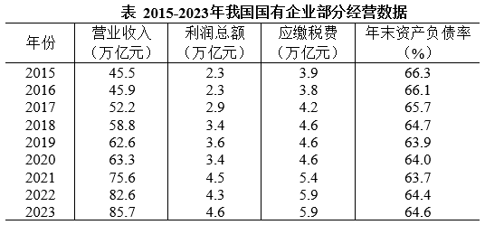

| 年份 | 营业收入（万亿元） | 利润总额（万亿元） | 应缴税费（万亿元） | 年末资产负债率（%） |
| --- | ---: | ---: | ---: | ---: |
| 2015 | 45.5 | 2.3 | 3.9 | 66.3 |
| 2016 | 45.9 | 2.3 | 3.8 | 66.1 |
| 2017 | 52.2 | 2.9 | 4.2 | 65.7 |
| 2018 | 58.8 | 3.4 | 4.6 | 64.7 |
| 2019 | 62.6 | 3.6 | 4.6 | 63.9 |
| 2020 | 63.3 | 3.4 | 4.6 | 64.0 |
| 2021 | 75.6 | 4.5 | 5.4 | 63.7 |
| 2022 | 82.6 | 4.3 | 5.9 | 64.4 |
| 2023 | 85.7 | 4.6 | 5.9 | 64.6 |

### 第 126 题

2015-2023年，我国国有企业年末资产负债率的中位数是：

A. 63.9%

B. 64.0%

C. 64.6%

D. 64.7%

第 126 题 · 答案与解析

**参考答案（粉笔题库参考内容）**

C

**解析**

定位表格材料可得：2015-2023年，我国国有企业年末资产负债率从大到小排序为：66.3%、66.1%、65.7%、64.7%、64.6%、64.4%、64.0%、63.9%、63.7%，共9个数据，则所求中位数为64.6%（第五位）。

故正确答案为C。

**来源**：2025年江苏省公务员录用考试《行测》题（C类）（网友回忆版）第121题

### 第 127 题

2016-2023年，我国国有企业营业收入、利润总额、应缴税费均增长的年份有：

A. 2个

B. 3个

C. 4个

D. 5个

第 127 题 · 答案与解析

**参考答案（粉笔题库参考内容）**

B

**解析**

定位表格材料可知2015-2023年我国国有企业的营业收入、利润总额、应缴税费。观察发现，2016-2023年，我国国有企业营业收入每年均增长；利润总额增长的年份有2017年、2018年、2019年、2021年、2023年；应缴税费增长的年份有2017年、2018年、2021年、2022年。因此，2016-2023年，我国国有企业营业收入、利润总额、应缴税费均增长的年份有2017年、2018年、2021年，共3个。

故正确答案为B。

**来源**：2025年江苏省公务员录用考试《行测》题（C类）（网友回忆版）第122题

### 第 128 题

2016-2023年，我国国有企业营业收入利润率最高的年份是：

A. 2017年

B. 2018年

C. 2019年

D. 2021年

第 128 题 · 答案与解析

**参考答案（粉笔题库参考内容）**

D

**解析**

据题干“2016-2023年······营业收入利润率最高的年份是”，结合营业收入利润率= 利润总额/营业收入，可判定本题为现期比重问题。定位表格材料可得2015-2023年我国国有企业的营业收入和利润总额。则2017年、2018年、2019年、2021年我国国有企业营业收入利润率依次为：2.9/52.2 ≈ 5.6%、3.4/58.8 ≈ 5.8%、3.6/62.6 ≈ 5.8%、4.5/75.6≈6.0%，比较可知，2021年我国国有企业营业收入利润率最高。

故正确答案为D。

**来源**：2025年江苏省公务员录用考试《行测》题（C类）（网友回忆版）第123题

### 第 129 题

若2016-2023年我国国有企业营业收入、利润总额和应缴税费年均增速分别用V_1、V_2、V_3表示，则下列关系正确的是：

A. V_3 ＜ V_1 ＜ V_2

B. V2＜V3＜V1

C. V_3 ＜ V_2 ＜ V_1

D. V_1＜V_3＜V_2

第 129 题 · 答案与解析

**参考答案（粉笔题库参考内容）**

A

**解析**

根据题干“······年均增速······”，可判定本题为年均增长率问题。定位统计表可得2015年、2023年我国国有企业营业收入、利润总额和应缴税费。根据年均增长率公式：(1+r)^n=现期量/基期量（n为年份差），当年份差相同时，直接比较现期量/基期量即可。则2016-2023年我国国有企业营业收入、利润总额和应缴税费的现期量/基期量分别为：营业收入，85.7/45.5 = 1.8^+；利润总额，4.6/2.3 = 2；应缴税费，5.9/3.9=1.5^+。则年均增速的排序为应缴税费（V_3）<营业收入（V_1）<利润总额（V_2）。

故正确答案为A。

**来源**：2025年江苏省公务员录用考试《行测》题（C类）（网友回忆版）第124题

### 第 130 题

下列选项中，能够根据上述资料算出的是：

A. 2015年我国国有企业应缴税费增量

B. 2024年8月末我国国有企业资产总额

C. 2022年1-8月我国国有企业营业收入

D. 2023年末与当年8月末我国国有企业资产负债率之差

第 130 题 · 答案与解析

**参考答案（粉笔题库参考内容）**

D

**解析**

A项：定位表格材料可得，2015年我国国有企业应缴税费为3.9万亿元。材料中无其他数据，无法推出2015年我国国有企业应缴税费增量，错误；

B项：定位文字材料可得，2024年8月末，国有企业资产负债率64.9%。材料中无其他数据，无法推出2024年8月末我国国有企业资产总额，错误；

C项：定位文字材料可得，2024年1-8月，我国国有及国有控股企业（以下简称国有企业）营业收入53.8万亿元，同比增长1.4%。材料中无其他数据，无法推出2022年1-8月我国国有企业营业收入，错误；

D项：定位文字材料可得，2024年8月末，国有企业资产负债率64.9%，同比上升0.1个百分点；定位表格材料可得，2023年末我国国有企业资产负债率为64.6%。则2023年8月末我国国有企业资产负债率为64.9%-0.1%=64.8%，题干所求资产负债率之差=64.8%-64.6%=0.2%，即0.2个百分点，可以推出，正确。

故正确答案为D。

**来源**：2025年江苏省公务员录用考试《行测》题（C类）（网友回忆版）第125题

## 材料 6

2023年末，全国共有公共图书馆3309个，从业人员6.1万人。其中，高级职称人员0.8万人，占13.0%；中级职称人员1.9万人，占31.2%。全国公共图书馆实际使用面积2260万平方米，比上年末增长7.7%；图书总藏量14.4亿册，增长5.6%。

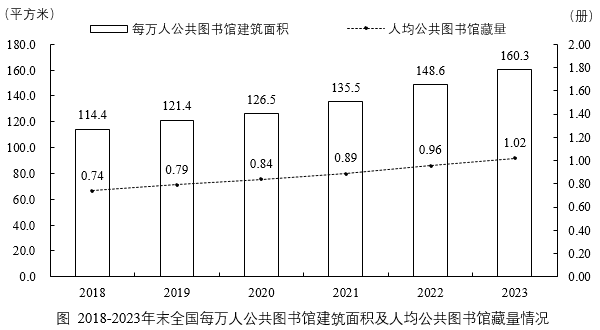

### 第 131 题

2023年末全国公共图书馆平均实际使用面积是：

A. 0.66万平方米

B. 0.68万平方米

C. 0.76万平方米

D. 0.78万平方米

第 131 题 · 答案与解析

**参考答案（粉笔题库参考内容）**

B

**解析**

根据题干“2023年末······平均实际使用面积是”，结合材料时间为2023年末，可判定本题为现期平均数问题。定位文字材料可得：2023年末，全国共有公共图书馆3309个，全国公共图书馆实际使用面积2260万平方米。根据公式：公共图书馆平均实际使用面积=实际使用面积/公共图书馆数量，则所求= 2260万平方米/3309个 ≈ 2260/3310 ≈ 0.68万平方米。

故正确答案为B。

**来源**：2025年江苏省公务员录用考试《行测》题（B类）（网友回忆版）第131题

### 第 132 题

2023年末全国公共图书馆图书总藏量比上年多：

A. 0.69亿册

B. 0.76亿册

C. 0.81亿册

D. 1.03亿册

第 132 题 · 答案与解析

**参考答案（粉笔题库参考内容）**

B

**解析**

根据题干“2023年末······比上年多”，结合选项带单位，可判定本题为增长量计算问题。定位文字材料可得：2023年末，全国公共图书馆图书总藏量14.4亿册，增长5.6%。根据公式：增长量=现期量/(1+r)×r，则所求=14.4/(1+5.6%)×5.6%≈ 14.4/(1 + 1/18) × 1/18= 14.4/19 ≈ 0.76亿册。

故正确答案为B。

**来源**：2025年江苏省公务员录用考试《行测》题（B类）（网友回忆版）第132题

### 第 133 题

2019-2023年末，全国每万人公共图书馆建筑面积比上年增长不足5%的有：

A. 1年

B. 2年

C. 3年

D. 4年

第 133 题 · 答案与解析

**参考答案（粉笔题库参考内容）**

A

**解析**

根据题干“2019-2023年末······比上年增长不足5%的有”，可判定本题为一般增长率问题。定位统计图可得：2018-2023年末，全国每万人公共图书馆建筑面积分别为114.4平方米、121.4平方米、126.5平方米、135.5平方米、148.6平方米、160.3平方米。根据公式：增长率= (现期量 − 基期量)/基期量，则各年份全国每万人公共图书馆建筑面积同比增长率分别为：

2019年，(121.4 − 114.4)/114.4 ≈ 7/110 ≈ 6%>5%，不符合条件；

2020年，(126.5-121.4)/121.4 ≈ 5.1/120 ≈ 4%<5%，符合条件；

2021年，(135.5 − 126.5)/126.5 ≈ 9/130 ≈ 7%>5%，不符合条件；

2022年，(148.6 − 135.5)/135.5 ≈ 13.1/140 ≈ 9%>5%，不符合条件；

2023年，(160.3 − 148.6)/148.6 ≈ 11.7/150 ≈ 8%>5%，不符合条件。

综上可知，比上年增长不足5%的有1年。

故正确答案为A。

**来源**：2025年江苏省公务员录用考试《行测》题（B类）（网友回忆版）第133题

### 第 134 题

以2018年末为基期，2023年末全国人均公共图书馆藏量的增长率：

A. 小于30%

B. 介于30%~35%之间

C. 介于35%~40%之间

D. 大于40%

第 134 题 · 答案与解析

**参考答案（粉笔题库参考内容）**

C

**解析**

根据题干“以2018年末为基期，2023年末······增长率”，可判定本题为一般增长率问题。定位统计图可得：2018年末、2023年末全国人均公共图书馆藏量分别为0.74册、1.02册。根据公式：增长率= (现期量 − 基期量)/基期量，则所求增长率= (1.02 − 0.74)/0.74= 0.28/0.74 ≈ 38%，在C项范围内。

故正确答案为C。

**来源**：2025年江苏省公务员录用考试《行测》题（B类）（网友回忆版）第134题

### 第 135 题

下列选项中，能够从上述资料推出的是：

A. 2023年末全国人口总数超过14.4亿

B. 2023年末全国公共图书馆平均从业人员超过20人

C. 2019-2023年末，全国人均公共图书馆藏量的增量逐年增大

D. 2023年末全国公共图书馆初级职称从业人员占比不超过55.8%

第 135 题 · 答案与解析

**参考答案（粉笔题库参考内容）**

D

**解析**

A项：定位文字材料可得，2023年末，全国公共图书馆图书总藏量14.4亿册；定位统计图可得，2023年末，全国人均公共图书馆藏量1.02册。则所求人口总数=图书总藏量/人均公共图书馆藏量=14.4亿册/1.02册<14.4亿，并未超过14.4亿，错误；

B项：定位文字材料可得，2023年末，全国共有公共图书馆3309个，从业人员6.1万人。则所求平均从业人员数=从业人员数/公共图书馆数量=6.1万/3309＜6.1/0.33<20人，并未超过20人，错误；

C项：定位统计图可得，2021-2023年末全国人均公共图书馆藏量分别为0.89册、0.96册、1.02册。根据公式：增长量=现期量-基期量，可得2022年末全国人均公共图书馆藏量的增量=0.96-0.89=0.07册，2023年末全国人均公共图书馆藏量的增量=1.02-0.96=0.06册。2022年末的增量（0.07册）>2023年末的增量（0.06册），并非逐年增大，错误；

D项：定位文字材料可得，2023年末，全国共有公共图书馆从业人员6.1万人。其中，高级职称人员0.8万人，占13.0%；中级职称人员1.9万人，占31.2%。则中、高级职称从业人员占比=13.0%+31.2%=44.2%，故初级职称从业人员占比≤1−44.2%=55.8%，即占比不超过55.8%，正确。

故正确答案为D。

**来源**：2025年江苏省公务员录用考试《行测》题（B类）（网友回忆版）第135题

