# 2026 江苏省公务员录用考试 行测（A类，网友回忆残卷）

> 行测 · 93 题 · 江苏 2026

> **实有93个题位 / 原编号上限135，仍缺42题。** 缺16—23、32—40、86—93、102—108、126—135；各段均是原PDF明确标“暂缺”，未以空题占位。现有部分题还有题干删略、缺共用文章、缺作答指令等问题，不能将本卷计为完整卷。

用户从[公开分享](https://pan.quark.cn/s/c247e6f348cb)取得ZIP后提供本机原PDF。封面写“2026年江苏省公务员《行测》（A卷）真题（网友回忆版）”，内页标题“2025年12月7日江苏省考”，整理署名“公众号你注定会上岸整理分享”；红字键标“金标尺答案”。这是同一招考年度与考试日期的两种表述。文件未给出原题作者及正式出版信息，不能冒称官方题本或官方答案。

题面采用原扫描像素裁图，公式、选项和图表均随图保留；红字答案从题面裁离，置于文末折叠区。每题另有折叠OCR检索初稿，可能含识别错字、字符错序或公式丢失，原图优先，未将OCR初稿冒充逐字校勘正文。来源没有逐题解析，本次不把参考字母扩写成无证据的机构解析。

已确认源内问题：第1—11、13—14、25题题干有删略；第1、3、5、11题部分分项有星号；第46—50题缺共用文章；第70题缺题干所称原图；第81—85题没有文字作答指令。第45题在源中误印为第二个44，本库明示按位置记45，不静默改原图。其他题位的逐字、原卷及正确性核验仍未完成，不将“未发现缺项”写成质量达标。

## 第 1 题

> 来源校勘：来源题干含省略号/星号删略，按原图保留，未猜补原文；来源部分分项含星号遮蔽/删词，选项条件未完整。

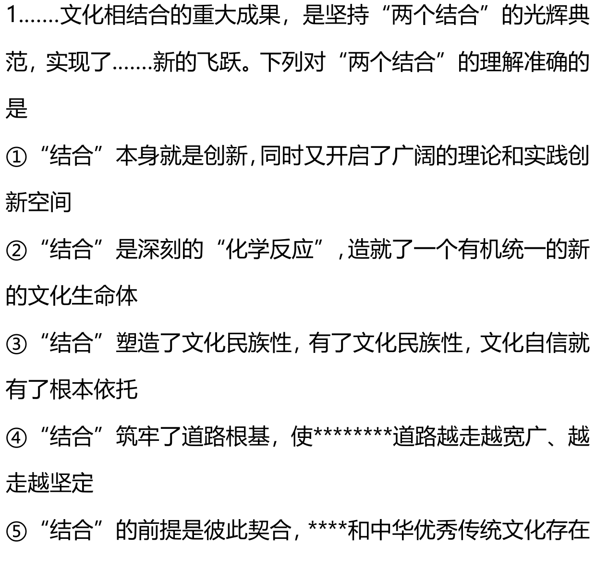

辅助检索字稿（OCR初稿，以原图为准）

1......文化相结合的重大成果，是坚持“两个结合”的光辉典
范，实现了.....新的飞跃。下列对“两个结合”的理解准确的
是
“结合”本身就是创新，同时又开启了广阔的理论和实践创
1
新空间
“结合”是深刻的“化学反应”，造就了一个有机统一的新
的文化生命体
3
“结合”塑造了文化民族性，有了文化民族性，文化自信就
有了根本依托
“结合”筑牢了道路根基，使
********道路越走越宽广、越
走越坚定
“结合”的前提是彼此契合，
，****和中华优秀传统文化存在
高度的契合性
A.①②③④
B.①②③5
C.①②④5
D.①③④5

## 第 2 题

> 来源校勘：来源题干含省略号/星号删略，按原图保留，未猜补原文。

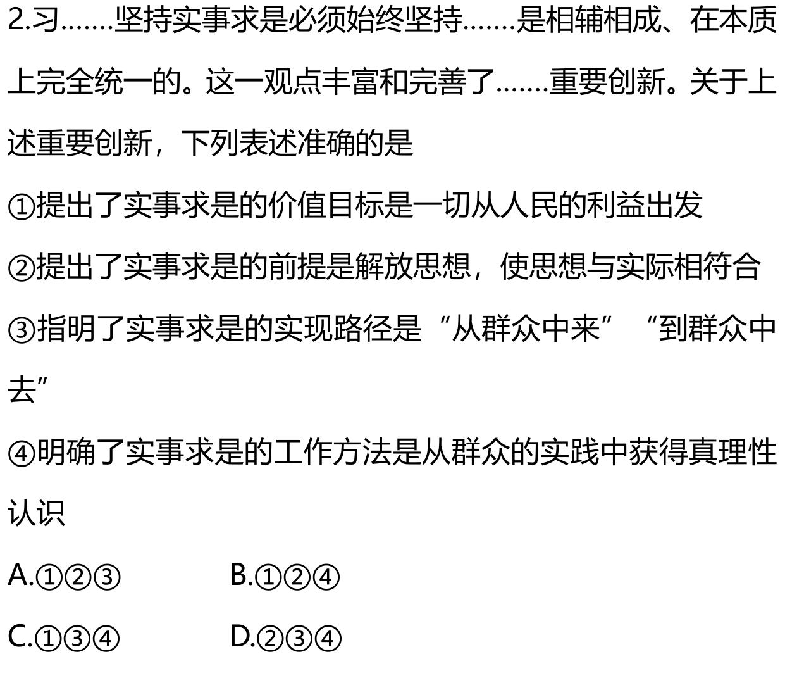

辅助检索字稿（OCR初稿，以原图为准）

2..习......坚持实事求是必须始终坚持.....是相辅相成、在本质
上完全统一的。这一观点丰富和完善了......重要创新。关于上
述重要创新，下列表述准确的是
①提出了实事求是的价值目标是一切从人民的利益出发
②提出了实事求是的前提是解放思想，使思想与实际相符合
③指明了实事求是的实现路径是“从群众中来”
“到群众中
去”
④明确了实事求是的工作方法是从群众的实践中获得真理性
认识
A.①②③
B.①②④
C.①③④
D.②③④

## 第 3 题

> 来源校勘：来源题干含省略号/星号删略，按原图保留，未猜补原文；来源部分分项含星号遮蔽/删词，选项条件未完整。

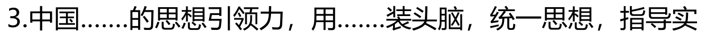

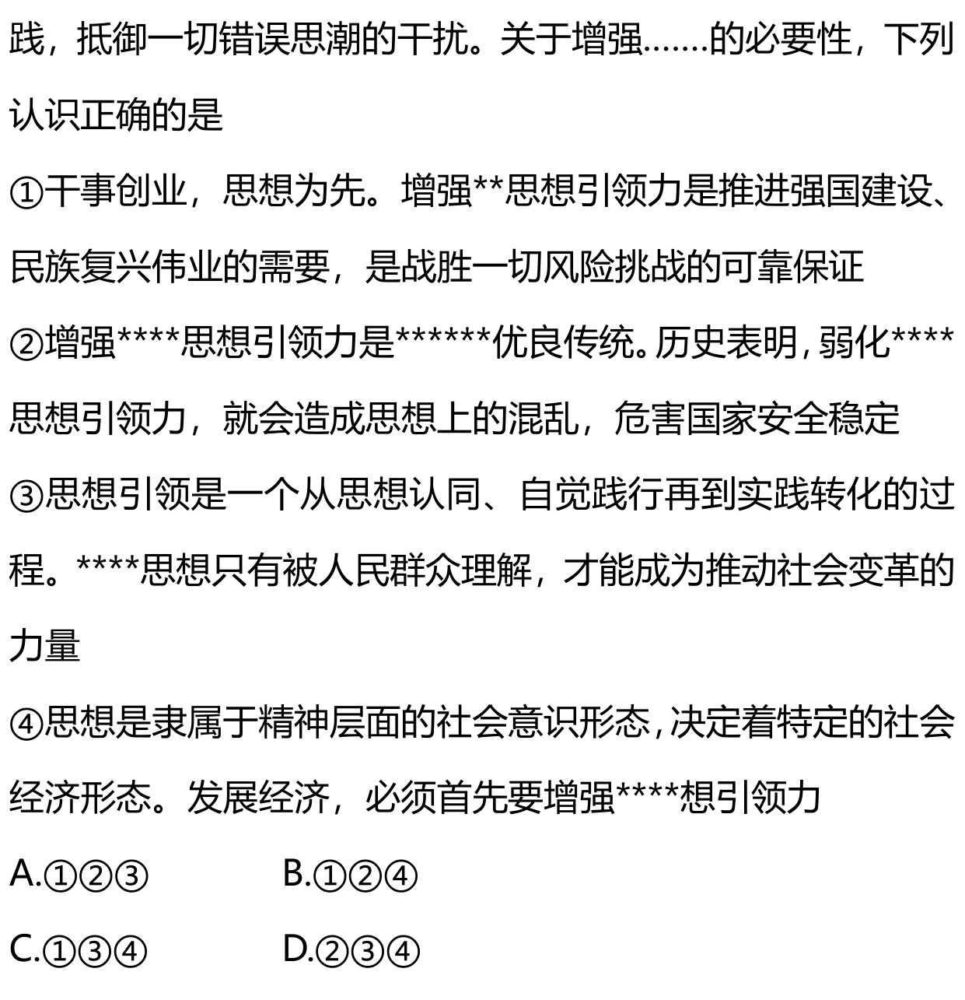

辅助检索字稿（OCR初稿，以原图为准）

3.中国.....的思想引领力，用....装头脑，统一思想，指导实
践，抵御一切错误思潮的干扰。关于增强......的必要性，下列
认识正确的是
①干事创业，思想为先。增强**思想引领力是推进强国建设、
民族复兴伟业的需要，是战胜一切风险挑战的可靠保证
②增强****思想引引领力是
******优良传统。历史表明，弱化
****
思想引领力，就会造成思想上的混乱，危害国家安全稳定
③思想引|领是一个从思想认同、自觉践行再到实践转化的过
程。
****日
思想只有被人民群众理解，才能成为推动社会变革的
力量
④思想是隶属于精神层面的社会意识形态，决定着特定的社会
经济形态。发展经济，必须首先要增强****想引领力
A.①②③
B.①②④
C.①③④
D.②③④

## 第 4 题

> 来源校勘：来源题干含省略号/星号删略，按原图保留，未猜补原文。

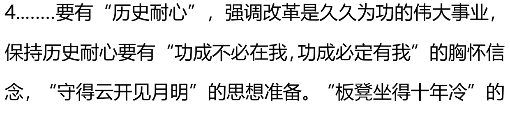

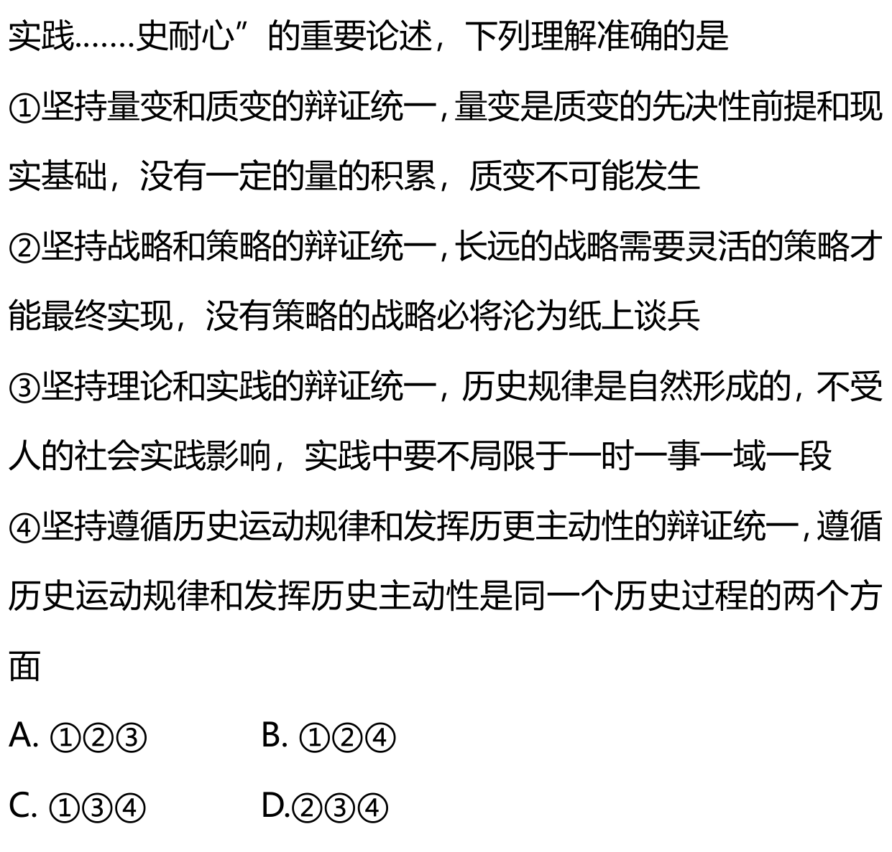

辅助检索字稿（OCR初稿，以原图为准）

4.......要有“历史耐心”，强调改革是久久为功的伟大事业，
保持历史耐心要有“功成不必在我，功成必定有我”的胸怀信
念，“守得云开见月明”的思想准备。“板凳坐得十年冷”的
实践....史耐心”的重要论述，下列理解准确的是
①坚持量变和质变的辩证统一，量变是质变的先决性前提和现
实基础，没有一定的量的积累，质变不可能发生
②坚持战略和策略的辩证统一，长远的战略需要灵活的策略才
能最终实现，没有策略的战略必将沦为纸上谈兵
③坚持理论和实践的辩证统一，历史规律是自然形成的，不受
人的社会实践影响，实践中要不局限于一时一事一域一段
④坚持遵循历史运动规律和发挥历更主动性的辩证统一，遵循
历史运动规律和发挥历史主动性是同一个历史过程的两个方
面
A. ①②③
B. ①②④
C. ①③④
D.②③④

## 第 5 题

> 来源校勘：来源题干含省略号/星号删略，按原图保留，未猜补原文；来源部分分项含星号遮蔽/删词，选项条件未完整。

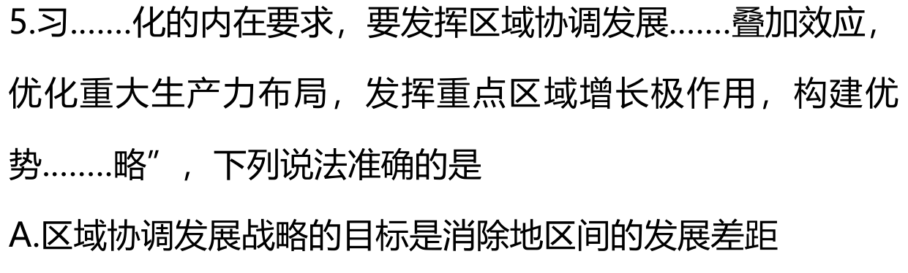

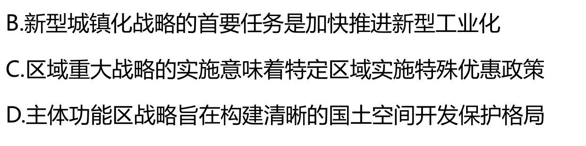

辅助检索字稿（OCR初稿，以原图为准）

5.习.....化的内在要求，要发挥区域协调发展......叠加效应
优化重大生产力布局，发挥重点区域增长极作用，构建优
势....略”，下列说法准确的是
A.区域协调发展战略的目标是消除地区间的发展差距
B.新型城镇化战略的首要任务是加快推进新型工业化
C.区域重大战略的实施意味着特定区域实施特殊优惠政策
D.主体功能区战略旨在构建清晰的国土空间开发保护格局

## 第 6 题

> 来源校勘：来源题干含省略号/星号删略，按原图保留，未猜补原文。

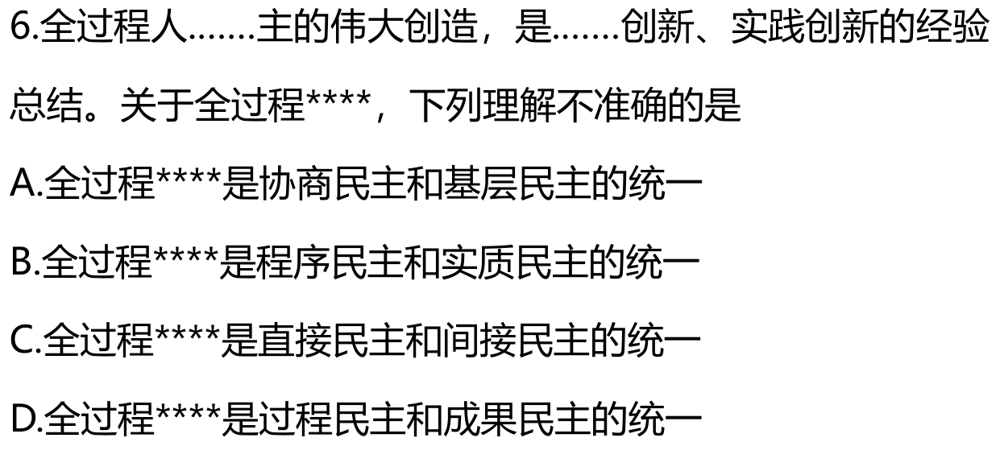

辅助检索字稿（OCR初稿，以原图为准）

6..全过程人......主的伟大创造，是......创新、实践创新的经验
总结。关于全过程
****
，下列理解不准确的是
A.全过程****是协商民主和基层民主的统一
B.全过程****是程序民主和实质民主的统一
C.全过程****是直接民主和间接民主的统一
D.全过程****是过程民主和成果民主的统一

## 第 7 题

> 来源校勘：来源题干含省略号/星号删略，按原图保留，未猜补原文。

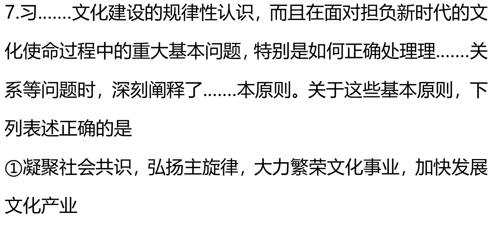

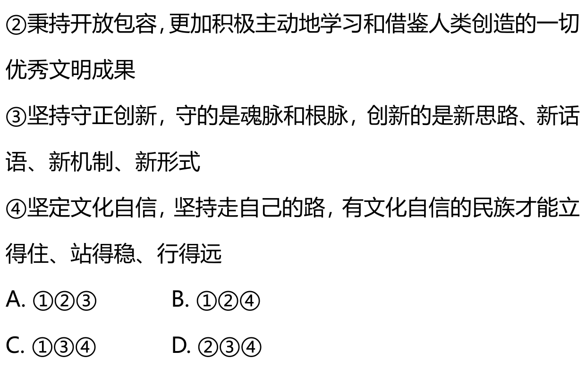

辅助检索字稿（OCR初稿，以原图为准）

7.习.....文化建设的规律性认识，而且在面对担负新时代的文
化使命过程中的重大基本问题，特别是如何正确处理理.....关
系等问题时，深刻阐释了.......本原则。关于这些基本原则，下
列表述正确的是
①凝聚社会共识，弘扬主旋律，大力繁荣文化事业，加快发展
文化产业
②秉持开放包容，更加积极主动地学习和借鉴人类创造的一切
优秀文明成果
③坚持守正创新，守的是魂脉和根脉，创新的是新思路、新话
语、新机制、新形式
④坚定文化自信，坚持走自己的路，有文化自信的民族才能立
得住、站得稳、行得远
A. ①②③
B. ①②④
C. ①③④
D. ②③④

## 第 8 题

> 来源校勘：来源题干含省略号/星号删略，按原图保留，未猜补原文。

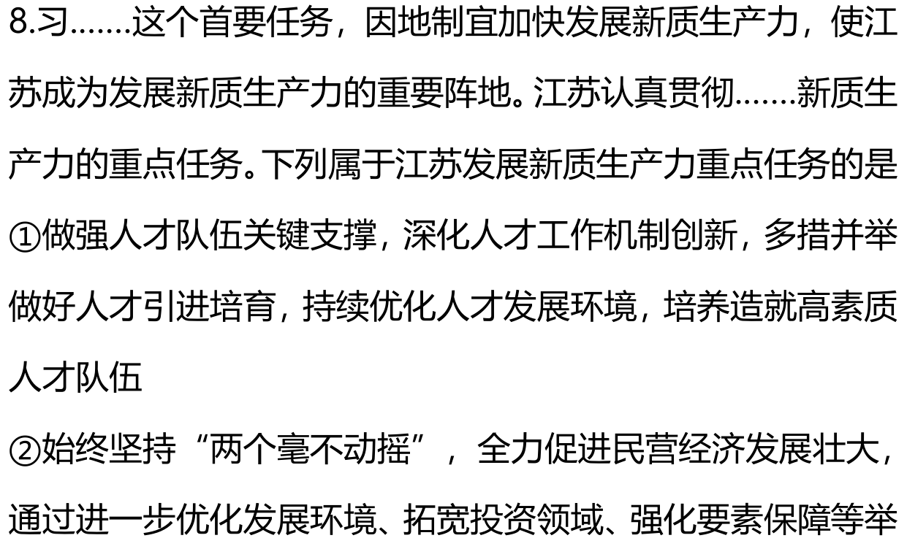

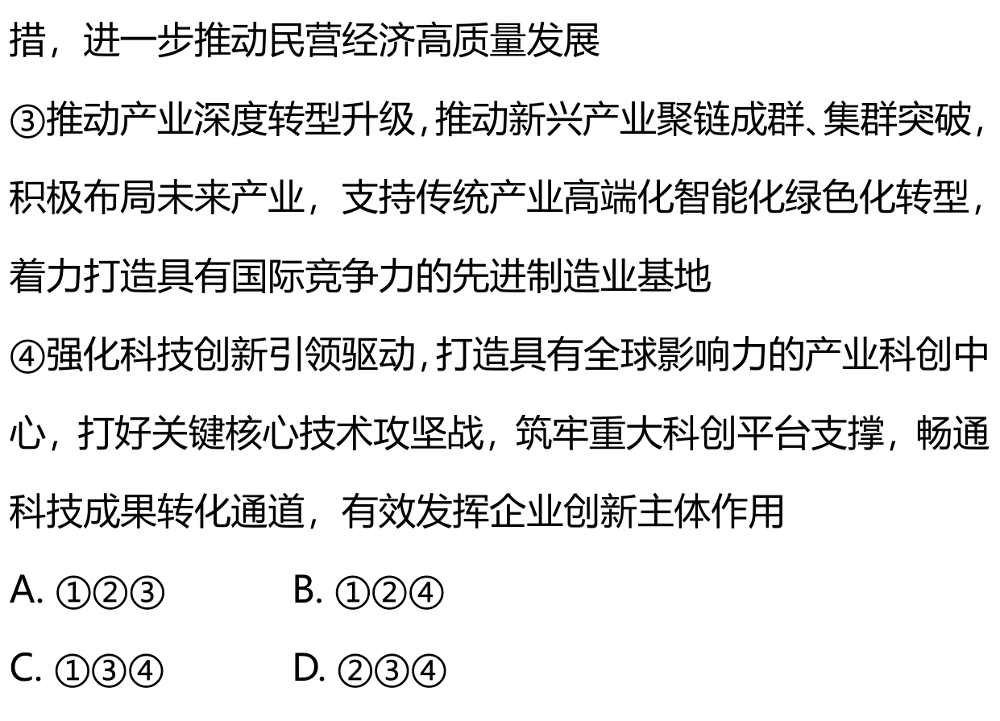

辅助检索字稿（OCR初稿，以原图为准）

8.习.......这个首要任务，因地制宜加快发展新质生产力，使江
苏成为发展新质生产力的重要阵地。江苏认真贯彻......新质生
产力的重点任务。下列属于江苏发展新质生产力重点任务的是
①做强人才队伍关键支撑，深化人才工作机制创新，多措并举
做好人才引进培育，持续优化人才发展环境，培养造就高素质
人才队伍
②始终坚持“两个毫不动摇”，全力促进民营经济发展壮大，
通过进一步优化发展环境、拓宽投资领域、强化要素保障等举
措，进一步推动民营经济高质量发展
③推动产业深度转型升级，推动新兴产业聚链成群、集群突破，
积极布局未来产业，支持传统产业高端化智能化绿色化转型，
着力打造具有国际竞争力的先进制造业基地
④强化科技创新引|领驱动，打造具有全球影响力的产业科创中
心，打好关键核心技术攻坚战，筑牢重大科创平台支撑，畅通
科技成果转化通道，有效发挥企业创新主体作用
A. ①②③
B. ①②④
C. ①③④
D. ②③④

## 第 9 题

> 来源校勘：来源题干含省略号/星号删略，按原图保留，未猜补原文。

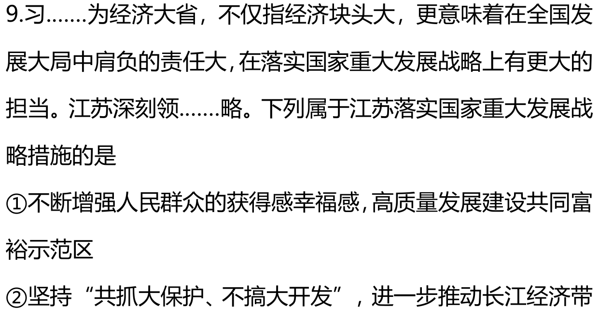

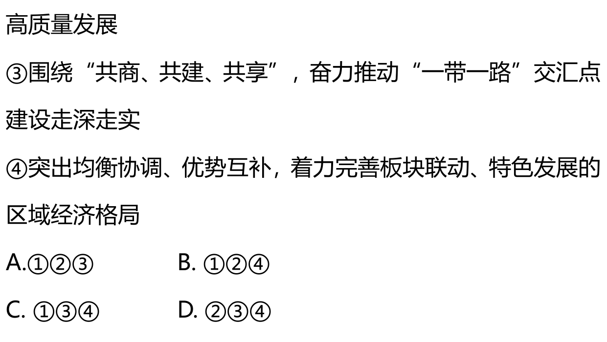

辅助检索字稿（OCR初稿，以原图为准）

9.习.....为经济大省，不仅指经济块头大，更意味着在全国发
展大局中肩负的责任大，在落实国家重大发展战略上有更大的
担当。江苏深刻领.....略。下列属于江苏落实国家重大发展战
略措施的是
①不断增强人民群众的获得感幸福感，高质量发展建设共同富
裕示范区
②坚持“共抓大保护、不搞大开发”，进一步推动长江经济带
高质量发展
③围绕&quot;共商、共建、共享”，奋力推动“一带一路”交汇点
建设走深走实
④突出均衡协调、优势互补，着力完善板块联动、特色发展的
区域经济格局
A.①②③
B. ①②④
C. ①③④
D. ②③④

## 第 10 题

> 来源校勘：来源题干含省略号/星号删略，按原图保留，未猜补原文。

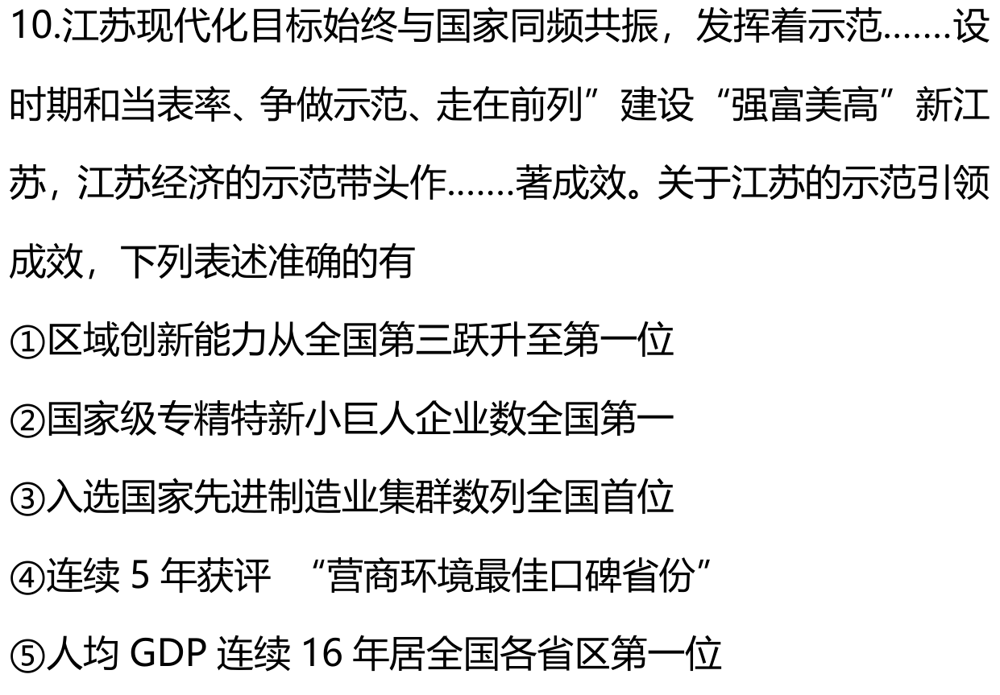

辅助检索字稿（OCR初稿，以原图为准）

10.江苏现代化目标始终与国家同频共振，发挥着示范.....设
时期和当表率、争做示范、走在前列”建设“强富美高”新江
苏，江苏经济的示范带头作......著成效。关于江苏的示范引领
成效，下列表述准确的有
①区域创新能力从全国第三跃升至第一位
②国家级专精特新小巨人企业数全国第一
③入选国家先进制造业集群数列全国首位
④连续5年获评
“营商环境最佳口碑省份
③人均GDP连续16年居全国各省区第一位
?制造业高质量发展指数连续5年全国第一
A.6项
B.5项
C.4项
D.3项

## 第 11 题

> 来源校勘：来源题干含省略号/星号删略，按原图保留，未猜补原文；来源部分分项含星号遮蔽/删词，选项条件未完整。

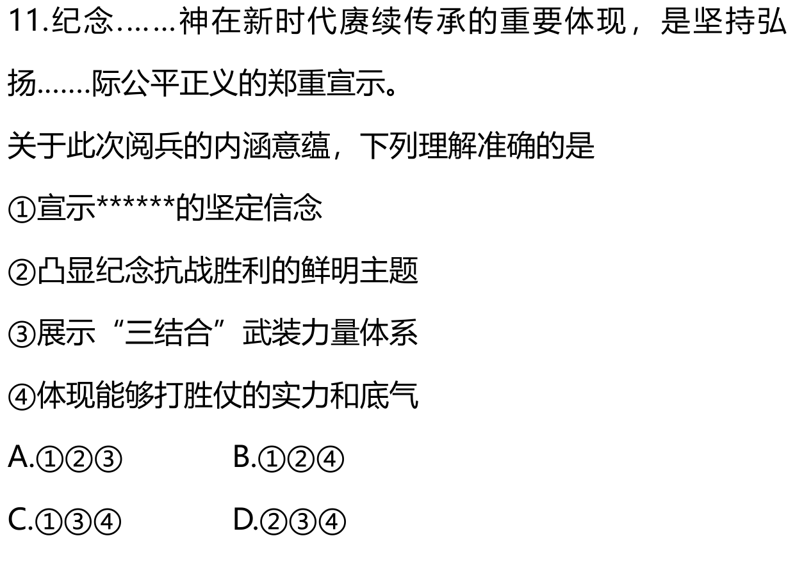

辅助检索字稿（OCR初稿，以原图为准）

11.纪念.....神在新时代续传承的重要体现，是坚持弘
扬.....际公平正义的郑重宣示
关于此次阅兵的内涵意蕴，下列理解准确的是
①宣示******
的坚定信念
②凸显纪念抗战胜利的鲜明主题
③展示“三结合”武装力量体系
④体现能够打胜仗的实力和底气
A.①②③
B.①②④
C.①③④
D.②③④

## 第 12 题

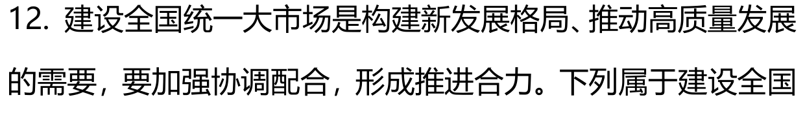

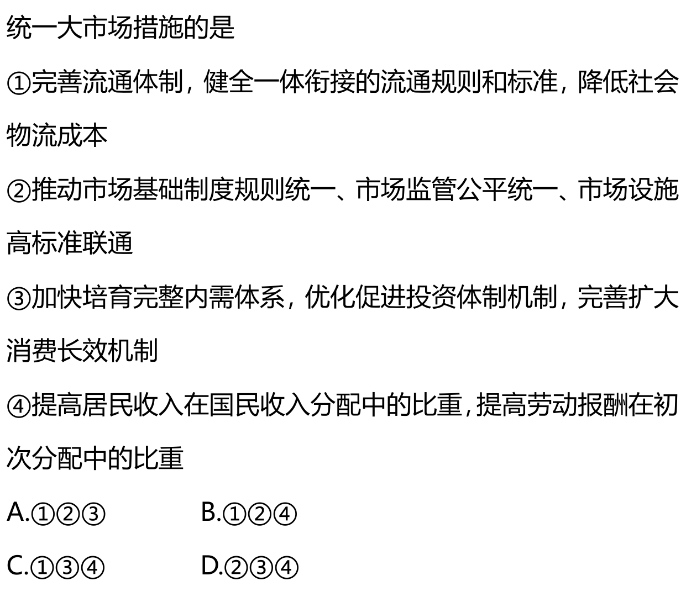

辅助检索字稿（OCR初稿，以原图为准）

12.建设全国统一大市场是构建新发展格局、推动高质量发展
的需要，要加强协调配合，形成推进合力。下列属于建设全国
统一大市场措施的是
①完善流通体制，健全一体衔接的流通规则和标准，降低社会
物流成本
②推动市场基础制度规则统一、市场监管公平统一、市场设施
高标准联通
③加快培育完整内需体系，优化促进投资体制机制，完善扩大
消费长效机制
④提高居民收入在国民收入分配中的比重，提高劳动报酬在初
次分配中的比重
A.①②③
B.①②④
C.①③④
D.②③④

## 第 13 题

> 来源校勘：来源题干含省略号/星号删略，按原图保留，未猜补原文。

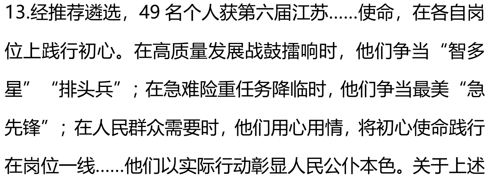

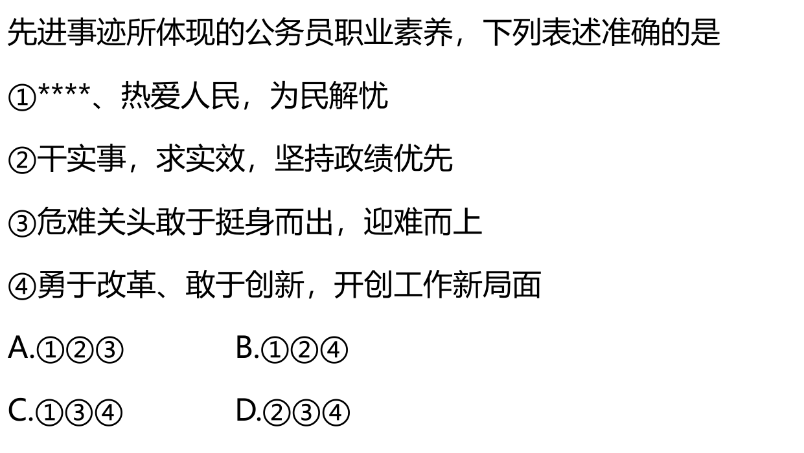

辅助检索字稿（OCR初稿，以原图为准）

13.经推荐选，49名个人获第六届江苏.....使命，在各自岗
位上践行初心。在高质量发展战鼓擂响时，他们争当“智多
星”“排头兵”；在急难险重任务降临时，他们争当最美“急
先锋”；在人民群众需要时，他们用心用情，将初心使命践行
在岗位一线.....他们以实际行动彰显人民公仆本色。关于上述
先进事迹所体现的公务员职业素养，下列表述准确的是
****、热爱人民，为民解忧
1
②干实事，求实效，坚持政绩优先
③危难关头敢于挺身而出，迎难而上
④勇于改革、敢于创新，开创工作新局面
A.①②③
B.①②④
C.①③④
D.②③④

## 第 14 题

> 来源校勘：来源题干含省略号/星号删略，按原图保留，未猜补原文。

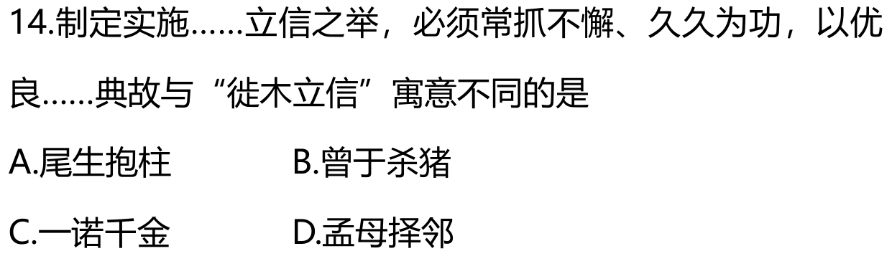

辅助检索字稿（OCR初稿，以原图为准）

14.制定实施....立信之举，必须常抓不解、久久为功，以优
良.....典故与“徙木立信”寓意不同的是
A.尾生抱柱
B.曾于杀猪
C.一诺千金
D.孟母择邻

## 第 15 题

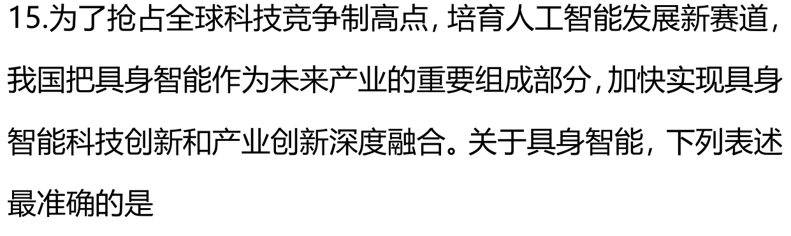

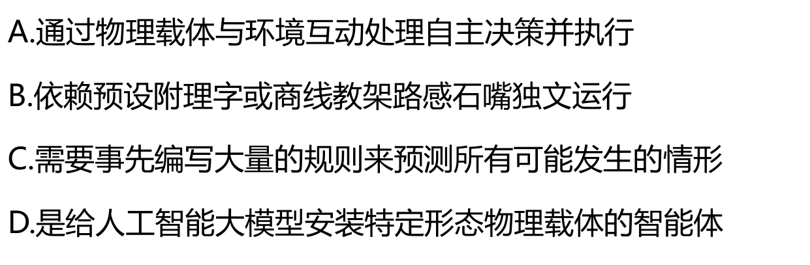

辅助检索字稿（OCR初稿，以原图为准）

15.为了抢占全球科技竞争制高点，培育人工智能发展新赛道，
我国把具身智能作为未来产业的重要组成部分，加快实现具身
智能科技创新和产业创新深度融合。关于具身智能，下列表述
最准确的是
A.通过物理载体与环境互动处理自主决策并执行
B.依赖预设附理字或商线教架路感石嘴独文运行
C.需要事先编写大量的规则来预测所有可能发生的情形
D.是给人工智能大模型安装特定形态物理载体的智能体

## 第 24 题

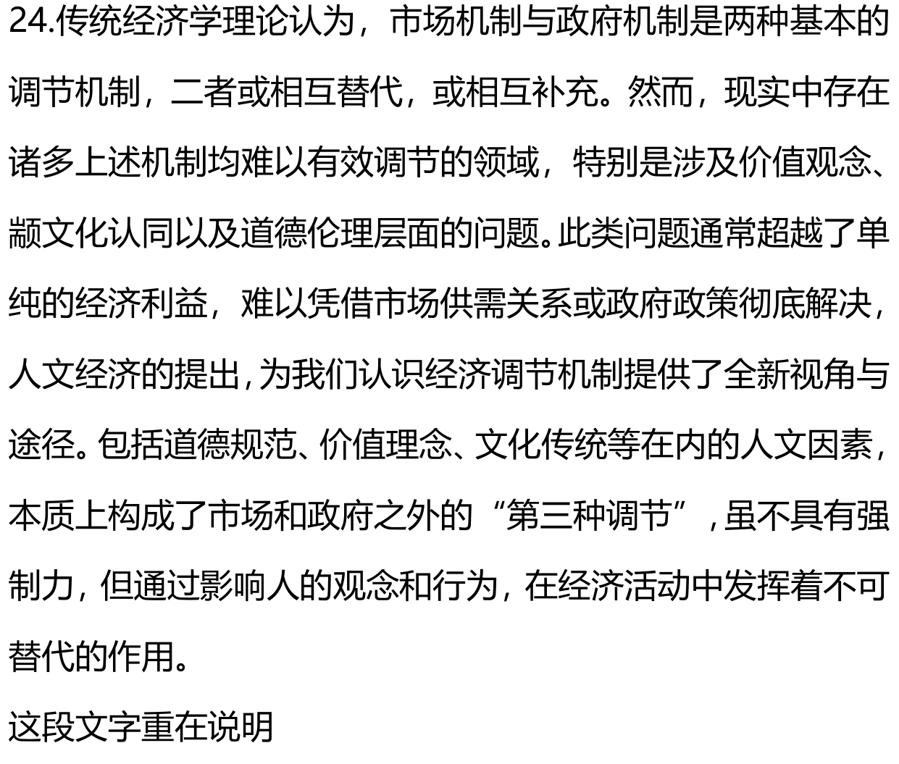

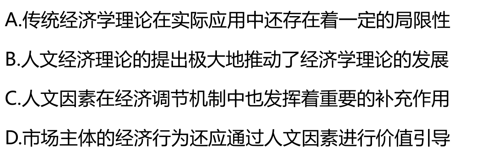

辅助检索字稿（OCR初稿，以原图为准）

24.传统经济学理论认为，市场机制与政府机制是两种基本的
调节机制，二者或相互替代，或相互补充。然而，现实中存在
诸多上述机制均难以有效调节的领域，特别是涉及价值观念、
文化认同以及道德伦理层面的问题。此类问题通常超越了单
纯的经济利益，难以凭借市场供需关系或政府政策彻底解决，
人文经济的提出，为我们认识经济调节机制提供了全新视角与
途径。包括道德规范、价值理念、文化传统等在内的人文因素，
本质上构成了市场和政府之外的“第三种调节”，虽不具有强
制力，但通过影响人的观念和行为，在经济活动中发挥着不可
替代的作用。
这段文字重在说明
A.传统经济学理论在实际应用中还存在着一定的局限性
B.人文经济理论的提出极大地推动了经济学理论的发展
C.人文因素在经济调节机制中也发挥着重要的补充作用
D.市场主体的经济行为还应通过人文因素进行价值引|导

## 第 25 题

> 来源校勘：来源题干含省略号/星号删略，按原图保留，未猜补原文。

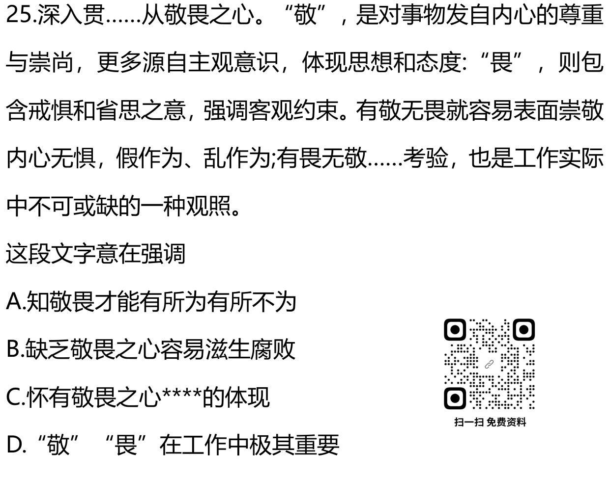

辅助检索字稿（OCR初稿，以原图为准）

25.深入贯.....从敬畏之心。&quot;敬”，是对事物发自内心的尊重
与崇尚，更多源自主观意识，体现思想和态度：“畏”，则包
含戒惧和省思之意，强调客观约束。有敬无畏就容易表面崇敬
内心无惧，假作为、乱作为；有畏无敬.....考验，也是工作实际
中不可或缺的一种观照。
这段文字意在强调
A.知敬畏才能有所为有所不为
B.缺乏敬畏之心容易滋生腐败
C.怀有敬畏之心****的体现
扫一扫免费资料
D.“敬”“畏”在工作中极其重要

## 第 26 题

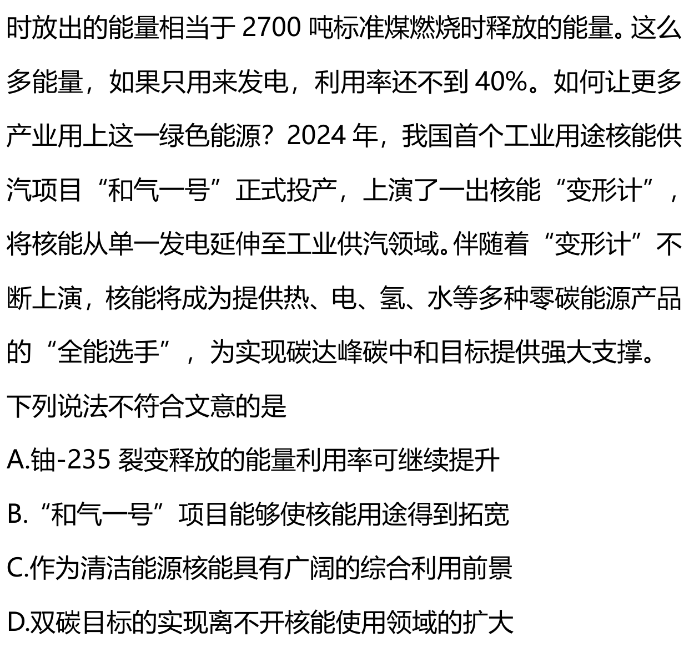

辅助检索字稿（OCR初稿，以原图为准）

26.核能是最高效的清洁能源之一，1公斤的铀-235全部裂变
时放出的能量相当于2700吨标准煤燃烧时释放的能量。这么
多能量，如果只用来发电，利用率还不到40%。如何让更多
产业用上这一绿色能源？2024年，我国首个工业用途核能供
汽项目“和气一号”正式投产，上演了一出核能“变形计”，
将核能从单一发电延伸至工业供汽领域。伴随着“变形计”不
断上演，核能将成为提供热、电、氢、水等多种零碳能源产品
的“全能选手”，为实现碳达峰碳中和目标提供强大支撑
下列说法不符合文意的是
A.铀-235裂变释放的能量利用率可继续提升
B.&quot;和气一号”项目能够使核能用途得到拓宽
C.作为清洁能源核能具有广阔的综合利用前景
D.双碳目标的实现离不开核能使用领域的扩大

## 第 27 题

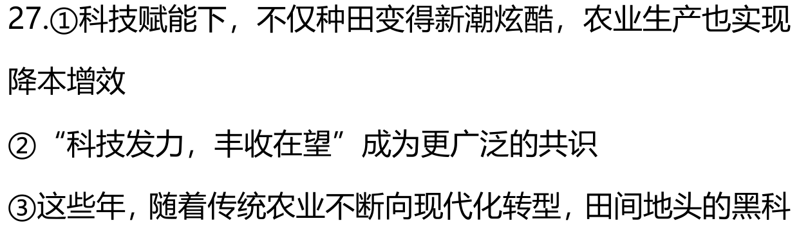

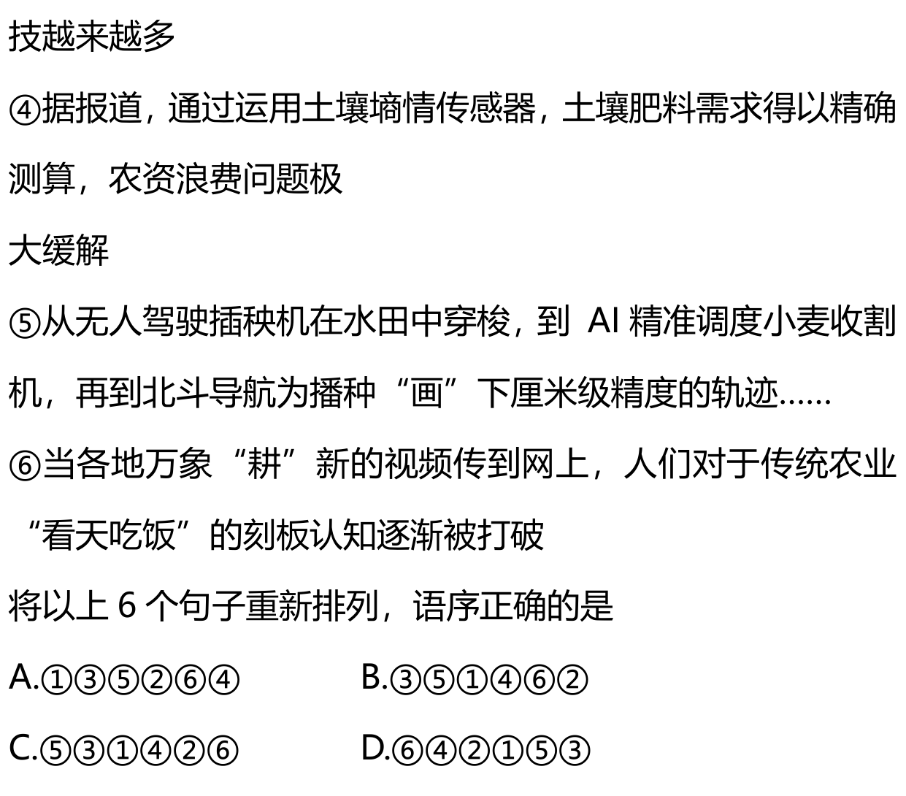

辅助检索字稿（OCR初稿，以原图为准）

27.①科技赋能下，不仅种田变得新潮炫酷，农业生产也实现
降本增效
&quot;科技发力，丰收在望”成为更广泛的共识
③这些年，随着传统农业不断向现代化转型，田间地头的黑科
技越来越多
④据报道，通过运用土壤情传感器，土壤肥料需求得以精确
测算，农资浪费问题极
大缓解
③从无人驾驶插秧机在水田中穿梭，到AI精准调度小麦收割
机，再到北斗导航为播种“画”下厘米级精度的轨迹.....
③当各地万象“耕”新的视频传到网上，人们对于传统农业
“看天吃饭”的刻板认知逐渐被打破
将以上6个句子重新排列，语序正确的是
A.①③5②6④
B.35①④62
C.5③①④②6
D.6④②①53

## 第 28 题

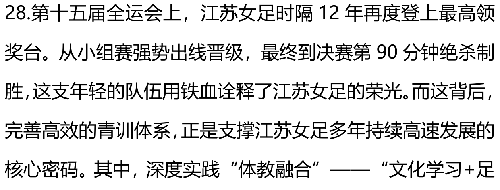

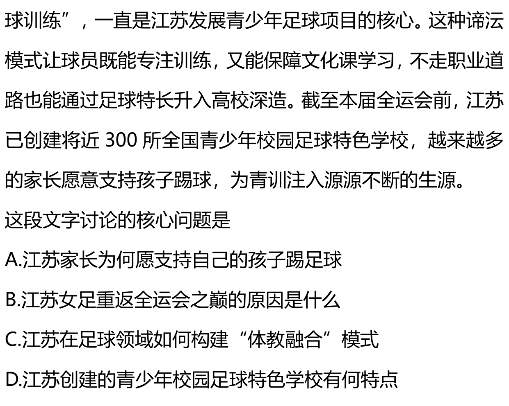

辅助检索字稿（OCR初稿，以原图为准）

28.第十五届全运会上，江苏女足时隔12年再度登上最高领
奖台。从小组赛强势出线普级，最终到决赛第90分钟绝杀制
胜，这支年轻的队伍用铁血诠释了江苏女足的荣光。而这背后
完善高效的青训体系，正是支撑江苏女足多年持续高速发展的
核心密码。其中，深度实践&quot;体教融合”——
&quot;文化学习+足
球训练”，一直是江苏发展青少年足球项目的核心。这种谛;
模式让球员既能专注训练，又能保障文化课学习，不走职业道
路也能通过足球特长升入高校深造。截至本届全运会前，江苏
已创建将近300所全国青少年校园足球特色学校，越来越多
的家长愿意支持孩子踢球，为青训注入源源不断的生源。
这段文字讨论的核心问题是
A.江苏家长为何愿支持自己的孩子踢足球
B.江苏女足重返全运会之巅的原因是什么
C.江苏在足球领域如何构建“体教融合”模式
D.江苏创建的青少年校园足球特色学校有何特点

## 第 29 题

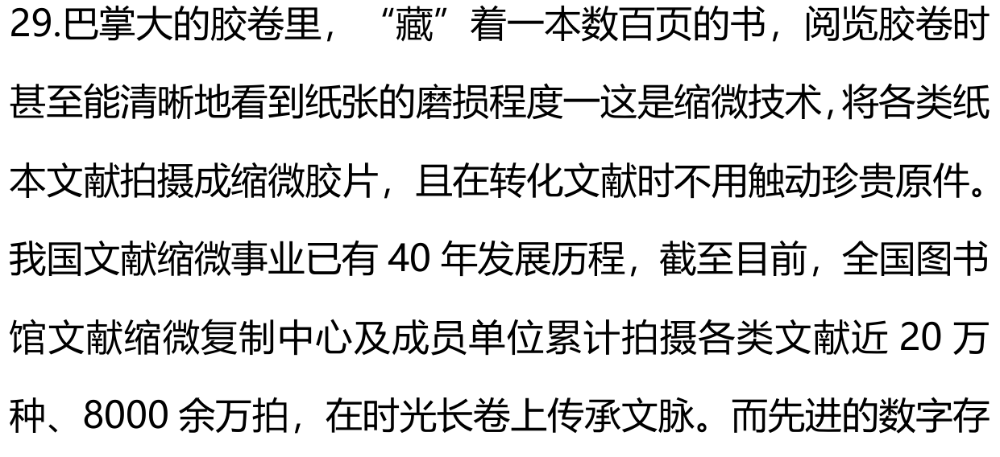

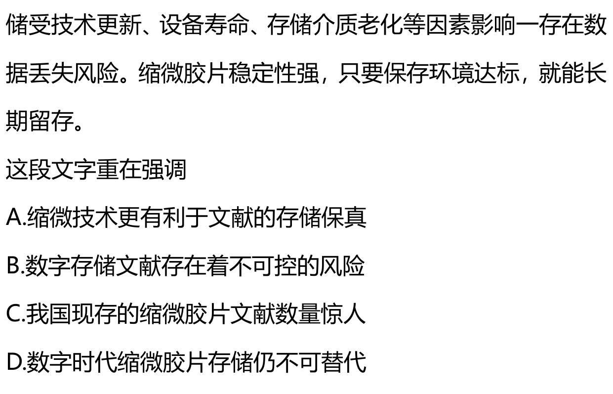

辅助检索字稿（OCR初稿，以原图为准）

29.巴掌大的胶卷里，&quot;藏”着一本数百页的书，阅览胶卷时
甚至能清晰地看到纸张的磨损程度一这是缩微技术，将各类纸
本文献拍摄成缩微胶片，且在转化文献时不用触动珍贵原件。
我国文献缩微事业已有40年发展历程，截至目前，全国图书
馆文献缩微复制中心及成员单位累计拍摄各类文献近20万
种、8000余万拍，在时光长卷上传承文脉。而先进的数字存
储受技术更新、设备寿命、存储介质老化等因素影响一存在数
据丢失风险。缩微胶片稳定性强，只要保存环境达标，就能长
期留存。
这段文字重在强调
A.缩微技术更有利于文献的存储保真
B.数字存储文献存在着不可控的风险
C.我国现存的缩微胶片文献数量惊人
D.数字时代缩微胶片存储仍不可替代

## 第 30 题

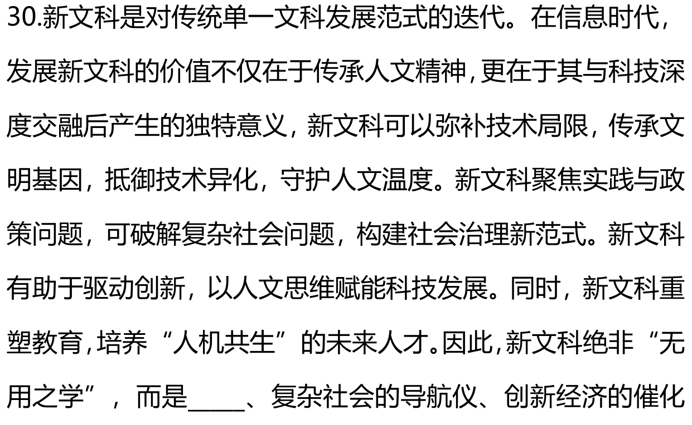

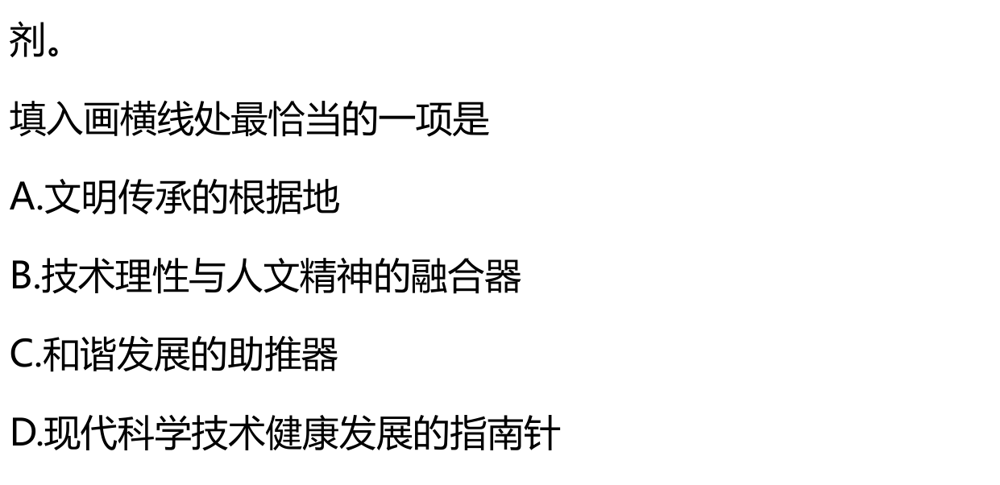

辅助检索字稿（OCR初稿，以原图为准）

30.新文科是对传统单一文科发展范式的迭代。在信息时代
发展新文科的价值不仅在于传承人文精神，更在于其与科技深
度交融后产生的独特意义，新文科可以弥补技术局限，传承文
明基因，抵御技术异化，守护人文温度。新文科聚焦实践与政
策问题，可破解复杂社会问题，构建社会治理新范式。新文科
有助于驱动创新，以人文思维赋能科技发展。同时，新文科重
塑教育，培养“人机共生”的未来人才。因此，新文科绝非“无
用之学”，而是
、复杂社会的导航仪、创新经济的催化
剂。
填入画横线处最恰当的一项是
A.文明传承的根据地
B.技术理性与人文精神的融合器
C.和谐发展的助推器
D.现代科学技术健康发展的指南针

## 第 31 题

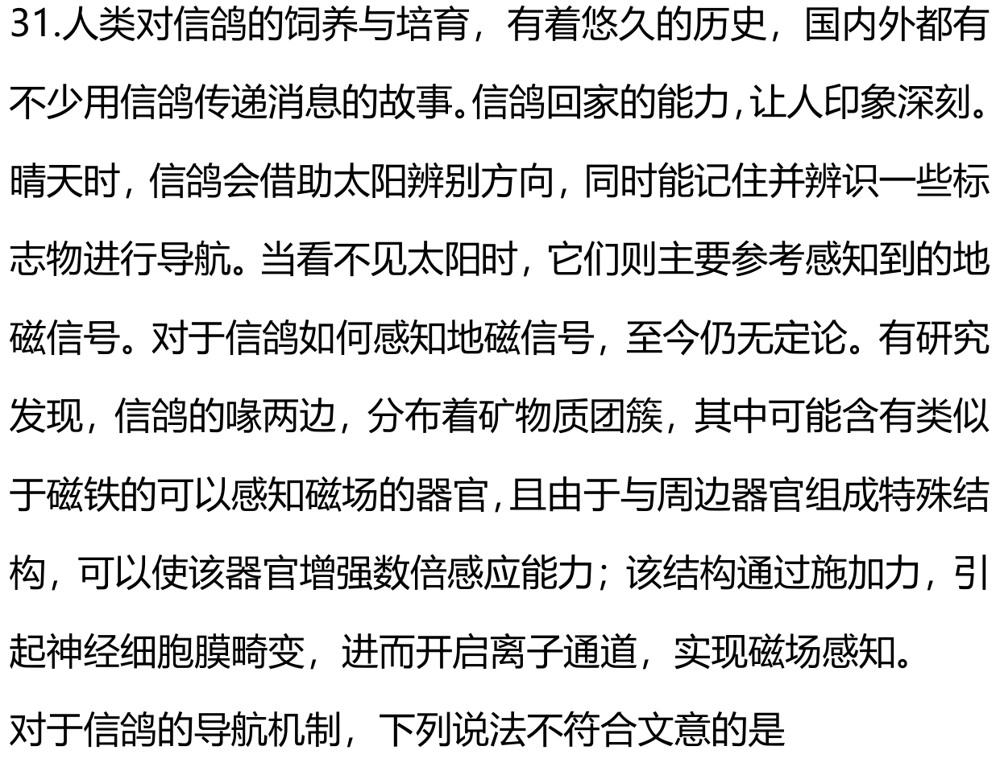

辅助检索字稿（OCR初稿，以原图为准）

31.人类对信鸽的饲养与培育，有着悠久的历史，国内外都有
不少用信鸽传递消息的故事。信鸽回家的能力，让人印象深刻。
晴天时，信鸽会借助太阳辨别方向，同时能记住并辨识一些标
志物进行导航。当看不见太阳时，它们则主要参考感知到的地
磁信号。对于信鸽如何感知地磁信号，至今仍无定论。有研究
发现，信鸽的喙两边，分布着矿物质团簇，其中可能含有类似
于磁铁的可以感知磁场的器官，且由于与周边器官组成特殊结
构，可以使该器官增强数倍感应能力；该结构通过施加力，引
起神经细胞膜畸变，进而开启离子通道，实现磁场感知
对于信鸽的导航机制，下列说法不符合文意的是
A.定位能力与其嘎觉和视觉密切相关
B.通常会借助太阳和地磁信号来定向
C.或存在能感知地磁信号的特殊器官
D.导航方式可根据环境变化进行调整

## 第 41 题

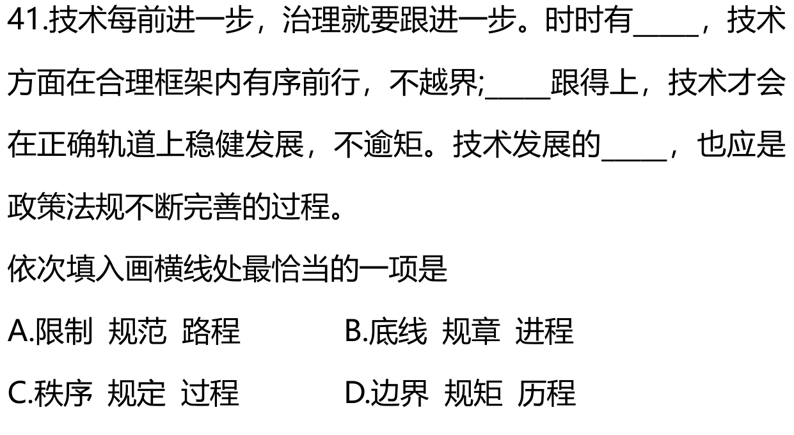

辅助检索字稿（OCR初稿，以原图为准）

41.技术每前进一步，治理就要跟进一步。时时有
方面在合理框架内有序前行，不越界；
跟得上，技术才会
在正确轨道上稳健发展，不逾矩。技术发展的
_，也应是
政策法规不断完善的过程。
依次填入画横线处最恰当的一项是
A.限制规范路程
B.底线规章进程
C.秩序规定过程
D.边界 规矩历程

## 第 42 题

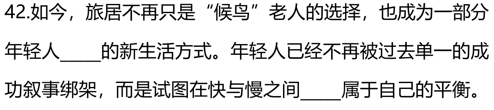

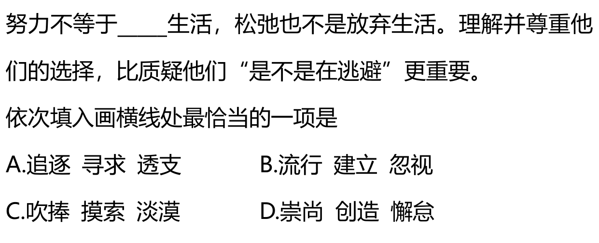

辅助检索字稿（OCR初稿，以原图为准）

42.如今，旅居不再只是“候鸟”老人的选择，也成为一部分
年轻人
的新生活方式。年轻人已经不再被过去单一的成
功叙事绑架，而是试图在快与慢之间
属于自己的平衡。
努力不等于
生活，松弛也不是放弃生活。理解并尊重他
们的选择，比质疑他们“是不是在逃避”更重要。
依次填入画横线处最恰当的一项是
A.追逐寻求透支
B.流行建立忽视
C.吹捧摸索淡漠
D.崇尚创造懈怠

## 第 43 题

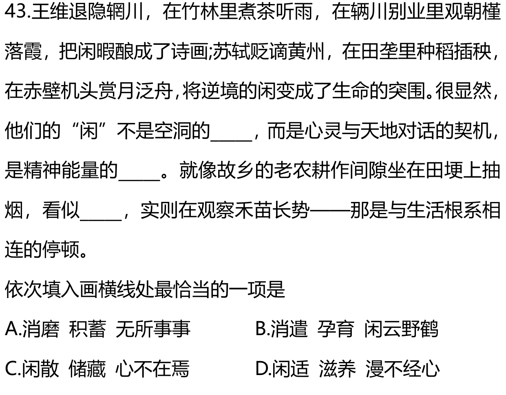

辅助检索字稿（OCR初稿，以原图为准）

43.王维退隐辋川，在竹林里煮茶听雨，在辆川别业里观朝槿
落霞，把闲暇酿成了诗画；苏轼贬谪黄州，在田垄里种稻插秧
在赤壁机头赏月泛舟，将逆境的闲变成了生命的突围。很显然
他们的“闲”不是空洞的
，而是心灵与天地对话的契机，
是精神能量的
_。就像故乡的老农耕作间隙坐在田埂上抽
烟，看似
，实则在观察禾苗长势
那是与生活根系相
连的停顿。
依次填入画横线处最恰当的一项是
A.消磨积蓄无所事事
B.消遣孕育闲云野鹤
C.闲散储藏心不在焉
D.闲适滋养漫不经心

## 第 44 题

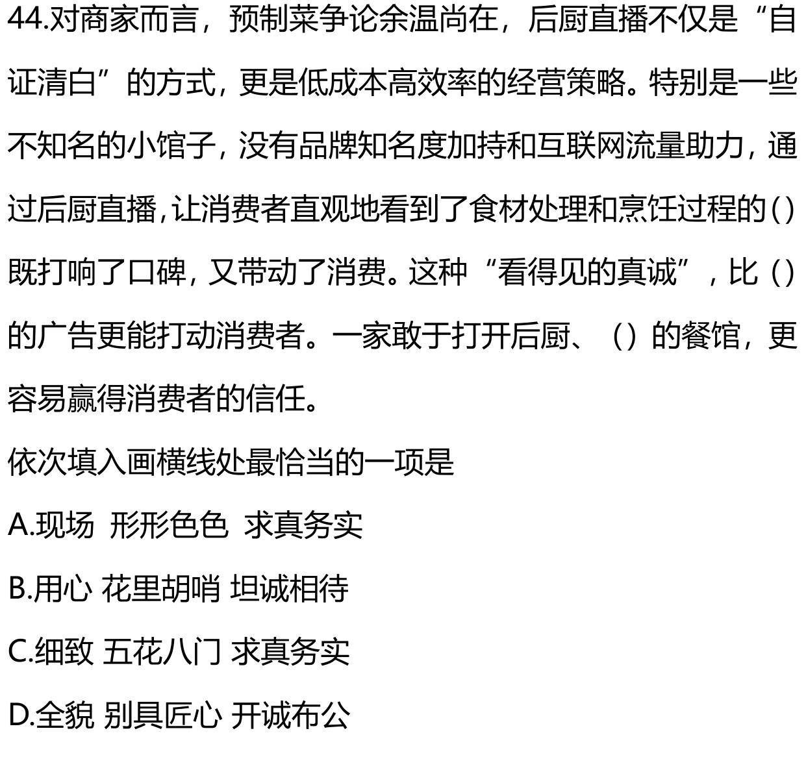

辅助检索字稿（OCR初稿，以原图为准）

44.对商家而言，预制菜争论余温尚在，后厨直播不仅是”自
证清白”的方式，更是低成本高效率的经营策略。特别是一些
不知名的小馆子，没有品牌知名度加持和互联网流量助力，通
过后厨直播，让消费者直观地看到了食材处理和烹饪过程的（）
既打响了口碑，又带动了消费。这种“看得见的真诚”，比（)
的广告更能打动消费者。一家敢于打开后厨、（）的餐馆，更
容易赢得消费者的信任
依次填入画横线处最恰当的一项是
A.现场形形色色求真务实
B.用心花里胡哨坦诚相待
C.细致五花八门求真务实
D.全貌别具匠心开诚布公

## 第 45 题

> 来源校勘：来源将此题误印为第二个44；本库以44与46之间题序标45，原图仍保留印字44。

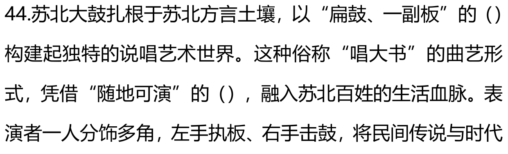

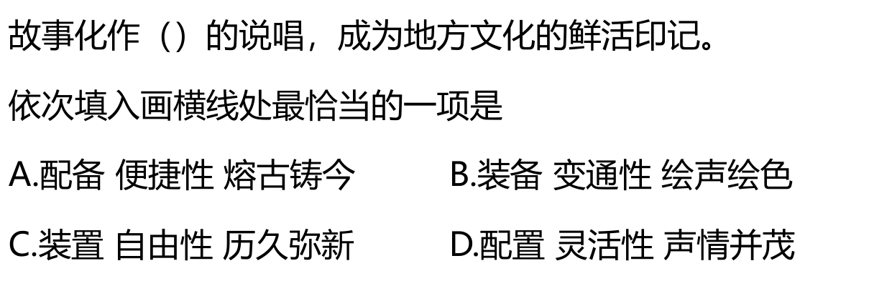

辅助检索字稿（OCR初稿，以原图为准）

44.苏北大鼓扎根于苏北方言土壤，以“扁鼓、一副板”的（)
构建起独特的说唱艺术世界。这种俗称“唱大书”的曲艺形
式，凭借“随地可演”的（），融入苏北百姓的生活血脉。表
演者一人分饰多角，左手执板、右手击鼓，将民间传说与时代
故事化作（）的说唱，成为地方文化的鲜活印记。
依次填入画横线处最恰当的一项是
A.配备便捷性熔古铸今
B.装备变通性绘声绘色
C.装置自由性历久弥新
D.配置灵活性声情并茂

## 材料 1（供第46—50题使用，来源缺失）

> 原PDF未附该组AI幻觉文章，只有五道设问及选项。以下保存真实碎片，不补造共用文章，不能作为完整阅读题练习。

### 第 46 题

> 来源校勘：来源未附AI幻觉共用阅读材料，不能作为完整可作答题。

辅助检索字稿（OCR初稿，以原图为准）

46.依次填入文中画横线处最恰当的项是
A.叙述以化传论
B.编造张冠李戴
C.杜撰颠三倒四
D.描摹牵强附会

### 第 47 题

> 来源校勘：来源未附AI幻觉共用阅读材料，不能作为完整可作答题。

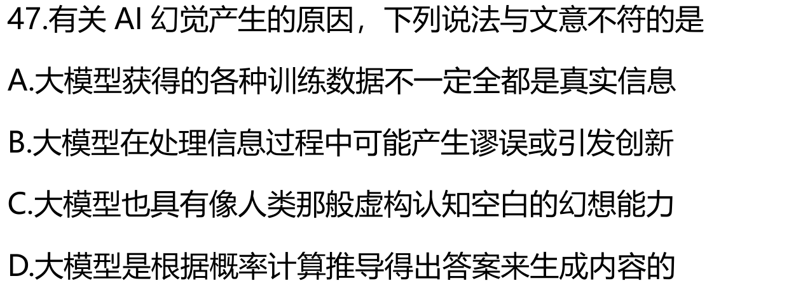

辅助检索字稿（OCR初稿，以原图为准）

47.有关AI幻觉产生的原因，下列说法与文意不符的是
A.大模型获得的各种训练数据不一定全都是真实信息
B.大模型在处理信息过程中可能产生谬误或引|发创新
C.大模型也具有像人类那般虚构认知空白的幻想能力
D.大模型是根据概率计算推导得出答案来生成内容的

### 第 48 题

> 来源校勘：来源未附AI幻觉共用阅读材料，不能作为完整可作答题。

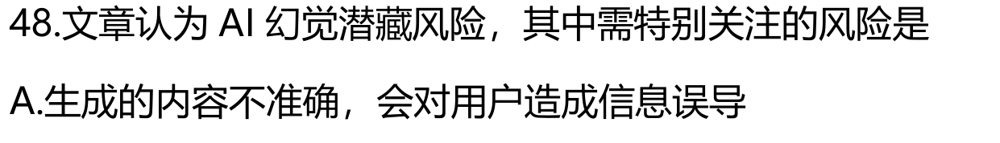

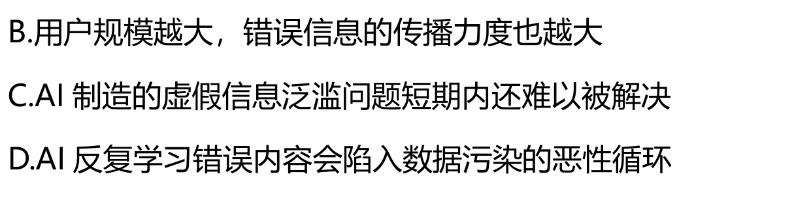

辅助检索字稿（OCR初稿，以原图为准）

48.文章认为AI幻觉潜藏风险，其中需特别关注的风险是
A.生成的内容不准确，会对用户造成信息误导
B.用户规模越大，错误信息的传播力度也越大
C.AT制造的虚假信息泛滥问题短期内还难以被解决
D.AI反复学习错误内容会陷入数据污染的恶性循环

### 第 49 题

> 来源校勘：来源未附AI幻觉共用阅读材料，不能作为完整可作答题。

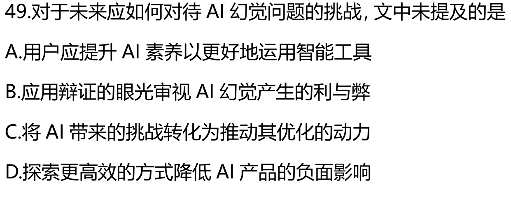

辅助检索字稿（OCR初稿，以原图为准）

49.对于未来应如何对待A1幻觉问题的挑战，文中未提及的是
A.用户应提升AI素养以更好地运用智能工具
B.应用辩证的眼光审视AI幻觉产生的利与弊
C.将AI带来的挑战转化为推动其优化的动力
D.探索更高效的方式降低AI产品的负面影响

### 第 50 题

> 来源校勘：来源未附AI幻觉共用阅读材料，不能作为完整可作答题。

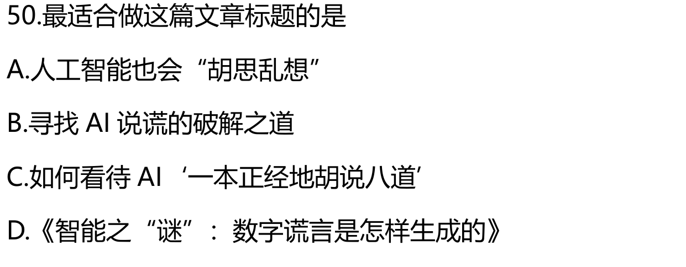

辅助检索字稿（OCR初稿，以原图为准）

50.最适合做这篇文章标题的是
A.人工智能也会“胡思乱想&#x27;
B.寻找AI说谎的破解之道
C.如何看待AI‘一本正经地胡说八道
D.《智能之“谜”：数字谎言是怎样生成的》

## 第 51 题

辅助检索字稿（OCR初稿，以原图为准）

51.-1,-6,-7,0,23,(
A.-24
B.39
C.55
D.78

## 第 52 题

辅助检索字稿（OCR初稿，以原图为准）

52, 5.8, 4.12, 9.15, 7.23, 17.29,(
A.13.45
B.13.47
C.15.45
D.15.47

## 第 53 题

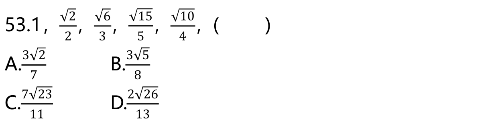

辅助检索字稿（OCR初稿，以原图为准）

53.1,
3
5
4
3√2
3v5
A
B
7
8
7√23
2√26
11
13

## 第 54 题

辅助检索字稿（OCR初稿，以原图为准）

54.
3
22&#x27;
62&#x27;
150
79
101
A
B
349
398
77
103
416
459

## 第 55 题

辅助检索字稿（OCR初稿，以原图为准）

55.0,6,23，56，109（
A.147
B.169
C.184
D.218

## 第 56 题

辅助检索字稿（OCR初稿，以原图为准）

56.某单位组织全体员工参加“为爱行走”徒步活动，需安排
3名员工负责后勤保障。若安排3名男员工，则参与徒步的男
女员工人数之比是3：5；若安排3名女员工，则参与徒步的男女
员工人数之比是3:4。若安排2名男员工和1名女员工，则参
与徒步的男女员工人数之比是
A.2:3
B.8:11
C.11:17
D.13:20

## 第 57 题

辅助检索字稿（OCR初稿，以原图为准）

57.今年3月某林场组织甲、乙两个志愿者队伍开展植树活动。
甲队每天植树20棵，乙队每天植树35棵。两个队伍均从
3月1日开始植树，甲队每天都植树，乙队每相邻两天植树一
天、休息一天，则今年3月甲队植树的数量比乙队多
A.40棵
B.60棵
C.75棵
D.95棵

## 第 58 题

辅助检索字稿（OCR初稿，以原图为准）

58.某博览会场馆内设有23个展区，计划举办77场配套活动。
若每个展区最多举办5场配套活动，则举办4场及以上配套
活动的展区至少有
A.4个
B.6个
C.8个
D.9个

## 第 59 题

辅助检索字稿（OCR初稿，以原图为准）

59.某单位后勤部门每周一召开协调会，每周五召开总结会
某年该部门7月召开的协调会与总结会次数相同，则该年的8
月1日是
A.星期二
B.星期三
C.星期四
D.星期五

## 第 60 题

辅助检索字稿（OCR初稿，以原图为准）

60.某智能工厂新开3条生产线，安排5名员工管理，要求每
名员工至少管理一条生产线，每条生产线都恰有2名员工管
理。若这5名员工中有2名员工能管理2条生产线，其余3
名员工都只能管理一条生产线，则不同的安排方式共有
A.72种
B.108种
C.144 种
D.180种

## 第 61 题

辅助检索字稿（OCR初稿，以原图为准）

61.某商场购进一款运动鞋20双，定价每双800元。按定价
售出一些后，国庆促销时降价优惠15%又售出部分，剩余的
在换季时按定价打8折售完。若这20双鞋的销售额为14000
元，且按定价售出的运动鞋比国庆促销售出的多，则换季时售
出的运动鞋数量是
A.5双
B.7双
C.9 双
D.11双

## 第 62 题

辅助检索字稿（OCR初稿，以原图为准）

62.一种实心圆柱形配件由内芯和外壳组成，内芯也是圆柱形
和外壳高度相同且与外壳之间无间隙。该配件的底面直径为
8cm；内芯的密度为3g/cm²，底面直径为4cm外壳的密度
为8g/cm²，质量为16kg，则内芯的质量为
A.2kg
B.3kg
C.4kg
D.6kg

## 第 63 题

辅助检索字稿（OCR初稿，以原图为准）

63.个人技能大赛初赛共安排3个任务，选手完成其中任意2
个任务即可成功晋级。已知小王完成这3个任务的概率分别
是0.8、0.7、0.6，且各项任务是否完成相互独立，则他成功
普级的概率是
A.0.596
B.0.648
C.0.788
D.0.812

## 第 64 题

辅助检索字稿（OCR初稿，以原图为准）

64.甲、乙两车分别从M、N两地同时出发，甲开往N地，乙
开往M地，到达目的地后均立即沿原路返回。甲从M地到N
地时，前1/4路程的平均速度为60km/h，后3/4路程的平
均速度为90km/h；从N地返回M地时，以75km/h的速度
匀速行驶。乙全程匀速行驶，速度为80km/h。若甲从出发到
第二次与乙相遇，行驶的总路程比乙少10km则M、N两地
的距离是
A.290km
B.300km
C.310km
D.320 km

## 第 65 题

辅助检索字稿（OCR初稿，以原图为准）

65.今年」省龙狮大赛吸引了20支代表队同场竞技、大赛设有
舞龙、舞狮和彩带龙共3个比赛项目。已知参加舞龙的有10
支代表队，参加舞狮的有12支代表队，参加彩带龙的有14
支代表队，3个项目都参加的有2支代表队，则这20支代表
队中，至少参加2个比赛项目的代表队共有
A.12支
B.14支
C.15支
D.16支

## 第 66 题

辅助检索字稿（OCR初稿，以原图为准）

66、某超市销售大、中、小三种型号的燕尾夹，小王分别购
买了2只、5只、8只共花费22元；小李分别购买了3只
7只、11只，共花费31.5元。若在该超市购买上述三种型号
的燕尾夹各1只，则共花费的金额是：
A.6.5元
B.7元
C.7.5元
D.8元

## 第 67 题

辅助检索字稿（OCR初稿，以原图为准）

67、某团队共有5名成员，他们共同完成一项工作需要4天
时间。从该团队选3人完成此项工作，最快的组合需要5天
时间，最慢的组合需要10天时间。若从该团队选2人完成此
项工作，则最慢的组合需要的时间是：
A.12 天
B.15天
C.18 天
D.20天

## 第 68 题

辅助检索字稿（OCR初稿，以原图为准）

68、有E、F、G、H 四个瓶子，H为空瓶，E、F、G中均装
有质量为192克的酒精溶液，浓度分别为70%、50%、30%。
分别将E、F中的溶液倒出部分到H中，再把G中的溶液倒
出部分到E中，最后将G中剩余的溶液全部倒入F中，测得
E、F、H中酒精溶液的浓度分别为35%、45%、65%，则H
中酒精溶液的质量为：
A.180克
B.197克
C.228克
D.240克

## 第 69 题

辅助检索字稿（OCR初稿，以原图为准）

69、某玩具工厂共有30台机器，其中S型20台、T型10
台，同种型号的机器工作效率相同。这30台机器工作1小时
共生产玩具240个。改进工艺后，S、T型机器的生产效率分
别提升20%和25%，这30台机器工作1小时比改进工艺前
多生产玩具50个。改进工艺后，S型机器的生产效率是T型
的：
A.1.5倍
B.2.4倍
C.2.5 倍
D.3倍

## 第 70 题

> 来源校勘：来源题干称“如图所示”但没有梯形配图，保留文字条件，不重画原图。

辅助检索字稿（OCR初稿，以原图为准）

70、如图所示，在梯形ABCD中，AB//CD，点E在边BC上，
CE=2BE，AE与BD相交于点F。已知ADF 与BEF 的面
积分别为28和4，则DFC的面积为：
A.40
B.42
C.50
D.56

## 第 71 题

天堑：通途

- **A**. 美酒：佳肴
- **B**. 桑田：沧海
- **C**. 荒山：果园
- **D**. 沉舟：千帆

辅助检索字稿（OCR初稿，以原图为准）

71、天堑：通途
A.美酒：佳肴
B.桑田：沧海
C.荒山：果园
D.沉舟：千帆

## 第 72 题

辅助检索字稿（OCR初稿，以原图为准）

72、经济发展：科技进步
A.体魄强健：饮食规律
B.雨雪飘飞：山道湿滑
C.头脑风暴：集思广益
D.互帮互助：友情加深

## 第 73 题

辅助检索字稿（OCR初稿，以原图为准）

73、海上飞燕飞上海：江内行船行内江
A.雪映梅花梅映雪：莺恋柳树柳恋莺
B.处处扬花扬处处：潺潺碧水碧潺潺
C.城边赛车赛边城：湖南来宾来南湖
D.秀山轻雨青山秀：香柏鼓风鼓柏香

## 第 74 题

桌子：抽屉：木

- **A**. 路：路标：灯
- **B**. 船：船舵：铁
- **C**. 壶：壶把：水
- **D**. 楼：楼板：土

辅助检索字稿（OCR初稿，以原图为准）

74、桌子：抽屉：木
A.路：路标：灯
B.船：船舱：铁
C.壶：壶把：水
D.楼：楼板：土

## 第 75 题

辅助检索字稿（OCR初稿，以原图为准）

75.增绿：减排：碳中和
A.资助：智助：村民富
B.小结：反思：认知高
C.锻炼：跑步：身体壮
D.点拨：指导：进步快

## 第 76 题

辅助检索字稿（OCR初稿，以原图为准）

76.情同手足：莫逆于心：朋友
A.兄友弟恭：煮豆燃其：兄弟
B.黄发垂髻：龟鹤遐龄：老人
C.续情深：骨肉相连：母子
D.琴瑟和鸣：相敬如宾：夫妻

## 第 77 题

辅助检索字稿（OCR初稿，以原图为准）

77.具身智能：人工智能：居家养老
A.技术迭代：产业迭代：深海探索
B.语言模型：数学模型：文本生成
C.量子通信：量子纠缠：微信交流
D.脑机芯片：脑机接口：术后康复

## 第 78 题

辅助检索字稿（OCR初稿，以原图为准）

78.智慧交通：智慧政务：智慧城市
A.南亚地区：东亚地区：亚洲地区
B.社区养老：社区食堂：社区服务
C.游戏规则：球赛规则：比赛规则
D.数字伦理：数字主权：数字法制

## 第 79 题

辅助检索字稿（OCR初稿，以原图为准）

79.冰川融水之于（）相当于（）之于文化载体
A.和煦春风石碾
B.江河湖海绘画
C.社会资源信息
D.生态资源村落

## 第 80 题

辅助检索字稿（OCR初稿，以原图为准）

80.不温不火 之于不冷不热相当于(
)之于(
A.不卑不亢不慌不忙
B.不尴不尬不痛不痒
C.不偏不倚不见不散
D.不闻不问不管不顾

## 第 81 题

> 来源校勘：来源只有图形与选项，未附文字作答指令，不补写原题要求。

辅助检索字稿（OCR初稿，以原图为准）

81.
2
A

## 第 82 题

> 来源校勘：来源只有图形与选项，未附文字作答指令，不补写原题要求。

辅助检索字稿（OCR初稿，以原图为准）

82.
2
B
D

## 第 83 题

> 来源校勘：来源只有图形与选项，未附文字作答指令，不补写原题要求。

辅助检索字稿（OCR初稿，以原图为准）

83.
2
A
B
D

## 第 84 题

> 来源校勘：来源只有图形与选项，未附文字作答指令，不补写原题要求。

辅助检索字稿（OCR初稿，以原图为准）

84.
？
A
B
C
D

## 第 85 题

> 来源校勘：来源只有图形与选项，未附文字作答指令，不补写原题要求。

辅助检索字稿（OCR初稿，以原图为准）

85.
3
$2
价
?
B
C
D

## 第 94 题

辅助检索字稿（OCR初稿，以原图为准）

94.三星堆出土大量青铜器的祭祀坑的年代集中在距今3226
年至3037年，当时黄河流域的殷墟文明与长江上游的三星堆
文明都处于商王朝晚期。1986年发掘出土了巨型青铜人像、
发式各异的青铜头像以及覆盖其上的黄金面具等文物，这些出
土文物与人们认知中的中原风土人情大不相同。据此，有人认
为，三星堆文明也许跟中原的殷墟文明并非同根同源。
以下除哪项外，均能质疑上述观点？
A.三星堆祭祀坑中出土的青铜像双手顶尊置于头顶，这与中原
青铜文化使用青铜容器作为礼器有着同样的意义
B.研究发现，三星堆青铜器的铸造工艺，采用了与中原青铜器
相同的铸造法，这表明二者可能有过互动与交流
C.三星堆出土的青铜尊、青铜的造型，基本上仿照了中原青
铜器的同类器型，只是在纹饰风格上附加了古蜀人的创造
D.三星堆还存在许多东亚青铜文明体系中罕见的物品，包括黄
金“权杖”、可能与&quot;太阳神&quot;
“字宙树”崇拜有关的青铜神
树等

## 第 95 题

辅助检索字稿（OCR初稿，以原图为准）

95.根据统计，唐朝诗人杜甫一生给他人的赠诗有736首，涉
及他的402位朋友，但仅有8人回赠他16首诗。尽管由于诗
歌佚失导致这个数字并不准确但我们仍然可以大致窥见一个
热衷于赠诗却极少得到回应的“诗圣”形象。
以下哪项如果为真，最能解释上述杜甫“朋友圈”遇冷的现
象?
A.杜甫打破了唐代文人圈层壁垒，赠诗对象大都为不通文墨的
普通人
B.杜甫的赠诗对象包括乐师、画师等人，这些人只能以其他方
式回赠杜甫
C.杜甫的诗歌贴近生活、描写现实，与浪漫主义诗歌风格大相
径庭
D.杜甫年轻时与李白、高适等朋友的交往主要是基于才华、志
趣的精神之交

## 材料 2（供第96—97题使用）

### 第 96 题

辅助检索字稿（OCR初稿，以原图为准）

96.根据上述信息，加入乙企业的人员不可能同时包括哪两位？
A.程工和马工
B.马工和吕经理
C.陆经理和吕经理
D.程工和陆经理

### 第 97 题

辅助检索字稿（OCR初稿，以原图为准）

97.如果陆经理加入丙企业，则可以推出以下哪项？
A.吕经理加入丁企业
B.程工加入丙企业
C.马工加入甲企业
D.林经理加入乙企业

## 第 98 题

辅助检索字稿（OCR初稿，以原图为准）

98.当你拿起手机刷了上百条短视频、在朋友圈点赞无数时
大脑正经历着信息“超载的考验。根据已有的研究成果，手机
中的海量信息会使大脑对信息处理的方式从原本更适应深度
思考的模式，变为注意力转移更加频繁、记忆巩固减少的浅层
认知模式。据此，有专家认为，需要对手机保持警惕，重新设
置使用红线，培养批判意识
以下哪项如果为真，最能支持上述专家的观点？
A.当前80%的信息都是用户生成内容未来生成式人工智能带
来的信息洪流则更加汹涌，人们无法置身事外
B.算法推荐技术可以做到“投其所好”，让许多人的思维和生
活方式在即时满足中悄然改变，一旦接触到这种愉悦性的信息
就很难停下来
C.人类能以每秒约10亿比特的速度收集信息，但大脑的整体
信息处理速度却只有每秒约10比特，大脑能处理的信息远小
于接收到的信息
D.有些从小学就沉迷游戏和短视频的孩子，刚进初中就表现出
语言逻辑混乱、叙事能力较弱等问题，对现实人际交往会表现
出焦虑与抵触

## 第 99 题

辅助检索字稿（OCR初稿，以原图为准）

99.班长说：&quot;已对申班所有毕业论文进行查重检测，没有重复
率高于20%的论文。”后来的事实表明，班长所言不符合实
际情况
根据上述陈述，可以推出以下哪项？
A.甲班有些毕业论文查重检测的重复率高于20%
B.若对甲班所有论文都进行查重检测，则甲班一定有毕业论文
重复率高于20%
C.若甲班毕业论文未被全部查重检测，则甲班毕业论文中有些
重复率高于20%
D.甲班或者有的毕业论文没有查重检测，或者所有毕业论文重
复率都不高于20%

## 第 100 题

辅助检索字稿（OCR初稿，以原图为准）

100.某公司需要在甲、乙、丙、丁、戊、己、庚7人中至少
选派1人前往海外分公司担任经理。公司高层商议时，有如
下意见：
（1）如果选派丙，那么也选派庚
（2)如果选派甲，那么也选派乙和丙
(3)如果在丁和己两人中至少选派1人，那么选派甲而不选派
庚;
(4)如果在乙和戊两人中至少选派1人，那么也要选派丁和庚。
根据以上陈述，可以推出该公司选派前往海外的人一定有
A.甲
B.丙
C.丁
D.庚

## 第 101 题

辅助检索字稿（OCR初稿，以原图为准）

101.娥六号带回的月球背面土样揭示了月球背面土壤中氮
-3平均含量达0.02克/吨，据此推算，月球氦-3的储量是地
球的100万倍。氮-3核聚变反应无中子辐射，安全性远超传
统核能。据此，有研究人员称，月球背面的氦-3是核聚变燃
料的理想选择，具有极高开采价值。以下哪项如果为真，最能
削弱上述研究人员的观点？
A.目前人类的核聚变技术尚待突破，即使开采出氮-3，暂时也
难以实现商业化
B.月球背面土壤开采需要应对极端低温和接近真空的环境，单
次开采成本极高
C.地球海洋中已发现可替代氢-3的气氙燃料，其储量能满足
人类核能源需求
D.月球背面的氮-3资源仅在少数撞击坑区域富集，实际可开
采量不足估算的10%

## 第 109 题

辅助检索字稿（OCR初稿，以原图为准）

109.互补式就业，指通过整合不同产业或岗位资源，实现劳动
力灵活调配和技能互补，从
而解决季节性缺工、行业变化等带来的就业问题
下列不属于互补式就业的是
A.张先生今年初跳槽后，成了另一家网站的自由撰稿人，同时
还经营着自己的公众号，虽然工作性质没有什么变化，收入却
比以前高了不少
B.每年七八月份，某市的避暑度假村从暂时歇业的滑雪场招聘
大量的临时工，以应对客流旺季蜂拥而来的客人，解决了这些
员工的后顾之忧
C.某快递企业弓入了大量的无人送货机器人，同时又对优化下
来的快递员进行技术培训，设置了十多个负责维修保养机器人
的工程师岗位
D.煤炭等传统化石能源行业因为产能压缩而造成的富余人员
经整合纷纷转行到了光伏、新能源汽车等绿色产业，变成了太
阳能电池板安装工、锂电池工程师

## 第 110 题

辅助检索字稿（OCR初稿，以原图为准）

110．生态保护修复：指对受损或退化的生态系统采取一系列
干预措施，恢复其生态功能、提升生物多样性、重建生态平衡，
最终实现人与自然和谐共生
下列不属于生态保护修复的是
A.某市实行退渔还湿政策后，湿地面积不断扩大，鸟类品种逐
年增加。摄影爱好者还多次拍到了一些濒危的珍稀鸟类
B.某市为了建成国家级“美丽海湾”，大力实施砂质岸线修
复、危岩岸线防护、海岛植被恢复等工程。到2024年底，全
市森林覆盖率已经超过60%
C.某市持续开展珊瑚礁监测与管护，建设珊瑚苗床，移植珊瑚
苗，珊瑚总面积显著增加，吸弓了大量海洋生物的回归，渔业
资源也更为丰富
D.某市利用原始森林、草甸、湖泊、沼泽等生态资源，建成了
地球上同纬度地带生态系统最完整的自然保护区，成为国内外
游客的观光胜地

## 第 111 题

镜像预判：指在博弈或决策过程中，通过推断对方的思维逻辑、行为模式，及其可能采取的行动，相应调整自身策略的思维方法。

下列最能体现镜像预判的是

- **A**. 出其不意，攻其不备
- **B**. 知己知彼，百战不殆
- **C**. 运筹帷幄，决胜千里
- **D**. 明修栈道，暗度陈仓

辅助检索字稿（OCR初稿，以原图为准）

111．镜像预判：指在博弈或决策过程中，通过推断对方的思
维逻辑、行为模式，及其可能采取的行动，相应调整自身策略
的思维力法。
下列最能体现镜像预判的是
A.出其不意，攻其不备
B.知己知彼，百战不殆
C.运筹惟，决胜干里
D.明修栈道，暗度陈仓

## 第 112 题

辅助检索字稿（OCR初稿，以原图为准）

112.会展经济：指通过举办会议、展览、展销等活动，带动关
联产业发展，创造经济效益或社会效益的经济活动。
下列不属于会展经济的是
A.某市采用“会展+旅游”“会展+美食”模式，多次举办特
色农产品博览会，实现了“一展多游一展多吃”的溢出效应
B.某市居民多次自发组织“手工艺品义卖会”，让文化艺术走
进广大市民的日常生活，促进了城市精神文明建设
C.某市举办的大型车展，展示了汽车行业的前沿技术，同时拉
动了交通、住宿、广告等行业的消费，衍生经济效益远超直接
收入
D.某市通过国际美食旅游节活动，推动文化创新与旅游融合，
强化了“美食之都”的品牌形象，并促进了开放合作

## 第 113 题

辅助检索字稿（OCR初稿，以原图为准）

113.功能性机器人替代：指机器人通过模拟人类的操作动作或
信息处理方式，在不引|发原有工作流程、操作模式系统性变革
的前提下，代替人类完成单一性、重复性的工作。
下列不属于功能性机器人替代的是
A.某车企引入的新型焊接机器人，能按指令完成汽车车身焊接
工作，作业流程、质量标准与人工作业保持一致
B.梨快递网点添置了一个分掠机器人，可以快速准确地按区域
分拣包裹，大大降低了分掠工的劳动强度
C.某超市的仓储机器人，替代仓库管理员盘点货架上商品的
数量，误差率从原来的5%降低到0.1%
D.某学校的教学机器人，能够帮助教师讲解课程、批改作业，
还可以优化设计线上教学的流程体系

## 第 114 题

辅助检索字稿（OCR初稿，以原图为准）

114.契约式亲情：指独居人士以合同或协商的方式，与年轻一
代建立非血缘的亲属关系，进而实现情感互助或资源交换的新
型养老模式。
下列属于契约式亲情的是
A．退休的陈女士，子女都在外地工作。半年前把闲置的两间
卧室租给了三个年轻人，家里从此热闹起来，她把他们都当成
了自己的孩子
B.独居多年的郑先生，身体一天不如一天，平时也不爱出门。
社工小李每天除了上门做饭，有时还陪他聊聊家长里短
C.70岁的赵女士一直没有结婚，最近通过社交平台认小刘为
女儿，约定小刘每周探
望次数、节日陪伴等义务，如果小刘履行义务就把房产送给她
D.养老院护理员钱女士，平时总是亲切地称老人们“爷
爷”“奶奶”，在他们过生日的时候，还会给他们一个温情拥
抱

## 第 115 题

辅助检索字稿（OCR初稿，以原图为准）

115．数据孤岛：指组织内部不同部门、系统或业务流程中，
因为数据存储分散、标准不统一或权限分割而无法有效共享、
整合的状态。
下列不属于数据孤岛的是
A.某医院的挂号系统、电子病历系统、检验系统各自独立运行，
检查结果需要患者自行打印后，才能传递到医生工作站
B.某公司市场部与研发部共享云平台，所有文档、项目进度、
客户沟通记录均存储在云端，员工可跨部门、跨地域随时访问
C.某电商平台与实体门店的会员系统、库存数据尚未打通，线
上订单无法从最近的门店调货，顾客也无法跨渠道享受积分权
益
D.某建筑公司预算、工程、材料等部门分别使用不同系统
数据分散，无法全局监控项目成本与进度

## 材料 3（供第116—120题使用）

### 第 116 题

辅助检索字稿（OCR初稿，以原图为准）

116.2024年全国地表水中未入渗补给地下水的资源量比入渗
补给地下水的多
A. 1227.4 亿 m
B. 8538.0 亿 m3
C. 14992.0 亿 m²
D. 21214.4 亿 m3

### 第 117 题

辅助检索字稿（OCR初稿，以原图为准）

117.2024年全国用水量中比上年增长最快的是
A.生活用水量
B．工业用水量
C.农业用水量
D.人工生态环境补水量

### 第 118 题

辅助检索字稿（OCR初稿，以原图为准）

118.2023年全国地下水源供水量占供水总量的比重是
A.12.7%
B. 13.9%
C. 16.4%
D. 17.3%

### 第 119 题

辅助检索字稿（OCR初稿，以原图为准）

119.2024年全国工业增加值是
A.40.5万亿元
C.50.3万亿元
B.45.2万亿元
D.54.1万亿元

### 第 120 题

辅助检索字稿（OCR初稿，以原图为准）

120.下列选项能够被推出的是
A.2024年全国生活用水量占用水总量的比重较上年有所上
升
B.2024年全国供水总量中，地下水源和非常规水源的合计占
比大于20%
C.与2023年相比，2024年全国生活用水的增加量大多来自
地表水源供水的增加量
D.与2023年相比，2024年全国万元工业增加值用水量的下
降量大于万元国内生产总值

## 材料 4（供第121—125题使用）

### 第 121 题

辅助检索字稿（OCR初稿，以原图为准）

121.2024年6月末，全国官方储备资产总额是
A.34457.3亿美元
B.34543.6亿美元
C.34698.9亿美元
D.34786.1亿美元

### 第 122 题

辅助检索字稿（OCR初稿，以原图为准）

122.2020一2024年，全国官方储备黄金资产年平均增加
A.160万蛊司
B.178万蛊司
C.197万蛊司
D.213万蛊司

### 第 123 题

辅助检索字稿（OCR初稿，以原图为准）

123.2025年6月末，全国官方储备资产中对储备资产总额同
比增长贡献最大的是
A.外汇储备
C.特别提款权
B.基金组织储备头寸
D.黄金

### 第 124 题

辅助检索字稿（OCR初稿，以原图为准）

124.2025年6月末，全国官方储备资产中每蛊司黄金的价格
同比上涨
A. 25.3%
B. 28.8%
C. 41.1%
D. 41.7%

### 第 125 题

辅助检索字稿（OCR初稿，以原图为准）

125.下列选项能够被推出的是
A.2024年下半年，全国官方储备特别提款权资产有所增加
B.与2019年末相比，2024年末全国官方储备资产中增速最
快的是黄金资产
C.2025年上半年，全国官方储备资产总额的增加额大于
2020-2024年各年的增加额
D.2020年末至2024年末，全国官方外汇储备资产与储备资
产总额有相同的变动态势

## 答案与解析

第 1 题

**答案**：C

**来源参考答案**：用户提供回忆题本PDF第4页红字“金标尺答案”，非官方公布答案。来源仅有字母，没有本题解析；未据字母倒推或补造题干。

**限制**：来源题干含省略号/星号删略，按原图保留，未猜补原文；来源部分分项含星号遮蔽/删词，选项条件未完整。原参考字母保留，不表示残缺题已具备独立作答条件。

第 2 题

**答案**：C

**来源参考答案**：用户提供回忆题本PDF第4页红字“金标尺答案”，非官方公布答案。来源仅有字母，没有本题解析；未据字母倒推或补造题干。

**限制**：来源题干含省略号/星号删略，按原图保留，未猜补原文。原参考字母保留，不表示残缺题已具备独立作答条件。

第 3 题

**答案**：A

**来源参考答案**：用户提供回忆题本PDF第5页红字“金标尺答案”，非官方公布答案。来源仅有字母，没有本题解析；未据字母倒推或补造题干。

**限制**：来源题干含省略号/星号删略，按原图保留，未猜补原文；来源部分分项含星号遮蔽/删词，选项条件未完整。原参考字母保留，不表示残缺题已具备独立作答条件。

第 4 题

**答案**：B

**来源参考答案**：用户提供回忆题本PDF第6页红字“金标尺答案”，非官方公布答案。来源仅有字母，没有本题解析；未据字母倒推或补造题干。

**限制**：来源题干含省略号/星号删略，按原图保留，未猜补原文。原参考字母保留，不表示残缺题已具备独立作答条件。

第 5 题

**答案**：D

**来源参考答案**：用户提供回忆题本PDF第7页红字“金标尺答案”，非官方公布答案。来源仅有字母，没有本题解析；未据字母倒推或补造题干。

**限制**：来源题干含省略号/星号删略，按原图保留，未猜补原文；来源部分分项含星号遮蔽/删词，选项条件未完整。原参考字母保留，不表示残缺题已具备独立作答条件。

第 6 题

**答案**：A

**来源参考答案**：用户提供回忆题本PDF第7页红字“金标尺答案”，非官方公布答案。来源仅有字母，没有本题解析；未据字母倒推或补造题干。

**限制**：来源题干含省略号/星号删略，按原图保留，未猜补原文。原参考字母保留，不表示残缺题已具备独立作答条件。

第 7 题

**答案**：D

**来源参考答案**：用户提供回忆题本PDF第8页红字“金标尺答案”，非官方公布答案。来源仅有字母，没有本题解析；未据字母倒推或补造题干。

**限制**：来源题干含省略号/星号删略，按原图保留，未猜补原文。原参考字母保留，不表示残缺题已具备独立作答条件。

第 8 题

**答案**：C

**来源参考答案**：用户提供回忆题本PDF第9页红字“金标尺答案”，非官方公布答案。来源仅有字母，没有本题解析；未据字母倒推或补造题干。

**限制**：来源题干含省略号/星号删略，按原图保留，未猜补原文。原参考字母保留，不表示残缺题已具备独立作答条件。

第 9 题

**答案**：D

**来源参考答案**：用户提供回忆题本PDF第10页红字“金标尺答案”，非官方公布答案。来源仅有字母，没有本题解析；未据字母倒推或补造题干。

**限制**：来源题干含省略号/星号删略，按原图保留，未猜补原文。原参考字母保留，不表示残缺题已具备独立作答条件。

第 10 题

**答案**：D

**来源参考答案**：用户提供回忆题本PDF第11页红字“金标尺答案”，非官方公布答案。来源仅有字母，没有本题解析；未据字母倒推或补造题干。

**限制**：来源题干含省略号/星号删略，按原图保留，未猜补原文。原参考字母保留，不表示残缺题已具备独立作答条件。

第 11 题

**答案**：B

**来源参考答案**：用户提供回忆题本PDF第11页红字“金标尺答案”，非官方公布答案。来源仅有字母，没有本题解析；未据字母倒推或补造题干。

**限制**：来源题干含省略号/星号删略，按原图保留，未猜补原文；来源部分分项含星号遮蔽/删词，选项条件未完整。原参考字母保留，不表示残缺题已具备独立作答条件。

第 12 题

**答案**：A

**来源参考答案**：用户提供回忆题本PDF第12页红字“金标尺答案”，非官方公布答案。来源仅有字母，没有本题解析；未据字母倒推或补造题干。

第 13 题

**答案**：C

**来源参考答案**：用户提供回忆题本PDF第13页红字“金标尺答案”，非官方公布答案。来源仅有字母，没有本题解析；未据字母倒推或补造题干。

**限制**：来源题干含省略号/星号删略，按原图保留，未猜补原文。原参考字母保留，不表示残缺题已具备独立作答条件。

第 14 题

**答案**：D

**来源参考答案**：用户提供回忆题本PDF第13页红字“金标尺答案”，非官方公布答案。来源仅有字母，没有本题解析；未据字母倒推或补造题干。

**限制**：来源题干含省略号/星号删略，按原图保留，未猜补原文。原参考字母保留，不表示残缺题已具备独立作答条件。

第 15 题

**答案**：A

**来源参考答案**：用户提供回忆题本PDF第14页红字“金标尺答案”，非官方公布答案。来源仅有字母，没有本题解析；未据字母倒推或补造题干。

第 24 题

**答案**：C

**来源参考答案**：用户提供回忆题本PDF第15页红字“金标尺答案”，非官方公布答案。来源仅有字母，没有本题解析；未据字母倒推或补造题干。

第 25 题

**答案**：A

**来源参考答案**：用户提供回忆题本PDF第15页红字“金标尺答案”，非官方公布答案。来源仅有字母，没有本题解析；未据字母倒推或补造题干。

**限制**：来源题干含省略号/星号删略，按原图保留，未猜补原文。原参考字母保留，不表示残缺题已具备独立作答条件。

第 26 题

**答案**：D

**来源参考答案**：用户提供回忆题本PDF第16页红字“金标尺答案”，非官方公布答案。来源仅有字母，没有本题解析；未据字母倒推或补造题干。

第 27 题

**答案**：B

**来源参考答案**：用户提供回忆题本PDF第17页红字“金标尺答案”，非官方公布答案。来源仅有字母，没有本题解析；未据字母倒推或补造题干。

第 28 题

**答案**：B

**来源参考答案**：用户提供回忆题本PDF第18页红字“金标尺答案”，非官方公布答案。来源仅有字母，没有本题解析；未据字母倒推或补造题干。

第 29 题

**答案**：D

**来源参考答案**：用户提供回忆题本PDF第19页红字“金标尺答案”，非官方公布答案。来源仅有字母，没有本题解析；未据字母倒推或补造题干。

第 30 题

**答案**：B

**来源参考答案**：用户提供回忆题本PDF第20页红字“金标尺答案”，非官方公布答案。来源仅有字母，没有本题解析；未据字母倒推或补造题干。

第 31 题

**答案**：A

**来源参考答案**：用户提供回忆题本PDF第21页红字“金标尺答案”，非官方公布答案。来源仅有字母，没有本题解析；未据字母倒推或补造题干。

第 41 题

**答案**：D

**来源参考答案**：用户提供回忆题本PDF第21页红字“金标尺答案”，非官方公布答案。来源仅有字母，没有本题解析；未据字母倒推或补造题干。

第 42 题

**答案**：A

**来源参考答案**：用户提供回忆题本PDF第22页红字“金标尺答案”，非官方公布答案。来源仅有字母，没有本题解析；未据字母倒推或补造题干。

第 43 题

**答案**：A

**来源参考答案**：用户提供回忆题本PDF第22页红字“金标尺答案”，非官方公布答案。来源仅有字母，没有本题解析；未据字母倒推或补造题干。

第 44 题

**答案**：B

**来源参考答案**：用户提供回忆题本PDF第23页红字“金标尺答案”，非官方公布答案。来源仅有字母，没有本题解析；未据字母倒推或补造题干。

第 45 题

**答案**：D

**来源参考答案**：用户提供回忆题本PDF第24页红字“金标尺答案”，非官方公布答案。来源仅有字母，没有本题解析；未据字母倒推或补造题干。

**限制**：来源将此题误印为第二个44；本库以44与46之间题序标45，原图仍保留印字44。原参考字母保留，不表示残缺题已具备独立作答条件。

第 46 题

**答案**：B

**来源参考答案**：用户提供回忆题本PDF第24页红字“金标尺答案”，非官方公布答案。来源仅有字母，没有本题解析；未据字母倒推或补造题干。

**限制**：来源未附AI幻觉共用阅读材料，不能作为完整可作答题。原参考字母保留，不表示残缺题已具备独立作答条件。

第 47 题

**答案**：C

**来源参考答案**：用户提供回忆题本PDF第24页红字“金标尺答案”，非官方公布答案。来源仅有字母，没有本题解析；未据字母倒推或补造题干。

**限制**：来源未附AI幻觉共用阅读材料，不能作为完整可作答题。原参考字母保留，不表示残缺题已具备独立作答条件。

第 48 题

**答案**：C

**来源参考答案**：用户提供回忆题本PDF第25页红字“金标尺答案”，非官方公布答案。来源仅有字母，没有本题解析；未据字母倒推或补造题干。

**限制**：来源未附AI幻觉共用阅读材料，不能作为完整可作答题。原参考字母保留，不表示残缺题已具备独立作答条件。

第 49 题

**答案**：C

**来源参考答案**：用户提供回忆题本PDF第25页红字“金标尺答案”，非官方公布答案。来源仅有字母，没有本题解析；未据字母倒推或补造题干。

**限制**：来源未附AI幻觉共用阅读材料，不能作为完整可作答题。原参考字母保留，不表示残缺题已具备独立作答条件。

第 50 题

**答案**：C

**来源参考答案**：用户提供回忆题本PDF第25页红字“金标尺答案”，非官方公布答案。来源仅有字母，没有本题解析；未据字母倒推或补造题干。

**限制**：来源未附AI幻觉共用阅读材料，不能作为完整可作答题。原参考字母保留，不表示残缺题已具备独立作答条件。

第 51 题

**答案**：C

**来源参考答案**：用户提供回忆题本PDF第26页红字“金标尺答案”，非官方公布答案。来源仅有字母，没有本题解析；未据字母倒推或补造题干。

第 52 题

**答案**：A

**来源参考答案**：用户提供回忆题本PDF第26页红字“金标尺答案”，非官方公布答案。来源仅有字母，没有本题解析；未据字母倒推或补造题干。

第 53 题

**答案**：D

**来源参考答案**：用户提供回忆题本PDF第26页红字“金标尺答案”，非官方公布答案。来源仅有字母，没有本题解析；未据字母倒推或补造题干。

第 54 题

**答案**：B

**来源参考答案**：用户提供回忆题本PDF第26页红字“金标尺答案”，非官方公布答案。来源仅有字母，没有本题解析；未据字母倒推或补造题干。

第 55 题

**答案**：C

**来源参考答案**：用户提供回忆题本PDF第27页红字“金标尺答案”，非官方公布答案。来源仅有字母，没有本题解析；未据字母倒推或补造题干。

第 56 题

**答案**：C

**来源参考答案**：用户提供回忆题本PDF第27页红字“金标尺答案”，非官方公布答案。来源仅有字母，没有本题解析；未据字母倒推或补造题干。

第 57 题

**答案**：B

**来源参考答案**：用户提供回忆题本PDF第28页红字“金标尺答案”，非官方公布答案。来源仅有字母，没有本题解析；未据字母倒推或补造题干。

第 58 题

**答案**：A

**来源参考答案**：用户提供回忆题本PDF第28页红字“金标尺答案”，非官方公布答案。来源仅有字母，没有本题解析；未据字母倒推或补造题干。

第 59 题

**答案**：D

**来源参考答案**：用户提供回忆题本PDF第28页红字“金标尺答案”，非官方公布答案。来源仅有字母，没有本题解析；未据字母倒推或补造题干。

第 60 题

**答案**：A

**来源参考答案**：用户提供回忆题本PDF第29页红字“金标尺答案”，非官方公布答案。来源仅有字母，没有本题解析；未据字母倒推或补造题干。

第 61 题

**答案**：D

**来源参考答案**：用户提供回忆题本PDF第29页红字“金标尺答案”，非官方公布答案。来源仅有字母，没有本题解析；未据字母倒推或补造题干。

第 62 题

**答案**：A

**来源参考答案**：用户提供回忆题本PDF第30页红字“金标尺答案”，非官方公布答案。来源仅有字母，没有本题解析；未据字母倒推或补造题干。

第 63 题

**答案**：C

**来源参考答案**：用户提供回忆题本PDF第30页红字“金标尺答案”，非官方公布答案。来源仅有字母，没有本题解析；未据字母倒推或补造题干。

第 64 题

**答案**：C

**来源参考答案**：用户提供回忆题本PDF第31页红字“金标尺答案”，非官方公布答案。来源仅有字母，没有本题解析；未据字母倒推或补造题干。

第 65 题

**答案**：B

**来源参考答案**：用户提供回忆题本PDF第31页红字“金标尺答案”，非官方公布答案。来源仅有字母，没有本题解析；未据字母倒推或补造题干。

第 66 题

**答案**：A

**来源参考答案**：用户提供回忆题本PDF第31页红字“金标尺答案”，非官方公布答案。来源仅有字母，没有本题解析；未据字母倒推或补造题干。

第 67 题

**答案**：D

**来源参考答案**：用户提供回忆题本PDF第32页红字“金标尺答案”，非官方公布答案。来源仅有字母，没有本题解析；未据字母倒推或补造题干。

第 68 题

**答案**：C

**来源参考答案**：用户提供回忆题本PDF第32页红字“金标尺答案”，非官方公布答案。来源仅有字母，没有本题解析；未据字母倒推或补造题干。

第 69 题

**答案**：B

**来源参考答案**：用户提供回忆题本PDF第33页红字“金标尺答案”，非官方公布答案。来源仅有字母，没有本题解析；未据字母倒推或补造题干。

第 70 题

**答案**：B

**来源参考答案**：用户提供回忆题本PDF第33页红字“金标尺答案”，非官方公布答案。来源仅有字母，没有本题解析；未据字母倒推或补造题干。

**限制**：来源题干称“如图所示”但没有梯形配图，保留文字条件，不重画原图。原参考字母保留，不表示残缺题已具备独立作答条件。

第 71 题

**答案**：D

**来源参考答案**：用户提供回忆题本PDF第33页红字“金标尺答案”，非官方公布答案。来源仅有字母，没有本题解析；未据字母倒推或补造题干。

第 72 题

**答案**：D

**来源参考答案**：用户提供回忆题本PDF第33页红字“金标尺答案”，非官方公布答案。来源仅有字母，没有本题解析；未据字母倒推或补造题干。

第 73 题

**答案**：C

**来源参考答案**：用户提供回忆题本PDF第34页红字“金标尺答案”，非官方公布答案。来源仅有字母，没有本题解析；未据字母倒推或补造题干。

第 74 题

**答案**：B

**来源参考答案**：用户提供回忆题本PDF第34页红字“金标尺答案”，非官方公布答案。来源仅有字母，没有本题解析；未据字母倒推或补造题干。

第 75 题

**答案**：A

**来源参考答案**：用户提供回忆题本PDF第34页红字“金标尺答案”，非官方公布答案。来源仅有字母，没有本题解析；未据字母倒推或补造题干。

第 76 题

**答案**：D

**来源参考答案**：用户提供回忆题本PDF第35页红字“金标尺答案”，非官方公布答案。来源仅有字母，没有本题解析；未据字母倒推或补造题干。

第 77 题

**答案**：B

**来源参考答案**：用户提供回忆题本PDF第35页红字“金标尺答案”，非官方公布答案。来源仅有字母，没有本题解析；未据字母倒推或补造题干。

第 78 题

**答案**：B

**来源参考答案**：用户提供回忆题本PDF第35页红字“金标尺答案”，非官方公布答案。来源仅有字母，没有本题解析；未据字母倒推或补造题干。

第 79 题

**答案**：D

**来源参考答案**：用户提供回忆题本PDF第36页红字“金标尺答案”，非官方公布答案。来源仅有字母，没有本题解析；未据字母倒推或补造题干。

第 80 题

**答案**：D

**来源参考答案**：用户提供回忆题本PDF第36页红字“金标尺答案”，非官方公布答案。来源仅有字母，没有本题解析；未据字母倒推或补造题干。

第 81 题

**答案**：C

**来源参考答案**：用户提供回忆题本PDF第36页红字“金标尺答案”，非官方公布答案。来源仅有字母，没有本题解析；未据字母倒推或补造题干。

**限制**：来源只有图形与选项，未附文字作答指令，不补写原题要求。原参考字母保留，不表示残缺题已具备独立作答条件。

第 82 题

**答案**：B

**来源参考答案**：用户提供回忆题本PDF第37页红字“金标尺答案”，非官方公布答案。来源仅有字母，没有本题解析；未据字母倒推或补造题干。

**限制**：来源只有图形与选项，未附文字作答指令，不补写原题要求。原参考字母保留，不表示残缺题已具备独立作答条件。

第 83 题

**答案**：A

**来源参考答案**：用户提供回忆题本PDF第37页红字“金标尺答案”，非官方公布答案。来源仅有字母，没有本题解析；未据字母倒推或补造题干。

**限制**：来源只有图形与选项，未附文字作答指令，不补写原题要求。原参考字母保留，不表示残缺题已具备独立作答条件。

第 84 题

**答案**：B

**来源参考答案**：用户提供回忆题本PDF第37页红字“金标尺答案”，非官方公布答案。来源仅有字母，没有本题解析；未据字母倒推或补造题干。

**限制**：来源只有图形与选项，未附文字作答指令，不补写原题要求。原参考字母保留，不表示残缺题已具备独立作答条件。

第 85 题

**答案**：D

**来源参考答案**：用户提供回忆题本PDF第38页红字“金标尺答案”，非官方公布答案。来源仅有字母，没有本题解析；未据字母倒推或补造题干。

**限制**：来源只有图形与选项，未附文字作答指令，不补写原题要求。原参考字母保留，不表示残缺题已具备独立作答条件。

第 94 题

**答案**：D

**来源参考答案**：用户提供回忆题本PDF第39页红字“金标尺答案”，非官方公布答案。来源仅有字母，没有本题解析；未据字母倒推或补造题干。

第 95 题

**答案**：A

**来源参考答案**：用户提供回忆题本PDF第40页红字“金标尺答案”，非官方公布答案。来源仅有字母，没有本题解析；未据字母倒推或补造题干。

第 96 题

**答案**：C

**来源参考答案**：用户提供回忆题本PDF第40页红字“金标尺答案”，非官方公布答案。来源仅有字母，没有本题解析；未据字母倒推或补造题干。

第 97 题

**答案**：A

**来源参考答案**：用户提供回忆题本PDF第41页红字“金标尺答案”，非官方公布答案。来源仅有字母，没有本题解析；未据字母倒推或补造题干。

第 98 题

**答案**：D

**来源参考答案**：用户提供回忆题本PDF第42页红字“金标尺答案”，非官方公布答案。来源仅有字母，没有本题解析；未据字母倒推或补造题干。

第 99 题

**答案**：B

**来源参考答案**：用户提供回忆题本PDF第43页红字“金标尺答案”，非官方公布答案。来源仅有字母，没有本题解析；未据字母倒推或补造题干。

第 100 题

**答案**：D

**来源参考答案**：用户提供回忆题本PDF第43页红字“金标尺答案”，非官方公布答案。来源仅有字母，没有本题解析；未据字母倒推或补造题干。

第 101 题

**答案**：D

**来源参考答案**：用户提供回忆题本PDF第44页红字“金标尺答案”，非官方公布答案。来源仅有字母，没有本题解析；未据字母倒推或补造题干。

第 109 题

**答案**：A

**来源参考答案**：用户提供回忆题本PDF第45页红字“金标尺答案”，非官方公布答案。来源仅有字母，没有本题解析；未据字母倒推或补造题干。

第 110 题

**答案**：D

**来源参考答案**：用户提供回忆题本PDF第46页红字“金标尺答案”，非官方公布答案。来源仅有字母，没有本题解析；未据字母倒推或补造题干。

第 111 题

**答案**：B

**来源参考答案**：用户提供回忆题本PDF第46页红字“金标尺答案”，非官方公布答案。来源仅有字母，没有本题解析；未据字母倒推或补造题干。

第 112 题

**答案**：B

**来源参考答案**：用户提供回忆题本PDF第47页红字“金标尺答案”，非官方公布答案。来源仅有字母，没有本题解析；未据字母倒推或补造题干。

第 113 题

**答案**：D

**来源参考答案**：用户提供回忆题本PDF第48页红字“金标尺答案”，非官方公布答案。来源仅有字母，没有本题解析；未据字母倒推或补造题干。

第 114 题

**答案**：C

**来源参考答案**：用户提供回忆题本PDF第49页红字“金标尺答案”，非官方公布答案。来源仅有字母，没有本题解析；未据字母倒推或补造题干。

第 115 题

**答案**：B

**来源参考答案**：用户提供回忆题本PDF第50页红字“金标尺答案”，非官方公布答案。来源仅有字母，没有本题解析；未据字母倒推或补造题干。

第 116 题

**答案**：C

**来源参考答案**：用户提供回忆题本PDF第51页红字“金标尺答案”，非官方公布答案。来源仅有字母，没有本题解析；未据字母倒推或补造题干。

第 117 题

**答案**：D

**来源参考答案**：用户提供回忆题本PDF第51页红字“金标尺答案”，非官方公布答案。来源仅有字母，没有本题解析；未据字母倒推或补造题干。

第 118 题

**答案**：B

**来源参考答案**：用户提供回忆题本PDF第52页红字“金标尺答案”，非官方公布答案。来源仅有字母，没有本题解析；未据字母倒推或补造题干。

第 119 题

**答案**：A

**来源参考答案**：用户提供回忆题本PDF第52页红字“金标尺答案”，非官方公布答案。来源仅有字母，没有本题解析；未据字母倒推或补造题干。

第 120 题

**答案**：A

**来源参考答案**：用户提供回忆题本PDF第52页红字“金标尺答案”，非官方公布答案。来源仅有字母，没有本题解析；未据字母倒推或补造题干。

第 121 题

**答案**：B

**来源参考答案**：用户提供回忆题本PDF第53页红字“金标尺答案”，非官方公布答案。来源仅有字母，没有本题解析；未据字母倒推或补造题干。

第 122 题

**答案**：D

**来源参考答案**：用户提供回忆题本PDF第54页红字“金标尺答案”，非官方公布答案。来源仅有字母，没有本题解析；未据字母倒推或补造题干。

第 123 题

**答案**：A

**来源参考答案**：用户提供回忆题本PDF第54页红字“金标尺答案”，非官方公布答案。来源仅有字母，没有本题解析；未据字母倒推或补造题干。

第 124 题

**答案**：C

**来源参考答案**：用户提供回忆题本PDF第54页红字“金标尺答案”，非官方公布答案。来源仅有字母，没有本题解析；未据字母倒推或补造题干。

第 125 题

**答案**：C

**来源参考答案**：用户提供回忆题本PDF第55页红字“金标尺答案”，非官方公布答案。来源仅有字母，没有本题解析；未据字母倒推或补造题干。

