# 2008年江西省公务员录用考试《行测》题

<!-- gwy:overview:start -->
> **江西 · 2008 · 行测 · 统考** ｜ 125 题 · 图片 65 处 · 答案随题折叠

| 题型模块 | 题量 | 题号 |
| --- | ---: | ---: |
| 言语理解与表达 | 25 | 1–25 |
| 数量关系 | 20 | 26–45 |
| 判断推理 | 35 | 46–80 |
| 常识判断 | 20 | 81–100 |
| 资料分析 | 25 | 101–125 |
| **合计** | **125** | |

导航：[题型与作答说明](#题型与作答说明) · [题目](#题目) · [材料 1](#材料-1)
<!-- gwy:overview:end -->

> 候选采集稿。参考答案及解析来自粉笔页面，不代表官方答案或真实高分答卷；来源使用许可与原卷对应关系仍需人工核实。

## 题型与作答说明

言语理解与表达

（25题）

本部分中每道题包含一段话或一个句子，后面是一个不完整的陈述，要求你从四个选项中选出一个来完成陈述。注意：答案可能是完成对所给文字主要意思的提要，也可能是满足陈述中其他方面的要求，你的选择应与所提要求最相符合。

数量关系

（20题）

本部分包括数字推理与数量关系两种类型的试题。

判断推理

（35题）

本部分包括图形推理、定义判断、类比推理与逻辑判断四种类型的试题。

常识判断

（20题）

根据题目要求．在四个选项中选出一个正确答案。

资料分析

（25题）

所给出的图、表或一段文字均有5个问题要你回答。你应根据资料提供的信息进行分析、比较、计算和判断处理，从四个备选答案中选出符合题意的答案。

## 题目

### 第 1 题

由于近年来黄河水资源过度开发利用，1972年以来，黄河有21个年份出现断流；1997年，黄河断流226天，断流河段一直延伸到开封，长达704公里。一方面黄河“闹水荒”，另一方面流域内用水有增无减。专家预计，到2010年，遇到正常来水年份，黄河用水缺口将达40亿立方米；遇到缺水年份，黄河用水缺口将达100亿立方米，黄河支持流域社会经济发展的功能已到极限。

这段文字意在说明：

A. 黄河水资源利用已突破河流承载的极限

B. 开发利用黄河水资源已造成河流常年干涸断流

C. 黄河“生命”将很快终结

D. 黄河自身平衡的“生态水量”已一去不复返

第 1 题 · 答案与解析

**参考答案（粉笔题库参考内容）**

A

**解析**

根据提问标志词“意在”可知，本题为中心理解题。

材料首句提到黄河水资源的过度开发利用，接下来举例说明其后果，最后提出自己的观点，即“黄河支持流域社会经济发展的功能已到极限”。整个材料构成“举例说明—提出观点”的“分—总”结构，重点在于最后的观点。

因此，结合选项应该选择A。

材料意在说明过度开发利用黄河水资源造成的后果，并不能认为“开发利用水资源是河流常年干涸断流的原因”，B项属于偷换概念，排除；C项表述绝对化，不能准确说明文意，排除；D项并不是材料论述的主要内容，排除。

故正确答案为A。

**考点**：分述句特征-引入铺垫

**来源**：2008年江西省公务员录用考试《行测》题第1题

### 第 2 题

饮食偏好和进餐模式在人的儿童阶段已形成，而儿童时代的食品选择和饮食习惯将会对人的一生造成重要影响。收集的证据显示，2至11岁儿童对食物和饮料的偏好和购买“要求”，对于他们的消费习惯同样产生不小的影响。目前的食品和饮料的构成和电视上狂轰滥炸般的儿童食品广告给儿童的长期身体健康带来很大危险。

通过这段文字可看出作者的主要观点是：

A. 儿童要养成良好的饮食习惯

B. 儿童时代的食品选择和饮食习惯会影响一生

C. 电视广告会影响儿童的偏好和购买“要求”

D. 垃圾食品电视广告会影响儿童健康

第 2 题 · 答案与解析

**参考答案（粉笔题库参考内容）**

D

**解析**

根据提问标志词“主要观点”可知，本题为中心理解题。

材料前两句是说儿童时期形成的饮食习惯对人的长期影响，包括影响他们的消费习惯，最后提出当下的食品构成和电视广告给儿童的长期身体健康带来的危险。前两句都只是为引出最后的结论做铺垫。

因此，结合选项应该选择D。

A项过度引申，不能从材料中推断出来，排除；B、C项只是作者观点的铺垫，表述不全面，排除。

故正确答案为D。

**考点**：分述句特征-引入铺垫

**来源**：2008年江西省公务员录用考试《行测》题第2题

### 第 3 题

莫高窟可以傲视异邦古迹的地方，就在于它是一千多年的层层累聚。看莫高窟，不是看死了一千年的标本，而是看<u>活了一千年的生命</u>。一千年而始终活着，血脉畅通，这是一种何等壮阔的生命！一代又一代艺术家前呼后拥向我们走来，每个艺术家又牵连着喧闹的背景，在这里举行着横跨千年的游行。

这段文字中画线句“活了一千年的生命”的含义是：

A. 中华民族千年文化艺术的恒久魅力

B. 中华民族千年文化艺术的层层累聚

C. 中华民族可以傲视异邦的千年壮阔

D. 中华民族可以傲视异邦的千年古迹

第 3 题 · 答案与解析

**参考答案（粉笔题库参考内容）**

A

**解析**

首先定位原文，画线语句出现在文段的中间，分析后文“一千年而始终活着，血脉畅通······”“一代又一代艺术家前呼后拥向我们走来······”可知，这两句话是说中华民族的文化艺术流传千年，未曾间断，形容其具有恒久的魅力，对应A项。

B项“艺术的累聚”、C项“傲视异邦的壮阔”、D项“千年古迹”均与“生命”的语义无关，排除。

故正确答案为A。

**考点**：句子

**来源**：2008年江西省公务员录用考试《行测》题第3题

### 第 4 题

这里连禽鸟都在歌舞，连繁花都裹卷成图案，为这个天地欢呼。这里的雕塑都有脉搏和呼吸，挂着千年不枯的吟笑和娇嗔。这里的每一个场面，都非双眼能够看尽，而每一个角落，都够你留连长久。这里没有重复，真正的欢乐从不重复。这里不存在刻板，刻板容不下真正的人性。

根据上述文字，对其描写对象特点概括正确的是：

①图案美丽 ②形象生动 ③美不胜收 ④神态逼真 ⑤场面宏伟 ⑥不断创新 ⑦没有重复 ⑧没有刻板

A. ①③⑤⑦

B. ②④⑤⑥

C. ①④⑥⑧

D. ②③⑥⑧

第 4 题 · 答案与解析

**参考答案（粉笔题库参考内容）**

B

**解析**

此题为细节判断题的变型，考查应试者的概括能力以及对成语的理解运用，难度较高。

本段文字出自余秋雨的《莫高窟》。本题应首先明确所描写的对象是什么。禽鸟都在歌舞欢呼，可以用“形象生动”来概括；“雕塑都有脉搏和呼吸，挂着千年不枯的吟笑和娇嗔”可以概括为“神态逼真”；“每一个场面，都非双眼能够看尽”意在说“场面宏伟”；整个莫高窟，也就是文中最后两句描写的“这里没有重复······刻板容不下真正的人性”可以概括为“不断创新”。

因此，结合选项应该选择B。

此题还可以用排除法，“不断创新”是对“没有重复”和“没有刻板”的概括与总结，所以⑦⑧都不选，排除A、C、D三项。

故正确答案为B。

**考点**：细节判断题

**来源**：2008年江西省公务员录用考试《行测》题第4题

### 第 5 题

蜘蛛侠当时说过一句很著名的台词，能力有多大、责任有多大。假如说虚假广告对消费者的权益造成了伤害，明星获得了利益，就该追诉明星的责任，但有一部分明星可以得到豁免，比如说这个明星不具备独立的行为能力，他是儿童、童星。

这段文字主要讨论的话题是：

A. 代言虚假广告的明星要不要承担相应的法律责任

B. 代言虚假广告的明星要承担相应的法律责任

C. 明星是虚假广告的最大受益者

D. 虚假广告对消费者的权益造成了伤害

第 5 题 · 答案与解析

**参考答案（粉笔题库参考内容）**

A

**解析**

根据提问标志词“话题”可知，本题为中心理解题。
本题的提问方式是“讨论的话题”，说明选择的话题具有一定的争议性和讨论价值，因此A选项符合题干要求。

B项为强干扰项，它概括的是材料的主旨，但是与题干要求不合，答非所问，排除；C、D两项都不能从材料中推断出来，排除。

故正确答案为A。

**考点**：主题词

**来源**：2008年江西省公务员录用考试《行测》题第5题

### 第 6 题

舆论认为，目前由美国牵头的反恐是“越反越恐”。因此马德里反恐国际峰会探索的途径就是通过全球合作，促进不同宗教文化的和平共处、逐步消灭贫困、以多边主义彻底取代单边主义、采取行之有效的联合反恐措施。事实证明，只有合作，才可能真正促进国际社会的民主和安全。

马德里反恐国际峰会探索国际反恐新途径的根本原因是：

A. 目前由美国牵头的反恐是“越反越恐”

B. 国际反恐活动没有采用和平共处政策

C. 国际反恐活动没有采取联合反恐措施

D. 单边主义致使国际反恐斗争陷入泥潭

第 6 题 · 答案与解析

**参考答案（粉笔题库参考内容）**

D

**解析**

此题难度较高。文中“因此马德里反恐国际峰会探索的途径······以多边主义彻底取代单边主义、采取行之有效的联合反恐措施”说明马德里反恐国际峰会探索国际反恐新途径的根本原因是“单边主义”的存在，这也是美国反恐“越反越恐”的根本原因。

因此，结合选项应该选择D。

A、B、C三项均是表面的原因，排除。

故正确答案为D。

**考点**：特殊问法

**来源**：2008年江西省公务员录用考试《行测》题第6题

### 第 7 题

从18世纪开始，＿＿＿＿＿＿＿＿＿＿。如今，英、美、法、德和意大利等国的博物馆收藏了几十万件埃及文物，仅法国卢浮宫就有4.5万件，而意大利都灵博物馆的埃及文物典藏也仅次于埃及开罗博物馆的10万件。具有讽刺意味的还有，狮身人面像上的石刻胡须部分被收藏在大英博物馆中，欧洲最大的一座方尖碑，就是从埃及卢克索神庙塔门前搬到卢浮宫旁的协和广场中央的。

这段文字中画线处的句子应选的是：

A. 西方各国大量窃掠埃及的珍贵文物

B. 埃及的珍贵文物就被西方大量窃掠

C. 西方各国大量收藏埃及的珍贵文物

D. 埃及珍贵文物不断散落于西方各国

第 7 题 · 答案与解析

**参考答案（粉笔题库参考内容）**

A

**解析**

本题为横线在开头的语句填空题，横线处需要对后文进行概括总结，后文具体分析“英、美、法、德和意大利等国”。又根据“具有讽刺意味的还有”可知，本段文字的感情色彩是贬义的，A项和B项中“窃掠”为贬义，符合文意要求，保留；而C项和D项中“收藏”“散落”无法体现贬义色彩，排除。

B项“西方”而文段提到的是“英、美、法、德和意大利等国”，所以西方范围很大，表述不明确，排除。

故正确答案为A。

**考点**：横线在开头

**来源**：2008年江西省公务员录用考试《行测》题第7题

### 第 8 题

鲨鱼是海中的恐怖杀手，表皮多呈单调的灰色。乍看之下，这似乎是在潜近猎物时，不容易被发现的一种保护色，但事实不然。动物的体色有多种功能，除了掩护（保护）自己外，还有向同类异性炫耀的作用。鲨鱼的眼睛跟多数鱼类一样，有一显著的不同点是，它的视网膜上只有分辨明暗的杆状细胞，任何东西在它们的眼中只是不同层次的“灰色”而已。因此，即使有了缤纷多彩的体色，然在异性眼中也是“毫无意义”的，甚至是进化上的一种“消费”。所以它们就一直保持着最纯朴的体色——灰色。

从这段文字中提炼的寓意不正确的是：

A. 觉得世界是单纯的人，他自己也可能是一个单纯的人

B. 单纯的人如果以为世界都是单纯的，可能会造成严重的后果

C. 单纯的人如果以为世界都是单纯的，不一定造成严重的后果

D. 不论人还是动物，简单的生理机制是形成单纯的根本原因

第 8 题 · 答案与解析

**参考答案（粉笔题库参考内容）**

D

**解析**

根据提问标志词“寓意”可知，此题为中心理解题。

寓意：（1）觉得世界是单纯的人，可能是因为他自己也是一个单纯的人，通常是用单纯的眼光去观察周边的事物。就像是鲨鱼，因为眼睛只能看到灰色，所以世界对它们来说就是“单纯的灰”。（2）单纯的人因其生存的环境不需复杂的应付，于是他便以为世界都是单纯的，这可能会造成很严重的后果。但是也不必太过忧虑，因为如果他面对的是一个和自己同样单纯的人，那么很多担心便是无意义的。例如，因为鲨鱼只能看到深深浅浅的灰色，所以即使它有了缤纷多彩的体色，在异性眼中也是“毫无意义”的，这并不会产生什么严重的后果。

因此，结合选项应该选择D。

A、B、C三项都是可以从文中提炼出来的寓意；D项表述得太过绝对，并不是文中提炼出来的寓意。

本题为选非题，故正确答案为D。

**来源**：2008年江西省公务员录用考试《行测》题第8题

### 第 9 题

李陵在匈奴生活了约二十年，最后死在那里。他的躯体上一直覆盖着厚厚的冰雪。一个蒙羞的灵魂，一个堆积着厚厚冰雪的灵魂，一个插着无数把刀的灵魂，在两千多年前安息了。隔着两千多年的岁月，李陵在冰雪中远去，远去。人们一直遥望着的，是那一个背影。人们感受到李陵灵魂里的冰雪。

这段文字中，对“冰雪”一词理解不恰当的是：

A. 李陵死在“大雪满弓刀”的雪地

B. 李陵一直顶着叛变罪名

C. 李陵远离故土客死寒冷的北方

D. 李陵一直承受辱骂指责

第 9 题 · 答案与解析

**参考答案（粉笔题库参考内容）**

A

**解析**

“冰雪”有两层含义：① “冰雪”暗示了李陵远离故土，最后客死在北方；② 李陵一直生活在叛国的阴影中，这是“一个蒙羞的灵魂”，“冰雪”象征着他所承受的冷眼、指责和叛变罪名。因此B、C、D三项表述正确。

文中并没有提到李陵死在雪地里，所以A项表述不合文意。

本题为选非题，故正确答案为A。

**考点**：实词

**来源**：2008年江西省公务员录用考试《行测》题第9题

### 第 10 题

世界贸易组织总干事帕斯卡尔·拉米认为，该组织所取得的最重要成果就是把中国纳入其中，将会有更多国家从中国市场开放中受益，中国经济的增长有利于所有人。还有分析家指出，一个富裕的中国是维护世界和平的重要力量。那些为中国成功而忧虑的人，原本更应为中国经济的增长是否会急剧减速而担心。

这段文字的议题是：

A. 世界贸易组织总干事帕斯卡尔·拉米的观点

B. 中国加入世界贸易组织

C. 富裕的中国

D. 中国经济的增长

第 10 题 · 答案与解析

**参考答案（粉笔题库参考内容）**

D

**解析**

根据提问关键词“议题”可知，本题为中心理解题。

“议题”即所讨论的题目。材料首先谈到了中国市场的开放，以此引出关于中国经济增长的评论。材料最后一句，“那些为中国成功而忧虑的人，原本更应为中国经济的增长是否会急剧减速而担心”，直接表明材料的核心意思。

因此，结合选项应该选择D。

A、B、C三项只是材料中的细节，不是讨论的主题，排除。

故正确答案为D。

**来源**：2008年江西省公务员录用考试《行测》题第10题

### 第 11 题

香蕉“巴拿马病”学名为香蕉枯萎病，因为巴拿马病是植物病原物引起的，树的维管束内繁殖，它只感染香蕉树，患病的香蕉树不会结果，结果的香蕉树肯定是不染病的。香蕉枯萎病与食用香蕉的安全性没有任何关联。通过选育优良品种、推行标产、综合应用各种病虫害防治措施等配套技术，可控制香蕉枯萎病的蔓延，减轻危害。

这段文字意在告诉我们：

A. 香蕉枯萎病与果实没有关系

B. 香蕉枯萎病的防治措施很多

C. 香蕉枯萎病不会致人感染疾病

D. 香蕉枯萎病并不源发于中国

第 11 题 · 答案与解析

**参考答案（粉笔题库参考内容）**

C

**解析**

由提问标志词“意在”可知，本题为中心理解题。

材料首先解释了香蕉枯萎病的病理，即植物病原物只会对香蕉树是否能够结出果实产生影响。接下来提到“因为结果的香蕉树肯定是不染病的”，所以香蕉枯萎病不会影响食用香蕉的安全，人们可以安心食用，并不会因此而感染疾病。C项表述内容符合文意。

因此，结合选项应该选择C。

材料中提到香蕉枯萎病和食用香蕉的安全性没有任何关系，而不是说与“果实”无关。因为香蕉枯萎病会直接关系到果实的形成，所以A项错误，排除；B选项具有干扰性，香蕉枯萎病的防治措施作者说的很笼统，说明这不是文字想要告诉我们的主要内容，排除；材料中并未提到香蕉枯萎病的发源，因此D项表述不当，也非材料主旨，排除。

故正确答案为C。

**考点**：分述句特征-其他

**来源**：2008年江西省公务员录用考试《行测》题第11题

### 第 12 题

中国象棋，周朝时双方就各设5个兵卒。西汉末年刘向的《说苑》中则有“斗象棋”的记载。至南北朝，因周武帝亲撰《象经》使象棋逐渐流行。唐时象棋很普及并传入日本，明清以后，棋坛名将辈出，棋谱大量刊行流传到世界上多个国家和地区。围棋是以双方分别用黑色和白色的棋子围攻对方、以吃子多少定胜负。

这段文字中，对中国象棋和围棋的解释说法不正确的是：

A. 中国象棋最初就有5个兵卒

B. 中国象棋到了南北朝就逐渐流行

C. 围棋以双方围攻、吃子多少定胜负

D. 中国象棋明清后传到世界很多国家

第 12 题 · 答案与解析

**参考答案（粉笔题库参考内容）**

A

**解析**

材料首句提到“周朝时双方就各设5个兵卒”，也就是一副象棋中共有10个，A项表述错误。

B、C、D三项都可在材料中找到支持信息。

本题为选非题，故正确答案为A。

**考点**：细节判断题

**来源**：2008年江西省公务员录用考试《行测》题第12题

### 第 13 题

根据民诉法规定的二审终审原则，任何案件证据要经过二次质证，并最终得以认证。检察院以新证据为由提出抗诉从而引发再审程序并最终定案容易导致有些当事人在一、二审中恶意隐瞒证据，在判决生效后拿出“杀手锏”向检察院申诉，通过再审从而达到最后的诉讼胜利，这是不道德、不公正的。因此，检察机关以新证据为由提起抗诉是不妥的。

这段文字的核心意思是：

A. 任何案件证据都要经过二次质证

B. 检察机关用发现新证据提起抗诉的规定是不妥的

C. 民诉法规定的二审终审原则，并最终得以认证

D. 通过再审从而达到最后的诉讼胜利，这是不公正的

第 13 题 · 答案与解析

**参考答案（粉笔题库参考内容）**

B

**解析**

由提问标志词“核心意思”可以判定此题为中心理解题。

根据总结关系词“因此”可以判断，整个材料的语意重点应该是其后的内容，即“检察机关以新证据为由提起抗诉是不妥的”，B项表述符合文意。

因此，结合选项应该选择B。

A、C项属于分句的内容，不是材料的主旨，排除；D项偷换概念，材料是说通过恶意隐瞒证据，然后在再审中取得诉讼胜利是不公正的，排除。

故正确答案为B。

**考点**：关联词-因果

**来源**：2008年江西省公务员录用考试《行测》题第13题

### 第 14 题

传统农业生产方式需要使农产品获得历史附加值，甚至可以同时成为旅游观景点，完整保留中国几千年的农业生产文化。在这个区域内，包括农民的住宅、道路、水电，外在景观都要统一设计，以保证传统的外貌景观，但是，在农民的家庭内部，同样可以享受现代化的种种便利。

这段文字的主要观点是：

A. 要把传统农业生产区打造成旅游观光景点

B. 农业生产要体现传统，农民生活必须现代

C. 传统农业需要完整保留中国农业生产文化

D. 传统农业需要统一设计，讲求传统的外观

第 14 题 · 答案与解析

**参考答案（粉笔题库参考内容）**

C

**解析**

根据提问标志词“主要观点”可以判定此题为中心理解题。

阅读可知，材料属于证明性结构。题干首先提出论题“传统农业生产方式需要······完整保留中国几千年的农业生产文化”，后面接着论述应该如何保留中国农业生产文化，可知材料的主旨是“传统农业需要完整保留中国农业生产文化”。

因此，结合选项应该选择C。

A项内容只是保留农业生产文化的一种方式，排除；B项表述不当，材料中是说农民的家庭内部，“可以享受现代化的种种便利”，而非“必须现代”，排除；D项偷换概念，题干中是说外在景观需要统一设计，而非传统农业，排除。

故正确答案为C。

**考点**：分述句特征-其他

**来源**：2008年江西省公务员录用考试《行测》题第14题

### 第 15 题

因为房价上涨还有人买不起房，因此要限制一部分人购买第二套住房，那么是否因为还有人买不起私人汽车就不发展汽车产业了？是否因为中国的企业借贷有坏账就停止银行的贷款业务，将银行的信贷风险都转移给消费者？这与部分农民养鸡喂猪有可能产生资本主义的道理如出一辙，没有任何逻辑上的差别。

与这段文字的文意相合的说法是：

A. 由于房价上涨有人买不起房，因此要限制一部分人购买第二套住房

B. 如果用停止银行贷款业务来应对企业借贷的坏账，银行信贷风险就会转移给消费者

C. 养鸡喂猪有可能产生资本主义

D. 由于有相当多的人买不起私人汽车，汽车产业不宜发展

第 15 题 · 答案与解析

**参考答案（粉笔题库参考内容）**

B

**解析**

题干首先提出一个观点，即“因为房价上涨还有人买不起房，因此要限制一部分人购买第二套住房”，然后对这个观点提出了质疑。

因此，结合选项应该选择B。

A、C、D三项都与作者要批驳的观点一致，因而与文意相违背，均排除。

故正确答案为B。

**考点**：细节判断题

**来源**：2008年江西省公务员录用考试《行测》题第15题

### 第 16 题

雪山草地，＿＿下前辈铿锵的足迹；战火硝烟，＿＿起先烈英勇的雕像。

上面划线处填入词语，最恰当的是：

A. 留 树

B. 写 刻

C. 印 铸

D. 刻 铸

第 16 题 · 答案与解析

**参考答案（粉笔题库参考内容）**

D

**解析**

此题考查实词语境最佳选择。

材料中，字里行间流露出作者对先烈们强烈的崇敬和热爱。因此填入第一个空格处的词语应该有强烈的语气，可以和“铿锵的足迹”相呼应。对比分析“留”“写”“印”“刻”四个动词可以发现，它们的语气强度逐步增强。D项的“刻”，更符合语境要求，保留。

第二个空格处，“刻起雕像”，搭配不当，排除。“树起雕像”侧重于动作的结果，而“铸起雕像”则强调铸造的过程，能更好地展现出先烈们于战火硝烟之中挥洒血汗的英勇形象，D项当选。

故正确答案为D。

**考点**：实词填空、对应关系-前后呼应、词的辨析-搭配对象

**来源**：2008年江西省公务员录用考试《行测》题第16题

### 第 17 题

＿＿全党同志和全国人民团结一心，坚持不懈地奋斗，不断取得扎扎实实的成效，我们＿＿一定能够使社会主义新农村建设真正成为惠及广大农民群众的民心工程。

上面划线处填入词语，最恰当的是：

A. 如果 就

B. 只有 才能

C. 只要 就

D. 倘若 也就

第 17 题 · 答案与解析

**参考答案（粉笔题库参考内容）**

C

**解析**

根据语意可知，材料两个分句之间为充分条件关系。

结合题干“······一定······”的语气，选择“只要······就”更符合语境要求。

因此，结合选项应该选择C。

A项为强干扰项，“如果······就”表示假设条件关系，“假设达成了某个条件，某种结果可能出现”，语气上比较婉转含蓄；“只要”表示充分条件关系，即“一旦达成某个条件，某种结果就能够出现”，语气上比较坦白真切，排除；

B项为表示必要条件关系的关联词，可以直接排除；

D项“倘若”与“也就”搭配不当，排除。

故正确答案为C。

**来源**：2008年江西省公务员录用考试《行测》题第17题

### 第 18 题

放眼世界、海纳百川，通过＿＿、消化、＿＿，努力推动我国科学技术跨越式发展。

上面划线处填入词语，最恰当的是：

A. 引进 吸收

B. 引进 改造

C. 学习 创新

D. 学习 改造

第 18 题 · 答案与解析

**参考答案（粉笔题库参考内容）**

A

**解析**

此题考查实词语境最佳选择。根据题干，可知横线处的词语与“消化”存在逻辑顺承关系。“引进”“消化”“吸收”，是有逻辑和时间顺序的完整程序。

因此，结合选项应该选择A。

B、C、D三项中的词语都没有构成合理的逻辑顺承关系，均排除。

故正确答案为A。

**考点**：关联关系-并列关系、实词填空

**来源**：2008年江西省公务员录用考试《行测》题第18题

### 第 19 题

所有企业和用人单位都要强化社会责任，＿＿和＿＿农民工的劳动和创造，不得违反国家法律法规和政策规定损害农民工权益。

上面划线处填入词语，最恰当的是：

A. 保护 爱护

B. 珍惜 爱护

C. 鼓励 保护

D. 重视 保护

第 19 题 · 答案与解析

**参考答案（粉笔题库参考内容）**

B

**解析**

此题考查近义实词的语境搭配。材料说的是农民工的权益问题。

只有B项的“珍惜、爱护”可以形成最佳的语境搭配。

因此，结合选项应该选择B。

农民工属于社会上的弱势群体，强势对于弱势、长者对于幼者的关爱，通常使用“爱护”一词。另外，“鼓励”所指的对象应该是人，不能是“农民工的劳动和创造”。A项中的“保护”与“爱护”在意思上有些重复而显得赘余，排除。

故正确答案为B。

**考点**：实词填空、对应关系-前后呼应、词的辨析-搭配对象

**来源**：2008年江西省公务员录用考试《行测》题第19题

### 第 20 题

【该题目根据网络搜集，选自2008年江西省公务员录用考试《行测》题目言语科目题目，该言语逻辑填空题目原文节选自鲁迅散文《记念刘和珍君》。鲁迅先生在参加了刘和珍的追悼会之后，亲作《记念刘和珍君》一文，追忆这位始终微笑的和蔼的学生，痛悼“为中国而死的中国的青年”，歌颂“虽殒身不恤”的“中国女子的勇毅”。非粉笔创作。】

当三个女子从容地辗转于文明人所发明的枪弹的攒射中的时候，这是怎样的一个惊心动魄的伟大呵！中国军队的屠戮妇婴的＿＿，八国联军的惩创学生的＿＿，不幸全被这几缕血痕抹杀了。

上面划线处填入词语，最恰当的是：

A. 伟绩 武功

B. 罪行 行径

C. 暴行 罪恶

D. 罪恶 罪行

第 20 题 · 答案与解析

**参考答案（粉笔题库参考内容）**

A

**解析**

原文为鲁迅先生的《记念刘和珍君》，选择A项。

如在脱离原文的情况下进行分析，暴行：凶残暴虐的行为或凶狠残酷的兽行。罪恶：犯罪的行为；坏事、错事。罪行：犯罪的行为。

前文中，三个女子的死是“惊心动魄的伟大”，后文中又将三个女子的死形容为“几缕血痕”，此为反语，含有否定、讽刺以及嘲弄的意思，是一种带有强烈感情色彩的修辞方法。因此，对应“屠戮妇婴、惩创学生”的词应选择反语，用伟绩、武功，更能体现出反讽意味。

屠戮妇婴、惩创学生，非“罪行”“罪恶”所能形容，故可排除B、D两项；

“暴行”“罪恶”两个词在程度上有明显差别，不符合并列句式和语境，排除C项。

故正确答案为A。

**考点**：实词填空、对应关系-前后呼应、词的辨析-程度轻重

**来源**：2008年江西省公务员录用考试《行测》题第20题

### 第 21 题

云团＿＿地移动着，被吞没了多时的满月一下子跳出来，像一个刚出炼炉的银盘，辉煌灿烂，银光耀眼，把整个大地照得＿＿的，荷叶上的青蛙，草丛里的蚂蚱和树枝上的小鸟，都被这突然＿＿的光明惊醒，欢呼、跳跃，高声鸣唱起来。

上面划线处填入词语，最恰当的是：

A. 慢慢 明晃晃 降临

B. 缓缓 亮堂堂 降临

C. 慢慢 亮堂堂 来临

D. 缓缓 明晃晃 来临

第 21 题 · 答案与解析

**参考答案（粉笔题库参考内容）**

B

**解析**

本题考查近义实词的语境搭配。

第一空“缓缓”是指动作轻柔缓慢，用来形容云团比用“慢慢”更为生动贴切。

第二空“亮堂堂”可以用来形容空间明亮；“明晃晃”是指光亮闪耀，多用来形容发光的物体，不具有空间感，用来形容“大地”这个广阔的空间显然不恰当。因此，第二个横线处应选择“亮堂堂”。

第三空“光明”是从天上照下来的，应该选择“降临”；“来临”是时间性的动词，放在此处不合文意。

故正确答案为B。

**考点**：实词填空、词的辨析-词义侧重

**来源**：2008年江西省公务员录用考试《行测》题第21题

### 第 22 题

2000年 3 月 18 日，当人们还沉浸在欢庆新春到来的喜悦之中的时候，＿＿，刺骨的西北风携带着漫天飞旋的黄沙铺天盖地而来。阳光明媚、大地＿＿的美好景象，＿＿被遮天蔽日的沙尘罩上了一层厚厚的土黄色。太阳失去了往日的光辉，像一只灰色盘子悬挂在天空。

上面划线处填入词语，最恰当的是：

A. 突然 回春 顷刻

B. 突然 复苏 顷刻

C. 忽然 回春 立刻

D. 忽然 复苏 立刻

第 22 题 · 答案与解析

**参考答案（粉笔题库参考内容）**

A

**解析**

此题为实词和虚词的混搭填空。

本题的突破口在于第二个空格。

题干前面说“欢庆新春到来的喜悦”，横线处填入“回春”可以和“新春”形成恰当的语境呼应，排除B、D。

第三个空格是用来形容沙尘暴来的时间。“顷刻”指时间不长；“立刻”指马上、时间极短。根据常识，沙尘暴来得再快也是需要时间的，所以“顷刻”比“立刻”更恰当。

故正确答案为A。

**考点**：实词填空、对应关系-前后呼应、词的辨析-词义侧重

**来源**：2008年江西省公务员录用考试《行测》题第22题

### 第 23 题

在二次大战前，有一批作家为避免侦探小说千篇一律，便在主角、写作风格上力求创新，而求新求变的结果使推理文学出现了新的写作形式，如心理惊魂小说、冒险动作＿＿间谍小说、冷面硬汉派小说等，他们＿＿重塑侦探形象、拓展取材范围，甚至走纯文学的路线，其目的无非是为了跳出传统推理小说的＿＿。

上面划线处填入词语，最恰当的是：

A. 和 尝试 老套

B. 和 试图 窠臼

C. 或 尝试 窠臼

D. 或 试图 老套

第 23 题 · 答案与解析

**参考答案（粉笔题库参考内容）**

C

**解析**

本题为实词与虚词的混搭填空。

此题的突破口在于第二个空。

“尝试”指试探性地试验，“试图”是指打算。材料中作家们在主角、写作风格上力求创新、求新求变的做法具有探索、试验的性质，属于“尝试”，由此排除B、D项。

第三空，“窠臼”为书面语，是指现成的格式，老套子。“老套”是口语，也用作形容词。根据语境，此空填入书面语“窠臼”更为恰当，排除A项。

故正确答案为C。

**考点**：对应关系-前后呼应、混搭填空

**来源**：2008年江西省公务员录用考试《行测》题第23题

### 第 24 题

人生三境界：＿＿，才能览物于胸；＿＿，才能洞若观火；＿＿，才能超然物外。此三重境界，形影交错，亦梦亦境，需反复思虑，不断探索，才能冲破重天驾驭人生。

上面划线处填入词语，最恰当的是：

A. 看淡 看远 看透

B. 看远 看透 看淡

C. 看透 看淡 看远

D. 看透 看远 看淡

第 24 题 · 答案与解析

**参考答案（粉笔题库参考内容）**

B

**解析**

此题考查实词侧重点不同的辨析和语境使用。

在题干中“人生三境界”用了三个分号分开，应考虑选择的词语与“才能”之后的词相搭配。

第二个横线处“洞若观火”形容对事物观察得清楚明白，就像看火一样，解释第二个横线处词义，应选“看透”。

第三个横线处借助后边的“超然物外”的解释可知是“看淡”；第一个横线处后边的词“览物于胸”解释横线处词义，选“看远”。

故正确答案为B。

**考点**：实词填空、对应关系-前后呼应

**来源**：2008年江西省公务员录用考试《行测》题第24题

### 第 25 题

尽管这名病人被诊断为植物状态，但她保留了理解口头＿＿并通过大脑活动、而非语音或动作做出＿＿的能力。欧文表示：“她决定与我们合作，根据我们的＿＿想象特定的任务，这是一个清楚的＿＿行为，确凿无疑地证明，她有意识的认识自己和周围环境。”

上面划线处填入词语，最恰当的是：

A. 指令 反应 指令 意向

B. 指示 反应 指示 意识

C. 指令 反映 指令 意识

D. 指示 反映 指示 意向

第 25 题 · 答案与解析

**参考答案（粉笔题库参考内容）**

A

**解析**

“指示”是指明、示意，多用于领导与下属之间；“指令”是指示，命令，多用作科学术语。根据题干，第一个空和第三个空应填“指令”。

第二空“反应”是身体某些部分发生的相应刺激的变化，包括事情所引起的意见态度或行为；“反映”比喻把客观事物的实质表现出来。第二个空是说对病人下达指令后病人产生的变化，所以应填“反应”。

第四空“意向”可以理解为有方向的意识，有明确的意图。根据题意，“根据我们的指令想象特定的任务”这是有方向性的，不是胡乱的意识，此空应填“意向”。

故正确答案为A 。

**考点**：实词填空、词的辨析-词义侧重

**来源**：2008年江西省公务员录用考试《行测》题第25题

### 第 26 题

3，16，45，96，（    ），288

A. 105

B. 145

C. 175

D. 195

第 26 题 · 答案与解析

**参考答案（粉笔题库参考内容）**

C

**解析**

原数列各项做因数分解：，，，，（    ），。其中左子列3、4、5、6、7、8为等差数列，右子列1^2、2^2、3^2、4^2、5^2、6^2为幂次数列，所以数列第5项应为。

故正确答案为C。

**来源**：2008年江西省公务员录用考试《行测》题第26题

### 第 27 题

4，9，15，26，43，（    ）

A. 68

B. 69

C. 70

D. 71

第 27 题 · 答案与解析

**参考答案（粉笔题库参考内容）**

D

**解析**

递推数列，两项之和再加2等于下一项，4+9+2=15，9+15+2=26，15+26+2=43，因此下一项为26+43+2=71。

故正确答案为D。

**来源**：2008年江西省公务员录用考试《行测》题第27题

### 第 28 题

1/16，1/27，1/16，1/5，（    ），7

A. 1/16

B. 1

C. 2

D. 1/24

第 28 题 · 答案与解析

**参考答案（粉笔题库参考内容）**

B

**解析**

底数2、3、4、5、6、7和幂指数-4、-3、-2、-1、0、1均为等差数列。1/16=2^-4，1/27=3^-3，1/16=4^-2，1/5=5^-1，(1=6°)，7=7^1，因此原数列第5项应为6^0，B项正确。

故正确答案为B。

**来源**：2008年江西省公务员录用考试《行测》题第28题

### 第 29 题

2，3，20，92，448，（    ）

A. 2160

B. 2060

C. 1960

D. 1860

第 29 题 · 答案与解析

**参考答案（粉笔题库参考内容）**

A

**解析**

递推数列，两项之和再乘4等于下一项，(2+3)×4=20，(3+20)×4=92，(20+92)×4=448，因此下一项应为(92+448)×4=2160。

故正确答案为A。

**来源**：2008年江西省公务员录用考试《行测》题第29题

### 第 30 题

3，2，11，14，27，（    ）

A. 30

B. 32

C. 34

D. 36

第 30 题 · 答案与解析

**参考答案（粉笔题库参考内容）**

C

**解析**

本数列为平方数列修正形式：

原数列：；

平方数列：；

修正项：。

因此原数列的下一项为。

故正确答案为C。

**来源**：2008年江西省公务员录用考试《行测》题第30题

### 第 31 题

0，8，54，192，500，（    ）

A. 840

B. 960

C. 1080

D. 1280

第 31 题 · 答案与解析

**参考答案（粉笔题库参考内容）**

C

**解析**

本数列为形式：

原数列：；

立方数列：；

等差数列：。

因此原数列下一项为。

故正确答案为C。

**来源**：2008年江西省公务员录用考试《行测》题第31题

### 第 32 题

11，29，65，137，281，（    ）

A. 487

B. 569

C. 626

D. 648

第 32 题 · 答案与解析

**参考答案（粉笔题库参考内容）**

B

**解析**

递推数列，每一项乘2再加7等于下一项，11×2+7=29，29×2+7=65，65×2+7=137，137×2+7=281，因此第6项应为281×2+7=569，根据尾数法可知B项正确。

故正确答案为B。

**来源**：2008年江西省公务员录用考试《行测》题第32题

### 第 33 题

1.03，2.05，2.07，4.09，（    ），8.13

A. 8.17

B. 8.15

C. 4.13

D. 4.11

第 33 题 · 答案与解析

**参考答案（粉笔题库参考内容）**

D

**解析**

将数列按照整数和小数部分进行划分，每一项的小数部分为3、5、7、9、(    )、13，显然为等差数列，括号里小数部分应为11，整数部分的规律为1、2=2、4=4、8，因此第5项应为4.11。

故正确答案为D。

**来源**：2008年江西省公务员录用考试《行测》题第33题

### 第 34 题

1，2，3，4，7，6，（    ）

A. 11

B. 8

C. 5

D. 4

第 34 题 · 答案与解析

**参考答案（粉笔题库参考内容）**

A

**解析**

故正确答案为A。

**来源**：2008年江西省公务员录用考试《行测》题第34题

### 第 35 题

1，3，5，9，17，31，57，（    ）

A. 105

B. 89

C. 95

D. 135

第 35 题 · 答案与解析

**参考答案（粉笔题库参考内容）**

A

**解析**

递推数列，相邻三项的和等于第四项，1+3+5=9，3+5+9=17，5＋9＋17＝31，9+17+31=57，因此数列下一项应为17+31+57=105。

故正确答案为A。

**来源**：2008年江西省公务员录用考试《行测》题第35题

### 第 36 题

(1+1/2+1/3)×(1/2+1/3+1/4)-(1+1/2+1/3+1/4)×(1/2+1/3)=（ ）

A. 1/2

B. 1/3

C. 1/4

D. 1/5

第 36 题 · 答案与解析

**参考答案（粉笔题库参考内容）**

C

**解析**

将看做一个整体a，则，C项正确。

故正确答案为C。

**来源**：2008年江西省公务员录用考试《行测》题第36题

### 第 37 题

甲、乙、丙三名举重运动员，三个甲的体重相当于四个乙的体重，三个乙的体重相当于二个丙的体重，甲的体重比丙轻10千克，甲体重为多少千克？

A. 60

B. 70

C. 80

D. 90

第 37 题 · 答案与解析

**参考答案（粉笔题库参考内容）**

C

**解析**

设甲、乙、丙三人的体重分别为x、y、z千克，根据题意可得到方程：

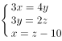

解方程得：x=80，C项正确。

故正确答案为C。

**考点**：和差倍比问题

**来源**：2008年江西省公务员录用考试《行测》题第37题

### 第 38 题

小李开了一个多小时会议，会议开始时看了手表，会议结束又看了手表，发现时针与分针恰好互换了位置，问：这个会议大约开了1小时多少分？

A. 51

B. 47

C. 45

D. 43

第 38 题 · 答案与解析

**参考答案（粉笔题库参考内容）**

A

**解析**

时针和分针互换了位置，说明共走过720°，因为时针每分钟转过0.5°，分针每分钟转过6°，所以分，约为1小时51分。

故正确答案为A。

**来源**：2008年江西省公务员录用考试《行测》题第38题

### 第 39 题

一列长为280米的火车，速度为20米/秒，经过2800米的大桥，火车完全通过这座大桥需多少时间？

A. 28秒

B. 2分20秒

C. 2分28秒

D. 2分34秒

第 39 题 · 答案与解析

**参考答案（粉笔题库参考内容）**

D

**解析**

火车完全通过大桥需要行进280+2800=3080米，火车速度为20米/秒，所以需要时间为。

故正确答案为D。

**考点**：火车过桥

**来源**：2008年江西省公务员录用考试《行测》题第39题

### 第 40 题

一个空的容积为64升的鼓形圆桶上有A、B两孔，一种蒸馏水从A孔流入同时从B孔流出，如果通过A孔的流速为3升/小时，那么在B孔的流速为多少升时才能保证用96小时恰好装满该容器？

A. 4/3

B. 8/3

C. 7/3

D. 3/7

第 40 题 · 答案与解析

**参考答案（粉笔题库参考内容）**

C

**解析**

设B孔流出的速度为x升/小时，从A孔流入同时从B孔流出，说明桶中蒸馏水的累积速度为(3-x)升/小时，则有(3-x)×96=64，解得x=7/3。

故正确答案为C。

**考点**：给具体单位型

**来源**：2008年江西省公务员录用考试《行测》题第40题

### 第 41 题

配制黑火药用的原料是火硝、硫磺和木炭。火硝的质量是硫磺和木炭的3倍，硫磺只占原料总量1/10，要配制这种黑火药320千克，需要木炭多少千克？

A. 48

B. 60

C. 64

D. 96

第 41 题 · 答案与解析

**参考答案（粉笔题库参考内容）**

A

**解析**

火硝的质量是硫磺和木炭的3倍，说明火硝占原料总量的3/4，又因为硫磺占原料总量的1/10，所以木炭占原料总量的，因此配置这种黑火药320千克需要木炭。

故正确答案为A。

**考点**：和差倍比问题

**来源**：2008年江西省公务员录用考试《行测》题第41题

### 第 42 题

小王和小李合作投资，年终根据每人的投资进行分红，小王取了全部的1/3另加9万元。小李取剩余1/3和剩下的14万元。

问小王比小李多得多少万元？

A. 2

B. 3

C. 4

D. 5

第 42 题 · 答案与解析

**参考答案（粉笔题库参考内容）**

B

**解析**

小李取剩余1/3和剩下的14万元，说明剩余的2/3为14万元，即小李得到，又小王取了全部的1/3另加9万元，所以全部的2/3为21+9=30万元，全部为，小王得到45-21=24万元，比小李多得3万元。

故正确答案为B。

**考点**：和差倍比问题

**来源**：2008年江西省公务员录用考试《行测》题第42题

### 第 43 题

A、B、C、D、E这5个小组开展扑克比赛，每两个小组之间都要比赛一场，到现在为止，A组已经比赛了4场，B组已经比赛3场，C组已经比赛了2场，D组已经比赛了1场。

问E组比了几场？

A. 0

B. 1

C. 2

D. 3

第 43 题 · 答案与解析

**参考答案（粉笔题库参考内容）**

C

**解析**

A组已经比赛了4场，说明A组与其他组都进行过比赛；D组已经比赛1场，根据上一个条件，说明D组只与A组进行了比赛；

B组已经比赛3场，根据上一个条件，说明B组只与A、C、E组进行了比赛；

C组已经比赛2场，说明C组只与A、B组进行了比赛。

综上，E组只与A、B组进行了比赛，即比了2场。

故正确答案为C。

**来源**：2008年江西省公务员录用考试《行测》题第43题

### 第 44 题

在同一环形跑道上小陈比小王跑得慢，两人都同一方向跑步时，每隔12分钟遇一次；若两人速度不变，其中一人按相反方向跑步，则隔4分钟相遇一次。

问：两人跑完一圈小陈花费的时间比小王多多少分钟？

A. 5

B. 6

C. 7

D. 8

第 44 题 · 答案与解析

**参考答案（粉笔题库参考内容）**

B

**解析**

环形跑道同时出发同向而行时，实际为环形追及问题，每追上一次小王比小陈多跑一圈，设每圈路程为S，可知①；同时出发背向而行时，每相遇一次二人合跑一圈，即②。联立①②可得，，，即S/(3V_陈)=4，可知小陈每跑一圈需要分钟，路程相同时速度与时间成反比，小王每跑一圈需要6分钟，相差12-6=6分钟。

故正确答案为B。

**考点**：相遇追及

**来源**：2008年江西省公务员录用考试《行测》题第44题

### 第 45 题

A、B、C三件衬衫的价格打折前合计1040元，打折后合计948元，已知A衬衫的打折幅度是9.5折，B衬衫的打折幅度是9折，C衬衫的打折幅度8.75折，打折前A、B两件衬衫的价格比为5：4，那么打折前A、B、C三件衬衫的价格是多少元？

A. 600元，400元，140元

B. 300元，240元，500元

C. 400元，320元，320元

D. 200元，160元，680元

第 45 题 · 答案与解析

**参考答案（粉笔题库参考内容）**

C

**解析**

根据打折前A、B衬衫的价格比为5:4，不妨设打折前A、B、C三件衬衫的价格为5x、4x、y元。根据题意有：5x+4x+y=1040，4.75x+3.6x+0.875y=948，解得x=80，y=320，即A、B、C三件衬衫的价格为400、320、320元。

故正确答案为C。

**考点**：经济利润问题

**来源**：2008年江西省公务员录用考试《行测》题第45题

### 第 46 题

从所给四个选项中，选择最合适的一个填入问号处，使之呈现一定的规律性：

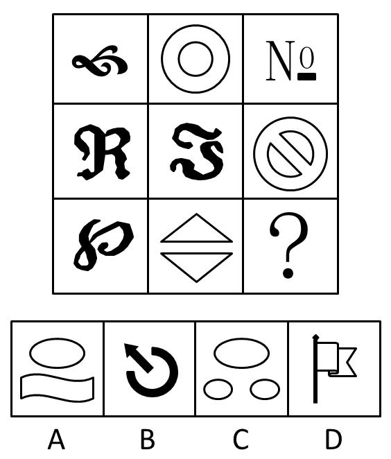

A. A

B. B

C. C

D. D

第 46 题 · 答案与解析

**参考答案（粉笔题库参考内容）**

C

**解析**

元素组成凌乱，考数数。

数部分（连在一起的黑色线条为一部分）。每一行的三幅图分别由一部分、两部分、三部分组成。正确答案为三部分组成的C。选项中的组成部分为2、2、3、1 。

故正确答案为C。

**考点**：数量规律-素

**来源**：2008年江西省公务员录用考试《行测》题第46题

### 第 47 题

从所给四个选项中，选择最合适的一个填入问号处，使之呈现一定的规律性：

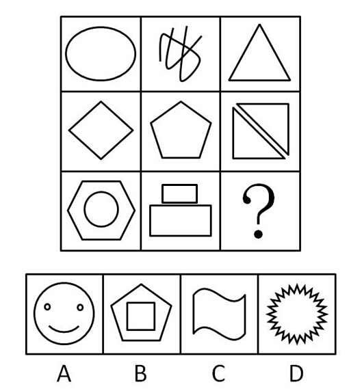

A. A

B. B

C. C

D. D

第 47 题 · 答案与解析

**参考答案（粉笔题库参考内容）**

B

**解析**

元素组成不同，无明显的属性规律，考虑数量规律。观察发现，图形中出现了单一圆和多边形，优先考虑数线条数，九宫格中的图形依次由1、2、3、4、5、6、7、8条线组成，问号处应填入9条线的图形。

故正确答案为B。

**考点**：数量规律-线

**来源**：2008年江西省公务员录用考试《行测》题第47题

### 第 48 题

从所给四个选项中，选择最合适的一个填入问号处，使之呈现一定的规律性：

A. A

B. B

C. C

D. D

第 48 题 · 答案与解析

**参考答案（粉笔题库参考内容）**

C

**解析**

已知图形均为封闭图形，正确答案为封闭图形。

故正确答案为C。

**考点**：属性规律-开闭性

**来源**：2008年江西省公务员录用考试《行测》题第48题

### 第 49 题

从所给四个选项中，选择最合适的一个填入问号处，使之呈现一定的规律性：

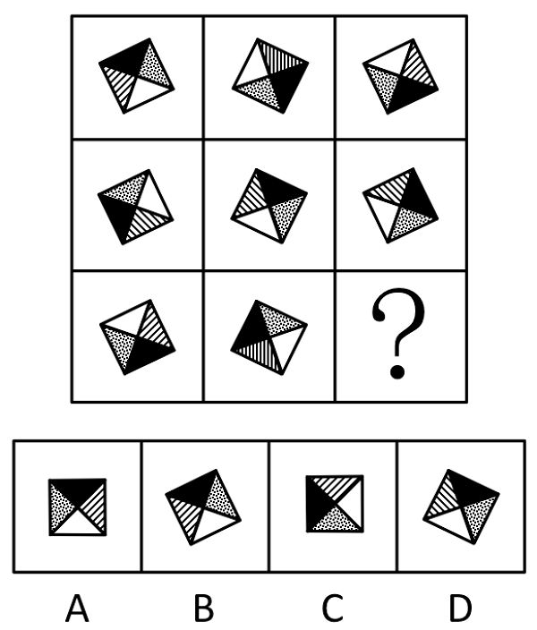

A. A

B. B

C. C

D. D

第 49 题 · 答案与解析

**参考答案（粉笔题库参考内容）**

B

**解析**

元素组成相同，考查位置规律。

已知各图形都是通过同一个图形旋转而得到的。

故正确答案为B。

**考点**：位置规律-旋转

**来源**：2008年江西省公务员录用考试《行测》题第49题

### 第 50 题

从所给四个选项中，选择最合适的一个填入问号处，使之呈现一定的规律性：

A. A

B. B

C. C

D. D

第 50 题 · 答案与解析

**参考答案（粉笔题库参考内容）**

B

**解析**

元素组成凌乱，考数数。

两种元素，分别数，查看二者之间的关系。已知各幅图中，圆的个数都比方形的个数多一个。

故正确答案为B。

**考点**：数量规律-素

**来源**：2008年江西省公务员录用考试《行测》题第50题

### 第 51 题

从所给四个选项中，选择最合适的一个，使之呈现一定的规律性：

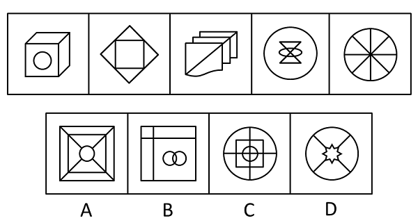

A. A

B. B

C. C

D. D

第 51 题 · 答案与解析

**参考答案（粉笔题库参考内容）**

A

**解析**

元素组成凌乱，考数数。

注意第一幅图不是立方体，有4个封闭面。原题五幅图依次有4，5，6，7，8，（9）个封闭面，选项中的面的数量分别为9、7、12、5。

故正确答案为A。

**考点**：数量规律-面

**来源**：2008年江西省公务员录用考试《行测》题第51题

### 第 52 题

从所给四个选项中，选择最合适的一个，使之呈现一定的规律性：

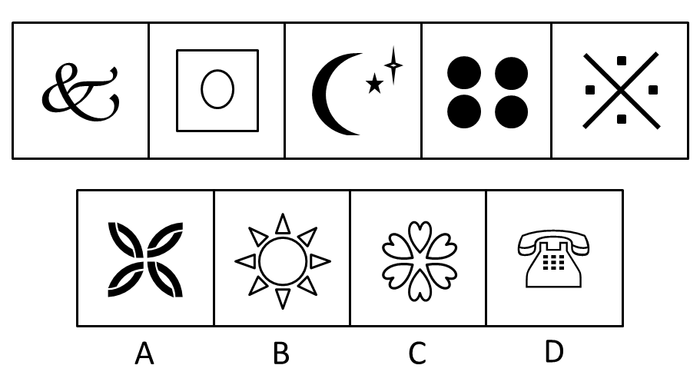

A. A

B. B

C. C

D. D

第 52 题 · 答案与解析

**参考答案（粉笔题库参考内容）**

C

**解析**

元素组成凌乱，考数数。

数部分（连在一起的黑色线条为一部分）。已知各图形分别由1，2，3，4，5，（6）个部分组成，选项中的组成部分为8、9、6、11。

故正确答案为C。

**考点**：数量规律-素

**来源**：2008年江西省公务员录用考试《行测》题第52题

### 第 53 题

从所给四个选项中，选择最合适的一个，使之呈现一定的规律性：

A. A

B. B

C. C

D. D

第 53 题 · 答案与解析

**参考答案（粉笔题库参考内容）**

D

**解析**

元素组成凌乱，考数数。

数部分。已知各图均由两个不相同且不相连的部分组成，选项A、B、C、D分别有两个部分（相同），三个部分，一个部分，两个部分。

故正确答案为D。

**考点**：数量规律-素

**来源**：2008年江西省公务员录用考试《行测》题第53题

### 第 54 题

从所给四个选项中，选择最合适的一个，使之呈现一定的规律性：

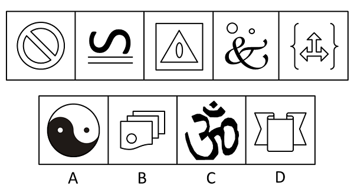

A. A

B. B

C. C

D. D

第 54 题 · 答案与解析

**参考答案（粉笔题库参考内容）**

C

**解析**

元素凌乱，考数数。

已知各图形均由不相连的三个部分组成，选项的组成部分别为2、2、3、1。

故正确答案为C。

**考点**：数量规律-素

**来源**：2008年江西省公务员录用考试《行测》题第54题

### 第 55 题

从所给四个选项中，选择最合适的一个，使之呈现一定的规律性：

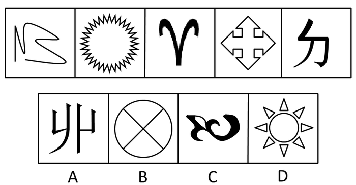

A. A

B. B

C. C

D. D

第 55 题 · 答案与解析

**参考答案（粉笔题库参考内容）**

B

**解析**

本题属于争议题。

方法一：元素组成凌乱，考虑属性变化。已知图形中奇数项图形是开放的，偶数项图形是全封闭的，未知的下一项图形是偶数项，所以应该是封闭的。通过分析只有B选项的图形是封闭的。故正确答案为B。

方法二：元素组成凌乱，考虑数数。已知图形奇数项图形是0个面，偶数项图形是1个面，图形面数呈0、1、0、1、0？的规律。未知的下一项也应该是有1个面的图形，通过分析A项为0个面，B项为4个面， D项为9个面，只有C选项为1个面。故正确答案为C。

**考点**：数量规律-面

**来源**：2008年江西省公务员录用考试《行测》题第55题

### 第 56 题

妒富意识：指妒忌别人富有的错误意识。

下列属于妒富意识的是：

A. 有极少数人一旦知道某某富了一些，就来找他的麻烦了

B. 不少人和单位即使是正当的经济来源也不愿意对外说

C. 小王新买了一件价值数万元的钻石戒指，同办公室的同事一致认为不好看

D. 有一种观点认为：一些部门和人通过正当渠道先富起来，也可能妨碍共同富裕

第 56 题 · 答案与解析

**参考答案（粉笔题库参考内容）**

A

**解析**

第一步：抓住定义中的关键词。

关键词强调这种意识产生于对“别人”的“妒忌”，并且是“错误”意识。

第二步：逐一判断选项。

A中嫉妒别人富有，从而产生了错误的意识，导致了错误的举动，符合定义，当选；

B是为了避免别人对自己的妒忌，是自我保护，不符合定义，排除；

C中“不好看”并未体现妒忌，而是主观上对美丑的判断，不属于错误意识，不符合定义，排除；

D是并非出于“妒忌”，而是学术观点，不符合定义，排除。

故正确答案为A。

**考点**：拆词

**来源**：2008年江西省公务员录用考试《行测》题第56题

### 第 57 题

互文：修辞格之一。在连贯性的话语中，将本应合在一起说的两个词语，分开拼在上下两句中或一句的上下段中，参互成文。合而见义，如“主人下马客在船”，应理解为“主人和客人共同下了马，来到了船上”。

下列不属于互文手法的是：

A. 秦时明月汉时关，万里长征人未还

B. 白兔捣药秋复春，嫦娥孤栖与谁邻

C. 孤屿池痕春涨满，小栏花韵午晴初

D. 映阶碧草自春色，隔叶黄鹂空好音

第 57 题 · 答案与解析

**参考答案（粉笔题库参考内容）**

D

**解析**

第一步：抓住定义中的关键词。

关键词强调“将本应合在一起说的两个词语，分开拼在上下两句中或一句的上下段中”、“合而见义”。

第二步：逐一判断选项。

A中“明月”和“关”分开在一句的上下段中，应理解为“秦汉时的明月照耀秦汉时的关塞”，A正确；

B中“白兔捣药”和“嫦娥孤栖”分开在上下两句中，应理解为“白兔在月中年复一年地捣着药杵，到底谁来陪伴它，嫦娥在月宫里年复一年孤独地生活，到底谁来陪伴她”，B正确；

C中“孤屿池痕”和“小栏花韵”分开在上下两句中，应理解为“在初晴的中午，有着小岛的池塘充满春色，小小花圃中鲜花盛开充满春色”，C正确；

D中“映阶碧草”和“隔叶黄鹂”分开在上下两句中，但是它们不能合在一起共用谓语，因为“草”不能“空好音”，“黄鹂”不能“自春色”，D错误。

本题为选非题，故正确答案为D。

**考点**：方式目的

**来源**：2008年江西省公务员录用考试《行测》题第57题

### 第 58 题

公地悲剧：也称公共地悲剧，指享有者都从自己私利出发，争取从中获取更多收益，而付出的代价由大家负担。

下列不属于公地悲剧的是：

A. 军备竞赛的双方都面临着一个困境——一方面军事力量不断增加，另一方面国家安全却受到越来越多的威胁

B. 博弈游戏中，任何“赢”的一方都是背离游戏的，任何“输”的一方也都是背离游戏的

C. 一群牧民一同在一块公共草场放牧。不少牧民都想多养羊增加个人收益，结果草场持续退化，直至无法养羊，最终导致所有牧民破产

D. 有的企业把下水道污物、化学物质、放射性污染物和高温废弃物等排放到水体中，将有毒废气排放到大气中

第 58 题 · 答案与解析

**参考答案（粉笔题库参考内容）**

B

**解析**

第一步：找到定义关键词。

“享有者都从自己私利出发，争取从中获取更多收益，而付出的代价由大家负担”。

第二步：逐一分析选项。

A项：为了能更好的军备竞赛，增加军事力量，体现了从自己私利出发，而国家安全受到越来越多的威胁，体现了付出的代价由大家负担，符合定义，排除；

B项：博弈游戏中，无论输赢都不是背离游戏的，只是针对博弈的两方都是背离游戏的，没有体现付出的代价由大家负担，不符合定义，当选；

C项：牧民想多养羊增加个人收益体现从自己私利出发，而造成草场退化、所有牧民破产，体现了付出的代价由大家负担，符合定义，排除；

D项：有的企业排放污染物，体现了从自己的私利出发，污染物的排放势必污染土壤、空气，付出的代价由大家负担，符合定义，排除。

本题为选非题，故正确答案为B。

**考点**：原因结果

**来源**：2008年江西省公务员录用考试《行测》题第58题

### 第 59 题

对外贸易地理方向指一个国家或地区进口商品的来源和出口商品的去向，从而反映该国与其他国家或地区之间的经济贸易联系程度。

下列属于对外贸易地理方向的是：

A. 2003年，上海合作组织成功举行了一场反恐演习

B. 第一次全国经济普查结束，中国经济总量升至世界第六

C. 海关统计，2004年欧盟成为中国最大的贸易伙伴

D. 中国与欧美纺织品贸易摩擦经多次谈判后最终得到协商解决

第 59 题 · 答案与解析

**参考答案（粉笔题库参考内容）**

C

**解析**

第一步：抓住定义中的关键词。

关键词强调通过“进口商品的来源和出口商品的去向向”来反映国家或地区间的“经济贸易联系程度”。

第二步：逐一判断选项。

A项中“反恐演习”不是“进出口商品”，排除；

B项中从“经济总量大”不能得知“商品去向”，也不能体现“经济贸易联系程度”，排除；

C项中反映了欧盟和中国之间有进出口商品，且欧盟与中国的经济贸易联系紧密，当选；

D项中“中国与欧美贸易摩擦得到解决”体现了商品去向，但不能直接体现“经济贸易联系程度”，排除。

故正确答案为C。

**考点**：拆词

**来源**：2008年江西省公务员录用考试《行测》题第59题

### 第 60 题

认知干预：认知干预的原则认为，一个人的心理活动和心理状态决定于其内在的认知观念，个体心理问题的根源是其头脑中不合理的认识观念，认知干预就是要以正确的理论知识来改变个体的不合理认识。

下列不属于认知干预的是：

A. 在实施某项手术前，医护人员以正确的医学和生理学知识告诉病人此项手术是必需和安全的，消除病人的焦虑

B. 学校有计划、按步骤地对学校中有关人员的心理活动、个性特征或他们的心理问题施加影响．使之发生指向预期目标的变化

C. 对于抑郁症患者，给其提供另一种可以解释其观察和经验的概念系统从而取代其原有的信念

D. 对于渴望提高自身理论水平的在职人员，教师结合其实际，向其提供系统的理论知识

第 60 题 · 答案与解析

**参考答案（粉笔题库参考内容）**

D

**解析**

第一步：抓住定义中的关键词。

理解题干得出，认知干预就是“用正确的理论知识改变个体的不合理认识，进而解决个人的心理问题”。

第二步：逐一判断选项。

A中“医护人员用正确的知识”来消解病人“焦虑”这个心理问题，符合定义，排除；

B中直接指出对心理问题施加影响从而解决问题，符合定义，排除；

C中通过“概念系统取代原有的不合理信念”来解决抑郁症（心理问题），符合定义，排除；

D中“渴望提高自身理论水平”并非是“个体的不合理认识”，而是对自身能力的更高追求，不符合定义，当选。

本题为选非题，故正确答案为D。

**考点**：方式目的

**来源**：2008年江西省公务员录用考试《行测》题第60题

### 第 61 题

钳子：修理

A. 农民：土地

B. 士兵：岗位

C. 粉笔：教师

D. 学校：学生

第 61 题 · 答案与解析

**参考答案（粉笔题库参考内容）**

C

**解析**

第一步：判断题干词语间逻辑关系。

题干两词间是对应关系，钳子是修理用的工具。

第二步：判断选项词语间逻辑关系。

A中土地被农民使用，但与题干的顺序不同，排除；

B、D中词语间也是对应关系，但与题干有区别，是人物和地点间的对应关系，均排除；

C中粉笔是教师用的工具，当选。

故正确答案为C。

**考点**：逻辑关系-对应关系

**来源**：2008年江西省公务员录用考试《行测》题第61题

### 第 62 题

南昌：北京

A. 语言：汉语

B. 电话：冰箱

C. 书本：教师

D. 小说：人物

第 62 题 · 答案与解析

**参考答案（粉笔题库参考内容）**

B

**解析**

第一步：判断题干词语间逻辑关系。

题干中两词是并列关系的两个城市。

第二步：判断选项词语间逻辑关系。

A、C、D中词语间都不具有并列关系，A是包容关系，C是对应关系，D是包容关系中的组成关系，均排除；

B中电话和冰箱是并列关系的两个家电，当选。

故正确答案为B。

**考点**：逻辑关系-并列关系

**来源**：2008年江西省公务员录用考试《行测》题第62题

### 第 63 题

脊髓：神经系统

A. 几何：平面图形

B. 寂寞：无所事事

C. 法院：国家机关

D. 山河：风光秀丽

第 63 题 · 答案与解析

**参考答案（粉笔题库参考内容）**

C

**解析**

第一步：判断题干词语间逻辑关系。

题干中两词是包容关系，脊髓是神经系统的组成部分。

第二步：判断选项词语间逻辑关系。

A中平面图形是几何的研究对象之一，是对应关系，排除；

B、D中，前者并非后者的组成部分，均排除；

C中两词是包容关系，法院是国家机关，当选。

故正确答案为C。

**考点**：逻辑关系-包容关系

**来源**：2008年江西省公务员录用考试《行测》题第63题

### 第 64 题

奶粉：牛奶

A. 麦片：大麦

B. 毛豆：绒毛

C. 面粉：挂面

D. 国家：王国

第 64 题 · 答案与解析

**参考答案（粉笔题库参考内容）**

A

**解析**

第一步：判断题干词语间逻辑关系。

题干两词是对应关系，奶粉是由牛奶加工而成的。

第二步：判断选项词语间逻辑关系。

A中麦片是由大麦加工而成的，当选；

B中绒毛是毛豆的组成部分，是包容关系，排除；

C中挂面是由面粉加工而成的，但是词语顺序错误，排除；

D中“王国”是以国王为元首的国家，是国家的一种，D中两词是种属关系，排除。

故正确答案为A。

**考点**：逻辑关系-对应关系

**来源**：2008年江西省公务员录用考试《行测》题第64题

### 第 65 题

棉花：棉田

A. 灯光：灯火

B. 海滩：海豚

C. 庙会：庙宇

D. 茶树：茶园

第 65 题 · 答案与解析

**参考答案（粉笔题库参考内容）**

D

**解析**

第一步：判断题干词语间逻辑关系。

题干两词是对应关系，棉花生长在棉田里。

第二步：判断选项词语间逻辑关系。

A、B、C中词语间并非物与地点的对应关系，均排除；

D符合题干逻辑，茶树生长在茶园里，当选。

故正确答案为D。

**考点**：逻辑关系-对应关系

**来源**：2008年江西省公务员录用考试《行测》题第65题

### 第 66 题

水：湖泊

A. 富裕：休闲

B. 山：水

C. 营养：健康

D. 蓝图：海洋

第 66 题 · 答案与解析

**参考答案（粉笔题库参考内容）**

C

**解析**

第一步：判断题干词语间逻辑关系。

题干两词是组成关系，湖泊里必然有水。

第二步：判断选项词语间逻辑关系。

A、D中词语无明显逻辑关系，均排除；

B中词语间不是组成关系，排除；

C中健康必然包括营养，当选。

故正确答案为C。

**考点**：逻辑关系-包容关系

**来源**：2008年江西省公务员录用考试《行测》题第66题

### 第 67 题

南辕：北辙

A. 声东：击西

B. 虚情：假意

C. 七上：八下

D. 阳春：白雪

第 67 题 · 答案与解析

**参考答案（粉笔题库参考内容）**

A

**解析**

第一步：判断题干词语间逻辑关系。

题干中“南辕”和“北辙”的意义相反，并且构成成语。

第二步：判断选项词语间逻辑关系。

A符合题干的逻辑，两个相对意义的词项构成成语，当选；

B、C、D中的词项虽然也都能构成成语，但是其词项在意思上相近；注意C为干扰项，“七上”和“八下”都表示忐忑的状态。

故正确答案为A。

**考点**：拆分思维、语义关系-反义关系

**来源**：2008年江西省公务员录用考试《行测》题第67题

### 第 68 题

屏幕：彩屏

A. 时间：纳米

B. 何首乌：中药材

C. 酷暑：空洞

D. 青年：愤青

第 68 题 · 答案与解析

**参考答案（粉笔题库参考内容）**

D

**解析**

第一步：判断题干词语间逻辑关系。

题干两词是包容关系中的种属关系，彩屏是屏幕的一种。

第二步：判断选项词语间逻辑关系。

A中纳米是数量单位的一种，排除；

B中词项顺序与题干相反，排除；

C中词项间无明显逻辑关系，排除；

D中愤青是青年中的一类人，当选。

故正确答案为D。

**考点**：逻辑关系-包容关系

**来源**：2008年江西省公务员录用考试《行测》题第68题

### 第 69 题

影星：江西人

A. 蔬菜：种植

B. 专家：军人

C. 鼓手：乐队

D. 社会：自然

第 69 题 · 答案与解析

**参考答案（粉笔题库参考内容）**

B

**解析**

第一步：判断题干词语间逻辑关系。

题干两词在人物身份上是交叉关系。

第二步：判断选项词语间逻辑关系。

A中两词构成动宾结构短语，排除；

B中“专家”和“军人”身份上也交叉，当选；

C中“鼓手”是“乐队”的组成部分，是包容关系，排除；

D中“社会”和“自然”是并列关系，排除。

故正确答案为B。

**考点**：逻辑关系-交叉关系

**来源**：2008年江西省公务员录用考试《行测》题第69题

### 第 70 题

潮湿：干燥

A. 晴朗：刮风

B. 日出：日落

C. 高温：低温

D. 黎明：黄昏

第 70 题 · 答案与解析

**参考答案（粉笔题库参考内容）**

C

**解析**

第一步：判断题干词语间逻辑关系。

题干两词是一对相对反义词，是湿度在程度上的划分，属于反义关系。

第二步：判断选项词语间逻辑关系。

A、B、D中词项都构成反对关系，不是反义词，均排除；

C中词项是相对反义词，是温度在不同程度上的划分，当选。

故正确答案为C。

**考点**：语义关系-反义关系

**来源**：2008年江西省公务员录用考试《行测》题第70题

### 第 71 题

在世界总人口中，男女比例相当，但黄种人是大大多于黑种人的，在其它肤色的人种中，男性比例大于女性，由此可见：

A. 黄种女性多于黑种男性

B. 黄种男性多于黑种女性

C. 黄种男性多于黑种男性

D. 黄种女性多于黑种女性

第 71 题 · 答案与解析

**参考答案（粉笔题库参考内容）**

A

**解析**

日常结论题，根据题干信息逐一分析选项。

A项：根据题干中“其它肤色的人种中，男性比例大于女性”，且世界总人口中，男女比例相当，可推出黄种人和黑种人中女性比男性多，再根据黄种人大大多于黑种人，可以推出黄种女性（多数人的大部分）多于黑种男性（少数人的少部分），可以推出，当选；

B项：根据题干可推出黄种人和黑种人中女性比男性多，且黄种人是大大多于黑种人的，但每种人的男女比例无法确定，所以是无法比较黄种男性（多数人中的少部分）和黑种女性（少数人中的多部份）的多少的，无法推出，排除；

C项：根据题干可推出黄种人和黑种人中女性比男性多，且黄种人是大大多于黑种人的，但每种人的男女比例无法确定，所以是无法比较黄种男性（多数人中的少部分）和黑种男性（少数人中的少部份）的多少的，无法推出，排除；

D项：根据题干可推出黄种人和黑种人中女性比男性多，且黄种人是大大多于黑种人的，但每种人的男女比例无法确定，所以是无法比较黄种女性（多数人中的多部分）和黑种女性（少数人中的多部份）的多少的，无法推出，排除；

故正确答案为A。

**考点**：日常结论

**来源**：2008年江西省公务员录用考试《行测》题第71题

### 第 72 题

任何一本所有批评家赞许的作品都被每个文学工作者所读过，并且任何一个读过点什么的人都将谈论到它，任何一个批评家都将赞许那些推崇批评家本人的人的任一作品，张因铣推崇每位批评家，由此可见：

A. 张因铣写了很多作品

B. 所有文学工作者都读过张因铣的作品

C. 张因铣作品被所有批评家读过

D. 张因铣所有作品都被所有的文学工作者谈论

第 72 题 · 答案与解析

**参考答案（粉笔题库参考内容）**

B

**解析**

第一步：翻译题干的逻辑。

题干前半部分：所有批评家赞许的作品→该作品被每个文学工作者所读过；某作品被读过→有作品被谈论。

题干后半部分：某人推崇某个批评家→该批评家赞许该人的作品，也就是说某人推崇所有批评家→所有批评家赞许该人的作品。

将以上三个推导连起来即为：某人推崇所有批评家→所有批评家赞许该人的作品→该作品被每个文学工作者所读过→有作品被谈论。

第二步：从事实信息开始推导，并得到结论。

题中未提及张因铣的作品数量，A错误，排除；

题干中“张因铣推崇每位批评家”是事实信息，由此开始推导。将“张因铣推崇每位批评家”代入到题干的逻辑关系中可以得到：张因铣推崇每位批评家→所有批评家都赞许张因铣的任一作品→所有文学工作者都读过张因铣的所有作品→有作品被谈论，B正确，当选；

题干指出批评家只赞许一个人的作品，但题中并未提及批评家是否读过，C错误，排除；

有作品被谈论，但不见得是所有作品都被谈论，D错误，排除。

故正确答案为B。

**考点**：常规翻译

**来源**：2008年江西省公务员录用考试《行测》题第72题

### 第 73 题

在某生态区由于激烈的生存竞争，老年大象的数量在逐年减少，但青年大象的生存、繁殖能力提高了，幼年大象的成活率也大大提高了。

照此发展下去，可以预见两年内：

A. 老年大象的数量将少于幼年大象的数量

B. 幼年大象的比例将提高

C. 青年大象比例将减少

D. 青年大象的比例将增加

第 73 题 · 答案与解析

**参考答案（粉笔题库参考内容）**

B

**解析**

第一步：抓住题干中的对象。

注意本题隐含青年大象的数量基本不变。题干强调“老年大象数量逐年减少”，“幼年大象成活率大大提高”。

第二步：逐一判断选项。

“数量”和“成活率”的参照物不同，二者无法直接比较得出老年大象的总量是否会少于幼年大象的总量，A错误，排除；

由“成活率”提高可知幼象总量上涨，同时老象总量减少，青年象数量不变，因此幼象比例提高，B正确，当选；

幼象变多，老象变少，但大象总量的变化未知，因此青年象的比例变化未知，C、D错误，均排除。

故正确答案为B。

**考点**：日常结论

**来源**：2008年江西省公务员录用考试《行测》题第73题

### 第 74 题

来自公安机关的资料显示，娱乐圈中有人吸毒，高级知识分子中也有人吸毒，吸毒者中有些人是女性，而抢劫犯中有相当比例是吸毒者。

由此可见：

A. 高级知识分子中也有抢劫犯

B. 抢劫犯中吸毒者占了大多数

C. 有些抢劫犯可能是女性

D. 有些抢劫犯不是女性

第 74 题 · 答案与解析

**参考答案（粉笔题库参考内容）**

C

**解析**

第一步：翻译题干。

将题干中的每句话翻译成标准的直言命题，即“有的娱乐圈的人是吸毒者”，“有的高级知识分子是吸毒者”，“有的吸毒者是女性”，“有的抢劫犯是吸毒者”，可用符号表示为：①有的娱乐圈的人→吸毒者，②有的高级知识分子→吸毒者，③有的吸毒者→女性，④有的抢劫犯→吸毒者。

第二步：逐一判断选项。

从②和④可看出，高级知识分子和吸毒者、抢劫犯和吸毒者都是交叉关系，因此无法肯定高级知识分子和抢劫犯之间的关系，只能说这两者可能存在交叉，即有的高级知识分子可能是抢劫犯，A错误，排除；

“抢劫犯中有相当比例是吸毒者”中的相当比例不代表吸毒者在抢劫犯中占了大多数，B错误，排除；

由③和④可看出，女性和吸毒者、抢劫犯和吸毒者是交叉关系，因此“女性”和“抢劫犯”之间只能构成或然交叉关系，可能是也可能不是，C正确，当选。D错误，排除。

故正确答案为C。

**考点**：集合推理

**来源**：2008年江西省公务员录用考试《行测》题第74题

### 第 75 题

小丁说：“只要高局长过目，2006年年度统计报告就不会出错。”小陈说：“如果我和小丁认真负责，高局长就不要过目。”小马说：“高局长审过了2006年统计报告，他一眼就看出其中一个统计数字有问题。”假如三人中有一人说错并且高局长确实看过2006年统计报告，那么可以推出：

A. 小马说了假话

B. 小陈说了假话

C. 小丁没有认真负责

D. 小丁或小陈没有认真负责

第 75 题 · 答案与解析

**参考答案（粉笔题库参考内容）**

D

**解析**

第一步：找出题干矛盾命题。

小丁：高局长过目→年度报告不会错

小陈：陈 且 小丁认真负责→高局长不过目

小马：高局长过目 且 年度报告有问题

分析题干条件可知，小丁和小马的说法为矛盾关系，必有一真一假。。

第二步：根据题干条件推理。

根据题干条件可知，三人中有一人说错，则说错的人一定在小丁和小马之间，所以小陈说的为真，且高局长看过报告，根据“否后必否前”可知，小丁或小陈没有认真负责，对应D项

故正确答案为D。

**考点**：只有一真/一假

**来源**：2008年江西省公务员录用考试《行测》题第75题

### 第 76 题

如果国民生产总值提高了并且民众消费心理变化了，那么蔬菜的供应将大幅增加；如果国民生产总值没有提高，或者蔬菜供应将大幅增加，那么城市居民的最低生活将没有保障；如果蔬菜供应大幅增加，那么或者农民增收，或者社会福利增加。而事实上，城市居民的最低生活获得了保障。由此可见：

A. 农民增收了

B. 社会福利增加了

C. 民众的消费心理没有发生变化

D. 民众的消费心理变化了

第 76 题 · 答案与解析

**参考答案（粉笔题库参考内容）**

C

**解析**

第一步：翻译题干。利用充分必要条件。

第一句：总值提高∧消费心理变化→供应增加。

第二句：总值没有提高∨供应增加→最低生活没有保障。

第三句：供应增加→农民增收∨社会福利增加。

第二步：从事实信息开始推导，并得到结论。

“城市居民的最低生活获得了保障”是题干中的事实信息，由此开始推导。题干指出“最低生活获得保障”，这否定了第二句的后件，可以得到否定第二句前件的结论“总值提高∧供应没有增加”。

A、B：由于“供应没有增加”否定第三句的前件不能推出否定第三句后件的结论。所以从题干中不能知道“农民有没有增收”，也不能知道“社会福利有没有增加”，所以A、B不能推出，均排除；

C、D：“供应没有增加”否定了第一句的后件可以推出否定第一句的前件的结论，即“总值没有提高∨消费心理没有变化”。又因为“总值提高”，所以只能“消费心理没有变化”，C正确，当选；D错误，排除。

故正确答案为C。

**考点**：常规翻译

**来源**：2008年江西省公务员录用考试《行测》题第76题

### 第 77 题

世界上越是经济发展快的国家，人们看表的次数相对也就多。越是发展缓慢的国家，人们看表的频率也就越低。早些时候经济发展速度的排列次序是美国、日本、德国、英国、荷兰、新加坡、意大利、韩国、中国香港、中国台湾······但这些排列总会随着经济的发展而不断变化。

据此，我们可以认为：

A. 看表的频率决定经济发展速度

B. 经济发展速度决定看表的频率

C. 早些时候，荷兰人的看表次数超过香港

D. 美国人的看表次数总是世界第一

第 77 题 · 答案与解析

**参考答案（粉笔题库参考内容）**

C

**解析**

日常结论题，根据题干信息逐一分析选项

A项：根据题干说的“越是经济发展快的国家，人们看表的次数相对也就多。越是发展缓慢的国家，人们看表的频率也就越低”可知，看表频率是受经济发展速度影响的，而非看表频率决定经济发展速度，并且“决定”表述过于绝对，无法推出，排除；

B项：题干说的是发展快的国家人们看表的次数“相对”多，并未表述经济发展速度能“决定”看表频率，“决定”表述过于绝对，无法推出，排除；

C项：根据题干中早些时候各国经济发展速度的排列次序可知，荷兰的经济发展速度排在中国香港之前，再结合“经济发展快的国家，人们看表的次数相对也就多”，可以推出早些时候荷兰人的看表次数超过香港，当选；

D项：题干仅提及“早些时候”美国的经济发展速度排名第一，且明确表示经济发展速度的排列“总会随着经济的发展而不断变化”，所以无法推出美国“总是”第一，排除。

故正确答案为C。

**考点**：日常结论

**来源**：2008年江西省公务员录用考试《行测》题第77题

### 第 78 题

今年春运对全市中巴客运车的安全检查后，甲、乙、丙三名交警有如下结论：

甲：所有中巴客运车都存在超载问题

乙：所有中巴客运车都不存在超载问题

丙：如意公司的中巴客运车和吉祥公司的中巴客运车都存在超载问题

如果上述三个结论只有一个错误，则以下哪项一定为真：

A. 如意公司的中巴客运车和吉祥公司的中巴客运车都不存在超载问题

B. 如意公司的中巴客运车和吉祥公司的中巴客运车都存在超载问题

C. 如意公司的中巴客运车存在超载问题，但吉祥公司的中巴客运车不存在超载问题

D. 吉祥公司的中巴客运车存在超载问题，但如意公司的中巴客运车不存在超载问题

第 78 题 · 答案与解析

**参考答案（粉笔题库参考内容）**

B

**解析**

第一步：寻找突破口。

本题突破口为甲和乙的结论是反对关系，两人的结论不可同真但可同假，因此必有一假。

第二步：看其他人的话并判断选项。

甲和乙的结论中必有一个为假，又因为本题只有一个结论为假，所以丙的结论为真，即“如意公司和吉祥公司的中巴客运车都存在超载问题”，B正确。同时可知，甲的结论为真，乙的结论为假。

故正确答案为B。

**考点**：只有一真/一假

**来源**：2008年江西省公务员录用考试《行测》题第78题

### 第 79 题

无论是工业用水还是民用水，现行水费价格一直偏低。某区推出一项举措，对超出月额定数的用水量，无论是工业用水还是民用水，一律按上调高价收费。这一举措将对该区的节约用水产生重大的促进作用。

上述举措要达到预期的目的，（    ）必须是真的。

（1）有相当数量的浪费用水是因为水价格偏低而造成的

（2）有相当数量的用户是因为水价格偏低而浪费用水的

（3）超额用水价格的上调幅度一般对浪费用水的用户产生经济压力

A. （1）、（2）和（3）

B. 仅（1）和（2）

C. 仅（1）和（3）

D. 仅（2）和（3）

第 79 题 · 答案与解析

**参考答案（粉笔题库参考内容）**

A

**解析**

第一步：找到论点和论据。

本题论点是“对超额用水量一律按上调高价收费能达到节约用水的目的”。论据是“目前工业用水和民用水的现行水费价格一直偏低”。

第二步：判断加强方式。

论点强调水价上升能促进节约用水，论据强调水价偏低，两者无直接因果关系，需对题干加强。

第三步：逐一判断语句。

加强论证可补充“浪费用水与水价偏低有关”，（1）、（2）符合。（3）指出高水价能减少浪费用水，这直接加强了论点，（3）符合。

故正确答案为A。

**考点**：必要条件

**来源**：2008年江西省公务员录用考试《行测》题第79题

### 第 80 题

某教研室要选派一些教师参加一个国际学术研讨会。根据工作安排，必须满足下列几个条件：

（1）如果赵老师或者钱老师去，那么孙老师也应该去；

（2）负责科研的宗主任必须去；

（3）如果钱老师不去，那么李老师去，但是周老师不能去；

（4）如果宗主任去，那么周老师也应该去。

由此可见：

A. 钱老师、孙老师应该去

B. 钱老师、孙老师都不应该去

C. 钱老师应该去，孙老师不应该去

D. 孙老师应该去，钱老师不应该去

第 80 题 · 答案与解析

**参考答案（粉笔题库参考内容）**

A

**解析**

第一步：翻译题干。利用充分必要条件。

（1）：赵去∨钱去→孙去。

（2）：宗必去。

（3）：钱不去→李去∧周不去。

（4）：宗去→周去。

第二步：从事实信息开始推导，并得到结论。

（2）“宗主任必须去”是事实信息，由此开始推导。根据（4），“宗必去”可以推出“周老师去”。“周老师去”否定了（3）的后件，可以得出否定（3）前件的结论，即“钱老师去”。“钱老师去”，根据（1）可以推出“孙老师也去”。

综上所述，宗主任、周老师、钱老师、孙老师去，赵老师和李老师去不去不一定。

故正确答案为A。

**考点**：常规翻译

**来源**：2008年江西省公务员录用考试《行测》题第80题

### 第 81 题

党的十七大报告中提出，新时期最突出的标志是：

A. 与时俱进

B. 艰苦奋斗

C. 无私奉献

D. 实事求是

第 81 题 · 答案与解析

**参考答案（粉笔题库参考内容）**

A

**解析**

本题考查毛中特。

党的十七大报告指出，新时期最鲜明的特点是改革开放，新时期最显著的成就是快速发展，新时期最突出的标志是与时俱进。

故正确答案为A。

**来源**：2008年江西省公务员录用考试《行测》题第81题

### 第 82 题

一种固定下来适合和便于网络交往，判定行为者是否文明和礼貌的行为标准就是：

A. 网络道德原则

B. 网络道德规范

C. 网络道德素质

D. 网络道德礼仪

第 82 题 · 答案与解析

**参考答案（粉笔题库参考内容）**

D

**解析**

本题考查毛中特。

网络文化是一种新型人际关系，由于网络行为本身的特殊性，它也需要一种特殊的礼仪表达方式，即：网络道德礼仪。网络道德礼仪就是一种固定下来适合和便于网络交往，判定行为者是否文明和礼貌的行为标准。

故正确答案为D。

**来源**：2008年江西省公务员录用考试《行测》题第82题

### 第 83 题

贯彻“四个尊重”的方针，其中核心是：

A. 尊重文化

B. 尊重历史

C. 尊重劳动

D. 尊重资本

第 83 题 · 答案与解析

**参考答案（粉笔题库参考内容）**

C

**解析**

“尊重劳动、尊重知识、尊重人才、尊重创造”，四者是一个具有内在联系的统一整体，劳动在其中居于核心和基础地位；知识是创造财富的重要源泉，但它只有通过劳动者、劳动资料，才能形成实际的财富；人才是知识资源的载体，人才的本质在于创造性。人才只有通过劳动，为社会创造出巨大的物质和精神财富，才能体现出自身的价值；创造本身就是一种劳动，创造过程即是劳动者最大限度地发挥聪明才干的过程，“四个尊重”中，核心是尊重劳动。

故正确答案为C。

**来源**：2008年江西省公务员录用考试《行测》题第83题

### 第 84 题

某单位收发员为收集邮票，故意隐匿毁弃他人信件，其行为侵犯了宪法规定的公民的哪项权利：

A. 隐私权

B. 通信自由

C. 通讯秘密

D. 社会文化权利

第 84 题 · 答案与解析

**参考答案（粉笔题库参考内容）**

B

**解析**

我国《宪法》第四十条规定：“中华人民共和国公民的通信自由和通信秘密受法律的保护。除因国家安全或者追查刑事犯罪的需要，由公安机关或者检察机关依照法律规定的程序对通信进行检查外，任何组织或者个人不得以任何理由侵犯公民的通信自由和通信秘密。”可见，通信自由是公民的基本权利，它包括公民与其他人进行正当通信的自由以及保守自己信件秘密的权利两方面内容。题干中提到某收发员为收集邮票，故意隐匿毁弃他人信件，侵犯了通信自由权利。

故正确答案为B。

**本题相关知识点：**

1.隐私权是指自然人享有的私人生活安宁与私人信息秘密依法受到保护，不被他人非法侵扰、知悉、收集、利用和公开的一种人格权，而且权利主体对他人在何种程度上可以介入自己的私生活，对自己是否向他人公开隐私以及公开的范围和程度等具有决定权。

2.通讯秘密指通信内容有保持秘密不为人知的自由外，通信对象、通信时间、通信方式均在通信自由和通讯秘密权所保障的范围之内。

**考点**：宪法

**来源**：2008年江西省公务员录用考试《行测》题第84题

### 第 85 题

根据我国宪法规定，决定战争与和平问题的职权由：

A. 全国人民代表大会常务委员会行使

B. 全国人民代表大会行使

C. 国家中央军事委员会行使

D. 中国共产党中央军事委员会行使

第 85 题 · 答案与解析

**参考答案（粉笔题库参考内容）**

B

**解析**

中华人民共和国全国人民代表大会作为最高国家权力机关在国防方面的职权主要有：决定战争与和平的问题；制定有关国防方面的基本法律；选举中央军事委员会主席，根据中央军事委员会主席的提名，决定中央军事委员会其他组成成员，并有权罢免以上人员；审查和批准包括国防建设在内的国民经济和社会发展计划和计划执行情况的报告；审查和批准包括国防经费预算在内的国家预算和预算执行情况的报告；改变或者撤销全国人民大会代表常务委员会在国防方面不适当的决定；应当由全国人民代表大会行使的国防方面的其他职权。

故正确答案为B。

**考点**：宪法

**来源**：2008年江西省公务员录用考试《行测》题第85题

### 第 86 题

下列各项中符合《广告法》规定的广告是：

A. 保证100％有效的某药品广告

B. 某麻醉药品广告

C. 电视上发布的某烟草广告

D. 标明产地的茶叶广告

第 86 题 · 答案与解析

**参考答案（粉笔题库参考内容）**

D

**解析**

《广告法》第九条第一款规定：“广告中对商品的性能、产地、用途、质量、价格、生产者、有效期限、允诺或者对服务的内容、形式、质量、价格、允诺有表示的，应当清楚、明白。”

故正确答案为D。

**本题相关知识点：**

1.第十四条规定：“药品、医疗器械广告不得有下列内容：（一）含有不科学的表示功效的断言或者保证的；（二）说明治愈率或者有效率的。”故A不正确。

2.第十六条规定：“麻醉药品、精神药品、毒性药品、放射性药品等特殊药品，不得做广告。”故B不正确。

3.第十八条规定：“禁止利用广播、电影、电视、报纸、期刊发布烟草广告。禁止在各类等候室、影剧院、会议厅堂、体育比赛场馆等公共场所设置烟草广告。烟草广告中必须标明‘吸烟有害健康’。”故C不正确。

**考点**：劳动法和经济法

**来源**：2008年江西省公务员录用考试《行测》题第86题

### 第 87 题

根据我国现行宪法规定，下列自然资源中只能为国家所有的是：

A. 森林

B. 草原

C. 水流

D. 荒地

第 87 题 · 答案与解析

**参考答案（粉笔题库参考内容）**

C

**解析**

宪法第九条规定，除由法律规定属于集体所有的森林和山岭、草原、荒地、滩涂以外，矿藏、水流、森林、山岭、草原、荒地、滩涂等自然资源都属于国家所有，即全民所有。宪法第十条规定城市的土地属于国家所有，农村和城市郊区的土地原则上属于集体所有，但由法律规定属于国家所有的，属于国家所有。 由此可见选项中只有水流是只能为国家所有。

故正确答案为C。

**考点**：宪法

**来源**：2008年江西省公务员录用考试《行测》题第87题

### 第 88 题

《中华人民共和国公务员法》第13条规定，公务员享有对机关工作和领导人员提出批评和建议的权利，这属于：

A. 义务性规则

B. 授权性规则

C. 禁止性规则

D. 权义复合规则

第 88 题 · 答案与解析

**参考答案（粉笔题库参考内容）**

D

**解析**

法律规则从其内容上可以将其划分为授权性规则、义务性规则和权义复合规则。授权性规则是指规定人们可为或不可为一定行为以及要求其他人为或不为一定行为的规则。授权性规则可以分为职权性规则和权利性规则。义务性规则是指规定人们应为或勿为一定行为的规则。义务性规则可分为命令性规则和禁止性规则。兼具权利和义务两重性的规则，就是权义复合规则。权义复合规则的主要特点是一方面主体按规则为或不为一定行为方面为或不为这种行为也是该主体无可推脱的义务。公务员有权对机关工作领导人提出批评和建议也有义务对机关工作和领导人提出批评和建议。

故正确答案为D。

**考点**：行政法

**来源**：2008年江西省公务员录用考试《行测》题第88题

### 第 89 题

国家审计机关对国家的财政金融机构和企业事业组织财务收支情况的审计活动，在我国的监督属于：

A. 社会监督

B. 司法监督

C. 行政监督

D. 财务监督

第 89 题 · 答案与解析

**参考答案（粉笔题库参考内容）**

D

**解析**

财务监督是对财务活动合法性、效益性的监察和督导。财务监督的目的在于督促财务活动符合国家有关政策、法规和企业经营、制度的规定，揭露财务活动中的弊端和违法行为，威慑和制约不法行为，保证财务活动的正轨运行；促进企业资源的合理配置及有效利用，实现企业经营目标。国家审计机关对国家的财政金融机构和企业事业组织财务收支情况的审计活动，应属于财务监督。

故正确答案为D。

**本题相关知识点：**

1.社会监督是指非执政党和非国家机关对行政活动监督。社会监督是凭借国家宪法和法律赋予的权利，而不是凭借国家权力或政治权力，各民主党派、各社会团体、新闻机构及公民个人对行政管理的监督构成了社会监督。

2.司法监督是指公安、检察机关按照国家法律法规的规定对不正当竞争行为所实施的监督查处。

3.行政监督（检查）有时又称行政调查，是指行政主体依法定职权，对相对方遵守法律、法规、规章，执行行政命令、决定的情况，进行检查、了解、监督的行政行为。

**考点**：劳动法和经济法

**来源**：2008年江西省公务员录用考试《行测》题第89题

### 第 90 题

下列法律行为中属于单方行为的是：

A. 李某订立遗嘱，将全部遗产处分给长子继承

B. 王某为购买轿车提供订金

C. 费某为于某代理购买化肥

D. 成某缴纳个人所得税

第 90 题 · 答案与解析

**参考答案（粉笔题库参考内容）**

A

**解析**

单方行为是指仅基于当事人一方意思表示即可依法成立的法律行为，是“双方行为”的对称。单方行为可分为有相对人的单方行为和无相对人的单方行为两类。前者是指行为人须向特定人作出意思表示，无须其承诺即可依法成立的法律行为，如免除债务、撤销代理等行为，又称“相对的单方行为”；后者则是指行为人的意思表示无须针对任何特定人即可依法成立的法律行为，如遗嘱行为、悬赏广告行为、放弃继承行为等，又称“绝对的单方行为”。

故正确答案为A。

**本题相关知识点：**

双方行为是相对于单方行为而言的一种民事法律行为，人们习惯上亦称之为契约，是指依双方当事人相互的意思表示一致而成立的民事法律行为。

**考点**：民法典

**来源**：2008年江西省公务员录用考试《行测》题第90题

### 第 91 题

下列选项中，不属于我国行政法法律渊源的是：

A. 国际条约

B. 司法判例

C. 行政法规

D. 部门规章

第 91 题 · 答案与解析

**参考答案（粉笔题库参考内容）**

B

**解析**

行政法的法律渊源包括：

1.宪法。比如：国务院的职权，地方政府的职权。

2.法律。全国人大及全国人大常委会制定的一般法律和基本法律。

3.行政法规。

4.地方性法规。

5.地方政府规章。

6.自治条例和单行条例。

7.国际条约、惯例。

8.部门规章。

本题为选非题，故正确答案为B。

**考点**：行政法

**来源**：2008年江西省公务员录用考试《行测》题第91题

### 第 92 题

税务机关依照法定的税种、税率对某企业征税，这一行为是：

A. 自由裁量行政行为

B. 不要式行政行为

C. 双方行政行为

D. 羁束行政行为

第 92 题 · 答案与解析

**参考答案（粉笔题库参考内容）**

D

**解析**

题干中指出税务机关依照法定的税种、税率对某企业征税，也就是说法律明确规定了企业征税的税种和税率。羁束行政行为：指法律明确规定了行政行为的范围、条件、程度、方法等。行政机关没有自由选择的余地，只能严格依照法律作出行政行为。题干与此相符，故正确答案为D。

**本题相关知识点：**

1.自由裁量行政行为：法律仅仅规定行政行为的范围、条件、幅度和种类等，由行政机关根据实际情况决定如有适用法律而作出的行政行为。

2.不要式行政行为：不需要具备特定形式或特定程序，只需行为人口头意思表示就可生效的行政行为。一般在紧急情况出现或情况比较简单的条件下实施的行政行为多是不要式行为。

3.双方行政行为：指必须经过行政主体和行政相对人双方意思表示一致才能成立的行政行为。

**考点**：劳动法和经济法

**来源**：2008年江西省公务员录用考试《行测》题第92题

### 第 93 题

下列关于我国法律监督的表述，错误的有：

A. 全国人民代表大会是我国的最高权力机关

B. 人民检察院是我国的法律监督机关

C. 各级国家机关、社会组织和公民个人均可成为我国法律监督的主体

D. 人民法院是我国专门的法律监督机关

第 93 题 · 答案与解析

**参考答案（粉笔题库参考内容）**

D

**解析**

人民法院是我国的审判机关，不是法律监督机关；人民检察院是我国的法律监督机关。

故正确答案为D。

**考点**：宪法

**来源**：2008年江西省公务员录用考试《行测》题第93题

### 第 94 题

下列国家机构中，属于国务院直属机构的是：

A. 民政部

B. 中国人民银行

C. 国家税务总局

D. 国家中医药管理局

第 94 题 · 答案与解析

**参考答案（粉笔题库参考内容）**

C

**解析**

国务院直属机构

1.冠国号的正部级总署：中华人民共和国海关总署和中华人民共和国新闻出版总署；

2.冠国号的正部级总局：中华人民共和国国家工商行政管理总局和中华人民共和国国家质量监督检验检疫总局；

3.不冠国号的正部级总局：国家税务总局、国家体育总局、国家广播电影电视总局、 国家安全生产监督管理总局；

4.冠国号的副部级国家局：中华人民共和国国家统计局、中华人民共和国国家知识产权局、中华人民共和国国家旅游局；

5.不冠国号的副部级国家局：国家林业局、国家宗教事务局、国家预防腐败局；

6.冠以“国务院”的国务院直属机构：国务院参事室、国务院机关事务管理局；

7.国务院直属特设机构：国务院国有资产监督管理委员会。

故正确答案为C。

**来源**：2008年江西省公务员录用考试《行测》题第94题

### 第 95 题

物权法的立法是涉及每一个人生活的大事。按照物权法一般理论，下列选项中属于用益物权的是：

A. 土地使用权

B. 抵押权

C. 留置权

D. 质押权

第 95 题 · 答案与解析

**参考答案（粉笔题库参考内容）**

A

**解析**

用益物权是指对他人所有物在一定范围内进行占有、使用、收益、处分的他物权。其特征为：标的物主要是不动产；以占有为前提；是他物权、期限物权、限制物权；是以使用、收益为目的的独立物权。

我国的用益物权主要包括国有土地使用权、土地承包经营权、宅基地使用权、典权。担保物权，是指为确保债权的实现而设定的，以直接取得或者支配特定财产的交换价值为内容的权利。我国担保物权包括抵押权、质押权、留置权。

由上可知，B、C、D项都属于担保物权。

故正确答案为A。

**考点**：其他法律法规

**来源**：2008年辽宁省公务员录用考试《行测》题第86题

### 第 96 题

张某系某市人民政府办公室工作人员，在2006年年度考核中被定为不称职，张某对该考核结果不服，他可以采取的救济措施是：

A. 他可以自知道该考核结果之日起三十日内向原处理机关申请复核

B. 他可以自知道该考核结果之日起三十日内直接对原处理机关提起行政诉讼

C. 他可以自知道考核结果之日起三十日内向监察机关提出控诉

D. 他可以自知道该考核结果之日起三十日内向人事部门申请复核

第 96 题 · 答案与解析

**参考答案（粉笔题库参考内容）**

A

**解析**

本题考查法律常识。

《公务员法》第九十五条第一款规定：“公务员对涉及本人的下列人事处理不服的，可以自知道该人事处理之日起三十日内向原处理机关申请复核；对复核结果不服的，可以自接到复核决定之日起十五日内，按照规定向同级公务员主管部门或者作出该人事处理的机关的上一级机关提出申诉；也可以不经复核，自知道该人事处理之日起三十日内直接提出申诉：

（一）处分；

（二）辞退或者取消录用；

（三）降职；

（四）定期考核定为不称职；

（五）免职；

（六）申请辞职、提前退休未予批准；

（七）不按照规定确定或者扣减工资、福利、保险待遇；

（八）法律、法规规定可以申诉的其他情形。”

故正确答案为A。

**考点**：行政法

**来源**：2008年江西省公务员录用考试《行测》题第96题

### 第 97 题

个体户崔某为使自己的劣质酱油能在某超市上柜，为超市部门主管汤某安排一次全家境外游，并为汤某的儿子入学缴纳了3万元的赞助费。

在反不正当竞争法中这一行为属于：

A. 混淆行为

B. 虚假宣传行为

C. 独占排挤行为

D. 商业贿赂行为

第 97 题 · 答案与解析

**参考答案（粉笔题库参考内容）**

D

**解析**

《反不正当竞争法》第八条规定：“经营者不得采用财物或者其他手段进行贿赂以销售或者购买商品”，其中所指的贿赂，既包括行贿也包括受贿。本题中崔某对汤某构成了行贿行为。

故正确答案为D。

**考点**：劳动法和经济法

**来源**：2008年江西省公务员录用考试《行测》题第97题

### 第 98 题

小宋受朋友之请去某饭店吃饭，中途去洗手间时，因地面油滑不慎摔倒，致使腿骨骨折。对小宋受到的损害，以下说法正确的是：

A. 小宋不付款，与饭店没有形成合同关系，所以饭店不承担责任

B. 小宋不付款，不是消费者，所以饭店不承担责任

C. 小宋不付款，但也是消费者，所以饭店应当承担责任

D. 小宋是自己不注意摔倒的，饭店并无加害行为，所以饭店不承担责任

第 98 题 · 答案与解析

**参考答案（粉笔题库参考内容）**

C

**解析**

《中华人民共和国消费者权益保护法》第十八条第二款规定：“宾馆、商场、餐馆、银行、机场、车站、港口、影剧院等经营场所的经营者，应当对消费者尽到安全保障义务。”第四十八条第二款规定：“经营者对消费者未尽到安全保障义务，造成消费者损害的，应当承担侵权责任。”因此，小宋属于消费者，作为经营者的饭店，应当保障小宋的安全，由于地面油滑而导致小宋摔倒骨折，该饭店应当承担赔偿责任。因此，A、B、D三项表述错误。

故正确答案为C。

**考点**：民法典

**来源**：2008年江西省公务员录用考试《行测》题第98题

### 第 99 题

我国 《 民事诉讼法 》 规定起诉必须符合一定的条件，其中不包括：

A. 属于受诉人民法院管辖

B. 有明确的被告

C. 具体的诉讼请示

D. 有充分确凿的证据

第 99 题 · 答案与解析

**参考答案（粉笔题库参考内容）**

D

**解析**

我国《民事诉讼法》第108条规定起诉必须符合下列条件：（一）原告是与本案有直接利害关系的公民、法人和其他组织；（二）有明确的被告；（三）有具体的诉讼请求、事实和理由；（四）属于人民法院受理民事诉讼的范围和受诉人民法院管辖。有充分确凿的证据不属于起诉必须的条件。

本题为选非题，故正确答案为D。

**考点**：诉讼法

**来源**：2008年江西省公务员录用考试《行测》题第99题

### 第 100 题

江某在某超市购买了一台电动榨汁机，1个月后出现故障，要求超市处理。但超市“购物须知”规定：“在本超市购物有质量问题，请及时解决，自购物之日起超过15日的概不退换。”超市以此为由，拒绝受理，要求江某与生产厂家联系处理。

对本案纠纷的处理，下列观点错误的是：

A. 超市的规定是“霸王条款”，损害消费者权益，应当无效

B. 超市的规定是“要约”，消费者的购买是承诺，双方形成合同关系，所以规定有效

C. 超市的规定是“格式条款”，但免除了自己的责任，所以无效

D. 超市的规定与产品《质量法》的规定相抵触，所以无效

第 100 题 · 答案与解析

**参考答案（粉笔题库参考内容）**

B

**解析**

A项正确，该超市的“购物须知”规定是霸王条款，主要是指一些经营者单方面制定的逃避法定义务、减免自身责任的不平等的格式合同、通知、声明和店堂公告或者行业惯例等，这些条款损害消费者权益，不产生法律效力。

B项错误，在《合同法》实施之前，商业广告被视作是要约邀请。要约邀请指一方发出邀请对方或者引诱对方向自己发出要约的行为，在法律上发出要约邀请的一方一般不用承担法律后果。所以，前些年的商业广告往往极尽夸大、吹嘘之能事，欺骗、误导消费者。为了改变这种状况，新《合同法》第十五条第二款规定：“商业广告的内容符合要约规定的，视为要约。”要约是希望和他人订立合同的意思表示，接受要约的相对人一旦进行承诺，合同便成立，所以要约一经做出便对要约人产生法律上的约束力。超市并未要约江某，他们之间没有发生要约行为。

C项正确，《消费者权益保护法》第二十四条规定：“经营者不得以格式合同、通知、声明、店堂告示等方式作出对消费者不公平、不合理的规定，或者减轻、免除其损害消费者合法权益应当承担的民事责任。格式合同、通知、声明、店堂告示等含有前款所列内容的，其内容无效。”

D项正确，《产品质量法》第四条规定：“生产者、销售者依照本法规定承担产品质量责任。”超市规定与《产品质量法》相抵触，所以无效。

本题为选非题，故正确答案为B。

**本题相关知识点：**

格式条款又称格式合同，是指当事人为了重复使用而预先拟定、并在订立合同时未与对方协商的条款。如：保险合同、拍卖成交确认书等，都是格式合同。

**考点**：民法典

**来源**：2008年陕西省公务员录用考试《行测》题第115题

## 材料 1

根据我国农村和城市郊区农业生产结构特征。南方农作物主要为早稻和晚稻，北方主要为小麦和玉米，大中城市郊区主要以蔬菜为主。2005年，南方早、晚稻每公顷平均年产1.23万元，北方小麦和玉米每公顷年产1.04万元，大中城市郊区蔬菜每公顷平均年产值为3.89万元。按照现行征地补偿最高标准30倍，南方每公顷耕地的最高征地补偿为36.9万元，北方每公顷耕地的最高征地补偿为31.2万元。大中城市郊区每公顷耕地最高征地补偿为116.7万元。根据国家农调队统计数据，2005年农户人均从耕地（即种植业）中获得的纯收入为1098元，农户人均耕地面积为0.14公顷即每公顷耕地的纯收入为7842元。以预期寿命70岁计算农民一生从1公顷耕地中获得的纯收入为54.89万元，这还没有考虑农产品价格上涨因素和土地增值、保值因素（即70年后土地还可以用于农业生产）。在实际征地时，通常不按最高标准进行补偿，大中城市郊区也仍然以价值较低的粮食作物产值作为补偿依据。因此，我国目前征地补偿严重偏低。

### 第 101 题

以2005年的种植业产值估算北方农村每公顷耕地的实际征地补偿，结果如何：

A. 等于116.7万元

B. 等于36.9万元

C. 等于31.2万元

D. 低于31.2万元

第 101 题 · 答案与解析

**参考答案（粉笔题库参考内容）**

D

**解析**

由“北方每公顷耕地的最高征地补偿为31.2万元”和“在实际征地时，通常不按最高标准进行补偿······我国目前征地补偿严重偏低”可知，D项符合。

故正确答案为D。

**考点**：文字资料、直接找数

**来源**：2008年江西省公务员录用考试《行测》题第101题

### 第 102 题

2005年，农民户均（假设为三口之家）从耕地中获得的纯收入为多少元：

A. 7842

B. 5663

C. 3294

D. 1098

第 102 题 · 答案与解析

**参考答案（粉笔题库参考内容）**

C

**解析**

“2005年农户人均从耕地中获得的纯收入为1098元”，则户均（三口之家）纯收入为1098×3=3294元，应用尾数法即可确定C项正确。

故正确答案为C。

**考点**：文字资料、现期平均数

**来源**：2008年江西省公务员录用考试《行测》题第102题

### 第 103 题

下列说法错误的是：

A. 与农民从耕地上取得的收入相比，农民所得征地补偿偏低

B. 2005年，大中城市郊区农户人均从耕地中获得的纯收入为1098元

C. 按照现行征地补偿标准，南方地区农村的征地补偿高于北方

D. 大中城市郊区农民从耕地上取得的产值高于南方及北方农村

第 103 题 · 答案与解析

**参考答案（粉笔题库参考内容）**

B

**解析**

A选项正确，材料中明确指出：“在实际征地时，通常不按最高标准进行补偿，大中城市郊区也仍然以价值较低的粮食作物产值作为补偿依据。因此，我国目前征地补偿严重偏低”；

B选项错误，材料中所给出的从耕地中获得的人均收入不是大中城市郊区农户，而是全国农户；

C选项正确，“按照现行征地补偿最高标准30倍，南方每公顷耕地的最高征地补偿为36.9万元，北方每公顷耕地的最高征地补偿为31.2万元”，南方高于北方；

D选项正确，根据“南方早、晚稻每公顷平均年产1.23万元，北方小麦和玉米每公顷年产1.04万元，大中城市郊区蔬菜每公顷平均年产值为3.89万元。”可知大中城市郊区农民从耕地上取得的产值高于南方及北方农村。

本题为选非题，故正确答案为B。

**考点**：文字资料、综合分析

**来源**：2008年江西省公务员录用考试《行测》题第103题

### 第 104 题

与农民从耕地上取得的收入相比，实际得到的征地补偿偏低最严重的地方是：

A. 北方农村

B. 南方农村

C. 大中城市郊区

D. 小城市郊区

第 104 题 · 答案与解析

**参考答案（粉笔题库参考内容）**

C

**解析**

“实际征地时，大中城市郊区也仍然以价格较低的粮食作物产值作为补偿依据”，可以推断出相对于其他地区而言，大中城市郊区的征地补偿不仅没有按照最高补偿标准补偿，而且实际补偿依据较低，与农民从耕地上取得的收入相比，实际得到的征地补偿偏低更为严重。

故正确答案为C。

**考点**：文字资料、直接找数

**来源**：2008年江西省公务员录用考试《行测》题第104题

### 第 105 题

2005年，大中城市郊区蔬菜每亩平均产值是南方早、晚稻每亩年均产值的约多少倍：

A. 3.16

B. 4.23

C. 4.52

D. 5.08

第 105 题 · 答案与解析

**参考答案（粉笔题库参考内容）**

A

**解析**

大中城市郊区蔬菜每公顷平均年产值为3.89万元，南方早、晚稻每公顷年均产值为1.23万元，1公顷=15亩，所以大中城市郊区蔬菜每亩平均产值是南方早、晚稻每亩年均产值的(3.89÷15)÷(1.23÷15)倍，即3.89÷1.23，首位是3，则可确定为A项。

这道题目单位对结果没有影响，但要注意此类单位型陷阱。

故正确答案为A。

**考点**：文字资料、现期倍数

**来源**：2008年江西省公务员录用考试《行测》题第105题

## 材料 2

总体看来，2004年世界各国的石油探明储量基本变化不大。但是由于BP公司修正了前苏联、哈萨克斯坦、伊朗、利比亚和苏丹等国的数据，特别是哈萨克斯坦从12亿吨修正到54亿吨，从而使各国在全球石油储量分布中所占的比例发生了一些变化。尽管如此这并没有影响到欧佩克在全球石油储量中的地位，其石油储量约占全球的74.9%。若从地区来看，中东石油资源最为集中，占全球的61.7%，其中仅沙特阿拉伯就达22.1%，占世界石油储量的1/5以上，其次是伊朗（11.1%）、伊拉克（9.7%）、科威特（8.3%）和阿联酋（8.2%）。在中南美地区，石油储量最多的委内瑞拉（占世界的6.5%）在该地区占有4/5的石油资源。在欧洲及前苏联地区，修正后前苏联的石油储量占世界的6.1%，哈萨克斯坦占世界的3.3%，其后是挪威（0.8%）和阿塞拜疆（0.6%）。在非洲，修正后利比亚所占的份额达到了3.3%，其次是尼日利亚（3.0%）阿尔及利亚（1.0%），苏丹修正后也从0.1%升高到了0.5%。北美三国、美国、加拿大和墨西哥的石油储量份额分别为2.5%、1.4%和1.2%。在亚太地区，石油储量最多的是中国，占世界的1.4%，其次是印度、印度尼西亚和马来西亚，均在0.4%～0.5%之间。2004年世界石油产量达38.68亿吨，比上年增长了4.5%。欧佩克的产量增长了7.7%，达到15.88亿吨，从而继续赢得市场份额。伊拉克（增长了50.8%）和委内瑞拉（增长了13.8%）的供应有所反弹，但仍低于先前的最高水平。沙特阿拉伯的产量达到5.06亿吨，增长了3.7%，创历史新高。中东其他产油国产量也分别有所提高。伊朗增长了2.3%，达到2.03亿吨；阿联酋增长了5.2%，达到1.26亿吨；科威特增长了8.7%，达到1.20亿吨。俄罗斯也比上年增长了8.9%，达4.58亿吨。而美国由于墨西哥湾飓风的影响，产量下降了2.5%，但仍达3.30亿吨，排名其后的是伊朗和墨西哥（1.91亿吨）。石油产量居世界第六位的是中国，达1.75亿吨。

### 第 106 题

根据上文的数据推算，2004年全球石油探明储量约为多少亿吨：

A. 

B. 

C. 

D. 

第 106 题 · 答案与解析

**参考答案（粉笔题库参考内容）**

D

**解析**

由题干“2004年全球石油探明储量约为多少亿吨”，结合材料给出2004年哈萨克斯坦石油探明储量及其占比，可判定本题为现期比重计算问题。定位文字材料可得，哈萨克斯坦石油探明储量为54亿吨，占世界的3.3%，则全球石油探明储量亿吨，与D项最接近。

故正确答案为D。

**考点**：文字资料、现期比重

**来源**：2008年江西省公务员录用考试《行测》题第106题

### 第 107 题

关于石油储量，下列说法正确的是：

A. 因部分国家的数据作了修正，2004年世界各国石油探明储量发生了很大变化

B. 由于委内瑞拉的石油储量占4/5，因此其石油储量比仅占1/5的沙特阿拉伯多

C. 中南美地区的石油储量约占世界的8.12%

D. 从2004年的数据来看，美国的石油储量低于中国

第 107 题 · 答案与解析

**参考答案（粉笔题库参考内容）**

C

**解析**

A项：定位材料首句可知，2004年世界各国的石油探明储量基本变化不大，错误；

B项：定位材料可得，在中南美地区，委内瑞拉石油储量占世界的6.5%，低于沙特阿拉伯的22.1%，错误；

C项：定位材料可得，在中南美地区，石油储量最多的委内瑞拉（占世界的6.5%）在该地区占有4/5的石油资源，则中南美地区石油储量占世界的比重为，正确；

D项：定位材料可得，北美三国、美国、加拿大和墨西哥的石油储量份额分别为2.5%、1.4%和1.2%。在亚太地区，石油储量最多的是中国，占世界的1.4%。美国与中国石油储量均占世界的1.4%，两国储油量相同，错误。

故正确答案为C。

**考点**：文字资料、综合分析

**来源**：2008年江西省公务员录用考试《行测》题第107题

### 第 108 题

下列哪个图形阴影部分的比例可以近似表示中东五国（沙特阿拉伯、伊朗、伊拉克、科威特和阿联酋）石油储量占世界石油储量的份额：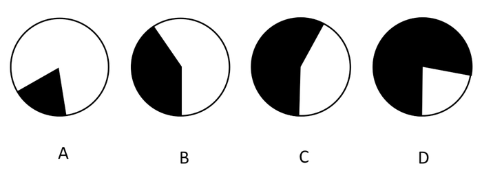

A. A

B. B

C. C

D. D

第 108 题 · 答案与解析

**参考答案（粉笔题库参考内容）**

C

**解析**

由题干“下列哪个图形阴影部分的比例可以近似表示······占世界石油储量的份额”，可判定本题为现期比重问题。定位文字材料可得，中东石油资源最为集中，占全球的61.7%，其中仅沙特阿拉伯就达22.1%，其次是伊朗（11.1%）、伊拉克（9.7%）、科威特（8.3%）和阿联酋（8.2%）。则中东五国石油储量总占比为22.1%+11.1%+9.7%+8.3%+8.2%=59.4%，所占比例与C项最接近。

故正确答案为C。

**考点**：文字资料、现期比重

**来源**：2008年江西省公务员录用考试《行测》题第108题

### 第 109 题

2003年阿联酋的石油产量比科威特：

A. 高

B. 低

C. 一样

D. 无法判断

第 109 题 · 答案与解析

**参考答案（粉笔题库参考内容）**

A

**解析**

由题干“2003年阿联酋的石油产量比科威特”，结合材料时间为2004年，选项为高/低，可判定本题为基期比较问题。定位材料可得，2004年阿联酋增长了5.2%，达到1.26亿吨；科威特增长了8.7%，达到1.20亿吨。根据基期，2003年阿联酋的石油产量为亿吨，科威特为亿吨，观察可得，前者分子大于后者，分母小于后者，可知2003年阿联酋的石油产量高于科威特。

故正确答案为A。

**考点**：基期比较、文字资料

**来源**：2008年江西省公务员录用考试《行测》题第109题

### 第 110 题

关于石油产量，下列说法错误的是：

A. 2004年伊拉克石油产量有较高的增长

B. 2004年俄罗斯的石油产量位列世界第一

C. 除沙特和伊朗外，2004年中国石油产量分别比阿联酋和科威特的石油产量高

D. 尽管2004年美国石油产量下降，但仍在世界上排为第三大产油国

第 110 题 · 答案与解析

**参考答案（粉笔题库参考内容）**

B

**解析**

A项：定位材料可得，2004年伊拉克石油产量增长了50.8%，增幅较高，正确；

B项：定位材料可得，2004年俄罗斯石油产量为4.58亿吨，低于沙特阿拉伯（5.06亿吨），错误；

C项：定位材料可得，2004年沙特阿拉伯的石油产量为5.06亿吨，伊朗产量高于墨西哥的1.91亿吨，中国石油产量为1.75亿吨，均高于阿联酋（1.26亿吨）和科威特（1.20亿吨），正确；

D项：定位材料可得，2004年世界第一大产油国为沙特阿拉伯（5.06亿吨），第二为俄罗斯（4.58亿吨），第三为美国（3.30亿吨），正确。

本题为选非题，故正确答案为B。

**考点**：文字资料、综合分析

**来源**：2008年江西省公务员录用考试《行测》题第110题

## 材料 3

根据下表所提示的信息回答问题：

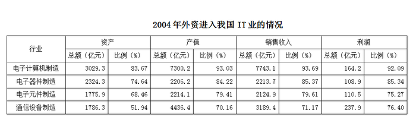

### 第 111 题

2004年，在我国的电子计算机制造业中，外资企业的产值约是其他企业的多少倍：

A. 8

B. 10

C. 13

D. 16

第 111 题 · 答案与解析

**参考答案（粉笔题库参考内容）**

C

**解析**

我国的电子计算机制造业中，外资企业的产值所占比例为93.03%，则其他企业比例为1-93.03%，外资企业是其他企业的93.03÷(1-93.03)倍，计算时首位为1，第二位为3。

故正确答案为C。

**考点**：现期倍数、统计表

**来源**：2008年江西省公务员录用考试《行测》题第111题

### 第 112 题

2004年，我国通信设备制造业的资产总额约为多少亿元：

A. 3439

B. 3029

C. 2324

D. 1786

第 112 题 · 答案与解析

**参考答案（粉笔题库参考内容）**

A

**解析**

2004年外资企业的通信设备资产总额为1786.3亿元，所占比例为51.94%，则我国通信设备制造业资产总额为。

故正确答案为A。

**考点**：现期比重、统计表

**来源**：2008年江西省公务员录用考试《行测》题第112题

### 第 113 题

2004年，在我国的各IT分行业中，外资企业资产利润率最高的是：

A. 电子计算机制造

B. 电子器件制造

C. 电子元件制造

D. 通信设备制造

第 113 题 · 答案与解析

**参考答案（粉笔题库参考内容）**

D

**解析**

，四个选项的利润率分别为164.2/7743.1，108.9/2213.7，110.5/2124.9，237.9/3189.4。应用化同法可得，，显然，因此D项正确。

故正确答案为D。

**考点**：比值比较、统计表

**来源**：2008年江西省公务员录用考试《行测》题第113题

### 第 114 题

总体上说，在我国的各IT分行业中，2004年外资企业控制程度较低的是：

A. 电子计算机制造

B. 电子器件制造

C. 电子元件制造

D. 通信设备制造

第 114 题 · 答案与解析

**参考答案（粉笔题库参考内容）**

D

**解析**

外资企业控制程度的一个衡量标准：外资企业占各IT分行业中资产、产值、销售收入、利润等的比重，通过观察图表，可以发现，总体上外资企业在通信设备制造业的各指标中所占比重相对较低，故控制程度较低。

故正确答案为D。

**考点**：直接找数、统计表

**来源**：2008年江西省公务员录用考试《行测》题第114题

### 第 115 题

下列关于2004年外资进入我国IT业情况的说法错误的是：

A. 从市场份额和生产规模来看，外资企业对我国IT业的控制程度较高

B. 在我国的各IT分行业中，外资企业的销售收入利润率高于其他企业

C. 在我国的各lT分行业中，外资企业的资产利润率高于其他企业

D. 外资企业的产值、销售收入、利润在我国IT业中的比重都在70％以上

第 115 题 · 答案与解析

**参考答案（粉笔题库参考内容）**

B

**解析**

A选项正确，外资企业占各IT分行业中资产、产值、销售收入、利润等的比重较高；

B选项错误，C选项正确，根据各行业利润所占比例与其他项所占比例的大小关系可知电子计算机制造、电子器件制造和电子元件制造不符合；

D选项正确，查表可知外资企业的产值、销售收入和利润在我国IT行业中的比重都在70%以上。

本题为选非题，故正确答案为B。

**考点**：统计表、综合分析

**来源**：2008年江西省公务员录用考试《行测》题第115题

## 材料 4

根据下表所提供的信息回答问题：

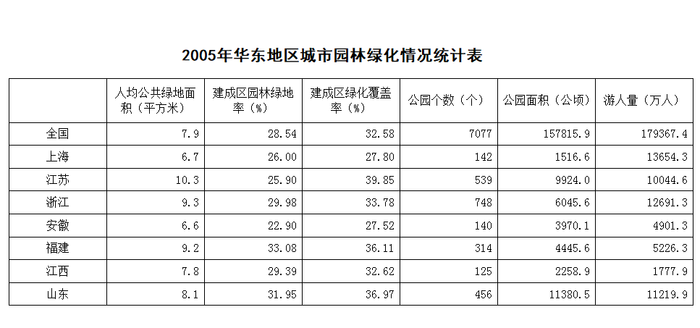

### 第 116 题

2005年全国大约有660个城市，每个城市约有多少个公园：

A. 11

B. 15

C. 17

D. 18

第 116 题 · 答案与解析

**参考答案（粉笔题库参考内容）**

A

**解析**

2005年全国公园个数7077个，大约有660个城市，所以大约每个城市有公园(7077÷660)个，做除法计算时首位为1，第二位为0，即第二位只能是0或者1，根据选项可知只有A项符合。

故正确答案为A。

**考点**：现期平均数、统计表

**来源**：2008年江西省公务员录用考试《行测》题第116题

### 第 117 题

2005年华东六省一市中的建成区园林绿地率、建成区绿化覆盖率这两项低于全国平均值的有：

A. 浙江、江西

B. 江苏、安徽

C. 上海、安徽

D. 福建、山东

第 117 题 · 答案与解析

**参考答案（粉笔题库参考内容）**

C

**解析**

2005年全国建成区园林绿地率、建成区绿化覆盖率分别为28.54%和32.58%，观察图表可以直接得到安徽和上海两项指标分别为22.90%、27.52%和26.00%、27.80%。

故正确答案为C。

**考点**：直接找数、统计表

**来源**：2008年江西省公务员录用考试《行测》题第117题

### 第 118 题

2005年华东六省一市，人均公共绿地面积超过全国平均值的有几个省市：

A. 7

B. 5

C. 4

D. 3

第 118 题 · 答案与解析

**参考答案（粉笔题库参考内容）**

C

**解析**

人均公共绿地面积全国平均值为7.9平方米，超过全国平均值的有江苏、浙江、福建、山东4省，即4个。

故正确答案为C。

**考点**：直接找数、统计表

**来源**：2008年江西省公务员录用考试《行测》题第118题

### 第 119 题

华东六省一市平均每个公园面积超过20公顷的有几个省市：

A. 2

B. 4

C. 5

D. 6

第 119 题 · 答案与解析

**参考答案（粉笔题库参考内容）**

A

**解析**

比较材料公园个数与公园面积两栏，可得到各省市平均每个公园的面积分别为1516.6/142、9924.0/539、6045.6/748、3970.1/140、4445.6/314、2258.9/125、11380.5/456公顷，经估算首位能进2的只有安徽和山东两省，即有两个省市平均公园面积超过20公顷，A项正确。

故正确答案为A。

**考点**：文字资料、现期平均数

**来源**：2008年江西省公务员录用考试《行测》题第119题

### 第 120 题

下列关于2005年城市园林绿化统计分析中，正确的有几项：

（Ⅰ）华东六省一市的建成区园林绿地率平均值约为30%

（Ⅱ）华东地区的公园个数最多和最少的分别是浙江省和江西省

（Ⅲ）上海市的游人量高于华东地区的其他六省

A. 0

B. 1

C. 2

D. 3

第 120 题 · 答案与解析

**参考答案（粉笔题库参考内容）**

D

**解析**

（Ⅰ）华东六省一市的建成区园林绿地率平均值为，各项均在30%左右浮动，可知约为30%，正确；

（Ⅱ）华东地区的公园个数最多和最少的分别是浙江省和江西省，分别是748个和125个，正确；

（Ⅲ）上海市的游人量最高，为13654.3万人，高于华东地区的其他六省，正确。

三个说法均正确。

故正确答案为D。

**考点**：统计表、综合分析

**来源**：2008年江西省公务员录用考试《行测》题第120题

## 材料 5

请根据下图所提供的信息回答问题：

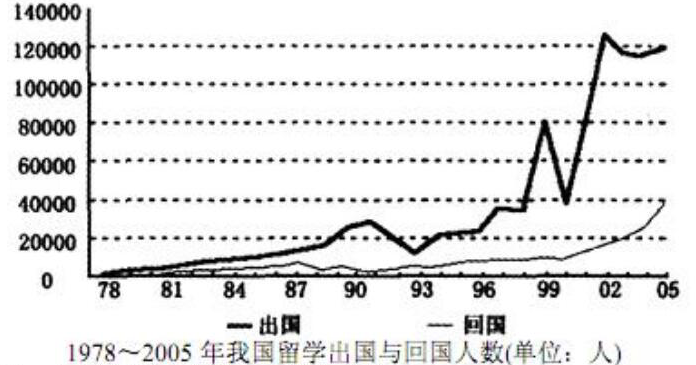

### 第 121 题

留学出国人数与回国人数是否都有逐渐增加趋势：

A. 前者没有，后者有

B. 前者有，后者没有

C. 都有

D. 都没有

第 121 题 · 答案与解析

**参考答案（粉笔题库参考内容）**

C

**解析**

根据统计图，总体来看曲线整体呈上升趋势，即两者均有逐渐增加趋势。

故正确答案为C。

**考点**：直接找数、统计图

**来源**：2008年江西省公务员录用考试《行测》题第121题

### 第 122 题

1990—2005年的各年中留学出国人数与回国人数之比最小约是：

A. 1：1

B. 2：1

C. 3：1

D. 4：1

第 122 题 · 答案与解析

**参考答案（粉笔题库参考内容）**

B

**解析**

出国与回国人数相差最小出现在92~93年，观察曲线可知最小比约为2:1。

故正确答案为B。

**考点**：直接找数、统计图

**来源**：2008年江西省公务员录用考试《行测》题第122题

### 第 123 题

留学出国人数波动最大的时期是：

A. 1989—1992年

B. 1990—1994年

C. 2001—2005年

D. 1999—2002年

第 123 题 · 答案与解析

**参考答案（粉笔题库参考内容）**

D

**解析**

观察曲线可知，波动最大的时期为年。

故正确答案为D。

**考点**：直接找数、统计图

**来源**：2008年江西省公务员录用考试《行测》题第123题

### 第 124 题

2005年与2000年相比，留学出国人数增加了约多少人：

A. 60000

B. 80000

C. 85000

D. 90000

第 124 题 · 答案与解析

**参考答案（粉笔题库参考内容）**

B

**解析**

根据曲线进行简单计算：120000-40000=80000。

故正确答案为B。

**考点**：增长量计算、统计图

**来源**：2008年江西省公务员录用考试《行测》题第124题

### 第 125 题

下列说法正确的是：

A. 进入新世纪以来，留学出国人员的回国人数明显增多

B. 改革开放以来，留学出国人员的回国人数逐年增加

C. 2000年—2005年期间，留学出国人数有减少趋势

D. 从1980—2005年这一期间，并非每一年的留学出国人数都比回国人数多

第 125 题 · 答案与解析

**参考答案（粉笔题库参考内容）**

A

**解析**

A选项正确，从曲线变化趋势可知A项正确；

B选项错误，回国人数并不是逐年增加，期间有减少的情况；

C选项错误，出国人数并没有减少的趋势；

D选项错误，出国人数的曲线一直在回国人数的上方，说明出国人数始终比回国人数多。

故正确答案为A。

**考点**：统计图、综合分析

**来源**：2008年江西省公务员录用考试《行测》题第125题

