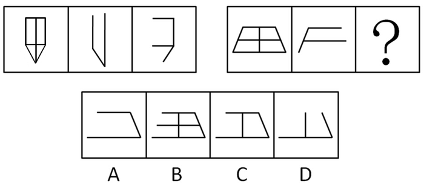
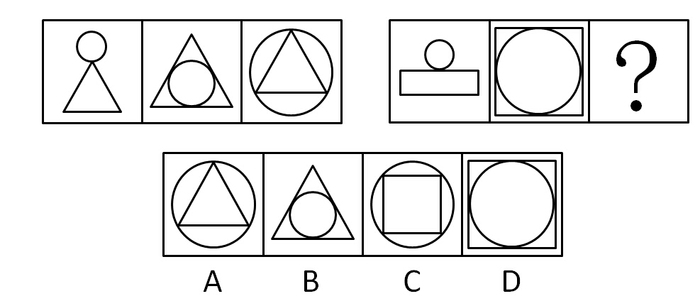
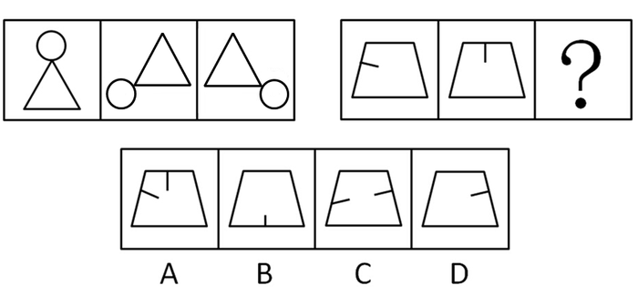
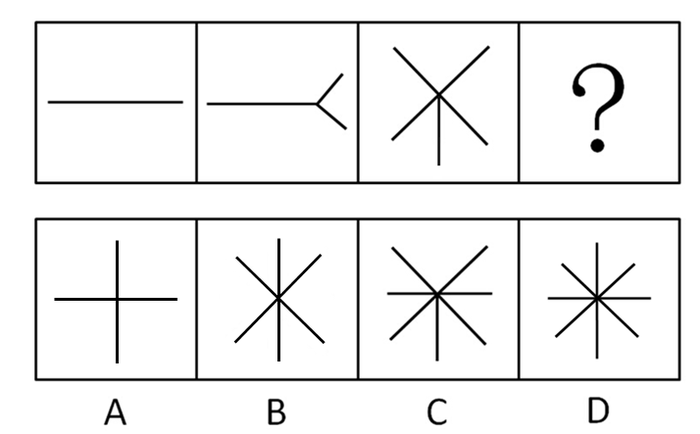
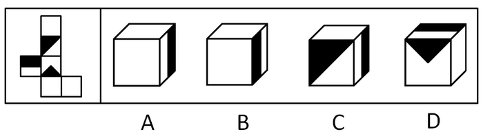
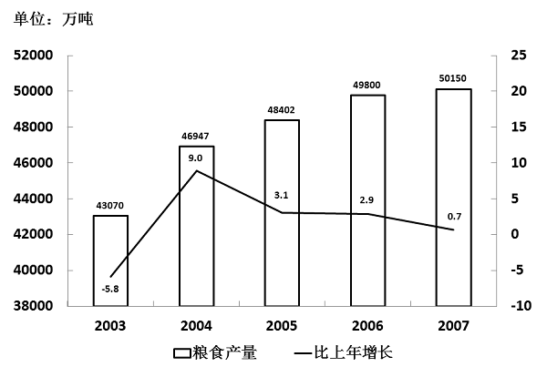
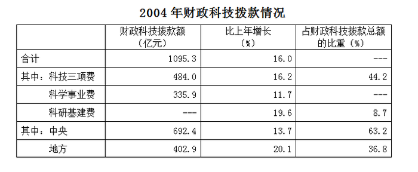
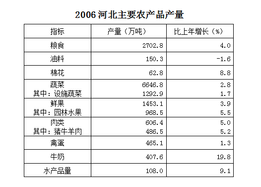

# 2009年江西省公务员录用考试《行测》题

<!-- gwy:overview:start -->
> **江西 · 2009 · 行测 · 统考** ｜ 125 题 · 图片 111 处 · 答案随题折叠

| 题型模块 | 题量 | 题号 |
| --- | ---: | ---: |
| 言语理解与表达 | 25 | 1–25 |
| 数量关系 | 20 | 26–45 |
| 判断推理 | 35 | 46–80 |
| 常识判断 | 20 | 81–100 |
| 资料分析 | 25 | 101–125 |
| **合计** | **125** | |

导航：[题型与作答说明](#题型与作答说明) · [题目](#题目) · [材料 1](#材料-1)
<!-- gwy:overview:end -->

> 候选采集稿。参考答案及解析来自粉笔页面，不代表官方答案或真实高分答卷；来源使用许可与原卷对应关系仍需人工核实。

## 题型与作答说明

言语理解与表达

（25题）

根据题目要求，在四个选项中选出一个正确答案。

数量关系

（20题）

本部分包括数字推理与数学运算两种类型的试题。

判断推理

（35题）

本部分包括图形推理、逻辑判断、定义判断与类比推理四种类型的试题。

常识判断

（20题）

根据题目要求.在四个选项中选出一个正确答案。

资料分析

（25题）

所给出的图、表或一段文字均有5个问题要你回答。你应根据资料提供的信息进行分析、比较、计算和判断处理，从四个备选答案中选出符合题意的答案。

## 题目

### 第 1 题

绘画，笔墨不必过周，以拙为巧，以空为灵，含不尽之意于画外，＿＿＿＿更见幽远。

上面划线处填入词语，最恰当的一项是：

A. 画意

B. 境界

C. 意象

D. 诗情

第 1 题 · 答案与解析

**参考答案（粉笔题库参考内容）**

B

**解析**

此题是实词填空题。

根据空格前的句子“含不尽之意于画外”可知，需要填入空格的词语应该能体现出画外意。首先理解一下每个选项的含义。

A、D选项“诗情”“画意”可以理解为诗画一般的美好意境，但是不能体现出画外之意，故排除；B选项“境界”是指事物所到达的程度或表现的情况，C选项“意象”是指文学艺术作品通过形象描写表现出来的境界和情调。意象和意境的区别主要有以下三点：第一，意象是以象寓意的艺术形象，意境是由那寓意之象生发出来的艺术氛围；第二，意象是实有的存在，意境是虚化了的韵致和意味；第三，意境是作家所追求的艺术创造的终极目标，意象则只是营造意境的手段和材料。由两者的区别以及文段上下问可知，B项“境界”更符合题意，当选。

故正确答案为B。

### 第 2 题

什么样的人，做什么样的梦。梦是思想感情的延伸，是心灵世界的＿＿＿＿。

上面划线处填入词语，最恰当的是：

A. 陈述

B. 自白

C. 反照

D. 透视

第 2 题 · 答案与解析

**参考答案（粉笔题库参考内容）**

B

**解析**

此题是实词填空题。

首先理解一下每个选项的含义：A项“陈述”是指有条理的表达；B项“自白”是指自己说明自己的意思，自我表白；C项“反照”是指光线反射；D项“透视”用来比喻清楚的看事物的本质。

文段主要描述的是“梦”和“人”的关系，“陈述”、“反照”、“透视”都不符合语境；只有“自白”能表达出“梦是心灵世界的真实独白”。

故正确答案为B。

### 第 3 题

不会“异想天开”要僵化，只会“异想天开”要退化，“异想天开”和“脚踏实地”结合才能“＿＿＿＿”。

上面划线处填入词语，最恰当的是：

A. 美化

B. 进步

C. 进化

D. 强化

第 3 题 · 答案与解析

**参考答案（粉笔题库参考内容）**

C

**解析**

此题是实词填空题。

通过题干可以知道只有“异想天开”和“脚踏实地”结合才能取得发展，首先可以排除A、D两个选项，“美化”和“强化”都没有发展的意思。

C项“进化”是事物由简单到复杂、由低级到高级而逐渐变化的过程，而B项“进步”是相比较前面的人、事、物而有所发展，但其本身是不变的。本题强调的是通过“异想天开”和“脚踏实地”结合可以取得质的变化，C项“进化”更符合题意。另外“进化”能与前面的“僵化”“退化”对应。

故正确答案为C。

### 第 4 题

生活就像一杯茶，平淡是它的本色，苦涩是它的＿＿＿＿，清香是它的馈赠。

上面划线处填入词语，最恰当的是：

A. 历陈

B. 归宿

C. 历程

D. 结果

第 4 题 · 答案与解析

**参考答案（粉笔题库参考内容）**

C

**解析**

此题是实词填空题。

首先理解一下各选项含义：“历陈”是指一条一条的陈述；“归宿”是指人或事的最终着落；“历程”是指经历的过程；“结果”是指在一定阶段事物发展所达到的最后状态。

通过题干可以知道苦涩是生活的过程，而不是结果或者归宿。

故正确答案为C。

### 第 5 题

请别摘走那朵向你＿＿＿＿的小花，她还要向每个人＿＿＿＿。

上面划线处填入词语，最恰当的是：

A. 敬礼 问好

B. 微笑 问候

C. 微笑 问好

D. 敬礼 问候

第 5 题 · 答案与解析

**参考答案（粉笔题库参考内容）**

C

**解析**

此题为实词填空题。

一般情况下人们都说“微笑”的小花，体现出小花的惹人怜爱；同时“敬礼”是指立正、举手或鞠躬行礼表示恭敬，此处用来形容小花明显不当，故可先排除A、D两项。

第二个空格根据语感选“问好”。

故正确答案为C。

### 第 6 题

如果说，听清话语是听话能力的＿＿＿＿，那么，理解话语就是听话能力的＿＿＿＿。

上面划线处填入词语，最恰当的是：

A. 根本 中心

B. 基础 核心

C. 根本 核心

D. 基础 中心

第 6 题 · 答案与解析

**参考答案（粉笔题库参考内容）**

B

**解析**

此题为实词填空题。

第一空中，由题意可知“听清”“理解”均是听话能力的必要条件，根据常识“听清”是基础，是前提，故排除A、C两项。

第二空中，“中心”是指事物的主要部分；“核心”通常是指内在的、深层的，而非有形的东西，此处“理解”是无形的，应该是听话能力的“核心”。

故正确答案为B。

### 第 7 题

书籍是我们的良师益友，困惑时它给你＿＿＿＿，悲哀时它给你慰藉，得意时它给你＿＿＿＿，低落时它给你力量。

上面划线处填入词语，最恰当的是：

A. 启发 指引

B. 鼓舞 清醒

C. 启发 清醒

D. 鼓舞 指引

第 7 题 · 答案与解析

**参考答案（粉笔题库参考内容）**

C

**解析**

此题为实词填空题。选自高占祥《求知善读》。

选项分析：

“启发”：指开导观点或阐明事例。

“鼓舞”：使振作起来，增强信心和勇气。

“指引”：指导、引领。

“清醒”：认清客观、主观情况，保持理性。

由句中的“悲哀时它给你慰藉”“低落时它给你力量”可知，空缺处要填的词语应分别与“困惑”“得意”构成互补关系。“困惑”是指疑惑不解，在迷惑之中最需要的就是师友的指引和点拨，“启发”与文意相符，排除B、D两项。

“得意”往往容易使人忘形，这时保持理性就分外重要，“清醒”与文意相符。

故正确答案为C。

### 第 8 题

古人云：“凡事预则立，不预则废。”有了计划，才能够胸中有＿＿＿＿，行动有目标，工作有程序；才能够增强自觉性，减少＿＿＿＿性，调动积极性。

上面划线处填入词语，最恰当的是：

A. 大局 盲目

B. 全局 消极

C. 大局 消极

D. 全局 盲目

第 8 题 · 答案与解析

**参考答案（粉笔题库参考内容）**

D

**解析**

此题为实词填空题。

第一空中，虽然“大局”和“全局”都有整个局面的意思，但是两者强调的重点不同。“全局”重在整体把握，以整体为重；“大局”重在分清事情轻重，抛开个人和小集体利益，以集体利益为重，或者是优先考虑事情的重点，先不考虑次要的。题干中的计划必须有“全面性”，故应用“全局”，可以排除A、C两项。

第二空中，结合上下文，前文提到有目标、有程序，后文提到调动积极性，第二个空格填写“盲目”最合适，另外注意“减少”一般不与“消极”搭配。

故正确答案为D。

### 第 9 题

学生的求知欲（问题意识）和表现欲（参与意识）、求知的欢乐和实现愿望是推进课堂教学发展的永恒的内动力。没有认识的＿＿＿＿，实质上就没有＿＿＿＿。

上面划线处填入词语，最恰当的是：

A. 需要 教学

B. 欲望 教育

C. 需要 教育

D. 欲望 教学

第 9 题 · 答案与解析

**参考答案（粉笔题库参考内容）**

B

**解析**

此题考查实词填空。由前文的“求知欲”、“表现欲”可知，第一个空格应该填“欲望”，另外欲望的程度比需要更强烈，符合语境，故排除A、C。

第二个空格前的“实质上”是指深层的含义，“教学”是指教师把知识和技能传授给学生的过程；而“教育”是指按一定要求培养人的工作，“教育”比“教学”的层次更深一些，符合题意。

故正确答案为B。

### 第 10 题

劝说朋友，话不必说尽，只要其心领神会，便当止住，否则就是＿＿＿＿；做文章，句子不必要太显，诡文而谲谏，寓言以讽为喻，点景以生情，意味更见＿＿＿＿。

上面划线处填入词语，最恰当的是：

A. 啰嗦 深刻

B. 啰嗦 深长

C. 肤浅 深长

D. 肤浅 深刻

第 10 题 · 答案与解析

**参考答案（粉笔题库参考内容）**

B

**解析**

此题为实词填空题。

由前文的“不必说尽”可知，第一空应该填“啰嗦”，故排除C、D两项。

第二空可以根据习惯搭配得出答案，“意味”与“深长”是固定搭配。

故正确答案为B。

### 第 11 题

下列各句没有语病的一句是：

A. 他们谩骂法庭执法人员，殴打执行公务的干警，这实属是藐视国家法律尊严与权威的违法行为

B. 大会期间，代表们认真学习领会《公民道德规范》的精神实质，提出了许多具有建设性的意见和建议

C. 尽管克隆技术引发的多方面问题仍有许多难以明确给予定论，但对生殖性克隆人实验应当严格禁止

D. 从大量观测到的事实中告诉我们，要掌握天气的连续变化，最好每小时都进行观察

第 11 题 · 答案与解析

**参考答案（粉笔题库参考内容）**

C

**解析**

此题为病句辨析题。

A选项中有两个动词，应把“实属”后的“是”删去；B选项中“学习”与“精神实质”搭配不当，应改成“学习《公民道德规范》并领会其精神实质”；D选项缺少主语，“告诉”之前是介词结构，不可充当主语，要去掉“从”和“中”，“大量事实”才可以成为整个句子的主语。

只有C选项的句子没有语病。

故正确答案为C。

### 第 12 题

欣赏你的同事，你和同事之间会合作得更加融洽；欣赏你的下属，下属会更加努力地工作；欣赏你的爱人，爱情会更加甘甜；欣赏你的学生，学生会更加可爱。＿＿＿＿＿＿＿＿＿＿＿＿。

上面划线处填入句子，最恰当的是：

A. 用欣赏的眼光打量周围，你会觉得世界变得更加和谐

B. 用欣赏的眼光打量他人，你会觉得他人都对你友好

C. 世界并不缺乏美好，就看你有没有发现美好的眼光

D. 自己的心情美好，世界就美好

第 12 题 · 答案与解析

**参考答案（粉笔题库参考内容）**

A

**解析**

此题为语句填空题。

文段通过描写欣赏同事、下属、爱人和学生，给自己及对方带来了和谐感受。

因此，结合选项应该选择A项。A选项“用欣赏的眼光打量周围，你会觉得世界变得更加和谐”与文段完全相符。

B选项只是提到“你会觉得他人对你友好”，没有提到由此对工作及生活带来的好处，过于片面，故排除B项；C、D选项与文段表达内容关系不大，故排除C、D两项。

故正确答案为A。

### 第 13 题

当你端着满满的一杯咖啡行走时，如果你的眼睛老是盯着液面心中总在设法使之平稳，结果你会发现咖啡液面的波动会越来越剧烈，以致溅出杯子，相反，如果你不过分地小心翼翼，大胆地走，它反而不会溅出杯子。政府对经济的干预也是这样，＿＿＿＿＿＿＿＿＿＿＿＿。

上面划线处填入句子，最恰当的是：

A. 过分地通过干预追求平衡反而会出问题，而任其自由发展反而没有问题

B. 过分地通过干预追求平衡反而会出问题，而放开手脚让经济在市场中自由发展反而容易达到平衡

C. 放开手脚让经济在市场中自由发展，反而容易达到平衡

D. 不要过分干预，干预总是走向反面

第 13 题 · 答案与解析

**参考答案（粉笔题库参考内容）**

B

**解析**

此题为语句填空题。

文段通过端咖啡的两种状态来说明政府对经济干预的不同结果：一是过分地通过干预追求平衡往往会出问题；二是放开手脚，让经济在市场中自由发展反而容易达到平衡。

因此，结合选项应该选择B，只有B选项正确表达了文段的含义，把握了政府干预经济的尺度以及结果。

A选项后半句“而任其自由发展反而没有问题”表达有误，曲解了文段的含义，故排除A选项；文段描述的是政府对经济的干预问题，而C选项描述的是经济自由发展，没有提到政府的干预，没有把握住重点，故排除C选项；D选项中的“干预总是走向反面”表述过于绝对，没有正确把握文段含义，故排除D选项。

故正确答案为B。

### 第 14 题

夏天有苍蝇、蚊子，但夏天能长出我们必需的粮食和各种作物；冬天虽然少一些害虫，但冬天不长庄稼，因此，谁也不会希望总是过冬天。
对这段话的理解不准确的一项是：

A. 对事物不要求全责备

B. 取长补短，双方得益

C. 事物的优劣是相比较而言的

D. 客观条件，为我所用

第 14 题 · 答案与解析

**参考答案（粉笔题库参考内容）**

B

**解析**

文段通过描述自然现象来揭示哲理：事物的好坏不能一言以蔽之，对事物不要求全责备，应符合实际。A、C、D三个选项都是围绕这个哲理进行描述的，只有B选项没有体现，“取长补短”与文段表达哲理不符。

本题为选非题，故正确答案为B。

### 第 15 题

社情不等同于民意，但社情包含着民意；民意不等同于社情，但民意是最重要的社情。了解和反映社情民意，最主要的是了解和反映民情民意。
这段话表达的主要观点是：

A. 社情包括民情

B. 民意不包括社情

C. 一般说，社情就是民情

D. 反映民情就是社情

第 15 题 · 答案与解析

**参考答案（粉笔题库参考内容）**

D

**解析**

根据提问方式可知本题为中心理解题。

通过文段中“社情不等同于民意······但民意是最重要的社情”可知，在许多情况下，社情就是民情。因此，了解反映社情民意，最主要的是了解和反映民情民意。

因此，结合选项应该选择D，D选项正确地指出了民情与社情的关系。

文段强调的是“社情”，而A、C选项没有涵盖主要观点，故排除A、C选项；B选项本身不正确，故排除B选项。

故正确答案为D。

### 第 16 题

一个班很多学生，毕业多年后和老师一起聚会，这些学生有的功成名就，有的平平淡淡。老师拿出各式各样的很多杯子，全部倒上水，让学生选择。学生们先选择的都是当中最精美的杯子。然后老师对他们说：“无论杯子是什么形状，什么质地，好看不好看，精致不精致，里面装的水都是一样的。”

对这段话理解准确的一项是：

A. 人生与包装不是一致的

B. 人生不靠包装

C. 人生归结起来都是一样的

D. 人生没有高低贵贱之分

第 16 题 · 答案与解析

**参考答案（粉笔题库参考内容）**

D

**解析**

通过阅读文段中“老师对他们说：‘无论杯子是什么形状，什么质地，好看不好看，精致不精致，里面装的水都是一样的。’”这句可知“水”指的是人生，尤指人格。老师通过这个简单的游戏揭示深刻的道理，即外表是什么样子并不重要，人格没有高低贵贱之分。

因此，结合选项应该选择D。D选项与文段主旨相符，指出人生没有高低贵贱之分。

A、B两个选项本身没有问题，但是没有抓住文段关键点，故排除A、B；C选项本身是错误的，人生是有区别的，但是人格是平等的，故排除C选项。

故正确答案为D。

### 第 17 题

1953年5月29日上午9时，希拉里与诺尔盖到达珠峰南隘，此处山脊下降，然后是突然升高10米，视野里出现了峰顶。在距离峰顶不足1米的地方，希拉里突然停了下来，他用手一指前方，对向导诺尔盖说：“这是你的土地，你先上吧。”后来外界对谁是第一个登顶的人争论不休，有人怀疑真正首位登上珠峰的不是希拉里而是他的向导诺尔盖。面对质疑，希拉里始终保持沉默，拒绝宣布自己就是登上珠峰第一人，只是表示两人作为一个团队登顶。

对这段话的准确理解是：

A. 攀登的光荣来自团队

B. 攀登的勇气来自团队

C. 希拉里面对巨大荣誉时的退让是最崇高的精神

D. 诺尔盖是希拉里的真正向导

第 17 题 · 答案与解析

**参考答案（粉笔题库参考内容）**

C

**解析**

文段通过描述希拉里与盖尔诺登珠峰顶的事情来赞扬希拉里面对巨大荣誉时的退让精神，通过文段中“在距离峰顶不足1米的地方，希拉里突然停了下来······希拉里始终保持沉默，拒绝宣布自己就是登上珠峰第一人，只是表示两人作为一个团队登顶”可知C选项正确。

A、B两个选项文段没有提及，属于没有根据的推测，排除；而D选项与文段阐述的重点不符，文段赞美的是希拉里的品质，没有提到诺尔盖作为向导的具体情况，排除D。

故正确答案为C。

### 第 18 题

许多比赛之所以不能取胜，是因为自己身上的包袱太重：骄傲是包袱，急躁是包袱，气馁是包袱，荣誉是包袱，患得患失是包袱，不动脑筋、马虎大意也是包袱。
对这段话理解最准确的是：

A. 轻装才能前进

B. 患得患失是失败的主要原因

C. 要想战胜对手，首先要战胜自己

D. 战胜了自己，就能战胜对手

第 18 题 · 答案与解析

**参考答案（粉笔题库参考内容）**

C

**解析**

此题为细节判断题。

文段分为两部分：第一部分主要说由于身上的包袱导致不能成功，第二部分主要围绕什么是“包袱”进行论述。

因此，结合选项应该选择C。选项中的“首先要战胜自己”指的是放下包袱，符合题意；另外战胜自己是战胜对手的前提也是正确的。

A选项忽略了放下“包袱”的重要意义，只提到“轻装”，故排除A；B选项中的“患得患失”只是“包袱”的一种，文段没有将其描述为主要原因，故排除B；D选项过于绝对，战胜自己和战胜对手有明显的区别，战胜自己并不代表能战胜对手，故排除D。

故正确答案为C。

### 第 19 题

毛泽东说：“只有让人民来监督政府，政府才不敢松懈。只有人人起来负责，才不会人亡政息。”民主管理的一个重要内容就是对经营者的监督，监督其经营行为的合理性、科学性和可行性，民主管理的另一个重要内容就是劳动者的主人翁地位即人人负责的管理环境的建立。
对此段话理解不正确的是：

A. 毛泽东的话在此更加形象深刻地提出了民主管理的必要性

B. 民主管理包括两个方面的内容

C. 民主管理重在强调对经营者的监督

D. 民主管理的这两个方面同等重要，不可偏废任何一方

第 19 题 · 答案与解析

**参考答案（粉笔题库参考内容）**

C

**解析**

此题为细节判断题。

文段通过引用毛泽东的话以及具体论点，强调民主管理的两个方面，即对经营者的监督以及人民的主人翁地位。

因此，结合选项应该选择C。C项太片面，只提到民主管理强调对经营者的监督，而忽视了人民的主人翁地位。

A、B、D三个选项符合题意。

本题为选非题，故正确答案为C。

### 第 20 题

一个已经二十岁身高不足1米的残疾乞丐躺在地上乞讨，将近一天时间所获无几。一个老外路过，送给他一张百元大钞。令人惊异的是，不到半分钟后，他一瘸一拐地参加了为一个身患重病却无力支付医疗费的女孩募捐的队伍，那队伍有200多人。
对这段话的准确概括是：

A. 身残志不残，个矮情却长

B. 奉献爱心，已蔚然成风

C. 最缺少爱的人最懂得爱的温馨

D. 爱是无价之宝

第 20 题 · 答案与解析

**参考答案（粉笔题库参考内容）**

C

**解析**

根据提问方式可知此题为中心理解题。

文段主要围绕乞丐的爱心进行叙述，前两句介绍乞丐“所获无几”，说明他“最缺少爱”，而终于收到“一张百元大钞”，第三句讲乞丐加入已有200多人的募捐队伍奉献爱心，说明他更懂得“爱的奉献”。

因此，结合选项应该选择C。

A选项突出的是乞丐“志不残”，但是文段没有提到“意志”的相关内容，故排除A选项；文段虽然提到奉献爱心的两个例子，但是乞丐的“所获无几”无法说明“奉献爱心已蔚然成风”，排除B选项；D选项表现出爱的价值，但是没有对乞丐转赠100美元的行为进行具有针对性地总结，属于泛泛而谈，故排除D。

故正确答案为C。

### 第 21 题

截至2007年12月7日上午，三峡电站年内已发电约590亿千瓦时。至此，三峡电站投产已累计发电2050亿千瓦时。三峡电站的经济效益从来没有人怀疑过，屡遭质疑的是三峡工程的环保效益，如破坏长江流域生态，造成泥沙沉积等。而三峡工程26台发电机组全部投产后，与燃煤火力发电机比，每年要少消耗5000万吨煤炭，向大气少排放1亿吨的二氧化碳。
这段话主要表明了：

A. 三峡电站的经济效益是主要的

B. 三峡电站的经济效益大于环保效益

C. 对三峡电站的环保效益的评价应该是一个整体

D. 对三峡电站的环保效益现在尚不能做出评价

第 21 题 · 答案与解析

**参考答案（粉笔题库参考内容）**

C

**解析**

此题是中心理解题。

文段先论述了三峡电站的经济效益，后论述了环保效益，前后形成鲜明对比，但是没有给出哪个效益更大的定论，告诉我们对于三峡电站的环保效益评价应该是个整体。

因此，结合选项应该选择C，只有C选项指出对三峡电站的环保效益评价应该是一个整体。

A、B选项有相似之处，都认为经济效益是主要的，但是文段没有给出定论，故排除A、B选项；根据文段给出的描述，三峡电站目前的环保效益是需要综合评价的，D选项尚不能做出评价，故排除D选项。

故正确答案为C。

### 第 22 题

温总理在中欧领导人会议上的讲话，首先重申了中国政府一贯坚持的原则，即西藏和台湾都是中国领土不可分割的一部分，并希望默克尔能在会见达赖喇嘛一事上认错。此后特别强调，法国、德国是中国的朋友，是战略合作的伙伴，朋友和伙伴也有说过错话做过错事的时候，但只要认识了，改正了，我们还是一如既往友好相待。
对这段话的正确理解是：

A. 表明了中国底线外交的三个层面：清晰性、反馈性和建设性

B. 表明了中国底线外交的三个层面：原则性、反馈性和灵活性

C. 表明了中国的外交政策的原则性和灵活性

D. 表明了中国的外交政策的原则性和适应性

第 22 题 · 答案与解析

**参考答案（粉笔题库参考内容）**

B

**解析**

此题为细节判断题。

文段中指出：“中国政府重申一贯坚持的原则，西藏、台湾都是中国领土的一部分”，表明中国底线外交中的原则性；“希望默克尔认错”表明反馈性；而“强调中德的战略伙伴关系”则是表明底线外交的灵活性。

因此，结合选项应该选择B，B项符合题意。

A、C、D三项没有准确完整地把握住题意，因此排除。

故正确答案为B。

### 第 23 题

门是隐秘、回避的象征，是心灵躲进极乐的静谧或悲伤的秘密搏斗的象征。没有门的屋子不是屋子，而是走廊。无论一个人在哪儿，只要他在一扇关着的门的后面，他就能使自己不受拘束。在关着的门内，头脑的工作最为有效。人不是在一起放牧的马群。

对这段话的准确理解是：

A. 人需要有门排除外界干扰，以提高脑子的思考力

B. 人需要有门，使自己不受拘束，自主地生活

C. 人不是在一起放牧的马群，有赖于门作一些必要的回避

D. 人是有思想感情的，需要有自己独立的天地

第 23 题 · 答案与解析

**参考答案（粉笔题库参考内容）**

D

**解析**

文段开篇介绍门的象征意义，接着指出没有门的屋子只是走廊，一人在关着的门的后面，就能够不受拘束，在关着的门内，头脑的工作最为有效，最后通过尾句进行总结升华，指出人不是在一起放牧的马群。故文段以“门”为喻体，重在论述“门”能够使人区别于动物，人有着独立的个体意识、有完整独立的内心世界等，对应D项。

A项“以提高脑子的思考力”，B项“使自己不受拘束”均对应文段尾句之前的内容，非重点，排除；

C项，“有赖于门作一些必要的回避”仅论述了门的“回避”功能，表述片面，排除。

故正确答案为D。

### 第 24 题

邻居在房屋的周围种上许多梨树，其中有一颗正好靠近我家的稻田，致使我家稻田约两平方米或多或少减产，但父亲从来没有怨言。后来，邻居觉得不好意思，每到梨子成熟时便摘最大的梨子送到我家，还将猪圈里的肥料朝我家稻田里撒，因此，我家稻田的收成总体上没有减少，父亲便以此为例。告诫我：＿＿＿＿＿＿＿＿＿＿＿＿。
填入横线上最恰当的一句是：

A. 以德报怨，是为自己造福

B. 宽容是不会蚀本的

C. 不要斤斤计较

D. 退一步海阔天空

第 24 题 · 答案与解析

**参考答案（粉笔题库参考内容）**

B

**解析**

此题为语句填空题。

分析文段可以得出父亲对于邻居影响自己利益的行为表示宽容，邻居对于自己的行为感到抱歉，同时互惠互利，最后我家的收成也没有损失。概括来看文段有两点核心意思：“宽容”和“没有损失”。

因此，结合选项应该选择B，只有B选项既包括“宽容”，又包括“没有损失”。

A选项“以德报怨”只提到不记别人的仇，反而给他好处，没有提到自己没有损失，故排除A；C选项只是表示不对无关紧要的事过分计较，没有体现出宽容及没有损失两个要点，故排除C；D选项是指在非原则的问题上或在自己应得的物质利益上，如果能以宽容之心对待他人之过，就能得到化干戈为玉帛的喜悦，但是没有提到别人对自己的回报，最终使自己没有损失，故排除D。

故正确答案为B。

### 第 25 题

大亚湾地理位置得天独厚，地处21世纪亚太经济圈的核心位置。近年来，他以集港口工业、国际贸易、旅游为一体的未来百万人口海滨一流新城市的宏伟蓝图，吸引着众多的海内外客商。举世瞩目的熊猫汽车城、东风汽车城、南海石化城、庄士工业城等一批超大型工业和旅游项目，都先后落户在这里。
这段话的中心意思是：

A. 大亚湾得天独厚的地理位置

B. 大亚湾的工业和旅游项目

C. 大亚湾得天独厚的地理位置将给它带来繁荣的商业前景

D. 大亚湾是一座现代化城市

第 25 题 · 答案与解析

**参考答案（粉笔题库参考内容）**

C

**解析**

此题为中心理解题。

文段第一句就提到“大亚湾地理位置得天独厚”，后面围绕这个特点引出了“大型工业和旅游项目”等商业前景，故文段的主题词有两个，分别是“得天独厚的地理位置”和“商业前景”，二者缺一不可。

因此，结合选项应该选择C，同时包含这两个主题词的只有C选项。

A选项只提到地理位置，缺少工业和旅游项目，即缺少商业前景，故排除A；B选项缺少地理位置，故排除B；D选项只是概括地说到现代化城市，没有抓住主题词，故排除D。

故正确答案为C。

### 第 26 题

0，3，9，21，（    ），93

A. 40

B. 45

C. 36

D. 38

第 26 题 · 答案与解析

**参考答案（粉笔题库参考内容）**

B

**解析**

观察数列，发现数列无明显规律，优先考虑作差。后项减前项得到新数列：3，6，12，（    ），（    ），是公比为2的等比数列，则新数列后两项为，，故原数列所求项为21+24=45，向后验证：45+48=93，符合规律。

故正确答案为B。

### 第 27 题

－3，3，0，（  ），3，6

A. 3

B. 4

C. 5

D. 6

第 27 题 · 答案与解析

**参考答案（粉笔题库参考内容）**

A

**解析**

观察数列无明显特征，作差后无规律，考虑递推数列，圈三数，找规律。观察发现：-3+3=0，推测该数列规律为：第一项+第二项=第三项，则所求项为3+0=3，向后验证：0+3=3，3+3=6，符合规律。

故正确答案为A。

### 第 28 题

44，54，65，77，（  ）

A. 91

B. 90

C. 89

D. 88

第 28 题 · 答案与解析

**参考答案（粉笔题库参考内容）**

B

**解析**

观察数列，发现数列无明显规律，优先考虑作差。后项减前项得到新数列：10、11、12、（  ），是公差为1的等差数列，则新数列下一项为12+1=13，故原数列所求项为77+13=90。

故正确答案为B。

### 第 29 题

12，10，14，13，16，16，（  ），（  ）

A. 14，18

B. 20，19

C. 18，19

D. 15，18

第 29 题 · 答案与解析

**参考答案（粉笔题库参考内容）**

C

**解析**

数列项数较多，且有两项未知，考虑多重数列，优先交叉找规律。交叉后得到，奇数项数列：12，14，16，（  ），是公差为2的等差数列，则所求项为16+2=18；偶数项数列：10，13，16，（  ），是公差为3的等差数列，则所求项为16+3=19。

故正确答案为C。

### 第 30 题

13，9，11，6，9，3，（  ），（  ）

A. 6，0

B. －1，1

C. 7，0

D. 7，6

第 30 题 · 答案与解析

**参考答案（粉笔题库参考内容）**

C

**解析**

数列项数较多，且有两项未知，考虑多重数列，优先交叉找规律。交叉后得到，奇数项数列：13，11，9，（  ），是公差为-2的等差数列，则所求项为9-2=7；偶数项数列：9，6，3，（  ），是公差为-3的等差数列，则所求项为3-3=0。

故正确答案为C。

### 第 31 题

，，，，，，（  ）

A. 

B. 

C. 

D. 

第 31 题 · 答案与解析

**参考答案（粉笔题库参考内容）**

D

**解析**

题干与选项均为分数，优先考虑分数数列。将分子、分母分开看，发现无明显规律，考虑整体观察，观察发现每一个分数的分子为前一分数的分母与分子之差，而分母为前一个分数的分母与分子之和，故最后一项分子为28-12=16，分母为28+12=40。

故正确答案为D。

### 第 32 题

3，6，8，13，20，（  ），51

A. 31

B. 28

C. 42

D. 32

第 32 题 · 答案与解析

**参考答案（粉笔题库参考内容）**

D

**解析**

观察数列无明显特征，作差后无规律，考虑递推数列，圈三数，找规律。观察发现：3+6-1=8，推测该数列规律为：第一项+第二项-1=第三项，做验证：6+8-1=13，8+13-1=20，符合规律，则所求项为13+20-1=32，向后验证：20+32-1=51，符合规律。

故正确答案为D。

### 第 33 题

22，122，1221，11221，112211，（  ）

A. 111221

B. 111122

C. 1122111

D. 1112211

第 33 题 · 答案与解析

**参考答案（粉笔题库参考内容）**

D

**解析**

数字位数较多，考虑机械划分。观察数列发现，数列第一项是22，第二项22前面添一个1，第三项122后面添一个1，所以规律是每次给下一项首位或末位添一个1，如果上次添首位，则下次添末位，第五项是在第四项的基础上末位添了一个1，因此第六项应该在第五项，即112211的首位添一个1，所以第六项是1112211。

故正确答案为D。

### 第 34 题

7，4，14，8，21，16，（  ），（  ）

A. 20，18

B. 28，32

C. 20，32

D. 28，64

第 34 题 · 答案与解析

**参考答案（粉笔题库参考内容）**

B

**解析**

数列项数较多，且有两项未知，考虑多重数列，优先交叉找规律。交叉后得到，奇数项数列：7，14，21，（  ），是公差为7的等差数列，则所求项为21+7=28；偶数项数列：4，8，16，（  ），是公比为2的等比数列，则所求项为。

故正确答案为B。

### 第 35 题

160，80，40，20，（  ）

A. 

B. 1

C. 10

D. 5

第 35 题 · 答案与解析

**参考答案（粉笔题库参考内容）**

C

**解析**

观察发现，160、80、40、20、（    ）是公比为的等比数列，故数列最后一项是10。

故正确答案为C。

### 第 36 题

把一根钢管锯成两段要4分钟，若将它锯成8段要多少分钟？

A. 16

B. 32

C. 14

D. 28

第 36 题 · 答案与解析

**参考答案（粉笔题库参考内容）**

D

**解析**

方法一：根据题干可知，把一根钢管锯成两段时有一个切口，且需要4分钟；若将它锯成8段，将有7个切口，则共需要分钟。

方法二：根据题干可知，所锯次数较少，可利用枚举法解决，具体如下：

锯成2段：分钟（锯1次）；

锯成4段：分钟（再锯2次）；

锯成8段：分钟（再锯4次）。

故正确答案为D。

### 第 37 题

一个四边形广场，它的四边长分别是60米，72米，84米，96米，现在在四边上植树，四角需种树，而且每两棵树的间隔相等，那么，至少要种多少棵树：

A. 22

B. 25

C. 26

D. 30

第 37 题 · 答案与解析

**参考答案（粉笔题库参考内容）**

C

**解析**

环形植树问题公式：。根据题意可知，种的树想尽可能少，则每两棵树之间的间距应尽可能大，因此可求四个边边长的最大公约数，96、84、72、60的最大公约数是12，则至少种：。

故正确答案为C。

### 第 38 题

甲、乙两人同时同地绕400米的环形跑道同向而行，甲每秒钟跑8米，乙每秒钟跑9米，多少秒后两人第三次相遇？

A. 400

B. 800

C. 1200

D. 1600

第 38 题 · 答案与解析

**参考答案（粉笔题库参考内容）**

C

**解析**

已知甲、乙两人的速度分别是8米/秒、9米/秒。由题意可知，两人同向而行，那么每次相遇时乙比甲多跑一圈，则第三次相遇时乙比甲多跑三圈，即米。由此可知，所需时间为秒。

故正确答案为C。

### 第 39 题

一个等腰三角形，两边长分别为5厘米、2厘米，则周长为多少厘米？

A. 12

B. 9

C. 12或9

D. 无法确定

第 39 题 · 答案与解析

**参考答案（粉笔题库参考内容）**

A

**解析**

由题意可知，三角形周长为三边之和。根据“三角形两边之和大于第三边”得知，该等腰三角形的边长分别是5、5、2，故周长=5+5+2=12厘米。

故正确答案为A。

### 第 40 题

电影票10元一张，降价后观众增加一倍，收入增加，则一张票降价多少元？

A. 8

B. 6

C. 4

D. 2

第 40 题 · 答案与解析

**参考答案（粉笔题库参考内容）**

C

**解析**

赋值原来的观众人数为5，则原来的收入为元。根据题意，电影票降价后收入增加，则降价后的收入为；观众增加一倍，则降价后观众人数为人。故降价后的票价为元，因此一张票降价了10-6=4元。

故正确答案为C。

### 第 41 题

在浓度为40%的酒精中加入4千克水，浓度变为30%，再加入M千克纯酒精，浓度变为50%，则M为多少？

A. 8

B. 12

C. 4.6

D. 6.4

第 41 题 · 答案与解析

**参考答案（粉笔题库参考内容）**

D

**解析**

浓度公式：。设原来浓度40%的酒精质量为N千克，根据题意，溶质不变，则可列等式为：，解得N=12千克；再加入M千克酒精后，浓度为50%，根据浓度公式可列式为：，解得M=6.4千克。

故正确答案为D。

### 第 42 题

一架飞机所带燃料，最多用6小时；出发时顺风，每小时飞1500千米，飞回时逆风，每小时1200千米，此飞机最多飞出去多少小时就需往回飞？

A. 

B. 

C. 3

D. 

第 42 题 · 答案与解析

**参考答案（粉笔题库参考内容）**

A

**解析**

方法一：设飞机顺风飞x小时，逆风飞6-x小时。由题意可知，飞机往返路程不变，由此可列等式为，解得小时。

方法二：设单向路程为N千米。由题意得，飞机往返路程相等，且来回飞行的总时间为6小时，则可列方程为，解得N=4000千米，因此最多飞出小时。

故正确答案为A。

### 第 43 题

学生在操场上列队做操，只知人数在90-110之间。如果排成3排则不多不少；排成5排则少2人；排成7排则少4人；则学生人数是多少?

A. 102

B. 98

C. 104

D. 108

第 43 题 · 答案与解析

**参考答案（粉笔题库参考内容）**

D

**解析**

由题意可知，学生人数可以被3整除，排除B、C两项，剩二代一：

代入A项：整数，不符合题意，排除；

故只剩D项当选。验证D项：，，正确。

故正确答案为D。

### 第 44 题

一个长方体模型，所有棱长之和为72，长宽高的比是4：3：2，则体积是多少：

A. 72

B. 192

C. 128

D. 96

第 44 题 · 答案与解析

**参考答案（粉笔题库参考内容）**

B

**解析**

设长方体长、宽、高分别为4a，3a，2a，则所有棱长之和为，解得a=2。则根据体积公式可知，该长方体体积为。

故正确答案为B。

### 第 45 题

某次考试中，小林的准考证号码是个三位数，个位数字是十位数字的2倍，十位数字是百位数字的4倍，三个数字的和是13，则准考证号码是：

A. 148

B. 418

C. 841

D. 814

第 45 题 · 答案与解析

**参考答案（粉笔题库参考内容）**

A

**解析**

根据题干，考虑代入选项进行验证。因该三位数个位数字是十位数字的2倍，排除B项、C项和D项。

故正确答案为A。

### 第 46 题

从所给四个选项中，选择最合适的一个填入问号处，使之呈现一定的规律性：

A. A

B. B

C. C

D. D

第 46 题 · 答案与解析

**参考答案（粉笔题库参考内容）**

D

**解析**

元素组成相似，元素叠加。每组图中前两个图相加去同存异得第三个图形。

故正确答案为D。

### 第 47 题

从所给四个选项中，选择最合适的一个填入问号处，使之呈现一定的规律性：

A. A

B. B

C. C

D. D

第 47 题 · 答案与解析

**参考答案（粉笔题库参考内容）**

C

**解析**

元素组成相同，考查位置规律。每组图中，第一个图中下面的图形包住上面的图形成为第二个图，上面的图形包住下面的图形成为第三个图。

故正确答案为C。

### 第 48 题

从所给四个选项中，选择最合适的一个填入问号处，使之呈现一定的规律性：

A. A

B. B

C. C

D. D

第 48 题 · 答案与解析

**参考答案（粉笔题库参考内容）**

D

**解析**

元素组成相同，考查位置规律。第一组图中圆沿顶点逆时针移动；第二组图中线段沿梯形的边顺时针移动，且与边垂直。

故正确答案为D。

### 第 49 题

从所给四个选项中，选择最合适的一个填入问号处，使之呈现一定的规律性：

A. A

B. B

C. C

D. D

第 49 题 · 答案与解析

**参考答案（粉笔题库参考内容）**

C

**解析**

数线段，每个图形中由共同顶点引出的射线的数目依次为1，3，5，7。

故正确答案为C。

### 第 50 题

左边给定的是正方体的外表面展开图，右边哪一项能由它折叠而成？

A. A

B. B

C. C

D. D

第 50 题 · 答案与解析

**参考答案（粉笔题库参考内容）**

A

**解析**

B中右边的面的黑色部分不可能与空白面相接；C中正面和右面两个面的相接部分应该均是黑色部分；D中空白面应该与正面中黑色三角形的底边相接。

故正确答案为A。

### 第 51 题

所有的亲戚我都问过了，谁也不知道明明的下落。

上述断定为假，以下判定可以确定为真的是（    ）。

A. 有的亲戚不知道明明的下落

B. 有的亲戚知道明明的下落

C. 没有亲戚知道明明的下落

D. 知道明明下落的亲戚没有问到

第 51 题 · 答案与解析

**参考答案（粉笔题库参考内容）**

B

**解析**

第一步：分析题干条件。

所有的亲戚我都问过了，谁也不知道明明的下落。

已知上述断定为假，则其矛盾命题为真。

矛盾命题：有的亲戚知道明明的下落。

第二步：逐一分析选项。

A项：根据“有的是”无法推出“有的不是”，因此无法得到“有的亲戚不知道明明的下落”，排除；

B项：与题干断定的矛盾命题一致，一定为真，当选；

C项：选项与题干命题“谁也不知道明明的下落”一致，根据题干已知此断定为假，排除；

D项：根据题干信息，不能判定知道明明下落的亲戚是否有问到，不能判断真假，排除。

故正确答案为B。

### 第 52 题

有些不是鱼的动物外表像鱼。
与以上判断等值的是：

A. 有些外表像鱼的动物不是鱼

B. 有些外表像鱼的动物是鱼

C. 有些不是鱼的动物外表不像鱼

D. 有些鱼外表不像鱼

第 52 题 · 答案与解析

**参考答案（粉笔题库参考内容）**

A

**解析**

第一步：判断题干命题的类型。

有些不是鱼的动物外表像鱼，属于“有些S是P”的直言命题，其中S指“不是鱼的动物”，P是“外表像鱼”。

第二步：结合直言命题的推理规则，判断选项的正误。

根据直言命题的换位推理规则，有些S是P，换位后命题为有些P是S，即有些外表像鱼的动物不是鱼，A项与题干命题等值；

B中“有些外表像鱼的动物是鱼”和D中“有些鱼外表不像鱼”都涉及到对“鱼”的判断，但题干命题只提到两个概念，“不是鱼的动物”和“外表像鱼的动物”，没有对“鱼”这种动物进行判断，故B、D两项均与题干不等值；

C项和题干命题构成了反对关系，肯定一个为真，无法判断另一个的真假，C项与题干不等值。

故正确答案为A。

### 第 53 题

如果“我们班有的同学不会使用计算机”是一个真判断，下面不能确定其真假的是（    ）。

A. 我们班至少有一个同学不会使用计算机

B. 我们班所有的同学都会使用计算机

C. 我们班有的同学会使用计算机

D. 不会使用计算机的有些是我们班的同学

第 53 题 · 答案与解析

**参考答案（粉笔题库参考内容）**

C

**解析**

第一步：翻译题干。

①我们班有的同学不会使用计算机。

第二步：逐一分析选项。

A项，我们班有的同学不会使用计算机，则其人数至少为一，该项一定为真。

B项，我们班有的同学不会使用计算机，该项一定为假。

C项，由题干只能得出我们班有的同学不会使用计算机，不能得出我们班是否有同学会使用计算机，该项无法确定真假。

D项，根据“有的S是P有的P是S”原则，由①可得，不会使用计算机的有些是我们班的同学，该项一定为真。

故正确答案为C。

### 第 54 题

某人说：“不可能所有的人都会投他的赞成票。”

与以上判断的意思最相近的是：

A. 可能所有的人都会投他的赞成票

B. 可能所有的人都不会投他的赞成票

C. 必然所有的人都会投他的赞成票

D. 必然有的人不会投他的赞成票

第 54 题 · 答案与解析

**参考答案（粉笔题库参考内容）**

D

**解析**

本题考查模态命题和性质命题的对当关系。

根据模态命题的对当关系可知，“不可能P”等价于“必然非P”，根据性质命题的对当关系可知，并非“所有S是P”等价于“有的S不是P”，因此从题干的判断“不可能所有的人都会投他的赞成票”可推出，必然有的人不会投他的赞成票。

故正确答案为D。

### 第 55 题

调查人员发现，被害人曾两次向朋友提到了被威胁的事，一次是1996年5月，她向男朋友周某提出分手，周某威胁要毁她的容。另一次没有说时间，只说她在6年里经常受到周某的威胁。以上事实最好地支持了下面哪项？

A. 被害人1996年5月开始受到周某的威胁

B. 周某威胁了被害人6年

C. 被害人是被周某杀害的

D. 被害人因要和周某分手而经常受到威胁

第 55 题 · 答案与解析

**参考答案（粉笔题库参考内容）**

B

**解析**

第一步：分析题干。

题干的内容是被害人向朋友讲述她被男友威胁的事情。一次发生在1996年5月，因提出分手而受威胁，另一次只说在6年里经常受威胁。

第二步：逐一判断选项。

A项，被害人在讲述自己在6年里经常受男友威胁时，并没有说明开始受到威胁的时间，不能断定是否从1996年5月开始就受到威胁，该项为无由猜测。

B项，被害人向朋友讲述在6年里经常受男友威胁，可知该项符合题干。

C项，题干没有说明被害人是否死亡，无从得知被害人是否被周某杀害，该项为无中生有。

D项，被害人只是说某一次威胁的原因是提出分手，但并不代表其他威胁也是这个原因，该项为无由猜测。

故正确答案为B。

### 第 56 题

“如果你关掉了所有错误的大门，真理也将被拒之门外。”
与以上判断的含义最为接近的是：

A. 如果真理被拒之门外，那一定是你关掉了所有错误的大门

B. 只有关掉所有错误的大门，真理才不会被拒之门外

C. 如果真理没有被拒之门外，那么，一定是没有关掉所有错误的大门

D. 若要接纳真理，必须拒绝错误

第 56 题 · 答案与解析

**参考答案（粉笔题库参考内容）**

C

**解析**

第一步：翻译题干。利用充分必要条件。

关掉所有错误的大门真理被拒之门外。

第二步：逐一翻译选项并判断正确答案。利用逆否规则。

A项，真理被拒之门外关掉所有错误的大门，“真理被拒之门外”肯定题干推导关系的后件，无法得出绝对表达的结论，A项错误；

B项，-真理被拒之门外关掉所有错误的大门，“-真理被拒之门外”是否定题干推导关系的后件，否后件可以推出否前件，但不能推出肯前件，故B项错误；

C项，-真理被拒之门外关闭所有错误的大门，是题干推导关系的逆否命题，正确；

D项，接纳真理跟拒绝错误题干没有涉及，无法推出，属于无关选项。

故正确答案为C。

### 第 57 题

为了成功地进行沟通我们需要参照重叠的系统，用这种方式我们所看到的世界是一个相容的世界。但是我们不可能与所有的人有着相同的经历，因而完全相同的参照系统是不可能的。

最能支持以上推理的是（    ）。

A. 完全相同的参照系统必须是相容的

B. 完全相同的参照系统必须依赖相同的经历

C. 不同的经历造成了一个不相容的世界

D. 成功沟通是不可能的

第 57 题 · 答案与解析

**参考答案（粉笔题库参考内容）**

B

**解析**

第一步：找出论点和论据。

论点：完全相同的参照系统是不可能的。

论据：我们不可能与所有的人有着相同的经历。

第二步：逐一判断选项。

A项，参照系统是否相容无法说明经历与参照系统之间的关系，该项为无关项。

B项，由题干“我们不可能与所有的人有着相同的经历，因而完全相同的参照系统是不可能的”，推出其逆否命题为“完全相同的参照系统必须依赖相同的经历”。该项搭建了论据与论点的联系，加强论证。

C项，经历跟相容世界的关系，与论点、论据没有直接关系，该项为无关项。

D项，成功的沟通可不可能与是否存在完全相同的参照系统无关，该项为无关项。

故正确答案为B。

### 第 58 题

村里的房子都不是木房子，有些房子涂上了颜色。
由此可以推断：

A. 有些房子是涂了颜色的木房子

B. 有些房子不是涂了颜色的木房子

C. 有些房子或者是木房子或者是涂了颜色

D. 有些房子或者不是木房子或者没有涂颜色

第 58 题 · 答案与解析

**参考答案（粉笔题库参考内容）**

B

**解析**

第一步：翻译题干。

第一句：①村子里的房子木房子；第二句：根据直言命题的变形推理规则，“有些房子涂上了颜色”等价于“有些涂上颜色的房子是村里的房子”，可翻译为②“有些涂上颜色的房子村子里的房子”。将①、②两个推导关系连接起来，可得出③有些涂上颜色的房子木房子。

第二步：逐一判断选项。

A项的命题等价于有些涂了颜色的房子是木房子，可翻译为“有些涂上颜色的房子木房子”，与题干不相符，A错误。

B项的命题等价于有些涂了颜色的房子不是木房子，可翻译为“有些涂上颜色的房子木房子”，与题干的推导关系一致，B正确。

C项，有些房子木房子∨涂了颜色，由于所有房子都不是木房子，有些房子或者是木房子的说法不成立，C项无法推出。

D项，有些房子木房子∨-涂上颜色，根据直言命题的对当关系，有些房子涂上了颜色为真，无法推出有些房子没有涂颜色的真假，D中有些房子或者没有涂颜色无法推出。

A、C、D三项均无法从题干推出。

故正确答案为B。

### 第 59 题

有一批新产品不合要求，经检查，不合要求的原因不是由于原材料质量差，也不是由于产品设计有差错。由此我们认定，这批产品不合要求是由于工人技术水平低造成的。

最能支持以上结论的是（    ）。

A. 影响产品质量的因素有很多

B. 该厂没有对工人进行必要的培训

C. 新产品面世总是会有不少波折

D. 产品不合要求，或者是由于原材料质量差或者是由于产品设计有差错，或者是由于工人技术水平低

第 59 题 · 答案与解析

**参考答案（粉笔题库参考内容）**

D

**解析**

第一步：找出论点和论据。

论点：产品不合要求是由于工人技术水平低造成的。

论据：新产品不合要求，原因不是原材料质量差，也不是产品设计有差错。

第二步：逐一判断选项。

A项，“影响产品质量的因素有很多”，那么排除掉原材料和产品设计的原因，真正的原因无法确定，也不能推出一定是工人技术水平原因，不能支持。

B项，“员工培训”在题干没有提到，无法判断是否与产品不合要求有关，属于无关项。

C项，“新产品面临波折”与产品不合要求是两个话题，属于无关项。

D项，该项说明，产品不合要求的可能原因有三个，既然排除了原材料和产品设计，那么只能是工人技术水平的问题，属于论点成立的前提，可以支持结论。

故正确答案为D。

### 第 60 题

当一种语言的谓语排列在宾语之后时，它的所有者总是排列在名词中心语之前。
与这句话蕴含的意思逻辑上相排斥的是：

A. 某语言的谓语排列在宾语之前时，所有者也排列在名词中心语之前

B. 某语言的谓语排列在宾语之前时，所有者有的排列在名词中心语之前，有的排列在名词中心语之后

C. 某语言的所有者排列在名词中心语之后时，谓语排列在宾语之后

D. 某语言的所有者排列在名词中心语之前时，谓语排列在宾语之前

第 60 题 · 答案与解析

**参考答案（粉笔题库参考内容）**

C

**解析**

第一步：利用充分必要条件翻译题干。

语言的谓语排列在宾语之后语言的所有者在名词中心语之前

第二步：分析题意，结合选项得出答案。

与题干相排斥的命题，即为题干的矛盾命题，即其负命题“-（语言的谓语排列在宾语之后语言的所有者在名词中心语之前）”，根据矛盾关系的转换规则，“-（语言的谓语排列在宾语之后语言的所有者在名词中心语之前）”等价于“语言的谓语排列在宾语之后∧-语言的所有者在名词中心语之前”，即语言的谓语排列在宾语之后，且语言的所有者排在名词中心语之后。

故正确答案为C。

### 第 61 题

应激性是指生物对外界刺激所发生的反应，是生物趋利避害的一种措施，也是生物的基本特征之一。
以下属于应激性反应的是：

A. 鞭炮点燃后发生爆炸

B. 湖水中扔入石头泛起波澜

C. 手碰到燃烧的蜡烛马上缩回

D. 铁钉放置在潮湿环境中生锈

第 61 题 · 答案与解析

**参考答案（粉笔题库参考内容）**

C

**解析**

第一步：找出定义关键词。

“生物对外界刺激所发生的反应”、“生物趋利避害的措施”。

第二步：逐一分析选项。

A项：鞭炮不是生物，不符合“生物对外界刺激所发生的反应”，不符合定义，排除；

B项：湖水和石头都不是生物，不符合“生物对外界刺激所发生的反应”，不符合定义，排除；

C项：手的主体是人类或动物，属于生物，碰到燃烧的蜡烛马上缩回是为了避免被烫伤，符合“生物对外界刺激所发生的反应”、“生物趋利避害的措施”，符合定义，当选；

D项：铁钉不是生物，不符合“生物对外界刺激所发生的反应”，不符合定义，排除。

故正确答案为C。

### 第 62 题

动物消化食物的方式有两种，细胞内消化和细胞外消化。细胞内消化是指单细胞的原生动物等将食物颗粒吞入细胞内进行消化。
以下属于细胞内消化的是：

A. 鸟类的胃对食物进行的消化

B. 人生病时不能进食便从静脉注射葡萄糖溶液

C. 牛休息时将吃过的食物进行反刍

D. 生活在淡水中的草履虫吞噬枯草杆菌

第 62 题 · 答案与解析

**参考答案（粉笔题库参考内容）**

D

**解析**

第一步：抓住定义中的关键词。

定义中强调“单细胞的原生动物”等。

第二步：逐一判断选项。

A中的鸟、B中的人、C中的牛均不是单细胞的原生动物，不符合定义。

故正确答案为D。

### 第 63 题

体液是指人体体内含有的大量以水为基础的液体，包括细胞内液和细胞外液，其中除含有大量的水外，还有许多离子和化合物。
以下不属于体液的是：

A. 炎热环境中排出的汗液

B. 血管中流动的血浆

C. 组织细胞间隙的组织液

D. 淋巴管内流动的淋巴

第 63 题 · 答案与解析

**参考答案（粉笔题库参考内容）**

A

**解析**

第一步：抓住定义中的关键词。

定义中强调“人体体内含有的”、“以水为基础”等。

第二步：逐一判断选项。

A中汗液是排出体外的液体，不符合定义中“人体体内含有的”。

本题为选非题，故正确答案为A。

### 第 64 题

反射是指在中枢神经系统的参与下，动物体或人体对内外环境变化作出的规律性应答。
以下不属于反射的是：

A. 人的手碰到燃烧的蜡烛马上缩回

B. 伸手触摸含羞草的叶片，含羞草触碰后叶片垂下

C. 巴普洛夫在对狗进行的实验中，摇铃时狗便分泌唾液，即使没有提供食物

D. 猫看见老鼠便追，虽然并不是处于饥饿状态

第 64 题 · 答案与解析

**参考答案（粉笔题库参考内容）**

B

**解析**

第一步：抓住定义中的关键词。

定义中强调“中枢神经系统参与”、“动物体或人体”等。

第二步：逐一判断选项。

B中的含羞草不是动物或人体，更不存在中枢神经系统，因此不符合定义。

本题为选非题，故正确答案为B。

### 第 65 题

个人所得税的纳税人是指在中国境内有住所，或者无住所而在境内居住满一年，从中国境内和境外取得所得的个人；在中国境内无住所又不居住或者无住所而在境内居住不满一年，从中国境内取得所得的个人。
根据上述定义，下列不属于中国个人所得税的纳税人的是：

A. 亨利是美国人，应聘在“北京华尔街英语学校”任教6个月

B. 汤姆是英国人，应聘在“北京华尔街英语学校”任教2年

C. 高红是美籍华人，在回国探亲2个月内，她在美国工作地公司仍然向她支付工资

D. 李扬是北京大学的教授，她在新加坡出版了一本书，得到一笔稿费

第 65 题 · 答案与解析

**参考答案（粉笔题库参考内容）**

C

**解析**

第一步：抓住定义中的关键词。

定义中强调“有住所或无住所但居住一年的在境内或境外取得所得”和“无住所且无居住或居住不满一年的在国内取得所得”的个人。

第二步：逐一判断选项。

A、B两项为在国内取得所得的个人，符合定义，均排除；

C项中在国内探亲2个月，符合定义中的后者的情况，但不是在国内取得所得的个人，因此不符合定义，当选；

D项中由北大教授可知在国内任职，符合定义中的前者，排除。

本题为选非题，故正确答案为C。

### 第 66 题

考试信度是指考试的客观性，指一个考试反映考生真实水平的程度。
根据上述定义，对考试信度影响不大的一项是：

A. 同一篇作文，张老师给了50分，赵老师却只给了30分

B. 许多女生都没有答对这道有关足球比赛的题目

C. 考试这天天气特别闷热，许多同学的发挥受到影响

D. 高考前数学老师押中了两道大题，考后同学们都很高兴

第 66 题 · 答案与解析

**参考答案（粉笔题库参考内容）**

B

**解析**

第一步：抓住定义中的关键词。

定义中强调“反映考生真实水平的程度”。

第二步：逐一判断选项。

A中同一篇作文给出不同的分数，则这些分数不能反映考生的真实水平；

B中许多女生在考试中不知道题目的答案，是由于自身知识水平的缺陷，也是考生真实水平的反映，符合定义；

C中炎热天气影响了发挥，不能使学生发挥自己真实的水平；

D中押中题目，说明考试前考生已经因为老师的告知而提前知道题目的答案，因此此考试不能真实反映考生水平。

故正确答案为B。

### 第 67 题

竞争是两种或两种以上生物互相争夺资源和空间。竞争的结果常表现为相互抑制，有时表现为一方占优势，另一方处于劣势或灭亡。
下面两种生物表现不是竞争的是：

A. 猴群为争夺王位而进行的斗争

B. 水稻田中的水稻和杂草

C. 同一块草地上的牛和羊

D. 同一个池塘中的草鱼和鲫鱼

第 67 题 · 答案与解析

**参考答案（粉笔题库参考内容）**

A

**解析**

第一步：抓住定义中的关键词。

定义中强调“相互争夺资源和空间”、“两种或两种以上生物”等。

第二步：逐一判断选项。

A中的猴群不是两种或两种以上的生物，不符合定义。

本题为选非题，故正确答案为A。

### 第 68 题

民事法律关系，是由民法规范调整的发生于民事主体之间的具有民事权利义务内容的社会关系。

下列哪种情形形成民事法律关系？

A. 男青年甲与女青年乙约定一起外出游玩

B. 男青年甲与女青年乙相互鼓励共同进步

C. 男青年甲与女青年乙确定恋爱关系

D. 男青年甲赠与女青年乙定情信物

第 68 题 · 答案与解析

**参考答案（粉笔题库参考内容）**

D

**解析**

第一步：抓住定义中的关键词。

定义中强调“具有民事权利义务内容的社会关系”等。

第二步：逐一判断选项。

A中的外出游玩、B中的共同进步、C中的恋爱关系均不是法律上的具有民事权利义务内容的社会关系；

D中涉及到赠与行为，是民事法律关系，因此符合定义。

故正确答案为D。

### 第 69 题

强度相对数是两个不同性质但又有联系的总量指标之间的比值，用以说明现象的强度、密度、和普遍程度的综合指标。

根据以上定义，以下描述属于强度相对数的有：

A. 2006年，我国人均GDP超过2000美元

B. 2007年，某地区城镇在职职工的人均月工资为1800元

C. 美国与中国的人均GDP之比约为20：1

D. 2008年1月某地区劳动生产率为3000元/人

第 69 题 · 答案与解析

**参考答案（粉笔题库参考内容）**

D

**解析**

第一步：抓住定义中的关键词。

定义中强调“不同性质但又有联系的总量指标”、“比值”等。

第二步：逐一判断选项。

A、B中的数字均不是比值；

C中的比值不是不同性质的总量间的比值；

D中的数字是产值与人数的比值，符合定义。

故正确答案为D。

### 第 70 题

季节变动是指某些客观现象在一年之内随季节的更替而出现某种有规律性的明显波动。
根据以上定义，下列属于季节变动的是：

A. 2008年春天长沙出现50年一遇的冰冻天气

B. 2006年6-8月长沙西瓜销售量全年最高

C. 2007年报考研究生人数比2006年减少7.2万

D. 2007年冬季我国居民消费价格指数上升迅速

第 70 题 · 答案与解析

**参考答案（粉笔题库参考内容）**

B

**解析**

第一步：抓住定义中的关键词。

定义中强调“一年之内”、“随季节更替而出现”、“有规律性的明显波动”等。

第二步：逐一判断选项。

A、C中的变化均不是一年之内发生的，不符合定义，均排除；

D中的变化不存在规律性的明显波动，不符合定义，排除。

故正确答案为B。

### 第 71 题

（    ） 对于 南宋 相当于 西游记 对于 （    ）

A. 封神演义 南宋

B. 三侠五义 汉

C. 说岳全传 唐朝

D. 水浒传 清朝

第 71 题 · 答案与解析

**参考答案（粉笔题库参考内容）**

C

**解析**

第一步：将选项逐一代入，判断各选项前后两部分的逻辑关系。

A项中封神演义以商周为历史背景，与南宋不构成逻辑关系；

B项中三侠五义的历史背景为北宋，与南宋不构成逻辑关系；

C项中说岳全传的历史背景为南宋，西游记描述的历史背景为唐朝，均构成了作品与其历史背景的对应关系；

D项中水浒传的历史背景为北宋，与南宋不构成逻辑关系。

第二步：逻辑关系相同即为答案。

故正确答案为C。

### 第 72 题

（  ）  对于  氯化氢  相当于  石灰水  对于  （  ）

A. 硫酸 钠

B. 盐酸 氢氧化钙

C. 氨水 氯化钙

D. 甲烷 氯氧化钠

第 72 题 · 答案与解析

**参考答案（粉笔题库参考内容）**

B

**解析**

第一步：判断题干与选项间的逻辑关系。

由题干与选项可分析得知，题目考查的是全同关系，是同种物质的化学名称和俗称间的同义词关系。

第二步：逐一判断选项。

氯化氢的俗称为盐酸，石灰水的化学名称为氢氧化钙。

故正确答案为B。

### 第 73 题

英国：伦敦

A. 美国：加州

B. 中国：北京

C. 东京：日本

D. 葡萄牙：西班牙

第 73 题 · 答案与解析

**参考答案（粉笔题库参考内容）**

B

**解析**

第一步：判断题干词语间逻辑关系。

题干两词为对应关系，是国家与其首都的对应关系。

第二步：判断选项词语间逻辑关系。

A项中美国首都是华盛顿，不构成对应关系；

B项中中国首都是北京，符合对应关系；

C项中日本首都为东京，但对应顺序与题干相反；

D项中葡萄牙首都为里斯本，不构成对应关系。

故正确答案为B。

### 第 74 题

义务警员：警察

A. 小偷：模范

B. 狮子：小绵羊

C. 肖像：装饰

D. 死刑：刑罚

第 74 题 · 答案与解析

**参考答案（粉笔题库参考内容）**

C

**解析**

第一步：判断题干词语间逻辑关系。

义务警员不是警察，但是具有警察的职能，二者是对应关系。

第二步：判断选项词语间逻辑关系。

A项：小偷和模范之间没有明显的逻辑关系，与题干逻辑关系不一致，排除；

B项：狮子和小绵羊是动物，二者是并列关系，与题干逻辑关系不一致，排除；

C项：肖像不是装饰，但是具有装饰的功能，二者是对应关系，与题干逻辑关系一致，当选；

D项：死刑是一种刑罚，二者是种属关系，与题干逻辑关系不一致，排除。

故正确答案为C。

### 第 75 题

公共汽车：售票员

A. 司机：火车

B. 汽车：乘客

C. 飞机：空姐

D. 营业员：商店

第 75 题 · 答案与解析

**参考答案（粉笔题库参考内容）**

C

**解析**

第一步：判断题干词语间逻辑关系。

题干两个词属于对应关系，职务和工作场所的对应，售票员在公共汽车上为乘客服务。

第二步：判断选项词语间逻辑关系。

A项，司机驾驶火车，但两者顺序与题干不同，与题干不符；

B项，乘客乘坐汽车，乘客是接受服务的对象，与题干不符；

C项，飞机和空姐属于对应关系，空姐在飞机上为乘客服务，符合题意；

D项，营业员在商店为顾客服务，但两者顺序与题干不同，与题干不符。

故正确答案为C。

### 第 76 题

（  ）  对于  U.K  相当于  美国  对于  （  ）

A. 德国 P.R.C

B. 中国 G.C

C. 联合国 U.K

D. 英国 U.S.A

第 76 题 · 答案与解析

**参考答案（粉笔题库参考内容）**

D

**解析**

第一步：由题干和选项判断词语间的逻辑关系。

由题干和选项可得出，题目要考查全同关系，是一个国家的中文名称和英文简称之间的同义词关系。

第二步：逐一判断选项。

U.K是英国的英文简称，美国的英文简称为U.S.A。

故正确答案为D。

### 第 77 题

（  ）  对于  精确  相当于  讨厌  对于  （  ）

A. 准确 厌恶

B. 精细 喜欢

C. 正确 厌烦

D. 精明 憎恶

第 77 题 · 答案与解析

**参考答案（粉笔题库参考内容）**

A

**解析**

逐一代入选项。

A项中前后两组词均是近义词关系，当选；

B项中前一组词为近义词关系，后一组词为反义词关系，排除；

C项中正确与精确没有逻辑关系，正确强调对，而精确强调准，排除；

D项中前一组词不存在逻辑关系，排除。

故正确答案为A。

### 第 78 题

（  ）  对于  恺撒  相当于  印度  对于  （  ）

A. 希腊 伯利克里

B. 罗马 阿育王

C. 埃及 埃阿斯

D. 巴比伦 屋大维

第 78 题 · 答案与解析

**参考答案（粉笔题库参考内容）**

B

**解析**

第一步：由题干和选项判断词语间的逻辑关系。

由题干和选项可分析得出，题目考查对应关系，是人物与所属国家的对应。

第二步：逐一判断选项。

题干中恺撒是罗马人。A中伯利克里、C中埃阿斯均是是希腊人；

B中阿育王是印度人；

D中屋大维是罗马人。

综上，构成对应关系的为B。

故正确答案为B。

### 第 79 题

（  ）  对于  拉萨  相当于  云冈石窟  对于  （  ）

A. 马王堆汉墓 开封

B. 布达拉宫 大同

C. 白马寺 冀州

D. 晋祠 洛阳

第 79 题 · 答案与解析

**参考答案（粉笔题库参考内容）**

B

**解析**

第一步：由题干和选项判断词语间的逻辑关系。

由题干与选项可推断出题目考查对应关系，是名胜与其所在城市的对应关系。

第二步：逐一判断选项。

题目中云冈石窟位于大同。

A中马王堆汉墓位于长沙市；

B中布达拉宫位于拉萨；

C中白马寺位于洛阳；

D中晋祠位于太原。

构成对应关系的为B。

故正确答案为B。

### 第 80 题

（  ）  对于  鸵鸟  相当于  梵蒂冈  对于  （  ）

A. 蜂鸟 俄罗斯

B. 麻雀 加拿大

C. 燕子 美国

D. 喜鹊 中国

第 80 题 · 答案与解析

**参考答案（粉笔题库参考内容）**

A

**解析**

第一步：将选项逐一代入，判断各选项前后部分的逻辑关系。

A中两组词均构成同类事物中最大种类与最小种类的对应，即蜂鸟是鸟类中最小的，鸵鸟是鸟类中最大的；梵蒂冈土地面积是国家中最小的，俄罗斯土地面积是国家中最大的。

B、C、D均与题干没有对应关系。

第二步：逻辑关系符合要求即为正确答案。

由上述分析可知。

故正确答案为A。

### 第 81 题

甲出售伪劣“良种”，被农民乙丙丁起诉。甲应诉答辩后突然失踪。对此法院应当如何处理：

A. 中止诉讼

B. 终结诉讼

C. 延期审理

D. 缺席判决

第 81 题 · 答案与解析

**参考答案（粉笔题库参考内容）**

D

**解析**

《民事诉讼法》第一百三十条：“被告经传票传唤，无正当理由拒不到庭的，或者未经法庭许可中途退庭的，可以缺席判决。”

故正确答案为D。

**本题相关知识点：**

根据民事诉讼法的有关规定，缺席判决适用于下列情况：

1.原告不出庭或中途退庭按撤诉处理，被告提出反诉的；

2.被告经传票传唤，无正当理由拒不到庭的，或未经法庭许可中途退庭的；

3.法院裁定不准撤诉的，原告经传票传唤，无正当理由拒不到庭的；

4.无民事行为能力的被告人的法定代理人，经传票传唤无正当理由拒不到庭的；

5.在借贷案件中，债权人起诉时，债务人下落不明的，人民法院受理案件后公告传唤债务人应诉。公告期限届满，债务人仍不应诉，借贷关系明确的，经审理后可以缺席审判。在审理中债务人出走，下落不明，借贷关系明确的，可以缺席判决。

缺席判决与对席判决具有同等法律效力。对于缺席判决，人民法院同样应当依照法定的方式和程序，向缺席的一方当事人宣告判决及送达判决书，并保障当事人的上诉权利的充分行使。

### 第 82 题

很多人认为贵州省的旅游可以归纳为：一栋房子（遵义），一个瓶子（茅台酒），一棵树（黄果树）。你认为贵州省这栋房子之所以能够成为旅游景点，主要是因为这里：

A. 打响了武装反抗国民党反动统治第一枪

B. 党的历史上生死攸关的转折点

C. 召开了中国共产党第一次代表大会

D. 宣告两万里长征胜利结束

第 82 题 · 答案与解析

**参考答案（粉笔题库参考内容）**

B

**解析**

本题考查毛中特。

A项错误，打响第一枪的是南昌起义；

B项正确，遵义会议集中全力解决了当时具有决定意义的军事和组织问题，肯定了毛泽东的军事战略主张，确立了毛泽东在党和红军中的领导地位。会议在与共产国际中断联系的情况下，独立自主地作出一系列重大决策，在极其危急的情况下挽救了党，挽救了红军，挽救了中国革命，是党的历史上一个生死攸关的转折点；

C项错误，中共一大在上海召开，和贵州无关；

D项错误，长征胜利结束是以红军甘肃会宁一、二、四方面军会师为标志。

故正确答案为B。

### 第 83 题

个体经营户张某因为不服区工商局五千元的处罚提出申请复议，市工商局认为处罚过轻，改为没收工商营业执照，张某如果想提出行政诉讼，应该告哪个单位：

A. 市工商局

B. 区工商局

C. 区人民政府

D. 市工商局和区工商局

第 83 题 · 答案与解析

**参考答案（粉笔题库参考内容）**

A

**解析**

根据《行政诉讼法》第二十六条第二款规定：“经复议的案件，复议机关决定维持原行政行为的，作出原行政行为的行政机关和复议机关是共同被告；复议机关改变原行政行为的，复议机关是被告。”本题中市工商局就区工商局对张某的处罚行为进行了变更，因此由市工商局作为被告。

故正确答案为A。

### 第 84 题

某市劳动部门发现某玩具厂使用一批不满15周岁的学徒工。对此，劳动行政部门拟采取的下列哪一项措施不符合法律规定：

A. 责令雇主改正，并处罚5万元

B. 责令雇主解除劳动合同，遣返这批学徒工

C. 责令雇主承担遣返费用，并给予经济补偿

D. 收缴雇主在非法用工期间的经济所得

第 84 题 · 答案与解析

**参考答案（粉笔题库参考内容）**

D

**解析**

《劳动法》第十五条规定：“禁止用人单位招用未满十六周岁的未成年人。文艺、体育和特种工艺单位招用未满十六周岁的未成年人，必须依照国家有关规定，履行审批手续，并保障其接受义务教育的权利。”

第九十四条也规定：“用人单位非法招用未满十六周岁的未成年人的，由劳动行政部门责令改正，处以罚款；情节严重的，由工商行政管理部门吊销营业执照。”

A、B、C项都属于劳动行政部门责令用人单位改正的内容，D项没有法律依据。

故正确答案为D。

### 第 85 题

许多家庭防盗门都有猫眼，从室内透过猫眼往外看，可以看到正立的缩小的像，猫眼相当于：

A. 凸透镜

B. 凹透镜

C. 三棱镜

D. 玻璃砖

第 85 题 · 答案与解析

**参考答案（粉笔题库参考内容）**

B

**解析**

猫眼是由两块透镜组合而成，靠门外的是一个凹透镜L1，靠门内的是一个凸透镜L2。

从门内向外看时，物镜L1是凹透镜，目镜L2是凸透镜。物镜L1的焦距极短，它将室外的人或物AB成一缩得很小的正立虚像，此像正好落在目镜L2的第一焦点之内，L2起着放大镜的作用，最后得到一个较为放大的正立虚像，此像恰又成在人眼的明视距离附近，对于门外的情况，就看得清楚了。

由该原理可知正立缩小的像是凹透镜的作用。

故正确答案为B。

### 第 86 题

某省人民政府建设一项国家重点高速公路，决定占用沿途部分农民的土地，省人民政府对被占用土地的农民给予了各种补偿，并对多余的劳动力进行了安置。

省人民政府的这项行为属于：

A. 行政征用

B. 行政征收

C. 行政征购

D. 行政没收

第 86 题 · 答案与解析

**参考答案（粉笔题库参考内容）**

A

**解析**

A项正确，行政征用是指行政主体出于公共利益的需要，依据法律、法规的规定，强制性地取得行政相对人财产所有权、使用权或劳务并给予合理经济补偿的一种具体行政行为；

B项错误，行政征收是指行政机关或者法定授权的组织根据法律、法规的规定，向公民、法人或者其他组织无偿收取一定财物的行政行为；

C项错误，行政征购一般是通过合同方式，行政机关按照市场价格取得相对人财产所有权的行为，无须进行后续安置行为；

D项错误，行政没收是对违法违规项目进行的强制征收，无需提供任何补偿。

故正确答案为A。

### 第 87 题

行政征收的实施应以下列哪一项内容为前提：

A. 行政人相对违法

B. 行政机关与行政相对人意思表示一致

C. 公共利益需要

D. 行政相对人负有行政法上的缴纳义务

第 87 题 · 答案与解析

**参考答案（粉笔题库参考内容）**

D

**解析**

行政征收是指行政机关或者法定授权的组织根据法律、法规的规定，向公民、法人或者其他组织无偿收取一定财物的行政行为。行政征收须以公民、法人或者其他组织负有行政法上的缴纳义务为前提，其实质是国家以强制方式无偿取得行政相对人一定财产所有权，强调缴纳义务。

故正确答案为D。

### 第 88 题

张某骑摩托逆行，被交警李某拦下，李某口头决定对张某处以200元的罚款，张某要求李出示书面处罚依据和罚款收据，李说张是无理取闹，针对这一处罚决定，下列哪个说法正确的：

A. 无效

B. 违法

C. 可以取消

D. 决定不成立

第 88 题 · 答案与解析

**参考答案（粉笔题库参考内容）**

D

**解析**

根据《行政处罚法》第六十二条的规定，行政机关及其执法人员在作出行政处罚决定之前，未依照本法第四十四条、第四十五条的规定向当事人告知拟作出的行政处罚内容及事实、理由、依据，或者拒绝听取当事人的陈述、申辩，不得作出行政处罚决定；当事人明确放弃陈述或者申辩权利的除外。本题中口头处罚使得处罚决定不能成立。既然是不成立，即视为行为根本不存在，不产生对其合法性、有效性等方面的任何评价。

故正确答案为D。

### 第 89 题

在影视剧的拍摄中，常见一些房屋道具倒塌或重物落下，却不会将演员砸成重伤，这些重物是用：

A. 密度比实物大的材料做成

B. 密度比实物小的材料做成

C. 密度与实物相同的材料做成

D. 密度与实物相近的材料做成

第 89 题 · 答案与解析

**参考答案（粉笔题库参考内容）**

B

**解析**

相等体积的两个物体，其质量跟物体的密度有着密切的关系，密度越大，质量越大；相反，密度越小，质量也越小。道具倒塌或重物落下，之所以不会将演员砸成重伤，是因为物体密度小，质量也要比实物小得多。

故正确答案为B。

### 第 90 题

刘某的月工资为1800元，每月工作约22天，2008年10月1至3日，公司安排刘某在这3天值班。根据劳动法的规定，公司应当向刘某支付大约多少加班费（  ）。

A. 360元

B. 540元

C. 740元

D. 1000元

第 90 题 · 答案与解析

**参考答案（粉笔题库参考内容）**

C

**解析**

根据《劳动法》第四十四条规定：有下列情形之一的，用人单位应当按照下列标准支付高于劳动者正常工作时间工资的工资报酬：（三）法定休假日安排劳动者工作的，支付不低于工资的百分之三百的工资报酬。

李某的日工资大约是82元，10月1到3日，每日加班费为246元，3天总计大约738元。

故正确答案为C。

注：题目中的22天，是因为劳动部《关于职工全年月平均工作时间和工资折算问题的通知》里规定，月计薪天数=(365天-104天)÷12月=21.75天。

### 第 91 题

根据《国家赔偿法》的规定，下列情形不属于国家赔偿的是：

A. 某地政府为挽救当地一濒临倒闭的国有企业，强令另一企业与该国有企业订立订购合同。该企业不服，政府将其银行账户冻结

B. 税务局工作人员钱某与个体户赵某素有矛盾，以赵某偷税为名借税务局名义没收其5000元的财物

C. 狱警李某的朋友被犯人张某打伤，李某指使同监犯人将张某打伤

D. 工商局孙某骑自行车上班途中与人相撞，发生争执后将人打伤

第 91 题 · 答案与解析

**参考答案（粉笔题库参考内容）**

D

**解析**

《国家赔偿法》第五条规定了国家不承担行政赔偿责任的几种情形：

（1） 行政机关工作人员与行使职权无关的个人行为；

（2） 因公民、法人和其他组织自己的行为致使损害发生的；

（3） 法律规定的其他情形。

故根据《国家赔偿法》第五条的规定，工商局孙某骑自行车上班途中与人相撞，发生争执后将人打伤，其行为属于个人行为，与行使职权无关，不属于国家赔偿的范围。

本题为选非题，故正确答案为D。

### 第 92 题

今年来，许多城市都作出了限放烟花爆竹的规定，其原因主要是燃放烟花爆竹会：

A. 污染水源

B. 产生温室效应

C. 污染土壤

D. 污染空气、产生噪声、易引发火灾

第 92 题 · 答案与解析

**参考答案（粉笔题库参考内容）**

D

**解析**

爆竹的主要成份是黑火药，燃放烟花爆竹会引起大气污染，并且容易引发火灾，而且燃放烟花爆竹产生的爆炸声也会形成噪音污染。

故正确答案为D。

### 第 93 题

法官甲在审理民事案件时，下列哪一项情形可以不予回避：

A. 甲是案件当事人

B. 甲是当事人的表哥

C. 当事人是甲的妻子

D. 当事人是甲的同学

第 93 题 · 答案与解析

**参考答案（粉笔题库参考内容）**

D

**解析**

《民事诉讼法》第四十五条规定：审判人员有下列情形之一的，必须回避，当事人有权用口头或者书面方式申请他们回避：

（一）是本案当事人或者当事人、诉讼代理人的近亲属；

（二）与本案有利害关系；

（三）与本案当事人有其他关系，可能影响对案件公正审理的。

前款规定，适用于书记员、翻译人员、鉴定人、勘验人。

故正确答案为D。

### 第 94 题

关于“一事不再罚原则”的表述正确的是：

A. 针对同一违法行为，不能进行多种处罚

B. 针对同一违法行为，不能由两个或两个以上的行政机关进行处罚

C. 不能进行两次或两次以上的罚款

D. 不能依据同一法律规范进行两次或两次以上的处罚

第 94 题 · 答案与解析

**参考答案（粉笔题库参考内容）**

C

**解析**

“一事不再罚”是行政处罚的基本原则之一，根据《行政处罚法》第二十九条规定：“对当事人的同一个违法行为，不得给予两次以上罚款的行政处罚。同一个违法行为违反多个法律规范应当给予罚款处罚的，按照罚款数额高的规定处罚。”

故正确答案为C。

### 第 95 题

党的十六届六中全会提出，要让百姓共享改革发展成果，要坚持发展为了人民、发展依靠人民、发展成果由人民共享，切实解决人民群众最关心、最直接、最现实的利益问题。

要让百姓共享改革发展成果体现了：
①社会主义的本质 ②社会主义的根本目标
③价值规律是市场经济的基本规律 ④效率优先的原则

A. ①②

B. ②③

C. ③④

D. ①④

第 95 题 · 答案与解析

**参考答案（粉笔题库参考内容）**

A

**解析**

社会主义的本质是：解放生产力，发展生产力，消灭剥削，消除两极分化，最终达到共同富裕。而社会主义的根本目标是解放和发展生产力。让百姓共享改革发展成果体现了上述两点，而跟价值规律和效率优先无关。

故正确答案为A。

### 第 96 题

党的十六届六中全会提出，要让百姓共享改革发展成果，要坚持发展为了人民、发展依靠人民、发展成果由人民共享，切实解决人民群众最关心、最直接、最现实的利益问题。

要切实解决人民群众最关心、最直接、最现实的利益问题，从根本上说必须：

A. 免征各种针对居民个人的税收，切实减轻居民的税收负担

B. 进一步完善我国的分配制度，杜绝一切非法收入

C. 鼓励、支持和引导非公有制经济的发展，为百姓营造良好的创业环境

D. 大力发展生产力，提高我国的经济水平

第 96 题 · 答案与解析

**参考答案（粉笔题库参考内容）**

D

**解析**

人民群众最关心、最直接、最现实的利益问题即经济利益，经济利益的解决，从根本上还是要大力发展我国的社会生产力，提高我国的经济水平。

故正确答案为D。

### 第 97 题

2006年10月是中国工农红军长征胜利70周年。在新的历史时期，我们应当继承和发扬“长征精神”，这是因为：

A. “长征精神”的内容永远不会发生变化

B. 正确的意识对事物发展起促进作用

C. 正确的社会意识才能反作用于客观事物

D. “长征精神”决定着社会主义现代化建设的发展

第 97 题 · 答案与解析

**参考答案（粉笔题库参考内容）**

B

**解析**

马克思主义哲学告诉我们：物质决定意识，意识反作用于物质；正确的意识能促进事物的发展，错误的意识则阻碍事物的进步；事物是不断变化发展的。

故正确答案为B。

### 第 98 题

关于行政许可程序，下列哪一项是错误的：

A. 申请事项依法不属于本行政机关职权范围的，应当即时作出不予受理的裁定

B. 涉及公共利益的重大行政许可事项，行政机关应当向社会公告，并举行听证

C. 行政机关作出的准予行政许可决定，应当予以公开

D. 行政许可适用范围没有地域限制的，申请人取得的行政许可在全国范围内有效

第 98 题 · 答案与解析

**参考答案（粉笔题库参考内容）**

B

**解析**

《中华人民共和国行政许可法》第三十二条规定：申请事项依法不属于本行政机关职权范围的，应当即时作出不予受理的决定，并告知申请人向有关行政机关申请。因此A项正确。

《中华人民共和国行政许可法》第四十六条规定：法律、法规、规章规定实施行政许可应当听证的事项，或者行政机关认为需要听证的其他涉及公共利益的重大行政许可事项，行政机关应当向社会公告，并举行听证。很明显，听证需要双重条件，首先行政机关认为需要听证的，其次是涉及公共利益。因此B项错误。

《中华人民共和国行政许可法》第四十条规定：行政机关作出的准予行政许可决定，应当予以公开，公众有权查阅。因此C项正确。

《中华人民共和国行政许可法》第四十一条规定：“法律、行政法规设定的行政许可，其适用范围没有地域限制的，申请人取得的行政许可在全国范围内有效。”因此D项正确。

本题为选非题，故正确答案为B。

### 第 99 题

下列人民法院作出的民事裁定，哪项当事人不可以上诉：

A. 关于不予受理的裁定

B. 关于驳回起诉的裁定

C. 关于管辖权异议的裁定

D. 关于财产保全的裁定

第 99 题 · 答案与解析

**参考答案（粉笔题库参考内容）**

D

**解析**

民事裁定是指法院为处理民事诉讼中的各种程序性事项所作出的结论性判定。

裁定适用于下列范围：

可以上诉：不予受理、对管辖权有异议、驳回起诉。

不能上诉但可申请复议：财产保全和先予执行。

不能上诉也不能申请复议：准许或者不准许撤诉、中止或者终结诉讼、补正判决书中的笔误、中止或者终结执行、不予执行仲裁裁决。

A项错误，可上诉；

B项错误，可上诉；

C项错误，可上诉；

D项正确，人民法院可以依当事人的申请或者依职权作出财产保全或者先予执行的裁定。该裁定一经作出，即具有法律效力，当事人不能上诉。当事人不服该裁定，可以向作出该裁定的人民法院申请复议一次，但复议期间不停止对该裁定的执行。

本题为选非题，故正确答案为D。

### 第 100 题

我国《宪法》所规定的人民行使国家权力的机关是：

A. 全国人民代表大会

B. 国务院

C. 各级人民政府

D. 全国人民代表大会和地方各级人民代表大会

第 100 题 · 答案与解析

**参考答案（粉笔题库参考内容）**

D

**解析**

《宪法》第二条第二款明文规定，人民行使国家权力的机关是全国人民代表大会和地方各级人民代表大会。

故正确答案为D。

## 材料 1

根据下面文字资料完成以下各题。

        据海关统计数据显示：2004年1—10月，医药产品进出口贸易总额为87.39亿美元，同比增长19.04%。其中出口45.61亿美元，增长13.11%；进口41.8亿美元，增长25.3%。

        从贸易结构看，2004年前10个月医疗器械占医药产品贸易总额的41.5%。化学原料药品所占比例为31.68%，中成药和卫生材料所占比重在8%左右。从进口结构看，进口最大的仍然是医疗器械，占医药产品进口金额的比例达到53.32%，其次是化学原料药品为16.44%，再次是中成药的14.32%和西药的12.73%。在出口的产品结构方面，46.65%为化学原料药品，30.67%为医疗器械，卫生材料所占比例也达到了12.77%。

        另据海关统计数据显示，2005年1—9月中药出口总额突破5亿美元，同比增长18.23%。对亚洲、北美洲和欧洲的中药出口分别占我国中药出口总额的66.08%、14.56%、14.46%；对南美洲、非洲和大洋洲的出口占我国中药出口总额的4.9%。

### 第 101 题

2003年1—10月，我国医药产品实现贸易顺差约为多少亿美元？

A. 6.98

B. 5.94

C. 4.26

D. 3.83

第 101 题 · 答案与解析

**参考答案（粉笔题库参考内容）**

A

**解析**

根据题干“2003年······顺差约为”，结合材料时间为2004年，可判定本题为基期和差问题。定位文字材料第一段可得：2004年1-10月，出口45.61亿美元，增长13.11%；进口41.8亿美元，增长25.3%。则2003年1-10月，我国医药产品贸易顺差为，与A项最接近。

故正确答案为A。

### 第 102 题

2004年前10个月，我国化学原料药品贸易总额约为中成药和卫生材料贸易总额的：

A. 1倍

B. 2倍

C. 3倍

D. 4倍

第 102 题 · 答案与解析

**参考答案（粉笔题库参考内容）**

D

**解析**

根据题干“2004年······约为······的”，结合材料时间为2004年，可判定本题为现期倍数问题。定位文字材料第二段可得：化学原料药品所占比例为31.68%，中成药和卫生材料所占比重在8%左右。则2004年前10个月，化学原料药品贸易总额是中成药和卫生材料的倍。

故正确答案为D。

### 第 103 题

根据材料下列说法正确的是：

A. 2004年1—10月，医疗器械进口贸易总额约占同期医药贸易总额的

B. 2004年化学原料药品进口年增长率高于医疗器械的进口年增长率

C. 2004年1—10月，医疗器械进出口的贸易差额为8.29亿美元

D. 卫生材料出口贸易总额约是化学原料药品进出口总额的32.6%

第 103 题 · 答案与解析

**参考答案（粉笔题库参考内容）**

C

**解析**

A项：定位文字材料第二段可得：2004年1—10月，医疗器械占医药产品贸易总额的41.5%，约为，错误；

B项：定位文字材料第二段，没有给出化学原料药品进口年增长率与医疗器械的进口年增长率的相关数据，故无法推出，错误；

C项：定位文字材料第一、二段可得，2004年1—10月，医药产品进口额为41.8亿美元，医疗器械占医药贸易总额为53.32%；出口额为45.61亿美元，占比为30.67%。则医疗器械进出口贸易差额为亿美元，很接近8.29，正确；

D项：定位文字材料第一、二段可得，2004年1—10月，医药产品进出口总额为87.39亿美元，化学原料占医药贸易总额为31.68%；出口额为45.61亿美元，卫生材料占医药产品出口额为12.77%。则卫生材料出口额是化学原料进出口额的，远小于32.6%，错误。

故正确答案为C。

### 第 104 题

2004年1—10月，医疗器械占医药产品贸易总额的比例是：

A. 53.32%

B. 41.5%

C. 31.68%

D. 52.2%

第 104 题 · 答案与解析

**参考答案（粉笔题库参考内容）**

B

**解析**

定位文字材料第二段可得：2004年前10个月医疗器械占医药产品贸易总额的41.5%。

故正确答案为B。

### 第 105 题

根据材料，不能推出的为：

A. 2005年1—9月中药出口总额与2004年同期相比增长了

B. 2005年1—9月中药出口总额增长率比2004年1—10月高2.3个百分点

C. 目前亚洲成为我国中药出口的主要地区

D. 我国对北美洲的中药出口总额比南美洲高

第 105 题 · 答案与解析

**参考答案（粉笔题库参考内容）**

B

**解析**

A项：定位文字材料第三段，2005年1-9月中药出口总额突破5亿美元，同比增长18.23%，即2005年1-9月中药出口总额与2004年同期相比增长了，正确；

B项：定位文字材料，没有给出2004年1-10月中药出口总额增长率，故无法推出，错误；

C项：定位文字材料第三段，对亚洲、北美洲和欧洲的中药出口分别占我国中药出口总额的66.08%、14.56%、14.46%，可知目前亚洲成为我国中药出口的主要地区，正确；

D项：定位文字材料第三段，对北美洲的中药出口占我国中药出口总额的14.56%，对南美洲、非洲和大洋洲的出口占我国中药出口总额的4.9%，可知对北美出口额高于南美，正确。

本题为选非题，故正确答案为B。

## 材料 2

根据下列图形完成以下各题。

### 第 106 题

2003年-2007年粮食产量增长速度最快的是哪一年？

A. 2003

B. 2004

C. 2006

D. 2007

第 106 题 · 答案与解析

**参考答案（粉笔题库参考内容）**

B

**解析**

定位统计图可得：2003年-2007年粮食产量增速分别为-5.8%、9.0%、3.1%、2.9%、0.7%。由此可知增速最快的是2004年，为9.0%。

故正确答案为B。

### 第 107 题

2007年全国粮食总产量是多少万吨？

A. 48402

B. 49800

C. 53021

D. 50150

第 107 题 · 答案与解析

**参考答案（粉笔题库参考内容）**

D

**解析**

定位图形材料可得：2007年全国粮食总产量为50150万吨。

故正确答案为D。

### 第 108 题

2003年-2007年，粮食产量的增长幅度超过3%的是哪几年？

A. 2003 2004

B. 2003 2005

C. 2004 2005

D. 2004 2006

第 108 题 · 答案与解析

**参考答案（粉笔题库参考内容）**

C

**解析**

定位图形材料可得：2003年-2007年粮食产量年增速分别为-5.8%、9.0%、3.1%、2.9%、0.7%。可知增长幅度超过3%有2004、2005年。

故正确答案为C。

### 第 109 题

2006年的粮食总产量比2003年粮食总产量多了多少万吨？

A. 6730

B. 6530

C. 6947

D. 6070

第 109 题 · 答案与解析

**参考答案（粉笔题库参考内容）**

A

**解析**

根据题干“2006年······比2003年······多了多少万吨”，可判定本题为增长量计算问题。定位图形材料可得：2006年粮食总产量为49800万吨，2003年粮食总产量为43070万吨。则2006年粮食产量比2003年多49800-43070=6730万吨。

故正确答案为A。

### 第 110 题

不符合上图的选项：

A. 07年粮食总产量增长速度为0.7%

B. 03年粮食总产量增长速度为5.8%

C. 05年粮食总产量为48402万吨

D. 06年粮食总产量为49800万吨

第 110 题 · 答案与解析

**参考答案（粉笔题库参考内容）**

B

**解析**

A项：定位图形材料可得，2007年粮食产量比上年增长0.7%，正确；

B项：定位图形材料可得，2003年粮食产量增长率为-5.8%，错误；

C项：定位图形材料可得，2005年粮食总产量为48402万吨，正确；

D项：定位图形材料可得，2006年粮食总产量为49800万吨，正确。

本题为选非题，故正确答案为B。

## 材料 3

根据下表完成以下各题。

### 第 111 题

2004年财政科技拨款中科学事业费与科技三项费相比差多少亿元？

A. 148.1

B. 752.3

C. 562.3

D. 482.3

第 111 题 · 答案与解析

**参考答案（粉笔题库参考内容）**

A

**解析**

根据题干“2004年······与······差多少亿元”，结合材料时间为2004年，可判定本题为简单加减计算问题。定位表格材料可得：科学事业费335.9亿元，科技三项费484.0亿元。则科学事业费与科技三项费差了484.0-335.9=148.1亿元。

故正确答案为A。

### 第 112 题

科学事业费占财政科技拨款总额的比重为：

A. 28%

B. 35%

C. 33%

D. 31%

第 112 题 · 答案与解析

**参考答案（粉笔题库参考内容）**

D

**解析**

根据题干“······占······的比重为”，结合材料时间为2004年，可判定本题为现期比重问题。定位表格材料可得：科学事业费为335.9亿元，财政科技拨款总额为1095.3亿元。根据比重公式：，可知所求比重，与D项最接近。

故正确答案为D。

### 第 113 题

科研基建费为多少亿元？

A. 76.3

B. 64.2

C. 95.29

D. 85.6

第 113 题 · 答案与解析

**参考答案（粉笔题库参考内容）**

C

**解析**

根据题干“······为多少亿元”，结合材料时间为2004年，且已知总体量及占比，可判定本题为现期比重问题。定位表格材料可得：财政科技拨款总额为1095.3亿元，科研基建费占财政科技拨款总额的8.7%。根据比重公式：部分，可知所求部分量，与C项最接近。

故正确答案为C。

### 第 114 题

上年的中央拨款为多少亿元？

A. 657

B. 608

C. 625

D. 591

第 114 题 · 答案与解析

**参考答案（粉笔题库参考内容）**

B

**解析**

根据题干“上年的······为多少亿元”，结合材料时间为2004年，可判定本题为基期计算问题。定位表格材料可得：2004年财政科技拨款中央拨款692.4亿元，比上年增加13.7%。根据基期公式：基期量，可知上年的中央拨款为亿元，与B项最接近。

故正确答案为B。

### 第 115 题

财政科技拨款额合计增长多少亿元？

A. 944

B. 67

C. 151

D. 16

第 115 题 · 答案与解析

**参考答案（粉笔题库参考内容）**

C

**解析**

根据题干“······增长多少亿元”，可判定本题为增长量计算问题。定位表格材料可得：2004年财政科技拨款总额为1095.3亿元，比上年增长16%。根据公式：增长量，可知财政科技拨款总额增长了亿元，与C项最接近。

故正确答案为C。

## 材料 4

根据文字资料完成以下各题。

        2007年粮食种植面积10553万公顷，比上年增加70万公顷；棉花种植面积559万公顷，增加7万公顷；油料种植面积1094万公顷，减少60万公顷；糖料种植面积167万公顷，增加10万公顷。

        全年粮食产量50150万吨，比上年增加350万吨，增产0.7%，其中，夏粮产量11534万吨，增产1.3%；早稻产量3196万吨，增产0.3%；秋粮产量35420万吨，增产0.6%。

        全年棉花产量760万吨，比上年增产1.3%。油料产量2416万吨，减产4.2%。糖料产量11110万吨，增产11.4%。烤烟产量239万吨，减产3.9%。茶叶产量114万吨，增产10.9%。全年肉类总产量6800万吨，比上年减少3.5%。其中，猪肉减少9.2%；牛、羊肉分别增长6.1%和5.8%。全年水产品产量4737万吨，增长3.3%。全年木材产量6974万立方米，增长5.5%。全年新增的有效灌溉面积107万公顷，新增节水灌溉面积136万公顷。

### 第 116 题

2007年下列哪种粮食作物种植面积的增加幅度最大？

A. 棉花

B. 油料

C. 糖料

D. 森林

第 116 题 · 答案与解析

**参考答案（粉笔题库参考内容）**

C

**解析**

根据题干“2007年······增加幅度最大”，可判定本题为一般增长率比较问题。定位文字材料第一段可得：2007年棉花种植面积559万公顷，增加7万公顷；油料种植面积1094万公顷，减少60万公顷；糖料种植面积167万公顷，增加10万公顷，而森林无相应数据。根据公式：增长率，可知2007年棉花增速；油料增速；糖料增速，故增幅最大为糖料种植面积。

故正确答案为C。

### 第 117 题

2006年全国的粮食总产量是多少万吨？

A. 50150

B. 49800

C. 50500

D. 50350

第 117 题 · 答案与解析

**参考答案（粉笔题库参考内容）**

B

**解析**

根据题干“2006年······多少万吨”，结合材料时间为2007年，可判定本题为基期计算问题。定位文字材料第二段可得：2007年全年粮食产量50150万吨，比上年增加350万吨。根据公式：基期量=现期量-增长量，可知2006年粮食总产量=50150-350=49800万吨。

故正确答案为B。

### 第 118 题

下列哪种作物在2007年的产量没有增加？

A. 棉花

B. 糖料

C. 茶叶

D. 烤烟

第 118 题 · 答案与解析

**参考答案（粉笔题库参考内容）**

D

**解析**

定位文字材料第三段可得：2007年棉花产量760万吨，比上年增产1.3%；糖料产量11110万吨，增产11.4%；烤烟产量239万吨，减产3.9%；茶叶产量114万吨，增产10.9%。可知只有烤烟增速为负，产量减少。

故正确答案为D。

### 第 119 题

2006年全年，全国的肉类总产量是多少万吨？

A. 7047

B. 7132

C. 6643

D. 6745

第 119 题 · 答案与解析

**参考答案（粉笔题库参考内容）**

A

**解析**

根据题干“2006年······多少万吨”，结合材料时间为2007年，可判定本题为基期计算问题。定位文字材料第三段可得：2007全年肉类总产量6800万吨，比上年减少3.5%。根据公式：基期量，可知2006年全国肉类总产量7046.6万吨，与A项最接近。

故正确答案为A。

### 第 120 题

下列说法错误的是哪一个？

A. 2007年全国的油料种植面积是1094万公顷

B. 2007年全国的夏粮产量为11534万吨

C. 2007年全国的木材产量为6800万立方米

D. 2007年全国新增节水灌溉面积136万公顷

第 120 题 · 答案与解析

**参考答案（粉笔题库参考内容）**

C

**解析**

A项：定位文字材料第一段可得，2007年油料种植面积1094万公顷，正确；

B项：定位文字材料第二段可得，2007年夏粮产量11534万吨，正确；

C项：定位文字材料第三段可得，2007年木材产量6974万立方米，不符合条件，错误；

D项：定位文字材料第三段可得，2007年新增节水灌溉面积136万公顷，正确。

本题为选非题，故正确答案为C。

## 材料 5

根据下表完成以下各题。

### 第 121 题

2006年河北蔬菜产量是多少万吨？

A. 1292.9

B. 6646.8

C. 2702.8

D. 6982.8

第 121 题 · 答案与解析

**参考答案（粉笔题库参考内容）**

B

**解析**

根据统计表第二列，第五行，河北2006年蔬菜产量为6646.8万吨。

故正确答案为B。

### 第 122 题

2006河北哪种主要农产品的产量相比上一年没有增加？

A. 粮食

B. 牛奶

C. 肉类

D. 油料

第 122 题 · 答案与解析

**参考答案（粉笔题库参考内容）**

D

**解析**

观察表格第三列，油料比上年的增长率是-1.6%，其余农作物都是正增长，故2006年河北油料比上一年没有增长。

故正确答案为D。

### 第 123 题

2006年河北的园林水果在鲜果中所占的比重是多少？

A. 66.65%

B. 68.91%

C. 72.17%

D. 74.29%

第 123 题 · 答案与解析

**参考答案（粉笔题库参考内容）**

A

**解析**

根据题干“2006年······中所占的比重······”，结合材料时间为2006年，可判定本题为现期比重问题。定位表格材料可知，园林水果为968.5万吨，鲜果为1453.1万吨。故2006年河北的园林水果在鲜果中的比重为，与A项最接近。

故正确答案为A。

### 第 124 题

2006河北主要农产品的产量超过千万吨的有哪些？

A. 粮食 棉花

B. 禽类 蔬菜

C. 鲜果 粮食

D. 肉类 油料

第 124 题 · 答案与解析

**参考答案（粉笔题库参考内容）**

C

**解析**

根据统计表，产量超过千万吨的农产品有粮食、蔬菜、鲜果，只有C选项中的两种农作物产量都超过千万吨。

故正确答案为C。

### 第 125 题

2005年河北的蔬菜产量是多少万吨？

A. 6425.74

B. 6512.91

C. 6465.76

D. 6762.18

第 125 题 · 答案与解析

**参考答案（粉笔题库参考内容）**

C

**解析**

根据题干“2005年河北的蔬菜产量是多少万吨”，结合材料时间为2006年，故判定本题为基期计算问题。定位表格材料，2006年河北蔬菜产量为6646.8万吨，比上年增加2.8%，故可得2005年蔬菜产量为，与C项最接近。

故正确答案为C。

