# 2010年江西省公务员录用考试《行测》题

<!-- gwy:overview:start -->
> **江西 · 2010 · 行测 · 统考** ｜ 135 题 · 图片 120 处 · 答案随题折叠

| 题型模块 | 题量 | 题号 |
| --- | ---: | ---: |
| 言语理解与表达 | 35 | 1–35 |
| 数量关系 | 20 | 36–55 |
| 判断推理 | 35 | 56–90 |
| 资料分析 | 20 | 91–110 |
| 常识判断 | 25 | 111–135 |
| **合计** | **135** | |

导航：[题型与作答说明](#题型与作答说明) · [题目](#题目) · [材料 1](#材料-1)
<!-- gwy:overview:end -->

> 候选采集稿。参考答案及解析来自粉笔页面，不代表官方答案或真实高分答卷；来源使用许可与原卷对应关系仍需人工核实。

## 题型与作答说明

言语理解与表达

（35题）

本部分包括表达与理解两方面的内容。请根据题目要求，在四个选项中选出一个最恰当的答案。

数量关系

（20题）

本部分包括数字推理与数量关系两种类型的试题。

判断推理

（35题）

本部分包括图形推理、类比推理、定义判断与逻辑判断四种类型的试题。

资料分析

（20题）

所给出的图、表或一段文字均有5个问题要你回答。你应根据资料所提供的信息进行分析、比较、计算和判断处理。

常识判断

（25题）

根据题目要求，从四个选项中选出一个最恰当的答案

## 题目

### 第 1 题

徜徉在这个花海中，常常使你思索起来，感受到许多寻常的道理中新鲜的＿＿＿。

填入划横线部分最恰当的一项是：

A. 意思

B. 意味

C. 涵义

D. 意义

第 1 题 · 答案与解析

**参考答案（粉笔题库参考内容）**

C

**解析**

根据文意，横线表示那些蕴含在道理之中的东西，C项“涵义”泛指事物所蕴含的意思，符合文意。

A项“意思”指意义、道理，B项“意味”指意境和趣味，D项“意义”指事物本身所表达的意思，和文段中的“道理”均搭配不当，排除。

故正确答案为C。

**考点**：实词填空、对应关系-前后呼应

**来源**：2010年江西省公务员录用考试《行测》题第1题

### 第 2 题

国务院常务会议要求在保持政策连续性和稳定性的同时，加强保障性住房建设，加强市场监管，稳定市场预期，＿＿＿部分城市房价过快上涨的势头。

填入划横线部分最恰当的一项是：

A. 遏制

B. 遏止

C. 抵制

D. 制止

第 2 题 · 答案与解析

**参考答案（粉笔题库参考内容）**

A

**解析**

本题考查近义实词的辨析。

“遏制”是制约、控制的意思，搭配对象一般是某种趋势或人的情绪。关于房价过快增长，政府宏观调控只是为了在某种程度上起到制约、控制的作用，选择遏制最为恰当。

因此，结合选项应该选择A。

B项不合适，“遏止”是停止、阻止的意思，搭配对象常是战争、暴动、洪流等来势凶猛而突然发生的重大事件；C项不合适，“抵制”的意思是阻止某些事物，使不能侵入或发生作用；D项不合适，“制止”是强迫使停止，不允许继续的意思。

故正确答案为A。

**考点**：实词填空、词的辨析-搭配对象

**来源**：2010年江西省公务员录用考试《行测》题第2题

### 第 3 题

每年的梨花节前，都会有一张素洁得如同梨花一样的请柬飞到我的案头，传达着梨花对我的＿＿＿。

填入划横线部分最恰当的一项是：

A. 召唤

B. 呼唤

C. 深情

D. 邀请

第 3 题 · 答案与解析

**参考答案（粉笔题库参考内容）**

A

**解析**

文段使用拟人的手法表现了梨花的可爱，A项“召唤”是用某种方式或方法把人们唤来，体现了作者心中对梨花的热情，且和前文的“请柬”一词形成呼应，符合文意。

B项“呼唤”多指叫喊、叫唤，不如召唤表意亲切，且体现不出把大家召集起来的意思，排除；C项“深情”是指深长悠厚的情感，不符合文意，排除；D项“邀请”通常用于正式场合，表达风格与该文段不符，排除。

故正确答案为A。

**考点**：实词填空、对应关系-前后呼应

**来源**：2010年江西省公务员录用考试《行测》题第3题

### 第 4 题

科学选择新兴战略性产业非常重要，选对了就能跨越发展，选错了将会＿＿＿时机。

填入划横线部分最恰当的一项是：

A. 痛失

B. 耽误

C. 错过

D. 贻误

第 4 题 · 答案与解析

**参考答案（粉笔题库参考内容）**

D

**解析**

本题考查实词填空。

“贻误”指错误遗留下去，指受到坏的影响，多用于形容重大事件。由文段中“科学选择新兴战略性产业”可知事件意义重大且影响深远，所以选择贻误恰当，而且“贻误时机”已经形成了习惯搭配。

因此，结合选项应该选择D。

不选A、C两项的原因是，“选错了”必然会痛失或错过时机，与题干中的“将会”一词矛盾；B项没有体现出新兴战略性产业选择会造成的影响。

故正确答案为D。

**考点**：实词填空、对应关系-前后呼应、词的辨析-搭配对象

**来源**：2010年江西省公务员录用考试《行测》题第4题

### 第 5 题

工作已经进入收尾阶段，这时候更要认真对待，要慎终如始，否则就会＿＿＿。

填入划横线部分最恰当的一项是：

A. 一败涂地

B. 功亏一篑

C. 一蹶不振

D. 无功而返

第 5 题 · 答案与解析

**参考答案（粉笔题库参考内容）**

B

**解析**

本题考查成语语境最佳选择。

功亏一篑指事情做到最后一点没能坚持完成，以前的努力全白费了。由文中“工作已经进入收尾阶段”可知，工作已经到了最后只差一点了，此处选择“功亏一篑”最为合适。

因此，结合选项应该选择B。

A项，一败涂地常用来形容惨败，也形容处境十分狼狈或事情坏到无法收拾的地步；C项，一蹶不振指一跌倒就再也爬不起来，比喻遭受一次挫折以后就再也振作不起来；D项，无功而返指没有任何成效而回来。

故正确答案为B。

**考点**：对应关系-前后呼应、成语填空

**来源**：2010年江西省公务员录用考试《行测》题第5题

### 第 6 题

沙漠里真有魔鬼吗？在那时人们的知识水平看起来，确像是有魔鬼在作怪。但是人们在掌握了自然规律以后，便可把海市蜃楼这种＿＿＿的现象说清楚。

填入划横线部分最恰当的一项是：

A. 奇形怪状

B. 鬼斧神工

C. 光怪陆离

D. 鬼鬼祟祟

第 6 题 · 答案与解析

**参考答案（粉笔题库参考内容）**

C

**解析**

本题考查成语语境最佳选择。

“光怪陆离”形容奇形怪状，五颜六色，多指现象奇特，用来形容题中的“海市蜃楼”十分合适。

因此，结合选项应该选择C。

A项“奇形怪状”指不同一般的、奇奇怪怪的形状，修饰“现象”不合适；B项“鬼斧神工”多形容工艺，也不修饰“现象”；D项“鬼鬼祟祟”多形容人的动作，不用于修饰“现象”。

故正确答案为C。

**考点**：对应关系-前后呼应、成语填空、词的辨析-搭配对象

**来源**：2010年江西省公务员录用考试《行测》题第6题

### 第 7 题

勤的积极意义是要人进德修业，不但不同于草木，也有异于禽兽，成为＿＿＿的万物之灵。

填入划横线部分最恰当的一项是：

A. 名副其实

B. 名负其实

C. 名符其实

D. 名附其实

第 7 题 · 答案与解析

**参考答案（粉笔题库参考内容）**

A

**解析**

根据文意可知，横线处应体现出人要成为真正的万物之灵，A项“名副其实”指名声或名称与实际相符合，符合文意，当选。

B项“名负其实”指名声常常可能大于实际，与文意相悖，排除；C项“名符其实”为“名副其实”的不规范用法，排除；D项“名附其实”并非成语，排除。

故正确答案为A。

【文段出处】梁实秋《勤》

**考点**：对应关系-前后呼应、成语填空

**来源**：2010年江西省公务员录用考试《行测》题第7题

### 第 8 题

警惕投资后遗症并非要＿＿＿，而是要在投资的同时，努力用好投资，把握投资方向，提高投资效益，以投资带动消费。

填入划横线部分最恰当的一项是：

A. 一成不变

B. 因循守旧

C. 画地为牢

D. 因噎废食

第 8 题 · 答案与解析

**参考答案（粉笔题库参考内容）**

D

**解析**

根据“并非······而是”可知，横线处所填成语与后文内容构成反义并列。后文指出要在投资的同时用好投资、把握方向、提升效益，也就是要继续开展投资工作，故横线处应表达因为投资存在后遗症，就干脆放弃投资、不做投资的意思。D项“因噎废食”比喻因为怕出问题，索性把该做的事情都放弃不做，符合文意，当选。

A项“一成不变”指一经形成，不再改变，侧重强调守旧不变，B项“因循守旧”指沿袭旧规，不思革新，侧重思想保守，不肯改进，C项“画地为牢”比喻只许在指定的范围内活动，侧重自我设限、限定活动边界，均与文意不符，排除。

故正确答案为D。

**考点**：关联关系-并列关系、成语填空

**来源**：2010年江西省公务员录用考试《行测》题第8题

### 第 9 题

一系列网络热点事件＿＿网络管理应进一步＿＿，加大财力和人才的投入，加快完善立法。

依次填入划横线部分最恰当的一项是：

A. 表明 规范

B. 证明 规划

C. 说明 规范

D. 显示 规划

第 9 题 · 答案与解析

**参考答案（粉笔题库参考内容）**

A

**解析**

本题考查近义实词辨析。

第二空，网络管理下一步的动作，要与加大投入完善立法相呼应，立法就意味着“规定和制约”。选项“规范”是指对于某一工程作业或者行为进行定性的信息规定，“规划”是指为完成某一任务而做出的比较全面的长远打算的公文，是计划的一个种类。这里显然需要的是制约而非打算，故排除B、D两项。

第一空，“表明”一般指现象问题，“说明”的是本质的问题，文段中网络需要规范是从表面现象推出的应对措施，与本质无关。

故正确答案为A。

**考点**：实词填空、对应关系-前后呼应

**来源**：2010年江西省公务员录用考试《行测》题第9题

### 第 10 题

三清山风景如画，有＿＿＿的峰峦，＿＿＿的奇石。

依次填入划横线部分最恰当的一项是：

A. 凸出 崎岖

B. 突出 崎岖

C. 突出 嶙峋

D. 凸出 嶙峋

第 10 题 · 答案与解析

**参考答案（粉笔题库参考内容）**

D

**解析**

本题考查近义实词的辨析。

第一个空，“凸出”指高于周围，“突出”指鼓起来。应该是在和其他山峰的比较下，有的峰峦凸显出来。据此排除B、C两项。

第二个空，“嶙峋”形容山石峻峭、重叠、突兀的样子；“崎岖”形容山路不平，比喻处境很难，在这里不符合题意。

故正确答案为D。

**考点**：实词填空、词的辨析-词义侧重

**来源**：2010年江西省公务员录用考试《行测》题第10题

### 第 11 题

一帆风顺的旅途只能酿就＿＿＿＿的思维，而人生中的＿＿从来都是经历了颠簸与坎坷之后才赫然出现。

依次填入划横线部分最恰当的一项是：

A. 墨守成规 捷径

B. 一成不变 捷径

C. 画地为牢 道路

D. 中规中矩 道路

第 11 题 · 答案与解析

**参考答案（粉笔题库参考内容）**

A

**解析**

本题从第二空入手，根据“从来都是经历了颠簸与坎坷之后才赫然出现”可知，出现的一定是一个好的结果，“捷径”正确，而“道路”是始终客观存在的，不是“经历了颠簸与坎坷”才有的，排除C、D两项。

第一空，根据题意可知，一帆风顺的旅途能够让人们更愿意遵循已有的现成的思维模式，A项“墨守成规”表示思想保守、守着老规矩不肯改变；B项“一成不变”强调已经形成，不再改变，题干更强调人们对于原有思维模式的一种遵循，而不在于强调它的一种变化，对应A项。

故正确答案为A。

**考点**：对应关系-前后呼应、混搭填空、词的辨析-词义侧重

**来源**：2010年江西省公务员录用考试《行测》题第11题

### 第 12 题

春天翻动思绪，春景使人联想，行到水穷处，坐看云起时，都是哲人对春天的一种见解，沐浴春天的一种方式，对春天＿＿的理解，春天呈现的种类自然也就＿＿。

依次填入划横线部分最恰当的一项是：

A. 莫衷一是 千变万化

B. 因人而异 千姿百态

C. 浮想联翩 姹紫嫣红

D. 众说纷纭 千娇百媚

第 12 题 · 答案与解析

**参考答案（粉笔题库参考内容）**

B

**解析**

本题考查成语辨析。

第二空，由“春天呈现的种类”可知，第二空要着重表现种类之多。“千变万化”强调的是变化，“姹紫嫣红”强调的是色彩，“千娇百媚”多用于形容女性容貌极好，都与语境不符，只有“千姿百态”体现出种类多。

第一空，春天呈现出许多种类是因为每个人对春天的理解都不同，故填入“因人而异”最符合语境。

故正确答案为B。

**考点**：对应关系-前后呼应、成语填空

**来源**：2010年江西省公务员录用考试《行测》题第12题

### 第 13 题

依次填入下列各句划横线部分最恰当的一项是：

①这几年新建的楼房＿＿＿，使这座城市更加繁荣。

②文艺晚会上他们把自己的表演才能发挥得＿＿＿。

③现在到人才市场应聘的人多但＿＿＿。用人要找到真正能胜任工作的人也不容易。

A. 星罗棋布 良莠不齐 目不暇接

B. 目不暇接 淋漓尽致 鱼龙混杂

C. 鳞次栉比 淋漓尽致 良莠不齐

D. 层出不穷 目不暇接 鳞次栉比

第 13 题 · 答案与解析

**参考答案（粉笔题库参考内容）**

C

**解析**

第一句根据“使这座城市更加繁荣”可知，横线处应表达楼房多之意，A项“星罗棋布”形容数量多，分布广，C项“鳞次栉比”形容房屋或船只等排列得很密很整齐，D项“层出不穷”形容事物连续出现，没有穷尽，均符合文意，保留。B项“目不暇接”指东西多，眼睛都看不过来，虽然语义合适，但该词应用于“令人”“让人”之后，故此处使用不当，排除。

第二句搭配“发挥得”，C项“淋漓尽致”形容文章、谈话表达得十分透彻，充分，与“发挥得”为常见搭配，保留。A项“良莠不齐”比喻好人坏人夹杂在一起，D项“目不暇接”指东西多，眼睛都看不过来，两项均无法搭配“发挥得”，排除。

第三句，代入验证，“良莠不齐”填入此处表示虽然人多，但好坏都有，符合文意，当选。

故正确答案为C。

**考点**：关联关系-转折关系、成语填空、词的辨析-搭配对象

**来源**：2010年江西省公务员录用考试《行测》题第13题

### 第 14 题

我们中华民族有悠久的历史和优秀的文化传统，有丰富的文化遗产，中国文化是世界上最古老的文化之一，＿＿＿，我们的文化不同于其他古代文化的一个特点是，几千年来它一直没有中断，我们丰硕的文化遗产＿＿＿可以丰富我国人民＿＿＿可以丰富世界人民的精神文明的宝库。

依次填入划横线部分最恰当的一项是：

A. 同时 不仅 而且

B. 但是 不仅 而且

C. 于是 既 也

D. 同时 既 也

第 14 题 · 答案与解析

**参考答案（粉笔题库参考内容）**

B

**解析**

本题考查关联词选择。

先看第二、三空，在题干后半段中，由“我国人民”到“世界人民”的精神文明，范围逐步扩大，程度逐渐加重，因此，第二和第三个空应该为一组递进关系的关联词，A、B两项“不仅……而且”符合文意，C、D两项“既……也”表示并列，与文意不符，排除。

再看第一空，横线前后连接的内容之间并不存在并列关系，并且横线后面的内容指出了中国民族文化不同于其他文化的特点，有强调的意味，转折词“但是”能表现出这种效果，所以第一空应选“但是”，而非“同时”，排除A项。

故正确答案为B。

**考点**：关联关系-转折关系、词的辨析-程度轻重

**来源**：2010年江西省公务员录用考试《行测》题第14题

### 第 15 题

精神是一种无形的力量，精神上高尚富有，就会焕发\_\_\_，增强\_\_\_，提高\_\_\_。

依次填入划横线部分最恰当的一项是：

A. 凝聚力 创造力 战斗力

B. 创造力 战斗力 凝聚力

C. 创造力 凝聚力 战斗力

D. 战斗力 创造力 凝聚力

第 15 题 · 答案与解析

**参考答案（粉笔题库参考内容）**

C

**解析**

第一空，焕发一般指精神层面，由内而外散发出来，战斗力由主客观多种综合因素决定，与焕发搭配不当，排除D。创造力指产生新思想、发现和创造新事物的能力，搭配焕发较恰当，凝聚力指使人和事物聚集到一起的力量，通常需要通过外力加以改变形成，排除A。由焕发、增强、提高可知逐层递进，凝聚力是战斗力提高的前提，排除B。

故正确答案为C。

【文段来源】《追求精神上高尚富有》

**考点**：实词填空、对应关系-前后呼应、词的辨析-搭配对象

**来源**：2010年江西省公务员录用考试《行测》题第15题

### 第 16 题

他们讲究亭台轩榭的＿＿。讲究假山池沼的＿＿，讲究花草树木的＿＿，讲究近景远景的＿＿，总之，一切都要为构成完美的图画而存在，决不容许有欠美伤美的败笔。

依次填入划横线部分最恰当的一项是：

A. 映衬 布局 配合 层次

B. 配合 布局 层次 映衬

C. 层次 布局 映衬 配合

D. 布局 配合 映衬 层次

第 16 题 · 答案与解析

**参考答案（粉笔题库参考内容）**

D

**解析**

通过阅读可知，材料描述的是一幅园林景观图。

从第三空入手，“花草树木”给人一种视觉上的色彩冲击，各种颜色相互衬托辉映，故该空选“映衬”，可排除A、B两项；

第四空，“近景远景”体现的是一种因距离远近，视角不同而形成的层次感，锁定D项。

验证第一、二空，文中对景观图的描述包含了远近、搭配等多个角度，统归到整体只能是布局的意思，并且“假山池沼的配合”符合逻辑，正确。

故正确答案为D。

**考点**：实词填空、对应关系-前后呼应

**来源**：2010年江西省公务员录用考试《行测》题第16题

### 第 17 题

咬文嚼字有时是一个坏习惯，＿＿＿这个成语的涵义通常不很好，但是在文学，无论阅读或写作，我们＿＿＿有一字不肯放松的谨严，文学借文字＿＿＿＿思想感情;文字上面有含糊，就显得思想还没有＿＿＿，情感还没有凝练，咬文嚼字，在表面上像只是斟酌文字的分量，在实际上就是＿＿＿思想和情感，从来没有一句话换一个说法而意味仍完全不变。

依次填入划横线部分最恰当的一项是：

A. 虽然 必需 表示 精确 调动

B. 所以 必需 表示 透彻 调整

C. 虽然 必须 表现 精确 调动

D. 所以 必须 表现 透彻 调整

第 17 题 · 答案与解析

**参考答案（粉笔题库参考内容）**

D

**解析**

本题可从第二空入手，“必需”强调需要，作动词时，是指“必须要有”的意思，后面不能再接“有”，排除A、B两项；C、D两项“必须”指一定要这么做，符合文意。

第四空，横线处搭配“思想”，根据“文字上面有含糊”可知，思想表达不通透，D项“透彻”符合文意。C项“精确”与“思想”搭配不当，排除。

其他三空代入验证，均符合惯用搭配，正确。

故正确答案为D。

**考点**：对应关系-前后呼应、混搭填空、词的辨析-搭配对象、词的辨析-词义侧重

**来源**：2010年江西省公务员录用考试《行测》题第17题

### 第 18 题

一定的历史观是对是非、善恶、美丑的评价体系的集中体现，历史是发展的、前进的，历史人物，事件终究会依其所起作用的性质和地位，而打上是非、美丑、善恶的烙印，＿＿＿，把本来十分清楚的历史评价错误地颠倒过来，就会搞乱社会公众的道德评价体系。

填入划横线部分最恰当的一项是：

A. 这种评价是主观的，但决不能说和客观没有一点关系

B. 这种评价是历史的，但决不能说和现实没有一点关系

C. 这种评价是现实的，但决不能说和历史没有一点关系

D. 这种评价是客观的，但决不能说和主观没有一点关系

第 18 题 · 答案与解析

**参考答案（粉笔题库参考内容）**

B

**解析**

横线句子位于文段中间，起到承上启下的作用。横线前面主要谈论的是用历史观来评价历史人物、事件，故可推知这种评价必然带有历史性，横线后面阐述的是这种评价与现实社会中公众的道德评价体系的关系，故对应B项。

A、D两项，文段体现不出“主客观”的意思，排除；C项话题前后颠倒，排除。

故正确答案为B。

**考点**：横线在中间

**来源**：2010年江西省公务员录用考试《行测》题第18题

### 第 19 题

下列各句中没有语病的一句是：

A. 当全球金融危机爆发，使我国出口遭遇寒冬

B. 现在的天文学，不是光研究太阳、月亮、星星在天上的位置和运行规律，还要研究星星里头的变化，研究宇宙的演化

C. 当下，大量新型社区的出现，同时改变了国人原有的居住方式，也促使人们的行为和观念发生了潜移默化的改变

D. 正午时分，经过几个小时的攀爬，我们终于登上了山的最高峰，不禁延口残喘

第 19 题 · 答案与解析

**参考答案（粉笔题库参考内容）**

B

**解析**

本题属于病句辨析题。

A项介词误用导致主语残缺，应去掉“当”；C项语序不当，应该将“同时”去掉；D项成语使用不当，“延口残喘”是指延长一口残余的呼吸，努力挣扎着活下去，根据语境应改为“气喘吁吁”。

故正确答案为B。

**来源**：2010年江西省公务员录用考试《行测》题第19题

### 第 20 题

①尽管如此，许多人仍然抱怨电视是一种单向的发射，它仍然垄断了信息的收集、组织、编辑、诠释和发布。

②这不仅因为电影、广播、电视或者互联网相继为大众的日常生活制造了巨大的快乐；更为重要的是，新型传播媒介的问世往往是与进一步的民主和开放联系在一起的。

③因此，计算机互联网的出现再度震动了人们。

④历史证明，媒介的垄断时常导致符号的垄断；反之，符号的解放必然吁求媒介的解放。

⑤相对于报纸，电视显然提供了一个较为广泛的公共空间。

⑥在大多数人眼里，电子传播媒介的崛起常被视为一种进步的标志。

将以上6个句子重新排列，语序正确的一项是：

A. ⑥②④⑤①③

B. ④⑥②⑤①③

C. ⑥③④⑤②①

D. ④⑥②③⑤①

第 20 题 · 答案与解析

**参考答案（粉笔题库参考内容）**

A

**解析**

根据题干和选项可知本题属于语句排序题。

阅读文段，可知整篇文段讲述的是电子媒介从报纸到电视再到互联网的发展与进一步的民主和开放联系在一起。

句③的“因此，计算机互联网的出现再度震动了人们”可知，句③前应当分析“再度”震动之前的那次震动是因何而起，不可能紧跟句⑥之后做开头两句，因此排除C项；句⑤讲述的是报纸和电视的积极意义，句①“尽管如此”指出电视的不足之处，可见句①必然跟在句⑤之后，句②提到了“民主和开放”，④提到了解放媒介，破除垄断，是民主与开放的进一步延伸，据此判断④应该接在②的后面，排除B、D两项。

故正确答案为A。

**考点**：确定尾句、确定顺序

**来源**：2010年江西省公务员录用考试《行测》题第20题

### 第 21 题

联想意义也最易误用而生流弊，联想起于习惯，习惯老是喜欢走熟路，熟路抵抗力最低，引诱性最大，一人走过，人人就都跟着走，越走就越平滑俗滥，没有一点新奇的意味，字被人用得太滥，也是如此。

文中“流弊”具体指的是：

A. 像走熟路那样联想

B. 误用联想意义

C. 用字太俗滥

D. 没有一点新奇的意味

第 21 题 · 答案与解析

**参考答案（粉笔题库参考内容）**

D

**解析**

首先定位原文，“流弊”出现在文段的开头，分析后文语义可知，联想起于习惯，而习惯喜欢走熟路，而熟路走的人多，越走越平滑俗滥，从而导致没有一点新奇的意味。由此可知，文中“流弊”具体指的是“没有一点新奇的意味”，对应D项。

A项“像走熟路那样使用联想”表述不够明确，没有点明“流弊”的具体内容；B项在文中的位置是在“流弊”之前，是“流弊”产生的原因，不是所指内容，排除；C项，由“字被人用得太滥，也是如此”可知，“用字太俗滥”对应文段举例的内容，非重点，排除。

故正确答案为D。

**考点**：实词

**来源**：2010年江西省公务员录用考试《行测》题第21题

### 第 22 题

文化是一个有机综合体，法是其中的一部分，即特殊的规范部分。任何国家的法都不是凭空产生，它都必然有一定的文化基础，即文化的其他因素在整体上，是法产生和存在的条件。因此，我们用“决定”一词来表达文化中其他因素之综合与法的关系。这正如马克思曾推出的：“权利绝不能超出社会的经济结构以及由经济结构制约的社会的文化发展。”

这段文字意图说明：

A. 法对文化的作用

B. 法是一定社会主文化的组成部分和表现

C. 文化中其他因素之综合与法的关系

D. 文化是一个有机的综合体

第 22 题 · 答案与解析

**参考答案（粉笔题库参考内容）**

C

**解析**

文段首句指出法是文化的一部分，然后指出法有一定的文化基础，即文化的其他因素在整体上是法产生和存在的条件，强调文化其他因素对于法的重要性，然后通过结论词“因此”得出结论，故文段的论述重点是文化中其他因素之综合对法的产生与存在的作用，对应C项。

A项“法对文化的作用”无中生有，文段只说到“法是文化的一部分”，并未提及对文化的作用，排除；B项为强干扰项，该项表达的仅是“法”与“文化”的被包含与包含的关系，而文段主要论述的是：作为文化组成部分的法，受除法以外的文化其它因素的影响和制约，所以B项非重点，排除；D项非重点，并未体现文化其他因素与法的关系，排除。

故正确答案为C。

**考点**：关联词-因果

**来源**：2010年江西省公务员录用考试《行测》题第22题

### 第 23 题

法国科学家法伯，曾经做过一个著名的“毛毛虫”实验，这种毛毛虫总是盲目地跟随着前面的毛毛虫走，法伯把若干个毛毛虫放在一个花盆的边沿上，首尾相接，围成一圈，并在花盆周围不到6英寸的地方撒了一些毛毛虫爱吃的松针，毛毛虫开始一个跟一个，绕着走。花盆一圈又一圈地走，一小时过去了，一天过去了，毛毛虫们还不停地坚韧地团团转，七天七夜后它们终于因为饥饿和筋疲力尽而死。

这个故事意在说明：

A. 人们的盲目性

B. 人们的固执己见

C. 人们的从众心理

D. 人们的因循守旧

第 23 题 · 答案与解析

**参考答案（粉笔题库参考内容）**

C

**解析**

据提问知本题属于中心理解题。

由文中“一个跟一个，绕着走”可知，文段意在说明人习惯跟从别人的行为，该行为是从众的心理的表现，C项正确。

A、B、D三项都没有体现出人们的行为受他人影响这一点，故不选。

故正确答案为C。

**来源**：2010年江西省公务员录用考试《行测》题第23题

### 第 24 题

现代自然科学不是单单研究一个个事物，一个个现象，而是研究事物、现象的变化发展过程，研究事物相互之间的关系，这就使自然科学发展成为严密的综合起来的体系，这是现代自然科学的重要特点。

这段文字的主旨是：

A. 现代自然科学，研究一个个事物，一个个现象

B. 严密的综合起来的体系是现代自然科学的重要特点。

C. 自然科学发展成为严密的综合起来的体系

D. 现代自然科学的重要特点是研究事物、现象的变化与关系

第 24 题 · 答案与解析

**参考答案（粉笔题库参考内容）**

B

**解析**

文段首句提出现代自然科学研究的是事物发展过程，相互之间的关系，然后通过指代词“这”指代前文，得出结论自然科学发展是综合起来的体系，最后再次通过指代词“这”得出结论，强调综合体系是现代自然科学的重要特点，对应B项。

A项和文段表述相悖，排除；C项本身表述正确，但是非重点，且“自然科学发展”扩大概念 ，排除；D项非重点，排除。

故正确答案为B。

**考点**：关联词-因果

**来源**：2010年江西省公务员录用考试《行测》题第24题

### 第 25 题

目前江西生态示范区的面积占全省国土面积的57.3%，全省森林覆盖率达60.05%，位居全国第2位，依托丰富的森林生态资源，建有99个公园，其中国家级35个，居全国第1位，拥有自然保护区156个，其中国家级8个，列全国第2位，得天独厚的良好生态优势成为江西低碳经济发展的极强后劲。

最适合这段文字的标题是：

A. 低碳经济快速发展

B. 江西森林覆盖率居全国前列

C. 江西森林生态资源丰富

D. 绿色生态成优势

第 25 题 · 答案与解析

**参考答案（粉笔题库参考内容）**

D

**解析**

文段中列举了江西大量的生态资源，该资源是江西低碳经济发展的后备力量，并未提到低碳经济“快速”发展，排除A项；文段中提到的资源以森林资源为主，但并不只说江西的森林覆盖率居全国前列，B项不全面，也可排除；文段中提到了江西森林生态资源丰富，但目的是为了表明该生态状况是一大优势，是江西低碳经济发展的后备力量，排除C项。整个文段都在围绕绿色生态展开叙述，“绿色生态”为文段主题词，D项契合中心，当选。

故正确答案为D。

**考点**：标题填入题

**来源**：2010年江西省公务员录用考试《行测》题第25题

### 第 26 题

中国模式最终一定会影响世界政治的游戏规则，丰富世界民主政治的内容和形式，西方模式也是一路走来，并最终成为强势模式的，这很像学外语，如果你认为世界上只有英语好，那么你就永远是学生，别人永远可以说你哪些地方不对，甚至打个不及格，现在中国崛起了，中文也自然会成为国际社会的强势语言，你要和我交流，就要好好学习我的语言，尽量达到我的母语水平，好戏在后头。

从这段文字看来，作者想要表明的态度是：

A. 中文将成为强势语言，值得自豪

B. 中国模式正在超越西方模式

C. 中国模式将最终成为强势模式

D. 平视西方模式，中国应更自信

第 26 题 · 答案与解析

**参考答案（粉笔题库参考内容）**

D

**解析**

文中主要讲中国模式正在崛起，并且以语言为例，说明中国应当破除对西方模式的迷信，从而更加自信，A项过于绝对，D项更符合文意。

由提问句“想要表明的态度”可知，正确选项应该体现一种心态和怎样看待问题的方法，B、C两项属于主观观点，不符合此意，故排除。

故正确答案为D。

**考点**：关联词-对策

**来源**：2010年江西省公务员录用考试《行测》题第26题

### 第 27 题

美国管理学家罗宾斯认为：管理者是被任命的，他们拥有合法的权力，进行奖励和处罚，其影响力来自于他们所在的职位所赋予的正式权力。领导者可以是任命的，也可以是从一个群体中产生出来的，领导者也可以不运用正式权力来影响他人的活动。

根据这段文字，以下不正确的是：

A. 管理者的合法权力是职位赋予的

B. 正式任命的领导者就是管理者

C. 正式任命的管理者是领导者

D. 管理者和领导者是两个不同概念

第 27 题 · 答案与解析

**参考答案（粉笔题库参考内容）**

B

**解析**

A项，根据文段“他们拥有合法的权力，进行奖励和处罚，其影响力来自于他们所在的职位所赋予的正式权力”可知，A项表述正确；

B项“就是”表述绝对，根据文段中“管理者”和“领导者”的概念可知，“领导者”区别于“管理者”的一个关键特征是“可以不运用正式权力来影响他人的活动”，“正式任命的领导者”不一定是管理者，B项表述错误；

C项，“管理者”和“领导者”都是可以任命的，正式任命的管理者拥有了职位赋予的权力，C项表述正确；

D项，根据文段表述，“管理者”和“领导者”是有区别的，表述正确。

本题为选非题，故正确答案为B。

**考点**：细节判断题

**来源**：2010年江西省公务员录用考试《行测》题第27题

### 第 28 题

植物学家对阿尔卑斯山脉的植被考察之后，发现了一个奇怪现象，最近100年来，许多高山上的植物品种正在增加。许多山底牧场上开放的花已经开到了海拔2000米的雪带上，而原先雪带上的植物则超过雪带向更高处攀登。植物学家研究了有关科学文献发现，造成这种情况的主要原因是阿尔卑斯山地区的气温逐渐升高，这些适宜在低气温环境里生长的植物为了寻找适宜的温度，不得不向更高的山上“攀登”。植物学家还发现，它们的生命力要比以前还强得多。

这段文字意在说明：

A. 许多植物自身都有对自然界灵敏的反应，并且不断调整自身的生存状态

B. 阿尔卑斯山地区的气温正在逐渐升高，导致植物发生变化

C. 高山上的植物品种正在增加，而且生命力强盛

D. 阿尔卑斯山脉的植被出现奇怪现象

第 28 题 · 答案与解析

**参考答案（粉笔题库参考内容）**

B

**解析**

文段首句指出“植物学家对阿尔卑斯山脉的植被考察之后，发现了一个奇怪现象”，然后进行具体阐述即阿尔卑斯山地区的环境变化导致植物的变化，对应B项。

文段只是指出了植物出现了变化，并没有提及这是“不断调整自身的生存状态”，A项过度引申，且文段讨论的主体是“阿尔卑斯山脉的植被”，且“许多植物”并不准确，排除；C项偷换概念，文段说植物的生命力要比以前强得多，但是自身相对过去的“比较强”并不等同于绝对的“生命力强盛”，排除；D项表述不明确，没有说明是什么奇怪现象，排除。

故正确答案为B。

【文段出处】《植物也会爬山》

**考点**：分述句特征-其他

**来源**：2010年江西省公务员录用考试《行测》题第28题

### 第 29 题

《左传》上有“一鼓作气”的话，是说战斗的，后来所谓“士气”就是这个气，也就是“斗志” ，这个“士”指的是武士，孟子提倡的“浩然之气”，似乎就是这个气的转变与扩充，他说“至大至刚”，说“养勇”都是带有战斗性的，“浩然之气”是“集义所生”，“义”就是“有理”，或“公道”。后来所谓“义气”，意思要狭隘些，可也算是“浩然之气”的分支，现在我们常说的“正义感”，虽然特别强调现实，似乎也还可以算是跟“浩然之气”联系着的。至于文天祥所歌咏的“正气”，更是跟“浩然之气”一脉相承。

这段文字意在说明：

A. 气的概念演变

B. 解释《左传》中的“一鼓作气”

C. 气是积极战斗的

D. “一鼓作气”与“浩然之气”一脉相承

第 29 题 · 答案与解析

**参考答案（粉笔题库参考内容）**

A

**解析**

据提问方式可知本题属于中心理解题。

文段中首先说《左传》中对“气”的解释，接着又讲了“气”在“后来”和“现在”的含义。整个语段是一个承接关系，强调的是时序性，也就是强调“气”这一概念的演变过程。

因此，结合选项应该选择A。

文段的确解释了《左传》中“一鼓作气”的意思，即所谓“士气”就是这个气，也就是“斗志”，也提到“气”是正面的，以及“一鼓作气”与“浩然之气”一脉相承，但这些都只是材料内容片面的复述，并不能概括整个文段的主旨，故排除B、C、D。

故正确答案为A。

**考点**：关联词-并列

**来源**：2010年江西省公务员录用考试《行测》题第29题

### 第 30 题

一个民族需要民族精神，一个时代需要时代精神，创业精神应当成为我们的民族精神，成为我们的时代精神，精神可以变物质，物质可以变精神，两个文明建设互相依存，互相促进。

这段文字表达的最主要的意思是：

A. 一个民族需要民族精神，一个时代需要时代精神

B. 精神可以变物质，物质可以变精神

C. 两个文明建设互相依存，互相促进

D. 创业精神应当成为我们的民族精神和时代精神

第 30 题 · 答案与解析

**参考答案（粉笔题库参考内容）**

D

**解析**

据提问方式可知本题属于中心理解题。

本题的关键字眼是“应当”二字，这对抓住材料主旨起到了重要的提示作用。本段首先说了“创业精神应当成为我们的民族精神，成为我们的时代精神”，接着阐述这样说的原因，可见“创业精神应当成为我们的民族精神，成为我们的时代精神”是文段的主旨句。

因此，结合选项应该选择D。

A、B、C三项只是文段内容片面的体现，应排除。

故正确答案为D。

**考点**：关联词-对策

**来源**：2010年江西省公务员录用考试《行测》题第30题

### 第 31 题

达尔文学说认为进化只能是适应性，自然选择几乎是万能的，换句话说，进化是有利变异在自然选择作用中固定积累的结果。但是，20世纪60年代以来，分子生物学研究表明，蛋白质和核酸水平的突变绝大多数是中性的，即对生物的生存既无利亦无害，自然选择对其不起作用。这种中性突变在种群中日积月累，积少成多，成为巨大的变异，并构成种属的差异，甚至门纲的差异，于是新种形成，这就是中性突变学说。它最早由日本学者木村在1968年提出，后被人称为非达尔文进化。其实中性突变学说并不是反对自然选择，只是否定自然选择万能论。

与这段文字文意相符的是：

A. 进化不是有利变异在自然选择作用中固定积累的结果，而是中性突变的结果

B. 蛋白质和核酸水平的突变构成了新种

C. 中性突变学说反对进化理论和达尔文学说

D. 中性突变学说和达尔文进化学说都是进化理论

第 31 题 · 答案与解析

**参考答案（粉笔题库参考内容）**

D

**解析**

据提问方式可知本题属于细节判断题。

由文中“达尔文学说认为进化只能是适应性，自然选择几乎是万能的”可知，达尔文学说是进化理论；由“中性突变在种群中日积月累，积少成多，成为巨大的变异，并构成种属的差异，甚至门纲的差异，于是新种形成”可知，中性突变学说也是进化理论，两者说的都是进化理论。

因此，结合选项应该选择D。

A项错误，文段只是介绍了两种理论，并不能确定哪种理论更正确，故无法确定进化到底符合哪种理论；B项以偏概全，由文段可知，并非所有的蛋白质和核酸水平突变都能构成新种；由文段最后一句话可知，“中性突变学说并不反对自然选择”，而“自然选择”是达尔文进化理论的核心部分，故C项的说法是错误的。

故正确答案为D。

**考点**：细节判断题

**来源**：2010年江西省公务员录用考试《行测》题第31题

### 第 32 题

对于假的东西，只是堵，不讲明必须堵的道理，也会有副作用，例如对于假钞，如果只是没收，不指明他的危害，人们反而会产生疑惑甚至不满。对于假道理，除了触犯法律的可以采取法律手段，依法取缔禁止外，其他的必须揭露批判它假在哪里，危害在哪里。

这段文字意在说明：

A. 讲道理要以理服人

B. 假道理的危害

C. 道理也要打假

D. 对于假的东西，只是堵，不讲明必须堵的道理，也会有副作用。

第 32 题 · 答案与解析

**参考答案（粉笔题库参考内容）**

A

**解析**

文段首句指出对于假的东西不讲明必须堵的道理，也会有副作用，并以假钞为例进行解释说明，然后指出对于假道理，要明确批判它假在哪，危害在哪，也就是讲道理要以理服人，对应A项。

B项“假道理的危害”无中生有，排除；C项只提到要打假，但是没有具体说明如何打假，相比较A项表述不明确，排除；D项非重点，文段重在论述对于假道理如何处理，排除。

故正确答案为A。

**考点**：关联词-对策

**来源**：2010年江西省公务员录用考试《行测》题第32题

### 第 33 题

作物生产系统，是一个作物—环境—社会相互交织的复杂系统，作物生产的高产、优质和高效通常又是矛盾的和难于协调统一的整体，而且，高产、优质和高效三者的主次关系也会随着社会经济的发展而变化，可见农学学科的研究对象不仅涉及自然因素，而且涉及了社会因素。

这段文字意图说明：

A. 农学学科的研究对象既涉及自然因素又涉及了社会因素

B. 作物生产系统是一个作物—环境—社会相互交织的复杂系统

C. 农学是服务于作物生产的一门综合学科

D. 必须以系统学的观点来认识农学和作物生产

第 33 题 · 答案与解析

**参考答案（粉笔题库参考内容）**

A

**解析**

文段首先指出作物生产是一个难以协调的复杂系统，会随着社会经济来变化，结尾通过“可见”对前文总结，得出结论：“农学学科的研究对象不仅涉及自然因素，而且涉及了社会因素”，对应A项。

B项，对应结论之前的内容，非重点，排除；

C项，无中生有，文段没有提及，排除；

D项，“作物生产”偏离文段核心话题，排除。

故正确答案为A。

**考点**：主题词

**来源**：2010年江西省公务员录用考试《行测》题第33题

### 第 34 题

针对宪法，人们有多种认识。比如《美国百科全书》认为：“宪法是治理国家的根本法和基本原则的总体。”日本《世界大百科事典》认为：“所谓宪法，意思是指与国家的组织及活动有关的各种根本法规的总和。”朱福惠先生认为：“宪法是调整国家机关与公民之间的权利义务关系和国家机关之间相互关系的国家根本法。”

这段文字理解正确的是：

A. 从宪法所规定的内容角度定义宪法

B. 从宪法的阶级本质角度定义宪法

C. 从综合的角度定义宪法

D. 从宪法的法律特征角度定义宪法

第 34 题 · 答案与解析

**参考答案（粉笔题库参考内容）**

A

**解析**

据提问方式可知本题属于细节判断题。

文段引用三句话来阐述人们对宪法的认识，宪法是“治理国家的根本法和基本原则的总体”，是“与国家的组织及活动有关的各种根本法规的总和”，是“调整国家机关与公民之间的权利义务关系和国家机关之间相互关系的国家根本法”，这三个概念从不同角度就宪法所规定的内容对宪法做出了定义，对应A项。

材料虽然提及了“国家机关与公民”，但强调的是宪法在两者之间所起到的作用，即内容，体现不出“阶级本质”，排除B项；材料侧重阐述宪法的内容，并没有涉及到“综合的角度”，比如作用、目的等，排除C项；如果要说明宪法的“法律特征”，应该拿宪法与其他法律作比较从而得出宪法的特点，题干没有说到其他法律，排除D项。

故正确答案为A。

**考点**：细节判断题

**来源**：2010年江西省公务员录用考试《行测》题第34题

### 第 35 题

心理健康的规定不是一成不变的，它可以随着社会及个体的变化不断调整。心理平衡表现为没有欲望和观念的冲突，没有紧张、焦虑、畏缩等不良情绪反应。心理健康就是人通过不断的心理活动，把由于种种原因造成的心理失衡调适为心理平衡的状态。

这段文字意在表明：

A. 心理活动和心理健康都是动态的

B. 只要心理不平衡肯定心理不健康

C. 心理平衡是心理健康的重要标志

D. 心理健康的标准是相对的

第 35 题 · 答案与解析

**参考答案（粉笔题库参考内容）**

C

**解析**

文段开篇引出心理健康及心理平衡的话题，尾句指出两者之间的关系，即“心理健康就是人通过不断的心理活动，把由于种种原因造成的心理失衡调适为心理平衡的状态”，文段重点围绕心理健康、心理平衡两个话题展开，对应C项。

A、D两项，偏离核心话题“心理平衡”，排除；

B项，表述过于绝对，文段所说的心理健康指的是将心理失衡调适为心理平衡这一动态过程，故心理不平衡并不一定就是心理不健康，排除。

故正确答案为C。

**考点**：主题词、分述句特征-引入铺垫

**来源**：2010年江西省公务员录用考试《行测》题第35题

### 第 36 题

6，7，5，8，4，9，（    ）

A. 5

B. 10

C. 3

D. 4

第 36 题 · 答案与解析

**参考答案（粉笔题库参考内容）**

C

**解析**

数列项数较多，考虑多重数列。交叉后得到，奇数项数列：6，5，4，（    ），是公差为-1的等差数列；偶数项数列：7，8，9，是公差为1的等差数列。所求项在奇数项数列中，故所求项为4-1=3。

故正确答案为C。

**来源**：2010年江西省公务员录用考试《行测》题第36题

### 第 37 题

－1，6，25，62，（  ）

A. 87

B. 105

C. 123

D. 132

第 37 题 · 答案与解析

**参考答案（粉笔题库参考内容）**

C

**解析**

观察发现各项均为幂次数附近的数字，考虑幂次修正数列：，，，，为立方数修正数列，底数是公差为1的等差数列，修正项为-2，所求项。

故正确答案为C。

**来源**：2010年江西省公务员录用考试《行测》题第37题

### 第 38 题

232，364，4128，52416，（  ）

A. 64832

B. 624382

C. 723654

D. 87544

第 38 题 · 答案与解析

**参考答案（粉笔题库参考内容）**

A

**解析**

数列变化无明显规律，且各项数字的位数较多，考虑机械划分。将数列各项划分为：⟨2│3│2⟩，⟨3│6│4⟩，⟨4│12│8⟩，⟨5│24│16⟩，观察发现，左侧部分：2，3，4，5，（    ），是公差为1的等差数列，所求项左侧为：5+1=6；中间部分：3，6，12，24，（    ），是公比为2的等比数列，所求项中间为；右侧部分：2，4，8，16，（    ），是公比为2的等比数列，所求项右侧为：。故所求项为64832。

故正确答案为A。

**来源**：2010年江西省公务员录用考试《行测》题第38题

### 第 39 题

4，5，7，9，13，15，（    ）

A. 17

B. 19

C. 18

D. 20

第 39 题 · 答案与解析

**参考答案（粉笔题库参考内容）**

B

**解析**

数列无明显特征，作差作和无规律。观察发现所有数字为质数或在质数附近，考虑质数修正数列。原数列转化为：4=2+2，5=2+3，7=2+5，9=2+7，13=2+11，15=2+13，即原数列各项减2可得新数列：2，3，5，7，11，13，（    ），为质数数列，下一项为17，故所求项=17+2=19。

故正确答案为B。

**来源**：2010年江西省公务员录用考试《行测》题第39题

### 第 40 题

3，3，4，5，7，7，11，9，（  ），（  ）

A. 13，11

B. 16，12

C. 18，11

D. 17，13

第 40 题 · 答案与解析

**参考答案（粉笔题库参考内容）**

C

**解析**

数列项数较多，考虑多重数列。优先交叉看，奇数项为：3，4，7，11，是简单递推和数列，第一项+第二项=第三项，下一项为7+11=18；偶数项为：3，5，7，9，是公差为2的等差数列，下一项为9+2=11，题目所求依次为18和11。

故正确答案为C。

**来源**：2010年江西省公务员录用考试《行测》题第40题

### 第 41 题

0，1，5，23，119，（  ）

A. 719

B. 721

C. 599

D. 521

第 41 题 · 答案与解析

**参考答案（粉笔题库参考内容）**

A

**解析**

数列无明显特征，且作差作和无规律，考虑递推。根据递增趋势相邻两项之间有：，，，，可得规律为：。因此所求项为。

故正确答案为A。

**来源**：2010年江西省公务员录用考试《行测》题第41题

### 第 42 题

12，19，29，47，78，127，（  ）

A. 199

B. 235

C. 145

D. 239

第 42 题 · 答案与解析

**参考答案（粉笔题库参考内容）**

A

**解析**

数列无明显特征，优先考虑作差。后项减前项可得数列：7，10，18，31，49；无明显特征，继续作差可得数列：3，8，13，18；是公差为5的等差数列，故所求项为(18+5)+49+127=199。

故正确答案为A。

**来源**：2010年江西省公务员录用考试《行测》题第42题

### 第 43 题

1/2，1，，，（  ）

A. 118/60

B. 119/19

C. 109/36

D. 107/60

第 43 题 · 答案与解析

**参考答案（粉笔题库参考内容）**

D

**解析**

展开分数数列无规律，考虑作差。两两作差得到新数列：1/2，1/3，1/4，（    ），分子均为1，分母为公差为1的等差数列，则新数列的下一项为1/5，故所求项为。

故正确答案为D。

**来源**：2010年江西省公务员录用考试《行测》题第43题

### 第 44 题

9，17，13，15，14，（  ）

A. 13

B. 14

C. 13.5

D. 14.5

第 44 题 · 答案与解析

**参考答案（粉笔题库参考内容）**

D

**解析**

方法一：观察数列，无明显特征，优先考虑作差。后项减前项得到数列：8、-4、2、-1；是公比为的等比数列，则新数列下一项为，故所求项为。

方法一：观察数列，存在递推规律，相邻三项中满足：，故所求项。

故正确答案为D。

**来源**：2010年江西省公务员录用考试《行测》题第44题

### 第 45 题

1，，，7/16，，

A. 

B. 

C. 

D. 

第 45 题 · 答案与解析

**参考答案（粉笔题库参考内容）**

B

**解析**

观察数列大部分都是分数，考虑分数数列。反约分后原数列可转化为：，，，7/16，，（    ）。奇偶项分子分母交叉看，奇数项分子与偶数项分母组成新数列1，4，9，16，25，均是幂次数，可转化为，，，，，是底数公差为1，指数为2的幂次数列，则该数列下一项为；奇数项分母与偶数项分子组成新数列1，3，5，7，9，是公差为2的等差数列，则该数列下一项为11。则原数列所求项应为。

故正确答案为B。

**来源**：2010年江西省公务员录用考试《行测》题第45题

### 第 46 题

11338×25593的值为：

A. 290133434

B. 290173434

C. 290163434

D. 290153434

第 46 题 · 答案与解析

**参考答案（粉笔题库参考内容）**

B

**解析**

这几个数只有中间一位不一样，其他数位上的数字之和2＋9＋0＋1＋3＋4＋3＋4＝26不能被3整除。因为25593是3的倍数，所以26+中间那位之后这个数可以被3整除，由此可知仅B选项26＋7＝33符合要求，其它的26＋3＝29，26＋6＝32，26＋5＝31都不行。

故正确答案为B。

**来源**：2010年江西省公务员录用考试《行测》题第46题

### 第 47 题

有20位运动员参加长跑，他们的参赛号码分别是1，2，3，······，20，至少要从中选出多少个参赛号码，才能保证至少有两个号码的差是13的倍数？

A. 12

B. 15

C. 14

D. 13

第 47 题 · 答案与解析

**参考答案（粉笔题库参考内容）**

C

**解析**

共有20个号码，要保证取出的号码有2个差值是13的倍数（即13），考虑最不利情况，先选出1、2、3、4······13。此时，从剩下的号码中任意拿出一个，均满足条件“保证有两个号码的差是13”，故至少需要拿出13+1=14个。

故正确答案为C。

**考点**：最不利构造

**来源**：2010年江西省公务员录用考试《行测》题第47题

### 第 48 题

小王的手机通讯录上有一手机号码，只记下前面8个数字为15903428。但他肯定，后面3个数字全是偶数，最后一个数字是6，且后3个数字中相邻数字不相同，请问该手机号码有多少种可能？

A. 15

B. 16

C. 20

D. 18

第 48 题 · 答案与解析

**参考答案（粉笔题库参考内容）**

B

**解析**

手机号码的后3个数字全是偶数且相邻数字不相同，已知最后一位数字是6，则倒数第二个数字只能是0、2、4、8中的一个，有种情况；倒数第三个数字是除倒数第二个偶数外其余4个偶数中的一个，有种情况，故该手机号码共有种可能。

故正确答案为B。

**考点**：基础排列组合

**来源**：2010年江西省公务员录用考试《行测》题第48题

### 第 49 题

甲从A地，乙从B地同时以均匀的速度相向而行，第一次相遇离A地6千米，继续前进，到达对方起点后立即返回，在离B地3千米处第二次相遇，则A、B两地相距多少千米：

A. 10

B. 12

C. 18

D. 15

第 49 题 · 答案与解析

**参考答案（粉笔题库参考内容）**

D

**解析**

设A、B两地相距S千米，从开始到第一次相遇，甲走了6千米，乙走了(S－6)千米；从开始到第二次相遇，两人共走了3S千米，甲共走了(S＋3)千米，则乙共走了(2S－3)千米。

方法一：因甲、乙两人均保持均匀的速度，所以在相同时间内，路程和速度成正比，第二次相遇时甲走的总路程是第一次相遇时的甲路程的3倍，可知甲走的总路程为3×6=18千米，即S+3=18，解得S=15，即A、B两地相距15千米。

方法二： 甲、乙同时出发，所用时间相同，根据时间一定，速度与路程成正比，可得：，代入选项验证，当S=15千米时符合。

故正确答案为D。

**考点**：相遇追及

**来源**：2010年江西省公务员录用考试《行测》题第49题

### 第 50 题

从一瓶浓度为20%的消毒液中倒出2/5后，加满清水，再倒出2/5，又加满清水，此时消毒液的浓度为：

A. 7.2%

B. 3.2%

C. 5.0%

D. 4.8%

第 50 题 · 答案与解析

**参考答案（粉笔题库参考内容）**

A

**解析**

初始消毒液的浓度为20%，第一次倒出消毒液的2/5，加满清水稀释后，浓度变为；再倒出消毒液的2/5，加满清水，此时浓度变为。

故正确答案为A。

**来源**：2010年江西省公务员录用考试《行测》题第50题

### 第 51 题

某次考试100道选择题，每做对一题得1.5分，不做或做错一题扣1分，小李共得100分，那么他答错多少题？

A. 20

B. 25

C. 30

D. 80

第 51 题 · 答案与解析

**参考答案（粉笔题库参考内容）**

A

**解析**

假设做错的题目有x道，没有做的题目有y道，则做对的有(100-x-y)道，，即x+y=20，结合选项分析，只有当x=20时，y不小于0，故答错20题。

故正确答案为A。

备注：问题“那么他答错多少题”不严谨，应该是“那么他答错可能为多少题”。

**考点**：和差倍比问题

**来源**：2010年江西省公务员录用考试《行测》题第51题

### 第 52 题

某玩具店同时卖出一个拼装玩具和一架遥控飞机，拼装玩具66元，遥控飞机120元，拼装玩具赚了10%，而遥控飞机亏本20%，则这个商店卖出这两个玩具赚钱或是亏本多少？

A. 赚了12元

B. 赚了24元

C. 亏了14元

D. 亏了24元

第 52 题 · 答案与解析

**参考答案（粉笔题库参考内容）**

D

**解析**

根据题意，拼装玩具赚了元，遥控飞机亏本元，故这个商店卖出这两个玩具亏本30－6＝24元。

故正确答案为D。

**考点**：经济利润问题

**来源**：2010年江西省公务员录用考试《行测》题第52题

### 第 53 题

从一楼走到五楼，爬完一层休息30秒，一共要210秒，那么从一楼走到7楼，需要多少秒：

A. 318

B. 294

C. 330

D. 360

第 53 题 · 答案与解析

**参考答案（粉笔题库参考内容）**

C

**解析**

从一楼爬到五楼，需要爬4层楼，到达五楼后不需要休息，则共休息了3次，每爬上一层所需时间为秒。同理，从一楼走到七楼需要爬6层，到达七楼不需要休息，共休息5次，故总时间秒。

故正确答案为C。

**来源**：2010年江西省公务员录用考试《行测》题第53题

### 第 54 题

A、B两村庄分别在一条公路L的两侧，A到L的距离|AC|为1公里，B到L的距离|BD|为2公里，C、D两处相距6公里，欲在公路某处建一个垃圾站，使得A、B两个村庄到此处处理垃圾都比较方便，应建在离C处多少公里：

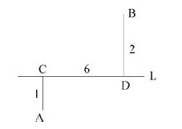

A. 2.75

B. 3.25

C. 2

D. 3

第 54 题 · 答案与解析

**参考答案（粉笔题库参考内容）**

C

**解析**

连接AB，交公路L于点E。根据两点之间线段最短，垃圾站建在E点，此时距离A、B两个村庄距离和最短。因，，可知，则，又CE+DE=6，解得CE=2，故应建在离C处2公里位置。

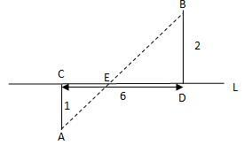

故正确答案为C。

**考点**：几何公式类-平面图形、几何结论类-几何小题型、几何结论类-相似图形

**来源**：2010年江西省公务员录用考试《行测》题第54题

### 第 55 题

某国家对居民收入实行下列税率方案；每人每月不超过3000美元的部分按照1%税率征收，超过3000美元不超过6000美元的部分按照X%税率征收，超过6000美元的部分按Y%税率征收(X，Y为整数)。假设该国某居民月收入为6500美元，支付了120美元所得税，则Y为多少？

A. 6

B. 3

C. 5

D. 4

第 55 题 · 答案与解析

**参考答案（粉笔题库参考内容）**

A

**解析**

各段分别缴税，由题意得：，简化上式可得：6X＋Y＝18，由此可得Y能够被6整除，在四个选项中仅A符合。

故正确答案为A。

**考点**：分段计算问题

**来源**：2010年江西省公务员录用考试《行测》题第55题

### 第 56 题

从所给四个选项中，选择最合适的一个填入问号处，使之呈现一定的规律性：

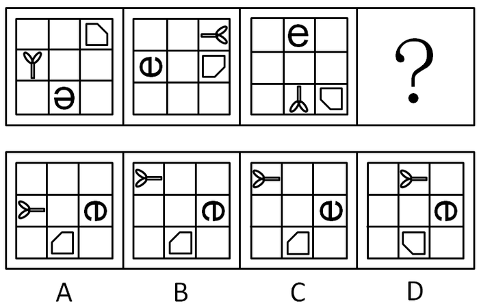

A. A

B. B

C. C

D. D

第 56 题 · 答案与解析

**参考答案（粉笔题库参考内容）**

B

**解析**

元素组成相同，考查位置规律。

“Y”元素依次顺时针移动三个格，“e”元素依次顺时针移动两个格，不规则五边形依次顺指针移动一个格。且每个元素每移动一次，自身就顺时针旋转90°。

故正确答案为B。

**考点**：位置规律-综合

**来源**：2010年江西省公务员录用考试《行测》题第56题

### 第 57 题

从所给四个选项中，选择最合适的一个填入问号处，使之呈现一定的规律性：

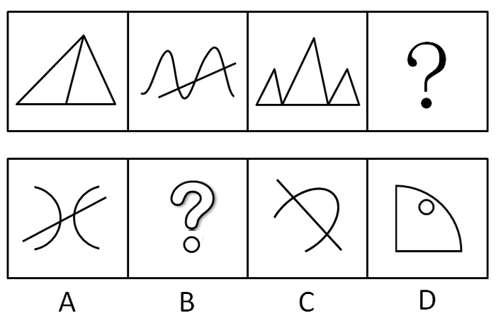

A. A

B. B

C. C

D. D

第 57 题 · 答案与解析

**参考答案（粉笔题库参考内容）**

C

**解析**

题目元素貌似凌乱，考查了奇偶特征。图一和图三中均有三个三角形，图二和图四均由一条直线和一条曲线组成。

故正确答案为C。

**考点**：数量规律-复合

**来源**：2010年江西省公务员录用考试《行测》题第57题

### 第 58 题

从所给四个选项中，选择最合适的一个填入问号处，使之呈现一定的规律性：

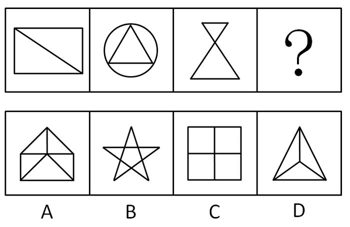

A. A

B. B

C. C

D. D

第 58 题 · 答案与解析

**参考答案（粉笔题库参考内容）**

B

**解析**

考查数量--数一笔画。

所有图形的笔画数为1，A项需要3笔；C、D都是至少2笔画；B项可以一笔完成。

故正确答案为B。

**考点**：数量规律-线

**来源**：2010年江西省公务员录用考试《行测》题第58题

### 第 59 题

从所给四个选项中，选择最合适的一个填入问号处，使之呈现一定的规律性：

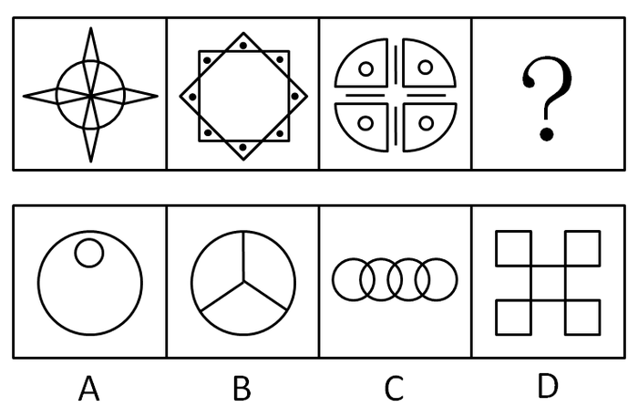

A. A

B. B

C. C

D. D

第 59 题 · 答案与解析

**参考答案（粉笔题库参考内容）**

D

**解析**

元素组成凌乱，呈现明显的对称规律。所有图形均为4个对称轴的对称图形。

故正确答案为D。

**考点**：属性规律-对称性

**来源**：2010年江西省公务员录用考试《行测》题第59题

### 第 60 题

从所给四个选项中，选择最合适的一个填入问号处，使之呈现一定的规律性：

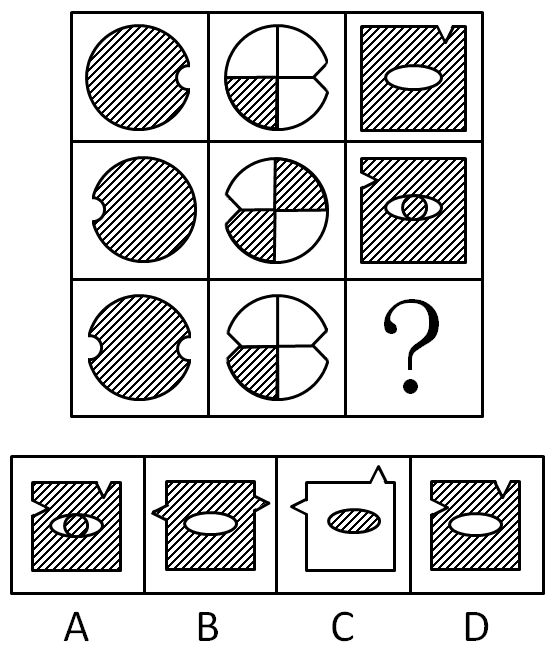

A. A

B. B

C. C

D. D

第 60 题 · 答案与解析

**参考答案（粉笔题库参考内容）**

D

**解析**

元素组成相似，元素黑白叠加。每一列中，前两个图叠加后去异存同得第三个图形；且叠加的颜色规则为：黑＋白＝白，白＋黑＝白，白＋白＝白，黑＋黑＝黑。注意第三列的中间部分，也是应用上述运算，为白。

故正确答案为D。

**考点**：样式规律-黑白运算

**来源**：2010年江西省公务员录用考试《行测》题第60题

### 第 61 题

从法律规则形式特征上看，可分为规范性规则和标准性规则。规范性规则指规则的内容明确、肯定和具体，且可直接适用的规则；标准性规则则指法律规则的部分内容或全部内容（事实状态、权利、义务、后果等）具有一定伸缩性，须经解释方可使用且可适当裁量的规则。

根据上述定义，下列属于规范性规则的是：

A. “早六点至晚六点间本街道禁止通车”

B. “每一选民在一次选举中只有一个投票权”

C. “民事活动应当尊重社会公德，不得损害社会公共利益”

D. “行政机关作出责令停产停业、吊销许可证或者执照、较大数额罚款等行政处罚决定之前，应当告知当事人有要求举行听证的权利”

第 61 题 · 答案与解析

**参考答案（粉笔题库参考内容）**

B

**解析**

第一步：找出定义关键词。

规范性规则：“规则的内容明确、肯定和具体”、“可直接适用的规则”；

标准性规则：“法律规则的部分内容或全部内容（事实状态、权利、义务、后果等）具有一定伸缩性”、“须经解释方可使用且可适当裁量的规则”。

第二步：逐一分析选项。

A项：“早六点至晚六点间本街道禁止通车”不是法律规则，不符合定义，排除；

B项：“每一选民在一次选举中只有一个投票权”符合关键词“规则的内容明确、肯定和具体”、“可直接适用的规则”，符合定义，当选；

C项：“应当尊重”说明规定具有伸缩性，不能直接适用，不符合定义，排除；

D项：“应当告知当事人有要求举行听证的权利”说明规定具有伸缩性，不能直接适用，不符合定义，排除。

故正确答案为B。

**考点**：常规问法

**来源**：2010年江西省公务员录用考试《行测》题第61题

### 第 62 题

社会互动是指人与人、人与社会、人与群体、群体与群体之间通过信息的传播而发生的相互影响、相互作用、相互依赖的社会交往活动的过程。

根据上述定义，下列不属于社会互动的现象是：

A. 在2008年的元旦晚会上，北大校长许智宏为学生们演唱了一首《隐形的翅膀》。歌声响起，北大学子们掌声相印，歌声相和

B. 榜样的力量是无穷的

C. 张三和他的邻居经常互相赠送自己做的小点心

D. 在第36届世界社会学大会上，中外学者互相交流学术观点

第 62 题 · 答案与解析

**参考答案（粉笔题库参考内容）**

B

**解析**

第一步：找出定义关键词。

“信息的传播”、“相互影响、相互作用、相互依赖的社会交往活动的过程”。

第二步：逐一分析选项。

A项：“歌声”符合关键词“信息的传播”、“相互影响、相互作用、相互依赖的社会交往活动的过程”，符合定义，排除；

B项：公众对榜样的模仿是榜样单方面的信息传播，不是相互影响与作用的过程，不符合定义，当选；

C项：“互相赠送自己做的小点心”符合关键词“信息的传播”、“相互影响、相互作用、相互依赖的社会交往活动的过程”，符合定义，排除；

D项：“中外学者互相交流学术观点”符合关键词“信息的传播”、“相互影响、相互作用、相互依赖的社会交往活动的过程”，符合定义，排除。

本题为选非题，故正确答案为B。

**考点**：方式目的

**来源**：2010年江西省公务员录用考试《行测》题第62题

### 第 63 题

法律责任是指由特定法律事实所引起的对损害予以补偿、强制履行或接受惩罚的特殊义务，亦即由于违反第一性义务而引起的第二性义务。

根据上述定义，下列属于导致法律责任的是：

A. 陈某向某电视台举报揭露某公司造假，电视台没有报道

B. 李某被公共汽车售票员提醒后，仍不给残疾人王某让座，结果王某被挤伤

C. 孙某和肖某谈恋爱，后因感情不和分手，肖某极度痛苦，患上抑郁症

D. 某公司要求工人每天至少工作16小时，加班费每小时5元

第 63 题 · 答案与解析

**参考答案（粉笔题库参考内容）**

D

**解析**

第一步：抓住定义中的关键词。

定义中强调“由特定法律事实所引起的”、“对损害予以补偿”、“违反第一性义务引起”等。

第二步：逐一判断选项。

A、B、C项中的事件均不是特定的法律事实，没有违反法律的规定，不符合定义；

D项中工作16个小时，超过法定要求的8小时，违反法律规定，属于特定法律事实；且公司对损害工人的时间予以补偿，属于对损害的补偿，符合定义。

故正确答案为D。

**考点**：原因结果

**来源**：2010年江西省公务员录用考试《行测》题第63题

### 第 64 题

以不同利益群体（或个人）的存在和目标物的稀缺为前提的，社会上人与人、群体与群体之间，对于一个共同目标的争夺就是竞争。

根据上述定义，下列行为中不属于竞争关系的是：

A. 2009年世界斯诺克英国锦标赛，丁俊晖以10：8战胜希金斯，获得冠军

B. 有关资料显示，2010年度有100余万人参加国家公务员录用考试

C. 2009年12月9号，拜仁慕尼黑队以四比一战胜尤文图斯队，获得欧冠小组赛的出线权

D. 公司的联欢晚会上，大家开展了歌曲联唱活动

第 64 题 · 答案与解析

**参考答案（粉笔题库参考内容）**

D

**解析**

第一步：抓住定义中的关键词。

定义中强调“不同利益群体（或个人）”、“目标物的稀缺”、“共同目标的争夺”等。

第二步：逐一判断选项。

A、B、C项均是为稀缺的同一目标物的争夺，符合定义；

D项中没有涉及共同的目标的争夺，不符合定义。

故正确答案为D。

**考点**：拆词

**来源**：2010年江西省公务员录用考试《行测》题第64题

### 第 65 题

所谓诬告陷害罪是指捏造事实诬告陷害他人，意图使他人受刑事追究，情节严重的行为。

根据上述定义，下列行为构成诬告陷害罪的是：

A. 乙捏造“文某强奸幼女”的事实，并向司法部门举报

B. 甲与丁某长期不和，便捏造丁某包养情人并匿名举报，使丁某与妻子离婚

C. 丙捏造同事万某受贿10万元的事实，并印刷大量传单在县城的大街小巷张贴

D. 丁匿名举报李某抢劫他人50万元。事后查明，李某只抢劫了5000元

第 65 题 · 答案与解析

**参考答案（粉笔题库参考内容）**

A

**解析**

第一步：抓住定义中的关键词。

定义中强调“捏造事实”、“使他人受刑事追究”等。

第二步：逐一判断选项。

A项中乙捏造事实，并可以使他人受到刑事追究，符合定义；

B、C项中没有体现使他人受刑事追究；

D项中没有体现是丁捏造事实诬告陷害他人，均不符合定义。

故正确答案为A。

**考点**：方式目的

**来源**：2010年江西省公务员录用考试《行测》题第65题

### 第 66 题

血缘关系是以血统或生理的联系为基础形成的人际关系；或者是指在婚姻和血缘基础上形成的人际关系。

根据上述定义，下列人际关系中属于血缘关系的是：

A. 张三出差外地，巧遇家乡来的一个堂叔

B. 某高校中文系88级同学毕业后第一次聚会

C. 小张被公司派往日本学习，在东京遇到了多年前的一个老朋友

D. 京剧《红灯记》里，李铁梅唱道：“我家的表叔数不清······虽说是亲人又不相认······可他比亲人还要亲。”

第 66 题 · 答案与解析

**参考答案（粉笔题库参考内容）**

A

**解析**

第一步：抓住定义中的关键词。

定义中强调“以血统或生理的联系为基础”或“婚姻和血缘基础上”等。

第二步：逐一判断选项。

A项“堂叔”属于血缘上的关系，符合定义；

B、C、D项中的人际关系，既没有血统上的关系，也没有婚姻基础上的关系，不符合定义。

故正确答案为A。

**考点**：拆词

**来源**：2010年江西省公务员录用考试《行测》题第66题

### 第 67 题

社会化过度是指把成年人某些社会化的任务前移到了部分青少年身上。现在我们的教育过早及过多地给予孩子们社会规范、纪律约束和强求一律的认同，极易造成青少年的社会化过度。

根据上述定义，下列行为中不属于社会化过度的是：

A. 老周说，同事李先生的小孩太聪明了，小小年纪就懂得“见人说人话，见鬼说鬼话”

B. 一项调查显示，现在中小学生中想当班组长的人非常多，而长大以后想当官是不少孩子主要的人生目标

C. 2007年，香港9岁神童沈诗钧被香港某大学录取一事引起广泛关注

D. 有人形容时下青少年中流行的啃老族是：“一直无业，二老啃光，三餐饱食，四肢无力，五官端正，六亲不认，七分任性，八方逍遥，九（久）坐不动，十分无用。”

第 67 题 · 答案与解析

**参考答案（粉笔题库参考内容）**

D

**解析**

第一步：抓住定义中的关键词。

定义中强调“社会化的任务”、“前移”等。

第二步：逐一判断选项。

A项圆滑世故的处世之道、B项对权利的追捧、C项对独自适应大学和社会生活的要求，都体现了人的某些社会化任务前移到青少年身上，符合定义；

D项说明青少年缺少应有的社会任务，与定义相悖。

本题为选非题，故正确答案为D。

**考点**：单定义-其他句式

**来源**：2010年江西省公务员录用考试《行测》题第67题

### 第 68 题

统一指挥原则是指在正式组织里，无论什么时候，一个下属都应该接受而且只应接受一个上级的命令并向这个上级汇报自己的工作。

根据上述定义，下列选项违背了统一指挥原则的是：

A. 总经理把产品销售的责任委派给一位分管市场经营的副总经理，由其负责所在地区的经销办事处，同时总经理又要求各地区经销办事处的经理们直接向总会计师汇报每天的销售数量

B. 主任科员小张在省级政府部门工作，发现他的直接上司有索贿受贿的行为，于是就向省纪委举报其上司的违法行为

C. 王大夫是某医院的外科医生，同时也是医院工会会员。有一天，王大夫接到手术安排的同时也接到了工会主席要求参加一项活动的通知，王大夫在向直接上司请假后参加了工会的活动

D. 某商业集团公司的刘总到公司下属某商场暗访，现场发现一些员工违反公司制度的行为，刘总并没有现场责令员工改进，而是将问题反映给了商场经理

第 68 题 · 答案与解析

**参考答案（粉笔题库参考内容）**

A

**解析**

第一步：找出定义关键词。

关键词为“应该接受而且只应接受一个上级的命令”“并向这个上级汇报自己的工作”。

第二步：逐一分析选项。

A项：听从命令和汇报的上级不是同一个上级，不符合定义；

B项：小张向省纪委进行的是举报工作，并非自己的本职工作，并没有涉及到统一指挥原则，因此无法判断是否违反了统一指挥原则，不明确；

C项：王大夫是向自己的主任请假，只有一个上级就是直接上司，遵循了统一指挥原则；

D项：刘总没有直接干涉下属商场工作，而是把情况反映给了商场经理，并没有涉及到谁是唯一上级，没用到统一指挥原则，因此无法判断是否违反了统一指挥原则，不明确。

B、D两项都没用到统一指挥原则，C选项遵循了统一指挥原则，因此违反了统一指挥原则的只有A项。

故正确答案为A。

**考点**：主客体

**来源**：2010年江西省公务员录用考试《行测》题第68题

### 第 69 题

行政主体是指享受行政职权，能以自己的名义行使国家行政职权，作出影响相对人权利义务的行政行为，并能由其本身对外承担行政法律责任的组织。

根据上述定义，下列不是行政主体的是：

A. 行政机关

B. 法律法规授权行使行政管理权的组织

C. 江西省人民政府省长

D. 行政机关的派出机关

第 69 题 · 答案与解析

**参考答案（粉笔题库参考内容）**

C

**解析**

第一步：抓住定义中的关键词。

定义中强调“能以自己的名义行使国家行政职权”等。

第二步：逐一判断选项。

A、B、D项均能以自己的名义行使国家行政职权，符合定义；

C项中的省长不能以自己的名义行使国家行政职权，因此不符合定义。

本题为选非题，故正确答案为C。

**考点**：单定义-其他句式

**来源**：2010年江西省公务员录用考试《行测》题第69题

### 第 70 题

目前主流看法是，导致气候变化的过量碳排放，是在人类生产和消费过程中出现的。“低碳生活”是指要减少导致气候变化的过量碳排放，就要相应优化和约束某些消费和生产活动，倡导较低（或更低）的温室气体（二氧化碳为主的）排放的生活方式。可以简单地理解为：“适度吃、住、行、用，不浪费、多运动”。

根据上述定义，下列哪个行为不属于低碳生活？

A. 建筑中使用中空玻璃

B. 轿车定期更换机油

C. 使用一次性纸杯

D. 周末，某大学有越来越多的同学步行回家

第 70 题 · 答案与解析

**参考答案（粉笔题库参考内容）**

C

**解析**

第一步：抓住定义中的关键词。

定义中强调“减少过量碳排放”、“适度吃、住、行、用，不浪费、多运动”等。

第二步：逐一判断选项。

A、B、D项的措施和行为，都可以减少碳的排放，符合定义；

C项不是适度的“用”行为，属于一种浪费行为，与定义相悖。

本题为选非题，故正确答案为C。

**考点**：拆词

**来源**：2010年江西省公务员录用考试《行测》题第70题

### 第 71 题

奋斗：成功

A. 大雪：封山

B. 学习：理解

C. 财富：贫困

D. 考试：成绩

第 71 题 · 答案与解析

**参考答案（粉笔题库参考内容）**

B

**解析**

第一步：判断题干词语间的第一重逻辑关系，并在选项中进行选择。

题干两词为或然因果关系。

A、B项中两词均为或然因果关系；

C项中词语不构成因果关系；

D项中两词为必然因果关系。

第二步：答案不唯一时，判断题干词语间的第二重逻辑关系，并在选项中进行选择。

题干中的奋斗与B项中的学习同为抽象词语，而A项中的大雪不是抽象词语。

故正确答案为B。

**考点**：逻辑关系-对应关系

**来源**：2010年江西省公务员录用考试《行测》题第71题

### 第 72 题

石油：汽油

A. 铁矿石：钢铁

B. 木材：家具

C. 水泥：房屋

D. 玻璃：窗户

第 72 题 · 答案与解析

**参考答案（粉笔题库参考内容）**

A

**解析**

第一步：判断题干词语间逻辑关系。

题干两词为原材料对应关系。

第二步：判断选项词语间逻辑关系。

A、B、C三项均为原材料对应关系，保留；D项为组成关系，排除。

进行二级辨析，题干为化学工艺，只有A项为化学工艺，B、C两项均为物理工艺，排除。

故正确答案为A。

**考点**：逻辑关系-对应关系

**来源**：2010年江西省公务员录用考试《行测》题第72题

### 第 73 题

井冈山：红色摇篮

A. 泰山：日出

B. 庐山：瀑布

C. 黄山：险峻

D. 延安：革命圣地

第 73 题 · 答案与解析

**参考答案（粉笔题库参考内容）**

D

**解析**

第一步：判断题干词语间的逻辑关系。

题干两词为全同关系中的同义词关系，所指均为同一事物。

第二步：判断选项词语间的逻辑关系。

A、B是景点与其对应著名景观的对应关系；

C为属性关系；

D为全同关系中的同义词关系，两词所指为同一事物。

故正确答案为D。

**考点**：逻辑关系-全同关系

**来源**：2010年江西省公务员录用考试《行测》题第73题

### 第 74 题

白居易：在天愿作比翼鸟，在地愿为连理枝

A. 曾巩：明月不谙离恨苦，斜光到晓穿朱户

B. 张若虚：春江潮水连海平，海上明月共潮生

C. 岳飞：莫等闲，白了少年头，空悲切

D. 王实甫：枯藤老树昏鸦，小桥流水人家，古道西风瘦马

第 74 题 · 答案与解析

**参考答案（粉笔题库参考内容）**

B

**解析**

第一步：判断题干词语间的第一重逻辑关系，并在选项中进行选择。

题干两词是对应关系，是诗句与其作者的对应。

A项中诗句的作者为晏殊，D项中诗句的作者为马致远，均不构成对应关系；

B、C项中的两词均为作者与其诗句的对应关系。

第二步：答案不唯一时，判断题干词语间的第二重逻辑关系，并在选项中进行选择。

题干中诗句为对偶诗句，而C项中的诗句不是对偶诗句。

故正确答案为B。

**考点**：逻辑关系-对应关系

**来源**：2010年江西省公务员录用考试《行测》题第74题

### 第 75 题

节能：减排：环保

A. 火药：造纸：四大发明

B. 起床：步行：上班

C. 生产：销售：管理

D. 锻炼：营养：健康

第 75 题 · 答案与解析

**参考答案（粉笔题库参考内容）**

D

**解析**

第一步：判断题干词语间的逻辑关系。

节能和减排为方式，目的是为了环保，三者为方式目的的对应关系。

第二步：判断选项词语间的逻辑关系。

A项：火药和造纸均为四大发明的组成部分，与题干逻辑关系不一致，排除；

B项：起床和步行不是上班的方式，与题干逻辑关系不一致，排除；

C项：生产、销售和管理为并列关系，与题干逻辑关系不一致，排除；

D项：锻炼和营养为方式，目的是为了健康，三者为方式目的的对应关系，与题干逻辑关系一致，当选。

故正确答案为D。

**考点**：逻辑关系-对应关系

**来源**：2010年江西省公务员录用考试《行测》题第75题

### 第 76 题

纠纷：诉讼：裁判

A. 损害：车祸：赔偿

B. 文学作品：作家：写作

C. 学习：借鉴：创新

D. 书籍：撰写：纸张

第 76 题 · 答案与解析

**参考答案（粉笔题库参考内容）**

C

**解析**

第一步：判断题干词语间的逻辑关系。

题干三个词为并列关系，是按先后顺序依次出现的三个动作。

第二步：判断选项词语间的逻辑关系。

A项中三个词语为并列关系，但先后顺序错误，车祸应该在损害的前面；

B项中作家与写作为对应关系；

C项中三个动作是并列关系，并且先后顺序正确；

D项中书籍与纸张是组成关系。

故正确答案为C。

**考点**：逻辑关系-对应关系

**来源**：2010年江西省公务员录用考试《行测》题第76题

### 第 77 题

赣：江西：赣江

A. 辽：辽河：辽宁

B. 桂：广西：漓江

C. 粤：广东：珠江

D. 湘：湖南：湘江

第 77 题 · 答案与解析

**参考答案（粉笔题库参考内容）**

D

**解析**

第一步：判断题干前两词间的逻辑关系，并在选项中进行选择。

题干前两个词为全同关系中的同义词关系。

A项中前两词为对应关系；

B、C、D三项中前两词均为同义词关系。

第二步：判断题干一、三词间的逻辑关系，并在选项中进行选择。

题干中一、三词间为对应关系，是名称与其来源的对应。

B、C两项中一、三词均不是名称与其来源的对应；

D项种一、三词为名称与其来源的对应关系。

故正确答案为D。

**考点**：逻辑关系-全同关系

**来源**：2010年江西省公务员录用考试《行测》题第77题

### 第 78 题

拱桥 对于 （    ） 相当于 樟树 对于 （    ）

A. 建筑 绿化

B. 高超 高大

C. 技艺 生长

D. 桥梁 树林

第 78 题 · 答案与解析

**参考答案（粉笔题库参考内容）**

D

**解析**

第一步：将选项逐一代入，判断选项前后两部分的逻辑关系。

A项中两词与题干不构成逻辑关系；

B项中前两词没有逻辑关系，后两词为属性关系；

C项中后两词为属性关系，前两词不是属性关系；

D项中拱桥是桥梁中的一种形状，樟树是树林里的一个树种，前后两部分逻辑关系一致。

第二步：逻辑关系相同即为答案。

故正确答案为D。

**考点**：逻辑关系-包容关系

**来源**：2010年江西省公务员录用考试《行测》题第78题

### 第 79 题

寒 对于 （    ） 相当于 叫 对于 （    ）

A. 冷 喊

B. 冬 唱

C. 春 吟

D. 冰 说

第 79 题 · 答案与解析

**参考答案（粉笔题库参考内容）**

A

**解析**

逐一代入选项。

A项与题干组成的两组词均为近义词关系，当选；

B中前两词为属性关系，后两词没有逻辑关系，排除；

C中两词与题干均不构成逻辑关系，排除；

D中前两词为属性关系，后两词不构成逻辑关系，排除。

故正确答案为A。

**考点**：语义关系-近义关系

**来源**：2010年江西省公务员录用考试《行测》题第79题

### 第 80 题

糖 对于 （    ） 相当于 汞 对于 （    ）

A. 苦 毒

B. 核糖 非金属

C. 咖啡 温度计

D. 碳水化合物 水银

第 80 题 · 答案与解析

**参考答案（粉笔题库参考内容）**

D

**解析**

逐一代入选项。

A项：糖是甜的，苦不是糖的属性，汞是有毒的，毒是汞的属性，前后逻辑关系不一致，排除；

B项：核糖是糖的一种，二者是种属关系；汞是一种金属元素，不是非金属，前后逻辑关系不一致，排除；

C项：糖可以和咖啡搭配使用，汞是制作温度计的原材料，前后逻辑关系不一致，排除；

D项：糖也称碳水化合物，二者是全同关系，汞俗称水银，二者也是全同关系，前后逻辑关系一致，当选。

故正确答案为D。

**考点**：逻辑关系-全同关系

**来源**：2010年江西省公务员录用考试《行测》题第80题

### 第 81 题

2008年，我国某“城调队”的一份调查显示，“80后”的已婚青年夫妇中，与父母或岳父母生活在一起的人占该年龄段人口的比例达55%以上；相比“70年代”的已婚青年夫妇，这一比例上升了22%。由此看来，“80后”的已婚青年夫妇更难以承受独立生活的压力。

上文的结论最可能基于下列哪项假设？

A. “80后”的青年夫妇更喜欢过二人世界的生活

B. “80后”的有些青年夫妇不愿意由双方的父母来照顾自己的孩子，所以不愿与双方父母共同生活

C. “80后”的青年夫妇只要能够独立生活，就不会选择与双方父母亲共同生活

D. 有些“80后”的青年夫妇因工作压力大而不想要孩子

第 81 题 · 答案与解析

**参考答案（粉笔题库参考内容）**

C

**解析**

第一步：找出论点和论据。

论点：“80后”的已婚青年夫妇更难以承受独立生活的压力。

论据：调查显示，“80后”的已婚青年夫妇中，与父母或岳父母生活在一起的人占该年龄段人口的比例达55%以上。

第二步：判断加强方式。

论点强调的是“难以承受独立生活的压力”，论据强调的是“与父母或岳父母生活在一起”，论点和论据强调的内容不一样，需要加强论证，在两者间搭桥。

第三步：逐一判断选项的作用。

A项中喜不喜欢独立生活、B项中的愿不愿意跟父母共同生活、D项中的想不想要孩子，都不能说明有没有能力独立生活的问题，与论点无关，属于无关选项；

C项在独立生活跟与父母亲一起生活之间搭桥，加强题干的论证，符合题意。

故正确答案为C。

**考点**：搭桥

**来源**：2010年江西省公务员录用考试《行测》题第81题

### 第 82 题

公司召开一个重要会议，小张又迟到了。公司王经理批评他说：“小张，你为什么又迟到啦？”小张解释说：“因为来晚了，所以迟到了。”

以下哪项陈述正确描述了上文推论中的错误？

A. 使用了一种原则上既不能证明为真也不能证明为假的前提

B. 把对一类事物中的个别种类断定为真的结论推广到这类事物的所有种类

C. 使用了一种强词夺理的说法

D. 把所需要做出解释的现象本身作为对那种现象的一种解释

第 82 题 · 答案与解析

**参考答案（粉笔题库参考内容）**

D

**解析**

第一步：找出题干的推论。

因为来晚了，所以迟到了。

第二步：分析推论，结合选项得出答案。

由于来晚和迟到是同义词，因此小张的解释可翻译为“来晚（迟到）⇒迟到（来晚）”，以结果当原因来解释结果，属于把所需要做出解释的现象本身作为对那种现象的一种解释。

故正确答案为D。

**考点**：日常结论

**来源**：2010年江西省公务员录用考试《行测》题第82题

### 第 83 题

大学生在大学里要学习很多知识，小王是一名大学生，所以他学习了很多的知识。

以下哪项论证展示的推理错误与上述论证中的最相似？

A. 水果中含有各种丰富的维生素，苹果是一种水果，所以苹果中含有丰富的维生素

B. 所有的老员工都是优秀的，李刚是新来的员工，所以李刚不是优秀员工

C. 某高校学报的编辑不但要组织和编辑稿件，自己也写了许多学术方面的文章，老郑是该学报的一名编辑，所以他也写过许多学术方面的文章

D. 这所大学的有些学生学习成绩很好，小赵是这所大学的一名学生，所以她的学习成绩很好

第 83 题 · 答案与解析

**参考答案（粉笔题库参考内容）**

A

**解析**

第一步：翻译题干。

题干可翻译为，A(大学生)⇒B（学习知识），C（小王）∈A，结论：C⇒B。

第二步：逐一翻译选项。

A可翻译为，A（水果）⇒B（有丰富维生素），C（苹果）∈A，结论：C⇒B；

B可翻译为，A（老员工）⇒B（优秀），C（李刚）＝﹣A，结论：C⇒﹣B；

C可翻译为，A（编辑）⇒B（编辑稿件）且C（写了学术文章），D（老郑）∈A，结论：D⇒C；

D可翻译为，有的A（学生）⇒B（成绩好），C（小赵）∈A，结论：C⇒B。

对比题干与选项的推理形式，A项与题干的推理形式最为相似。

故正确答案为A。

**考点**：推理形式

**来源**：2010年江西省公务员录用考试《行测》题第83题

### 第 84 题

不可能所有的江西人都喜欢辣椒。以下哪项判断的含义与上述判断最为接近？

A. 必然有的江西人不喜欢吃辣椒

B. 可能所有的江西人都喜欢吃辣椒

C. 必然所有的江西人都喜欢吃辣椒

D. 可能有的江西人会吃辣椒

第 84 题 · 答案与解析

**参考答案（粉笔题库参考内容）**

A

**解析**

第一步：翻译题干。

\-所有的江西人⇒喜欢辣椒。

第二步：逐一判断选项。

A项，由“-所有的江西人⇒喜欢辣椒”可知，有些江西人⇒不喜欢辣椒。该项可以推出。

B项，该项与题干明显矛盾，不能推出。

C项，所有的江西人⇒喜欢辣椒，否定题干前件，不能推出。

D项，有些江西人⇒吃辣椒，无法从题干中得出。

故正确答案为A。

**来源**：2010年江西省公务员录用考试《行测》题第84题

### 第 85 题

所有与甲流患者接触的人都被隔离了，所有被隔离的人都与小王接触过。

如果以上命题是真的，以下哪个命题也是真的？

A. 小王是甲流患者

B. 小王不是非甲流患者

C. 可能有人没有接触过甲流患者，但接触过小王

D. 所有甲流患者都与小王接触过

第 85 题 · 答案与解析

**参考答案（粉笔题库参考内容）**

C

**解析**

第一步：翻译题干。

接触流感患者⇒被隔离；被隔离⇒接触小王。

以上两个推导关系连起来即为：接触流感患者⇒被隔离⇒接触小王。

第二步：逐一判断选项。

A、B项从以上两个命题无法得出小王是否为流感患者，A、B两项无法推出；

C项可翻译为，接触小王⇒接触流感患者。“接触小王”为肯定第一步推导关系中的后件，由逆否规则可知无法得出绝对表达的结论，但可以推出可能性结论，即可能有人没有接触流感患者但接触过小王，C项的可能性表达正确；

D项从两个命题也没有说明流感患者和小王之间的关系，D项无法推出。

故正确答案为C。

**考点**：常规翻译

**来源**：2010年江西省公务员录用考试《行测》题第85题

### 第 86 题

某天五个朋友聚会，其中一个人历数喝酒对身体的危害，并热心地劝告大家戒酒。他逐个询问说：“你现在戒酒了吗？”四个人的回答各不同。

请根据他们的回答，判断这四个人当中，谁没有违反这个推理隐含的前提：

A. 我正准备戒酒

B. 我已经戒酒啦

C. 我从来不喝酒

D. 我特别喜欢喝酒

第 86 题 · 答案与解析

**参考答案（粉笔题库参考内容）**

A

**解析**

第一步：抓住题干主要信息。

题干说的是有人在聚会上指出喝酒的坏处，并劝其他人戒酒。

第二步：根据题干信息逐一分析选项。

A项：由“劝其他人戒酒”和逐个询问对方戒酒了没有，可以看出，题干推理隐含的前提是四个人现在都喝酒，A项正准备戒酒，说明该人目前处于喝酒状态，符合题意，当选；

B项：说明当下是不喝酒的状态，不喝酒就无所谓戒酒，与题干推理相悖，排除；

C项：说明当下是不喝酒的状态，不喝酒就无所谓戒酒，与题干推理相悖，排除；

D项：喜不喜欢喝酒跟现在有没有喝酒无关，属于无关选项，排除。

故正确答案为A。

**考点**：日常结论

**来源**：2010年江西省公务员录用考试《行测》题第86题

### 第 87 题

十六世纪英国市场上流通的是金属铸币，时间长了，人们发现足值与不足值的铸币可以一样使用，于是，人们就把成色的足值货币（良币）储藏起来，而把不足值的货币（劣币）赶紧花出去，结果，劣币把良币赶出了市场。这就是格雷欣法则，是一种“优败劣胜”的自然与社会现象。

以下哪种现象如果为真，最符合以上的结论？

A. 猴群中强者为王

B. 山寨手机在手机市场上流行一时

C. 优秀的文学作品大多是能够广为流传的

D. 学校里品学兼优的学生总是容易脱颖而出

第 87 题 · 答案与解析

**参考答案（粉笔题库参考内容）**

B

**解析**

第一步：抓住题干关键信息。

题干的结论为：“优败劣胜”。

第二步：逐一判断选项。

A项，“强者为王”是指强者胜，优胜劣汰，不符合“优败劣胜”。

B项，“山寨流行”是劣质的手机在市场流行，符合“优败劣胜”。

C项，“优秀的文学作品”是优质的作品，是优胜劣汰，不符合“优败劣胜”。

D项，“品学兼优”是优秀的学生，是优胜劣汰，不符合“优败劣胜”。

故正确答案为B。

**考点**：日常结论

**来源**：2010年江西省公务员录用考试《行测》题第87题

### 第 88 题

人类从诞生之日起就在与疾病作斗争，各种疾病中最容易让人产生恐慌的是大范围传染性疾病。短短几年来，人们充分见识了重大疫情的威胁。特别是这次甲型H1N1流感疫情，蔓延速度之快，范围之广，令人吃惊，这不能不引起人们的警觉。所以说，人类与传染病斗争未有穷期。

以下哪项如果为真，最不支持以上的结论？

A. 新发传染病大都是病毒感染所致，抗生素对新的传染病基本无效

B. 病毒越来越具有隐蔽性

C. 病毒为了生存会不断变异

D. 人定胜天，历史上曾有过的多次灾难性疾病最终都被人类打败了

第 88 题 · 答案与解析

**参考答案（粉笔题库参考内容）**

D

**解析**

第一步：找出论点和论据。

论点：人类与传染病斗争未有穷期。

论据：短短几年来，大范围传染性疾病，尤其是甲型H1N1流感疫情给人们带来的威胁。

第二步：逐一判断选项。

A项说抗生素对新的传染病基本无效，说明人类需要不停地与新传染病抗争，属加强选项；

B、C两项都说明病毒在不断变化，同时也越来越难以发现，这些都加大了人类消灭病毒的难度，加强论点；

D项说的人类曾成功地打败灾难性疾病，即人类能战胜疾病，这削弱了题干论点。

A、B、C都加强论点，D削弱论点，最不支持论点的是D项。

故正确答案为D。

**考点**：加强选非题

**来源**：2010年江西省公务员录用考试《行测》题第88题

### 第 89 题

三个好朋友“五一”节准备外出游玩，他们对出行方式的态度如下：王某要坐车，什么车都可以；李某可以不坐车，要坐就坐公交车；张某可以不坐车，要坐就坐出租车。如果他们根据自己的态度，对以下意见表示自己的看法：不坐车，坐公交车，坐出租车。

根据以上资料，以下哪项是不可能成立的？

A. 有一个人同意全部意见

B. 每个意见至少有两个人同意

C. 王某和李某都同意坐公交车

D. 张某同意不坐车和坐出租车

第 89 题 · 答案与解析

**参考答案（粉笔题库参考内容）**

A

**解析**

第一步：根据题干已知信息列表。根据题干可知有王某、李某、张某三人对“不坐车，坐公交车，坐出租车”三种观点各自发表了不同的看法，将三人观点列表如下：

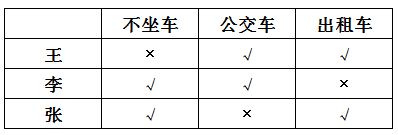

第二步：分析列表信息，结合选项得出答案。

由列表可知，王某、李某、张某各自同意三种意见中的两种，没有人同意全部意见，A项不成立，B项成立；王某和李某都同意坐公交车，C项成立；张某同意不坐车和坐出租车，D项成立。

本题为选非题，故正确答案为A。

**考点**：排除法

**来源**：2010年江西省公务员录用考试《行测》题第89题

### 第 90 题

有一些经济学家认为，加速城市化，以城市化为杠杆，撬动内需增长，不失为一个应对金融危机的积极选择。并提出可以借鉴的“破窗理论”：当一扇窗户被打破以后，主人自然要购置新玻璃，这就是间接促进了玻璃厂的扩大再生产，从而拉动了经济发展。因此说，城市化是加速经济发展的一项积极举措。

以下哪项如果为真，最能质疑上述的理论和观点？

A. 有官员声称，中央出台刺激经济政策，我们应该抓住机遇，加快推进城市建设

B. 有学者论证，只有加速城市化，才能使中国经济摆脱长期陷于谷底的状态

C. 有市民认为，仅仅加速城市建设不是提升老百姓消费水平的好办法

D. 有开发商认为，城市化就应该加速房地产开发

第 90 题 · 答案与解析

**参考答案（粉笔题库参考内容）**

C

**解析**

第一步：找出论点和论据。

论点为经济学家的观点，即加速城市化，以城市化为杠杆，撬动内需增长，是应对金融危机的积极选择。

论据为破窗理论。

第二步：判断削弱方式。

本题论点和论据存在明显的因果关系，所以需要削弱论点。

第三步：逐一判断选项的作用。

A项只说明加快推进城市建设，没有说明城市化是否对加速经济发展有用，无法否论点；

B项支持论点；

C项直接否定论点，说明加快城市化并不能拉动内需，无法加速经济发展；

D项说的是城市化该怎么做，没有说明城市化是否有用，属于无关选项。

故正确答案为C。

**考点**：削弱论点

**来源**：2010年江西省公务员录用考试《行测》题第90题

## 材料 1

国家工商总局公布的数据显示，2009年第一季度，全国工商行政管理机关共查处各类违法违章案件68202件，同比下降29.98%；其中立案查处案件49654件，同比下降32.26%，案件总值33.57亿元，同比下降21.26%，罚没金额3.33亿元，同比下降39.49%。

        从违法法规看，违法企业登记管理法规案件9216件，同比下降38.54%；违反产品质量法规案件6760件，同比下降27.51%；违反反不正当竞争法规案件4944件，同比增长6.51%；违反商标法规案件4119件，同比下降21.93%；违反广告法规案件2141件，同比下降24.27%；违反消费者权益保护法规定案件1644件，下降13.66%；违反合同法规案件156件，同比下降57.02%。

        从违法主体看，在立案查处的案件中，个体工商户案件22142件，同比下降22.73%；自然人案件12472件，同比下降49.04%；公司案件6521件，同比下降21.73%；私营企业案件3975件，同比下降22.27%；集体企业案件728件，同比下降45.26%。

### 第 91 题

若保持同比下降率不变，预计2010年第一季度全国立案查处案件数将：

A. 接近4.8万

B. 接近3.4万

C. 接近1.6万

D. 接近2.1万

第 91 题 · 答案与解析

**参考答案（粉笔题库参考内容）**

B

**解析**

根据题干“若保持同比下降率不变，预计2010年第一季度全国立案查处案件数将”，结合材料给出的是2009年的数据，判定本题为现期计算问题。定位文字材料第一段，2009年第一季度，全国工商行政管理机关立案查处案件49654件，同比下降32.26%。根据公式：现期量=基期量，可得2010年第一季度全国立案查处案件数件=3.4万件，B项符合。

故正确答案为B。

**考点**：文字资料、现期计算

**来源**：2010年江西省公务员录用考试《行测》题第91题

### 第 92 题

2009年第一季度，违反产品质量法规案件减少量是违反商标法规案件减少量的几倍？

A. 1.25

B. 1.56

C. 1.77

D. 2.22

第 92 题 · 答案与解析

**参考答案（粉笔题库参考内容）**

D

**解析**

根据题干“2009年第一季度，······是······的几倍”，可判定本题为现期倍数计算问题。定位文字材料第二段，违反产品质量法规案件6760件，同比下降27.51%······违反商标法规案件4119件，同比下降21.93%。代入公式：减少量，可得2009年第一季度，违反产品质量法规案件减少量是违反商标法规案件减少量的倍，与D项最接近。

故正确答案为D。

**考点**：文字资料、现期倍数

**来源**：2010年江西省公务员录用考试《行测》题第92题

### 第 93 题

2009年第一季度，各类违法主体占立案查处案件比重的最高值与最低值相差多少？

A. 43.13%

B. 36.62%

C. 31.40%

D. 26.67%

第 93 题 · 答案与解析

**参考答案（粉笔题库参考内容）**

A

**解析**

根据题干“2009年第一季度，各类违法主体占立案查处案件比重······”，可判定本题为现期比重问题。定位文字材料第一段和第三段可得：2009年第一季度······其中立案查处案件49654件；各类违法主体占立案查处案件比重最高的是个体工商户有22142件，最低的为集体企业案件有728件。代入公式：比重=部分/整体，可得所求比重差值，与A项最接近。

故正确答案为A。

**考点**：文字资料、现期比重

**来源**：2010年江西省公务员录用考试《行测》题第93题

### 第 94 题

下列说法与资料相符的有几个：

（1）2009年第一季度，罚没金额同比下降率大于案件总值同比下降率

（2）2008年第一季度，违反合同法规案件为353件

（3）2009年第一季度，公司案件数大于私营企业案件与集体企业案件数之和

A. 0

B. 1

C. 2

D. 3

第 94 题 · 答案与解析

**参考答案（粉笔题库参考内容）**

C

**解析**

（1）定位文字材料第一段，2009年第一季度······案件总值33.57亿元，同比下降21.26%，罚没金额3.33亿元，同比下降39.49%。39.49%＞21.26%，罚没金额同比下降率大于案件总值同比下降率，正确；

（2）定位文字材料第二段，从违法法规看······违反合同法规案件156件，同比下降57.02%。根据公式：基期量，2008年第一季度违反合同法规案件，并非353件，错误；

（3）定位文字材料第三段，从违法主体看······公司案件6521件······私营企业案件3975件······集体企业案件728件，6521>3975+728，公司案件数大于私营企业案件与集体企业案件数之和，正确。

综上所述，（1）（3）正确。

故正确答案为C。

**考点**：文字资料、综合分析

**来源**：2010年江西省公务员录用考试《行测》题第94题

### 第 95 题

根据上述资料，以下描述不正确的是：

A. 2009年第一季度，自然人案件与集体企业案件同比下降均超过40%

B. 2009年第一季度，违反广告法规案件占各类违法违章案件的比重为3.14%

C. 2009年第一季度，违反各类法规案件与去年同期相比均有下降

D. 2009年第一季度，违反不正当竞争法规案件数量大约是违反消费者权益保护法规案件数量的3倍

第 95 题 · 答案与解析

**参考答案（粉笔题库参考内容）**

C

**解析**

A项：定位文字材料第三段，从违法主体看······自然人案件同比下降49.04%，集体企业案件同比下降45.26%。同比下降均超过40%，正确；

B项：定位文字材料第一段，2009年第一季度，全国工商行政管理机关共查处各类违法违章案件68202件。定位文字材料第二段，从违法法规看······违反广告法规案件2141件。故违反广告法规案件占各类违法违章案件的比重，正确；

C项：定位文字材料第二段，从违法法规看······违反反不正当竞争法规案件4944件，同比增长6.51%，错误；

D项：定位文字材料第二段，从违法法规看······违反不正当竞争法规案件数4944件，违反消费者权益保护法规案件数1644件。违反不正当竞争法规案件数约是违反消费者权益保护法规的倍，正确。

本题为选非题，故正确答案为C。

**考点**：文字资料、综合分析

**来源**：2010年江西省公务员录用考试《行测》题第95题

## 材料 2

2008年江西省各设区市普通中学分布情况表

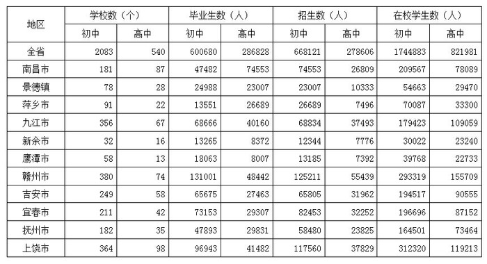

### 第 96 题

2008年宜春市高中招生数占全省高中招生人数的比重为：

A. 8.55%

B. 11.47%

C. 11.58%

D. 12.34%

第 96 题 · 答案与解析

**参考答案（粉笔题库参考内容）**

C

**解析**

根据题干“2008年······占······比重为”，可判定本题为现期比重问题。定位统计表可知，2008年全省高中招生人数为278606人，宜春市为32252人，代入公式：比重=部分/整体，可得宜春市所占比重。

故正确答案为C。

**考点**：现期比重、统计表

**来源**：2010年江西省公务员录用考试《行测》题第96题

### 第 97 题

下列各设区市中，2008年校均高中毕业生数量最少的是：

A. 南昌

B. 鹰潭

C. 新余

D. 吉安

第 97 题 · 答案与解析

**参考答案（粉笔题库参考内容）**

D

**解析**

根据题干“······，校均高中毕业生数量最少的是······”，可判定本题为现期平均数问题。定位统计表可知，2008年，南昌有高中学校87个，高中毕业生74553人；鹰潭有高中学校13个，高中毕业生8007人；新余有高中学校16个，高中毕业生8372人；吉安有高中学校58个，高中毕业生27463人。故4个市区校均高中毕业生分别为：南昌人，鹰潭人，新余人，吉安人，吉安市最少。

故正确答案为D。

**考点**：现期平均数、统计表

**来源**：2010年江西省公务员录用考试《行测》题第97题

### 第 98 题

2008年赣州市初中招生人数是抚州市和景德镇两市初中招生数总和的多少倍？

A. 1.47

B. 1.54

C. 2.14

D. 5.44

第 98 题 · 答案与解析

**参考答案（粉笔题库参考内容）**

B

**解析**

根据题干“2008年······是······多少倍”，可判定本题为现期倍数问题。定位统计表可知，2008年赣州市初中招生人数为125211人，抚州市和景德镇两市初中招生数总和为58480+23007=81487人。则2008年赣州市初中招生人数是抚州市和景德镇两市初中招生数总和的倍。

故正确答案为B。

**考点**：现期倍数、统计表

**来源**：2010年江西省公务员录用考试《行测》题第98题

### 第 99 题

2008年初中和高中在校学生均高于全省平均水平的设区市有几个：

A. 6

B. 5

C. 4

D. 3

第 99 题 · 答案与解析

**参考答案（粉笔题库参考内容）**

A

**解析**

根据题干“2008年······均高于全省平均······”，可判定本题为现期平均数问题。定位统计表可知，2008年全省11个市区中，初中生在校学生1744883人，平均每个市区人；高中在校学生821981人，平均每个市区人。其中，南昌市在校初中和高中生分别为209567人、78089人，九江市分别为179423人、109059人，赣州市分别为293319人、155709人，吉安市分别为194517人、90555人，宜春市分别为196696人、87152人，上饶市分别为312320人、119213人，共6个地市初中和高中在校学生均高于全省平均水平。

故正确答案为A。

**考点**：现期平均数、统计表

**来源**：2010年江西省公务员录用考试《行测》题第99题

### 第 100 题

能够从上述资料中推出的是：

A. 2008年上饶市初中和高中学校数在全省都是最多的

B. 2008年赣州市初中毕业生数占全省初中毕业生数的比重超过25%

C. 2008年抚州高中招生数高于萍乡市、新余市和鹰潭市高中招生数之和

D. 2008年初中在校学生数最多与最少的设区市，与高中在校学生数最多与最少的设区市相同

第 100 题 · 答案与解析

**参考答案（粉笔题库参考内容）**

C

**解析**

A项：定位统计表可知，2008年上饶市初中的学校数（364个）&lt;赣州市的学校数（380个），上饶市初中的学校数并非最多，错误；

B项：定位统计表可知，2008年全省初中毕业人数600680人，赣州市初中毕业人数131001人。故赣州市初中毕业人数所占比重，错误；

C项：定位统计表可知，2008年抚州高中招生数为23825人，萍乡市、新余市和鹰潭市高中招生数之和为7496+7776+7392=22664人，抚州（23825人）>萍乡市、新余市和鹰潭市之和（22664人），正确；

D项：定位统计表可知，2008年初中在校学生数最多、最少的设区市分别为上饶市和新余市；高中在校学生数最多、最少的设区市分别为赣州市和鹰潭市，对应不同，错误。

故正确答案为C。

**考点**：统计表、综合分析

**来源**：2010年江西省公务员录用考试《行测》题第100题

## 材料 3

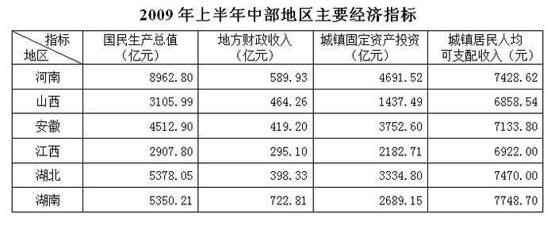

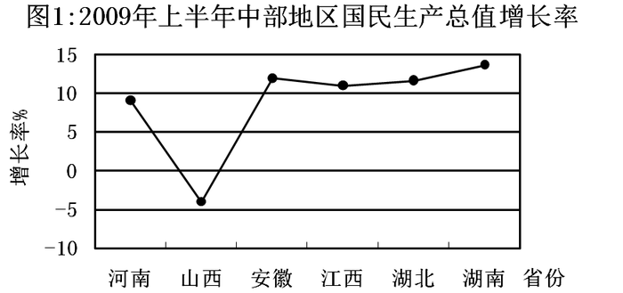

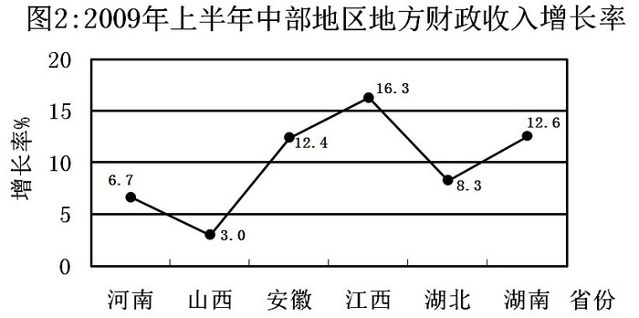

### 第 101 题

2009年上半年，江西国民生产总值增长率在中部地区排名第几：

A. 第二

B. 第三

C. 第四

D. 第五

第 101 题 · 答案与解析

**参考答案（粉笔题库参考内容）**

C

**解析**

定位统计图1可知，2009年上半年，江西国民生产总值增长率低于安徽、湖北、湖南，在中部地区排名第四。

故正确答案为C。

**考点**：直接找数、综合资料

**来源**：2010年江西省公务员录用考试《行测》题第101题

### 第 102 题

2008年上半年，地方财政收入位居中部地区第二和第三的省份分别是：

A. 湖南和安徽

B. 河南和山西

C. 山西和安徽

D. 山西和湖南

第 102 题 · 答案与解析

**参考答案（粉笔题库参考内容）**

B

**解析**

根据题干“2008年上半年，地方财政收入······”，结合材料时间为2009年上半年，可判定本题为基期计算问题。定位表格材料和图2，根据公式：基期可得，2008年上半年各地方财政收入分别为：

河南：；山西：；

安徽：；江西：；

湖北：；湖南：。

可知地方财政收入位居中部地区第二和第三的省份分别是河南和山西。

故正确答案为B。

**考点**：基期计算、综合资料

**来源**：2010年江西省公务员录用考试《行测》题第102题

### 第 103 题

2009年上半年，城镇固定资产投资和城镇居民人均可支配收入均居同一位的省份有几个：

A. 0

B. 1

C. 2

D. 3

第 103 题 · 答案与解析

**参考答案（粉笔题库参考内容）**

C

**解析**

定位表格材料可得，2009年上半年，城镇固定资产投资排名从高到低依次是河南、安徽、湖北、湖南、江西和山西；城镇居民人均可支配收入排名从高到低依次是湖南、湖北、河南、安徽、江西和山西。对比可知，2009年上半年，城镇固定资产投资和城镇居民人均可支配收入均居同一位的省份有江西和山西两个省份。

故正确答案为C。

**考点**：直接找数、综合资料

**来源**：2010年江西省公务员录用考试《行测》题第103题

### 第 104 题

2009年上半年，国民生产总值排名与国民生产总值增长率排名差距最大的省份是：

A. 河南

B. 安徽

C. 江西

D. 湖南

第 104 题 · 答案与解析

**参考答案（粉笔题库参考内容）**

A

**解析**

定位表格材料可得，2009年上半年，国民生产总值排名为河南、湖北、湖南、安徽、山西和江西；定位图形材料可得，国民生产总值增长率排名为湖南、安徽、湖北、江西、河南和山西。则国民生产总值排名与国民生产总值增长率排名差距分别为：

河南：|1-5|=4；湖北：|2-3|=1；湖南：3-1=2；

安徽：4-2=2；山西：|5-6|=1；江西：6-4=2。

综上，排名差距最大的省份是河南。

故正确答案为A。

**考点**：直接找数、综合资料

**来源**：2010年江西省公务员录用考试《行测》题第104题

### 第 105 题

能够从上述资料推出的是：

A. 湖北国民生产总值大于山西和江西国民生产总值之和

B. 河南城镇居民人均可支配收入高于湖北城镇居民人均可支配收入

C. 在这六个经济指标中，湖北有三个指标排名高于湖南

D. 山西国民生产总值增长率为负，且地方财政收入增长率排名中部第六

第 105 题 · 答案与解析

**参考答案（粉笔题库参考内容）**

D

**解析**

A项：定位表格材料可得，湖北国民生产总值为5378.05亿元，山西为3105.99亿元，江西为2907.80亿元。可知，湖北小于山西与江西之和，错误；

B项：定位表格材料可得，河南城镇居民人均可支配收入为7428.62元，湖北城镇居民人均可支配收入为7470.00元，可知河南小于湖北，错误；

C项：定位表格材料第6、7行可得，湖北各个指标高于湖南的有国民生产总值和城镇固定资产投资；定位图形材料可得，湖北国民生产总值增长率与地方财政收入增长率均低于湖南。由此可知，在这六个经济指标中，湖北高于湖南的共有两个，错误；

D项：定位图1材料可得，山西国民生产总值增长率为负；定位图2材料可得，地方财政收入增长率排名从大到小依次为江西、湖南、安徽、湖北、河南、山西。可知山西排名第六，正确。

故正确答案为D。

**考点**：综合分析、综合资料

**来源**：2010年江西省公务员录用考试《行测》题第105题

## 材料 4

2009年11月，首届世界低碳与生态经济大会技术博览会在江西南昌召开，在这次大会上，江西共签约项目143个，总投资为1045.95亿元，先后分三次签约；第一次，与23家央企签约37个合作项目，项目总投资为519.1亿元；第二次，九江市人民政府与中信集团签订旅游基础设施投资框架协议，项目总投资为120亿元；第三次，签约合同项目105个，项目总投资为407.85亿元。

        从签约项目主要领域来看，旅游产业项目14个，占9.79%；钨及稀土深加工产业项目4个，占2.82%；医药化工产业项目14个，占9.79%；电子信息产业项目12个，占8.39%。

        在签约项目中，与京、浙、沪粤等省市(地区)签署的项目和投资总额较多，签约项目投资较多的省市(地区)为：北京34个，占23.77%；广东省25个，占17.48%；浙江省17个，占11.89%；上海市6个，占4.2%；港台地区合作项目数10个，占6.99%。

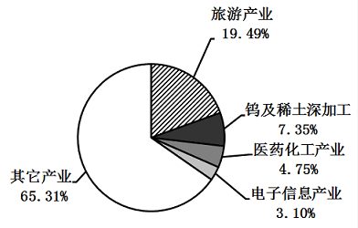

               图1：签约项目投资总额项目分布情况图

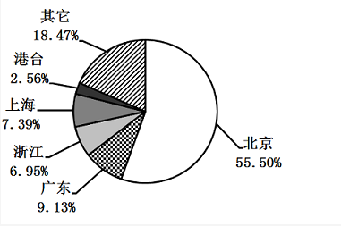

                 图2：签约项目投资总额地区分布情况图

### 第 106 题

第一次签约项目投资额占总投资额的比重为：

A. 25.87%

B. 38.96%

C. 49.58%

D. 61.04%

第 106 题 · 答案与解析

**参考答案（粉笔题库参考内容）**

C

**解析**

根据题干“······占······比重为”，结合材料时间为2009年，可判定本题为现期比重问题。定位文字材料第一段可得，签约项目总投资为1045.95亿元，第一次项目总投资为519.1亿元。根据公式：，则所求比重，与C项最接近。

故正确答案为C。

**考点**：现期比重、综合资料

**来源**：2010年江西省公务员录用考试《行测》题第106题

### 第 107 题

在签约项目中，医药化工产业项目投资额为多少亿元？

A. 32.46

B. 49.73

C. 76.95

D. 102.50

第 107 题 · 答案与解析

**参考答案（粉笔题库参考内容）**

B

**解析**

根据题干“······投资额为”，结合材料数据给出总投资额与医药化工产业项目占比，可判定本题为现期比重问题。定位文字材料可得，总投资为1045.95亿元；定位图1可得，医药化工产业项目占4.75%。根据公式：部分量=总体量比重，则所求部分量亿元，与B项最接近。

故正确答案为B。

**考点**：现期比重、综合资料

**来源**：2010年江西省公务员录用考试《行测》题第107题

### 第 108 题

在签约项目主要领域中，项目投资额占总投资额比重最多的两个产业的项目数之差为：

A. 0个

B. 2个

C. 9个

D. 10个

第 108 题 · 答案与解析

**参考答案（粉笔题库参考内容）**

D

**解析**

根据题干“······项目数之差为”，可判定本题为简单加减计算问题。定位图1可得，各项目投资额占比排在前两位的是旅游产业与钨及稀土深加工；由此定位文字材料第二段可得，签约旅游产业项目14个，钨及稀土深加工项目4个。可知两个产业项目数之差为=14－4＝10个。

故正确答案为D。

**考点**：简单加减计算、综合资料

**来源**：2010年江西省公务员录用考试《行测》题第108题

### 第 109 题

在签约地区中，签约项目数最多的两个省市（地区）的项目投资和为多少亿元：

A. 288.96

B. 431.87

C. 676.64

D. 774.43

第 109 题 · 答案与解析

**参考答案（粉笔题库参考内容）**

C

**解析**

根据题干“项目投资和为······”，结合材料数据给出总投资额以及各项目投资额占比，可判定本题为现期比重问题。定位文字材料第一、三段可得，总投资为1045.95亿元；签约项目数排在前两位的地区是北京与广东；由此定位图2可得，北京项目投资占比为55.50%，广东占比为9.13%。故两个省市（地区）项目投资和为亿元，与C项最接近。

故正确答案为C。

**考点**：现期比重、综合资料

**来源**：2010年江西省公务员录用考试《行测》题第109题

### 第 110 题

能够从上述资料中推出的是：

A. 这次大会签约项目平均投资额超过8亿元

B. 旅游产业签约项目数小于电子信息产业签约项目数

C. 钨及稀土深加工产业投资额所占比重小于医药化工产业项目数所占比重

D. 在签约省市（地区）中，签约项目数所占比重小于签约投资额所占比重的省市（地区）有3个

第 110 题 · 答案与解析

**参考答案（粉笔题库参考内容）**

C

**解析**

A项：定位文字材料第一段可得，签约项目共143个，总投资为1045.95亿元。可知这次大会签约项目平均投资额为亿元，小于8亿元，错误；

B项：定位文字材料第二段可得，旅游产业签约项目数为14个，电子信息产业签约项目数为12个。可知旅游产业大于电子信息产业签约项目数，错误；

C项：定位图1可得，钨及稀土深加工产业投资额占比重为7.35%，医药化工产业项目数所占比重为9.79%。可知钨及稀土深加工产业投资额占比小于医药化工产业，正确；

D项：定位文字与图2可得，材料中只给出部分省市(地区)的项目数和投资比例，故无法推出，错误。

**考点**：综合分析、综合资料

**来源**：2010年江西省公务员录用考试《行测》题第110题

### 第 111 题

为加快江西发展，我省提出了构建鄱阳湖生态经济区的发展战略。

以下哪一个城市没有纳入鄱阳湖生态经济区：

A. 南昌

B. 九江

C. 景德镇

D. 赣州

第 111 题 · 答案与解析

**参考答案（粉笔题库参考内容）**

D

**解析**

本题考查我国的国情社情相关知识。

鄱阳湖生态经济区位于江西省北部，包括南昌、景德镇、鹰潭3市，以及九江、新余、抚州、宜春、上饶、吉安市的部分县（市、区），共38个县（市、区）和鄱阳湖体在内，这一地区的国土面积为5.12万平方公里。所以A、B、C三项都在其内，D项不符合题意。

本题为选非题，故正确答案为D。

**考点**：中国地理

**来源**：2010年江西省公务员录用考试《行测》题第111题

### 第 112 题

江西被称为“红色摇篮”，这里有中国革命的摇篮、共和国的摇篮、人民军队的摇篮，其中被称为共和国摇篮的是：

A. 南昌

B. 安源

C. 瑞金

D. 井冈山

第 112 题 · 答案与解析

**参考答案（粉笔题库参考内容）**

C

**解析**

本题考查毛中特。

江西不仅是是中国革命的摇篮、人民军队的摇篮，而且是人民共和国的摇篮。1931年11月7日，中国共产党领导军民在江西瑞金成立中华苏维埃共和国，它成为了1949年10月1日在北京成立的中华人民共和国的雏形。

故正确答案为C。

**本题相关知识点：**

被誉为“中国革命的摇篮”的是井冈山，被誉为“人民军队的摇篮”的是南昌市。

**考点**：党的历史

**来源**：2010年江西省公务员录用考试《行测》题第112题

### 第 113 题

以下关于中部六省的描述，不正确的是：

A. 安徽率先在全国掀起家庭联产承包责任制

B. 湖北率先建立全国第一个小商品批发市场

C. 河南率先在全国完成集体林权制度改革

D. 湖南、湖北率先建设国家“两型社会”综合配套改革试验区

第 113 题 · 答案与解析

**参考答案（粉笔题库参考内容）**

C

**解析**

本题考查地理国情。

A项正确，1978年11月24日，安徽凤阳小岗村以敢为天下先的胆识，率先在全国掀起家庭联产承包责任制。

B项正确，1979年，武汉汉正街小商品批发市场开始营业，这是全国第一个小商品批发市场，汉正街被称为“中国改革开放第一街”。

C项错误，2004年，江西、福建、浙江、辽宁成为我国集体林权改革的先行省份，到2007年江西集体林权改革基本落实；河南省2012年表示，林改确权发证工作已基本完成。

D项正确，2007年底，国务院批准湖北武汉城市圈和湖南长株潭城市群在全国率先进行资源节约型和环境友好型，即“两型社会”综合配套改革试验，被外界誉为继上海浦东新区、天津滨海新区、成渝综合配套改革试验区之后的第四个“新特区”。

本题为选非题，故正确答案为C。

**考点**：中国地理

**来源**：2010年江西省公务员录用考试《行测》题第113题

### 第 114 题

俗话说“三个和尚没水喝”，这说明的是人浮于事，但如果“三个和尚”都很负责，结果也许会造成水满为患，这两种不同的说法表明：

A. 管理工作的有效性需要考虑内部环境各部分的整体效应

B. 即使管理无方，人多还是比人少好办事

C. 纵使管理有方，也不一定是人多好办事

D. 在不同的心态作用下会产生不同的群体合作结果

第 114 题 · 答案与解析

**参考答案（粉笔题库参考内容）**

A

**解析**

“三个和尚没水喝”的情况之所以会发生，是因为缺乏有效的制度安排来调动和尚们挑水的积极性；“三个和尚”都很负责，结果也许会造成水满为患，则说明了因为不合理的管理安排，尽管调动各方积极性同样会产生过犹不及的效果。本题的启示是如何实现管理的有效性，达到整体优化的目的。

故正确答案为A。

**来源**：2010年江西省公务员录用考试《行测》题第114题

### 第 115 题

江西素有物华天宝，人杰地灵的美誉，这里人文荟萃，人才辈出，唐宋八大家中江西就有三人，下面不属于这三人作品的是：

A. 《西游记》

B. 《元丰类稿》

C. 《醉翁亭记》

D. 《答司马谏议书》

第 115 题 · 答案与解析

**参考答案（粉笔题库参考内容）**

A

**解析**

唐宋八大家中，来自江西的三人为欧阳修、曾巩和王安石。

《醉翁亭记》是欧阳修的作品，《答司马谏议书》为王安石作品，《元丰类稿》是曾巩的文集。

选项A，《西游记》的作者是明代文学家吴承恩，籍贯淮安府由阳县（今江苏省淮安市楚州）。

故正确答案为A。

**考点**：文学常识

**来源**：2010年江西省公务员录用考试《行测》题第115题

### 第 116 题

下列不属于积极财政政策措施的是：

A. 减少税收，降低税率，扩大减免税范围

B. 增加财政补贴

C. 扩大财政支出

D. 放松信贷控制

第 116 题 · 答案与解析

**参考答案（粉笔题库参考内容）**

D

**解析**

本题考查经济常识。

积极的财政政策就是扩张性的财政政策，即在经济衰退时期，总需求不足，通过刺激总需求增长，以达到总需求和总供给的平衡，使经济尽快复苏。

A项正确，减少税收，降低税率，扩大减免税范围，会使得企业和个人可用资金增多，有利于刺激投资和消费，扩大社会总需求，属于扩张性财政政策。

B项正确，增加财政补贴，也会增加市场中流通的货币量，增加总需求，属于扩张性财政政策。

C项正确，财政支出本身就属于社会总需求的组成部分，扩大财政支出有利于增加社会总需求，属于扩张性财政政策。

D项错误，放松信贷控制属于扩张性货币政策。

本题为选非题，故正确答案为D。

**考点**：宏观经济与调控政策

**来源**：2010年江西省公务员录用考试《行测》题第116题

### 第 117 题

以下哪个行业不属于周期性行业：

A. 钢铁

B. 煤炭

C. 有色金属

D. 商业连锁

第 117 题 · 答案与解析

**参考答案（粉笔题库参考内容）**

D

**解析**

周期性行业是指行业的景气度与外部宏观经济环境高度正相关，并呈现周期性循环的行业。周期性行业的特点是产品价格、需求以及产能呈现周期性波动，行业景气度高峰期来临时产品需求上升，价格大涨，为满足突然膨胀的需求，产能大幅度扩张，而在萧条期时则刚好相反。周期性行业钢铁、煤炭、有色金属；而商业连锁属于相对平稳的行业即非周期性产业。

本题为选非题，故正确答案为D。

**考点**：宏观经济与调控政策

**来源**：2010年江西省公务员录用考试《行测》题第117题

### 第 118 题

近亲结婚对后代的影响是：

A. 遗传病连代传递

B. 产生交叉遗传

C. 增加隐性遗传病的发病率

D. 出现返祖现象

第 118 题 · 答案与解析

**参考答案（粉笔题库参考内容）**

C

**解析**

近亲结婚，由于双方有共同的祖先，相同的基因（包括正常的和异常的）很多，而且亲缘关系越近，相同的基因越多，其子代成为纯合子的机会就越大。每个人平均带有个有害基因，这些基因多为隐性，在杂合（一对等位基因，一个是正常的，另一个是隐性致病基因，称为杂合）状态下，一般危害不大。

一旦与带有相同有害基因的人婚配，双方就有可能将相同的有害基因同时传递给子女，使子女成为隐性有害基因的纯合子而呈现疾病。亲缘关系越近，其子女患病的可能性也越大。因此近亲结婚对于后代来说，会增加隐性遗传病的发病率。

故正确答案为C。

**考点**：生物常识

**来源**：2010年江西省公务员录用考试《行测》题第118题

### 第 119 题

在下列太阳系行星中，距太阳最近的是：

A. 水星

B. 地球

C. 火星

D. 土星

第 119 题 · 答案与解析

**参考答案（粉笔题库参考内容）**

A

**解析**

太阳系行星中，距太阳最近的是水星，向外依次是金星、地球、火星、木星、土星、天王星、海王星。

故正确答案为A。

**考点**：自然地理

**来源**：2010年江西省公务员录用考试《行测》题第119题

### 第 120 题

中国的英文名称“CHINA”的小写就是“瓷器”的意思，“CHINA”的英文发音源自景德镇的历史名称“昌南”，并以此突出景德镇瓷器在世界上的影响和地位。

以下不属于景德镇四大传统名瓷的是：

A. 青花

B. 白瓷

C. 玲珑

D. 粉彩

第 120 题 · 答案与解析

**参考答案（粉笔题库参考内容）**

B

**解析**

本题考查文化常识，主要涉及景德镇瓷器的相关知识。

青花、玲珑、粉彩、颜色釉，合称景德镇四大传统名瓷。白瓷出现时间较早，在邢窑中出现较多，不属于景德镇四大传统名瓷。

本题为选非题，故正确答案为B。

**考点**：文化常识

**来源**：2010年江西省公务员录用考试《行测》题第120题

### 第 121 题

目前，我国采用三角形符号作为塑料回收标志，一般标在塑料瓶底。三角形标志里面的数字表示该塑料瓶是否可以循环使用。

当数字大于等于多少时表示该塑料瓶可以循环使用：

A. 5

B. 4

C. 3

D. 2

第 121 题 · 答案与解析

**参考答案（粉笔题库参考内容）**

A

**解析**

本题考查生活常识，主要涉及塑料瓶回收利用的相关知识。

目前，我国采用三角形符号作为塑料回收标志，一般标在瓶底，每个塑料瓶底部都有一个带箭头的三角形标志，里面的数字越大越安全，假如数字大于或等于5时，就表示该塑料瓶可以循环使用。

故正确答案为A。

**考点**：生活常识

**来源**：2010年江西省公务员录用考试《行测》题第121题

### 第 122 题

1928年来，红军以不足一个营的兵力，打退了敌人四个团的进攻，保卫了井冈山。为此，毛泽东写下了《西江月·井冈山》，这次战斗发生的地方是：

A. 茨坪

B. 黄洋界

C. 笔架山

D. 桐木岭

第 122 题 · 答案与解析

**参考答案（粉笔题库参考内容）**

B

**解析**

本题考查毛中特。

1928年7月，湘赣敌军向井冈山发动第二次“会剿”。敌我力量虽然悬殊，但井冈军民凭险抵抗，最终以少胜多取得了黄洋界保卫战的胜利。《西江月·井冈山》这首词是毛泽东同志为赞扬黄洋界保卫战的胜利而写的。所以此次战斗发生的地方就是黄洋界。

故正确答案为B。

**考点**：党的历史

**来源**：2010年江西省公务员录用考试《行测》题第122题

### 第 123 题

下列选项中属于辩证法观点的是：

A. “人的感官是人认识外界事物的天然屏障”

B. “存在就是被感知”

C. “人不能两次踏进一条河流”

D. “人一次也不能踏进同一条河流”

第 123 题 · 答案与解析

**参考答案（粉笔题库参考内容）**

C

**解析**

“人不能两次踏进一条河流”是古希腊唯物主义哲学家赫拉克利特说的，他强调世界的绝对运动和相对静止，这是代表他辩证法思想最有名的一句哲学格言。

而A项将认识与存在孤立开来，B项只片面承认意识，D项只承认运动的绝对性，不承认相对静止，A、B、D都是片面孤立的形而上学观点。

故正确答案为C。

**考点**：唯物辩证法

**来源**：2010年江西省公务员录用考试《行测》题第123题

### 第 124 题

自古以来，中国人就有饮茶的习惯，国内较早关于茶叶的研究来自唐代陆羽的《茶经》，茶叶按其制作工艺可以分为不发酵、半发酵和完全发酵茶。

以下属于半发酵茶的是：

A. 西湖龙井茶

B. 庐山云雾茶

C. 福建安溪铁观音

D. 安徽祁门红茶

第 124 题 · 答案与解析

**参考答案（粉笔题库参考内容）**

C

**解析**

本题考查文化常识，主要涉及茶叶的相关知识。

半发酵茶即青茶，著名的品种有武夷岩茶、大红袍、铁观音、冻顶乌龙茶等。据此，C项属于半发酵茶，符合题意。

A项：错误，西湖龙井茶，著名绿茶之一，属于不发酵茶。

B项：错误，庐山云雾茶是汉族传统名茶，属于绿茶中的一种。也属于不发酵茶。

D项：错误，安徽祁门红茶属于发酵茶。

故正确答案为C。

**考点**：文化常识

**来源**：2010年江西省公务员录用考试《行测》题第124题

### 第 125 题

如果某公司中小道消息很多，正式沟通渠道的消息较少，这意味着该公司：

A. 正式沟通渠道中信息传递存在问题，需要调整

B. 非正式沟通渠道中信息传递很通畅，运作良好

C. 充分运用了非正式沟通渠道的作用，促进了信息的传递

D. 其中有部分人特别喜欢在背后乱发议论，传递小道消息

第 125 题 · 答案与解析

**参考答案（粉笔题库参考内容）**

A

**解析**

公司中小道消息很多，而通过正式渠道获得的消息较少恰恰说明正式沟通渠道不畅通，需要相关部门进行调节。

故正确答案为A。

**来源**：2010年江西省公务员录用考试《行测》题第125题

### 第 126 题

下列国家公务员中属于领导职位的是：

A. 调研员

B. 巡视员

C. 主任科员

D. 副乡长

第 126 题 · 答案与解析

**参考答案（粉笔题库参考内容）**

D

**解析**

本题考查法律常识。

《公务员法》第十八条规定：“公务员领导职务根据宪法、有关法律和机构规格设置。领导职务层次分为：国家级正职、国家级副职、省部级正职、省部级副职、厅局级正职、厅局级副职、县处级正职、县处级副职、乡科级正职、乡科级副职。”调研员、巡视员、主任科员属于非领导职位。副乡长即乡科级副职属于《公务员法》上的领导职位。

故正确答案为D。

**考点**：行政法

**来源**：2010年江西省公务员录用考试《行测》题第126题

### 第 127 题

甲因不服工商行政管理机关行政处罚决定向上级机关申请复议，要求撤销处罚决定，但没有提出赔偿请求。复议机关经审查认为该处罚决定违法，决定予以撤销。

对于处罚决定造成的财产损失，复议机关正确的做法是什么：

A. 解除查封的同时决定被申请人赔偿相应的损失

B. 解除查封并告知申请人就赔偿问题另行申请复议

C. 解除查封的同时就损失问题进行调解

D. 解除查封的同时要求申请人增加关于赔偿的复议申请

第 127 题 · 答案与解析

**参考答案（粉笔题库参考内容）**

A

**解析**

本题考查法律常识，主要涉及行政法的相关知识。

《行政复议法》第七十二条第二款规定：“申请人在申请行政复议时没有提出行政赔偿请求的，行政复议机关在依法决定撤销或者部分撤销、变更罚款，撤销或者部分撤销违法集资、没收财物、征收征用、摊派费用以及对财产的查封、扣押、冻结等行政行为时，应当同时责令被申请人返还财产，解除对财产的查封、扣押、冻结措施，或者赔偿相应的价款。”

根据本条规定，复议机关正确的做法是解除查封的同时决定被申请人赔偿相应的损失。A项符合题意。

故正确答案为A。

**考点**：行政法

**来源**：2010年江西省公务员录用考试《行测》题第127题

### 第 128 题

下列哪项职权不是全国人大常委会的职权：

A. 解释宪法，监督宪法的实施

B. 制定和修改基本法律

C. 废除同外国缔结的条约和重要协定

D. 撤销国务院制定的同宪法、法律相抵触的行政法规、决定和命令

第 128 题 · 答案与解析

**参考答案（粉笔题库参考内容）**

B

**解析**

本题考查法律常识，主要涉及宪法的相关知识。

《中华人民共和国宪法》第六十七条规定了全国人民代表大会常务委员会行使的职权，共二十一款。

A项：正确，根据《中华人民共和国宪法》第六十七条第一款，解释宪法，监督宪法的实施属于全国人大常委会的职权。

B项：错误，根据《中华人民共和国宪法》第六十二条第三款，制定和修改刑事、民事、国家机构的和其他的基本法律，属于全国人民代表大会的职权。根据《中华人民共和国宪法》第六十七条第二款，制定和修改除应当由全国人民代表大会制定的法律以外的其他法律，属于全国人大常委会的职权。故B项表述错误。

C项：正确，根据《中华人民共和国宪法》第六十七条第十四款，决定同外国缔结的条约和重要协定的批准和废除，属于全国人大常委会的职权。

D项：正确，根据《中华人民共和国宪法》第六十七条第七款，撤销国务院制定的同宪法、法律相抵触的行政法规、决定和命令，属于全国人大常委会的职权。

本题为选非题，故正确答案为B。

**考点**：宪法

**来源**：2010年江西省公务员录用考试《行测》题第128题

### 第 129 题

陈某、王某结婚后购得房屋一套，仅以陈某的名义进行了登记，后陈某独自将房屋以时价出售给不知情的丙，并办理了房屋所有权变更登记手续，对此，下列哪一选项是正确的：

A. 买卖合同有效，房屋所有权未转移

B. 买卖合同无效，房屋所有权已转移

C. 买卖合同有效，房屋所有权已转移

D. 买卖合同无效，房屋所有权未转移

第 129 题 · 答案与解析

**参考答案（粉笔题库参考内容）**

C

**解析**

陈某、王某结婚后购得房屋一套属于夫妻共同财产，应由双方共同行使支配权，因此陈某无权擅自处分房屋，但是丙购房屋是不知情、以合理的价格购买并办理了房屋所有权变更登记手续，根据民法上善意取得制度原理买卖合同有效，房屋所有权已转移，王某无权请求丙返还房屋。

故正确答案为C。

**考点**：民法典

**来源**：2010年江西省公务员录用考试《行测》题第129题

### 第 130 题

王某潜入某工厂仓库盗窃，将仓库货物（价值2万元）扔到院墙外，准备一会儿翻墙出去再捡，偶尔经过此处的刘某发现该货物无人看管，遂将其拿走，据为己有。10分钟后，王某来到院墙外，发现货物已无踪影。

对王某、刘某的行为定性，下列哪一选项是正确的：

A. 王某成立盗窃罪（未遂），刘某成立盗窃罪（既遂）

B. 王某和刘某成立盗窃罪共犯（既遂）

C. 王某成立盗窃罪（既遂），刘某成立侵占罪

D. 王某成立盗窃罪（未遂），刘某成立侵占罪

第 130 题 · 答案与解析

**参考答案（粉笔题库参考内容）**

C

**解析**

盗窃罪是行为犯盗窃人已经实施盗窃行为，并将盗窃物进行转移，有以上犯罪事实即构成盗窃罪。

刘某的行为属于非法侵占，其具体要件有：

（一）客体要件

本罪所侵害的客体是他人财物的所有权。

（二）客观要件

本罪在客观方面表现为将他人的交由自己代为保管的财物、遗忘物或者埋藏物非法占为己有。

（三）主体要件

本罪的主体为一般主体，凡年满16周岁具有刑事责任能力的自然人均可构成本罪。

（四）主观要件

本罪在主观方面必须出于故意。

故正确答案为C。

**考点**：刑法

**来源**：2010年江西省公务员录用考试《行测》题第130题

### 第 131 题

由于某化肥厂长期排污，该地域内两个村庄几年来多人患有罕见的严重疾病，根据《环境保护法》的规定，下列哪一选项是错误的：

A. 受害村民有权对该厂提起民事诉讼

B. 因环境污染引起的民事诉讼时效为3年

C. 环境污染民事责任的归责原则实行公平责任原则

D. 本案由化肥厂承担其排污行为和损害结果之间是否存在因果关系的举证责任

第 131 题 · 答案与解析

**参考答案（粉笔题库参考内容）**

C

**解析**

本题考查法律常识，主要涉及《环境保护法》和《侵权责任法》的相关知识。

A项：正确，根据《环境保护法》第四十一条，造成环境污染危害的，有责任排除危害，并对直接受到损害的单位或者个人赔偿损失。赔偿责任和赔偿金额的纠纷，可以根据当事人的请求，由环境保护行政主管部门或者其他依照法律规定行使环境监督管理权的部门处理，当事人对处理决定不服的，可以向人民法院起诉。当事人也可以直接向人民法院起诉。据此，受害村民有权对该厂提起民事诉讼，A项正确。

B项：正确，根据《环境保护法》第四十二条，因环境污染损害赔偿提起诉讼的时效期间为3年，从当事人知道或者应当知道受到污染损害起时计算。故B项正确。

C项：错误，过错推定，也叫过失推定，在侵权行为法上，就是受害人在诉讼中，能证明违法行为与损害事实之间的因果关系的情况下，如果加害人不能证明损害的发生自己无过错，那么就从损害事实的本身推定被告在致人损害的行为中有过错，并为此承担赔偿责任。环境污染民事责任的归责原则是过错推定，即由化肥厂承担是否存在因果关系的举证责任而不是实行公平责任原则。故C项错误。

D项：正确，根据《侵权责任法》第六十六条，因污染环境发生纠纷，污染者应当就法律规定的不承担责任或者减轻责任的情形及其行为与损害之间不存在因果关系承担举证责任。故D项正确。

本题为选非题，故正确答案为C。

**考点**：其他法律法规

**来源**：2010年江西省公务员录用考试《行测》题第131题

### 第 132 题

某小区已建有A大型超市，为满足需要，某市人民政府拟在该小区内再建一所超市，甲公司和乙公司先后向某市人民政府提出申请，甲公司获批准。下列哪一种说法是正确的：

A. A超市有权对某市人民政府批准再建超市的决定提起行政诉讼

B. 乙公司有权对某市人民政府批准甲公司申请的行为提起行政诉讼

C. 某市人民政府按照甲公司和乙公司申请的先后顺序作出批准决定是不合法的

D. 某市人民政府必须在受理甲公司和乙公司的申请之日起20日内作出批准与否的决定

第 132 题 · 答案与解析

**参考答案（粉笔题库参考内容）**

B

**解析**

本题考查法律常识，主要涉及《行政许可法》的相关知识。

A项：错误，A超市与某市人民政府批准行为没有直接的利益关系，无权提起行政诉讼。

B项：正确，甲公司和乙公司先后向某市人民政府提出申请甲公司获批准，乙公司作为利益相关方有权对某市人民政府批准甲公司申请的行为提起行政诉讼。

C项：错误，《行政许可法》第五十七条规定：有数量限制的行政许可，两个或者两个以上申请人的申请均符合法定条件、标准的，行政机关应当根据受理行政许可申请的先后顺序作出准予行政许可的决定。但是，法律、行政法规另有规定的，依照其规定。据此，某市人民政府按照甲公司和乙公司申请的先后顺序作出决定不违反法律、法规的强制性规定。

D项：错误，根据《行政许可法》第四十二条，除可以当场作出行政许可决定的外，行政机关应当自受理行政许可申请之日起二十日内作出行政许可决定。二十日内不能作出决定的，经本行政机关负责人批准，可以延长十日，并应当将延长期限的理由告知申请人。但是，法律、法规另有规定的，依照其规定。

故正确答案为B。

**考点**：行政法

**来源**：2010年江西省公务员录用考试《行测》题第132题

### 第 133 题

出租车司机王某送危重病人李某去医院，情形危急，为争取时间，王某连闯三个红灯，被交警拦截并被告知罚款，经王某解释，交警对王某未给予处罚且为其开警车引道，将李某及时送至医院。对此事件，下列哪一项表述是正确的：

A. 在此交通违章的处理中，进行了法的不同价值关系的判断选择

B. 警察对违章与否的解释属于法律解释

C. 在此交通违章的处理中，交警主要使用了演绎逻辑的推理方法

D. 此事件所反映出的法的价值之间没有冲突

第 133 题 · 答案与解析

**参考答案（粉笔题库参考内容）**

A

**解析**

自由、秩序、正义都可以说是法的最基本的价值，在此交通规章的处理中反映了法的价值之间的冲突，警察进行了秩序和正义两种价值的衡量与选择。

故正确答案为A。

**考点**：法理学

**来源**：2010年江西省公务员录用考试《行测》题第133题

### 第 134 题

甲以个人名义向乙独资设立的腾飞有限公司借款8万元，借期2年，不久，甲与丙登记结婚，将借款8万元用于购买新房的家电，婚后1年，甲与丙协议离婚，未对债务的偿还作出约定。下列哪一项是正确的：

A. 由乙向甲请求偿还8万元

B. 由乙向甲和丙请求偿还8万元

C. 腾飞公司只能向甲请求偿还8万元

D. 由腾飞公司向甲和丙请求偿还8万元

第 134 题 · 答案与解析

**参考答案（粉笔题库参考内容）**

D

**解析**

本题考查法律常识，主要涉及民法的相关知识。

腾飞公司虽然是个人设立，但其是公司法人，本题中乙须以腾飞公司的名义进行民事行为，排除A、B两项。《最高人民法院关于适用中华人民共和国民法典婚姻家庭编的解释（一）》第三十三条规定：“债权人就一方婚前所负个人债务向债务人的配偶主张权利的，人民法院不予支持。但债权人能够证明所负债务用于婚后家庭共同生活的除外。”本题中甲将借款8万元用于购买新房和家电，属于用于婚后家庭生活，所以应该由腾飞公司向甲和丙请求偿还债务。排除C项，D项正确。

故正确答案为D。

**考点**：民法典

**来源**：2010年江西省公务员录用考试《行测》题第134题

### 第 135 题

高某无证经营被区工商局罚款300元，高某不服申请复议，复议机关市工商局决定罚款600元，后经确认，区工商局所作的罚款行政处罚违反法律，下列说法正确的是：

A. 高某可以请求区工商局赔偿600元

B. 高某可以请求市工商局赔偿600元

C. 高某既可以请求区工商局赔偿600元，又可以请求市工商局赔偿600元

D. 高某可以请求区工商局赔偿300元，市工商局赔偿300元

第 135 题 · 答案与解析

**参考答案（粉笔题库参考内容）**

D

**解析**

本题考查法律常识，主要涉及《国家赔偿法》的相关知识。

《国家赔偿法》第八条规定：“经复议机关复议的，最初造成侵权行为的行政机关为赔偿义务机关，但复议机关的复议决定加重损害的，复议机关对加重的部分履行赔偿义务。”本题中区工商局作出罚款300元的决定，复议机关市工商局决定罚款600元，复议机关应对加重的300元罚款承担责任，因此区工商局所做的罚款行政处罚违反法律时，复议机关的决定也是不当的，因此高某可以请求区工商局赔偿300元，市工商局就加重的部分承担赔偿责任。

故正确答案为D。

**考点**：行政法

**来源**：2010年江西省公务员录用考试《行测》题第135题

