# 2012年江西省公务员录用考试《行测》题

<!-- gwy:overview:start -->
> **江西 · 2012 · 行测 · 统考** ｜ 135 题 · 图片 84 处 · 答案随题折叠

| 题型模块 | 题量 | 题号 |
| --- | ---: | ---: |
| 判断推理 | 35 | 1–35 |
| 常识判断 | 25 | 36–60 |
| 言语理解与表达 | 35 | 61–95 |
| 数量关系 | 20 | 96–115 |
| 资料分析 | 20 | 116–135 |
| **合计** | **135** | |

导航：[题型与作答说明](#题型与作答说明) · [题目](#题目) · [材料 1](#材料-1)
<!-- gwy:overview:end -->

> 候选采集稿。参考答案及解析来自粉笔页面，不代表官方答案或真实高分答卷；来源使用许可与原卷对应关系仍需人工核实。

## 题型与作答说明

判断推理

（35题）

本部分包括图形推理、定义判断、类比推理与逻辑判断四种类型的试题。

常识判断

（25题）

根据题目要求，在四个选项中选出一个最恰当的答案。

言语理解与表达

（35题）

本部分包括语言表达与理解两方面的内容。请根据每题的问题要求，在四个选项中选出一个最恰当的答案。

数量关系

（20题）

本部分包括数字推理与数学运算两种类型试题。

资料分析

（20题）

所给出的图、表或一段文字均有5个问题要你回答。你应根据资料所提供的信息进行分析、比较、计算和判断处理。

## 题目

### 第 1 题

从所给四个选项中，选择最合适的一项填入问号处，使之呈现一定的规律性：

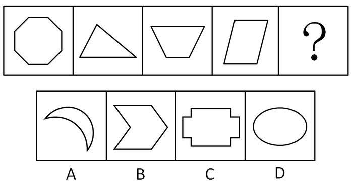

A. A

B. B

C. C

D. D

第 1 题 · 答案与解析

**参考答案（粉笔题库参考内容）**

D

**解析**

题干中所有图形均为凸图形。

凸图形：一个图形内的任意两个点A、B，若线段AB上的所有点恒在图形内，则称该图形为凸图形， 否则称之为非凸图形。

故正确答案为D。

**来源**：2012年江西省公务员录用考试《行测》题第1题

### 第 2 题

从所给四个选项中，选择最合适的一个填入问号处，使之呈现一定的规律性：

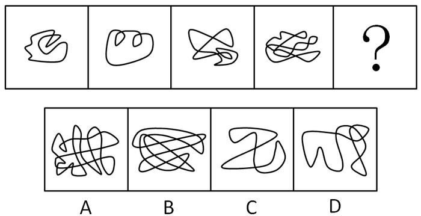

A. A

B. B

C. C

D. D

第 2 题 · 答案与解析

**参考答案（粉笔题库参考内容）**

B

**解析**

元素组成凌乱，考线和线的交点个数。所有图形中的交点个数依次为1，2，4，8，16，成等比数列。

故正确答案为B。

**考点**：数量规律-点

**来源**：2012年江西省公务员录用考试《行测》题第2题

### 第 3 题

从所给四个选项中，选择最合适的一项填入问号处，使之呈现一定的规律性：

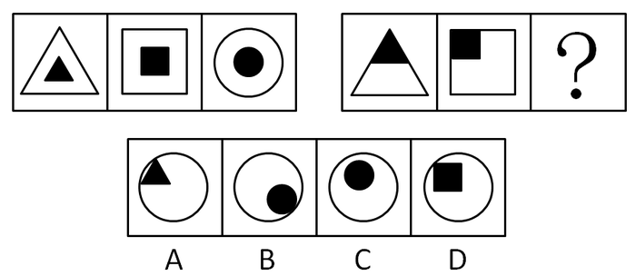

A. A

B. B

C. C

D. D

第 3 题 · 答案与解析

**参考答案（粉笔题库参考内容）**

B

**解析**

两组图中每个图形均由两个相同形状的黑白两部分组成。且第一组图中的每个图形，黑色部分与白色部分的相离；第二组图中的每个图形，黑白两部分相切。

故正确答案为B。

**考点**：数量规律-素、特殊规律-图形间关系

**来源**：2012年江西省公务员录用考试《行测》题第3题

### 第 4 题

从所给四个选项中，选择最合适的一个填入问号处，使之呈现一定的规律性：

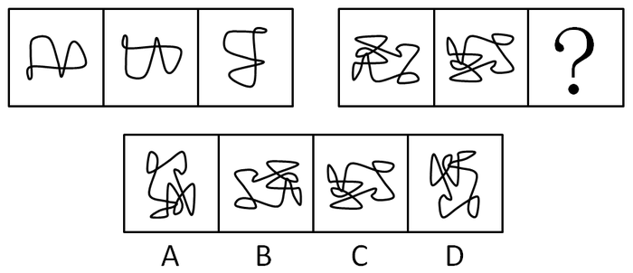

A. A

B. B

C. C

D. D

第 4 题 · 答案与解析

**参考答案（粉笔题库参考内容）**

D

**解析**

元素组成相同，考查位置规律。每组图中，第二个图形由第一个图形沿横轴翻转得到；第三个图形由第二个图形顺时针旋转90°得到。

故正确答案为D。

**考点**：位置规律-综合

**来源**：2012年江西省公务员录用考试《行测》题第4题

### 第 5 题

从所给四个选项中，选择最合适的一个填入问号处，使之呈现一定的规律性：

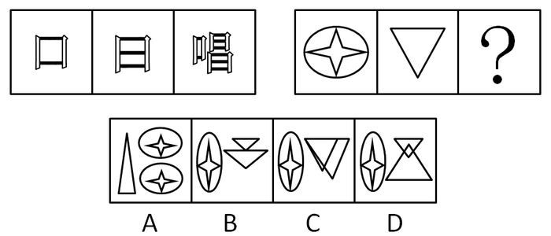

A. A

B. B

C. C

D. D

第 5 题 · 答案与解析

**参考答案（粉笔题库参考内容）**

B

**解析**

元素组成相似，元素叠加。每组图中，第三个图形的左半边是第一个图形；第三个图形的右半边是两个第二个图形上下累加组成，且不重叠。

故正确答案为B。

**考点**：样式规律-加减同异

**来源**：2012年江西省公务员录用考试《行测》题第5题

### 第 6 题

从所给四个选项中，选择最合适的一个填入问号处，使之呈现一定的规律性：

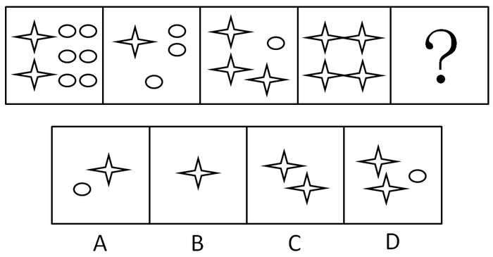

A. A

B. B

C. C

D. D

第 6 题 · 答案与解析

**参考答案（粉笔题库参考内容）**

C

**解析**

图形均由小元素构成，优先考虑数量规律的素。观察发现元素种类和个数均无规律，但题干中一共只出现了2种小元素，考虑元素换算。观察发现，图1与图2的小元素成倍数关系，那么图2与图3也应满足此关系，即：1星+3圆=2(3星+1圆)，可得到换算公式为：1圆=5星。代入题干，将圆全部换算为星得到的数量依次为：32、16、8、4、？，所以？处图形应有2个星。

故正确答案为C。

**考点**：数量规律-素

**来源**：2012年江西省公务员录用考试《行测》题第6题

### 第 7 题

请从所给的四个选项中，选择最合适的一项填在问号处，使之呈现一定的规律性：

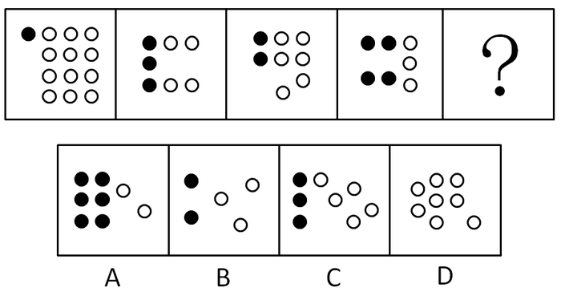

A. A

B. B

C. C

D. D

第 7 题 · 答案与解析

**参考答案（粉笔题库参考内容）**

A

**解析**

遇到黑白点，分开数，再观察二者间的关系。

黑点数量：1、3、2、4

白点数量：12、4、6、3

每个图形中黑白圆点的个数之积均为12。

故正确答案为A。

**考点**：数量规律-素

**来源**：2012年江西省公务员录用考试《行测》题第7题

### 第 8 题

从所给四个选项中，选择最合适的一个填入问号处，使之呈现一定的规律性：

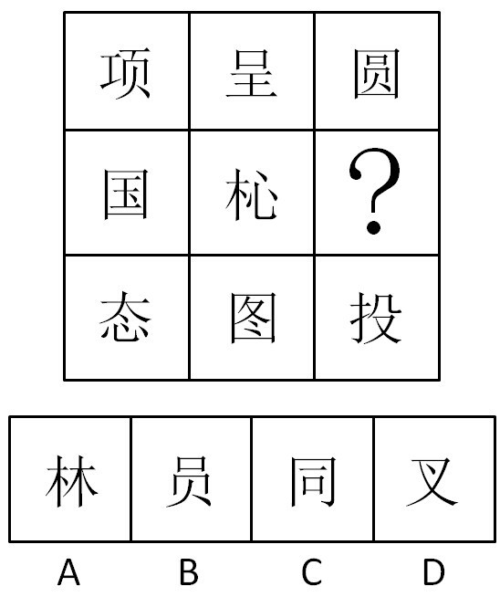

A. A

B. B

C. C

D. D

第 8 题 · 答案与解析

**参考答案（粉笔题库参考内容）**

B

**解析**

特殊考点，考查元素的内部结构，每一行的汉字中，均有一个上下结构、一个左右结构、一个包围结构。

故正确答案为B。

**考点**：文字/字母/数字类、样式规律-遍历

**来源**：2012年江西省公务员录用考试《行测》题第8题

### 第 9 题

把下面的六个图形分为两类，使每一类图形都有各自的共同特征成规律，分类正确的是：

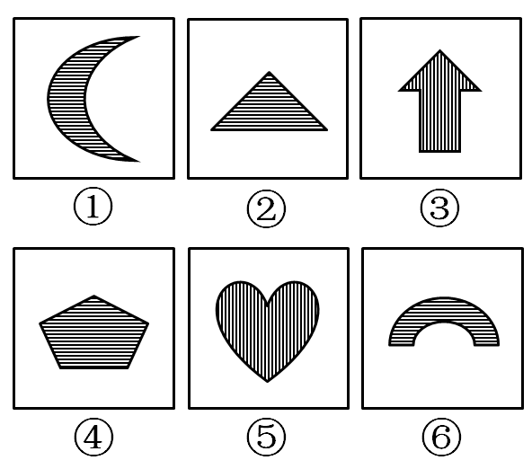

A. ①②④，③⑤⑥

B. ①③④，②⑤⑥

C. ①③⑤，②④⑥

D. ①④⑤，②③⑥

第 9 题 · 答案与解析

**参考答案（粉笔题库参考内容）**

C

**解析**

特殊考点，图形阴影与其对称轴的位置关系，①③⑤图形的对称轴与其内部网络线平行，②④⑥图形的对称轴与其内部网络线垂直。

故正确答案为C。

**考点**：属性规律-对称性

**来源**：2012年江西省公务员录用考试《行测》题第9题

### 第 10 题

把下面的六个图形分为两类，使每一类图形都有各自的共同特征或规律，分类正确的一项是：

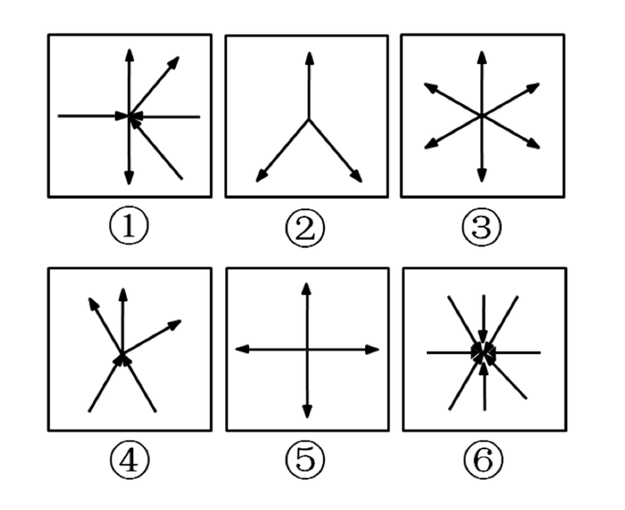

A. ①②③，④⑤⑥

B. ①③④，②⑤⑥

C. ①③⑤，②④⑥

D. ①④⑥，②③⑤

第 10 题 · 答案与解析

**参考答案（粉笔题库参考内容）**

D

**解析**

元素组成相似，观察其内部特征。①④⑥图形含有向内的箭头；而②③⑤图形中只含有向外的箭头。

故正确答案为D。

**考点**：特殊规律-功能元素

**来源**：2012年江西省公务员录用考试《行测》题第10题

### 第 11 题

民事单方法律行为，是指根据民事主体一方的意思表示即可成立的法律行为。

依据上述定义，下列属于单方法律行为的是：

A. 美国公民约翰在中国某大学访学期间，租用该大学学术中心406房间，租期为三个月

B. 王一在自动存款机上，将4500元现金存进去了

C. 王二发现洗发精用完了，到设在楼下超市的自动售货柜上付款后，取走了一瓶洗发精

D. 小张搬家后，将一套旧沙发和一台四成新洗衣机，丢弃在小区垃圾分类回收处

第 11 题 · 答案与解析

**参考答案（粉笔题库参考内容）**

D

**解析**

第一步：抓住定义中的关键词。

定义中强调“一方的意思表示即可成立”。

第二步：逐一判断选项。

A项中的租房需经过约翰和大学双方的同意；B项中的存款需经过银行（即取款机的读卡设备）和王一双方的同意；C项中的购买需经过王二及超市双方的同意，因此均不符合定义。D项中的丢弃垃圾无需经过另一方的同意，符合定义。

故正确答案为D。

**考点**：主客体

**来源**：2012年江西省公务员录用考试《行测》题第11题

### 第 12 题

广告，是指为了商业目的，由商品或服务之生产、经营者承担费用，通过一定媒介或一定公之于众的形式，直接或间接地对其经营的商品或服务予以宣扬的公开活动。

依据上述定义，下列不属于广告活动的选项是：

A. 江西某酒品有限公司，给其客户寄送五洋牌陈年黄酒的品种规格及价格清单表

B. 某县自来水厂厂长就其自来水水质受污染情况，在县电视台上予以公开说明

C. 某奶品公司就其绿健牌150毫升装酸乳的质量问题，召开新闻说明会

D. 某大型集团公司为首届环鄱阳湖自行车大赛提供赞助

第 12 题 · 答案与解析

**参考答案（粉笔题库参考内容）**

B

**解析**

第一步：抓住定义中的关键词。

定义中强调“为了商业目的”等。

第二步：逐一判断选项。

A项中的给客户寄送价格表是为了促使客户购买；C项中的行为是为了宣传产品的质量；D项中的行为是为了提高公司的知名度，均是为了商业目的，符合定义。B项中的行为是为了向公众公开自来水的受污染状况，不是为了商业目的，因此不符合定义。

本题为选非题，故正确答案为B。

**考点**：方式目的

**来源**：2012年江西省公务员录用考试《行测》题第12题

### 第 13 题

复句，是指两个或两个以上意义相关、在结构上互不包含的分句形式组成的句子。

依据上述定义，下列不属于复句的是：

A. 虽然他很聪明，人也很努力勤奋，但由于人际关系处理得不够好，最后还是非常遗憾地退出了比赛

B. 夕阳将其最后的一抹余晖，慷慨地泼撒在寂静的院子里，杨扬推着父亲的轮椅，缓缓地走在洒满落叶的乡间小道上；父亲沉醉在这乡土气息里，散发着生命中炽热的光芒，杨扬感觉到某种最后的日子来临

C. 叶问少年习武，青年卖武，中年教授武术，老年颐养天年，除此之外，他还开过一家旅店，兼营手脚之保健理疗

D. 新材料对一个国家经济增长速度、产业结构布局和人们生活方式的改变具有越来越重要的作用

第 13 题 · 答案与解析

**参考答案（粉笔题库参考内容）**

D

**解析**

第一步：抓住定义中的关键词。

定义中强调“两个或两个以上”、“意义相关”、“结构上互不包含”等。

第二步：逐一判断选项。

A项句子之间有因果、转折、承接的关系，但结构互不包含，A项符合定义；BC项句子之间均为并列关系，并且结构互不包含，因此均符合定义；D项中只有一个句子，与定义不符。

本题为选非题，故正确答案为D。

**考点**：单定义-其他句式

**来源**：2012年江西省公务员录用考试《行测》题第13题

### 第 14 题

民事法律关系，是由民事法律规范所调整的社会关系，也就是由民事法律规范确认和保护的社会关系。

依据以上定义，下列属于民事法律关系的是：

A. 公民李莫在购得一辆新轿车后，前往车辆管理所办理汽车牌照

B. 王某在购得秦某的房屋后，到房产管理部门办理产权过户手续

C. 李某为新出生的儿子欢欢办理户口登记手续

D. 江西籍中国公民王某在获得耶鲁大学全额奖学金的入学通知书后，到美国驻上海总领事馆办理留学签证事宜

第 14 题 · 答案与解析

**参考答案（粉笔题库参考内容）**

B

**解析**

第一步：抓住定义中的关键词。

定义中强调“由民事法律规范调整”等。

第二步：逐一判断选项。

A项由《行政许可法》调整，B项由《物权法》调整，C项由《户口登记条例》调整，D项由出入境管理的法律调整。其中《物权法》属于民事法律规范范畴。

故正确答案为B。

**考点**：单定义-其他句式

**来源**：2012年江西省公务员录用考试《行测》题第14题

### 第 15 题

法律制定，是指有立法权的国家机关或经授权的国家机关，在法定的职权或授权范围内，依照程序制定、补充、修改和废止法律和其他规范性法律文件，以及认可法律的一项专门活动。

依照上述定义，下列关于法律制定的说法正确的是：

A. 法的制定实质上就是法的创立或立法，从根本上讲，就是掌握国家政权的阶级将自己的意志上升为国家意志的活动

B. 中国法律的制定是指中共中央和国家最高权力机关依照法定权限和程序，制定规范性文件的活动

C. 在现代社会，某些不产生国家意志的活动也属于法律制定活动

D. 从本质上讲，法律制定实际上就是特定国家机关运用专门技术的活动，立法技术运用的高低，直接关系到立法效果的好坏

第 15 题 · 答案与解析

**参考答案（粉笔题库参考内容）**

A

**解析**

第一步：抓住定义中的关键词。

定义中强调“有立法权的国家机关或经授权的国家机关”等。

第二步：逐一判断选项。

A项符合定义中的关键词。B项中的中共中央和国家最高权力机关不是仅有的有立法权的国家机关或经授权的国家机关，还有享有立法权的国家行政机关、军事机关和地方权力机关，因此B项错误；立法是国家职能活动，不产生国家意志的活动不可能属于立法活动，因此C项错误；立法效果的最终决定因素是该立法是否符合社会要求，因此D项错误。

故正确答案为A。

**考点**：单定义-其他句式

**来源**：2012年江西省公务员录用考试《行测》题第15题

### 第 16 题

中国刑法规定了单位犯罪。单位犯罪的主体是单位，包括公司、企业、事业单位、机关、团体。

依据上述规定，下列说法错误的是：

A. 某市自来水公司是公用企业，因而不能成为单位犯罪中的企业

B. 某市工商行政管理局能够成为单位犯罪中的机关

C. 某市共青团委能够成为单位犯罪中的团体

D. 某市第一中学能够成为单位犯罪中的事业单位

第 16 题 · 答案与解析

**参考答案（粉笔题库参考内容）**

A

**解析**

第一步：抓住定义中的关键词。

定义中强调“公司、企业、事业单位、机关、团体”、“犯罪”等。

本题为选非题，故正确答案为A。

**考点**：主客体

**来源**：2012年江西省公务员录用考试《行测》题第16题

### 第 17 题

基层群众性自治组织，是指我国依照宪法和法律有关规定，以城乡居民或村民一定居住地为纽带和范围设立的，并由居民或村民选举产生的成员组成的，实行自我管理、自我教育、自我服务的社会组织。

依据上述定义，下列组织属于基层群众性自治组织的是：

A. 仙霞东区物业业主委员会和仙霞西区物业业主委员会

B. 仙霞村村民委员会和仙霞路居民委员会

C. 仙霞东区物业管理委员会和仙霞西区物业管理委员会

D. 仙霞东区街道办事处和仙霞西区街道办事处

第 17 题 · 答案与解析

**参考答案（粉笔题库参考内容）**

B

**解析**

第一步：抓住定义中的关键词。

关键词包括：“以城乡居民或村民一定居住地为纽带和范围设立的”、“由居民或村民选举产生的成员组成的”、“自我管理、自我教育、自我服务”、“社会组织”。

第二步：逐一判断选项。

A项：业主委员会，是指由物业管理区域内业主代表组成，代表业主的利益，向社会各方反映业主意愿和要求，并监督物业管理公司管理运作的一个民间性组织，它起到的是反映、建议、监督的职责，不具有“自我服务”的功能；

B项：我国法律规定，城市和农村按居民居住地区设立居民委员会或者村民委员会。居民委员会、村民委员会的任务是办理本居住地区的公共事务和公益事业，调解民间纠纷，协助维护社会治安，并且向人民政府反映人民群众的意见、要求和提出建议。二者都是自我管理、自我教育、自我服务的基层群众性自治组织；

C项：物业管理委员会是经物业产权人大会选举产生，由产权人和使用人代表组成，代表和维护房地产产权人、使用人合法权益的房屋管理自治组织。不符合“由居民或村民选举产生的成员组成的”；

D项：街道办事处是市辖区人民政府或功能区管委会的派出机关，受市辖区人民政府或功能区管委会领导，行使区人民政府或功能区管委会赋予的职权。因此不属于“社会组织”。

综上所述，A、C、D三项均不属于基层群众性自治组织。

故正确答案为B。

**考点**：大前提

**来源**：2012年江西省公务员录用考试《行测》题第17题

### 第 18 题

不作为的危害行为，是指消极的行为，即行为人不履行或不积极地履行其法律义务，而出现危害社会的后果。

依据上述定义，下列行为中属于不作为危害行为的是：

A. 甲驾车将王某撞伤后，逃逸现场，致使王某因未及时抢救而死亡

B. 乙分娩婴儿后，因不愿抚养，遂以两万元的价格将婴儿转卖他人

C. 丙分娩婴儿后，为掩盖其未婚先孕真相，遂将孩子送给他人抚养

D. 丁分娩婴儿后，将孩子弃置于火车站致其冻成重伤

第 18 题 · 答案与解析

**参考答案（粉笔题库参考内容）**

D

**解析**

第一步：抓住定义中的关键词。

定义中强调“不履行或不积极履行法律义务”、“出现危害社会的后果”等。

第二步：逐一判断选项。

A项中的行为本身构成交通肇事罪，而不是由于没有履行义务；B、C项中的行为没有出现危害社会的后果，因此均不符合定义；D项中的行为没有履行抚养义务，且后果危害社会，符合定义。

故正确答案为D。

**考点**：原因结果

**来源**：2012年江西省公务员录用考试《行测》题第18题

### 第 19 题

公民的基本权利和义务，是指由宪法所确认，作为中国公民所应当享有和履行的最起码的法律权利和义务。

依据上述定义，下列说法正确的是：

A. 基本权利表明公民的宪法地位，构成一个国家权利体系的基础

B. 凡是宪法规定的基本权利，各级政府和社会都应该为其实现提供一切可能的条件，不得打折扣

C. 张三年老体弱，膝下无子女，当地政府应该将其收进福利院颐养天年

D. 丁某是某省流浪到北京的智障者，在北京流浪一年后，该省当地政府有义务将其接回老家

第 19 题 · 答案与解析

**参考答案（粉笔题库参考内容）**

A

**解析**

第一步：抓住定义中的关键词。

定义中强调“宪法所确认”、“最起码的法律权利和义务”。

第二步：逐一判断选项。

公民的权利在某种条件下是不能行使的，如部分罪犯的政治权利会被剥夺，因此B项错误；宪法仅规定“公民在年老、疾病或者丧失劳动能力的情况下，有从国家和社会获得物质帮助的权利”和“帮助安排聋、哑和其他有疾病的公民的劳动、生活和教育”，因此C项中的进福利院、D项中的接回老家并不是宪法所确认的公民必须享有的权利。

故正确答案为A。

**考点**：单定义-其他句式

**来源**：2012年江西省公务员录用考试《行测》题第19题

### 第 20 题

《宪法》第40条规定：中华人民共和国公民的通信自由和通信秘密受法律的保护。除因国家安全或者追查刑事犯罪的需要，由公安机关或者检察机关依照法律规定的程序对通信进行检查外，任何组织或个人不得以任何理由，侵犯公民的通信自由和通信秘密。

依据上述规定，下列说法中正确的是：

A. 某市人民法院为了查明案情，根据需要，可以对当事人王某的手机通话记录予以查验

B. 某市人民法院不能对当事人王某所有与案件无关的通话记录予以查验

C. 无论什么理由，某市人民法院都不得对当事人王某的通话记录予以查验

D. 某市人民法院是否有权查验当事人王某通话记录并不重要，重要的是它有助于法院作出公正的判决

第 20 题 · 答案与解析

**参考答案（粉笔题库参考内容）**

C

**解析**

第一步：抓住定义中的关键词。

定义中强调“公安机关或者检察机关”等。

第二步：判断选项正误。

由于人民法院不是公安机关或检察机关，而是审判机关，因此不能对当事人王某的通话记录进行查验。

故正确答案为C。

**考点**：主客体

**来源**：2012年江西省公务员录用考试《行测》题第20题

### 第 21 题

横看成岭侧成峰：《题西林壁》：苏轼

A. 床前明月光：《静夜思》：李绅

B. 锄禾日当午：《悯农》：李白

C. 青春作伴好还乡：《闻官军收河南河北》：杜甫

D. 清明时节雨纷纷：《清明》：白居易

第 21 题 · 答案与解析

**参考答案（粉笔题库参考内容）**

C

**解析**

第一步：判断题干词语间的逻辑关系。

题干三个词语为诗句、所属诗的标题、诗句的作者之间的对应关系。

第二步：判断选项词语间的逻辑关系。

A项中诗句出自李白的《静夜思》；B项中的诗句出自李绅的《悯农》；D项中的诗句出自杜牧的《清明》，因此三项均不构成对应关系。C项中的词语构成诗句、诗句标题、诗句作者的对应。

故正确答案为C。

**考点**：逻辑关系-对应关系

**来源**：2012年江西省公务员录用考试《行测》题第21题

### 第 22 题

宁波：浙江

A. 柳州：广西

B. 大连：辽宁

C. 南昌：江西

D. 韶山：湖南

第 22 题 · 答案与解析

**参考答案（粉笔题库参考内容）**

B

**解析**

第一步：判断题干词语间逻辑关系。

宁波是浙江省的一个沿海非省会城市，二者是对应关系。

第二步：判断选项词语间逻辑关系。

A项：柳州是广西的一个非沿海城市；

B项：大连是辽宁的一个沿海非省会城市；

C项：南昌是江西的非沿海城市，而且是省会；

D项：韶山是湖南的一个非沿海城市。

故正确答案为B。

**考点**：逻辑关系-对应关系

**来源**：2012年江西省公务员录用考试《行测》题第22题

### 第 23 题

荷兰：日本

A. 中国：印度

B. 德国：英国

C. 美国：加拿大

D. 瑞典：西班牙

第 23 题 · 答案与解析

**参考答案（粉笔题库参考内容）**

B

**解析**

解析一：

第一步：判断题干词语间逻辑关系。

荷兰和日本都是沿海国家，而且日本是岛国。

第二步：判断选项词语间逻辑关系。

A项：中国和印度都是沿海国家，但印度不是岛国，与题干逻辑关系不一致，排除；

B项：德国和英国都是沿海国家，且英国是岛国，与题干逻辑关系一致，当选；

C项：美国和加拿大都是沿海国家，但加拿大不是岛国，与题干逻辑关系不一致，排除；

D项：瑞典和西班牙都是沿海国家，但西班牙不是岛国，与题干逻辑关系不一致，排除。

故正确答案为B。

解析二：

第一步：判断题干词语间逻辑关系。

荷兰与日本不相邻，二者不是邻国。

第二步：判断选项词语间逻辑关系。

A项：中国与印度相邻，二者是陆上邻国，与题干逻辑关系不一致，排除；

B项：德国与英国相邻，二者是海上邻国，与题干逻辑关系不一致，排除；

C项：美国与加拿大相邻，二者是陆上邻国，与题干逻辑关系不一致，排除；

D项：瑞典与西班牙不相邻，二者不是邻国，与题干逻辑关系一致，当选。

故正确答案为D。

注：以上两种思路均有道理，同学们无需纠结答案，重点积累常识即可。

**考点**：逻辑关系-对应关系

**来源**：2012年江西省公务员录用考试《行测》题第23题

### 第 24 题

雪花：大海

A. 绿叶：土地

B. 星星：宇宙

C. 白云：天空

D. 树木：森林

第 24 题 · 答案与解析

**参考答案（粉笔题库参考内容）**

A

**解析**

第一步：判断题干词语间逻辑关系。

雪花飘落到大海里，融化后融入大海。

第二步：判断选项词语间逻辑关系。

A项：绿叶飘落到土地上，腐烂后融入土地；

B项：星星是在宇宙中的，二者是组成关系，星星是组成宇宙的一种物质形式；

C项：白云和天空是对应关系，白云漂浮在天空中；

D项：树木和森林是组成关系，森林是由树木组成的。

故正确答案为A。

**考点**：逻辑关系-对应关系

**来源**：2012年江西省公务员录用考试《行测》题第24题

### 第 25 题

黄豆：蚕豆

A. 饰具：灯具

B. 鲫鱼：鲸鱼

C. 猴子：狮子

D. 木瓜：西瓜

第 25 题 · 答案与解析

**参考答案（粉笔题库参考内容）**

D

**解析**

第一步：判断题干词语间的第一重逻辑关系，并在选项中进行选择。

题干两词为并列关系。A项两词为交叉关系；B项中鲫鱼是鱼类，鲸鱼是哺乳类，不构成并列关系；C、D两项均构成并列关系。

第二步：答案不唯一时，判断题干词语间的第二重逻辑关系，并在选项中进行选择。

题干中D项中的词语均为植物，而C项中的词语属于动物。

故正确答案为D。

**考点**：逻辑关系-并列关系

**来源**：2012年江西省公务员录用考试《行测》题第25题

### 第 26 题

公司董事会决定调整公司的经理层，现有A、B、C、D、E、F、G七个合格人选，可供董事会挑选4名进入新组建的经理层。如何选定此4人，公司人力资源部门经过充分调查论证，已形成下列意见：

（1）如果选了A，最好也同时选取B，即让A和B一起进入班子；

（2）如果决定C不进入班子，那么最好让D进入；

（3）如果A不进入，而让C进入，那么最好让E进入；

（4）最好不要让E和F同时进入经理层；

（5）最好让F成为新班子的总经理。

根据以上意见，理想的人选方案是：

A. F、A、B、C

B. F、D、E、C

C. F、D、B、A

D. F、C、B、D

第 26 题 · 答案与解析

**参考答案（粉笔题库参考内容）**

AC

**解析**

第一步：翻译题干。

（1）A⇒B；（2）－C⇒D；（3）－A∧C⇒E；（4）－F∨－E；（5）F进入，这句为事实信息。

第二步：由事实信息推得出结论。

由（5）F进入，再根据（4）的选言关系命题可知，E不入选；由（3）的逆否命题可知，﹣E⇒﹣（﹣A∧C）=A∨﹣C。

分情况讨论

当A入选时，由（1）可知，B也入选，此时C可入选，也可不入选，因此入选名单为A、B、F、C或A、B、F。

当C不入选时，由（2）可知D入选，此时A可入选，也可不入选，因此入选名单为F、D、A、B或F、D。

故正确答案为AC。

**考点**：常规翻译

**来源**：2012年江西省公务员录用考试《行测》题第26题

### 第 27 题

研究人员做了一项长达12年的跟踪调查的研究项目，其主题是验证人类对音乐的敏感性和感受力。他们选取了80个出生三个月左右的婴儿作为样本。经测试，其中65个婴儿对音乐的节奏有明显反应，15个婴儿无明显反应。当这些孩子成长到9至12岁时，进行最后的测试，研究人员发现，在婴儿阶段对音乐有明显反应的孩子们，不仅依然喜欢音乐，而且还表现出很高的音乐素养。而在婴儿时期，15个对音乐无明显反应的孩子，有9个仍无明显兴趣，有6个比较喜欢音乐。

从这段文字中，不能推出的是：

A. 对音乐无明显兴趣的，可能会变得有兴趣了，但“有兴趣”很难变成“无兴趣”

B. 人对音乐的兴趣随着年龄的增长，会有所改变

C. 大多数人的音乐潜质在婴儿时期形成了

D. 大部分人还是喜欢音乐的

第 27 题 · 答案与解析

**参考答案（粉笔题库参考内容）**

D

**解析**

第一步：抓住题干主要信息。

由题干可知，65个婴儿儿时喜欢音乐，长大依然喜欢音乐；15个婴儿儿时不喜欢音乐，长大后9个不喜欢，6个比较喜欢。

第二步：逐一判断选项。

由上述分析可知有兴趣的依然有兴趣，没兴趣的有可能有兴趣，因此A项正确；由题干，一部分不喜欢音乐的婴儿长大后喜欢上了音乐，故B项正确；由题干可知，（65＋9）个人的兴趣未改变，因此C项可以得出；D选项说大部分人喜欢音乐与题干所讨论的主题并不一致，题干一直围绕成长（年龄增长）对音乐产生的影响，而D项讨论的是喜欢音乐的人数问题，从逻辑上来讲D项并不完全符合题干主题。

本题为选非题，故正确答案为D。

**考点**：日常结论

**来源**：2012年江西省公务员录用考试《行测》题第27题

### 第 28 题

二胡演奏家胡某，在其晚年的演奏表演中，并没有像其青年时代那样严格遵守曲目的节律，而是融入了其毕生演奏形成的精微而细致的体验。最近，市面上出现了一部她演奏的作品，经其粉丝倾听鉴别，发现此作品与其早年演奏的一样，严格遵守曲目的节律。因此断定此作品是其早年的作品，更具收藏价值。

上面论断所依据的前提是：

A. 胡某在晚年演奏时，比早年更不愿意打破其一贯坚守的节律

B. 随着演奏技巧及领悟作品内涵的功力日渐深厚，胡某越来越意识不到她是在演奏别人的作品

C. 在其晚年的演奏中，她是业内唯一有意在演奏中加入个人节律的演奏家，这使得其演奏更多地充满了个人风格

D. 胡某在晚年演奏时，没有再以其青年时代那样的方式，演奏过任何一部作品

第 28 题 · 答案与解析

**参考答案（粉笔题库参考内容）**

D

**解析**

第一步：找到论点和论据。

论点：该作品是其早年的作品；论据：早年的演奏⇒遵守曲律，且此作品遵守曲律。

第二步：判断加强方式。

由于遵守曲律是肯定论据命题的后件，无法得出论点，因此需加强论证。

第三步：逐一判断选项。

D项的意思为，遵守曲律⇒早年的演奏；因此遵守曲律与早年演奏之间互为充分必要条件，故可推出论点，属于加强论证。A项的意思为，晚年的演奏⇒遵守曲律，与题干意思相反，削弱论证，B项胡某是否意识到她在演奏别人的作品，无法判断她晚年的演奏是否遵守曲律，C项胡某晚年演奏时有意加入个人节律，并不能排除她晚年的演奏中没有严格遵守曲目节律的作品，B、C两项均无法加强论证。

故正确答案为D。

**考点**：搭桥

**来源**：2012年江西省公务员录用考试《行测》题第28题

### 第 29 题

2008年之前国内新培植的大豆品种平均产油率仍低于原产于某国的大豆，但自2008年3月至2010年4月，经过科技人员的精心培植，其平均产油率提高了很多。至今，平均产油率虽没再提高，但与进口某国的大豆产油率平均值差距在缩小。

基于上述论断，下面一定正确的一项是：

A. 从2010年4月后进口的某国大豆平均产油率逐渐降低

B. 新培植的本土大豆平均产油率从2010年4月后逐渐降低

C. 2010年4月后培植的本土大豆平均产油率高于同期进口某国的大豆

D. 2008年之前进口的某国大豆平均产油率高于2010年4月后进口的

第 29 题 · 答案与解析

**参考答案（粉笔题库参考内容）**

A

**解析**

第一步：抓住题干主要信息。

文中把国内大豆产油率和国外的进行了比较：国外大豆产油率-国内大豆产油率=差距。现在，国内产油率没有提高，且当成不变，但差距在缩小。

第二步：逐一分析选项。

A项：由题干可知 2010 年4月后国内新培植的大豆平均产油率没有提高，但与进口某国大豆产油率的差距在缩小，进口大豆产油率 – 国内大豆产油率 = 差距，已知：国内产油率没有提高，且当成不变，而差距缩小，即减数不变，差变小，可知被减数一定在减少，即：2010 年4月之后进口某国大豆的平均产油率逐渐降低，A项正确，当选；

B项：新培植的大豆平均产油率没有提高，有两种情况，降低或不变，并不一定逐渐降低，B项不必然正确，排除；

C项：由题干可知，本土大豆产油率低于进口大豆产油率，C项必然错误，排除；

D项：由于2008年3月到2010年4月之间进口大豆产油率有可能是上升的，因此D项不必然正确，排除。

故正确答案为A。

**考点**：日常结论

**来源**：2012年江西省公务员录用考试《行测》题第29题

### 第 30 题

刑警王某从某个杀人现场勘察完毕后回到局里。门卫老张问他结果怎么样，王某说知道了杀人犯到过现场。老张知道王刑警在调侃他，因为根本无须王某告诉，他就知道：如果某人是杀人犯，那么案发时他一定在现场。

据此回答，我们可以推知：

A. 如果张三案发时在现场，那么他就是杀人犯

B. 如果李四不是杀人犯，那么案发时他就不在现场

C. 如果王五案发时不在现场，那么他就不是杀人犯

D. 即使许六不在案发现场，也有可能是杀人犯

第 30 题 · 答案与解析

**参考答案（粉笔题库参考内容）**

C

**解析**

第一步：翻译题干。

题干中老张的意思为，杀人犯⇒到过犯罪现场。

第二步：逐一判断选项。

A项意思为，到过犯罪现场⇒杀人犯；肯定题干命题后件，由逆否规则可知无法得出结论。B项意思为，－杀人犯⇒﹣到过犯罪现场；否定题干命题前件，由逆否规则可知无法得出结论。C项意思为，﹣到过犯罪现场⇒－杀人犯，为题干命题的逆否命题，因此正确。D项意思为，不在案发现场可能是杀人犯，如果否定了题干命题后件，得到的应该是一定不是杀人犯，所以选项错误。

故正确答案为C。

**考点**：常规翻译

**来源**：2012年江西省公务员录用考试《行测》题第30题

### 第 31 题

为保护凤凰山红枫林免受山顶季节性狂风的肆虐而不被刮倒，凤凰山国家风景管理局在山顶上设置了巨大的防风屏障。这些屏障的建立虽然挡住了狂风的侵袭，但就风景的整体性而言，有两个副作用，一是近乎将红枫林圈围起来了，二是凤凰山山顶在狂风季节的“风”景，也因此屏障而大为逊色；另外也使本来就不太大的山顶显得更狭小了。

上述信息最支持的一项论断是：

A. 通过建筑防风屏障来保护红枫林，从长远来看，其作用可能是适得其反的

B. 由于季风的猛烈程度不断加深，必须从红枫林周围建立起更多有效的防风屏障

C. 为人类留下宝贵的红枫林资源，应该是红枫林风景管理的首要目标

D. 防风屏障永远不被风暴破坏，也不需要昂贵的维修和更新

第 31 题 · 答案与解析

**参考答案（粉笔题库参考内容）**

A

**解析**

第一步：抓住题干主要信息。

题干强调在凤凰山山顶设立防风屏障两个副作用，破坏了风景的整体性。

第二步：根据题干信息逐一分析选项。

从题干信息可知，设立防风屏障来保护红枫林，副作用明显，从长远看，不一定能起到预期作用，A项正确。B项支持建立更多防风屏障，与题干意思相悖；C项中红枫林风景管理的首要目标、D项中的防风屏障是否会被风暴破坏，题干均没有谈及，无法从题干得出。

故正确答案为A。

**来源**：2012年江西省公务员录用考试《行测》题第31题

### 第 32 题

某市某繁华街道“十字路口可见度改善工程”竣工使用后，有关它对交通事故预防效果的两份调查报告出台了。

第一份报告的结论是：此项工程改善了此十字路口的能见度，从而大大减少了那里的交通事故的发生。

第二份报告的结论是：此项工程完工后，每周交通事故增加了而不是减少了，因此，此项工程增加了事故发生的几率。

以下对于评价第二份报告的论述最有用的选项是：

A. 工程完工后，在十字路口处值勤的交警员平均值勤时间是多少

B. 工程竣工使用后，作为该市最为繁忙的十字路口之一，车流量的改变情况如何

C. 邻近城镇在改善危险路段可见度方面采取了什么样的措施

D. 工程完工后，该十字路口是否会不便于行人通行

第 32 题 · 答案与解析

**参考答案（粉笔题库参考内容）**

B

**解析**

第一步：找到论点和论据。

第二份报告中的论点为，此项工程增加了事故发生的几率；论据为，每周交通事故增加。

第二步：判断加强方式。

论点强调事故发生的几率，论据强调交通事故的次数，论点和论据强调的对象不同，需在两者间搭桥，加强论证。

故正确答案为B。

**来源**：2012年江西省公务员录用考试《行测》题第32题

### 第 33 题

已知法学10级3班有36人，假定下列四种说法有二个为真，其余为假：

（1）并非法学10级3班所有同学都去过庐山。

（2）法学10级3班王芳和李娜都去过庐山。

（3）只有法学10级3班有人去过庐山，才能说该班长张斐既去过庐山，也去过三清山。

（4）并非法学10级3班没有同学去过庐山。

依据上述假定及其给定条件，下列判断为真的选项是：

A. 该班至少有三个同学去过庐山

B. 王芳没有去过庐山，但是李娜去过

C. 张斐和李娜去过庐山

D. 王芳、李娜、张斐都没有去过庐山

第 33 题 · 答案与解析

**参考答案（粉笔题库参考内容）**

D

**解析**

第一步：整理题干。

（1）有的同学没有去过庐山；（2）王芳和李娜都去过庐山；（3）班长去过庐山和三清山→有同学去过庐山，因为“A→B”与“–A或B”等价，所以也可翻译为：–（班长去过庐山和三清山）或有同学去过庐山；（4）有的同学去过庐山。

第二步：找不到矛盾找反对。

4个命题中找不到矛盾，（1）和（4）为反对关系，必有一真，但题干说有两真，所以并不能确定其余命题的真假。

第三步：找到反对无法解题，找推出关系。

分析可知，（2）真→（4）真；（4）真→（3）真。

第四步：抓住推出关系定真假。

因为条件为两真两假，我们并不能通过“一真前假，一假后真”确定真假。但根据推出关系可知，假设（2）为真，可知（4）为真，进而可知（3）为真，这样三真与条件只有两真矛盾，那么（2）一定为假，那真实情况为：–李娜或–王芳，也就是说有同学没有去过庐山，（1）为真。（1）和（2）一真一假，也就是说（3）和（4）也是一真一假，结合（4）真→（3）真，根据“一真前假”，可知（4）为假，那真实情况为：所有同学都没去过庐山。

故正确答案为D。

**考点**：真假推理-其他

**来源**：2012年江西省公务员录用考试《行测》题第33题

### 第 34 题

王教授是某大学人气极旺的教授，他非常喜欢微博，自然对喜欢开微博的人也很欣赏。他的一位学生粉丝认为，不开微博没有资格来听王教授的课，于是自作主张，就在王教授上课的教室门口竖起了一块牌子，上面写着“不开微博者不得入内”。牌子竖起后，就来了一位想听课的学生小芳，据查她确实是个“微博控”。

如果牌子上的话得到准确理解和执行，那么正确的选项是：

A. 小芳可能不会被允许听课

B. 王教授一定不会允许小芳听课

C. 王教授的那位粉丝学生不可能会允许小芳听课

D. 小芳一定会被允许听课

第 34 题 · 答案与解析

**参考答案（粉笔题库参考内容）**

A

**解析**

第一步：翻译题干。

牌子上的话可以翻译为，不开微博⇒不得入内。

第二步：由事实信息得出结论。

由题干可知，小芳开了微博，否定了题干命题的前件；由逆否规则可知，否定前件无法得出任何肯定性的结论，但可以推出可能性的结论。

故正确答案为A。

**考点**：常规翻译

**来源**：2012年江西省公务员录用考试《行测》题第34题

### 第 35 题

指出下列推理中正确的一项是：

A. 有些人既喜欢吃牛肉，也喜欢吃鱼片，王佳喜欢吃牛肉，所以她也喜欢吃鱼片

B. 大量抽烟会导致肺癌，朱某不抽烟，所以朱某不会得肺癌

C. 中国是发展中国家，中国是社会主义国家，所以，有的社会主义国家同时也是发展中国家

D. 艺术没有阶级性，艺术是一种社会现象，所以，社会现象都是没有阶级性的

第 35 题 · 答案与解析

**参考答案（粉笔题库参考内容）**

C

**解析**

逐一翻译并判断选项。

A项，有些人⇒喜欢吃牛肉∧喜欢吃鱼片，王佳⇒喜欢吃牛肉，结论：王佳⇒喜欢吃鱼片；推理有误，不能从“有些人”的情况推出“王佳”的情况；

B项，大量抽烟⇒得肺癌，朱某⇒－抽烟，结论：朱某⇒－得肺癌；推理错误，“不抽烟”是对“大量抽烟”的否定，否定前件不能推出否定后件，也就是不能推出朱某不会得肺癌；

C项，中国⇒发展中国家，中国⇒社会主义国家，结论：有的社会主义国家⇒发展中国家；推理正确；

D项，艺术⇒－阶级性，艺术⇒社会现象，结论：社会现象⇒－阶级性；推理错误，根据三段论的推理规则，无法推出“所有”社会现象⇒－阶级性，只能推出“有的”社会现象⇒－阶级性，推理错误。

故正确答案为C。

**考点**：集合推理

**来源**：2012年江西省公务员录用考试《行测》题第35题

### 第 36 题

“三落三起”是邓小平同志波澜壮阔的伟人生涯中，坎坷经历的真实写照，其“第二落”落脚地位于江西省：

A. 东乡县

B. 宁都县

C. 进贤县

D. 新建县

第 36 题 · 答案与解析

**参考答案（粉笔题库参考内容）**

D

**解析**

本题考查毛中特。

邓小平第二次“落起”，是在“文化大革命”期间。在“文革”初期，邓小平作为“刘邓资产阶级司令部”的第二号“走资派”被打倒，全家受到株连，被下放到江西新建县拖拉机修造厂劳动改造。

故正确答案为D。

**本题相关知识点：**

1.第一次“落起”是在30年代初期中央苏区时，由于以博古为代表的中央临时政府推行“左”倾冒险主义，邓小平、毛泽覃、谢唯俊等人则坚决支持以毛泽东为代表的正确路线，反对他们的“城市中心论”。为此，邓小平遭批斗，并一度被关进监狱，他的会昌中心县委书记和江西省委宣传部长的职务也被撤销，并受到党内最严重警告处分。这一年邓小平只有29岁。直到1935年遵义会议，这次“落起”才画上句号。

2.邓小平第二次“落起”，是在“文化大革命”期间。在“文革”初期，邓小平作为“刘邓资产阶级司令部”的第二号“走资派”被打倒，全家受到株连，被下放到江西新建县拖拉机修造厂劳动改造。这是邓小平一生中感到最痛苦的时期。1971年“九一三”事件发生后，邓小平两次给毛泽东写信，要求出来工作。毛主席在信上作了肯定的批示，1973年邓小平的国务院副总理职务得以恢复。1975年初邓小平又被任命为中共中央副主席、国务院第一副总理、中央军委副主席兼总参谋长，并主持党、政、军的日常工作。

3.第三次“落起”是在1976年至1977年。邓小平因“全面整顿”“文化大革命”的错误，违背了以阶级斗争为纲。“四人帮”发动了“批邓、反击右倾翻案风”运动，邓小平再次被打倒。直到1977年7月党的十届三中全会前夕才获得第三次解放。

**考点**：党的历史

**来源**：2012年江西省公务员录用考试《行测》题第36题

### 第 37 题

温家宝总理在2012年《政府工作报告》中提出今年我国GDP增长目标是：

A. 9%

B. 8.5%

C. 8%

D. 7.5%

第 37 题 · 答案与解析

**参考答案（粉笔题库参考内容）**

D

**解析**

本题考查时事政治。

温家宝总理在2012年《政府工作报告》中提出今年我国GDP增长目标是7.5%。

故正确答案为D。

**考点**：重要文件

**来源**：2012年江西省公务员录用考试《行测》题第37题

### 第 38 题

哲学的基本问题，即思维与存在的关系问题，是指：

A. 物质与意识谁具有决定性

B. 物质与意识是否具有互换性

C. 物质与意识是否具有同一性

D. 物质与意识是否具有相似性

第 38 题 · 答案与解析

**参考答案（粉笔题库参考内容）**

A

**解析**

意识和物质、精神与自然界，究竟谁是世界的本原，即物质与意识谁是第一性，谁是第二性的问题是哲学的基本问题。

故正确答案为A。

**考点**：唯物论

**来源**：2012年江西省公务员录用考试《行测》题第38题

### 第 39 题

按照唯物辩证法原理，以下说法错误的是：

A. 运动的主体是物质

B. 思维是人脑的存在形式

C. 运动就是物质的存在形式

D. 静止是一种特殊的运动形式

第 39 题 · 答案与解析

**参考答案（粉笔题库参考内容）**

B

**解析**

B项错误，“思维是人脑的存在形式”是唯心主义观点，是意识决定物质的观点。

本题为选非题，故正确答案为B。

**本题相关知识点：**

意识在本质上是物质在人脑中的主观映象。意识是物质的产物，但不是物质本身。从物质器官看，意识是特殊的物质——人脑的机能。人脑是产生意识的物质载体，人脑也是物质，所以说物质是意识产生的主体。同样，运动是物质的运动，物质是运动的主体。世界上没有离开物质的运动，运动必然有它的物质主体，从简单的机械运动到复杂的社会运动和思维运动，都离不开物质主体。总之，各种运动形式的承担者都是物质，世界上不存在没有物质的运动。任何领域中的任何形式的运动，都以物质为其现实基础。设想无物质的运动，必然陷入唯心主义。

**考点**：唯物论

**来源**：2012年江西省公务员录用考试《行测》题第39题

### 第 40 题

马克思主义从创立到发展，经历了四个阶段。以时间为序，它们分别是：孕育和准备阶段、正式形成阶段、理论体系完成阶段、恩格斯对马克思主义的捍卫与发展阶段。每个阶段都可用一个标志性事件来表明。

下列标志性事件与前述四个阶段对应起来顺序是：

A. 《共产党宣言》发表→《哲学的贫困》发表→巴黎公社→马克思逝世和恩格斯逝世

B. 《共产党宣言》发表→巴黎公社→《哲学的贫困》发表→马克思逝世和恩格斯逝世

C. 《哲学的贫困》发表→巴黎公社→ 《共产党宣言》发表→马克思逝世和恩格斯逝世

D. 《哲学的贫困》发表→《共产党宣言》发表→巴黎公社→马克思逝世和恩格斯逝世

第 40 题 · 答案与解析

**参考答案（粉笔题库参考内容）**

D

**解析**

1847年，马克思撰写并发表《哲学的贫困》；

1848年2月，《共产党宣言》发表；

1871年，巴黎公社成立；

1883年马克思于伦敦逝世，1895年恩格斯逝世。

故正确答案为D。

**来源**：2012年江西省公务员录用考试《行测》题第40题

### 第 41 题

1931年11月27日中华苏维埃共和国临时中央政府成立，所在地是：

A. 瑞金

B. 宁都

C. 于都

D. 兴国

第 41 题 · 答案与解析

**参考答案（粉笔题库参考内容）**

A

**解析**

本题考查毛中特。

中华苏维埃在江西瑞金叶坪村召开第一次代表大会，会议决定成立中华苏维埃共和国临时中央政府。

故正确答案为A。

**考点**：党的历史

**来源**：2012年江西省公务员录用考试《行测》题第41题

### 第 42 题

社会主义制度在中国基本确立的时间是：

A. 1949年

B. 1953年

C. 1954年

D. 1956年

第 42 题 · 答案与解析

**参考答案（粉笔题库参考内容）**

D

**解析**

本题考查毛中特。

1956年，社会主义改造基本完成，社会主义基本经济制度全面建立，标志着中国进入了社会主义社会。

故正确答案为D。

**考点**：党的历史

**来源**：2012年江西省公务员录用考试《行测》题第42题

### 第 43 题

不相容职务是指那些如果由一个人担任，既可能发生错误和舞弊行为，又可能掩盖其错误和舞弊行为的职务。职责分离要求将不相容职务分配给不同的员工。

下列选项正确的是：

A. 侵权、执行、付款分离

B. 授权、付款、记录分离

C. 保管、执行、报告分离

D. 授权、记录、保管分离

第 43 题 · 答案与解析

**参考答案（粉笔题库参考内容）**

D

**解析**

控制不相容职务的方法，就是从组织设计以及职务安排上进行分离，将不相容职务分别安排给不同人员、甚至不同部门，以形成一个可以相互监督、相互牵制、相互核查的业务机制。具体如下：

1.授权批准职务与业务经办职务分离；

2.业务经办职务与稽核检查职务分离；

3.业务经办职务与会计记录职务分离；

4.财产保管职务与会计记录职务分离；

5.业务经办职务与财产保管职务分离。

D选项正确，授权、记录、保管分离。

故正确答案为D。

**来源**：2012年江西省公务员录用考试《行测》题第43题

### 第 44 题

甲某贩运假烟，驾车路过一个检查站，检查人员朱某正要登车检查时，甲某突然发动汽车夺路而逃，朱某抓住车门不放。甲某为了摆脱朱某，在疾驶后突然急刹车，朱某被摔倒在地，头部着地死亡。

甲某对朱某死亡的心理态度是：

A. 直接故意

B. 间接故意

C. 过于自信的过失

D. 疏忽大意的过失

第 44 题 · 答案与解析

**参考答案（粉笔题库参考内容）**

B

**解析**

A项错误，直接故意，是指行为人明知自己的行为会发生危害社会的结果，并且希望这种结果的发生。在本题中，甲某是为了摆脱朱某的检查，主观上并非想导致朱某死亡，故其主观心态不是直接故意。

B项正确，间接故意，是指行为人明知自己的行为可能发生危害社会的结果，并且放任这种结果发生的心理态度。甲某明知疾驶后刹车后可能会导致朱某受伤，还放任这种行为的发生。因此，甲某的主观心态属于间接故意。

C项错误，过于自信的过失，是指行为人已经预见自己的行为可能发生危害社会的结果，但轻信能够避免以致发生这种结果的心理态度。

D项错误，疏忽大意的过失，是指行为人应当预见自己的行为可能发生危害社会的结果，因为疏忽大意而没有预见，以致发生了这种危害结果的心理态度。

故正确答案为B。

**考点**：刑法

**来源**：2012年江西省公务员录用考试《行测》题第44题

### 第 45 题

下列权利中，属于请求权的是：

A. 债权

B. 物权

C. 人身权

D. 知识产权

第 45 题 · 答案与解析

**参考答案（粉笔题库参考内容）**

A

**解析**

支配权是指主体对权利客体可直接加以支配并享受其利益，同时排斥他人干涉的权利。物权、人身权、知识产权都属于支配权。请求权是指权利人请求他人为特定行为（作为、不作为）的权利。债权是典型的请求权。

故正确答案为A。

**考点**：民法典

**来源**：2012年江西省公务员录用考试《行测》题第45题

### 第 46 题

公民小朱年满16周岁，并以自己的劳动收入为主要生活来源，可以视为：

A. 限制民事行为能力人

B. 完全民事行为能力人

C. 无民事行为能力人

D. 有部分行为能力人

第 46 题 · 答案与解析

**参考答案（粉笔题库参考内容）**

B

**解析**

《中华人民共和国民法典》第十七条规定：“十八周岁以上的自然人为成年人。不满十八周岁的自然人为未成年人。”《中华人民共和国民法典》第十八条第二款规定：“十六周岁以上的未成年人，以自己的劳动收入为主要生活来源的，视为完全民事行为能力人。”本题中，小朱年满16周岁，并以自己的劳动收入为主要生活来源，应视为完全民事行为能力人。

故正确答案为B。

**考点**：民法典

**来源**：2012年江西省公务员录用考试《行测》题第46题

### 第 47 题

“徒法不足以自行”这句话表明：

A. 法律是由社会物质生活条件决定的

B. 在正式公布之前，法律不会自己生效

C. 法律的作用是有局限的

D. 法律永远不能满足人类的需要

第 47 题 · 答案与解析

**参考答案（粉笔题库参考内容）**

C

**解析**

“徒善不足以为政，徒法不足以自行”的意思是只有善德不足以处理国家的政务，只有法令不能够使之自己发生效力。意为治理国家必须把行善政与行法令结合起来，说明法律的作用是有“局限性”的。

故正确答案为C。

**考点**：法理学

**来源**：2012年江西省公务员录用考试《行测》题第47题

### 第 48 题

在我国，结婚的必备条件之一是：

A. 双方不得有血亲关系

B. 双方完全自愿

C. 双方签订婚约

D. 男方不得早于23周岁，女方不得早于21周岁

第 48 题 · 答案与解析

**参考答案（粉笔题库参考内容）**

B

**解析**

《婚姻法》第5条规定，结婚必须男女双方完全自愿，不许任何一方对他方加以强迫或任何第三者加以干涉。

故正确答案为B。

**考点**：民法典

**来源**：2012年江西省公务员录用考试《行测》题第48题

### 第 49 题

自然垄断物品只有排他性没有竞争性，下列不属于自然垄断物品的是：

A. 电力

B. 煤气

C. 环境

D. 消防

第 49 题 · 答案与解析

**参考答案（粉笔题库参考内容）**

C

**解析**

自然垄断(又称自然独占)是经济学中一个传统概念。早期的自然垄断概念与资源条件的集中有关，主要是指由于资源条件的分布集中而无法竞争或不适宜竞争所形成的垄断。在现代这种情况引起的垄断已不多见。而传统意义上的自然垄断则与规模经济紧密相连，指一个企业能以低于两个或者更多的企业的成本为整个市场供给一种物品或者劳务，如果相关产量范围存在规模经济时自然垄断就产生了。具有非竞争性和排他性的物品称为自然垄断物品，比如那些收费公路。A、B、D项均满足。环境是纯公共物品，自然就有的，既不竞争也不排他，不满足自然垄断的含义。

本题为选非题，故正确答案为C。

**考点**：微观经济

**来源**：2012年江西省公务员录用考试《行测》题第49题

### 第 50 题

以下各项中不能反映期货合约（futures）与远期合约（forwards）差异点的是：

A. 期货合约的交易双方按约定价格在未来某一期间完成特定资产交易行为

B. 远期合约交易一般规模较小，较为灵活

C. 远期合约交易双方易于按各自的愿望对合约条件进行磋商

D. 期货合约的交易是在有组织的交易所内完成的，合约的内容，如相关资产种类、数量、价格等，都有标准化的特点

第 50 题 · 答案与解析

**参考答案（粉笔题库参考内容）**

A

**解析**

期货合约（futures）也是指交易双方按约定价格在未来某一期间完成特定资产交易行为的一种方式。A选项为期货合约的定义，不是期货合约和远期合约的差异。

故正确答案为A。

**本题相关知识点：**

1.远期合约（forwards）指合约双方约定在未来某一日起按约定的价格买卖约定数量的相关资产。

2.远期契约与期货契约的差异

交易地点：前者在OTC，后者在集中市场。

交割方式：前者由交易所决定，并标准化标的物的交割方式、数量、品质、时间、地点，后者由买卖双方自行议定标的物的交割方式、数量、品质、时间、地点。

价格议定：前者由买卖双方自行议价，后者在交易场内公开竞价。

契约执行方式：前者大部分以现货交割，后者大部分以反向冲销平仓了结期货部位。

结算方式：前者由买卖双方直接结算，后者由结算所或结算公司负责结算。

交易之信用风险：前者由买卖双方自行承担违约风险，后者由结算所担保期约的履行。结算所介入，担任买方的卖方、卖方的买方，并承担违约风险，保证期约的履行。

**考点**：微观经济

**来源**：2012年江西省公务员录用考试《行测》题第50题

### 第 51 题

成语“曲高和寡”本义是曲调高深，能跟着唱的人就少，多指知音难得；引申义是言论或作品太深奥，能了解的人少。

从经济学角度来理解，它所体现出的道理是：

A. 价格应定在消费者的需求线上

B. 价格应定在边际成本上

C. 价格应该由政府整合调控好

D. 价格应定在社会实际需求上

第 51 题 · 答案与解析

**参考答案（粉笔题库参考内容）**

B

**解析**

“曲高和寡”从经济学的角度来理解，就是说价格不能定得过高，过高则会造成消费者需求的不足。这个原则要求我们把价格定在合理的位置上，即把价格定在边际成本上。

故正确答案为B。

**考点**：微观经济

**来源**：2012年江西省公务员录用考试《行测》题第51题

### 第 52 题

甲企业与工人签订了3年期的劳动合同，约定3年内按现行工资水平给付工资。合同签订后的3年里，企业所在区域发生了通货膨胀，该企业经常以各种借口缩短中午休息时间。企业在3年经营当中获取了超过同行业其他企业的更高的利润，该企业获得的超出其它企业的利润来源是：

A. 工人的一部分工资、绝对剩余价值与相对剩余价值

B. 绝对剩余价值与相对剩余价值

C. 工人的一部分工资和相对剩余价值

D. 工人的一部分工资与绝对剩余价值

第 52 题 · 答案与解析

**参考答案（粉笔题库参考内容）**

D

**解析**

绝对剩余价值指在必要劳动时间不变的条件下，通过绝对延长工作日，从而绝对延长剩余劳动时间来生产出来的剩余价值。相对剩余价值生产是在工作日长度不变的条件下，通过提高劳动生产率缩短必要劳动时间，相对延长剩余劳动时间而生产的剩余价值。该企业获得的超出利润来源于工人的一部分工资与绝对剩余价值。

故正确答案为D。

**考点**：市场经济

**来源**：2012年江西省公务员录用考试《行测》题第52题

### 第 53 题

人类利用太阳能的方式有：

A. 生物化学转换

B. 热化学转换

C. 聚合反应

D. 光化学转换

第 53 题 · 答案与解析

**参考答案（粉笔题库参考内容）**

D

**解析**

太阳能是来自地球外部天体的能源（主要是太阳能），人类所需能量的绝大部分都直接或间接的来自太阳。人类利用太阳能有三个途径：光热转换、光电转换和光化学转换。

故正确答案为D。

**考点**：科技理论与成就

**来源**：2012年江西省公务员录用考试《行测》题第53题

### 第 54 题

生态整体主义追求的最高价值是：

A. 发展人居环境

B. 人类整体利益

C. 自由主义

D. 生态系统整体利益

第 54 题 · 答案与解析

**参考答案（粉笔题库参考内容）**

D

**解析**

生态整体主义强调的是把人类的物质欲望、经济的增长、对自然的改造和扰乱限制在能为生态系统所承受、吸收、降解和恢复的范围内。这种限制为的是生态系统的整体利益，而生态系统的整体利益与人类的长远利益和根本利益是一致的。生态整体主义的核心思想是：把生态系统的整体利益作为最高价值而不是把人类的利益作为最高价值。

故正确答案为D。

**考点**：生活常识

**来源**：2012年江西省公务员录用考试《行测》题第54题

### 第 55 题

下列中暑处置方式错误的是：

A. 冷敷

B. 及时到医院就诊

C. 多喝水

D. 将患者转移到阴凉通风处

第 55 题 · 答案与解析

**参考答案（粉笔题库参考内容）**

C

**解析**

中暑后可采取以下处理方式：（1）及时将患者送往医院就诊。（2）让患者脱离高温环境，迅速将中暑者转移至阴凉通风处休息。（3）冷敷。应在头部、颈部、腋窝等大动脉血管部位放置冰袋，并可用冷水或30%酒精擦浴直到皮肤发红。（4）补充液体。如果中暑者神志清醒，并无恶心、呕吐，可饮用含盐的清凉饮料、茶水、绿豆汤等，以起到既降温、又补充血容量的作用。“多喝水”的说法并不准确。

本题为选非题，故正确答案为C。

**考点**：生活常识

**来源**：2012年江西省公务员录用考试《行测》题第55题

### 第 56 题

2011年，一场关于PM2.5的讨论，牵动着国人神经。

PM2.5是指：

A. 极细颗粒物

B. 细颗粒物

C. 微颗粒物

D. 超微颗粒物

第 56 题 · 答案与解析

**参考答案（粉笔题库参考内容）**

B

**解析**

PM2.5是指大气中直径小于或等于2.5微米的细颗粒物，也称为可入肺颗粒物。

故正确答案为B。

**考点**：生活常识

**来源**：2012年江西省公务员录用考试《行测》题第56题

### 第 57 题

2012年中央“一号文件”是《中共中央、国务院关于加快推进农业科技创新持续增强农产品供给保障能力的若干意见》。这表明新世纪以来中央“一号文件”关注“三农问题”已连续至：

A. 第十一年

B. 第十年

C. 第九年

D. 第八年

第 57 题 · 答案与解析

**参考答案（粉笔题库参考内容）**

C

**解析**

本题考查时事政治。

2012年中央“一号文件”继续锁定农业，以《中共中央国务院关于加快推进农业科技创新持续增加农产品供给保障能力的若干意见》为题聚焦“三农”问题，这是继2004年连续第9个以农业为主题的中央“一号文件”。

故正确答案为C。

**考点**：时事政治-其他

**来源**：2012年江西省公务员录用考试《行测》题第57题

### 第 58 题

2011年，国家确定的新扶贫标准是农民人均纯收入：

A. 2000元

B. 2300元

C. 2200元

D. 2400元

第 58 题 · 答案与解析

**参考答案（粉笔题库参考内容）**

B

**解析**

本题考查时事政治。

中央扶贫开发工作会议上，中央决定将农民人均纯收入2300元（2010年不变价）作为新的国家扶贫标准，这个标准比2009年1196元的标准提高了92%，更多低收入人口将享受到国家扶贫优惠政策。

故正确答案为B。

**考点**：时事政治-其他

**来源**：2012年江西省公务员录用考试《行测》题第58题

### 第 59 题

干燥的冷空气和富含水蒸气的暖空气相遇，发生大规模碰撞时形成的极端天气现象是：

A. 热带风暴

B. 台风

C. 飓风

D. 龙卷风

第 59 题 · 答案与解析

**参考答案（粉笔题库参考内容）**

D

**解析**

龙卷风是在极不稳定天气下，由两股空气强烈对流运动而产生的一种伴随着高速旋转的漏斗状云柱的强风涡旋。龙卷风内部空气极为稀薄，导致温度急剧降低，促使水汽迅速凝结，这是形成漏斗云柱的重要原因。它的形成与暖湿空气强烈上升、冷空气南下、地形作用等有关。

故正确答案为D。

**本题相关知识点：**

1.台风是热带气旋的一个类别。在气象学上，按世界气象组织定义：热带气旋中心持续风速在12级至13级（即每秒32.7米至41.4米）称为台风（typhoon）或飓风（hurricane），飓风的名称使用在北大西洋及东太平洋；而北太平洋西部（赤道以北，国际日期线以西，东经100度以东）使用的近义字是台风。

2.热带风暴（Tropical storm）是热带气旋的一种，其中心附近持续风力为每小时63-87公里，即烈风程度的风力。是所有自然灾害中最具破坏力的。每年飓风都从海洋横扫至内陆地区，强劲的风力和暴风雨过后留下的只是一片狼藉。也是台风的一种，是指中心最大风力达8-9级（17.2至24.4米/秒）的台风。

**考点**：自然地理

**来源**：2012年江西省公务员录用考试《行测》题第59题

### 第 60 题

根据《党政主要领导干部和国有企业领导人员经济责任审计规定》，下列不属于国有企业领导人员经济责任审计主要内容的是：

A. 履行国有资产出资人经济管理和监督职责情况

B. 有关内部控制制度的建立和执行情况

C. 有关债务的举借、管理和使用情况

D. 本企业财务收支的真实、合法和效益情况

第 60 题 · 答案与解析

**参考答案（粉笔题库参考内容）**

C

**解析**

《党政主要领导干部和国有企业领导人员经济责任审计规定》第17条规定，国有企业领导人员经济责任审计的主要内容是：本企业财务收支的真实、合法和效益情况；有关内部控制制度的建立和执行情况；履行国有资产出资人经济管理和监督职责情况。

本题为选非题，故正确答案为C。

**来源**：2012年江西省公务员录用考试《行测》题第60题

### 第 61 题

下列各句没有错别字的一句是：

A. 这一系列措施预示着我国建筑业正趋向节能时代，敏感的企业为之欢呼雀跃，因为建筑节能市场蕴含着无限商机。

B. 这里虽然没有百灵鸟的踪影，但是有许多暄闹而美丽的鸟儿在河边栖息，或路过这里。

C. 它是一个巨大的悖论，当你注视它的恶浊，它会腾起耀眼的光亮，当你模拜它的伟力，它会转过身让你看一看疮痍斑斑的后墙。

D. 一个人没有了跳动的脉膊，就无法生存下去；一个民族有了强大的文化支撑，才能挺起自己的脊梁骨，才能生生不息，迸发出巨大的创造活力。

第 61 题 · 答案与解析

**参考答案（粉笔题库参考内容）**

A

**解析**

本题考查文字使用。

B项中“暄”错误，应改为“喧”；

C项中“模”错误，应改为“膜”；

D项中“膊”错误，应改为“搏”。

本题为选非题，故正确答案为A。

**来源**：2012年江西省公务员录用考试《行测》题第61题

### 第 62 题

下列各句中有语病的一句是：

A. 每天都有很多人值得我感谢，因为他们在无形中教会了我一些事情。

B. 对于在如何使学生掌握现代化生活所必需的知识技能的问题上，该校的教师作过深入细致的研究。

C. 老师不应该把分数看得过重，不应该忽略而应该重视思想品德和各种能力的培养，否则就有点过分了。

D. 当我静静地缅怀往事，尤其是当我紧紧地闭上眼睛的时候，脑海里常常会浮现出许许多多善良人的面容。

第 62 题 · 答案与解析

**参考答案（粉笔题库参考内容）**

B

**解析**

本题考查病句辨析。

B项句式杂糅，“对于”和“在……上”两结构在语句中杂糅。

故正确答案为B。

**来源**：2012年江西省公务员录用考试《行测》题第62题

### 第 63 题

下列各句有语病的一句是：

A. 卫国战争中，苏联红军在海战战绩上乏善可陈，立下了赫赫战功。

B. 剑桥市非常小，骑自行车40分钟之内就能到达城市的任何一个地方。

C. 少儿读物体现着一个民族的文化创新发展能力，其社会功能非同一般。

D. 6月下旬的秘鲁喜气洋洋，不同民族、不同城市的节日在全国依次铺开，其中最有名的莫过于6月24日开始的太阳节。

第 63 题 · 答案与解析

**参考答案（粉笔题库参考内容）**

A

**解析**

本题考查病句辨析。

A项“乏善可陈”，是说不出有什么优点，没有什么好称道的，含有贬义。而“赫赫战功”是指战争纪录优异，形容战绩辉煌，为褒义。这样一来，“乏善可陈”和“赫赫战功”在此句中相互矛盾，造成搭配不当。

因此，结合选项应该选择A项。

B、C、D三项均无语病。

故正确答案为A。

**来源**：2012年江西省公务员录用考试《行测》题第63题

### 第 64 题

在没有准备的情况下，他＿＿＿拿来了可乐和汉堡包作为替代品。

填入划横线部分最恰当的一项是：

A. 按时

B. 准时

C. 临时

D. 有时

第 64 题 · 答案与解析

**参考答案（粉笔题库参考内容）**

C

**解析**

本题考查实词辨析。

C项“临时”指临到事情发生的时候，与题干中“在没有准备的情况下”相匹配。因此，结合选项应该选择C。

A项“按时”指按照规定或约定的时间；B项“准时”指不迟也不早于规定的时间；D项“有时”指有的时候，并不确定的时候。均不符合题意。

故正确答案为C。

**考点**：实词填空、对应关系-前后呼应

**来源**：2012年江西省公务员录用考试《行测》题第64题

### 第 65 题

刚从事遥感考古工作的同志，＿＿＿希望能验证一下自己的成果，＿＿＿希望在验证过程中获取经验和教训，＿＿＿有误，＿＿＿可以弄清失误的原因，找到正确的方向。

依次填入划横线部分最恰当的一项是：

A. 即使 也 不但 更

B. 也 更 即使 不但

C. 不但 更 即使 也

D. 更 也 不但 即使

第 65 题 · 答案与解析

**参考答案（粉笔题库参考内容）**

C

**解析**

本题考查关联词辨析。

从文中可看出，“验证成果”“获取经验”形成了递进关系，最后两个空根据“有误”和“找到正确方向”可以看出，它们之间形成了让步转折关系。根据关联词的固定搭配可以看出，不但“验证成果”、更“在验证过程中获取经验教训”，即使“有误”，也“可以弄清原因，找到方向”较为恰当。

故正确答案为C。

**考点**：对应关系-前后呼应

**来源**：2012年江西省公务员录用考试《行测》题第65题

### 第 66 题

文字是文化的一种＿＿＿，它的产生＿＿＿着社会文化有了划时代的进步。汉字是跟中国人重实际、多想象、包容万物的那种实用理性＿＿＿和物我一体的精神密切相关的。

填入划横线部分最恰当的一项是：

A. 载体 标志 思维

B. 积淀 象征 思想

C. 标志 证明 精神

D. 符号 说明 观念

第 66 题 · 答案与解析

**参考答案（粉笔题库参考内容）**

A

**解析**

本题考查实词辨析。

第二空，“标志”着“进步”，搭配得当。一般不说“证明着”、“说明着”，可排除C、D项。

第三空，“思想”是思维的结果，而“思维”是一种思考的过程，故“实用理性思维”更符合文意。

故正确答案为A。

**考点**：实词填空、对应关系-前后呼应、词的辨析-搭配对象

**来源**：2012年江西省公务员录用考试《行测》题第66题

### 第 67 题

＿＿家长自己艰苦朴素、尊老爱幼、和睦邻里、乐于助人，＿＿会使孩子耳濡目染，久而久之便留下深刻的烙印。这时，稍加言教点拨，就能收到事半功倍的效果。＿＿，如果家长自己言行不一、碌碌无为、不孝敬长辈、见利忘义，＿＿难以使自己的言教有说服力，＿＿会为孩子树立坏的“榜样”。

填入划横线部分最恰当的一项是：

A. 只有 才 相反 因为 所以

B. 只要 就 同时 既 又

C. 既然 就 可见 不仅 还

D. 如果 就 反之 不但 而且

第 67 题 · 答案与解析

**参考答案（粉笔题库参考内容）**

D

**解析**

本题考查关联词辨析。

先看最后一空。根据句意可知，“难以使自己的言教有说服力”与“会为孩子树立坏的‘榜样’”两分句之间存在递进关系，排除A、B两项。

再分析可知“＿＿＿家长艰苦朴素、尊老爱幼”与“如果家长自己言行不一、碌碌无为”属于并列关系，因此第一空填“如果”更恰当。

故正确答案为D。

**考点**：对应关系-前后呼应

**来源**：2012年江西省公务员录用考试《行测》题第67题

### 第 68 题

书法艺术在总体上是一种＿＿＿美，它与人品的关系，曲折错综。许多性格柔弱的文人却有一副＿＿＿的笔墨，而沙场猛将的字迹倒未必有＿＿＿之气。

填入划横线部分最恰当的一项是：

A. 形象 奇崛 暴戾

B. 形象 雄健 杀伐

C. 形式 雄健 暴戾

D. 形式 奇崛 杀伐

第 68 题 · 答案与解析

**参考答案（粉笔题库参考内容）**

D

**解析**

本题考查实词辨析。

此题第一空选项不好区分，可通过第二空入手，根据文段语意由于前面说与人品关系“曲折错综”、“却有”说明第二空应与“性格柔弱”意思相反，且用来修饰“笔墨”，“奇崛”谓笔墨新奇刚健，置于此处搭配得当。

第三空，因有“未必”，说明此处应与“沙场猛将”对应，“暴戾”和“杀伐”虽然意思接近，但暴戾多为贬义，与文段语境不符，所以应填入“杀伐”。

故正确答案为D。

**考点**：关联关系-转折关系、实词填空、词的辨析-感情色彩

**来源**：2012年江西省公务员录用考试《行测》题第68题

### 第 69 题

大山因为有脊梁，所以挺拔俊美；人因为有脊梁，所以＿＿＿；新闻因为有了脊梁，才能出淤泥而不染，才能＿＿＿、稳如泰山。

填入划横线部分最恰当的一项是：

A. 英姿飒爽 铁面无私

B. 精神抖擞 克己奉公

C. 威风凛凛 忠于职守

D. 顶天立地 刚正不阿

第 69 题 · 答案与解析

**参考答案（粉笔题库参考内容）**

D

**解析**

本题考查成语辨析。

第一空，“英姿飒爽”强调英俊威武、精神焕发；“精神抖擞”强调精神振奋；“威风凛凛”强调声势气派；“顶天立地”则指头顶云天，脚踏大地，强调形象高大，气概豪迈，无愧天地。比较四个成语，只有“顶天立地”更能贴近“脊梁”的形象。

第二空，“刚正不阿”与逗号前面的“出淤泥而不染”构成同义并列。

故正确答案为D。

**考点**：关联关系-因果关系、关联关系-并列关系、成语填空

**来源**：2012年江西省公务员录用考试《行测》题第69题

### 第 70 题

成长，像一杯清茶，虽没有牛奶的＿＿＿，却越品越香；成长，像一条小路，虽弯曲坎坷，却＿＿＿。

依次填入划横线部分最恰当的一项是：

A. 香甜 阳光普照

B. 嫩滑 前途光明

C. 淳朴 曲径通幽

D. 醇厚 风景秀丽

第 70 题 · 答案与解析

**参考答案（粉笔题库参考内容）**

D

**解析**

第一空，空格后出现转折词“却”，转折前后语义相反，而空格前出现“没有”，表示否定，所以空格处所填词语应与“越品越香”语义相近，即能够表达牛奶味道的词语。A项“香甜”、D项“醇厚”均可以形容牛奶的味道，保留；B项“嫩滑”指丝滑的状态，C项“淳朴”指厚道、朴实，通常形容人，均不能形容味道，排除B、C两项。

第二空，将成长比喻为小路，空格处形容小路的特点，A项“阳光普照”无法对应小路的特点，排除；D项“风景秀丽”可以形容小路沿途的风景，当选。

故正确答案为D。

**考点**：关联关系-转折关系、对应关系-前后呼应、混搭填空、词的辨析-搭配对象

**来源**：2012年江西省公务员录用考试《行测》题第70题

### 第 71 题

电影以＿＿＿为始端，而后依靠其＿＿＿感染与＿＿＿变换走到了今天。

填入划横线部分最恰当的一项是：

A. 艺术 风格 技术

B. 风格 艺术 技术

C. 风格 技术 艺术

D. 技术 艺术 风格

第 71 题 · 答案与解析

**参考答案（粉笔题库参考内容）**

D

**解析**

本题考查实词在语句中的搭配。

“为始端”、“而后...走到了今天”，所以在三个词语的使用上应当是由表及里，能够反映出从现象到本质的过渡。

“技术”一般是表面的东西，“感染”多与“艺术”搭配，“风格”能够“变换”。

故正确答案为D。

**考点**：实词填空、词的辨析-搭配对象

**来源**：2012年江西省公务员录用考试《行测》题第71题

### 第 72 题

在养生专家的＿＿＿下，在环保主义者的＿＿＿下，在时尚的引领下，世界许多国家和地区的公众流行着一种新的行为方式——素食。这种饮食行为的极端者被称为素食主义者。而素食主义者除了极力提倡素食以及把素食的优点扩大和＿＿＿到极致外，还对荤食极其不屑。

填入划横线部分最恰当的一项是：

A. 倡导 影响 渲染

B. 建议 游说 宣扬

C. 影响 倡议 夸张

D. 督促 推动 鼓吹

第 72 题 · 答案与解析

**参考答案（粉笔题库参考内容）**

A

**解析**

本题考查近义实词的辨析。

第一空，主体是养生专家，显然不能与“督促”搭配，排除D项。

第二空，主体是环保主义者，一般搭配“倡议”和“影响”，“游说”多为政治性说服，且一般针对特定范围的群体，与文意不符，故排除B项。

第三空，“夸张”与“扩大”语义上有重复之嫌，不如“渲染”的语义搭配更加适合。

故正确答案为A。

**考点**：实词填空、对应关系-前后呼应、词的辨析-搭配对象

**来源**：2012年江西省公务员录用考试《行测》题第72题

### 第 73 题

羞怯的人对批评非常敏感，批评让他们觉得己不如人。此外，＿＿＿，因为，他们认为自己不值得称赞。一个羞怯的人会以这样的话语来回答他人的赞美之词：“你这么说只不过是想让我感觉好点罢了，我知道这不是真的。”

填入划横线部分最恰当的一项是：

A. 他们不理会自己所受到的称赞

B. 他们也因别人的称赞而感到高兴

C. 他们也很难因别人的赞美而觉得高兴

D. 他们也很容易因别人的赞美而觉得难过

第 73 题 · 答案与解析

**参考答案（粉笔题库参考内容）**

C

**解析**

本题考查语句填空。

分析前后语句，前面说羞怯的人对批评敏感，后面说又认为不值得称赞，言下之意横线处的内容就是有别人称赞，根据最后的语句可以总结出，称赞会让他们感到局促，所以换句话就是他们也很难因别人称赞而感到高兴，对应C项。

分析横线处后面的句子，由“他们认为自己不值得称赞”可知，羞怯的人不会因为称赞而高兴，故首先排除B项；由此也可知他们没有不理会自己所受到的称赞，也可排除A项；由羞怯的人对别人赞美的回答“你这么说只不过是想让我感觉好点罢了，我知道这不是真的”可以看出他们并没有容易因为别人的赞美而难过，排除D项。

故正确答案为C。

**考点**：横线在中间

**来源**：2012年江西省公务员录用考试《行测》题第73题

### 第 74 题

人的一生是一个不断接受自己与不断完善自己的过程。＿＿＿。完全接受自己的人心中踏实，有信心，知道自己有价值，懂得珍重自己、爱惜自己、保护自己，也能做到体谅别人、关心别人、宽恕别人。

填入画横线部分最恰当的一项是：

A. 每个人都非常需要被别人接受和重视

B. 只有完全地接受自己，才能不断去完善和提高自己

C. 接受和重视他人，他人也会接受和重视自己

D. 接受他人，不刻意地张扬和炫耀自己的长处，不刻意注意别人的短处

第 74 题 · 答案与解析

**参考答案（粉笔题库参考内容）**

B

**解析**

本题考查语句的填空。

“接受自己的人······珍重自己、爱惜自己······宽恕别人。”横线后面的文字都是在说接受自己的重要作用，因此横线处的论述主体也应该是“接受自己”，所以“完全接受自己，才能完善和提高自己”填入横线处较为恰当。

故正确答案为B。

**考点**：横线在中间

**来源**：2012年江西省公务员录用考试《行测》题第74题

### 第 75 题

①众所周知，社会期望一旦提高，如民众权利意识的增强，一般是绝不可能下降而总是不断上升的

②因此，解决问题的关键在财富分配这边

③当然，解决的思路必须立足于两个方面，即社会期望和财富分配

④如何逐步提高社会公正感，成为当前中国一个亟待解决的重大课题

⑤从社会期望方面入手的解决思路极为有限，甚至是徒劳的

将以上5个句子重新排列，语序正确的一项是：

A. ①③②④⑤

B. ①④③②⑤

C. ④①②③⑤

D. ④③①⑤②

第 75 题 · 答案与解析

**参考答案（粉笔题库参考内容）**

D

**解析**

根据选项判断首句，①介绍社会期望不断提高的特点，④提出问题，不好判断首句。根据③“解决的思路必须立足于两个方面，即社会期望和财富分配”，应该先论述“社会期望”，再论述“财富分配”，所以①⑤应该在②之前，锁定答案为D项。

对D项进行验证，逻辑通顺，当选。

故正确答案为D。

**考点**：确定顺序

**来源**：2012年江西省公务员录用考试《行测》题第75题

### 第 76 题

将以下六个句子重新排列，语序正确的一项是：

①他们在这漫长的八个月里已经成为朋友，时常会在伤残军人活动室里下围棋或者喝茶，有时也用英语谈论文学，但更多时候是相互学习中文与日语。

②林楠笙出院那天忽然下起了阵雨，香港的秋季仍像夏天一样阴晴不定，空气中弥漫着一股浓烈的海腥味。

③经过医院的大门外时，林楠笙看了眼穿着橡胶雨衣站得笔直的卫兵，忽然用日语问：“你杀过几个中国人？”

④铃木正男军医打着一把雨伞相送，一路上，两个人谁也不说话。

⑤林楠笙接过他提着的那个皮箱，说，那好吧，再见。

⑥铃木正男愣了愣，用中文说，我是个医生，只会救人。

A. ①②③⑥④⑤

B. ④①②③⑥⑤

C. ②④①③⑥⑤

D. ④②①⑥⑤③

第 76 题 · 答案与解析

**参考答案（粉笔题库参考内容）**

C

**解析**

本题考查语句排序。

通过题干分析可知③、⑥为一问一答，应紧密连接，所以首先排除D项。①句“他们”为代词，置于段首指代不明，排除A项。代词所指在前文应该交代清楚，而②句说到“林楠笙”，④句说到“铃木正男军医”，为“他们”所指，所以①句应在②④句之后。

故正确答案为C。

**考点**：确定捆绑、确定顺序、确定首句-非首句特征

**来源**：2012年江西省公务员录用考试《行测》题第76题

### 第 77 题

气候变暖将使我国主要作物品种的布局发生变化，并影响到种植制度，种植界限北移西移的风险加大。据估算，到2030年前我国种植业产量在总体上因全球变暖可能会减少5%到10%左右，其中小麦、水稻和玉米三大作物均以减产为主。此外，全球变暖有利于农业病虫的越冬和繁殖，导致更严重的农业病虫与杂草危害。

这段文字意在说明：

A. 我国应根据气候变暖趋势调整农业生产布局。

B. 气候变暖将影响我国农业生产布局。

C. 气候变暖将影响我国农业生产安全。

D. 气候变暖将有利于农业病虫害的发生。

第 77 题 · 答案与解析

**参考答案（粉笔题库参考内容）**

C

**解析**

文段是由“此外”连接的并列结构，前文讲述气候变暖对我国农业布局的影响，后文讲述全球变暖带来更严重的农业虫害。概括可知，气候变暖影响农业生产安全。

A项“调整农业生产布局”属于无中生有，排除；B、D两项分别是并列其中的一方面，过于片面，排除。

故正确答案为C。

**考点**：关联词-并列

**来源**：2012年江西省公务员录用考试《行测》题第77题

### 第 78 题

我并不想美化网络文学，但认为，如果要理解网络文学，必须先破除一个误区：所谓欲望，就一定是低级欲望；所谓匮乏，就一定是无聊的匮乏。有些欲望和匮乏不仅是正当的，甚至是高尚的——有弱肉强食的现实法则不能包容的欲望，有小康社会的平庸生活不能满足的匮乏。

这段文字意在告诉人们：

A. 网络文学是不值得提倡的。

B. 人们应消除对网络文学存在的误解。

C. 网络文学虽然表达一些低级欲望和无聊匮乏，但我们要给予包容。

D. 人们呼唤网络文学以满足低级欲望和无聊的匮乏。

第 78 题 · 答案与解析

**参考答案（粉笔题库参考内容）**

B

**解析**

本题为中心理解题。

通过由关联词“但”引导的转折句提出文段主旨，即“如果要理解网络文学，必须先破除一个误区”，后文解释说明主旨句，即消除对网络文学存在的误解。

故正确答案为B。

**考点**：关联词-转折

**来源**：2012年江西省公务员录用考试《行测》题第78题

### 第 79 题

在“自媒体时代”，专业的历史研究无法回应社会急切需求，无法应对迅即出现的许多新问题，这就为另外一种被称为“草根史学”的非专业研究所替代，由此我们看到与过去一百年历史研究日趋专业化相背离的一个现象，即专业的研究越来越显得非常“不专业”。

与这段文字语意不符的一句是：

A. “草根史学”由于其自由灵活更利于发挥史学的作用。

B. “草根史学”由于其非专业性，无法应对迅即出现的新问题。

C. 在过去的一百年，历史研究越来越脱离社会现实需求。

D. 在某种意义上，“草根史学”比传统的专业历史研究更“专业”。

第 79 题 · 答案与解析

**参考答案（粉笔题库参考内容）**

B

**解析**

本题考查细节判断。

草根具有非专业性，但是“专业的历史研究……新问题”，说明无法应对迅即出现的新问题的是专业研究，没有对草根史学做评判。

因此，结合选项应该选择B。

作者在文段中体现的是“专业研究”跟不上形势，草根崛起的思路，A、D两项与作者语意一致，故正确；文段意在表明自媒体时代专业历史研究无法回应社会需求，无法应对新问题，因此C也正确。

本题为选非题，故正确答案为B。

**考点**：细节判断题

**来源**：2012年江西省公务员录用考试《行测》题第79题

### 第 80 题

法国一家报社组织了一次有奖智力竞赛，其中有这样一道题目：如果法国最大的博物馆卢浮宫失火了，在只能抢救一幅画的情况下，你会救哪一幅画？在该报收到的成千上万的答案中，贝尔纳以最佳答案获得了该题的奖金。他的答案是：抢救离出口最近的那一幅画。

这段文字传递的信息是：

A. 成功需要效率。

B. 时间就是金钱。

C. 最近的那一幅画最值钱。

D. 最有可能实现的目标是最佳目标。

第 80 题 · 答案与解析

**参考答案（粉笔题库参考内容）**

D

**解析**

本题为中心理解题。

该文段最重点信息在于最后一句“抢救离出口最近的那幅”。这句话表明画的价值、是否花时间都不重要，重要的在于可行性。而反过来说就是最有可能实现的便是最好的。

因此，结合选项应该选择D。

本题中C的理解完全是主观臆断；B选项并不准确；A选项为强干扰项，但仔细看题干便会知道，这里并没有说成功，而且这种状况很难说是“成功”，因此A也不正确。

故正确答案为D。

**来源**：2012年江西省公务员录用考试《行测》题第80题

### 第 81 题

爱、敬畏、献身精神、同情心、辨别善恶的能力以及将理想付诸行动的执行力，这些素质反映了一个人的品格。过去，孩子们是从他们所处的文化中、生活的内容里接受了这些品质。现在我们却目睹了所有这些品质在世界大部分地方崩溃。如果不想让孩子们失去培养这些人类宝贵品质的机会，就必须有意识地依靠教育来培养他们。

这段文字强调的是：

A. 教育对培养品格的重要性

B. 人类品质的崩溃对孩子的影响

C. 孩子们是如何学会人类品质的

D. 人类的诸多品质已渐渐崩溃

第 81 题 · 答案与解析

**参考答案（粉笔题库参考内容）**

A

**解析**

本题为中心理解题。

文段用层层递进的说明方式，一开始阐释素质体现品格，而后解释其来源，最后在文段尾句通过由“如果………就必须……”引导的假设复句引出主旨句，即教育对于孩子的品格培养的重要性。

因此，结合选项应该选择A。

文段只是说这些品格在很多地方崩溃，并没有谈到影响，所以B项错误；文段中只是一笔带过式地说孩子们在文化生活中接受，所以C项也不是主旨；D项是以偏概全，文段并未涉及。

故正确答案为A。

**考点**：关联词-对策

**来源**：2012年江西省公务员录用考试《行测》题第81题

### 第 82 题

蝴蝶不是生下来就那么美丽的，只有经过不断地蠕行，日晒雨淋，它才能由一条奇丑无比的虫子，一点儿一点儿地蜕化成一只美丽的蝴蝶。

这句话表达的观点是：

A. 美丽的事物都不是天生的。

B. 任何时候都不能以貌取人。

C. 美与丑是可以相互转化的。

D. 成长需要经过苦难的磨砺。

第 82 题 · 答案与解析

**参考答案（粉笔题库参考内容）**

D

**解析**

本题为中心理解题。

文段概括起来便是，蝴蝶并非天生美丽，是在日晒雨淋中从丑变美的。文段是想借蝴蝶蜕变的案例说明成长需要苦难磨砺。

因此，结合选项应该选择D。

本题与是否美丽无关，A、C两项的理解都流于表面；B项则完全不是文段所想传达的意思。

故正确答案为D。

**考点**：关联词-对策

**来源**：2012年江西省公务员录用考试《行测》题第82题

### 第 83 题

在北大西洋，浅层的热水向北溯流而上，与此同时，大洋深处的冷水则向南流动，这就是“热盐环流”，正是它把热传送到北极。环流的主要组成部分是暖流，而全球性的气候变化可能会使暖流停止流动，导致北欧和北美气候变冷而不是变热。

这段文字主要说明了：

A. 全球性气候变化对北欧和北美气候的影响。

B. 热盐环流对北极的影响。

C. 暖流对北欧和北美气候的影响。

D. 热盐环流对水流的影响。

第 83 题 · 答案与解析

**参考答案（粉笔题库参考内容）**

A

**解析**

本题为中心理解题。

文段为科学说明文，开头阐释了热盐环流的具体含义，最后阐释了气候变化会带来的可能影响，也是文段最终的落脚点——全球性气候变化对北欧和北美的影响。

因此，结合选项应该选择A。

B、C项都只提到文段的其中一个方面，不全面；D项与文意不符。

故正确答案为A。

**考点**：分述句特征-引入铺垫

**来源**：2012年江西省公务员录用考试《行测》题第83题

### 第 84 题

常规无菌手术100%不用抗生素，这是欧美发达国家早在20世纪70年代就已经推广的做法。目前我国很多大医院都在无菌环境下施行常规手术，极少有细菌感染的可能性。患者在术后使用抗生素不仅没有作用，而且加剧了抗生素滥用。

这段文字强调的是：

A. 常规无菌手术正在我国推广。

B. 目前在中国抗生素正处于滥用阶段。

C. 患者在常规无菌手术后没有必要使用抗生素。

D. 在欧美发达国家，常规无菌手术后不使用抗生素。

第 84 题 · 答案与解析

**参考答案（粉笔题库参考内容）**

C

**解析**

本题为中心理解题。

文段开头简单阐释无菌手术，进而阐释无菌手术在我国的现状，最后点明在术后用抗生素无用的结论。故文段重点在最后一部分，即无菌手术后抗生素无用的论点。

因此，结合选项应该选择C。

文段中提到我国很多大医院已经开展无菌手术，A项与文段不符；B项属于以偏概全，与文意不符；D项在文中并没有提及。

故正确答案为C。

**考点**：分述句特征-引入铺垫

**来源**：2012年江西省公务员录用考试《行测》题第84题

### 第 85 题

三千多年前，当“中国”这个名词刚被使用时，它的范围只指今天的河南一带，以后才逐步扩大到黄河中下游地区。尽管这一地区并非今天中国的地理中心，却一直被认为是“天下中心”，并且长期雄踞中国政治、经济、文化中心的地位。

这段文字主要谈的是：

A. “中国”一词在古代的真正含义

B. 三千年以前中国大致的疆土范围

C. 古代中国的政治、经济、文化中心

D. 黄河中下游地区在历史上的重要地位

第 85 题 · 答案与解析

**参考答案（粉笔题库参考内容）**

D

**解析**

文段首先介绍了“中国”这一名词的使用范围，指出其后来扩大到黄河中下游地区，然后通过指代词“这一地区”指代上文“黄河中下游地区”，并通过转折关联词“尽管······却······”引出文段重点，即黄河中下游地区处于中心地位，对应D项。

A、B两项，均为文段转折之前的内容，非重点，排除；

C项，没有提到“黄河中下游地区”这一主题词，排除。

故正确答案为D。

**考点**：主题词、关联词-转折

**来源**：2012年江西省公务员录用考试《行测》题第85题

### 第 86 题

火星的甲烷标志不断变化，这可能是地下生物圈活动的结果。另外，这些标志的附近地表有大量的硫酸钾盐黄钾铁矾，这是一种在地球温泉里发现的矿盐，尽管像温泉这样的环境不适合生命存在，但科学家在这样的环境里已经发现了生命体。

这段文字强调的是：

A. 火星上可能存在生命体。

B. 温泉环境可能产生生命体。

C. 火星上的大气环境变化很大。

D. 火星的地表元素与地球上很近似。

第 86 题 · 答案与解析

**参考答案（粉笔题库参考内容）**

A

**解析**

本题为中心理解题。

文段第一句以甲烷开头，说明可能是火星生物的反映。由此又延伸到地球上存在物质的联想，由此及彼，暗示火星上也有可能存在生命。

因此，结合选项应该选择A。

温泉并不是说明的重点，重点在于整个文段的谈论对象，故B项不正确；火星上大气环境变化并没有具体说明，所以C项错误；D项同样在文中没有涉及。

故正确答案为A。

**考点**：关联词-转折

**来源**：2012年江西省公务员录用考试《行测》题第86题

### 第 87 题

寺里有个小和尚，方丈让他每天去寺后两座山外的镇上买日用品，而别的小和尚都是去山前路途平坦又近的市镇，却回来得比他还晚，他们对方丈说：“我们说说笑笑，看看风景，就到这个时候了。”小和尚说：“我每天在路上都想着早去早回，由于肩上的东西重，我才更小心走，所以反而走得稳走得快。我已养成了习惯，心里只有目标，没有道路了。”方丈闻言大笑说：“道路平坦了，心反而不在目标上了。只有在坎坷的路上行走，才能磨练一个人的心志啊！”这小和尚就是日后声名远扬的玄奘法师。

下列选项中最适合做这段文字标题的是：

A. 路曲心直

B. 付出才能收获

C. 佛心源自坎坷路

D. 劣势也是优势

第 87 题 · 答案与解析

**参考答案（粉笔题库参考内容）**

A

**解析**

本题考查标题选择。

文段通过玄奘和别的和尚的对比，说明了“只有在坎坷的路上行走，才能磨练一个人的心志”，即“路曲心直”。且“曲”与“直”的强烈对比易给读者留下深刻的印象，符合标题的特点。

因此，结合选项应该选择A项。

B、C、D项都不够准确。

故正确答案为A。

**考点**：标题填入题

**来源**：2012年江西省公务员录用考试《行测》题第87题

### 第 88 题

对于在线阅读是否会提高人们的阅读效率，伦敦大学花了5年时间研究大英图书馆的在线读者，发现读者总是忙于一篇又一篇地浏览，却极少细看访问过的文章。他们打开一篇文章，通常读上一两页，便“蹦”到别处去了。报告说：“很明显，网络阅读让人们读得更多，却读得更浅。人们上网正是为了回避传统意义上的阅读。”

这段文字意在说明：

A. 网络使我们步入了信息社会，但也会造成信息泛滥。

B. 传统阅读比网络阅读更有韵味和深度，我们不应回避。

C. 网络容易分散人们的注意力，会影响网络阅读效率。

D. 网络阅读使人读得更浅，并不能真正提高阅读效率。

第 88 题 · 答案与解析

**参考答案（粉笔题库参考内容）**

D

**解析**

本题为中心理解题。

文段首先提出伦敦大学针对“在线阅读是否会提高人们的阅读效率”进行了大量研究。最后以“报告说”进行总结——网络阅读让人们读得更多，却读得更浅。也验证了最初研究的课题——在线阅读不能提高人们的阅读效率。

因此，结合选项应该选择D。

信息泛滥并没有提到，所以A项错误；这里只谈了在线阅读，并未说传统阅读，所以B项错误；文段也没有说网络分散注意力，所以C项不正确。

故正确答案为D。

**考点**：分述句特征-引入铺垫

**来源**：2012年江西省公务员录用考试《行测》题第88题

### 第 89 题

我们现在说到“官吏”，一般都笼而统之，一概叫“官吏”。实际上，“官”与“吏”乃是两回事。就其来源来说，“官”是指朝廷命官，是需要经过科举、军功或世袭得来的，而“吏”却是官雇佣的人员，也叫做幕僚。对于现代社会，“官”应该是需要选举的人员，“吏”就是公务员。“官”的来源非常清楚：通过科举考试政府任命——所谓“朝廷命官”是也。而“吏”的来源却很复杂：很多科举失利的人开始从幕，并形成了固定的群体，最著名的就是绍兴的师爷。

这段文字意在说明：

A. 现在所使用的“官吏”是对“官”“吏”的误读。

B. 在古代，“官”与“吏”是两种完全不同的概念。

C. “官”“吏”来源不同造成职位高低差距显著。

D. 古代“官”“吏”与现代职位的对应。

第 89 题 · 答案与解析

**参考答案（粉笔题库参考内容）**

B

**解析**

本题为中心理解题。

文段一开始抛出问题，说明“官吏”是个被笼统而用的词语，然后引出解释，通过分别解释“官”“吏”阐释二者区别，并加以相对应的举例说明。故整个文段都在阐释古代“官吏”的概念。

因此，结合选项应该选择B。

A项只是文段开头一句话的转换；C项在文中并未涉及；D项只是有个别案例对应而已，并不是文段重点。

故正确答案为B。

**考点**：关联词-转折

**来源**：2012年江西省公务员录用考试《行测》题第89题

### 第 90 题

网络问政，领导干部之责在于“问”，网民之责在于“正”。何谓“正”？就是要以正确的舆情信息影响领导干部。即使是涉及切身利益的问题，也应出以公心，不夸大，不歪曲，不谩骂。网络已经越来越成为人们反映意见、建议和诉求的重要渠道，这个渠道应当重用，但不能滥用，否则就会削弱其公信力。

这段文字主要讨论的是：

A. 网络问政中领导和网民之间的相互责任

B. 政府应该如何对待网络问政中出现的问题

C. 网民在网络问政中的责任

D. 如何增强网络问政的公信力

第 90 题 · 答案与解析

**参考答案（粉笔题库参考内容）**

C

**解析**

本题为中心理解题。

文章由对“正”的设问开头，阐释正确的舆情信息是什么，重点在后半句“网络已经成为······”因此本段重点在探讨网民在网络问政中的责任。

因此，结合选项应该选择C。

文中并未探讨领导，所以无所谓相互责任，故A选项错误；没有探讨政府应对方式，所以B选项错误；D选项也没有涉及，所以排除。

故正确答案为C。

**考点**：关联词-对策

**来源**：2012年江西省公务员录用考试《行测》题第90题

### 第 91 题

我国传统文化宣传孔融让梨，表扬他把最好的给兄弟姐妹，最差的留给自己，这种教育的特点是强调自觉。古罗马人不是这样。为了解决军队中出现的严重不公平现象，他们没有找一个榜样来教育人，而是着眼于制度设计。比如两个士兵得到一个面包，按规定其中一个负责切割，另一个人则有权首先挑选。这样，那个切割面包的士兵为了防止自己吃亏，就会非常小心，尽量切得一样大。这样的传统延续发展，就使现代西方社会比较重视制度设计。

这段文字意在说明：

A. 我国文化与古罗马文化在教育理念上存在巨大分歧

B. 好的制度设计比一味的道德说教来得更有效

C. 现代西方社会重视制度设计源于其文化传统

D. 完善的制度设计有助于最大限度地实现社会公平

第 91 题 · 答案与解析

**参考答案（粉笔题库参考内容）**

C

**解析**

本题为中心理解题。

此文段以中国传统案例孔融让梨开头，引出罗马人的解决方式，进而阐释后进行总结——西方社会重视制度设计。因此说明西方社会重视制度设计的文化传统。

因此，结合选项应该选择C。

区别只是一个引子，并不是重点，故A选项错误；文段并没有比出高低的意思，所以B选项也错误；由于没有高下比较，所以也无所谓强调制度优劣，因此D选项也不正确。

故正确答案为C。

**考点**：关联词-因果

**来源**：2012年江西省公务员录用考试《行测》题第91题

### 第 92 题

以制度安排和政策导向方式表现出来的集体行为，不过是诸多个人意见与个人选择的综合表现。除非我们每一个人都关心环境，并采取具体的行动，否则，任何政府都不会有动力（或压力）推行环保政策。即使政府制定了完善的环保法规，但如果每个公民都不主动遵守，再好的环保法规也达不到应有效果。

这段文字主旨的主要观点是：

A. 每个公民都应该提高自己的环保意识。

B. 完善的环保法规是环保政策成败的关键。

C. 政府制定的环保法规应该体现公民个人意愿。

D. 政府有责任提高公民的环保意识。

第 92 题 · 答案与解析

**参考答案（粉笔题库参考内容）**

A

**解析**

本题为中心理解题。

文段中以制度开头，以转折词“除非”后的内容进而说明，“每个人”都要关心环境，最后再次强调，“不主动遵守······环保法规也达不到效果。”所以谈论的核心是民众的意识。

因此，结合选项应该选择A。

B选项与文段主旨相悖；C选项在文中并未涉及；D选项同样没有提到。

故正确答案为A。

**考点**：关联词-转折

**来源**：2012年江西省公务员录用考试《行测》题第92题

### 第 93 题

中国古代，清雅幽远的古琴是“士”必须掌握的六艺之一，热闹火爆的吹打乐则是民间社火中缺少不了的。追究这两类音乐的产生，会发现其间有许多偶然性。但人们又会看到：古琴与中国的“士”那样的协调，吹打乐又是那样为社火增添光彩，若把二者交换个位置无疑是十分可笑的。这样的对比到处可见，我们不能设想在封建桎梏下的中国舞台上产生女演员双腿裸露的芭蕾形式，而这种舞蹈艺术产生于文艺复兴后的欧洲却又那样自然。

对这段话中心意思概括最准确的一项是：

A. 文化艺术的产生有其必然性。

B. 不同的国家，不同的文化阶层，喜爱的文化艺术自然不同。

C. 研究人类的文化，可以发现其中有许多偶然性。

D. 不同的文化艺术形式都有其特定的产生土壤。

第 93 题 · 答案与解析

**参考答案（粉笔题库参考内容）**

D

**解析**

本题为中心理解题。

文段通过对“古琴”与“吹打乐”的产生环境的对比，以及芭蕾舞产生于欧洲而非中国的阐述，说明的是不同的文化艺术形式，其背后的文化土壤是不同的。

因此，结合选项应该选择D。

A选项过于宽泛；B选项在文中并未涉及；C选项偶然性并不是探讨的重点。

故正确答案为D。

**考点**：关联词-转折

**来源**：2012年江西省公务员录用考试《行测》题第93题

### 第 94 题

为了保护中华传统文化资源，传承和弘扬中华文明，传统文化申遗无疑意义重大。但是更值得思考的是，申遗只能给这些非物质文化遗产一个名分，要想使传统文化真正发扬光大、深入人心，还有许多文章要做。其中最重要的是要丰富传统文化的内涵，使之与当代人的文化定位接轨，这样才能唤起当代中国人对传统文化的浓厚兴趣，激发人们参与传统文化的热情，从而达到保护传统文化的目的。

这段文字意在强调：

A. 要提升国人对传统文化的认知度、参与度。

B. 要丰富传统文化的内涵，使之走进人们的日常生活。

C. 要给传统文化资源申请文化遗产保护，使其发扬光大。

D. 要加强对传统文化的宣传力度，激发国人的民族认同感。

第 94 题 · 答案与解析

**参考答案（粉笔题库参考内容）**

B

**解析**

文段开篇指出传统文化申遗意义重大，接着通过转折词“但是”强调申遗只是给予名分，要让传统文化发扬光大还需更多努力。随后通过程度词“最重要”引出核心对策，即要丰富传统文化的内涵，使其与当代人的文化定位接轨，从而唤起兴趣、激发热情，达到保护目的。故文段围绕让传统文化真正发扬光大展开论述，强调需通过丰富内涵使其契合当代人的文化定位，对应B项。

A项，“参与度”为文段意义效果内容，非重点，排除；

C项，“传统文化资源申请文化遗产保护”为转折前内容，非重点，排除；

D项，文段未提及“要加强对传统文化的宣传力度”，无中生有，排除。

故正确答案为B。

**来源**：2012年江西省公务员录用考试《行测》题第94题

### 第 95 题

21世纪是海洋的世纪。近年来，世界诸强对海洋的开发、争夺和控制的特点已初现端倪，其中的重头戏就是向深海进军。这一轮看不见的“深海暗战”虽似风平浪静，却暗藏杀机，并将对未来全球政治格局、军事战略和国际关系产生深刻的影响。同时，控制深海对打赢陆战、空战甚至太空战，也将有决定性的意义。

这段文字重点介绍：

A. “深海暗战”的紧张程度。

B. 控制深海对未来局势的影响。

C. “深海暗战”的重点与未来的走势。

D. 世界诸强为控制深海展开的较量。

第 95 题 · 答案与解析

**参考答案（粉笔题库参考内容）**

B

**解析**

本题为中心理解题。

文段先引出“海洋”这一话题，紧接着通过背景铺垫说明“世界诸强向深海进军的趋势”。然后通过“这一轮”指代前文话题，说明“深海暗战”对未来全球各方面产生深刻的影响。然后通过“同时”表并列，继续说明“控制深海对打赢陆战、空战甚至太空战将有决定性的意义”。文段是并列关系，文段重点应概括“同时”前后的内容，即控制深海将对未来局势的影响，对应B项。

A项和D项，均对应前文的背景铺垫，非重点，排除；

C项，“未来走势”无中生有，排除。

故正确答案为B。

**考点**：分述句特征-引入铺垫

**来源**：2012年江西省公务员录用考试《行测》题第95题

### 第 96 题

1，5，13，25，41，（  ）

A. 57

B. 58

C. 60

D. 61

第 96 题 · 答案与解析

**参考答案（粉笔题库参考内容）**

D

**解析**

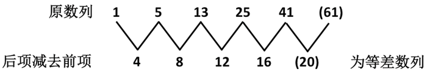

故正确答案为D。

**来源**：2012年江西省公务员录用考试《行测》题第96题

### 第 97 题

2，2，6，30，（  ），1890

A. 180

B. 210

C. 360

D. 240

第 97 题 · 答案与解析

**参考答案（粉笔题库参考内容）**

B

**解析**

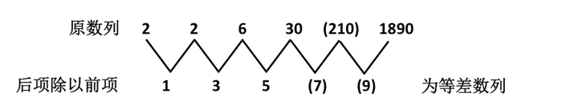

故正确答案为B。

**来源**：2012年江西省公务员录用考试《行测》题第97题

### 第 98 题

1，2，（  ），37，101，226

A. 9

B. 17

C. 10

D. 21

第 98 题 · 答案与解析

**参考答案（粉笔题库参考内容）**

C

**解析**

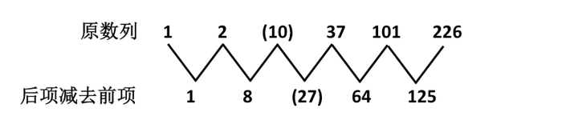

其中数列1、8、27、64、125分别为1^3、2^3、3^3、4^3、5^3。

故正确答案为C。

**来源**：2012年江西省公务员录用考试《行测》题第98题

### 第 99 题

5/6，6/11，11/17，（  ），28/45

A. 17/24

B. 17/28

C. 28/17

D. 24/17

第 99 题 · 答案与解析

**参考答案（粉笔题库参考内容）**

B

**解析**

原数列中，后项的分子等于前项的分母，后项的分母等于前项的分子、分母之和。

故正确答案为B。

**来源**：2012年江西省公务员录用考试《行测》题第99题

### 第 100 题

2，6，12，22，40，（  ），140

A. 74

B. 76

C. 84

D. 96

第 100 题 · 答案与解析

**参考答案（粉笔题库参考内容）**

A

**解析**

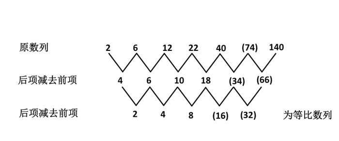

故正确答案为A。

**来源**：2012年江西省公务员录用考试《行测》题第100题

### 第 101 题

2，32，212，2012，（  ）

A. 3012

B. 20112

C. 20012

D. 30012

第 101 题 · 答案与解析

**参考答案（粉笔题库参考内容）**

C

**解析**

原数列中，第一项为2，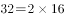，，，故未知项为。

故正确答案为C。

**来源**：2012年江西省公务员录用考试《行测》题第101题

### 第 102 题

0.25，0.5，2，（  ），2，0.5

A. 1

B. 4

C. 0.25

D. 0.125

第 102 题 · 答案与解析

**参考答案（粉笔题库参考内容）**

B

**解析**

原数列是一个递推数列，递推公式为，即，，，。

故正确答案为B。

**来源**：2012年江西省公务员录用考试《行测》题第102题

### 第 103 题

6，7，9，15，（  ），159，879

A. 21

B. 35

C. 67

D. 39

第 103 题 · 答案与解析

**参考答案（粉笔题库参考内容）**

D

**解析**

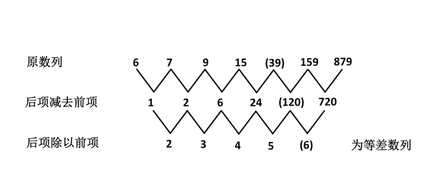

故正确答案为D。

**来源**：2012年江西省公务员录用考试《行测》题第103题

### 第 104 题

53，61，68，82，（  ），103，107

A. 89

B. 92

C. 94

D. 88

第 104 题 · 答案与解析

**参考答案（粉笔题库参考内容）**

B

**解析**

题干数列项数较多，考虑多重数列，找不到规律。尝试两两作差，作差后得到8、7、14、（    ）、（    ）、4，没有明显的规律，但观察到8=5+3（53的十位个位上的两个数字之和，后同）、7=6+1、14=6+8、最后的4=1+0+3，因此原数列是一个递推数列，递推公式为的各个位数上的值之和)，即61=53+5+3，68=61+6+1，82=68+6+8，(92)=82+8+2，103=92+9+2，107=103+1+3。

故正确答案为B。

**来源**：2012年江西省公务员录用考试《行测》题第104题

### 第 105 题

2，6，30，60，（  ），210，350

A. 76

B. 120

C. 130

D. 128

第 105 题 · 答案与解析

**参考答案（粉笔题库参考内容）**

C

**解析**

原数列为立方修正数列。

原数列：2、6、30、60、（130）、210、350；

立方项：1^3、2^3、3^3、4^3、（5^3）、6^3、7^3，底数为等差数列；

修正项：+1、-2、+3、-4、（+5）、-6、+7，自然数列正负交替出现；

则未知项为。

故正确答案为C。

**来源**：2012年江西省公务员录用考试《行测》题第105题

### 第 106 题

的个位数为：

A. 9

B. 8

C. 6

D. 4

第 106 题 · 答案与解析

**参考答案（粉笔题库参考内容）**

A

**解析**

如下表所示，3、4、8的不同幂次尾数是周期变化的，周期分别为4、2、4。

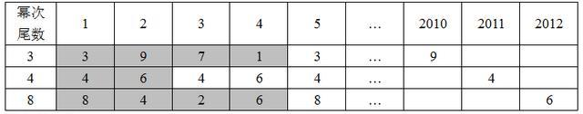

9+4+6=19，因此所求的个位数为9。

故正确答案为A。

**来源**：2012年江西省公务员录用考试《行测》题第106题

### 第 107 题

将一个三位数的个位数字和百位数字调换后所得的三位数与原三位数的和是1070，差是198，这个三位数是：

A. 218

B. 327

C. 436

D. 524

第 107 题 · 答案与解析

**参考答案（粉笔题库参考内容）**

C

**解析**

解析1：

设这个三位数为m，变化后的三位数为n，则有m＋n＝1070，n－m＝198，解之得m＝436。

解析2：

分析可知，这个三位数的百位与个位作和后尾数为0，作差后尾数为8，代入选项只有C满足条件。

故正确答案为C。

**来源**：2012年江西省公务员录用考试《行测》题第107题

### 第 108 题

某单位组织员工去旅游，要求每辆汽车坐的人数相同。如果每辆车坐20人，还剩下2名员工；如果减少一辆汽车，员工正好可以平均分到每辆汽车。问该单位共有多少名员工？

A. 244

B. 242

C. 220

D. 224

第 108 题 · 答案与解析

**参考答案（粉笔题库参考内容）**

B

**解析**

根据题意可知，每辆车坐20人将会多出2人，则（总人数-2）是20的倍数，可排除A、C、D项。

故正确答案为B。

**考点**：和差倍比问题

**来源**：2012年江西省公务员录用考试《行测》题第108题

### 第 109 题

某批农产品在流通过程中经历了多次价格变化。甲从农户手中收购后，加价40%转给乙；后来，乙因为货物积压太多担心变质，便削价5%倒手给批发商丙；丙又加价20%批发给零售店；零售店加价20%销售。

问农户手中价值100元的该批农产品，到达消费者手中需要多少元（结果四舍五入）：

A. 175

B. 183

C. 192

D. 201

第 109 题 · 答案与解析

**参考答案（粉笔题库参考内容）**

C

**解析**

根据已知，所求钱数为。

故正确答案为C。

**考点**：经济利润问题

**来源**：2012年江西省公务员录用考试《行测》题第109题

### 第 110 题

面值分别为1角、2角、5角的纸币共100张，总面值为30元整，其中2角的总面值比1角的总面值多1.6元。问面值1角、2角、5角的纸币各多少张？

A. 24，20，56

B. 28，22，40

C. 36，24，40

D. 32，24，44

第 110 题 · 答案与解析

**参考答案（粉笔题库参考内容）**

D

**解析**

解析1：

设面值1角、2角、5角的纸币各有a、b、c张，则根据已知有，a＋b＋c＝100，a＋2b＋5c＝300，2b－a＝16，解之得a＝32，b＝24，c＝44。

解析2：

设面值1角、2角、5角的纸币各有a、b、c张，则a＋2b＋5c的结果尾数应该为0，将选项一一代入，只有D符合。

故正确答案为D。

**考点**：和差倍比问题

**来源**：2012年江西省公务员录用考试《行测》题第110题

### 第 111 题

甲以每小时6千米的速度步行从A地前往B地，在甲出发90分钟时，乙发现甲落下了重要物品，立即骑自行车以每小时12千米的速度追甲，终于在上午11点追上了甲。问甲出发时间是上午几点：

A. 7

B. 8

C. 9

D. 10

第 111 题 · 答案与解析

**参考答案（粉笔题库参考内容）**

B

**解析**

甲的运动时间为t小时，则乙的运动时间为t－1.5小时，于是可知6t＝12(t－1.5)，因此t＝3。甲出发时间为早上8点。

故正确答案为B。

**考点**：相遇追及

**来源**：2012年江西省公务员录用考试《行测》题第111题

### 第 112 题

某市出租车运费计算方式如下：起步价2公里6元，2公里之后每增加1公里收费1.7元，6公里之后每增加1公里收费2.0元，不足1元按四舍五入计算。某乘客乘坐了31公里，应该付多少元车费：

A. 63

B. 64

C. 65

D. 66

第 112 题 · 答案与解析

**参考答案（粉笔题库参考内容）**

A

**解析**

根据题意，该乘客应付车费≈63元。

故正确答案为A。

**考点**：分段计算问题

**来源**：2012年江西省公务员录用考试《行测》题第112题

### 第 113 题

一批玩具，比进价高200%销售，一段时间后，六一儿童节促销，玩具按定价6折出售，打折后这批价格比进价高百分之几：

A. 20

B. 40

C. 60

D. 80

第 113 题 · 答案与解析

**参考答案（粉笔题库参考内容）**

D

**解析**

设进价为m，则六一儿童节促销后的价钱为\=1.8m，所以打折后价格比进价高。

故正确答案为D。

**考点**：经济利润问题

**来源**：2012年江西省公务员录用考试《行测》题第113题

### 第 114 题

某项工程，甲单独完成需要8天，乙需要4天，甲做一半换乙，乙做剩余一半又换甲，甲又做剩余一半再换乙完成，问整个工程花费多少天：

A. 5.5

B. 6

C. 6.5

D. 7

第 114 题 · 答案与解析

**参考答案（粉笔题库参考内容）**

C

**解析**

设总工程量为8（8、4的公倍数），则甲、乙每天的效率值分别为1、2，根据已知，有下表：

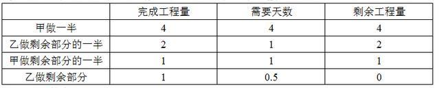

所以总天数为4+1+1+0.5=6.5。

故正确答案为C。

**考点**：给完工时间型

**来源**：2012年江西省公务员录用考试《行测》题第114题

### 第 115 题

小张、小李、小王三人到商场购买办公用品，小张购买1个计算器、3个订书机、7包打印纸共需要316元，小李购买1个计算器、4个订书机、10包打印纸共需要362元。

小王购买了1个计算器、1个订书机、1包打印纸共需要：

A. 224元

B. 242元

C. 124元

D. 142元

第 115 题 · 答案与解析

**参考答案（粉笔题库参考内容）**

A

**解析**

设1个计算器、1个订书机、1包打印纸的单价分别为a元、b元、c元。根据题意可得：

a+3b+7c=316①；

a+4b+10c=362元②。

方法一：得：a+b+c=948-724=224元。

方法二：赋c=0，可得a+3b=316，a+4b=362，则b=46，代入①式解得a=178，故a+b+c=178+46+0=224元。

故正确答案为A。

**考点**：和差倍比问题

**来源**：2012年江西省公务员录用考试《行测》题第115题

## 材料 1

随着中国老龄化进程加快，养老问题困扰不少普通家庭。2012年全国老龄工作会议提出：截至2011年年底，全国60岁以上老年人共有1.85亿，占总人口的13.7%。调查显示，居民对目前的养老保障现状有深切感受，37.8%的受访者表示对现状满意，39.9%的受访者认为一般。

        当被问及“您对自己老年生活方式的规划”时，55.7%的受访者选择自己或与爱人独住，26.9%的受访者选择和儿女待在一起，15.3%的受访者选择去敬老院。在养老方式上67.1%的受访者愿意由自己做主。当被问“您认为老年人的养老应由谁主要承担”时，35.5%的受访者选择政府，25.4%的受访者选择子女，22.5%的受访者选择自己，还有9%和7.7%分别选择所在单位和非政府组织。

        调查也发现，49.8%的受访者同意“养儿防老”的养老观念，47.6%的受访者明确表示不同意，还有2.6%的受访者表示非常不同意，二者合计50.2%。本次调查数据显示，29%的受访者认为身体不好活动不便是老年生活中最大困难，22%的受访者认为生活没人照料，20.4%的受访者最担心经济困难，17.2%的受访者最担心孤独。当被问“老年人最需要的服务项目”时，16.4%的受访者选择紧急救助，15.5%的受访者选择家庭护理，13.7%的受访者选择保健康复，选择陪护服务和文化娱乐服务的也在12%以上，还有8%以上选择社交服务和心理健康服务。

        调查还发现，随年龄增长，选择社会养老保险积累养老金的比例呈递增趋势。调查中，18-29岁和30-39岁的受访者选择社会养老保险积累养老金的分别是71.4%和85%，而40-49岁、50-59岁和60岁以上的受访者分别是94.5%、95.6%和94.4%。另居家养老发展空间很大，在调查中17.3%的受访者选择家政服务，15.3%的受访者选择子女照料，10.2%的受访者选择送餐配餐，选择家庭病床、邻里帮助和代购代买的比例也都接近10%。

### 第 116 题

对目前养老现状表示满意的比例是：

A. 77.7%

B. 39.9%

C. 37.8%

D. 22.3%

第 116 题 · 答案与解析

**参考答案（粉笔题库参考内容）**

C

**解析**

定位文字材料第一段，“居民对目前的养老保障现状有深切感受，37.8%的受访者表示对现状满意，39.9%的受访者认为一般”。故对目前养老现状表示满意的比例是37.8%。

故正确答案为C。

**考点**：文字资料、直接找数

**来源**：2012年江西省公务员录用考试《行测》题第116题

### 第 117 题

按选择社会养老保险比例高低排序，排第一位的年龄段是：

A. 30-39岁

B. 40-49岁

C. 50-59岁

D. 60岁以上

第 117 题 · 答案与解析

**参考答案（粉笔题库参考内容）**

C

**解析**

定位文字材料最后一段，“调查中，18-29岁和30-39岁的受访者选择社会养老保险积累养老金的分别是71.4%和85%，而40-49岁、50-59岁和60岁以上的受访者分别是94.5%、95.6%和94.4%”。所以50-59岁选择社会养老保险比例最高。

故正确答案为C。

**考点**：文字资料、直接找数

**来源**：2012年江西省公务员录用考试《行测》题第117题

### 第 118 题

在老年人养老主要由谁承担问题上，选择政府、子女和自己承担的比例累计为：

A. 95.5%

B. 83.4%

C. 92.4%

D. 35.5%

第 118 题 · 答案与解析

**参考答案（粉笔题库参考内容）**

B

**解析**

定位文字材料第二段，“35.5%的受访者选择政府，25.4%的受访者选择子女，22.5%的受访者选择自己，还有9%和7.7%分别选择所在单位和非政府组织”。所以在老年人养老主要由谁承担问题上，选择政府、子女和自己承担的比例累计为35.5%+25.4%+22.5%=83.4%。

故正确答案为B。

**考点**：文字资料、简单加减计算

**来源**：2012年江西省公务员录用考试《行测》题第118题

### 第 119 题

根据资料，下列错误的是：

A. 材料列出的居家养老方式，家政服务的比例最高

B. 16.7%的受访者选择由所在单位和非政府组织承担老年人的养老问题

C. 到2011年底，全国60岁以上的老年人占总人口的13.7%

D. 受访者选择社会养老保险积累养老金的比例与其年龄总体上呈反向变动趋势

第 119 题 · 答案与解析

**参考答案（粉笔题库参考内容）**

D

**解析**

A项，定位文字材料最后一段，“在调查中17.3%的受访者选择家政服务，15.3%的受访者选择子女照料，10.2%的受访者选择送餐配餐，选择家庭病床、邻里帮助和代购代买的比例也都接近10%”。对比以上数据，17.3%最大，故家政服务比例最高，正确；

B项，定位文字材料第二段，“还有9%和7.7%分别选择所在单位和非政府组织”。故受访者选择由所在单位和非政府组织承担老年人的养老问题的比例为9%+7.7%=16.7%，正确；

C项，定位文字材料第一段，“2012年全国老龄工作会议提出：截至2011年年底，全国60岁以上老年人共有1.85亿，占总人口的13.7%”。故到2011年底，全国60岁以上的老年人占总人口是13.7%，正确；

D项，定位文字材料最后一段，“调查还发现，随年龄增长，选择社会养老保险积累养老金的比例呈递增趋势”，与选项表述不相符。

本题为选非题，故正确答案为D。

**考点**：文字资料、综合分析

**来源**：2012年江西省公务员录用考试《行测》题第119题

### 第 120 题

“养儿防老”是传统观念，本项调查，不赞同和非常不赞同的比例累计是：

A. 50.2%

B. 49.8%

C. 55.7%

D. 47.6%

第 120 题 · 答案与解析

**参考答案（粉笔题库参考内容）**

A

**解析**

定位文字材料第三段，“47.6%的受访者明确表示不同意，还有2.6%的受访者表示非常不同意，二者合计50.2%”。故“养儿防老”是传统观念，本项调查，不赞同和非常不赞同的比例累计是50.2%。

故正确答案为A。

**考点**：文字资料、直接找数

**来源**：2012年江西省公务员录用考试《行测》题第120题

## 材料 2

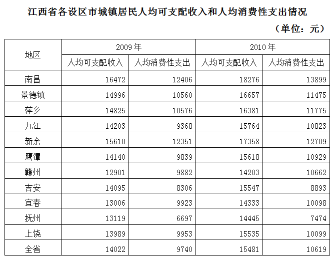

### 第 121 题

2010年城镇居民人均可支配收入不在前三位的是：

A. 景德镇

B. 南昌

C. 九江

D. 新余

第 121 题 · 答案与解析

**参考答案（粉笔题库参考内容）**

C

**解析**

定位表格材料第四列可知：2010年城镇居民人均可支配收入，景德镇16657元、南昌18276元、九江15764元、新余17358元。比较可知九江最少。故2010年城镇居民人均可支配收入不在前三位的是九江。

故正确答案为C。

**考点**：直接找数、统计表

**来源**：2012年江西省公务员录用考试《行测》题第121题

### 第 122 题

2010年与2009年相比，人均消费性支出增长大于可支配收入增长的是：

A. 新余

B. 赣州

C. 上饶

D. 南昌

第 122 题 · 答案与解析

**参考答案（粉笔题库参考内容）**

D

**解析**

根据题干“…增长大于…增长”可判定本题为增长比较问题。若为增长量的比较问题，则选项所对应的人均消费性支出增长量均小于可支配收入增长量，无正确选项。故本题为一般增长率的比较问题。定位表格材料可知：2009年四个选项对应的人均可支配收入与人均消费性支出分别为：新余15610元、12351元，赣州12901元、9882元，上饶13989元、9953元，南昌16472元、12406元。2010年四个选项对应的人均可支配收入与人均消费性支出分别为：新余17358元、12709元，赣州14203元、10662元，上饶15535元、10099元，南昌18276元、13899元。根据公式：，可求选项对应的人均消费性支出增长率：

新余：，

赣州：，

上饶：，

南昌：。

人均可支配收入增长率：

新余：，

赣州：，

上饶：，

南昌：。

因为题干要求“2010年与2009年相比，人均消费性支出增长大于可支配收入增长”，根据上述估算可以排除A、B、C。南昌人均消费性支出增长率，人均可支配收入增长率，12.4%>11.2%，故2010年与2009年相比，人均消费性支出增长大于可支配收入增长的是南昌。

故正确答案为D。

**考点**：一般增长率、统计表

**来源**：2012年江西省公务员录用考试《行测》题第122题

### 第 123 题

2010年全省城镇居民人均消费性支出增长约：

A. 9%

B. 10%

C. 11%

D. 12%

第 123 题 · 答案与解析

**参考答案（粉笔题库参考内容）**

A

**解析**

根据题干“…增长”，结合选项为百分数，可判定本题为一般增长率计算问题。定位表格材料可知：2009年全省城镇居民人均消费性支出9740元，2010年全省城镇居民人均消费性支出10619元。根据公式：，则2010年全省城镇居民人均消费性支出增长率为，只有A项满足。

故正确答案为A。

**考点**：一般增长率、统计表

**来源**：2012年江西省公务员录用考试《行测》题第123题

### 第 124 题

抚州市2010年城镇居民人均可支配收入中用于消费性支出的比例约：

A. 68.6%

B. 51.7%

C. 76.1%

D. 57.2%

第 124 题 · 答案与解析

**参考答案（粉笔题库参考内容）**

B

**解析**

根据题干“2010年…中…的比例”即比重，结合材料时间2010年，可判定本题为现期比重计算问题。定位表格材料可知：2010年抚州市城镇居民人均可支配收入为14445元、人均消费性支出为7474元。则抚州市2010年城镇居民人均可支配收入中用于消费性支出的比例为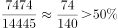且比较接近，与B项最为接近。

故正确答案为B。

**考点**：现期比重、统计表

**来源**：2012年江西省公务员录用考试《行测》题第124题

### 第 125 题

2010年城镇居民人均消费性支出增幅最小的是：

A. 南昌

B. 新余

C. 吉安

D. 抚州

第 125 题 · 答案与解析

**参考答案（粉笔题库参考内容）**

B

**解析**

根据题干“…增幅最小”，增幅表示增长率，可判定本题为一般增长率的比较问题。定位表格材料可知：四个选项所对应的2009年和2010年城镇居民人均消费性支出分别为：南昌12406元、13899元，新余12351元、12709元，吉安8306元、8893元，抚州6697元、7474元。根据公式：，可得：

南昌：；

新余：；

吉安：；

抚州：。

求增幅最小，故只需从新余和吉安中选择，因为吉安的分子较大且分母较小，所以吉安>新余，则2010年城镇居民人均消费性支出增幅最小的是新余。

故正确答案为B。

**考点**：一般增长率、统计表

**来源**：2012年江西省公务员录用考试《行测》题第125题

## 材料 3

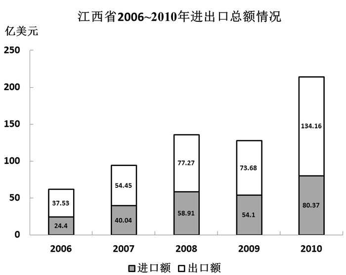

### 第 126 题

江西“十一五”进出口总额为：

A. 214.53亿美元

B. 634.91亿美元

C. 377.09亿美元

D. 257.82亿美元

第 126 题 · 答案与解析

**参考答案（粉笔题库参考内容）**

B

**解析**

定位图形材料可知：2006年进口24.4亿美元、出口37.53亿美元，2007年进口40.04亿美元、出口54.45亿美元，2008年进口58.91亿美元、出口77.27亿美元，2009年进口54.1亿美元、出口73.68亿美元，2010年进口80.37亿美元、出口134.16亿美元。分析选项可以采用尾数法，将每年的进出口额的尾数相加为0+3+4+5+1+7+0+8+7+6，可知尾数为1，与B项相符。

故正确答案为B。

**考点**：简单加减计算、统计图

**来源**：2012年江西省公务员录用考试《行测》题第126题

### 第 127 题

进出口贸易最接近平衡的年份：

A. 2006

B. 2007

C. 2008

D. 2010

第 127 题 · 答案与解析

**参考答案（粉笔题库参考内容）**

C

**解析**

根据题干“进出口贸易最接近平衡的年份”，进口与出口的比值越接近1说明进出口贸易越平衡，故判定本题为比值比较问题。定位图形材料可知：选项对应的进出口额分别为，2006年进口24.4亿美元、出口37.53亿美元，2007年进口40.04亿美元、出口54.45亿美元，2008年进口58.91亿美元、出口77.27亿美元，2010年进口80.37亿美元、出口134.16亿美元。故

2006年：，

2007年：，

2008年：，

2010年：。

根据上述计算可以得出2008年比值是最接近1的，故进出口贸易最接近平衡的年份是2008年。

故正确答案为C。

**考点**：比值比较、统计图

**来源**：2012年江西省公务员录用考试《行测》题第127题

### 第 128 题

2010年进出口贸易总额比2006年增长约：

A. 2.46倍

B. 3.46倍

C. 3.57倍

D. 2.57倍

第 128 题 · 答案与解析

**参考答案（粉笔题库参考内容）**

A

**解析**

根据题干“······比······增长”，结合选项为“······倍”，可判定本题为一般增长率计算问题。定位图形材料可知：2006年进口24.4亿美元、出口37.53亿美元，2010年进口80.37亿美元、出口134.16亿美元。根据公式：，可得2010年进出口贸易总额比2006年约增长。

故正确答案为A。

**考点**：一般增长率、统计图

**来源**：2012年江西省公务员录用考试《行测》题第128题

### 第 129 题

下列说法正确的是：

A. 2010年进出口总额比上年增长约67.9%

B. 2010年进口增幅大于出口增幅

C. 2010年贸易顺差比2009年小

D. “十一五”有四年出现贸易顺差、一年逆差

第 129 题 · 答案与解析

**参考答案（粉笔题库参考内容）**

A

**解析**

A项，定位图形材料可知：2009年进口54.1亿美元、出口73.68亿美元，2010年进口80.37亿美元、出口134.16亿美元。根据公式：，可得2010年进出口总额比上年增长约，正确；

B项，定位图形材料可知：2009年进口54.1亿美元、出口73.68亿美元，2010年进口80.37亿美元、出口134.16亿美元。根据公式：，可得2010年进口增幅为，出口增幅为，故2010年进口增幅小于出口增幅，错误；

C项，定位图形材料可知：2009年进口54.1亿美元、出口73.68亿美元，2010年进口80.37亿美元、出口134.16亿美元。根据贸易顺差=出口-进口，可得2010年贸易顺差为53.79亿美元，2009年贸易顺差为19.58亿美元，故2010年贸易顺差比2009年大，错误；

D项，定位图形材料可知：2006年进口24.4亿美元&lt;出口37.53亿美元，2007年进口40.04亿美元&lt;出口54.45亿美元，2008年进口58.91亿美元&lt;出口77.27亿美元，2009年进口54.1亿美元&lt;出口73.68亿美元，2010年进口80.37亿美元&lt;出口134.16亿美元。出口>进口，为顺差，故“十一五”中五年全部为贸易顺差，错误。

故正确答案为A。

**考点**：统计图、综合分析

**来源**：2012年江西省公务员录用考试《行测》题第129题

### 第 130 题

假定2010年至2012年两年进出口总额平均增幅为15%，推测2012年进出口总额为：

A. 246.11亿美元

B. 283.72亿美元

C. 360.00亿美元

D. 260.00亿美元

第 130 题 · 答案与解析

**参考答案（粉笔题库参考内容）**

B

**解析**

根据题干“假定2010年至2012年······平均增幅为15%，推测2012年······”，判定本题为现期计算问题。定位图形材料可知：2010年进口80.37亿美元、出口134.16亿美元。根据公式：现期=基期×(1+增长率)，可得2012年进出口总额为亿美元，与B项最接近。

故正确答案为B。

**考点**：现期计算、统计图

**来源**：2012年江西省公务员录用考试《行测》题第130题

## 材料 4

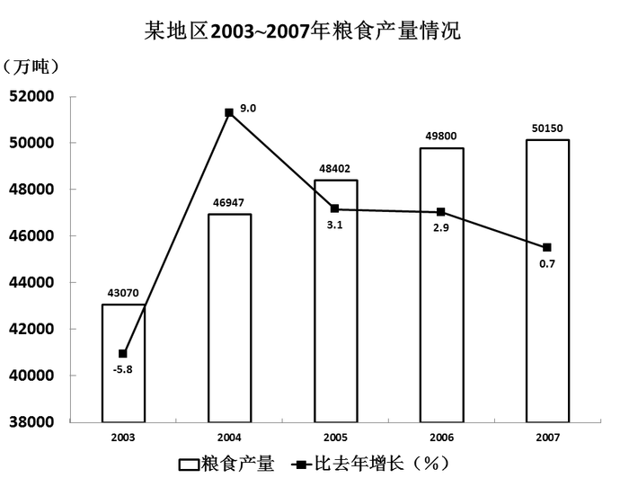

### 第 131 题

从图看出，粮食产量持续增长的年数是：

A. 1年

B. 2年

C. 3年

D. 4年

第 131 题 · 答案与解析

**参考答案（粉笔题库参考内容）**

D

**解析**

定位图形材料可知：2003~2007年增长率分别为-5.8%、9.0%、3.1%、2.9%、0.7%。增长率为正即为增长。有4个增长率为正，故粮食产量持续增长的年数是4。

故正确答案为D。

**考点**：直接找数、统计图

**来源**：2012年江西省公务员录用考试《行测》题第131题

### 第 132 题

粮食产量增长最大的年份是：

A. 2004年

B. 2005年

C. 2006年

D. 2007年

第 132 题 · 答案与解析

**参考答案（粉笔题库参考内容）**

A

**解析**

根据题干“…增长最大…”，判定本题为增长量比较问题。定位图形材料：从柱状图的高度差能看出，2004年相比2003年的增长最多，所以粮食产量增长最大的年份是2004年。

故正确答案为A。

**考点**：增长量比较、统计图

**来源**：2012年江西省公务员录用考试《行测》题第132题

### 第 133 题

2007年粮食产量比2003年增长了约：

A. 9.7%

B. 16.4%

C. 15.7%

D. 9.9%

第 133 题 · 答案与解析

**参考答案（粉笔题库参考内容）**

B

**解析**

根据题干“…增长了约”，结合选项为百分数，可判定本题为一般增长率计算问题。定位图形材料可知：2003年粮食产量为43070万吨，2007年粮食产量为50150万吨。根据公式：，可得2007年的粮食产量比2003年增长了约，与B项最为接近。

故正确答案为B。

**考点**：一般增长率、统计图

**来源**：2012年江西省公务员录用考试《行测》题第133题

### 第 134 题

假定2008年粮食产量同比增长速度1%，则其反映绝对量增长：

A. 501.5万吨

B. 498.0万吨

C. 350.0万吨

D. 365.0万吨

第 134 题 · 答案与解析

**参考答案（粉笔题库参考内容）**

A

**解析**

根据题干“…绝对量增长”，结合选项带单位，可判定本题为增长量计算问题。定位图形材料可知：2007年粮食产量为50150万吨。根据公式：增长量=基期×增长率，2008年同比增长率为1%，故2008年绝对量增长（即增长量）为50150×1%＝501.5万吨。

故正确答案为A。

**考点**：增长量计算、统计图

**来源**：2012年江西省公务员录用考试《行测》题第134题

### 第 135 题

2003~2007年五年粮食年均产量是：

A. 47673.8万吨

B. 48402.0万吨

C. 4932.5万吨

D. 4698.6万吨

第 135 题 · 答案与解析

**参考答案（粉笔题库参考内容）**

A

**解析**

根据题干“2003~2007年…年均产量是”，结合材料时间2003~2007年，可判定本题为现期平均数计算问题。定位图形材料可知：2003~2007年的粮食产量分别为43070万吨、46947万吨、48402万吨、49800万吨、50150万吨。

直接求和再求平均，五年粮食的总和约为43000＋47000＋48000＋50000＋50000＝238000万吨，平均产量为238000/5=47600万吨，与A选项最接近。

故正确答案为A。

**考点**：现期平均数、统计图

**来源**：2012年江西省公务员录用考试《行测》题第135题

