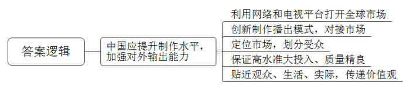
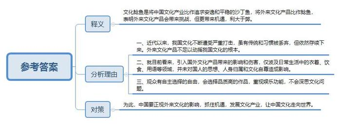
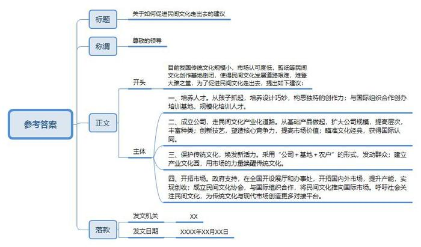
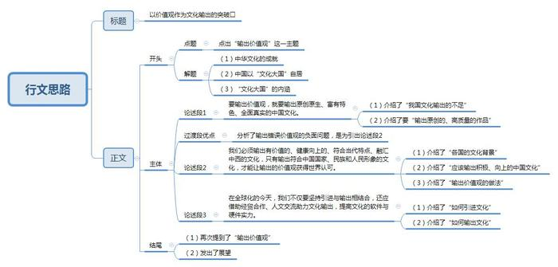

# 2014年公务员多省联考《申论》题（江西卷）

<!-- gwy:overview:start -->
> **江西 · 2014 · 申论 · 统考** ｜ 4 题 · 图片 4 处 · 答案随题折叠

导航：[题目](#题目) · [材料 1](#材料-1)
<!-- gwy:overview:end -->

> 候选采集稿。参考答案及解析来自粉笔页面，不代表官方答案或真实高分答卷；来源使用许可与原卷对应关系仍需人工核实。

## 给定材料

### 材料 1

随着网络和电视制造业的发展，全球电视剧市场已经进入了“大航海时代”，随意按动鼠标就能看到世界另一端同样在看的剧集。观众可以坐在家里尽享顶级剧集的极致体验，“追剧”俨然成为都市白领的一种生活方式。

而作为2014年最为火爆的美剧代表，《纸牌屋》一经推出便极度受宠，引起全民热议，连美国总统奥巴马也是《纸牌屋》的忠实粉丝。有观众看完《纸牌屋》后，表示对美国政治产生了浓厚的兴趣，对权利和爱情更有了新的认识，甚至翻出以往讲述美国政治历史的书籍、影片来观看，参与到这部剧的讨论。

2011年，美国电影和电视节目的总出口额是143亿美元，畅销100多个国家。2012年在法国播出美剧多达数十部，其中30多部单集观众超过百万，《超感神探》还一举成为当年的电视剧收视冠军。在德国，美剧基本处于垄断地位，占据约90%以上的播出份额。韩国2011年也从美国引进了122部电视剧。

“美剧《纸牌屋》这类全球剧的热播趋势有目共睹，它们真正开创了电视剧‘24小时全球联播’的奇迹。”英国某传媒的中华区首席执行官梁华军如此评价。专家认为，电视文化产品的价值日益凸显，中国应从中借鉴经验，提升电视剧制作水平，同时加强文化产品对外输出能力。

《纸牌屋》的热播并不影响《来自星星的你》赚取过亿眼球。由于两部电视剧对受众有明显的划分，出现了同期上映却“平分天下”的局面。《来自星星的你》在韩国播出时，网络最高收视率达68.9%。

美剧、韩剧在全球热播并非偶然。“以受众为导向，创新电视剧制作、播出模式，直接对接市场，接受评判。全新的制作模式给了电视剧全新的生命。”S大学新闻传播学教授唐锡光认为，与中国电视剧传统意义上的播出模式不同，美剧大都按“季”播出，通常一星期只播一集，边拍边播。由于美国电视剧播放平台不多，每年能在季播期黄金时间段播出的不到2000集，因此竞争异常激烈。近年来，韩剧也采取边拍边播的模式，《来自星星的你》每周播出两集，每次网上更新剧集都会引发下载热。

这种开放的模式可以使制作方充分感受到观众对剧集的关注程度，根据每周更新的收视率和观众的反映，及时调整创作方向。美剧《越狱》第一季播放时，收视率曾高达1800万人次；而《生活大爆炸》主人公谢尔顿的性格就是根据观众的反馈几经改变才定型的。

更值得关注的是，这些热播剧大多高水准、大投入，保证质量精良。季播和周播的模式本身就拉高了电视剧制作成本。而对制作团队、剧本、导演、演员、道具等精益求精的追求，使得热播剧拍摄成本很高。

对比艾美奖得主《广告狂人》、《斯巴达克斯》等美剧每集200万美元左右的制作费用，《纸牌屋》近400万美元的单集平均成本大大超过了一般制作标准。2011年美剧《史前新纪元》，重金打造的首集拍摄费用就接近2000万美元，甚至超过众多电影的投资成本。

这些热播剧还有一个特点，就是不同于中国的“武侠剧”“清宫剧”“名著剧”，而以现实为题材，用写实手法描述生活中的酸甜苦辣，与观众不疏远。除科幻剧外，美剧大多务求内容真实，有时涉及技术层面还要请顾问或相关专家亲自操刀。《生活大爆炸》剧组甚至拥有一个真正的“科学顾问”，专门负责剧本中关于科学部分的内容创作。

现实题材的电视剧制播能最充分地反映电视剧生产流程的市场化属性。《来自星星的你》尽管有科幻成分，但人物感情进展、尊老爱幼优良传统贯穿其中，传递出韩国普世价值观。

唐教授说，美剧和韩剧都通过简单的日常生活与谈话交流传递价值取向，剧中对生活中可能遇到的情感问题、生活细节问题的揭示，让人觉得真实可信，在贴近生活中的文化输出才容易被外国观众认同。

在国产电视剧产量猛增的背景下，专家建议中国应加强对产品质量把关，积极探索并生产出既承载中国文化价值观，又符合国际主流“文化经验”和“感觉结构”的电视产品。

### 材料 2

针对近日在中国内地掀起的一股追韩潮，政协委员G在2014年3月2日接受记者采访时称：“韩剧热潮，已经不仅是韩剧的问题了，这让我们的文化自尊受到伤害，文化自尊的伤害是由于文化自信的缺失。”

韩潮来袭，韩迷们自然是喜不胜收，来者不拒，多多益善。而如同G这样的文化人士则不免有些心存疑虑。担心韩流损害我们的文化自尊。一方是欢迎，一方是反对，究竟谁说的更有道理？有网站发起“我们该如何面对韩剧热潮”的讨论，引发大量跟帖。有网友把帖中的核心观点摘录如下：

观众喜欢韩剧，当然有其理由。比如情感细腻、演员养眼、制作精良等。相比于国内电视剧而言，这些都是韩剧的优势所在，在这个文化多元开放的时代，其实不管是韩剧还是好莱坞的电影，我们都有选择的自由。原因很简单，观众自然是什么好看看什么。从某种程度上说，观众所看中的更多的是韩剧的娱乐功能而非文化入侵。有人认为，韩剧逻辑性较差，观看时无需动脑子，单纯是“感情发泄”。换而言之，观众在看韩剧的时候，绝不会去想韩国文化怎么就伤害了中国文化这样的宏大命题。在他们看来，只要故事足够精彩就足够了。

著名历史学家汤因比认为，文明是在不断成功回应各种危机和挑战中得以存续和发展的。韩国的电视剧、美国好莱坞的电影，这些都是外来文化的表现形式，同时也是外来的“文化鲶鱼”，从某种意义上讲，我们的文化自尊受到伤害并非是从韩剧或者是好莱坞电影开始，因为自西方人用坚船利炮打开清政府的大门开始，无论是洋务运动，还是新文化运动，我们的传统文化可以说一直在与西方文化的斗争中不断地延续和发展，不可否认，现在中国传统文化式微，有些好的传统、好的习惯、好的做法都被抛弃了，但中华文化或者说华夏文明依然在一脉相承。

不可否认，韩剧是韩国文化的一种体现。韩剧热无形中会带来韩国文化的影响，给中国文化带来一定的伤害。但是这种影响究竟有多大，伤害程度究竟有多深，没有准确的实证数据。韩剧在大陆风行已经不是一天两天了，我们可以看到人们穿韩版衣服，说一两句“欧巴”“思密达”，吃几次韩餐，可并没有见到有谁因为喜欢看韩剧就改一个韩国名字或者移民韩国。韩剧的影响当然是客观存在，但说伤害了我们的文化自尊则未免太高估了韩国文化的影响。

看看韩剧，天不会塌下来。文化自尊也不一定会受到伤害。换句话说，我们既要正视韩流的影响，但更要思考如何让中华文化走向世界。

### 材料 3

广灵剪纸作为中国民间剪纸三大流派之一，以彩色剪纸为特色，每件作品经二十余道工序成形，是集绘画、色彩、镂雕于一体的手工艺术品，被誉为“中华民间艺术一绝”。2009年广灵剪纸作为中国剪纸的部分申报项目，被联合国教科文组织列入人类非物质文化遗产代表作名录。

广灵剪纸传到高清红这里，已经是第六代了。也许是广灵的青山绿水赋予了她灵巧的心思，也许是祖祖辈辈的匠心造就了她杰出的基因，4岁起高清红跟着外祖母和母亲学剪窗花，年纪轻轻就已经能独立完成设计巧妙、构思独特的剪纸作品了。

和身边很多同龄人一样，高中毕业后高清红走上了工作岗位。然而1996年她所在的县水泥厂因企业效益滑坡，她只得被迫下岗。回到家一次偶然的机会，她听说上世纪80年代广灵剪纸的主要创作生产基地广灵工艺美术厂倒闭了，她心底埋藏多年的那个儿时的“剪纸梦”突然萌动了，于是，追随梦想的召唤，青红剪纸艺术有限公司应运而生。作为广灵民间剪纸艺术的带头人，高清红开始带领广灵剪纸走上民间文化产业化的道路。

从“一年一枯荣、岁岁上窗棂”的窗花做起，青红公司规模越做越大，层次越做越高，单色的变成了多彩的，民间的变成了民族的。由高清红创新的“剪纸加减法”让构图跃然纸上，出图力透纸背，把传统的广灵剪纸艺术推到了创作新阶段，在众多形式的剪纸中独成一家。据了解，广灵剪纸中难度最大的多层剪纸，高清红目前已经可以剪到八层，这在全世界也是绝无仅有的。而在民间，她的多幅作品的市场价值已达数万元。

不再是传统福禄寿禧和飞禽走兽，高清红的剪纸瞄准了更广的文化经典：历时半年完工的长达数米的《清明上河图》以精湛的刀工艺术将北宋时期的繁荣市井刻画得惟妙惟肖；色彩明艳的《醉迷红楼十二金钗》让曹雪芹笔下的十二位古典美人生动传神。2013年，当联合国秘书长潘基文收到高清红为其创作的剪纸肖像礼品时赞不绝口，连连说：“太神奇了，比我本人还漂亮。”

青红剪纸愈剪愈美，作品也愈传愈远。如今的广灵青红剪纸公司被山西省大同市指定为“民间手工艺术专业公司”和旅游产品定点生产公司，在全国各地开设了10余个展厅和办事处，而青红剪纸不仅走进了北京奥运会、上海世博会，也随着中国的文化开放走向了国际舞台，每年实现产能1500万元，出口创汇100万美元。

产品走出了国门，高清红的心却在广灵。“中国剪纸是中国民间文化的一部分，但发展道路却很艰难，多年来难登大雅之堂。为了保护传统文化，让传统文化焕发出新的活力，我们采用‘公司+基地+农户’的形式，带领全县上万农民从事剪纸产业，还专门建立了广灵县剪纸产业文化园，用市场的力量唤醒传统文化。”高清红告诉记者，前不久，她们与国际生态安全合作组织和联合国青年技术培训组织共同创办了“国际青年就业技能培训基地”，组织培训剪纸人才1万多人；同时还成立了剪纸民间艺术协会，与多个国际组织合作，力图将中国民间艺术推向国际市场。2013年7月，高清红带着剪纸作品《清明上河图》全卷走入联合国，受到联合国秘书长潘基文和联合国教科文组织总干事伊莉娜·博科娃的高度赞赏。

“事实证明，中国传统文化是能在市场上占据一席之地的，但是这条路并不好走，规模也比较小，市场认可度仍有待提升。”高清红呼吁社会更多地关注民间文化，为传统文化与现代市场创造更多的对接平台，只有这样，传统文化才能真正走向市场、发扬光大。

### 材料 4

在中国国际图书贸易集团的M看来，近年来，伴随着与世界各国经贸领域的合作日渐深入，我国文化市场的开拓氛围在不断加强。

“不仅出口企业的数量在增加，输出产品的种类也日渐繁多。”他以自己所在的企业为例说，国图集团出口业务已经从图书、报刊、音像制品等实物出口领域，扩展至数据加工和物理加工为一体的增值服务贸易出口，并开展了国外展览业务。

“经济发展态势良好，文化产业才有走出去的资本和空间，”某大学文化创意产业研究所所长J说，“在世界各地，都能看到中国公司、中国人的身影，是文化输出的‘经济和人文基础’。”J说，“从另一个角度看，日渐增多的国际间经贸合作也在倒逼文化输出加速。”

“经济合作归根结底是人与人的合作。随着合作深入，我们必然要与不同人群进行深层次交流。文化产业有义务承担起建立沟通、化解误会的责任。”J说，“文化输出不仅具备了经济基础，也成为经贸深度合作的必然需要。”

当前，在中国企业迅速增加海外投资的过程中，一个不容回避的问题是：面对思维方式、价值取向迥异，文化背景天壤之别的海外合作者，我们如何实现无障碍交流？

“在没来到中国之前，我对中国的印象主要是：美食、长城、秀水街等等，但基本都是些片面的概念。”英国女孩娜姆说，“但在北京生活了3年后，我反而不知道怎么概括对这里的印象了。因为了解越深，越觉得有很多文化是我不知道的。”

“这是对中国文化理解片面化的个例。如果本土文化产品没有大量投入海外市场，当地消费者只能面对极有限的选择，而这部分产品由于不具备生产规模，难免存在内容片面等问题，传递给国外消费者的‘中国印象’也不可能完美。”J说。

于是，真正的中国文化精髓没有畅通的输出渠道，反而一些细枝末节的文化枝桠被广泛认知。比如，伴随着海外华人数量的急剧增长，养生、菜谱等种类书籍因与生活密切相关而广泛传播。

“但这些枝节根本无法还原中国文化的全貌。久而久之，就导致了一些外国人对中国印象的片面化、表面化。更严重的是，文化领域的误解会伴随着人与人的交往，辐射至各个领域。”J说。

“当别人不了解，甚至选择性误解你时，你更需要澄清自己。但为何我们屡次遭遇误解却难以澄清？因为长期以来，我国在文化传播领域仍处于弱势地位。”J说，“目前，国际舆论导向仍牢牢把握在欧美媒体手中。我们难以呈现一个全面而真实的形象。”

“近年来，中国文化作品、艺术展演在海外亮相，无论从频率、水准和反响看，都是前所未有的。这一方面满足了艺术爱好者的需求，一方面也纠正了部分人对中国文化的误读。”J说。

“文化输出的本质，是传递真实、全面的中国文化，获得公平的话语权、化解误会。从这个角度看，我们仍有很多需要改善之处。”某新闻学院院长Y说。

“我国文化产业仍处于起步阶段，因此市场经验缺乏、优质品牌不足、版权意识不成熟仍是普遍存在的问题。这都属于软件上的缺失。”中国知识产权律师网首席律师徐新明律师说。

“种种政策导向都在释放信号：文化输出必须接受市场规则，顺应海外市场特点，以此提高本土企业的软实力。”J说，“有一些地区因为发展心态浮躁，出现了‘揠苗助长’的现象。比如，一些地区盲目设立发展目标，导致政策制定和发展现状脱节。”

“要真正实现文化输出的目标，文化企业不仅得学会运用资本手段，武装企业硬件，更应创造出多元化、理念先进的文化产品。”Y说。

“日本动漫、韩国偶像剧等，都是营造良好国家形象的手段和符号。在通往国际市场的文化快车上，我们虽然起步晚了点，但中国文化底蕴深厚，又有极强的创新意识，一定能赶上世界的步伐。”J说。

### 材料 5

当前，中国在中外文化交流中存在着逆差，中国优秀文化走向世界和外国文化涌入中国，在数量质量上都难成比例。为了扭转这种逆差，有学者提出了中国文化输出问题。

这个问题的提出不是偶然的，而是中国对外开放发展到一定程度后的必然产物。

随着中国对外开放的水平进一步的提高，人们认识到中国当代文化建设不仅要“引进”，而且要“输出”。有学者认为：“在最初的挪用套用之后，必须有自己的创造性输出，否则这个民族就会丧失真正的精神生命力。”“中国当代文化需要进一步奠定自己的文化精神生长点，藉此从中西文化交流的逆差中走出来，真正开始自己的文化创生性，走向中西文化平等对话和文化输出。”

从1934年鲁迅提出拿来主义到当前我们提出文化输出，已经整整过去80年了。科学发展观要求我们对外开放要坚持“引进”和“输出”相结合。拓展发展空间，增强发展后劲，不仅是对经济建设提出的要求，而且也适合文化建设。这就是说，我们的文化建设要坚持“拿来主义”与“文化输出”相结合。

学者指出，中国当代文化建设从拿来主义到文化输出虽然是一个巨大转变，但是，我们的文化输出不能为输出而输出，而是应在人类文化发展史上占有一席之地，正如我们拿来的是人类创造的一切优秀文化成果，我们的文化输出也必须输出的是中国当代文化中对人类健康向上发展的有价值的东西。我们的文化输出应以我们的原创作品为主，即能够代表中国的国家形象，代表中国人民的形象，代表中国民族文化的形象。过去，我们也有一些文化产品输出，我们也输出了不少优秀的文化产品。但是，不可否认，我们输出的有些文化产品却是迎合西方一些人的狭隘需要，贩卖的是一些中国文化的落后的、丑陋的东西。这种文化输出损害了中国的国家形象，损害了中国人民的形象，损害了中国民族文化的形象。这是我们必须坚决反对的。

因此，中国当代文化解决中外文化交流中存在的“逆差”现象，就必须在努力解决现存冲突的过程中大力创造有价值的文化产品。这样，中华民族才能在人类的健康向上的发展中做出自己应有的独特贡献。这种“有价值的文化产品”，首先就内含着中国人自己的价值观。因此，有学者套用法国前总统德斯坦的话说：“中国在能够输出价值观之前，是不会成为一个真正的大国的。”

鉴于有人提出从文化拿来主义走向文化输出主义的理念，有学者也发表了自己的意见：一、少提“主义”，一提主义往往会走向极端；二、在文化上还是要“拿来”与“输出”并举。文化上的平等交流应该是互通的，一手进一手出，不应该只进不出或只出不进。现在没有哪个国家愿意只做进口生意不做出口生意的，文化上也如此，否则根本不符合世贸协定。“拿来”拿的是我们没有的，而且是必要的；“拿来”也不是全盘西化，囫囵吞枣，而是咀嚼消化，为我所用。“输出”也不是不分好歹地“倾销”，文化上的伪劣产品应该杜绝出口，以次充好必然败坏名声，后患无穷。即使是中国优秀的传统文化，尽管资源十分丰富，也需要经过现代的阐释，方能切合现时代世界的需要。最能体现中国当今文化软实力的，应该是经过中西会通又从现实需要出发，体现时代特点的原创性的文化观念、文化思想和文化产品，所以在输出什么、创造什么文化产品和怎样输出等方面，还需要作通盘的规划，并付之行动。

### 材料 6

韩国腌制越冬泡菜文化、日本和食、地中海饮食和法国大餐都列入了世界非物质文化遗产，中国进入世界非物质文化遗产的有昆曲、古琴艺术、福建南音、珠算等30项……其它国家更关注生活化的东西，和中国的关注点不太一样。不走出去，国家的文化在世界上就不会有影响，国家的价值观、文化体系就永远处于不被人了解和理解的状况。

如何让中华文化加快走出去？江西省文化学者C研究员提出了如下认识：

“与中华文化的悠久与厚重相比，与中国文化强国的总体要求相比，中国文化走出去还有不少的差距。根据我的观察，在中华文化走向世界的进程中，存在着‘三多三少’的现象：一是传统的多、古代的多，现代的少；二是舞台的多、表演的多，其他类型的少；三是展示的多、宣传的多，有市场竞争力的少。”

“比如长城，故宫等古代建筑，京剧、龙灯、舞狮等传统文化，国外可能知道、了解，但中国现代的东西还没有形成显著标志，还不能让人在看到时就能一眼识别出这是中国现代文化。中国在国际上拿奖的电影如《红高粱》，《大红灯笼高高挂》等，都是反映过去的事情，从这个侧面也可以看到，如何反映当代文化是我们的薄弱环节。”

“再比如我们的文艺团体出去演出多，还有一些文化展览，包括中华文化年的活动，多是以展示，演出为主。有些在维也纳金色大厅的演出，实际上都是自己出钱赚吆喝，不仅传播中国文化的效果不佳，还容易引起当地人的反感。”

“中国文化如何走向世界？我觉得走出去必须走进去，走进去必须走到心里去。”

“我认为不仅仅是世界各地有中文电视落地、有中文书刊发行，不仅仅是在五大洲开办孔子学院、建立海外中国文化中心，更重要的是，中国文化能被接受，成为异域的文化肌理。这是更为艰巨和长期的过程。我认为，中国文化走出去关键是要有国际视野。”

“首先，要认真研究对象国的需求和当地文化习俗。目前在国外举办的一些中国文化活动，多是为了提高作者或一些机构在中国的知名度，国内媒体炒得轰轰烈烈，举办国却很少有人关注。只有围绕对象国主流社会的需求，才能在举办地引起关注和影响，才能把中国文化走出去落到实处。中国文化的传播，也需要运用外国人喜闻乐见的方式，与新的高科技手段结合起来，才能产生更大的冲击力，向心力和凝聚力。这里要特别注意全面了解当地的文化习俗，避免误闯雷区。”

“其次，要充分利用好‘唐人街’这个平台。各国的‘唐人街’是举办中国文化活动的良好平台，要争取通过华侨华人圈，让中国文化进入当地主流社会。”

“第三，要‘走出去’，也要‘请进来’。‘文化走出去’是一种传播中国文化的良好方式，‘请进来’也是。一方面，现在中国文化对外‘发声’的渠道更为广阔，对外传播的方式更为多样化和便捷，对外交流的舞台更为丰富，特别是更多的国人走出国门，自然而然地把中国文化传统带到世界。另一方面，更多的外国人，来中国旅游、工作或学习，在潜移默化中受到中国文化的熏陶。”

“比如说留学生。来赣外籍留学生去年已突破3000人，来自五大洲113个国家。2013年，江西省又出资设立‘省政府外国留学生奖学金’，吸引更多优秀留学生来赣学习。这些留学生不仅自己学习了中国文化，也让亲朋好友对中国文化增加了了解。”

“第四，更要多地从日常生活文化入手。文化走出去，要改变过去那种宣传，说教的方式，找到和外国人生活能够相通的东西。比如说外国人在喝茶的时候，我们可以展示我们的茶文化，传播我们的文化观念。当然，这是一个‘水滴石穿’的过程，是一个‘润物细无声’的过程。”

“中国文化能否走向国际化，取决于中国文化的实力，取决于中国文化能否适应世界的需要，能否在化解、协调现代人类所共同面临的冲突和危机中，发挥出自己独特的魅力和价值，获得世人的认同。”

## 题目

### 第 1 题

**结合“给定资料**1**”中美剧、韩剧的成功事例，概括我们从中能借鉴到哪些经验？（15分）**

关联材料：材料 1

作答要求：

要求：全面、准确、简明，不超过100字。

第 1 题 · 答案与解析

**参考答案（粉笔题库参考内容）**

中国应提升制作水平，加强对外输出能力，具体如下：1.利用网络和电视平台打开全球市场。2.定位市场，划分受众。3.创新制作播出模式，对接市场。4.保证高水准大投入、质量精良。5.贴近观众、生活、实际，传递价值观。

**参考答案说明：**答案先整体上说明“应提升制作水平，加强对外输出能力”，再具体从“利用网络和电视平台”“划分受众”“创新电视剧播出模式”“保证质量精良”“贴近生活、传递普世价值观”这五个方面进行了分类撰写。各条要点之间在内容并列且没有交叉。

**解析状态：unknown（来源未提供）**

### 第 2 题

**请根据“给定资料**2**”，谈谈你对“文化鲶鱼”的理解。（20分）**

关联材料：材料 2

作答要求：

要求：观点明确、内容全面、言语简练，不超过300字。

第 2 题 · 答案与解析

**参考答案（粉笔题库参考内容）**

文化鲶鱼是将中国文化产业比作追求安逸和平稳的沙丁鱼，将外来文化产品比作鲶鱼，表明外来文化产品会带来挑战，但更带来机遇，利大于弊。

具体表现在：一、近代以来，我国文化不断遭受严重打击，虽有传统和习惯被丢弃，但依然存续下来。外来文化产品不足以动摇我国文化的根本。二、就目前看来，引入国外文化产品带来的影响和伤害，仅波及日常生活中的衣着、饮食、用语等领域，并未对国人的思想、人身归属和文化自尊造成影响。三、观众有自主选择的自由，会选择品质高的作品，重视娱乐功能，不会深思文化问题。

为此，中国要正视外来文化的影响，抓住机遇，发展文化产业，让中国文化走向世界。

**参考答案说明**：思路方面，本参考答案按照词句解释题“释义+分析相关要素+总结评价”的一般答题思路展开。内容方面，本参考答案先对“文化鲶鱼”的含义进行了解释；“分析相关要素”部分从“历史角度”“现实角度”“观众角度”三个方面分析了“表现”，最后提出了“对策”。

**解析状态：unknown（来源未提供）**

### 第 3 题

**请根据“给定资料**3**”围绕高清红剪纸事业的发展经历，以“如何促进民间文化走出去”为主题写一份政策建议，供领导参考。（25分）**

关联材料：材料 3

作答要求：

要求：概括完整、清晰、简明；对策全面、有效、针对性强；条理清晰、言语流畅、格式正确；不超过500字。

第 3 题 · 答案与解析

**参考答案（粉笔题库参考内容）**

关于如何促进民间文化走出去的建议

尊敬的领导：

目前我国传统文化规模小，市场认可度低，剪纸等民间文化创作基地倒闭，使得民间文化发展道路艰难，难登大雅之堂，为了促进民间文化走出去，提出如下建议：

一、培养人才。从孩子抓起，培养设计巧妙，构思独特的创作力；与国际组织合作创办培训基地，规模化培训人才。

二、成立公司，走民间文化产业化道路。从基础产品做起，扩大公司规模，提高层次，丰富种类；创新技艺，塑造核心竞争力，提高市场价值；瞄准文化经典，获得国际认同。

三、保护传统文化，焕发新活力。采用“公司＋基地＋农户”的形式，发动群众；建立产业文化园，用市场的力量唤醒传统文化。

四、开拓市场。政府支持，在全国开设展厅和办事处，开拓国内外市场，提升产能，实现创收；成立民间文化协会，与国际组织合作，将民间文化推向国际市场。呼吁社会关注民间文化，为传统文化与现代市场创造更多对接平台。

XX

XXXX年XX月XX日

**参考答案说明：**（1）格式方面，本参考答案写到了“标题”“称谓”“正文”“落款”。（2）正文部分，一方面从内容来看，围绕着“促进民间文化走出去”这一主题，本参考答案的开头先写到了“民间文化走出去”面临的问题及其意义；主体部分从“培养人才”“成立公司，走民间文化产业化道路”“保护传统文化，焕发新活力”“开拓市场”四个方面给出了民间文化走出去的对策。另一方面，形式上，本参考答案做到了分段、分条撰写，整体上条理较为清晰。（3）本参考答案能够结合题目中“简明”“言语流畅”等要求，在语言表达上做到了简洁，段落及句子之间的衔接自然。

**解析状态：unknown（来源未提供）**

### 第 4 题

**“给定资料**5**”划线部分写道：“中国在能够输出价值观之前，是不会成为一个真正的大国的。”请结合给定材料，自拟题目，写一篇议论文。（40分）**

关联材料：材料 1、材料 2、材料 3、材料 4、材料 5、材料 6

作答要求：

要求：

（1）自选角度，立意明确；

（2）联系实际，阐述充分；

（3）思路清晰，语言流畅；

（4）总字数1000~1200字。

第 4 题 · 答案与解析

**参考答案（粉笔题库参考内容）**

**参考范文****一**

**以价值观作为文化输出的突破口**

中华文化博大精深、源远流长，他囊括了数不尽的风流人物，读不完的经典流传，正是因为这些文化成就，让我们习惯于以“文化大国”自居。但是，一部分人似乎曲解了“大国”的含义，这里的“大”不只在于数量、规模，更在于文化的质量、品质，以及文化所承载的价值观的国际影响力。只有中国文化走出去，输出我们的价值观，传递中国原创、中国特色、真实全面、符合人民和民族形象的价值观，我们才算迈出了建成“文化大国”的第一步。

**要输出价值观，就要输出原创原生、富有特色、全面真实的中国文化。**长期以来，我国的影视文化作品，在数量上和质量上都远远不足，少有可以与《纸牌屋》《来自星星的你》等作品比肩的作品。但是，“少有”不等于没有。近年来，如《琅琊榜》等一系列被网友称为“良心剧”的电视作品，在国外播出后也是效果极佳，收获了良好的口碑。我们要输出，就应该输出这样原创的、高质量的作品，如此，我们才能通过这样的文化产品，成功的将我们的价值观输出国门，打造出如美国好莱坞一样的文化品牌，在世界范围内刮起一股“中国风”。

然而，为了获得一些蝇头小利、一时之利，我们输出过许多迎合希望狭隘需要的、落后的、丑陋的东西；也输出过细枝末节的文化，留给世界片面、不真实的印象，这在一定程度上也损害了我们国家和民族的形象。

**因此，我们必须****输出有价值的、健康向上的、符合当代特点、融汇中西的文化，****只有****输出符合中国国家、民族和人民形象的文化，才能让输出的价值观获得世界认可**。各国的历史各有不同，文化多有差异，但对于“真善美”的基本判定标准，却并无本质区别。走上国际舞台的广灵剪纸赢得世界认可，正是因为“青红人”努力将中国的审美价值、传统文化、创新精神等融入其中；像小琼这样的“文化资源包”在国外能获得高度评价，正是因为她身上所反映出的包容、耐心、善良和无私奉献等优秀品格，是中国文化的印记。因此，中国文化要想实现更好、更快、更大范围的有效输出，必须让越来越多的有健康文化烙印的产品走出国门，走向世界。

**此外，****在****全球化的今天****，我们****不仅****要坚持引进与输出相结合，还应借助经贸合作、人文交流助力文化输出，提高文化的****软件与硬****件实力。**一方面，我们要拿来我们没有的、必要的、人类创造的一切优秀文化成果，且要咀嚼消化、为我所用，让文化相互交流、相互碰撞、取长补短、去粗取精；另一方面，借助国家间经济往来和人文交流，输出品质好、品牌响的文化产品，传播中国价值观、传递中国正能量，让文化发挥潜移默化、润物无声的功效。

世界各国的成功经验告诉我们，唯有输出能代表中国风格、中国气质、中国特色、中国精神的文化，向国外传递中华民族、华夏儿女的价值观，才能扩大中国文化的国际影响力，最终实现我们伟大的文化大国梦、文化强国梦！

**文章分析**

**以价值观作为文化输出的突破口**

【**标题的优点：**首先，范文的标题“以价值观作为文化输出的突破口”突出了“输出价值观”这一主题。其次，采用了“以……作为……”这一结构形式，标题简单明了，主题突出。】

（1）中华文化博大精深、源远流长，他囊括了数不尽的风流人物，读不完的经典流传，（2）正是因为这些文化成就，让我们习惯于以“文化大国”自居。（3）但是，一部分人似乎曲解了“大国”的含义，这里的“大”不只在于数量、规模，更在于文化的质量、品质，以及文化所承载的价值观的国际影响力。只有中国文化走出去，输出我们的价值观，传递中国原创、中国特色、真实全面、符合人民和民族形象的价值观，我们才算迈出了建成“文化大国”的第一步。

【**开头的优点：**★内容方面。范文的开头是紧扣“输出价值观”这一主题展开的。首先，开头即点出主题，做到了主题明确。其次，对“输出价值观”这一主题进行了分析阐述，指出了（1）“中华文化的成就”；（2）“中国以‘文化大国’自居”；（3）“‘文化大国’的内涵”。注意以上几个方面的阐述在逻辑上有先后顺序：先写“输出价值观”的背景，再写“输出价值观”的重要性。★文字表达方面：使用了“正是因为”“但是”“不只”“以及”等关联词，使语言表达有逻辑性。】

**要输出价值观，就要输出原创原生、富有特色、全面真实的中国文化。**长期以来，（1）我国的影视文化作品，在数量上和质量上都远远不足，少有可以与《纸牌屋》《来自星星的你》等作品比肩的作品。但是，“少有”不等于没有。近年来，如《琅琊榜》等一系列被网友称为“良心剧”的电视作品，在国外播出后也是效果极佳，收获了良好的口碑。（2）我们要输出，就应该输出这样原创的、高质量的作品，如此，我们才能通过这样的文化产品，成功的将我们的价值观输出国门，打造出如美国好莱坞一样的文化品牌，在世界范围内刮起一股“中国风”。

【**论述段****1的优点：**★观点句：范文的观点句是紧扣“输出价值观”这一文章主题提出的。形式上，它在段首处直接写出，位置突出，容易发现。内容上，关键词突出，内容要点明确，可以明显看出它是从“输出的创造性”入手，指出了“如何‘输出价值观’”。★论述内容：（1）介绍了“我国文化输出的不足”；（2）介绍了要“输出原创的、高质量的作品”。注意：以上几个方面的内容都是紧扣“要输出价值观，就要输出原创原生、富有特色、全面真实的中国文化”这个观点句进行分析论述的，论述的针对性强，内容层次丰富。并且这几个方面的论述是有内在逻辑顺序的，先讲现状，再提出解决措施。最后，在论述方法和论据的选取上做到了以摆事实和讲道理结合，做到了丰富多样。】

然而，为了获得一些蝇头小利、一时之利，我们输出过许多迎合希望狭隘需要的、落后的、丑陋的东西；也输出过细枝末节的文化，留给世界片面、不真实的印象，这在一定程度上也损害了我们国家和民族的形象。

【**过渡段优点****：**过渡段分析了输出错误价值观的负面问题，此外，还要注意过渡段末尾的“损害了我们国家和民族的形象”是用来引起下文的过渡句。】

**因此，我们必须****输出有价值的、健康向上的、符合当代特点、融汇中西的文化，****只有****输出符合中国国家、民族和人民形象的文化，才能让输出的价值观获得世界认可**。（1）各国的历史各有不同，文化多有差异，但对于“真善美”的基本判定标准，却并无本质区别。（2）走上国际舞台的广灵剪纸赢得世界认可，正是因为“青红人”努力将中国的审美价值、传统文化、创新精神等融入其中；像小琼这样的“文化资源包”在国外能获得高度评价，正是因为她身上所反映出的包容、耐心、善良和无私奉献等优秀品格，是中国文化的印记。因此，（3）中国文化要想实现更好、更快、更大范围的有效输出，必须让越来越多的有健康文化烙印的产品走出国门，走向世界。

【**论述段****2的优点：**★观点句：范文的观点句是紧扣“输出价值观”这一文章主题提出的。形式上，它在段首处直接写出，位置突出，容易发现。内容上，关键词突出，内容要点明确，可以明显看出它是从“本质”入手，指出了“要输出符合国家、民族和人民形象的价值观”。★论述内容：（1）介绍了“各国的文化背景”；（2）介绍了“应该输出积极、向上的中国文化”；（3）介绍了“输出价值观的做法”。注意：以上几个方面的内容都是紧扣“我们必须输出有价值的、健康向上的、符合当代特点、融汇中西的文化，只有输出符合中国国家、民族和人民形象的文化，才能让输出的价值观获得世界认可”这个观点句进行分析论述的，论述的针对性强，内容层次丰富。并且这几个方面的论述是有内在逻辑顺序的，先讲背景，再讲我国现状，最后提出对策。最后，在论述方法和论据的选取上采用了讲道理、举例子、打比方，做到了丰富多样。】

**此外，****在****全球化的今天****，我们****不仅****要坚持引进与输出相结合，还应借助经贸合作、人文交流助力文化输出，提高文化的****软件与硬****件实力。**（1）一方面，我们要拿来我们没有的、必要的、人类创造的一切优秀文化成果，且要咀嚼消化、为我所用，让文化相互交流、相互碰撞、取长补短、去粗取精；（2）另一方面，借助国家间经济往来和人文交流，输出品质好、品牌响的文化产品，传播中国价值观、传递中国正能量，让文化发挥潜移默化、润物无声的功效。

【**论述段****3的优点：**★观点句：范文的观点句是紧扣“输出价值观”这一文章主题提出的。形式上，它在段首处直接写出，位置突出，容易发现。内容上，关键词突出，内容要点明确，可以明显看出它是从“引进和输出”入手，指出了“如何进行文化输出”。★论述内容：（1）介绍了“如何引进文化”；（2）介绍了“如何输出文化”。注意：以上几个方面的内容都是紧扣“在全球化的今天，我们不仅要坚持引进与输出相结合，还应借助经贸合作、人文交流助力文化输出，提高文化的软件与硬件实力”这个观点句进行分析论述的，论述的针对性强，内容层次丰富。并且这几个方面的论述是有内在逻辑顺序的，先讲引进文化，再讲输出文化。最后，在论述方法和论据的选取上以讲道理为主，论证透彻。】

【**论述段之间的关系：**论述段之间的关系：★内容的内在逻辑：范文的论述段之间是依照“并列”逻辑展开的。论述段1先写了“要有创造性的输出价值观”，论述段2再写了“要输出符合国家形象的价值观”，论述段3最后写了“引进与输出相结合”。★段与段的外在衔接：论述段1、2、3之间通过逻辑连词“因此”“此外”进行连接，可以看出三个段落之间呈现明显的并列关系。】

世界各国的成功经验告诉我们，（1）唯有输出能代表中国风格、中国气质、中国特色、中国精神的文化，向国外传递中华民族、华夏儿女的价值观，（2）才能扩大中国文化的国际影响力，最终实现我们伟大的文化大国梦、文化强国梦！

【**结尾的优点：**范文的结尾回扣了“输出价值观”这一主题。（1）再次提到“输出价值观”；（2）发出了展望，阐述了深远意义。】

**参考范文****二**

**输出价值观才能筑起文化大国**

中华文化有着悠久的历史、深厚的积淀，还有数不清的文化结晶，这些文化成果让我们习惯于以文化大国自居。但我们真的是文化大国吗？这里的“大”不只在于数量，更在于质量，在于影响力。眼下，我们的文化环境中充斥着美风、韩流，走出国门的本土文化品牌、产品又有几何？这样的“文化逆差”也使得国外对中国的印象片面、认识肤浅、理解不足。只有中国文化走出去，输出我们的价值观，传递中国原创、中国特色、真实全面、符合人民和民族形象的价值观，我们才算迈出了建成“文化大国”的第一步。

**要输出价值观，就要输出原创原生、富有特色、全面真实的中国文化。**长期以来，我国的影视文化作品，在数量上和质量上都远远不足，少有可以与《纸牌屋》《来自星星的你》等作品比肩的作品。但是，“少有”不等于没有。近年来，如《琅琊榜》等一系列被网友称为“良心剧”的电视作品，在国外播出后也是效果极佳，收获了良好的口碑。我们要输出，就应该输出这样原创的、高质量的作品，如此，我们才能通过这样的文化产品，成功的将我们的价值观输出国门，打造出如美国好莱坞一样的文化品牌，在世界范围内刮起一股“中国风”。

**当然，输出有价值的、健康向上的、符合当代特点、融汇中西的文化，输出符合中国国家、民族和人民形象的文化，才能让输出的价值观获得世界认可。**各国的历史各有不同，文化多有差异，但对于“真善美”的基本判定标准，却并无本质区别。走上国际舞台的广灵剪纸赢得世界认可，正是因为“青红人”努力将中国的审美价值、传统文化、创新精神等融入其中；像小玉这样的“文化人”在国外能获得高度评价，正是因为她身上所反映出的包容、耐心、善良和无私奉献等优秀品格，是中国文化的印记。因此，中国文化要想实现更好、更快、更大范围的有效输出，必须让越来越多的有健康文化烙印的产品走出国门，走向世界。

当然，我们确实也曾输出过许多迎合希望狭隘需要的、落后的、丑陋的东西；输出过细枝末节的文化，留给世界片面、不真实的印象，这在一定程度上也损害了我们国家和民族的形象。

**因此，在当今时代，我们既要坚持引进与输出相结合，还应借助经贸合作、人文交流助力文化输出，提高文化的软硬件实力。**一方面，我们要拿来我们没有的、必要的、人类创造的一切优秀文化成果，且要咀嚼消化、为我所用，让文化相互交流、相互碰撞、取长补短、去粗取精；另一方面，借助国家间经济往来和人文交流，输出品质好、品牌响的文化产品，传播中国价值观、传递中国正能量，让文化发挥潜移默化、润物无声的功效。

现实告诉我们，唯有我们输出能代表中国风格、中国气派、中国特色、中国精神的文化，向国外传递我们的价值观，才能扩大中国文化的国际影响力，实现我们的文化大国梦、文化强国梦！

**解析状态：unknown（来源未提供）**

