# 2014年江西省法检系统招录考试《行测》题

<!-- gwy:overview:start -->
> **江西 · 2014 · 行测 · 法检** ｜ 115 题 · 图片 49 处 · 答案随题折叠

| 题型模块 | 题量 | 题号 |
| --- | ---: | ---: |
| 言语理解 | 35 | 1–35 |
| 常识判断 | 25 | 36–60 |
| 数量关系 | 10 | 61–70 |
| 判断推理 | 35 | 71–105 |
| 资料分析 | 10 | 106–115 |
| **合计** | **115** | |

导航：[题型与作答说明](#题型与作答说明) · [题目](#题目) · [材料 1](#材料-1)
<!-- gwy:overview:end -->

> 候选采集稿。参考答案及解析来自粉笔页面，不代表官方答案或真实高分答卷；来源使用许可与原卷对应关系仍需人工核实。

## 题型与作答说明

言语理解

（35题）

本部分包括表达与理解两方面的内容。请根据题目要求，在四个选项中选出一个最恰当的答案。

常识判断

（25题）

根据题目要求，在四个选项中选出一个最恰当的答案

数量关系

（10题）

在这部分试题中，每道题呈现一段表述数字关系的文字，要求你迅速、准确地计算出答案。

判断推理

（35题）

本部分包括图形推理、定义判断、类比推理与逻辑判断四种类型的试题。

资料分析

（10题）

所给出的图、表、文字或综合性资料均有若干个问题要你回答。你应根据资料提供的信息进行分析、比较、计算和判断处理。

## 题目

### 第 1 题

叙利亚内战各方混乱不已，＿＿＿＿＿。埃及政局反复无常，穆兄会执政＿＿＿＿＿，军方强势回归，利比亚“合卡时代”乱糟糟，也门成为恐怖分子，伊拉克恐怖袭击常态化，中东板块叛乱频发。

依次填入画横线部分最恰当的一项是：

A. 肝脑涂地 明日黄花

B. 生灵涂炭 昙花一现

C. 门可罗雀 走马观花

D. 劳民伤财 大势所趋

第 1 题 · 答案与解析

**参考答案（粉笔题库参考内容）**

B

**解析**

第一空，横线前强调混乱不已，说明叙利亚局势复杂，百姓生活的不好，A项“肝脑涂地”形容竭尽忠诚，任何牺牲都在所不惜。不符合语境，应排除。C项“门可罗雀”形容为官者休官失势后，门庭冷落车马稀少；或形容事业由盛而衰，宾客稀少之况。文中没有出现“宾客稀少”的意思，应排除。B项“生灵涂炭”形容人民处于极端困苦的境地。D项“劳民伤财”是指既使人民劳苦，又耗费钱财。均符合语境中强调的叙利亚内战。

第二空，横线后说明是军方强势回归，说明穆兄会不再执政，故应填入B项“昙花一现”比喻稀有的事物只出现一会儿就消失了，符合要求。D项“大势所趋”指整个局势发展的趋向，表达意思刚好和文意相反，应排除。

故正确答案为B。

**考点**：对应关系-前后呼应、成语填空、词的辨析-词义侧重

**来源**：2014年江西省法检系统招录考试《行测》题第1题

### 第 2 题

利用好科技将是我国未来一段时间＿＿＿＿国家粮食安全的重要基石，要确保科技＿＿＿＿，必须进一步加快农业科技推广，提高科技成果转化率，用市场化机制加快农业科技推广。

依次填入画横线部分最恰当的一项是：

A. 维护 支持

B. 维持 支撑

C. 维护 支撑

D. 维持 支持

第 2 题 · 答案与解析

**参考答案（粉笔题库参考内容）**

C

**解析**

第一空，“维护”指维以护之，免受外害。“维持”指保持使继续存在。横线后搭配的是“国家粮食安全”，故应搭配“维护”。“维持”搭配的是“现状、生活、秩序”等。故可排除B、D项。

第二空，首句强调了科技是国家粮食安全的“基石”，说明科技是农业的基础，即科技对于农业来说具有“支撑”作用，“支撑”指顶住压力使不倒塌，照应了“基石”。“支持”指赞同，不含有起到“基础性作用”的意思，应排除A项。

故正确答案为C。

**考点**：实词填空、对应关系-前后呼应、词的辨析-搭配对象、词的辨析-词义侧重

**来源**：2014年江西省法检系统招录考试《行测》题第2题

### 第 3 题

记者从南昌市有关部门＿＿＿＿，南昌市青山湖区两个集贸市场将升级改造，改造工程将于下个月＿＿＿＿。

 依次填入画横线部分最恰当的一项是：

A. 获悉 启动

B. 告知 启动

C. 获悉 开启

D. 告知 开启

第 3 题 · 答案与解析

**参考答案（粉笔题库参考内容）**

A

**解析**

第一空，“获悉”指得到消息、得知某事、获得知悉。“告知”指告诉某人或某个组织使其知道某件事情。故“告知”的主语应该是“有关部门”，而文中的主语是“记者”，故应填入“获悉”，强调主动得到消息，排除B、D项。

第二空，所填词语要搭配“改造工程”，故应填入“启动”，指项目开始。“开启”指打开，表示“开始”的意思时，应该放在事情前面，如开启了商代文化的先河，故应排除C项。

故正确答案为A。

**考点**：实词填空、词的辨析-搭配对象、词的辨析-词义侧重

**来源**：2014年江西省法检系统招录考试《行测》题第3题

### 第 4 题

面对传统民居及其建筑技术快速消失的＿＿＿＿形势，某省通过开展传统居民的类型调查、信息保存等大量基础性工作，确立全省传统居民的类型谱系和信息系统，＿＿＿＿民居保护工作。

依次填入画横线部分最恰当的一项是：

A. 严重 推进

B. 严肃 推动

C. 严峻 推进

D. 严密 推动

第 4 题 · 答案与解析

**参考答案（粉笔题库参考内容）**

C

**解析**

第一空，所填词语搭配的是“形势”，只能填入C项“严峻”，指形势不好。A项“严重”表示情势紧急危险时，应该搭配的“事情”或“情况”，如“等到她明白事情十分严重的时候，她就毫无主意地痛苦起来。”故应排除A项。B项“严肃”指认真，如“严肃的表情”，故可排除B项。D项“严密”指事物之间结合得紧密,没有空隙，和文意没有关系，亦可排除。

验证第二空，“推进”指推向前进。在这里指推动民居工作向前进行，符合语境。

故正确答案为C。

**考点**：实词填空、词的辨析-搭配对象、词的辨析-词义侧重

**来源**：2014年江西省法检系统招录考试《行测》题第4题

### 第 5 题

在中国先秦时期被称为“显学”之一的墨家＿＿＿＿，在后来的中国学术上几近＿＿＿＿，成为“绝学”。

依次填入画横线部分最恰当的一项是：

A. 学派 消亡

B. 学说 消失

C. 学会 消亡

D. 学术 消失

第 5 题 · 答案与解析

**参考答案（粉笔题库参考内容）**

A

**解析**

第一空，“墨家”是中国东周时期的哲学派别，故应填入A项“学派”，指学术派别。B项“学说”指学术上自成系统的主张、理论，墨家不是一种理论，故应排除。C项“学会”指研究某一学科的人组成的学术团体，墨家也不是一种团体，应排除。D项“学术”指系统专门的学问，亦不符合，排除。

验证第二空，“消亡”指消失灭亡，照应了后文的“成为绝学”，符合语境。

故正确答案为A。

**考点**：实词填空、对应关系-主题词、词的辨析-词义侧重

**来源**：2014年江西省法检系统招录考试《行测》题第5题

### 第 6 题

＿＿＿＿在现有税制基础上，增开资本所得税或房产税，可使房价下降，＿＿＿＿这类改革总会导致更加恶化的福利分配结果，＿＿＿＿会导致改善型居民福利出现较大幅度下降。

依次填入画横线部分最恰当的一项是：

A. 即使 但 也

B. 虽然 但 尤其

C. 即使 但 而且

D. 虽然 但 就

第 6 题 · 答案与解析

**参考答案（粉笔题库参考内容）**

B

**解析**

分析句意，文中先强调了增开房产税可以使房价下降，得到好的结果，而第二空之后指出这类改革总会导致更恶化的福利分配结果，说明增开房产税之后还会带来不好的结果，故第一空和第二空，应填入转折关联词。“即使”表示承认某种事实,暂让一步,引导让步状语从句，故可排除A、C项。

第三空之后提到导致改善型居民福利出现较大幅度下降，也是增开房产税所带来的消极影响，故应通过递进关联词“尤其”来连接，表示进一步强调的意思。D项“就”经常和“只要”构成充分条件关系，在这里没有这层意思，故应排除。

故正确答案为B。

【出处】《房地产税制改革的房价效应和住房福利变化》

**考点**：关联关系-转折关系、词的辨析-程度轻重

**来源**：2014年江西省法检系统招录考试《行测》题第6题

### 第 7 题

“男二十而取，女十五而嫁”这一古礼＿＿＿＿，固于社会实际和民众期望有较大差距，并没有产生应有的＿＿＿＿＿和约束效果。

依次填入画横线部分最恰当的一项是：

A. 婚姻 引领

B. 婚俗 引导

C. 婚礼 引领

D. 婚龄 引导

第 7 题 · 答案与解析

**参考答案（粉笔题库参考内容）**

D

**解析**

第一空，横线强调的古礼是针对的年龄：男二十······，女十五······，故应填入“婚龄”，而其他选项都不够具体，故应排除。

验证第二空，文中强调这一古礼是为了约束民众的行为，即推行这一古礼就是告诉大家什么时间结婚合适，故填入“引导”合适。

故正确答案为D。

**考点**：关联关系-并列关系、实词填空、对应关系-前后呼应、词的辨析-词义侧重

**来源**：2014年江西省法检系统招录考试《行测》题第7题

### 第 8 题

带着父亲的教导与＿＿＿＿，柳传志的家园梦想在时代中壮大。“以产业报国为己任”成为他＿＿＿＿＿联想控股集团的第一要务。

依次填入画横线部分最恰当的一项是：

A. 继承 给予

B. 承传 赋予

C. 遗传 给予

D. 传承 赋予

第 8 题 · 答案与解析

**参考答案（粉笔题库参考内容）**

D

**解析**

先看第二空，“给予”指使别人得到，一般搭配“帮助、关怀”等。“赋予”指交给、寄托，一般搭配的是“重大任务、使命”等。文中强调的是“以产业报国为己任”，故应填入“赋予”，排除A、C项。

第一空，“承传”指继承并使流传下去，侧重“传”，强调流传下去。“传承”指传递继承，侧重“继承”。文中强调的是“父亲的······”，故是从父亲那里继承而来的东西，没有说明还要流传下去，用“传承”更合适，排除B项。

故正确答案为D。

【出处】《父亲言行永远激励着柳传志》

**考点**：关联关系-并列关系、实词填空、词的辨析-搭配对象、词的辨析-词义侧重

**来源**：2014年江西省法检系统招录考试《行测》题第8题

### 第 9 题

没有人能够轻易理解一颗走过小溪，＿＿＿＿小河，见到大海的灵魂，看见过他人无法享受的风景，才会有那份外界无法＿＿＿＿的心境，以及那般寻常经营者无以具备的强大＿＿＿＿。

依次填入画横线部分最恰当的一项是：

A. 跨过 体悟 气质

B. 越过 领悟 气度

C. 蹚过 体悟 气度

D. 渡过 领悟 气质

第 9 题 · 答案与解析

**参考答案（粉笔题库参考内容）**

C

**解析**

本题可从第二空入手，搭配“心境”，根据文意可知，横线处表达心境是由一些亲身经历带来的，即是亲身体会到的，“体悟”意为在实践中找感觉、感悟，在行动中感受、探索，强调的是身体力行，符合文意且搭配恰当。而“领悟”指领会晓悟，不一定是亲身经历的，故与文意不符，排除B、D两项。

第三空，根据文意可知，横线处表达在见识过各种风景后，更能有容人之量，C项“气度”指气魄风度，符合文意。A项“气质”指人的修养、品德等人格魅力，体现不出文段所表达的见过各种风景之后带来的状态，故排除A项。

第一空，代入C项“蹚过”验证，“蹚过小河”搭配恰当，当选。

故正确答案为C。

【出处】《赤子糖王郭鹤年》

**考点**：实词填空、对应关系-前后呼应、词的辨析-搭配对象、词的辨析-词义侧重

**来源**：2014年江西省法检系统招录考试《行测》题第9题

### 第 10 题

＿＿＿＿21世纪以来，全球范围内产业和城市“双转型”的浪潮＿＿＿＿。产业向科技型、知识型、生态型发展，城市向集约型、智慧型、绿色型发展。

依次填入画横线部分最恰当的一项是：

A. 跨入 风起云涌

B. 进入 风生水起

C. 跨入 排浪迭起

D. 进入 风轻云淡

第 10 题 · 答案与解析

**参考答案（粉笔题库参考内容）**

A

**解析**

此题突破口在第二空，所填词语需要形容“浪潮”，只能使用A项“风起云涌”，指大风刮起，乌云像水一样涌现，比喻许多事物相继兴起，声势浩大。在这里指产业和城市“双转型”成为全球范围内的热潮。B项“风生水起”比喻事情做得特别好，一定时间里发展特别快，迅速壮大起来。在文中并没有提到“双转型”很成功，只是强调出现了这种现象，故应排除。C项“排浪迭起”中的“排浪”和“浪潮”重复，应排除。D项“风轻云淡”表达一种宁静、闲适、恬淡的心境，不能用来形容全球范围内的这种“浪潮”，程度太轻，应排除。

验证第一空，“跨入21世纪”，照应了文中的“浪潮”，比“进入”更有气势，符合语境。

故正确答案为A。

【出处】《转型背景下的城市文化竞争力》

**考点**：对应关系-前后呼应、对应关系-形象表达、混搭填空、词的辨析-搭配对象、词的辨析-程度轻重

**来源**：2014年江西省法检系统招录考试《行测》题第10题

### 第 11 题

客家文化自宋代之后取得长足＿＿＿＿后，近代以来又受到海外文化的＿＿＿＿滋养，由此形成了开放、包容的文化性格，也是经历南迁和几个时期发展之后，与中原文化、岭南文化、台湾文化等长期碰撞、交流、吸收、＿＿＿＿的结果。

 依次填入画横线部分最恰当的一项是：

A. 发展 浸润 溶化

B. 进步 溶润 融合

C. 进步 沾凝 熔合

D. 发展 浸润 融合

第 11 题 · 答案与解析

**参考答案（粉笔题库参考内容）**

D

**解析**

先看第三空，文中强调的是客家文化与其他文化的长期碰撞、交流，故应填入“融合”。A项“溶化”指固体在液体中溶解的过程，搭配的对象应该是具体事物，文中强调的是“文化”，故应排除A项。C项“熔合”指多种固体吸收热量变为液体后融为一体，搭配的对象也应该是具体的事物，亦可排除。

第二空，文中强调的是客家文化受到海外文化的滋养，说明海外文化促进了客家文化的发展，D项“浸润”有浸染熏陶之意，符合语境，当选。B项“溶润”一般搭配具体事物，这里是指文化，应排除。

故正确答案为D。

【出处】《文化多样化发展的重要特征——兼论客家文化研究的三个向度》

**考点**：关联关系-并列关系、实词填空、词的辨析-搭配对象、词的辨析-词义侧重

**来源**：2014年江西省法检系统招录考试《行测》题第11题

### 第 12 题

“君子”作为一个集体人格的＿＿＿＿＿＿古已有之，却又经过儒家的选择、阐释、提升，结果成就了一种＿＿＿＿＿人格。

依次填入画横线部分最恰当的一项是：

A. 原型 想象

B. 雏形 理想

C. 原形 形象

D. 雏形 想象

第 12 题 · 答案与解析

**参考答案（粉笔题库参考内容）**

B

**解析**

第一空，横线后说明经过儒家的选择、阐释、提升，说明是在原来的基础上变得更好，那么古已有之的就应该是未成形的，故应填入“雏形”，“雏形”指事物初步形成的规模、未定型前的形式。A项“原型”指文学艺术作品中塑造人物形象所依据的现实生活中的人。文中指的是“集体人格”，没有提及“现实生活的人物”，故应排除。C项“原形”指原来形状、本来面目，含贬义。文中没有贬义环境，应排除。

第二空，横线前强调“成就了”，故填入的词语应该是积极的，故应选择B项的“理想”，指事物臻于最完善的境界。D项“想象”是个中性词，应排除。

故正确答案为B。

【出处】余秋雨《君子之道》

**考点**：关联关系-转折关系、实词填空、词的辨析-感情色彩、词的辨析-词义侧重

**来源**：2014年江西省法检系统招录考试《行测》题第12题

### 第 13 题

太阳刚冒出山头，沟里的＿＿＿＿还没有散尽，典礼就＿＿＿＿举行了。

依次填入画横线部分最恰当的一项是：

A. 雾霭 如期

B. 雾气 如约

C. 雾霾 如期

D. 雾水 如约

第 13 题 · 答案与解析

**参考答案（粉笔题库参考内容）**

A

**解析**

先看第二空，文段强调太阳刚冒出山头，在这一时间下，典礼就举行了，故强调的是典礼“如期”举行，“如期”指按预定时间进行，侧重按时、准时，强调时间。“如约”指按照约定行事，侧重“约定”，文中没有出现“约定”，应排除B、D项。

第一空，C项“雾霾”指的是大气受到污染之后的天气现象，故应排除。A项“雾霭”指雾气，形容雾气腾腾的样子，照应了后文的“散尽”。

故正确答案为A。

**考点**：实词填空、对应关系-主题词、对应关系-前后呼应、词的辨析-词义侧重

**来源**：2014年江西省法检系统招录考试《行测》题第13题

### 第 14 题

作家用笑的形式告别过去，在人性失态中发现人性的＿＿＿＿，面对那个＿＿＿＿、黑白颠倒的岁月,小说选择了与之相配的话语游戏化风格,淋漓痛快,少有节制。

依次填入画横线部分最恰当的一项是：

A. 常识 指鹿为马

B. 常态 风牛马不相及

C. 常态 指鹿为马

D. 常识 汗牛充栋

第 14 题 · 答案与解析

**参考答案（粉笔题库参考内容）**

C

**解析**

第一空，横线前强调的是在人性“失态”中发现，“失态”指的是失去常态、不正常的行为，故应填入“常态”。“常识”指成年人所应该具备的基本知识，文中没有提及“知识”话题，故应排除A、D项。

第二空，所填词语应和“黑白颠倒”构成近义词的关系，故应填入C项“指鹿为马”，意思是指着鹿，说是马，比喻故意颠倒黑白，混淆是非。B项“风牛马不相及”表示两事物毫无关联，不符合文意，可排除。

故正确答案为C。

**考点**：关联关系-并列关系、混搭填空、词的辨析-词义侧重

**来源**：2014年江西省法检系统招录考试《行测》题第14题

### 第 15 题

毛泽东可以说是语言表达的大师，通过他的幽默气质，把复杂、紧张、刻板的问题简单化、＿＿＿＿化，妙趣横生，令人＿＿＿＿。

依次填入画横线部分最恰当的一项是：

A. 条理 前仰后翻

B. 趣味 忍俊不禁

C. 条理 捧腹大笑

D. 趣味 啼笑皆非

第 15 题 · 答案与解析

**参考答案（粉笔题库参考内容）**

B

**解析**

第一空，横线前强调的是“通过他的幽默气质”，而横线前“简单化”只解决了“复杂”的问题，那么接下来应该强调的是“趣味”化，“条理”指的是秩序良好、层次清晰，体现不了“幽默”，故应排除A、C项。

第二空，横线前强调“妙趣横生”，形容有趣有意思，故接下来应填入B项“忍俊不禁”指忍不住笑出来。D项“啼笑皆非”指哭也不是，笑也不是，不知如何才好，形容处境尴尬或既令人难受又令人发笑的行为。文中只是强调有趣，并没有令人难受或尴尬的行为，故应排除D项。

故正确答案为B。

【出处】《专家谈毛泽东幽默气质：曾称蒋介石草头将军》

**考点**：关联关系-并列关系、对应关系-前后呼应、混搭填空、词的辨析-词义侧重

**来源**：2014年江西省法检系统招录考试《行测》题第15题

### 第 16 题

为了不让国家陷入        <u>&nbsp; &nbsp; &nbsp; &nbsp; 的</u>恶循环，曼德拉决定不用清算和惩治的方式对待种族隔离制度，提出了以＿＿＿＿的精神处理历史遗留问题。

依次填入画横线部分最恰当的一项是：

A. 冤冤相报 宽容

B. 以德报怨 宽厚

C. 以怨报德 宽容

D. 冤冤相报 宽厚

第 16 题 · 答案与解析

**参考答案（粉笔题库参考内容）**

A

**解析**

第一空，所填词语要形容“恶循环”，“恶循环”指的是许多坏事互为因果，循环不已，越来越坏。而B项“以德报怨”和C项“以怨报德”都出现了“德”，不能说明是坏事的循环，故应排除B、C项。“冤冤相报”指仇人互相报复，符合语境。

第二空，文中提到不用惩罚的方式对待种族隔离制度，所以是以“宽容”的态度处理历史遗留问题，“宽容”指的就是不追究、不计较。D项“宽厚”指宽容厚道，一般用来形容人的性格，故应排除。

故正确答案为A。

【出处】三联生活周刊《从对抗到和解》

**考点**：对应关系-前后呼应、混搭填空、词的辨析-搭配对象、词的辨析-词义侧重

**来源**：2014年江西省法检系统招录考试《行测》题第16题

### 第 17 题

“素质教育”一直被认为是积极教育，虽然加以＿＿＿＿，却难以推进，往往为应试教育的影响所＿＿＿＿。

依次填入画横线部分最恰当的一项是：

A. 提倡 隐蔽

B. 倡导 蒙蔽

C. 提倡 遮蔽

D. 倡导 荫蔽

第 17 题 · 答案与解析

**参考答案（粉笔题库参考内容）**

C

**解析**

此题突破口在第二空，A项“隐蔽”不能用于“为······所”的被动句式中，应先排除。B项“蒙蔽”指欺骗，原文没有欺骗的意思，应排除。D项“荫蔽”指被树叶遮蔽，这里是“应试教育的影响”，故应排除。C项“遮蔽”指遮住、不显露，符合文中强调的素质教育被应试教育的影响所遮住。

验证第一空，“提倡”指提议倡导，对应原文强调虽试图推行素质教育，却难以推进，符合语境。

故正确答案为C。

**考点**：关联关系-转折关系、实词填空、词的辨析-搭配对象、词的辨析-词义侧重

**来源**：2014年江西省法检系统招录考试《行测》题第17题

### 第 18 题

四亿多年过去了，随着海陆的变迁，志留纪华南陆块的浅海，抬升成了今日滇东＿＿＿＿＿＿＿＿＿的群山。

填入画横线部分最恰当的一项是：

A. 绵绵不绝

B. 此起彼伏

C. 跌宕起伏

D. 连绵起伏

第 18 题 · 答案与解析

**参考答案（粉笔题库参考内容）**

D

**解析**

横线处所填成语要修饰“群山”，即山很多，故应填入D项“连绵起伏”，“连绵起伏”指连续不断而且高低不平，既能体现山多，还能说明山高低不一。

A项，“绵绵不绝”指连续不断的样子，多用来形容和水相关的事物，如小雨。应排除。

B项，“此起彼伏”形容一起一伏，接连不断，高潮迭起，从未止息，用来表示频繁地出现或产生。应排除。

C项，“跌宕起伏”形容事物多变，不稳定，也比喻音乐音调忽高忽低和故事情节的曲折。应排除。

故正确答案为D。

**考点**：成语填空、词的辨析-搭配对象

**来源**：2014年江西省法检系统招录考试《行测》题第18题

### 第 19 题

重离子加速有什么作用？老百姓可能并不＿＿＿＿，但是重离子治癌却得到很多人的＿＿＿＿。

依次填入画横线部分最恰当的一项是：

A. 了解 关注

B. 理解 关心

C. 理解 关怀

D. 了解 关爱

第 19 题 · 答案与解析

**参考答案（粉笔题库参考内容）**

A

**解析**

第一空，横线前面是提出一个问题：重离子加速有什么作用？对于不知道答案的问题，应该说明老百姓可能不“了解”。“理解”的对象是一个明确的理论或观点，不能是没有答案的问题，故应排除B、C项。

第二空，文中的意思是老百姓可能不知道重离子加速，但是对于治癌是关心重视的态度，即应填入A项“关注”。D项“关爱”指关心爱护，不符合语境，应排除。

故正确答案为A。

【出处】人民日报《关注：重离子基础研究援手健康》

**考点**：关联关系-转折关系、实词填空、对应关系-前后呼应、词的辨析-词义侧重

**来源**：2014年江西省法检系统招录考试《行测》题第19题

### 第 20 题

对于过度依赖传媒技术的人来说，虚拟世界已＿＿＿＿改变其现实生活。这些人饱受强迫症、内心恐惧及孤独的＿＿＿＿。

依次填入画横线部分最恰当的一项是：

A. 默然 侵袭

B. 忽然 折磨

C. 悄然 折磨

D. 蓦然 袭击

第 20 题 · 答案与解析

**参考答案（粉笔题库参考内容）**

C

**解析**

第一空，D项“蓦然”指突然，B项“忽然”也指突然，强调一下子、猛然。文中强调虚拟世界“已”改变其现实生活，而不是一下子改变的，故应排除B、D项。

第二空，A项“侵袭”指侵入袭击，搭配对象是外来的力量，如防止敌人侵袭。文中是“内心恐惧及孤独”，故使用“折磨”更好，排除A项。

故正确答案为C。

**考点**：实词填空、词的辨析-搭配对象、词的辨析-词义侧重

**来源**：2014年江西省法检系统招录考试《行测》题第20题

### 第 21 题

我们党的政策和国家法律都是人民意志的反映，在本质上是一致的，党要领导立法、保证执法、带头守法，政法工作要自觉维护党的政策和国家法律的权威性，确保党的政策和国家法律得到统一正确的实施。

这段文字意在说明：

A. 要维护党的政策和国家法律的权威性

B. 党要领导立法、保证执法、带头守法

C. 正确处理党的政策和国家法律的关系

D. 党的政策和国家法律本质上的一致性

第 21 题 · 答案与解析

**参考答案（粉笔题库参考内容）**

C

**解析**

文段首句先强调了党的政策和国家法律本质上是一致的，接着提出对策，一方面党要领导立法、保证执法、带头守法；另一方面，政法工作要维护党的政策和国家法律的权威性，两者共同确保党的政策和国家法律得到统一正确的实施。对策是重点，故这段文字意在说明要正确处理党的政策和国家法律的关系，答案选C项。

A项、B项只是对策的一个方面，表述片面，均可排除。

D项，属于一开始描述党的政策和国家法律的关系部分，非重点，应排除。

故正确答案为C。

**考点**：关联词-对策

**来源**：2014年江西省法检系统招录考试《行测》题第21题

### 第 22 题

一个民族的生命基因，熔铸着文化的力量；一个民族前进的每一行足迹，都闪耀着文化的光芒；一个民族的兴衰存亡，说到底是文化的兴衰存亡。当今世界各国，除了经济、科学、军事力量等“硬实力”的比拼，文化软实力的竞争也日趋剧烈，因为文化愈来愈成为民族凝聚力和创造力的重要源泉、愈来愈成为综合国力竞争的重要因素。中国的和平崛起决不能止于经济和效益，更有文化软实力的匹配和壮大，中华优秀文化是我们民族永不褪色的名片，永不贬值的“硬通货”。

这段文字意在：

A. 强调民族文化的重要性

B. 揭示文化对民族兴衰存亡的决定作用

C. 提倡对民族优秀文化的保护

D. 呼吁中华优秀文化软实力要硬起来

第 22 题 · 答案与解析

**参考答案（粉笔题库参考内容）**

D

**解析**

文段首句先通过排比句说明文化对一个民族的重要性，接着说明当今世界各国，文化软实力的竞争日趋剧烈，因为文化成为综合国力竞争的重要因素。最后强调中国的崛起更有文化实力的匹配和壮大，而中华优秀文化就是我们永不贬值的“硬通货”。故文段属于分总结构，先通过分析民族文化的重要性和当前的形势，得出结论，强调中华优秀文化对于中国的崛起是十分重要的，故本题答案应选择D项。

其他选项均未涉及“中华”的文化，主体缺失，均可排除。

故正确答案为D。

**考点**：分述句特征-引入铺垫

**来源**：2014年江西省法检系统招录考试《行测》题第22题

### 第 23 题

在不同经济发展阶段，经济增长的动力机制是不同的。一个在低收入阶段和中低收入阶段快速增长的发展中国家在进入中高收入阶段后，如果不能适时转换经济增长动力机制，就会面临被“中等收入陷阱”锁定的风险。实证研究表明，制度和原创性技术进步是中等收入国家可持续增长的关键因素。发展中国家想要规避“中等收入陷阱”，必须改革政府治理、鼓励创新。

这段文字意在说明：

A. “中等收入陷阱”的风险在发展中国家普遍存在

B. 不同经济发展阶段的经济增长的动力机制不同

C. “中等收入陷阱”的风险主要发生在发展中国家

D. 改善政府治理、鼓励创新是发展中国家规避“中等收入陷阱”的关键

第 23 题 · 答案与解析

**参考答案（粉笔题库参考内容）**

D

**解析**

文段首句先说明了不同经济发展阶段，经济增长的动力机制是不同的，在进入中高收入阶段后，如果不能转换经济增长动力机制，就会面临被“中等收入陷阱”锁定的风险。随后提及制度和原创性技术进步是中等收入国家可持续增长的关键因素，故想要规避“中等收入陷阱”，必须改革政府治理、鼓励创新。最后的对策是重点，故这段文字意在说明的是改善政府治理、鼓励创新是发展中国家规避“中等收入陷阱”的关键，答案选择D项。

其他选项均不是对策选项，均可排除。

故正确答案为D。

【文段出处】《“中等收入陷阱”发生机理与中国经济增长的阶段性动力》

**考点**：关联词-对策

**来源**：2014年江西省法检系统招录考试《行测》题第23题

### 第 24 题

既然人是社会性的动物，做任何事情都无法脱离人际环境，那么，在单位时间内，谁能够以最低的沟通成本、最快地赢得他人的信任与配合，自然获得成功的几率就大——古今中外，凡能成就大事者，往往胜出在沟通、组织与行动的综合素质。进入工业时代的社会化大生产，以及市场经济环境下的商业竞争，无不需要将这类“人际型知识”贯穿于每一个“经济人”的行为之中。

下列说法与上述文字相符的是：

A. 沟通对于成功很重要

B. 降低沟通成本才能成功

C. 沟通、组织与行动能够成大事

D. 得到他人信任的关键在于沟通

第 24 题 · 答案与解析

**参考答案（粉笔题库参考内容）**

A

**解析**

A项，根据“谁能够以最低的沟通成本、最快地赢得他人的信任与配合，自然获得成功的几率就大”及“凡能成就大事者，往往胜出在沟通、组织与行动的综合素质”可知，沟通对成功很重要，表述正确，当选；

B项，根据“在单位时间内，谁能够以最低的沟通成本、最快地赢得他人的信任与配合，自然获得成功的几率就大”可知，文中只提及沟通成本低、最快地赢得他人信任与配合会使成功几率增大，并非降低沟通成本就必然成功，“才能成功”表述过于绝对，排除；

C项，根据“凡能成就大事者，往往胜出在沟通、组织与行动的综合素质”可知，成就大事者往往具备沟通、组织与行动的综合素质，而不是具备这三者就一定能成大事，混淆了条件关系，且“能够成大事”表述过于绝对，排除；

D项，根据“谁能够以最低的沟通成本、最快地赢得他人的信任与配合”可知，得到他人信任与沟通属于并列关系，而非“信任的关键在于沟通”，偷换逻辑，排除。

故正确答案为A。

**考点**：细节判断题

**来源**：2014年江西省法检系统招录考试《行测》题第24题

### 第 25 题

屏幕阅读与在线阅读的兴起，以及海量信息的便捷搜索，使人们的阅读呈现出“浅阅读”的特征。即时的在线阅读取代了传统的青灯黄卷式的经典阅读。快餐式、浏览式、随意性、跳跃性、碎片化的阅读是典型的浅阅读。其实，不仅在网络阅读中有较为突出的浅阅读，纸面阅读中的浅阅读同样不容忽视。

作者通过这段文字意在说明：

A. 浅阅读形成的客观原因

B. 浅阅读有哪些基本特点

C. 浅阅读存在于哪些领域

D. 浅阅读显现的消极影响

第 25 题 · 答案与解析

**参考答案（粉笔题库参考内容）**

B

**解析**

文段首句先说明了人们“浅阅读”的原因，接着描述了浅阅读的特点：快餐式、浏览式、随意性、跳跃性、碎片化。最后又提到浅阅读存在的领域有两个方面：一是网络阅读；二是纸面阅读。故文段整体属于并列关系，说的是浅阅读的一系列特点，答案选择B项。

A项，表述片面，只能体现首句内容，应排除。

C项，表述片面，只对应最后一句，应排除。

D项，“消极影响”在文中没有提到，应排除。

故正确答案为B。

**考点**：关联词-并列

**来源**：2014年江西省法检系统招录考试《行测》题第25题

### 第 26 题

数据表明，我国目前团购网站数量不到2000家，去年高峰时期曾有10000家。但不到一年的时间就淘汰了40%的网站。分析师认为，经过两年的竞争，资源逐渐掌握在少数几家手里，市场集中度还将进一步提高，只有极少数网站能够存活下来。活下来的网站会逐渐捡回话语权，毛利会逐渐上抬。

这段文字主要介绍了团购行业的：

A. 竞争方式

B. 经营现状

C. 发展趋势

D. 市场前景

第 26 题 · 答案与解析

**参考答案（粉笔题库参考内容）**

C

**解析**

文段首句先表明当前我们团购网站数量少，接着通过分析师的观点，强调当前团购资源集中在少数几家手里，未来市场集中度还将进一步提高，毛利也会逐渐上抬。故文段都在分析团购行业未来的发展情况，即“发展趋势”，答案选择C项。

A项，无中生有，原文并未提及如何竞争，应排除。

B项，文中只是强调当前团购网站数量少，并未说明团购网站的经营问题，故应排除。

D项，“市场前景”指的是未来有利于团购行业发展的外在环境，而文中强调的是团购行业本身的发展，故应排除。

故正确答案为C。

**考点**：分述句特征-数据资料

**来源**：2014年江西省法检系统招录考试《行测》题第26题

### 第 27 题

对于个体和一个国家来说，人的生存是首先要解决的头等大事，虽然环境保护已越来越多地被提及和关注，但比起解决“吃饭”问题，始终要屈居第二的。这也是发展中国家为什么多重复走发达国家先污染后治理的老路的原因，并非看不到教训，而是谋求发展的艰巨任务使得各国不得不走捷径，优先选择煤炭这种低廉可靠、提高贫困人口生活水平还能促进就业的发展型能源。

这段文字的主要意思是：

A. 环境保护和经济发展同样重要

B. 发展中国家为了生存和发展不得不先污染后治理

C. 解决温饱问题比保护环境更重要

D. 发展中国家谋求发展忽略了环境保护

第 27 题 · 答案与解析

**参考答案（粉笔题库参考内容）**

B

**解析**

文段首句先通过转折关联词“但”，强调了解决“吃饭”问题比环境保护要更重要，这也是为什么发展中国家多重复走先污染后治理之路的原因，最后得出结论说明是谋求发展的艰巨任务使得各国不得不走捷径，优先选择低廉可靠的污染方式来提高贫困人口的生活水平。故文段属于分总结构，重点在最后，强调发展中国家是为了生存和发展不得不先污染，答案选择B项。

A项，原文强调的是对于发展中国家来说，经济发展更重要，此项本身表述错误，应排除。

C项，属于原因解释部分，这是为什么选择先污染后治理的原因，故其本身并不重要，应排除。

D项，没有体现是为了解决温饱问题而暂时忽略环境保护，故应排除。

故正确答案为B。

**考点**：关联词-因果、关联词-转折

**来源**：2014年江西省法检系统招录考试《行测》题第27题

### 第 28 题

吃鱼的时候，小刺要比大刺麻烦，因为大刺很容易被发现，小刺则必须下很大功夫才能清除。做人，小毛病要比大毛病难改正，因为大的差错很容易被发现，小缺点则必须格外留意才会被发现。虽然有小刺的鱼往往肉都特别细腻而鲜美，但许多人就因为怕小刺而不愿意吃那种鱼。虽然脾气怪异、不拘小格的人常有特殊的才华，但是许多人就因为讨厌这些小毛病而不愿意与这些人打交道。

这段文字意在说明：

A. 要学会如何与人相处

B. 小毛病会让人敬而远之

C. 情商与智商同等重要

D. 小毛病可能产生大影响

第 28 题 · 答案与解析

**参考答案（粉笔题库参考内容）**

D

**解析**

文段首句先描述了吃鱼的时候小刺要比大刺麻烦，因为大刺容易被发现，小刺则不然。接着提到做人亦是如此，小缺点必须格外留意才会被发现。随后又描述了小毛病和小刺带来的危害，提到很多人就是因为讨厌这些小毛病而不愿意与这些人打交道。故文段意在说明的就是小毛病带来的严重影响，对应D项。

A项、C项缺少主题词“小毛病”，应排除。

B项，“敬而远之”指的是尊敬却有所顾虑不愿接近。而原文中强调的是因为“讨厌”小毛病而不愿意与这些人打交道，故此项表述错误，应排除。

故正确答案为D。

**考点**：关联词-转折

**来源**：2014年江西省法检系统招录考试《行测》题第28题

### 第 29 题

低利率政策的初衷是刺激美国人迅速消费，以弥补危机带来的需求萎缩。但经历了数年的储蓄资产贬值后，相信低利率的刺激作用的边际效应己缩减到了几近于无。危机之初，开启低利率的另一个目的是为流动性紧张的金融机构提供“免费”资金，并帮助金融业补充资本。凭借零利率的借贷，银行可投资于政府债券，获得稳定而无风险的回报。可正因为此，银行丧失了为企业提供信贷这一风险和收益并存的业务和动力，从而未能够帮助中小企业创造就业岗位。

这段文字主要是：

A. 暗示低利率政策必须做出调整

B. 分析实行低利率政策的弊端

C. 强调应鼓励银行开展企业信贷业务

D. 说明低利率政策刺激消费的作用有限

第 29 题 · 答案与解析

**参考答案（粉笔题库参考内容）**

B

**解析**

文段首先介绍了低利率政策的初衷，接着通过转折关联词“但”指出低利率政策的刺激作用已经几近于无，后文指出其另外一个目的是提供“免费”资金，随后通过转折词“可”指出其不良结果，即“丧失了为企业提供信贷这一风险和收益并存的业务和动力”，所以文段是并列结构，从两个方面说明低利率政策的不良结果，对应B项。

A项“必须做出调整”对策无中生有，文段重点在于从两个方面揭示低利率政策存在的问题，并未提到解决问题的对策，排除；C项“开展企业信贷业务”、D项“刺激消费的作用有限”仅对应文段一个方面的信息，表述片面，排除。

故正确答案为B。

【小贴士】本题为2014年题目，当年的命题思路与如今考查对策的思路略有不同，重在考查对文段字面意思的概括，本文重点论述低利率政策的问题，故B项契合中心。在此提醒各位纠结A项的小伙伴，结合最新的考情和命题思路来看，如果文段论述某一问题，则重在考查针对问题提对策的能力，A项更匹配当今的命题思路，但结合当年的考情来看，B项则更优。小伙伴们不必过多纠结此题，把握如今的命题及解题思路即可。

**考点**：关联词-对策

**来源**：2014年江西省法检系统招录考试《行测》题第29题

### 第 30 题

可能多数人都会认为，我们的五官是感知外部世界的窗口，五官感觉非常真实而精确地反映着外部世界的现实。殊不知，我们信赖有加的感官事实上也会“欺骗”我们，我们所感知的有可能并非真实世界的反映，各种感官知觉，特别是视觉，有时只是大脑的幻觉和虚构。加拿大不列颠哥伦比亚大学心理学家罗恩·雷恩辛克指出，“你的体验在很大程度上是大脑活动的产物，大脑通过眼睛来获取视觉信息，但这并不是现实的直接反映。”

这段文字意在：

A. 批驳普遍存在的关于“感知”的错误认识

B. 说明我们所感知的有可能并非真实的世界

C. 揭示我们信赖有加的感官事实上一直在“欺骗”我们

D. 介绍加拿大不列颠哥伦比亚大学心理学家的研究成果

第 30 题 · 答案与解析

**参考答案（粉笔题库参考内容）**

B

**解析**

文段首句先援引观点说明五官非常真实而精确地反映着外部世界的现实。接着通过“殊不知”引出主旨，强调我们信赖有加的感官事实上也会欺骗我们，我们感知的有可能并非真实世界的反映。最后再次通过援引心理学家罗恩的观点论证主旨句。故文段属于分-总-分的结构，答案应围绕“总”表述，对应B项。

A项，“批驳”语义程度太重，在文中没有出现，应排除。

C项，“一直”表述太绝对，原文强调的是“可能”并非真实世界的反映，故应排除。

D项，“成果”在文中没有提到，提及心理学家罗恩是为了论证“总”，故本身并不重要，应排除。

故正确答案为B。

【文段出处】《大脑的欺骗》

**考点**：关联词-转折

**来源**：2014年江西省法检系统招录考试《行测》题第30题

### 第 31 题

在现代性的基础上，艺术语言出现重大转折，表现的抽象的语言取代了写实的再现的语言，艺术主体对艺术客体的诗意表现永久性地摧毁了先前对自然界客观真实的信仰，如实摹写物象不再被看作是唯一再现艺术真实的途径；相反，现在人们相信，是在自己的感觉和感情中体验着艺术真实。

这段文字强调“在现代性的基础上”（  ）。

A. 艺术语言更注重艺术表现

B. 艺术语言更注重艺术真实

C. 艺术语言更注重艺术主体

D. 艺术语言更注重艺术情感

第 31 题 · 答案与解析

**参考答案（粉笔题库参考内容）**

A

**解析**

文段首句先说明了在现代性的基础上，艺术语言出现重大转折，接下来就具体说明了有哪些转折：表现的抽象的语言取代了写实的再现的语言，艺术主体对客体的诗意表现永久地摧毁了对真实客观的信仰。这两个转变都提到了“表现”。随后举例论证，说明现在人们相信是在自己的感觉和感情中体验着艺术真实。故文段属于总分结构，强调的内容应是“总”，即这段文字强调的就是艺术语言的艺术表现，对应A项。

B项，文段中强调“摧毁了先前对自然界客观真实的信仰”，故艺术语言不再重视真实，排除；

C项，文段中提到“艺术主体”是为了说明“艺术主体对艺术客体的诗意表现”，也就是说核心话题还是在强调“表现”，排除；

D项，“注重艺术情感”表述片面，文段只在最后一句中提到，排除。

故正确答案为A。

**考点**：分述句特征-举例子

**来源**：2014年江西省法检系统招录考试《行测》题第31题

### 第 32 题

汽车产业是一个长期性产业，作为产业革命带来的核心产品，它形成了相当长的产业链，不仅产业自身的发展会对经济增长具有一定的扩展或成倍的乘数效应，而且会带动金属、电器设备、橡胶等一系列相关产业的发展，极大地解决了就业问题，提升了社会福利，这反过来又会促进汽车工业的进一步发展。

这段文字主要说明的是：

A. 汽车产业与其他相关产业的关系

B. 汽车产业与社会就业问题的关系

C. 汽车产业与产业革命进程的关系

D. 汽车产业与经济社会发展的关系

第 32 题 · 答案与解析

**参考答案（粉笔题库参考内容）**

D

**解析**

文段首句先说明了汽车产业是一个长期性的产业，形成了相当长的产业链条，接着开始具体说明汽车产业发展所带来的意义：一是对经济增长具有成倍的乘数效应；二是会带动相关产业的发展；三是解决了就业问题，提升了社会福利；四是反过来又促进自己的进一步发展。故概括归纳之后，强调的是汽车产业和经济社会发展的关系，对应D项。

A项，表述片面，只是汽车产业发展带来的第二个意义，排除；

B项，表述片面，只是汽车产业发展带来的第三个意义，排除；

C项，无中生有，文中只是强调汽车产业“作为产业革命带来的核心产品”，并未说明“汽车产业”和“产业革命进程”之间的关系，排除。

故正确答案为D。

**考点**：分述句特征-引入铺垫

**来源**：2014年江西省法检系统招录考试《行测》题第32题

### 第 33 题

红米手机里有一个“老人模式”，就是根据论坛里的用户反馈倒逼出来的创新，“我们最早听到大量用户抱怨，老人不敢用智能手机，因为安卓系统太复杂了，让老人无所适从。技术人员着重在这些问题上研发产品，现在的红米手机‘老人模式’去除了所有的信息聚合，以卡片式的界面为主，将老人会用的短信、电话、新闻、拍照等功能铺排在桌面上，反响非常好。”

上述案例印证了下面哪句话？

A. “市场需要什么，应该由消费者来决定，而不是企业。”

B. “用户不知道他们想要什么，直到你把产品放在他们面前”

C. “在一个充分竞争的市场上，创新可以颠覆一切”

D. “在购买时，你可以用任何语言；但在销售时，你必须使用购买者的语言。”

第 33 题 · 答案与解析

**参考答案（粉笔题库参考内容）**

A

**解析**

文段首句强调红米手机里面的“老人模式”是根据论坛里的用户反馈倒逼出来的创新，接着就具体解释了怎么样倒逼创新的，最后说明这种模式受到消费者的欢迎，反响非常好。故“老人模式”这一创新就是根据用户的需要实现的，故“市场需要什么，应该由消费者来决定”是这个案例印证的，对应A项。

B项，强调的是企业提供什么，消费者就需要什么，是站在企业的角度上的观点，和文段不符，排除；

C项，强调的是创新的重要性，而文中是强调创新是怎么来的，故表述不一致，排除；

D项，谈论的是“销售”的话题，原文强调的是产品设计，排除。

故正确答案为A。

**考点**：分述句特征-其他

**来源**：2014年江西省法检系统招录考试《行测》题第33题

### 第 34 题

财产安全一直是人们忧虑的一个问题，如果人们无法保障其个人财产的安全，就不可能有积极性去创造财富，即使创造财富，也会转移。个人财产的安全，既体现在保有环节，也体现在交易环节。为避免交易风险，需要通过国家机关的登记行为来确认其物权状态，从而保障其真实性，登记行为本身是以国家信用做担保的，而国家信用的背后又是法律信用。

这段文字的关键词是：

A. 交易风险 物权登记 法律信用

B. 财产安全 保有环节 交易环节

C. 财产安全 物权登记 国家信用

D. 物权登记 国家担保 法律信用

第 34 题 · 答案与解析

**参考答案（粉笔题库参考内容）**

C

**解析**

文段首句先提出问题：财产安全一直是人们忧虑的一个问题，接着从反面提对策强调如果无法保障个人财产安全，就不可能积极去创造财富。所以必须保障个人财产安全。随后又提到个人财产安全的保障方法，即在交易环节需要国家机关的登记行为来确认其物权状态，而登记行为本身是以国家信用做担保的。对策是重点，故关键词应予以体现，故C项中的“物权登记”和“国家信用”符合要求，当选。

A、D两项，均未体现对策要解决的问题，即缺少“财产安全”，排除；

B项，没有体现对策“物权登记”，给出的三个词语均是问题，排除。

故正确答案为C。

【出处】《建立不动产统一登记制度的社会意义》

**考点**：主题词

**来源**：2014年江西省法检系统招录考试《行测》题第34题

### 第 35 题

中国的传统廉政文化源远流长，它对历代执政者的操守要求与为政规则不外乎五个方面：重民生而知根本、畏法度而能自律、明廉耻而守气节、崇节俭而重情操、知恩惠而思报国。

下面对传统廉政文化特点的概括与文意不符的是：

A. 执法如山、遵章守纪

B. 注重民生、情操高尚

C. 学识渊博、乐善好施

D. 生活简朴、严于律已

第 35 题 · 答案与解析

**参考答案（粉笔题库参考内容）**

C

**解析**

根据提问方式可知，本题为细节判断题，将选项信息和原文信息进行对比即可。

A项，“执法如山、遵章守纪”对应“畏法度而能自律”，与文意相符，排除；

B项，“注重民生、情操高尚”对应“重民生而知根本”和“明廉耻而守气节”，与文意相符，排除；

C项，“学识渊博”在文中没有提到，与文意不符，当选；

D项，“生活简朴、严于律已”对应“崇节俭而重情操”、“畏法度而能自律”，与文意相符，排除。

本题为选非题，故正确答案为C。

**考点**：细节判断题

**来源**：2014年江西省法检系统招录考试《行测》题第35题

### 第 36 题

改革开放以来，我国社会主义意识形态建设不断进行新的探索，以下关于这一历程的表述不正确的是：

A. 1978年12月，党的十一届三中全会重新恢复和确立了实事求是的思想路线

B. 2006年10月，党的十六届三中全会第一次明确提出了“建设社会主义核心价值体系”的重大命题和战略任务，明确提出了社会主义核心价值体系的内容，并指出社会主义核心价值观是社会主义核心价值体系的内核

C. 2011年10月，党的十七届六中全会强调，社会主义核心价值体系是“兴国之魂”，建设社会主义核心价值体系是推动文化大发展大繁荣的根本任务

D. 2012年11月，党的十八大报告明确提出“三个倡导”，即“倡导富强、民主、文明、和谐，倡导自由、平等、公正、法治，倡导爱国、敬业、诚信、友善，积极培育社会主义核心价值观”

第 36 题 · 答案与解析

**参考答案（粉笔题库参考内容）**

B

**解析**

本题考查毛中特。

A项正确，1978年12月18-22日，党的十一届三中全会在北京召开。全会实现了思想路线的拨乱反正。思想路线的拨乱反正是各方面拨乱反正的前提和先导。全会冲破了党的指导思想上存在的教条主义和个人崇拜的严重束缚，坚决批判和否定了“两个凡是”的错误方针，高度评价了关于真理标准问题的讨论，指出实践是检验真理的唯一标准是党的思想路线的根本原则，从而重新恢复和确立了马克思主义的实事求是的思想路线。

B项错误，党的十六届三中全会于2003年10月召开，而非选项中表述的2006年10月；2006年10月，党的十六届六中全会明确提出建设社会主义核心价值体系。

C项正确，2011年10月18日召开的第十七届中央委员会第六次会议上通过的《推动社会主义文化大发展大繁荣若干重大问题的决定》中提到：“坚持中国特色社会主义文化发展道路，深化文化体制改革，推动社会主义文化大发展大繁荣，必须全面贯彻党的十七大精神，······以科学发展为主题，以建设社会主义核心价值体系为根本任务·····”“社会主义核心价值体系是兴国之魂，是社会主义先进文化的精髓，决定着中国特色社会主义发展方向······”

D项正确，2012年11月，中共十八大报告明确提出“三个倡导”，即“倡导富强、民主、文明、和谐，倡导自由、平等、公正、法治，倡导爱国、敬业、诚信、友善，积极培育社会主义核心价值观”。进入二十一世纪以来，我国社会主义意识形态建设先后提出了公民基本道德建设和社会主义核心价值体系，党的十八大报告提出培育和践行社会主义核心价值观，是对社会主义道德观的新概括。

本题为选非题，故正确答案为B。

**考点**：党的历史

**来源**：2014年江西省法检系统招录考试《行测》题第36题

### 第 37 题

下列关于我国《宪法》修改的内容，按时间先后顺序排列正确的是：

①将“任何组织或者个人不得侵占、买卖、出租或者以其他形式非法转让土地”修改为“任何组织或者个人不得侵占、买卖或者以其他形式非法转让土地，土地的使用权可以依照法律的规定转让。”

②将“在法律规定的范围内的城乡劳动者个体经济，是社会主义公有制经济的补充，国家保护个体经济的合法权利和利益。”“国家通过行政管理，指导、帮助和监督个体经济。”“国家允许私营经济在法律规定的范围内存在和发展，私营经济是社会主义公有制经济的补充，国家保护私营经济的合法的权利和利益，对私营经济实行引导，监督和管理。”修改为“在法律规定的范围内的个体经济、私营经济等非公有制经济，是社会主义市场经济的重要组成部分。”“国家保护个体经济、私营经济的合法的权利和利益。国家对个体经济、私营经济实行引导、监督和管理。”

③将“国营企业在服从国家统一领导和全面完成国家计划的前提下，在法律规定的范围内，有经营管理的自主权。”修改为“国有企业在法律规定的范围内有权自主经营。”

④将“国家为了公共利益的需要，可以依照法律规定对土地实行征用。”修改为“国家为了公共利益的需要，可以依照法律规定对土地实行征收和征用并给予补偿。”

A. ①②③④

B. ①②④③

C. ①③④②

D. ①③②④

第 37 题 · 答案与解析

**参考答案（粉笔题库参考内容）**

D

**解析**

本题考查法律常识。

①：**1988年4月12日**，第七届全国人民代表大会第一次会议通过，将《宪法》第十条第四款“任何组织或者个人不得侵占、买卖、出租或者以其他形式非法转让土地。”修改为：“任何组织或个人不得侵占、买卖或者以其他形式非法转让土地，土地的使用权可以依照法律的规定转让。”

②：**1999年3月15日**，第九届全国人民代表大会第二次会议通过，将宪法第十一条：“在法律规定范围内的城乡劳动者个体经济，是社会主义公有制经济的补充。国家保护个体经济的合法的权利和利益。”“国家通过行政管理，指导、帮助和监督个体经济。”“国家允许私营经济在法律规定的范围内存在和发展。私营经济是社会主义公有制经济的补充。国家保护私营经济的合法的权利和利益，对私营经济实行引导、监督和管理。”修改为：“在法律规定范围内的个体经济、私营经济等非公有制经济，是社会主义市场经济的重要组成部分。”“国家保护个体经济、私营经济的合法的权利和利益。国家对个体经济、私营经济实行引导、监督和管理。”

③：**1993年3月29日**，第八届全国人民代表大会第一次会议通过，将宪法第十六条：“国营企业在服从国家的统一领导和全面完成国家计划的前提下，在法律规定的范围内，有经营管理的自主权。”修改为：“国有企业在法律规定的范围内有权自主经营。”

④：**2004年3月14日**，第十届全国人民代表大会第二次会议通过，将宪法第十条第三款“国家为了公共利益的需要，可以依照法律规定对土地实行征用。”修改为：“国家为了公共利益的需要，可以依照法律规定对土地实行征收或者征用并给予补偿。”

因此，按照时间先后顺序排列为①③②④。

故正确答案为D。

**考点**：宪法

**来源**：2014年江西省法检系统招录考试《行测》题第37题

### 第 38 题

以下不属于行政机关公务员处分种类的是：

A. 警告

B. 记过

C. 免职

D. 开除

第 38 题 · 答案与解析

**参考答案（粉笔题库参考内容）**

C

**解析**

本题考查法律常识。

C项错误，根据《公务员法》第六十二条规定：“处分分为：警告、记过、记大过、降级、撤职、开除。”因此，免职不属于行政机关公务员处分种类之一。

本题为选非题，故正确答案为C。

**考点**：行政法

**来源**：2014年江西省法检系统招录考试《行测》题第38题

### 第 39 题

以“六一居士”为别号的唐宋八大家是：

A. 欧阳修

B. 王安石

C. 曾巩

D. 柳宗元

第 39 题 · 答案与解析

**参考答案（粉笔题库参考内容）**

A

**解析**

本题考查人文常识。

A项正确，欧阳修，号醉翁，晚号六一居士（曾自曰：“吾集古录一千卷，藏书一万卷，有琴一张，有棋一局，而常置酒一壶，一翁老于其间，是为六一。”），北宋政治家、文学家，且在政治上负有盛名。欧阳修是在宋代文学史上最早开创一代文风的文坛领袖，领导了北宋诗文革新运动，继承并发展了韩愈的古文理论。

B项错误，王安石，北宋著名文学家，字介甫，号半山。王安石潜心研究经学，著书立说，被誉为“通儒”，创“荆公新学”，促进宋代疑经变古学风的形成。在哲学上，他用“五行说”阐述宇宙生成，丰富和发展了我国古代朴素唯物主义思想，其哲学命题“新故相除”，把我国古代辩证法推到一个新的高度。

C项错误，曾巩，字子固，他的文学成就突出，其文“古雅、平正、冲和”，位列唐宋八大家，世称“南丰先生”（祖籍江西南丰）。

D项错误，柳宗元，唐宋八大家之一，唐代文学家，世称“柳河东”、“河东先生”，代表作有《溪居》、《江雪》、《渔翁》。

故正确答案为A。

**考点**：文学常识

**来源**：2014年江西省法检系统招录考试《行测》题第39题

### 第 40 题

以下各组对应关系不正确的是：

A. 12月4日——国家宪法日

B. 4月15日——知识产权保护日

C. 3月22日——世界水日

D. 12月1日——世界艾滋病日

第 40 题 · 答案与解析

**参考答案（粉笔题库参考内容）**

B

**解析**

本题考查人文常识。

A项正确，2014年11月1日第十二届全国人民代表大会常务委员会第十一次会议通过设立国家宪法日为12月4日。设立国家宪法日不仅是增加一个纪念日，更要使这一天成为全民的宪法“教育日、普及日、深化日”，形成举国上下尊重宪法、宪法至上、用宪法维护人民权益的社会氛围。

B项错误，世界知识产权保护日由世界知识产权组织于2001年4月26日设立，并决定从2001年起将每年的4月26日定为世界知识产权保护日，目的是在世界范围内树立尊重知识、崇尚科学和保护知识产权的意识，营造鼓励知识创新的法律环境。

C项正确，世界水日的宗旨是唤起公众的节水意识，加强水资源保护。1993年1月18日，第四十七届联合国大会作出决议，确定每年的3月22日为“世界水日”。

D项正确，为提高人们对艾滋病的认识，世界卫生组织于1988年1月将每年的12月1日定为世界艾滋病日，号召世界各国和国际组织在这一天举办相关活动，宣传和普及预防艾滋病的知识。

本题为选非题，故正确答案为B。

**考点**：文化常识

**来源**：2014年江西省法检系统招录考试《行测》题第40题

### 第 41 题

中共中央总书记，国家主席，中央军委主席，中央国家安全委员会主席习近平4月15日上午主持召开中央国家安全委员会第一次会议时强调，要准确把握国家安全形式变化新特点新趋势，坚持总体国家安全观，以（  ）为宗旨，以（  ）为根本，以（  ）为基础，以军事、文化、社会安全为保障，以促进（  ）为依托，走出一条中国特色国家安全道路。

A. 政治安全、人民安全、经济安全、国际安全

B. 人民安全、政治安全、国际安全、经济安全

C. 政治安全、人民安全、国际安全、经济安全

D. 人民安全、政治安全、经济安全、国际安全

第 41 题 · 答案与解析

**参考答案（粉笔题库参考内容）**

D

**解析**

本题考查政治常识。

D项正确，2014年4月15日，习近平总书记在中央国家安全委员会第一次会议上指出，当前我国国家安全内涵和外延比历史上任何时候都要丰富，时空领域比历史上任何时候都要宽广，内外因素比历史上任何时候都要复杂，必须坚持总体国家安全观，以**人民安全**为宗旨，以**政治安全**为根本，以**经济安全**为基础，以军事、文化、社会安全为保障，以促进**国际安全**为依托，走出一条中国特色国家安全道路。

故正确答案为D。

**考点**：其他建设、重要会议讲话

**来源**：2014年江西省法检系统招录考试《行测》题第41题

### 第 42 题

为推动党的群众路线教育实践活动取得更大实效，促进基层服务型党组织建设各项任务落到实处，江西省委立足当前，着眼长远，出台了推进“三大工程”建设的实施意见，着力在密切联系群众上下功夫，在夯实基层基础上用力气，在发挥党员干部先锋模范作用上见成效，努力实现“基础巩固、作风改进、服务提升、兴赣先锋”的目标，以下属于“三大工程”的是：

A. 诚信

B. 法治

C. 强基

D. 富民

第 42 题 · 答案与解析

**参考答案（粉笔题库参考内容）**

C

**解析**

本题考查政治常识。

C项正确，推动党的群众路线教育实践活动取得更大实效，促进基层服务型党组织建设各项任务落到实处，江西立足当前，着眼长远，出台《关于开展“**连心、强基、模范**”三大工程，加强基层服务型党组织建设的实施意见》，着力在密切联系群众上下功夫，在夯实基层基础上用力气，在发挥党员干部先锋模范作用上见成效，努力实现“基础巩固、作风改进、服务提升、兴赣争先”的目标。

“强基”工程是指集中整顿软弱涣散基层党组织。按照不同领域，对整顿对象分类登记造册，逐级审核、逐级上报，建立省、市、县、乡四级整顿台账，使每个基层党组织班子都有能力、有条件为群众服务，积极组织带领党员开展活动，做好服务群众各项工作。

故正确答案为C。

**来源**：2014年江西省法检系统招录考试《行测》题第42题

### 第 43 题

某商场明知某产品已过保质期，不符合食品安全标准，但是为了减少损失仍然予以销售，造成消费者损害。关于该商场应承担的法律责任，以下说法不正确的是：

A. 按照消费者实际损失予以赔偿，并根据消费者要求支付其所购食品价款10倍的赔偿金

B. 应当承担民事赔偿责任和缴纳罚款、罚金的，优先支付罚款、罚金

C. 可能被采取的强制措施种类有责令改正、警告、停产停业、没收、罚款、吊销许可证

D. 如该企业被吊销食品生产许可证，其直接负责的主管人员5年内不得从事食品生产经营管理工作

第 43 题 · 答案与解析

**参考答案（粉笔题库参考内容）**

B

**解析**

本题考查法律常识。

A项正确，根据《食品安全法》第一百四十八条第二款规定：“生产不符合食品安全标准的食品或者经营明知是不符合食品安全标准的食品，消费者除要求赔偿损失外，还可以向生产者或者经营者要求支付价款十倍或者损失三倍的赔偿金；增加赔偿的金额不足一千元的，为一千元。但是，食品的标签、说明书存在不影响食品安全且不会对消费者造成误导的瑕疵的除外。”

B项错误，根据《食品安全法》第一百四十七条规定：“违反本法规定，造成人身、财产或者其他损害的，依法承担赔偿责任。生产经营者财产不足以同时承担民事赔偿责任和缴纳罚款、罚金时，先承担民事赔偿责任。”

C项正确，根据《消费者权益保护法》第五十六条规定：“经营者有下列情形之一，除承担相应的民事责任外，其他有关法律、法规对处罚机关和处罚方式有规定的，依照法律、法规的规定执行；法律、法规未作规定的，由工商行政管理部门或者其他有关行政部门责令改正，可以根据情节单处或者并处警告、没收违法所得、处以违法所得一倍以上十倍以下的罚款，没有违法所得的，处以五十万元以下的罚款；情节严重的，责令停业整顿、吊销营业执照：······（三）生产国家明令淘汰的商品或者销售失效、变质的商品的······”

D项正确，根据《食品安全法》第一百三十五条第一款规定：“被吊销许可证的食品生产经营者及其法定代表人、直接负责的主管人员和其他直接责任人员自处罚决定作出之日起五年内不得申请食品生产经营许可，或者从事食品生产经营管理工作、担任食品生产经营企业食品安全管理人员。”

本题为选非题，故正确答案为B。

**考点**：劳动法和经济法

**来源**：2014年江西省法检系统招录考试《行测》题第43题

### 第 44 题

以下表述正确的是：

A. 仰韶文化是我国历史上旧石器时代的文化

B. 公元前594年，楚国实行“初税亩”，按亩收税

C. 《史记》是一部纪传体通史

D. 殷墟遗址在中国古城洛阳

第 44 题 · 答案与解析

**参考答案（粉笔题库参考内容）**

C

**解析**

本题考查人文常识。

A项错误，仰韶文化是黄河中游地区一种重要的新石器时代彩陶文化，距今约7000年至5000年，持续时长2000年左右，分布在整个黄河中游（从今天的甘肃省到河南省之间）。

B项错误，初税亩是中国古代春秋时期鲁国在宣公十五年（公元前594年）实行的按亩征税的田赋制度，它是承认土地私有合法化的开始。

C项正确，《史记》是西汉史学家司马迁撰写的纪传体史书，是我国历史上第一部纪传体通史，记载了上至上古传说中的黄帝时代，下至汉武帝太初四年间共3000多年的历史。

D项错误，殷墟遗址是我国商朝后期都城遗址，位于河南省安阳市。20世纪初，殷墟因发掘甲骨文而闻名于世，1928年殷墟正式开始考古发掘，出土了大量都城建筑遗址和以甲骨文、青铜器为代表的丰富的文化遗存，系统地展现了我国商代晚期辉煌灿烂的青铜文明，确立了殷商社会作为信史的科学地位。

故正确答案为C。

**考点**：中国历史

**来源**：2014年江西省法检系统招录考试《行测》题第44题

### 第 45 题

在古代“诸子百家”中，与绿色和平组织的思想相近的学派是：

A. 法家

B. 儒家

C. 兵家

D. 道家

第 45 题 · 答案与解析

**参考答案（粉笔题库参考内容）**

D

**解析**

本题考查人文常识。

绿色和平组织倡导：“不论在科研或科技发明方面，提倡有利于环境保护的解决办法。宗旨是促进实现一个更为绿色、和平和可持续发展的未来。”总结下来就是人与自然和谐相处。

A项错误，法家是我国历史上提倡以法治为核心思想的重要学派。

B项错误，儒家思想以“仁、义、礼、智、信”为核心价值，注重君子的品德修养，强调仁与礼相辅相成，重视五伦与家族伦理，提倡教化和仁政，轻徭薄赋，抨击暴政，力图重建礼乐秩序，移风易俗，保国安民，富于入世理想与人文主义精神。

C项错误，兵家是我国先秦、汉初研究军事理论，从事军事活动的学派，与题干无关。

D项正确，道家崇尚“无为而治”“天人合一”，“天人合一”思想最早由道家学派代表人物庄子阐述，这一思想可解释为热爱生命，热爱大自然，能够领会所有生命的语言，时时处处感受到生命的存在，与大自然交融相和、和谐共存。故道家“天人合一”的思想与绿色和平组织的思想相近。

故正确答案为D。

**考点**：文化常识

**来源**：2014年江西省法检系统招录考试《行测》题第45题

### 第 46 题

世界上最长的山脉是：

A. 喜马拉雅山

B. 念青唐古拉山

C. 安第斯山

D. 乞力马扎罗山

第 46 题 · 答案与解析

**参考答案（粉笔题库参考内容）**

C

**解析**

本题考查地理国情。

A项错误，喜马拉雅山脉位于青藏高原南巅边缘，是东亚大陆与南亚次大陆的天然界山，也是中国与印度、尼泊尔、不丹、巴基斯坦等国的天然国界，西起克什米尔的南迦·帕尔巴特峰（海拔8125米），东至雅鲁藏布江大拐弯处的南迦巴瓦峰（海拔7782米），全长2450km，宽200-350km，是世界上海拔最高的山脉，主峰是世界最高峰珠穆朗玛峰，海拔高达8844.43米（雪盖高8848米，岩面高8844.43米）。

B项错误，念青唐古拉山脉位于中国西藏自治区，属于断块山，横贯西藏中东部，全长1400千米，平均宽80千米，海拔5000-6000米，主峰念青唐古拉峰海拔7111米。

C项正确，安第斯山脉位于南美洲的西岸，从北到南全长8900余千米，是世界上最长的山脉，纵贯南美大陆西部，素有“南美洲脊梁”之称。

D项错误，乞力马扎罗山脉位于坦桑尼亚东北部及东非大裂谷以南，是坦桑尼亚和肯尼亚的分水岭，非洲最高的山脉。山脉主体沿东西向延伸将近80公里，主要由基博、马温西和希拉三个死火山构成，面积756平方公里，其中央火山锥呼鲁峰，海拔5895米，是非洲最高点。

故正确答案为C。

**考点**：世界地理

**来源**：2014年江西省法检系统招录考试《行测》题第46题

### 第 47 题

以下与欧洲文艺复兴运动（15-16世纪）时间基本相同的历史大事件是：

A. 成吉思汗统一蒙古

B. 哥白尼提出“日心说”

C. 英国开始工业革命

D. 毕昇发明活字印刷术

第 47 题 · 答案与解析

**参考答案（粉笔题库参考内容）**

B

**解析**

本题考查人文常识。

A项错误，成吉思汗于12世纪80年代至13世纪初统一了蒙古高原上分布着的几个强大的游牧部落。

B项正确，波兰天文学家哥白尼在1543年发表的《天体运行论》中提出了日心说宇宙模型。

C项错误，英国工业革命始于18世纪60年代，以19世纪30、40年代机器制造业机械化的实现为基本完成的标志。

D项错误，11世纪北宋庆历（1041年-1048年）年间，中国的毕昇（970年—1051年）发明的泥活字，标志着活字印刷术的诞生。

故正确答案为B。

**来源**：2014年江西省法检系统招录考试《行测》题第47题

### 第 48 题

在作曲家贝多芬的作品中，被称为“命运交响曲”的是：

A. 第一交响曲

B. 第三交响曲

C. 第五交响曲

D. 第七交响曲

第 48 题 · 答案与解析

**参考答案（粉笔题库参考内容）**

C

**解析**

本题考查人文常识。

A项错误，《C大调第一交响曲》整体风格沿袭了前辈莫扎特、海顿的很多音乐元素，展现了舞蹈性的主题。

B项错误，《降E大调第三交响曲》又名《英雄交响曲》，由贝多芬作于1804年。

C项正确，《C小调第五交响曲》又名《命运交响曲》，由贝多芬完成于1807年末至1808年初。

D项错误，《A大调第七交响曲》是贝多芬于1812年创作的四乐章交响曲。全曲欢快、明亮、积极，是贝多芬的代表作之一，被瓦格纳誉为“舞蹈的神化”。

故正确答案为C。

**考点**：文化常识

**来源**：2014年江西省法检系统招录考试《行测》题第48题

### 第 49 题

以下与体育运动有关的表述，不正确的是：

A. WNBA代表美国女子职业篮球赛

B. 举重比赛的级别是按体重划分的

C. 第一届世界杯足球赛是在巴西举办的

D. 现代跳水运动最初评定优劣的标准是起跳高度

第 49 题 · 答案与解析

**参考答案（粉笔题库参考内容）**

C

**解析**

本题考查人文常识。

A项正确，国家女子篮球联盟，简称WNBA，是美国NBA主办的职业女子篮球联赛，成立于1996年。

B项正确，举重比赛的级别是按照运动员体重划分的，如男子举重70公斤级项目，要求参赛运动员体重不得超过70公斤（参赛体重范围为64.01-70公斤，上一级别为64公斤级），在同一级别比赛中成绩相同的就参考体重，体重小者获胜。

C项错误，第一届世界杯足球赛是在乌拉圭举行。1930年乌拉圭世界杯是第一届世界杯足球赛。

D项正确，现代跳水运动，裁判员根据运动员的助跑（即走板、跑台）、起跳、空中动作和入水动作来评定分数，但最初评定优劣的标准是起跳高度。

本题为选非题，故正确答案为C。

**考点**：文化常识

**来源**：2014年江西省法检系统招录考试《行测》题第49题

### 第 50 题

以下关于作品和创作者对应关系的表述不正确的是：

A. 《魔笛》——莫扎特

B. 《家》——老舍

C. 《最后的晚餐》——达·芬奇

D. 《灵与肉》——张贤亮

第 50 题 · 答案与解析

**参考答案（粉笔题库参考内容）**

B

**解析**

本题考查人文常识。

A项正确，《魔笛》与《费加洛的婚礼》、《女人皆如此》、《唐乔望尼》构成莫扎特杰出的四大歌剧。

B项错误，《家》是中国作家巴金的长篇小说《激流三部曲》中的第一部，其他两部为《春》、《秋》。老舍的代表作有《骆驼祥子》、《四世同堂》，剧本《茶馆》。

C项正确，《最后的晚餐》是意大利艺术家达·芬奇所创作，以《圣经》中耶稣跟十二门徒共进最后一次晚餐为题材。

D项正确，《灵与肉》是张贤亮所著短篇小说，1981年收入同名小说集中，是张贤亮的代表作之一，其中的人物许灵均、秀芝为广大读者耳熟能详。

本题为选非题，故正确答案为B。

**考点**：文学常识

**来源**：2014年江西省法检系统招录考试《行测》题第50题

### 第 51 题

“得道多助，失道寡助”出自哪一本古代典籍？

A. 《论语》

B. 《孟子》

C. 《老子》

D. 《庄子》

第 51 题 · 答案与解析

**参考答案（粉笔题库参考内容）**

B

**解析**

本题考查人文常识。

A项错误，《论语》是孔子及其弟子的语录结集，由孔子弟子及再传弟子编写而成，至战国前期成书。

B项正确，“得道多助，失道寡助”出自《孟子·公孙丑下》。《孟子》为孟子与其弟子所作，与《论语》、《大学》、《中庸》合称为“四书”。

C项错误，老子在出函谷关前著有五千言的《老子》一书，又名《道德经》。

D项错误，《庄子》又名《南华经》，是战国中期庄子及其后学所著。其书与《老子》、《周易》合称“三玄”。

故正确答案为B。

**考点**：文学常识

**来源**：2014年江西省法检系统招录考试《行测》题第51题

### 第 52 题

以下描述不正确的是：

A. 灵芝是一种能治疗多种疾病、滋补强身、扶正培本的真菌

B. 大气臭氧层的破坏导致皮肤癌和白内障的发病率增高

C. 白化病是一种遗传疾病

D. 脊髓灰质炎是一种可以由蚊子传播的疾病

第 52 题 · 答案与解析

**参考答案（粉笔题库参考内容）**

D

**解析**

本题考查科技常识。

A项正确，灵芝是多孔菌科真菌灵芝的子实体，具有补气安神、止咳平喘、延年益寿的功效。

B项正确，大气臭氧层的破坏导致对紫外线的阻挡作用减弱，而过量的紫外线照射可使人类皮肤癌、白内障的发生率增加。

C项正确，白化病属于家族遗传性疾病，为常染色体隐性遗传，常发生于近亲结婚的人群中。

D项错误，脊髓灰质炎又称小儿麻痹症，这种疾病是由破坏人体神经系统的脊髓灰质炎病毒引起。它会通过粪便传播，经由受污染的食物和饮水扩散。疟疾一般是由蚊子传播。

本题为选非题，故正确答案为D。

**考点**：生物常识

**来源**：2014年江西省法检系统招录考试《行测》题第52题

### 第 53 题

以下表述不正确的是：

A. 大白菜是由我国最早栽培的农作物

B. 高毒农药可以用于防护林

C. 大豆是从美洲传来的农作物

D. “茶”字的起源最早见于我国《神农本草》一书

第 53 题 · 答案与解析

**参考答案（粉笔题库参考内容）**

C

**解析**

本题考查科技常识。

A项正确，大白菜原产中国华北，各地广泛栽培，十九世纪传入日本、欧美各国。

B项正确，高毒农药指对人和牲畜的毒害作用的程度高的农药，高毒农药可以用于防护林。防护林是为了保持水土、防风固沙、涵养水源、调节气候、减少污染所经营的天然林和人工林，高毒农药毒性强，可用于防护林病虫害防治，利于林木生长。

C项错误，大豆原产中国，已有五千年栽培历史。大豆含有丰富的植物蛋白质。

D项正确，“茶”字最早见于《神农本草》（世界上第一部药物书。据考证，该书为战国时代的著作）一书。到了唐代，被后人尊为“茶圣”的陆羽于公元758年左右写成了世界上最早的茶叶专著《茶经》，系统而全面地论述了栽茶、制茶、饮茶、评茶的方法和经验。

本题为选非题，故正确答案为C。

**考点**：生物常识

**来源**：2014年江西省法检系统招录考试《行测》题第53题

### 第 54 题

根据《中华人民共和国反不正当竞争法》的相关规定。以下属于不正当竞争行为的是：

A. 甲企业为了清偿债务，将库存所有商品按照低于成本的价格销售

B. 乙企业举行抽奖式有奖销售，最高奖项为6000元的购物券，且顾客持购物券消费满2000元仍然可以参与再次抽奖

C. 丙公司公开高薪招聘公司高管，其同行业竞争者丁企业的3名高管集体辞职前去应聘，丙公司全部聘用

D. 戊电器公司的产品具有严重瑕疵，当地电视给予以公开曝光，但误将该产品报道为由庚电器公司生产，戊电器公司未作主动澄清

第 54 题 · 答案与解析

**参考答案（粉笔题库参考内容）**

B

**解析**

本题考查法律常识。

我国新的《反不正当竞争法》已于2018年1月1号生效。但由于本题为2014年真题，出题人的依据仍是1993年旧的《反不正当竞争法》。

A项错误，依据1993年旧的《中华人民共和国反不正当竞争法》第十一条规定：“经营者不得以排挤竞争对手为目的，以低于成本的价格销售商品。有下列情形之一的，不属于不正当竞争行为：（一）销售鲜活商品；（二）处理有效期限即将到期的商品或者其他积压的商品；（三）季节性降价；（四）因清偿债务、转产、歇业降价销售商品。”甲企业符合此条款第四项。

B项正确，根据1993年旧的《反不正当竞争法》第十三条规定：“经营者不得从事下列有奖销售：（一）采用谎称有奖或者故意让内定人员中奖的欺骗方式进行有奖销售；（二）利用有奖销售的手段推销质次价高的商品；（三）抽奖式的有奖销售，最高奖的金额超过五千元。”乙公司设置抽奖式有奖销售，最高奖的金额超过了五千元，属于不正当竞争行为。（注：根据2018年新的《反不正当竞争法》第十条的规定，抽奖式有奖销售，最高奖金额超过5万元的，才属于不正当有奖销售。若适用新法，乙企业的行为不构成不正当竞争，本题无答案。）

B项错误，根据《中华人民共和国反不正当竞争法》第十条规定：“经营者进行有奖销售不得存在下列情形：（一）所设奖的种类、兑奖条件、奖金金额或者奖品等有奖销售信息不明确，影响兑奖；（二）采用谎称有奖或者故意让内定人员中奖的欺骗方式进行有奖销售；（三）抽奖式的有奖销售，最高奖的金额超过五万元。”乙企业没有违反此条规定。

C项错误，丙公司的行为属于合法的招聘行为，不构成不正当竞争。

D项正确，根据1993年旧的《中华人民共和国反不正当竞争法》第十四条规定：经营者不得捏造、散布虚伪事实，损害竞争对手的商业信誉、商品声誉。但题干中戊电器公司虽然未主动澄清，但也没有主动捏造、散布虚伪事实，不构成不正当竞争行为。

本题为选非题，故正确答案为B。

注意：本题已过时，按照新的《反不正当竞争法》是没有答案的。

**考点**：劳动法和经济法

**来源**：2014年江西省法检系统招录考试《行测》题第54题

### 第 55 题

被称为“交响乐团的心脏”的乐器是：

A. 弦乐器

B. 管乐器

C. 打击乐器

D. 钢琴

第 55 题 · 答案与解析

**参考答案（粉笔题库参考内容）**

A

**解析**

本题考查人文常识。

A项正确，交响乐团是一个演奏交响音乐的大型管弦乐队，一般有50至120人，甚至有数百人之多，它由弦乐、木管、铜管、打击乐四组乐器组成。其中的弦乐组，包括小提琴、中提琴、大提琴和低音提琴四种乐器，这些乐器的形状大致相似，只是体积大小不同，各自的音域也不一样。弦乐组是乐团中最重要的一个组成部分，在数量上占绝对优势，一般在一个由100人组成的交响乐团中，弦乐组就有60人到70人。小提琴在弦乐组中体积最小，音域最高，它的表现力格外丰富多样。在演奏技术方面，小提琴在全乐队中也最灵活，它适于演奏任何速度和形式的乐句，包括带有和弦式进行的乐句。因此，小提琴在乐队中总是起着主导的作用，它又被称为“交响乐团的心脏”。故“交响乐团的心脏”是小提琴，属于弦乐器。

B项错误，管乐器是管弦乐队和军乐队中不可缺少的重要组成部分。在管弦乐队中，管乐器主要是作为和声支持声部或色彩性声部出现的。

C项错误，打击乐器是一种以打、摇动、摩擦、刮等方式产生效果的乐器种类。有些打击乐器不仅仅能产生节奏，还能作出旋律与合声的效果。

D项错误，钢琴是西洋古典音乐中的一种键盘乐器，有“乐器之王”的美称。

故正确答案为A。

**考点**：文化常识

**来源**：2014年江西省法检系统招录考试《行测》题第55题

### 第 56 题

根据地球生物演化史，地球生物经历由低级到高级，由简单到复杂的演进过程，以下排序正确的是：

A. 菌类-苔藓-鱼类-爬行动物

B. 节肢动物-草履虫-脊椎动物-哺乳动物

C. 绿藻-草履虫-爬行动物-鱼类

D. 苔藓-藻类-蕨类-双子叶植物

第 56 题 · 答案与解析

**参考答案（粉笔题库参考内容）**

A

**解析**

本题考查科技常识。

A项正确，菌类既不属于动物也不属于植物，菌类通常指真菌，如蘑菇（多细胞真菌），酵母菌（单细胞真菌），苔藓为多细胞植物，按照由单细胞动物进化为多细胞动物的原则，菌类和苔藓出现先后不易确定；脊椎动物的进化顺序：原始鱼类→原始两栖类→原始爬行类→原始鸟类、哺乳类，故先有鱼类，后有爬行类。

B项错误，草履虫是单细胞动物，节肢动物是多细胞动物，按照由单细胞动物进化为多细胞动物的原则，先有草履虫，后有节肢动物。另，脊椎动物先于哺乳动物出现。

C项错误，脊椎动物的进化顺序：原始鱼类→原始两栖类→原始爬行类→原始鸟类、哺乳类，由此可见，先有鱼类，后有爬行类。另，草履虫是单细胞动物，是动物中最早出现的类别，绿藻是藻类植物（有的为单细胞有的为多细胞），是植物中最早出现的，二者的绝对先后关系不易确定。

D项错误，植物的进化：藻类→苔藓→蕨类→裸子植物→被子植物（分为单子叶植物和双子叶植物），由此可见，先有藻类，后有苔藓。

故正确答案为A。

注：本题B、C、D三项都存在明显错误，而A项无明显错误，只是不严谨，故粉笔倾向于将A作为正确答案。

**考点**：生物常识

**来源**：2014年江西省法检系统招录考试《行测》题第56题

### 第 57 题

“休克疗法”作为一个医学术语，后来被人们引入了哪一个领域？

A. 政治

B. 法律

C. 经济

D. 管理

第 57 题 · 答案与解析

**参考答案（粉笔题库参考内容）**

C

**解析**

本题考查经济常识。

C项正确，“休克疗法”这一医学术语于20世纪80年代中期被美国经济学家杰弗里·萨克斯引入经济领域。主要内容是经济自由化、经济私有化、经济稳定化。实行紧缩的金融和财政政策，在短期内可能使社会的经济生活产生巨大的震荡，甚至导致出现“休克”状态。因此，人们借用医学上的名词，把萨克斯提出的这套稳定经济、治理通货膨胀的经济纲领和政策称为“休克疗法”。

故正确答案为C。

**考点**：国际经济及组织

**来源**：2014年江西省法检系统招录考试《行测》题第57题

### 第 58 题

以下哪一个节气与其他三个不属于同一个季度？

A. 立春

B. 惊蛰

C. 雨水

D. 芒种

第 58 题 · 答案与解析

**参考答案（粉笔题库参考内容）**

D

**解析**

本题考查人文常识。

A项正确，立春，是二十四节气中的第一个节气。“立”是“开始”的意思，自秦代以来，中国就一直以立春作为孟春时节的开始。

B项正确，惊蛰，是二十四节气中的第三个节气，标志着仲春时节的开始。惊蛰时，蛰虫惊醒，天气转暖，渐有春雷，中国大部分地区进入春耕季节。

C项正确，雨水，是二十四节气中的第二个节气，雨水节气意味着进入气象意义的春天。此时，气温回升、冰雪融化、降水增多，故取名为雨水。

D项错误，芒种，是二十四节气中的第九个节气，是夏季的第三个节气，表示仲夏时节的正式开始，此时中国长江中下游地区将进入多雨的黄梅时节。

本题为选非题，故正确答案为D。

**考点**：文化常识

**来源**：2014年江西省法检系统招录考试《行测》题第58题

### 第 59 题

下列关于谚语与农业生产经验描述不正确的是：

A. 今冬麦盖三层被，来年枕着馒头睡

B. 人在屋里热得跳，稻在田里哈哈笑

C. 立秋无雨样样有，立秋有雨收半秋

D. 清明早，小满迟，谷雨种棉正适时

第 59 题 · 答案与解析

**参考答案（粉笔题库参考内容）**

C

**解析**

本题考查科技常识。

A项正确，冬天下了很大的雪，盖在庄稼上，就像盖了三层棉被一样。这样庄稼既不怕被“冻死”和“渴死”，大雪又能把害虫除掉，来年收成就好，是“瑞雪兆丰年”的意思。

B项正确，热量是农作物生长发育的主要因素之一，农作物不仅需要一定温度的积累，而且要具备一定的强度才能完成生长发育，温度越高喜温作物生长发育越快，农谚“二伏不热，五谷不结”“人在田里热得叫，稻在田里哈哈笑”说明一定强度的高温对农作物生长发育是有利的。

C项错误，头秋旱，减一半；处暑雨，贵如金。立秋这天如果下雨了，那么今年的收成就好；如果没下雨，即使之前风调雨顺，也可能会经历秋旱，庄稼最多能够收一半。所以，应该是“立秋有雨样样有,立秋无雨收半秋”。

D项正确，谷雨源自古人“雨生百谷”之说，是播种移苗、埯瓜点豆的最佳时节。所以，“谷雨有雨好种棉”。

本题为选非题，故正确答案为C。

**考点**：生活常识

**来源**：2014年江西省法检系统招录考试《行测》题第59题

### 第 60 题

下列论述符合马克思主义哲学观点的是：

A. 意识是客观存在的反映

B. 人有多大胆，地有多高产

C. 时空性是物质的根本属性

D. 只有想不到，没有做不到

第 60 题 · 答案与解析

**参考答案（粉笔题库参考内容）**

A

**解析**

本题考查政治常识。

A项正确，物质决定意识，意识是物质世界发展的产物，它是人脑对客观事物的反映。意识是客观存在于人脑中的反映，离开了客观存在，人脑不会产生意识。

B项错误，夸大了主观能动性的作用，认为意识决定了物质，犯了主观唯心主义，否定了人们发挥主观能动性要以尊重客观规律为前提。

C项错误，运动是物质的根本属性，是物质的存在方式，任何物质的具体形态都离不开一定的运动。

D项错误，夸大了人的主观能动性，人类的能力和知识具有历史性和局限性，不是所有的事人们都能做到。

故正确答案为A。

**考点**：唯物论

**来源**：2014年江西省法检系统招录考试《行测》题第60题

### 第 61 题

某商品8月份涨价10%，9月份降价15%，10月份涨价7%，经过三次调价后，该商品价格与调价前相比：

A. 增加7.33%

B. 增加2%

C. 增加0.67%

D. 持平

第 61 题 · 答案与解析

**参考答案（粉笔题库参考内容）**

D

**解析**

根据题意，赋值某商品原价为100元，则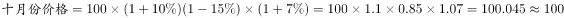元，所以该商品价格与调价前相比持平。

故正确答案为D。

**考点**：经济利润问题

**来源**：2014年江西省法检系统招录考试《行测》题第61题

### 第 62 题

某品牌纯净水有四种规格包装：1、355毫升售价1.50元；2、500毫升售价1.99元；3、1500毫升售价5.99元；4、3500毫升售价7.99元，每毫升水价从高到低排列正确的是：

A. 1324

B. 4123

C. 3142

D. 2143

第 62 题 · 答案与解析

**参考答案（粉笔题库参考内容）**

A

**解析**

根据题意可知，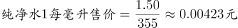；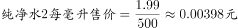；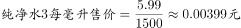；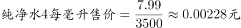，则这四种规格矿泉水每毫升水价从高到低排列为1324。

故正确答案为A。

**考点**：经济利润问题

**来源**：2014年江西省法检系统招录考试《行测》题第62题

### 第 63 题

甲、乙二人现在的年龄之和是一个完全平方数。7年前，他们各自的年龄都是完全平方数。再过多少年，他们的年龄之和又是完全平方数？

A. 20

B. 18

C. 16

D. 9

第 63 题 · 答案与解析

**参考答案（粉笔题库参考内容）**

B

**解析**

由题干设甲七年前的年龄为x，乙七年前的年龄为y，则七年后甲乙年龄和=(x+7)+(y+7)=x+y+14，根据题意x,y,(x+y+14)均为完全平方数。能作为年龄的平方数有1，4，9，16，25，36，49，64，81，100等，观察发现1+49+14=64，为完全平方数，则七年前甲1岁，乙49岁（说明：若甲49岁、乙1岁，结果一样），现在甲为1+7=8岁，乙为49+7=56岁。代入A项，20年后甲乙年龄和为(8+20)+(56+20)=104，不是完全平方数，排除；代入B项，18年后甲乙年龄和为(8+18)+(56+18)=100，是完全平方数，B项正确。

故正确答案为B。

**考点**：年龄问题

**来源**：2014年江西省法检系统招录考试《行测》题第63题

### 第 64 题

一个班级有50名学生参与选课，其中选了A课程的有31人，选了B课程的有24人，两门课程都未选择的有6人，同时选了A、B两门课程的有多少人？

A. 7

B. 11

C. 18

D. 25

第 64 题 · 答案与解析

**参考答案（粉笔题库参考内容）**

B

**解析**

由题意设同时选了A、B两门课程的人为x，根据两集和容斥公式：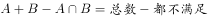，可知31+24-x=50-6，解得x=11人。

故正确答案为B。

**考点**：两集合

**来源**：2014年江西省法检系统招录考试《行测》题第64题

### 第 65 题

某小学约有1000名学生参加广播体操比赛，按12人一列排队，多一个人；按14人一列排队，也多一个人；按16人一列，还是多一个人。这所小学的学生人数是：

A. 1093

B. 1019

C. 1009

D. 1008

第 65 题 · 答案与解析

**参考答案（粉笔题库参考内容）**

C

**解析**

由题干可知学生人数除以12，14，16余数均为1，根据同余定理，学生人数应为12，14，16的最小公倍数的倍数+1。12，14，16的最小公倍数等于336，则学生人数为336m+1，根据学生人数约有1000，则m取3，则。

故正确答案为C。

**来源**：2014年江西省法检系统招录考试《行测》题第65题

### 第 66 题

某项工作，甲单独做需10天完成，乙单独做需6天完成。如果甲先做2天，然后乙接着甲做2天，再由甲接替乙做2天……两人如此交替工作，那么，完成此项工作共用多少天？

A. 6

B. 7

C. 8

D. 9

第 66 题 · 答案与解析

**参考答案（粉笔题库参考内容）**

C

**解析**

根据题意赋值工程总量为10和6的最小公倍数30，则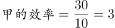，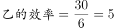，甲2天干了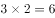，乙2天干了，甲再干2天干了，此时工作量还剩下30-6-10-6=8，乙1天只能完成5个工作量，因此还需要乙干2天，则共需要2+2+2+2=8天。

故正确答案为C。

**考点**：周期余数问题、给完工时间型

**来源**：2014年江西省法检系统招录考试《行测》题第66题

### 第 67 题

某单位去年的职工男女性别比为4：7，今年净增加男职工24人、女职工25人，男女性别比变为11：15，去年该单位的职工总人数为：

A. 104

B. 35

C. 44

D. 55

第 67 题 · 答案与解析

**参考答案（粉笔题库参考内容）**

D

**解析**

方法一：由题干设单位去年男职工人数为4x，女职工人数为7x，则今年男职工人数为4x+24，女职工人数为7x+25，根据题意可知(4x+24):(7x+25)=11:15，解得x=5，则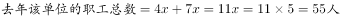。

方法二：由题干去年职工男女之比是4:7，根据倍数特性可知，总人数为4+7=11的倍数，排除A、B两项；代入C项，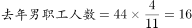，女职工人数=44-16=28，则今年男职工人数=16+24=40，女职工人数=28+25=53，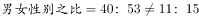，不符合题意，排除C项。

故正确答案为D。

**考点**：和差倍比问题

**来源**：2014年江西省法检系统招录考试《行测》题第67题

### 第 68 题

乘坐飞机从甲地去往乙地，可由甲地直接飞乙地，也可以经由丙地中转。每天从甲地直飞乙地的航班有3班、甲地飞丙地的航班有4班、丙地飞乙地的航班有2班，如果要从甲地出发在两天内到达乙地，可供选择的航班路线有多少种？

A. 14

B. 12

C. 11

D. 9

第 68 题 · 答案与解析

**参考答案（粉笔题库参考内容）**

C

**解析**

由题意可知，由甲到乙的路线可分为两类：由甲直飞到乙；经由丙中转到乙。由甲直飞到乙的航班有3种，先到丙再到乙的航班选择为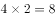种，则可供选择的航班路线有3+8=11种。

故正确答案为C。

**考点**：基础排列组合

**来源**：2014年江西省法检系统招录考试《行测》题第68题

### 第 69 题

汽车牌照“赣A12B45”，如果在1245的位置可选择10个数字“0～9”和26个英文字母“A～Z”的一个，则可以形成几个不同的牌照？

A. 1679628

B. 1296000

C. 466560

D. 1679616

第 69 题 · 答案与解析

**参考答案（粉笔题库参考内容）**

D

**解析**

由题意，“1245”共计四个位置，每个位置可选择10个数字或26个字母中的一个，即每个位置均有10+26=36种选择。则共可形成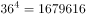个不同的牌照。

注：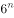的尾数均为6，可根据尾数快速锁定答案。

故正确答案为D。

**考点**：基础排列组合

**来源**：2014年江西省法检系统招录考试《行测》题第69题

### 第 70 题

高速公路上某隧道全长4368米，隧道内限速80千米/小时，一辆轿车通过隧道用时2分30秒，则可判定该车在隧道内：

A. 没有超速

B. 超速不足20%

C. 超速20%不足50%

D. 超速50%以上

第 70 题 · 答案与解析

**参考答案（粉笔题库参考内容）**

C

**解析**

根据题意，轿车通过隧道的车速为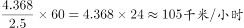。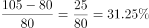，可知轿车超速31.25%，在C项范围内。

故正确答案为C。

**考点**：普通行程

**来源**：2014年江西省法检系统招录考试《行测》题第70题

### 第 71 题

从所给的四个选项中，选择合适的一个填入问号处，使其呈现一定的规律性：

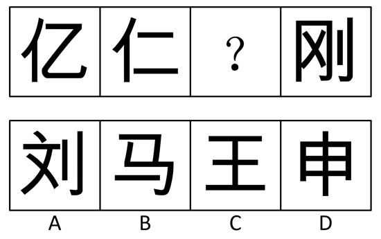

A. A

B. B

C. C

D. D

第 71 题 · 答案与解析

**参考答案（粉笔题库参考内容）**

D

**解析**

元素组成不同，没有明显的属性规律，考虑数量规律。图形均为汉字，优先考虑笔画数。图形的笔画数依次为3、4、？、6，因此应该选择一个5笔画的汉字。A选项6笔画，B选项3笔画，C选项4笔画，D选项5笔画。只有D项符合。

故正确答案为D。

**考点**：数量规律-线、文字/字母/数字类

**来源**：2014年江西省法检系统招录考试《行测》题第71题

### 第 72 题

从所给的四个选项中，选择合适的一个填入问号处，使其呈现一定的规律性：

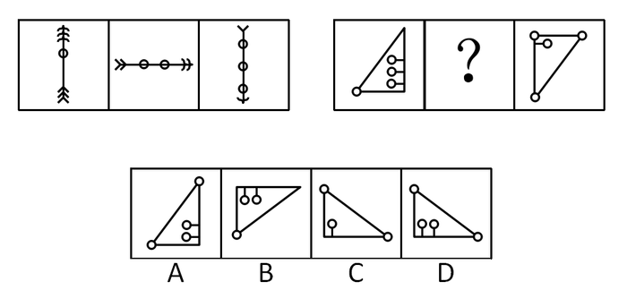

A. A

B. B

C. C

D. D

第 72 题 · 答案与解析

**参考答案（粉笔题库参考内容）**

D

**解析**

元素组成不同，无明显的属性规律，考虑数量规律。第一行图形中，小圆圈的个数依次增加一个，箭头的个数依次减少一个，弧形的个数依次减少一个，整个图形依次顺时针旋转90°。第二行图形内部圆圈依次减少一个，外部圆圈依次增加一个，且整个图形依次顺时针旋转90°。因此？处内部和外部圆圈个数均为2个，排除B、C选项，再根据位置规律，排除A选项。

故正确答案为D。

**考点**：数量规律-复合

**来源**：2014年江西省法检系统招录考试《行测》题第72题

### 第 73 题

从所给的四个选项中，选择合适的一个填入问号处，使其呈现一定的规律性：

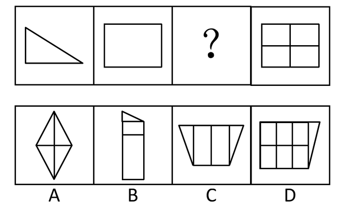

A. A

B. B

C. C

D. D

第 73 题 · 答案与解析

**参考答案（粉笔题库参考内容）**

A

**解析**

元素组成不同，没有明显的属性规律，考虑数量规律。图形均为多边形，考虑数线。线的数量依次为3、4、？、6，选项中没有5条直线的图形。再观察图形发现，图中直角数量较多，考虑数直角。直角数量依次为1、4、？、16，存在乘积关系，因此？处应选择一个直角数为4的图形。只有A项符合。

故正确答案为A。

**考点**：数量规律-角

**来源**：2014年江西省法检系统招录考试《行测》题第73题

### 第 74 题

从所给的四个选项中，选择合适的一个填入问号处，使其呈现一定的规律性：

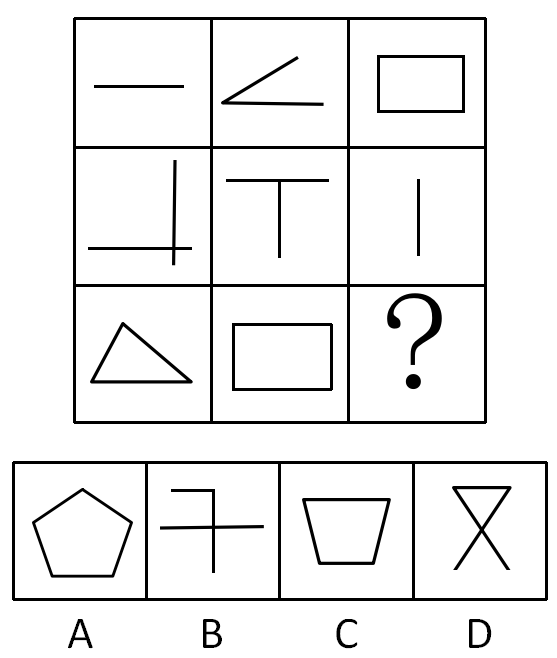

A. A

B. B

C. C

D. D

第 74 题 · 答案与解析

**参考答案（粉笔题库参考内容）**

A

**解析**

元素组成不同，没有明显的属性规律，考虑数量规律。九宫格，横向上没有规律，考虑竖向。第一列线的数量依次为1、2、3，第二列线的数量依次为2、2、4，前两个图形的直线数相加等于第三个图形的直线数，第三列也应该满足此规律。第三列前两个图形的直线数为4、1，因此？处应该选择一个直线数为5的图形。A选项5条直线，B选项3条直线，C选项4条直线，D选项3条直线。只有A项符合。

故正确答案为A。

**考点**：数量规律-线

**来源**：2014年江西省法检系统招录考试《行测》题第74题

### 第 75 题

从所给的四个选项中，选择合适的一个填入问号处，使其呈现一定的规律性：

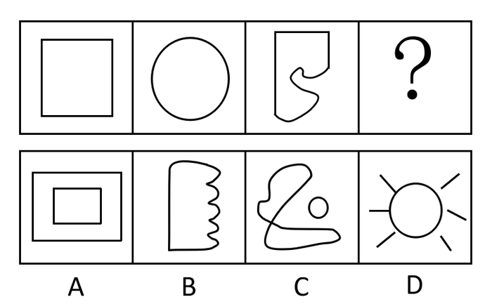

A. A

B. B

C. C

D. D

第 75 题 · 答案与解析

**参考答案（粉笔题库参考内容）**

B

**解析**

元素组成不同，没有明显的属性规律，考虑数量规律。图形均为一笔画图形，因此？处应该选择一个一笔画图形。A选项两笔画，B选项一笔画，C选项两笔画，D选项六笔画。

故正确答案为B。

**考点**：数量规律-线

**来源**：2014年江西省法检系统招录考试《行测》题第75题

### 第 76 题

私德是指人们在不直接涉及对社会整体的义务和责任的私人生活和私人交往中应当遵循的道德准则，主要包括个人生活习惯、行为风度、性格特点以及处理爱情、婚姻、家庭问题的道德等。根据上述定义，下列不属于私德的是：

A. 刘某是典型的“富二代”，但平时为人谦和，行事低调，衣着朴素

B. 李某是个典型的大男子主义者，在家里一直搞“一言堂”

C. 周某性格内向，沉默寡言，与左右邻居从来不主动打招呼

D. 赵某所在小区由A物业公司管理，尽管对物业服务中心有不满，但碍于自己的公务员身份，在物业公司催缴物业费时，每次都如数交清

第 76 题 · 答案与解析

**参考答案（粉笔题库参考内容）**

D

**解析**

第一步：找出定义关键词。

“私人生活和私人交往中应当遵循的道德准则”、“个人生活习惯”、“行为风度”、“性格特点”、“处理爱情、婚姻、家庭问题的道德”。

第二步：逐一分析选项。

A项：“为人谦和，行事低调，衣着朴素”强调的是刘某的生活习惯和性格特点，符合定义，排除；

B项：李某在家里一直搞“一言堂”符合关键词“处理爱情、婚姻、家庭问题的道德”，符合定义，排除；

C项：“周某性格内向，沉默寡言”符合关键词“性格特点”，符合定义，排除；

D项：赵某是碍于自己是公务员身份才缴物业费的，没有体现出关键词“私人生活和私人交往中应当遵循的道德准则”，不符合定义，当选。

本题为选非题，故正确答案为D。

**考点**：大前提

**来源**：2014年江西省法检系统招录考试《行测》题第76题

### 第 77 题

盖亚假说认为地球生命体与非生命体形成了一个可相互作用的复杂系统。该假说又分为强盖亚假说和弱盖亚假说，其中弱盖亚假说认为地球上的各种生物有效地调节着大气的温度和化学构成，在生物体影响生物环境的同时，环境又反过来影响生物进化的过程。强盖亚假说更进一步认为地球是一个巨大的有机体，具有自我调节的能力，为了这个有机体的健康，甚至可以自行消除那些有害的因素。根据上述定义，下列选项中属于弱盖亚假说的是：

A. 地球利用太阳能是一种星球尺度上的新陈代谢作用

B. 环保的重要性在于地球是唯一适合人类居住的星球

C. 大气层出现臭氧层空洞是因为人类过度活动造成的

D. 沙漠中引种耐热植物后，促进了当地旅游业的发展

第 77 题 · 答案与解析

**参考答案（粉笔题库参考内容）**

C

**解析**

第一步：找出定义关键词。

弱盖亚假说：“在生物体影响生物环境的同时，环境又反过来影响生物进化的过程”。

第二步：逐一分析选项。

A项：强调了地球和太阳能之间的关系，没有体现生物体和生物环境的相互影响，不符合定义，排除；

B项：强调了环保的重要性，没有体现生物体和生物环境之间的相互影响，不符合定义，排除；

C项：人类活动造成了臭氧层空洞，可以体现出生物体对生物环境的影响，符合定义，当选；

D项：沙漠中引种耐热植物促进了旅游业，没有体现出生物体和生物环境的相互影响，不符合定义，排除。

故正确答案为C。

**考点**：常规问法

**来源**：2014年江西省法检系统招录考试《行测》题第77题

### 第 78 题

公共产品又称“公共物品”，是指由政府提供的非排他性的物品或者服务。根据上述定义，下列属于公共产品的是：

A. 竞争秩序

B. 城区绿化

C. 救灾物资

D. 税收补贴

第 78 题 · 答案与解析

**参考答案（粉笔题库参考内容）**

B

**解析**

第一步：找出定义关键词。

“由政府提供”、“非排他性的物品或者服务”。

第二步：逐一分析选项。

A项：竞争秩序不属于物品或服务，不符合定义，排除；

B项：城区绿化是由政府提供的非排他性服务，符合定义，当选；

C项：救灾物资是专门提供给灾区人民的，具有排他性，不符合定义，排除；

D项：税收补贴不是针对全体人的，只有满足一定的条件才能享受，具有排他性，不符合定义，排除。

故正确答案为B。

**考点**：单定义-其他句式

**来源**：2014年江西省法检系统招录考试《行测》题第78题

### 第 79 题

企业信用广义上是指企业遵守工商、税务、海关、劳动、环保等部门的有关法规，履行商业合同，偿还或有负债等方面的情况；狭义上是指企业对到期债务按期还本付息的能力和意愿。根据上述定义，下列属于狭义企业信用的是：

A. 甲企业为了销售产品，通过有奖销售方式进行促销

B. 乙企业为了节约生产成本，用工业盐替代食用盐进行食品加工

C. 丙企业因经营管理不善，无法清偿前期民间融资

D. 丁企业对于即将到期的银行贷款，提前做好财务安排，于到期日如约偿还本息

第 79 题 · 答案与解析

**参考答案（粉笔题库参考内容）**

D

**解析**

第一步：找出定义关键词。

狭义的企业信用：“企业对到期债务按期还本付息的能力和意愿”。

第二步：逐一分析选项。

A项：甲企业采取有奖销售的方式促销，不能体现出偿还债务的能力和意愿，不符合定义，排除；

B项：乙企业用工业盐替代食用盐进行食品加工，不能体现出偿还债务的能力和意愿，不符合定义，排除；

C项：丙企业因经营管理不善，无法清偿前期民间融资，说明丙企业没有偿还债务的能力，不符合定义，排除；

D项：丁企业对于即将到期的银行贷款，提前做好财务安排，于到期日如约偿还本息，体现了丁企业对到期债务按期还本付息的能力和意愿，符合定义，当选。

故正确答案为D。

**考点**：常规问法

**来源**：2014年江西省法检系统招录考试《行测》题第79题

### 第 80 题

统计性歧视，是指将一个群体的典型特征推断为群体中的个体具有的特征，并将此特征作为对个体的评价标准。根据上述定义，下列属于统计性歧视的是：

A. 某企业近几年从某名牌大学招聘的大学毕业生基本都是工作不到3年即提出辞职申请，因此认为该校的大学生就业诚信度不高

B. 四川人爱吃辣椒，小李由此认定同寝室的成都女孩刘某一定不怕辣

C. 某专家根据近10年某省心脏病病例的统计数据，预测出该省未来3年心脏病的发病人数

D. 某景区连续发生多起游客在名胜古迹上乱涂的现象，景区管理人员认为游客的素质亟待提高，同时应加大景区巡查力度

第 80 题 · 答案与解析

**参考答案（粉笔题库参考内容）**

B

**解析**

第一步：找出定义关键词。

“将一个群体的典型特征推断为群体中的个体具有的特征”、“将此特征作为对个体的评价标准”。

第二步：逐一分析选项。

A项：由近几年从某名牌大学招聘的大学毕业生基本都是工作不到3年即提出辞职申请，推出该校的大学生就业诚信度不高，是将个体特征作为对群体特征的评价标准，不符合定义，排除；

B项：由四川人爱吃辣椒这个群体特征，推出成都女孩刘某一定不怕辣，是将群体特征作为对个体特征的评价标准，符合定义，当选；

C项：心脏病的发病人数不属于特征，也无法体现出群体和个体之间的关系，不符合定义，排除；

D项：由景区几个乱涂的现象，推出整个游客区群体的素质亟待提高， 是将个体特征作为对群体特征的评价标准，不符合定义，排除。

故正确答案为B。

**考点**：单定义-其他句式

**来源**：2014年江西省法检系统招录考试《行测》题第80题

### 第 81 题

政策性收益是指由于某些政策、法规的变动而导致的个体收益，这种收益不会导致整个社会财富的增长，只会导致整个社会财富的重新分配。根据上述定义，下列涉及政策性收益的是（  ）。

A. 由于央行宣布下调基准利率，小王的房贷按揭还款金额从下月起将减少

B. 某贫困县由于中央财政转移支付，获得3000万元专款用于山区小学危房改造

C. 爱心人士联合当地部分餐饮企业发起“待用快餐”活动，可以在相关餐饮企业免费领取快餐

D. 某女孩因轻生跳江，路人刘某奋勇相救，当地政府给予刘某见义勇为奖3000元

第 81 题 · 答案与解析

**参考答案（粉笔题库参考内容）**

A

**解析**

第一步：找出定义关键词。

“由于某些政策、法规的变动而导致的个体收益”、“这种收益不会导致整个社会财富的增长，只会导致整个社会财富的重新分配”。

第二步：逐一分析选项。

A项：“利率调整”符合“政策、法规的变动”，且下调基准利率不会导致整个社会财富的增长，只是导致了小王个体收益的变化，符合定义，当选；

B项：某贫困县由于中央财政转移支付获得3000万元专款不属于个体收益，不符合定义，排除；

C项：爱心人士联合当地部分餐饮企业发起“待用快餐”活动，不属于政策、法规的变动，不符合定义，排除；

D项：见义勇为奖不属于政策、法规的变动，不符合定义，排除。

故正确答案为A。

**考点**：原因结果

**来源**：2014年江西省法检系统招录考试《行测》题第81题

### 第 82 题

生产、销售有毒、有害食品是指在生产、销售的食品中掺入有毒、有害的非食品原料或者销售明知掺有有毒、有害的非食品原料的食品的行为。根据上述定义，下列构成生产、销售有毒、有害食品罪的是：

A. 某卖场使用过期变质的鸡腿，经过处理后用来制作炸鸡

B. 某地下加工窝点为提高所腌制熟食的销售品相，在加工过程中添加苏丹红

C. 某饮料生产厂家在生产的可乐中添加了食品添加剂——山梨酸钾，但并未在包装上予以注明

D. 某食品厂在所生产的一款糖果中添加食用色素超标，长期食用会给人体健康造成危害

第 82 题 · 答案与解析

**参考答案（粉笔题库参考内容）**

B

**解析**

第一步：找出定义关键词。

“在生产、销售的食品中掺入有毒、有害的非食品原料”、“销售明知掺有有毒、有害的非食品原料的食品的行为”。

第二步：逐一分析选项。

A项：变质的鸡腿不属于有毒、有害的非食品原料，不符合定义，排除；

B项：在腌制熟食中加入的苏丹红属于有毒、有害的非食品原料，符合定义，当选；

C项：食品添加剂山梨酸钾不属于有毒、有害的非食品原料，不符合定义，排除；

D项：食用色素不属于有毒、有害的非食品原料，不符合定义，排除。

故正确答案为B。

**考点**：单定义-其他句式

**来源**：2014年江西省法检系统招录考试《行测》题第82题

### 第 83 题

园林是指在一定地域运用工程技术和艺术手段，通过改造地形（或进一步筑山、叠石、理水）、种植花草、营造建筑和布置园路等途径，创作而成的优美自然环境和游憩境域。

根据上述定义，下列属于园林的是：

A. 某开发商为了提高商品房销售价格，在小区内种植了大量树木、花草

B. 刘某承包了数十亩水面，建造餐厅和客舍，吸引游客周末前来休闲垂钓

C. 某区专辟一块地供市民休闲，修建回廊亭阁、假山喷泉，以树木花草环绕

D. 某地虽地处偏僻，但树木葱郁，鸟语花香，民风淳朴，很多城市居民慕名前往旅游休闲

第 83 题 · 答案与解析

**参考答案（粉笔题库参考内容）**

C

**解析**

第一步：找出定义关键词。

“在一定地域运用工程技术和艺术手段”、“通过改造地形（或进一步筑山、叠石、理水）、种植花草、营造建筑和布置园路等途径，创作而成的优美自然环境和游憩境域”。

第二步：逐一分析选项。

A项：小区不属于自然环境和游憩境遇，不符合定义，排除；

B项：建造餐厅和客舍不属于工程技术和艺术手段，不符合定义，排除；

C项：修建回廊亭阁、假山喷泉，种植树木花草属于通过工程技术和艺术手段来打造优美自然环境和游憩境域，符合定义，当选；

D项：某地是自然景观，没有经过人为改造，不符合定义，排除。

故正确答案为C。

**考点**：方式目的

**来源**：2014年江西省法检系统招录考试《行测》题第83题

### 第 84 题

经营性资产是在生产和流通中能够为社会提供商品或劳务的资产，经营性资产的使用单位是具有法人地位的企业，其运营要以追求经济效益为原则。从会计角度看，主要指企业因盈利目的而持有，且实际也具有盈利能力的资产。根据上述定义，下列不属于经营性资产的是：

A. 某公司库存的价值300万的滞销产品

B. 某国有企业新近获得的500万银行贷款

C. 某儿童福利院新购置的一批儿童过冬棉衣

D. 某外贸公司被银行查封用于偿还贷款的账户资金

第 84 题 · 答案与解析

**参考答案（粉笔题库参考内容）**

C

**解析**

第一步：找出定义关键词。

“具有法人地位的企业”、“以追求经济效益为原则”、“在生产和流通中能够为社会提供商品或劳务的资产”、“因盈利目的而持有”、“具有盈利能力的资产”。

第二步：逐一分析选项。

A项：库存的价值300万的滞销产品属于在生产和流通中的资产，具有盈利能力，符合定义，排除；

B项：500万银行贷款属于具有盈利能力的资产，符合定义，排除；

C项：儿童福利院新购置的过冬棉衣没有盈利能力，不是以追求经济效益为原则，不符合定义，当选；

D项：用于偿还贷款的账户资金，属于具有盈利能力的资产，符合定义，排除。

本题为选非题，故正确答案为C。

**考点**：单定义-其他句式

**来源**：2014年江西省法检系统招录考试《行测》题第84题

### 第 85 题

暴力慈善是一种慈善的暴力行为，以牺牲受赠人的尊严来获得自己的满足，暴力慈善是对“现金救穷”、“高调行善”等行事方式的一种概括。根据以上定义，下列哪项中的现象不属于暴力慈善？

A. 某高校领导年前走访本单位困难教职工，送上慰问金，并在校电视台予以报道

B. 某行政机关为了完成上级部门规定的捐款额度，规定本单位处级（含本级）以上领导捐款金额不得低于300元，其他人员捐款金额不得低于100元

C. 某单位举行现场捐款活动，将所得捐款垒成金堆予以展示

D. 某知名爱心人士在海外举办了一场面向流浪乞讨人的慈善活动，通过当地报纸大肆宣传报道

第 85 题 · 答案与解析

**参考答案（粉笔题库参考内容）**

B

**解析**

第一步：找出定义关键词。

“以牺牲受赠人的尊严来获得自己的满足”、“现金救穷”、“高调行善”。

第二步：逐一分析选项。

A项：领导为员工送上慰问金并在电视台报道，属于“高调行善”，符合定义，排除；

B项：某行政机关强制捐款牺牲的是捐款人的利益，未体现受赠人，不符合定义，当选；

C项：将捐款垒成金堆予以展示，属于“高调行善”，符合定义，排除；

D项：爱心人士的慈善活动通过报纸大肆宣传，属于“高调行善”，符合定义，排除。

本题为选非题，故正确答案为B。

**考点**：方式目的

**来源**：2014年江西省法检系统招录考试《行测》题第85题

### 第 86 题

通货膨胀：央行基准利率

A. 血脂偏高：动物脂肪摄入

B. 蚊香：蚊子

C. 健康长寿：体育运动训练

D. 审计监督：腐败

第 86 题 · 答案与解析

**参考答案（粉笔题库参考内容）**

C

**解析**

第一步：判断题干词语间逻辑关系。

通货膨胀应提高央行基准利率，两者是对应关系。

第二步：判断选项词语间逻辑关系。

A项：血脂偏高应减少动物脂肪摄入，与题干逻辑关系不一致，排除；

B项：蚊香可以杀死蚊子，与题干逻辑关系不一致，排除；

C项：健康长寿应加强体育运动训练，与题干逻辑关系一致，当选；

D项：审计监督可以检查出腐败行为，与题干逻辑关系不一致，排除。

故正确答案为C。

**考点**：逻辑关系-对应关系

**来源**：2014年江西省法检系统招录考试《行测》题第86题

### 第 87 题

炉火纯青：冶炼

A. 青出于蓝：陶瓷

B. 量凿正枘：木工

C. 缘木求鱼：占卜

D. 画蛇添足：绘画

第 87 题 · 答案与解析

**参考答案（粉笔题库参考内容）**

D

**解析**

第一步：判断题干词语间逻辑关系。

炉火纯青原意是指在到炉子里的火发出纯青色的火焰的时候，就算成功了。与冶炼有关，两者是对应关系，且冶炼是动词。

第二步：判断选项词语间逻辑关系。

A项：青出于蓝意思是靛青是从蓼蓝提炼出来的，但颜色比蓼蓝更深。与陶瓷无关，与题干逻辑关系不一致，排除；

B项：量凿正枘指木工度量器物孔眼的大小方圆制作可与之相契合的榫头。木工是名词，与题干逻辑关系不一致，排除；

C项：缘木求鱼是指爬到没有鱼的树上去找鱼，与占卜无关，与题干逻辑关系不一致，排除；

D项：画蛇添足原意是指画蛇时给蛇添上脚。与绘画有关，两者是对应关系，且绘画是动词，与题干逻辑关系一致，当选。

故正确答案为D。

**考点**：逻辑关系-对应关系

**来源**：2014年江西省法检系统招录考试《行测》题第87题

### 第 88 题

关怀：无微不至

A. 准确：分毫不差

B. 挣扎：日落西山

C. 呐喊：声嘶力竭

D. 憔悴：望眼欲穿

第 88 题 · 答案与解析

**参考答案（粉笔题库参考内容）**

C

**解析**

第一步：判断题干词语间逻辑关系。

无微不至形容关怀、照顾得非常周到、细致。与关怀是对应关系。

第二步：判断选项词语间逻辑关系。

A项：分毫不差形容没有一点差错。与准确是同义词，与题干逻辑关系不一致，排除；

B项：日落西山形容人到老年将死或事物接近衰亡。与挣扎无关，与题干逻辑关系不一致，排除；

C项：声嘶力竭形容拼命地叫喊、呼号。与呐喊是对应关系，与题干逻辑关系一致，当选；

D项：望眼欲穿指眼睛都要望穿了，形容盼望殷切。与憔悴无关，与题干逻辑关系不一致，排除。

故正确答案为C。

**考点**：逻辑关系-对应关系

**来源**：2014年江西省法检系统招录考试《行测》题第88题

### 第 89 题

鲁迅：周树人：《狂人日记》

A. 老舍：舒庆春：《骆驼祥子》

B. 李白：诗仙：《望庐山瀑布》

C. 郭沫若：郭开贞：《伤逝》

D. 陶渊明：五柳先生：《桃花源记》

第 89 题 · 答案与解析

**参考答案（粉笔题库参考内容）**

A

**解析**

第一步：判断题干词语间逻辑关系。

鲁迅原名周树人，《狂人日记》是鲁迅的著作。

第二步：判断选项词语间逻辑关系。

A项：老舍原名舒庆春，《骆驼祥子》是老舍的著作，与题干逻辑关系一致，当选；

B项：李白被誉为诗仙，诗仙不是李白的原名，与题干逻辑关系不一致，排除；

C项：郭沫若原名郭开贞，但是《伤逝》是鲁迅的著作，与题干逻辑关系不一致，排除；

D项：五柳先生不是陶渊明的原名，与题干逻辑关系不一致，排除。

故正确答案为A。

**考点**：逻辑关系-全同关系、逻辑关系-对应关系

**来源**：2014年江西省法检系统招录考试《行测》题第89题

### 第 90 题

收入分配：基尼系数

A. 纽约：道琼斯指数

B. CPI：消费者价格指数

C. 环境保护：幸福指数

D. 食品支出：恩格尔系数

第 90 题 · 答案与解析

**参考答案（粉笔题库参考内容）**

D

**解析**

第一步：判断题干词语间逻辑关系。

基尼系数用来反映收入分配的平等性，两者是对应关系。

第二步：判断选项词语间逻辑关系。

A项：道琼斯指数是股票指数，与纽约无关，与题干逻辑关系不一致，排除；

B项：消费者价格指数的英文缩写为CPI，与题干逻辑关系不一致，排除；

C项：幸福指数与环境保护无关，与题干逻辑关系不一致，排除；

D项：恩格尔系数用来反映食品支出的多少，与题干逻辑关系一致，当选。

故正确答案为D。

**考点**：逻辑关系-对应关系

**来源**：2014年江西省法检系统招录考试《行测》题第90题

### 第 91 题

风险：损失：保险

A. 名气：宣传：代言

B. 肥胖：疾病：锻炼

C. 生产：事故：安全

D. 落后：开放：富强

第 91 题 · 答案与解析

**参考答案（粉笔题库参考内容）**

B

**解析**

第一步：判断题干词语间逻辑关系。

风险可能会导致损失，两者是因果关系，而保险能减少损失，两者是对应关系。

第二步：判断选项词语间逻辑关系。

A项：名气可以通过宣传得到，是方式的对应关系，而代言也是宣传的一种方式，与题干逻辑关系不一致，排除；

B项：肥胖可能会导致疾病，两者是因果关系，而锻炼可以减少疾病的发生，两者是对应关系，与题干逻辑关系一致，当选；

C项：生产的过程中可能会造成事故，而安全并不能减少事故的发生，应该是安全设施减少事故的发生，与题干逻辑关系不一致，排除；

D项：落后和开放之间没必然联系，开放与富强是因果关系，与题干逻辑关系不一致，排除。

故正确答案为B。

**考点**：逻辑关系-对应关系

**来源**：2014年江西省法检系统招录考试《行测》题第91题

### 第 92 题

墨斗：画线：木匠

A. 剪刀：裁剪：裁缝

B. 石板：浮雕：雕匠

C. 雷达：天线：军人

D. 粉笔：黑板：教师

第 92 题 · 答案与解析

**参考答案（粉笔题库参考内容）**

A

**解析**

第一步：判断题干词语间逻辑关系。

木匠用墨斗画线，木匠为职业，墨斗为木匠所需要的工具，画线为木匠的工作内容，三者为对应关系。

第二步：判断选项词语间逻辑关系。

A项：裁缝用剪刀裁剪，裁缝为职业，剪刀为裁缝所需要的工具，裁剪为裁缝的工作内容，三者为对应关系，与题干逻辑关系一致，当选；

B项：雕匠为职业，石板并非浮雕的工具，与题干逻辑关系不一致，排除；

C项：天线是雷达的组成部分，而军人和雷达之间无必然联系，与题干逻辑关系不一致，排除；

D项：粉笔是教师所需要的工具，但是黑板并非教师的工作内容，与题干逻辑关系不一致，排除。

故正确答案为A。

**考点**：语法关系、逻辑关系-对应关系

**来源**：2014年江西省法检系统招录考试《行测》题第92题

### 第 93 题

麒麟 对于 （    ） 相当于 狼烟 对于 （    ）

A. 财富 烽火

B. 和平 雾霾

C. 传说 现实

D. 吉祥 入侵

第 93 题 · 答案与解析

**参考答案（粉笔题库参考内容）**

D

**解析**

逐一代入选项。

A项：麒麟和财富之间无必然联系，狼烟和烽火都指烽火台上燃烧的烟火，两者为全同关系，前后逻辑关系不一致，排除；

B项：麒麟和和平之间无必然联系，狼烟和雾霾也无必然联系，前后逻辑关系不一致，排除；

C项：麒麟是古代五大瑞兽之一，但狼烟和现实之间无必然联系，前后逻辑关系不一致，排除；

D项：麒麟象征着吉祥，狼烟象征着入侵，前后逻辑关系一致，当选。

故正确答案为D。

**考点**：语义关系-比喻象征义

**来源**：2014年江西省法检系统招录考试《行测》题第93题

### 第 94 题

（    ） 对于 导游 相当于 （    ） 对于 教师

A. 行程 教材

B. 门票 电脑

C. 行程 大纲

D. 旅行社 教学楼

第 94 题 · 答案与解析

**参考答案（粉笔题库参考内容）**

C

**解析**

逐一代入选项。

A项：导游依据行程带队旅行，两者为依据的对应关系，教材是教师讲课所需要的工具，两者为工具的对应关系，前后逻辑关系不一致，排除；

B项：导游可以代买门票，老师可以利用电脑来教学，前后逻辑关系不一致，排除；

C项：导游依据行程带队旅行，教师依据大纲进行教学，均为依据的对应关系，前后逻辑关系一致，当选；

D项：导游与旅行社是职业和从属单位的对应关系，而教师与教学楼并非职业和从属单位，教师与学校为职业和从属单位的对应关系，前后逻辑关系不一致，排除。

故正确答案为C。

**考点**：逻辑关系-对应关系

**来源**：2014年江西省法检系统招录考试《行测》题第94题

### 第 95 题

（    ） 对于 公司 相当于 （    ） 对于 国家

A. 章程 政府

B. 章程 宪法

C. 董事会 议会

D. 经理 总统

第 95 题 · 答案与解析

**参考答案（粉笔题库参考内容）**

B

**解析**

逐一代入选项。

A项：公司的制度需要以章程为依据，两者为对应关系，而国家包含政府，两者为包容关系，前后逻辑关系不一致，排除；

B项：公司的制度需要以章程为依据，国家的法律需要以宪法为依据，前后逻辑关系一致，当选；

C项：董事会是公司的经营决策组织，而议会是资本主义国家中代表资产阶级利益的最高立法机关，前后逻辑关系不一致，排除；

D项：总统是共和制国家最高行政国家元首的名称，但经理并不是公司的最高领导人，前后逻辑关系不一致，排除。

故正确答案为B。

**考点**：逻辑关系-对应关系

**来源**：2014年江西省法检系统招录考试《行测》题第95题

### 第 96 题

有三个孩子分别叫婷婷（女）、笑笑（女）和强强。孩子的妈妈分别是孙梦甜、蒋英英和齐怀瑾。邻居张奶奶说：“冯一坤和蒋英英的孩子都参加了小学女子合唱团，周丹心的女儿不是笑笑，楚中天和齐怀瑾不是一家人。”

由此可以推断出下列是一家人的是：

A. 周丹心、蒋英英和笑笑，楚中天、孙梦甜和婷婷

B. 楚中天、孙梦甜和强强，冯一坤、齐怀瑾和笑笑

C. 周丹心、齐怀瑾和笑笑，楚中天、蒋英英和强强

D. 楚中天、齐怀瑾和笑笑，冯一坤、孙梦甜和强强

第 96 题 · 答案与解析

**参考答案（粉笔题库参考内容）**

B

**解析**

题干信息确定，可用排除法解题。

根据条件“冯一坤和蒋英英的孩子都参加了小学女子合唱团”可知，冯一坤和蒋英英的孩子都是女孩子，即不是强强，则可排除C项和D项。根据条件“周丹心的女儿不是笑笑”，则可排除A项。

故正确答案为B。

**考点**：排除法

**来源**：2014年江西省法检系统招录考试《行测》题第96题

### 第 97 题

甲：王经理是大众汽车集团在中国的高级雇员之一。乙：怎么可能？王经理一直用丰田汽车。

上述对话中，乙的陈述隐含的一个前提是：

A. 高级职员通常只用本公司的产品

B. 王经理在大众汽车集团并不受重用

C. 王经理在丰田汽车集团兼职

D. 大众汽车集团和丰田汽车集团都是名牌公司

第 97 题 · 答案与解析

**参考答案（粉笔题库参考内容）**

A

**解析**

第一步：找到论点和论据。

论点：王经理不是大众汽车集团在中国的高级雇员之一。

论据：王经理一直用丰田汽车。

第二步：逐一分析选项。

A项：指出高级职员通常只用本公司的产品，即说明了高级雇员与用车的关系，也就是王经理如果是大众集团的高级雇员就必须开大众的车，而王经理开的是丰田的车，所以王经理肯定不是大众集团的高级雇员，建立了论点论据之间的联系，为搭桥项，当选；

B项：指出王经理在大众集团并不受重用，并没有指出高级雇员和用车之间的关系，不是隐含前提，排除；

C项：指出王经理在丰田兼职，但并未说明兼职就一定不是大众的高级雇员，不是隐含前提，排除；

D项：指出大众汽车集团和丰田汽车集团都是名牌公司，属于无关选项，不是隐含前提，排除。

故正确答案为A。

**考点**：搭桥

**来源**：2014年江西省法检系统招录考试《行测》题第97题

### 第 98 题

业内人士分析：在股票市场上，投入的资金数量越少风险越大，越难于获得平均效益；资金数量越大风险越小，越易于获得超额收益。因此：

A. 只有少量资金的人一般不炒股

B. 如果有大量资金，则在股市上稳赚

C. 在股市上中小股民总是赔

D. 中小投资者在股票市场上风险更大

第 98 题 · 答案与解析

**参考答案（粉笔题库参考内容）**

D

**解析**

日常结论题，根据题干信息逐一分析选项。

A项：题干表述投入的资金数量越少风险越大，越难于获得平均效益，但不意味着只有少量资金的人一般不炒股，不能推出，排除；

B项：根据题干资金数量越大风险越小，越易于获得超额收益。但越容易获取收益并非稳赚，偷换概念，不能推出，排除；

C项：在股市上中小股民总是赔，该项表述过于绝对，排除；

D项：根据题干的表述对比可知，中小投资者在股票市场上风险更大，可以推出，当选。

故正确答案为D。

**考点**：日常结论

**来源**：2014年江西省法检系统招录考试《行测》题第98题

### 第 99 题

在一次画展中，一幅价值百万元的名画被盗了，窃贼确定是一同前来观展的周详、吴尚、郑重、王强、佟方五个人中的一个，在接受警方调查时，他们各说了三句话。

周详：我没有偷名画；我从小到大没有偷过任何东西；是王强偷的。

吴尚：我没有偷名画；我家里很有钱，而且我家里收藏了很多名画；王强知道是谁偷的。

郑重：我没有偷名画；我之前并不认识佟方；是王强偷的。

王强：我没有偷名画；是佟方偷的；周详说是我偷的，他说谎。

佟方：我没有偷名画；是吴尚偷的；郑重可以为我担保，因为我和他从小在一起。

警方经过仔细分析后，发现他们每个人所说的话中只有两句是真的，另外一句是假的。那么偷名画的人是：

A. 吴尚

B. 佟方

C. 王强

D. 周详

第 99 题 · 答案与解析

**参考答案（粉笔题库参考内容）**

A

**解析**

题干信息不确定，可用代入法解题。

A项：代入后满足题干的要求，当选；

B项：代入后佟方所说的“我没有偷名画”“是吴尚偷的”“郑重可以为我担保，因为我和他从小在一起”均为假话，不满足题干的要求，排除；

C项：代入后王强所说的“我没有偷名画；是佟方偷的；周详说是我偷的，他说谎”， “我没有偷名画”为假话，则后两句为真，即是佟方偷的，与王强偷的矛盾，不满足题干的要求，排除；

D项：代入郑重说的可知“王强偷的”为假，即“我之前并不认识佟方”为真，再代入佟方所说“郑重可以为我担保，因为我和他从小在一起”即为假，则“是吴尚偷的”为真，与D项“周详偷的”矛盾，不满足题干要求，排除。

故正确答案为A。

**考点**：代入法

**来源**：2014年江西省法检系统招录考试《行测》题第99题

### 第 100 题

金融学中有一种说法，叫“无套利兑现”，即在不承担任何风险的前提下套取利润，是一种理想状态下的假设。由此我们可以得出：

A. 在市场经济中我们可以实现“无套利兑现”

B. “无套利兑现”是一种理想的假设，在现实中很难实现

C. “无套利兑现”是一种理想的假设，是不能实现的

D. 只要看准时机就能“无套利兑现”

第 100 题 · 答案与解析

**参考答案（粉笔题库参考内容）**

B

**解析**

日常结论题，根据题干信息逐一分析选项。

A项：题干表述“无套利兑现”是一种理想的假设，即说明现实中很难实现，所以A项是可能性发生，不能推出，排除；

B项：题干表述“无套利兑现”是一种理想的假设，即说明现实中很难实现，可以推出，当选；

C项：“无套利兑现”是一种理想的假设，是不能实现的，该项表述过于绝对，排除；

D项：题干并未提到时机和“无套利兑现”的关系，不能推出，排除。

故正确答案为B。

**考点**：日常结论

**来源**：2014年江西省法检系统招录考试《行测》题第100题

### 第 101 题

铝既能溶于酸，又能溶于碱，它是人体维持正常运转所需的微量元素。据实验表明，红烧肉在铝锅里存放一夜，铝在肉中的含量每公斤可高达120毫克至250毫克。但人体吸收铝元素后很难再从体内排出，容易造成早衰和老年痴呆症。

由此我们可以得出：

A. 铝在人体内的含量很容易超标

B. 红烧肉不能隔夜吃

C. 老年痴呆症是由于过量摄入铝造成的

D. 铝是人体的必需元素

第 101 题 · 答案与解析

**参考答案（粉笔题库参考内容）**

D

**解析**

日常结论题，根据题干信息逐一分析选项。

A项：原文中没有体现，属于无中生有，不能推出，排除；

B项：原文说的是红烧肉不能放在铝锅里过夜，该项扩大了范围，不能推出，排除；

C项：与文章的最后一句话有关，但原文说的是吸收入人体的铝无法排出容易患病，无法从文中得到该病是否由于“过量摄入”铝造成，不能推出，排除；

D项：原文的复述，可以根据“它是人体维持正常运转所需的微量元素”得到，可以推出，当选。

故正确答案为D。

**考点**：日常结论

**来源**：2014年江西省法检系统招录考试《行测》题第101题

### 第 102 题

情感是芭蕾艺术的一个重要特征，艺术审美是要以情感规范艺术，以情感感染、启示艺术鉴赏者。

由此我们可以得出：

A. 人们对芭蕾艺术的掌握即是对情感的掌握

B. 人们的生活实践是芭蕾艺术的源泉

C. 一切芭蕾艺术都与情感有关

D. 芭蕾舞艺术都以高尚的人类情感为对象

第 102 题 · 答案与解析

**参考答案（粉笔题库参考内容）**

A

**解析**

日常结论题，根据题干信息逐一分析选项。

A项：题干中提到的“情感是芭蕾艺术的一个重要特征”，因此人们对芭蕾艺术的掌握即是对情感的掌握，可以推出，当选；

B项：原文并未提到芭蕾艺术的源泉的问题，属于无中生有，不能推出，排除；

C项：该项所说“一切芭蕾艺术都与情感有关”，此表述过于绝对，不能推出，排除；

D项：原文并未提到芭蕾艺术的对象，属于无中生有，不能推出，排除。

故正确答案为A。

**考点**：日常结论

**来源**：2014年江西省法检系统招录考试《行测》题第102题

### 第 103 题

目前的大学生普遍缺乏中国传统文化的学习和积累。据国家教委对部分高校最近的一次调研表明，大学生中喜欢京剧艺术的只占被调查人数的14%。

以下哪项最能削弱上述观点？

A. 大学生缺少对京剧艺术欣赏方面的指导，不懂得如何去欣赏

B. 有一些大学生既喜欢京剧，又对中国传统文化的其他方面有兴趣

C. 喜欢京剧艺术与学习中国传统文化不是一回事，不要以偏概全

D. 14%正说明培养大学生对传统文化的学习大有潜力可挖

第 103 题 · 答案与解析

**参考答案（粉笔题库参考内容）**

C

**解析**

第一步：找出论点和论据。

论点：目前的大学生普遍缺乏中国传统文化的学习和积累。

论据：大学生中喜欢京剧艺术的只占被调查人数的14%。

第二步：逐一分析选项。

A项：指出大学生不懂如何欣赏京剧，能加强，不能削弱，排除；

B项：指出有一些大学生喜欢京剧，但是有一些具体指多少不明确，削弱力度较弱，排除；

C项：指出喜欢京剧艺术与学习中国传统文化不是一回事，拆断了论点与论据之间关系，可以削弱，当选；

D项：指出14%正说明培养大学生对传统文化的学习大有潜力可挖，说的是以后的潜力发掘，属于无关选项，不能削弱，排除。

故正确答案为C。

**考点**：拆桥

**来源**：2014年江西省法检系统招录考试《行测》题第103题

### 第 104 题

有人听到“金钱如粪土”、“朋友值千金”这两句话之后，感觉有逻辑问题，因为它们可以推出“朋友如粪土”的荒唐结论。既然“朋友如粪土”的结论不能成立，于是从逻辑上可以推出（  ）。

A. “金钱如粪土”这一说法是假的

B. 如果朋友确实值千金，那么金钱并非如粪土

C. “朋友值千金”这一说法是真的

D. “金钱如粪土”、“朋友值千金”这两句或者为真，或者为假

第 104 题 · 答案与解析

**参考答案（粉笔题库参考内容）**

B

**解析**

第一步：翻译题干。

①金钱粪土，②朋友金钱，则可推出③朋友金钱粪土，即④朋友粪土，⑤朋友粪土，该句为事实信息，即已经成立的事实。

第二步：从事实信息开始推导，得出结论。

A项：由题干事实信息可知①金钱粪土，②朋友金钱这两个推导关系不可能同时为真，但不一定①为假，错误，排除；

B项：由A的分析可知①②不可能同时为真，所以②朋友金钱为真，那么①金钱粪土为假，正确，当选；

C项：与A项相同，二者有一个为假，不一定②为假，错误，排除；

D项：由事实信息知①②推导关系不可能同时为真，不要求同时为假，错误，排除。

故正确答案为B。

**来源**：2014年江西省法检系统招录考试《行测》题第104题

### 第 105 题

某法院对某刑事案件有以下四种说法：①有证据表明赵刚没有作案；②作案者或者是赵刚，或者是王强，或者是李明；③也有证据表明王强没有作案；④电视画面显示，案发时李明在远离案发现场的一个足球赛的观众席上。

下列各项是对四种说法的不同描述，其中正确的一项是：

A. 从上述说法中可以推出，只有一个人作案

B. 上述说法中至少有一个是假的

C. 从这几种说法中可以推出，表明王强没有作案的证据是假的

D. 李明肯定不在该足球赛的观众席上

第 105 题 · 答案与解析

**参考答案（粉笔题库参考内容）**

B

**解析**

第一步：找出题干矛盾关系。

本题突破口为“三个人都有证据表明没有作案”与“他们至少有一个人作案”之间的矛盾关系。

第二步：判断真假。

由“三个人都有证据表明没有作案”与“他们至少有一个人作案”之间的矛盾关系可知二者必有一假，故上述说法至少有一个是假的，但不能具体判断谁真谁假。

故正确答案为B。

**考点**：真假推理-其他

**来源**：2016年天津选调生选拔考试 综合知识试卷（精选）第36题

## 材料 1

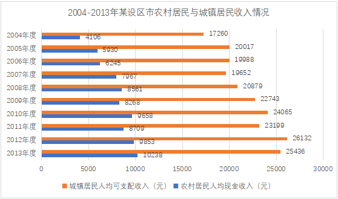

### 第 106 题

与2004年相比，2013年农村居民人均现金收入约增加了：

A. 149.3%

B. 249.3%

C. 40.1%

D. 148.4%

第 106 题 · 答案与解析

**参考答案（粉笔题库参考内容）**

A

**解析**

由题干“与2004年相比，2013年······收入约增加了”，结合选项为百分数，可判定本题为增长率计算问题。定位柱状图可得，2004年农村居民人均现金收入为4106元，2013年为10238元，则。

故正确答案为A。

**考点**：一般增长率、统计图

**来源**：2014年江西省法检系统招录考试《行测》题第106题

### 第 107 题

综合2004～2013年的数据，农村居民人均现金收入和城镇居民人均可支配收入都大幅增加的年份是：

A. 2005

B. 2006

C. 2009

D. 2012

第 107 题 · 答案与解析

**参考答案（粉笔题库参考内容）**

A

**解析**

由题干“综合2004～2013年的数据，······和······都大幅增加的年份是”，可判定本题为增长率比较问题。定位柱状图数据可知，2006年城镇居民人均可支配收入19988小于2005年的20017，2009年农村居民人均现金收入8268小于2008年的8561，是下降，不满足题干要求，所以排除。根据，计算2005年和2012年的增长率进行比较。

2005年农村：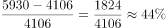，2005年城镇：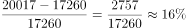；2012年农村：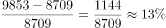，2012年城镇：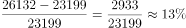。

比较可知，2005年农村居民人均现金收入和城镇居民人均可支配收入同比增长幅度更大。

故正确答案为A。

**考点**：一般增长率、统计图

**来源**：2014年江西省法检系统招录考试《行测》题第107题

### 第 108 题

2004～2013年，城镇居民人均可支配收入超过2万元的年份有几个：

A. 1

B. 7

C. 8

D. 9

第 108 题 · 答案与解析

**参考答案（粉笔题库参考内容）**

B

**解析**

定位柱状图可知，城镇居民人均可支配收入超过2万元的年份有2005、2008、2009、2010、2011、2012、2013，共有7个。

故正确答案为B。

**考点**：直接找数、统计图

**来源**：2014年江西省法检系统招录考试《行测》题第108题

### 第 109 题

2004～2013年，农村居民人均现金收入与城镇居民人均可支配收入差距最大的年份是：

A. 2004

B. 2007

C. 2011

D. 2012

第 109 题 · 答案与解析

**参考答案（粉笔题库参考内容）**

D

**解析**

定位柱状图可知各年农村居民人均现金收入与城镇居民人均可支配收入，计算差值进行比较即可。2004年：17260-4106=13154元；2007年：19652-7967=11685元；2011年：23199-8709=14490元；2012年：26132-9853=16279元。比较可知，差值最大的为2012年。

故正确答案为D。

**考点**：简单加减计算、统计图

**来源**：2014年江西省法检系统招录考试《行测》题第109题

### 第 110 题

能够从上述资料中推出的是：

A. 2004～2013年，农村居民人均现金收入与城镇居民人均可支配收入同步增长

B. 2004～2013年，农村居民人均现金收入与城镇居民人均可支配收入每年都稳步增长

C. 2004～2013年，农村居民人均现金收入的年均增长率大于城镇居民人均可支配收入的年均增长率

D. 2004～2013年，农村居民人均现金收入的年均增量大于城镇居民人均可支配收入的年均增量

第 110 题 · 答案与解析

**参考答案（粉笔题库参考内容）**

C

**解析**

A项：定位柱状图可知，2006年农村居民人均现金收入同比增加，城镇居民人均可支配收入同比下降，并非同步增加，错误；

B项：定位柱状图可知，2004-2013年，农村居民人均现金收入与城镇居民人均可支配收入有升有降，并非一直上升，错误；

C项：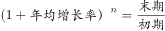，均需计算2004～2013年的年均增长率，年份差相等，因此只需比较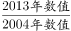的大小。农村：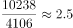，城镇：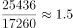，农村大于城镇，正确；

D项：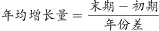，均需计算2004～2013年的年均增长量，年份差相等，因此只需比较（2013年数值-2004年数值）的大小。农村：10238-4106=6132元，城镇：25436-17260=8176元，农村小于城镇，错误。

故正确答案为C。

**考点**：统计图、综合分析

**来源**：2014年江西省法检系统招录考试《行测》题第110题

## 材料 2

固定资产投资保持较快增长。上半年，500万以上固定资产投资完成6617.3亿元，增长18.1%。其中，第三产业投资增长29.9%，分别高于第一、第二产业8.6和19.5个百分点，对全省投资增长的贡献率达到63.4%；三次产业投资比重由去年同期的2.0:59.5:38.5调整为2.1:55.6:42.3，第三产业投资比重提高3.8个百分点。消费市场基本稳定。上半年全省社会消费品零售额2323.9亿元，增长12.5%。其中，限额以上消费品零售总额909.9亿元，增长11.4%。新型业态消费快速增长，全省电子商务实现交易额571.2亿元，增长91.7%。南昌、赣州两市列入国家电子商务示范城市建设试点。乡村市场发展快于城镇。城镇市场实现零售额1931.8亿元，增长12.3%，其中，城区零售额1214.3亿元，增长13.3%；乡村市场实现零售额392.2亿元，增长13.4%，高于城镇市场1.1个百分点。商品零售主体拉动消费增长，商品零售2018.2亿元，增长13.5%，高于餐饮收入7.3个百分点。其中，限额以上商品零售872.3亿元，增长11.6%。开放型经济稳步发展。上半年，进出口总额230.8亿元，增长16%，比去年同期提高4.3个百分点。其中，出口额178.6亿元，增长10.4%，比去年同期回落6.6个百分点；进口额52.2亿美元，增长40.3%，比去年同期提高46.6个百分点；实际利用外资46.1亿美元，增长10.4%；引进省外5000万元以上项目资金2400亿元，增长21.7%。“走出去”步伐加快，全省对外承包工程营业额13亿美元，增长27.5%；对外直接投资额2.1亿美元，增长20%。外贸商品结构趋于优化。高新产品出口增长28.6%，铁合金出口增长68.7%，钢材出口增长67.2%，太阳能电池出口增长64.7%；机电产品和高新产品出口成倍增长，分别增长1.2倍和1.1倍。

### 第 111 题

去年上半年全省电子商务实现交易额约为多少亿元？

A. 571.2

B. 298.0

C. 523.8

D. 622.9

第 111 题 · 答案与解析

**参考答案（粉笔题库参考内容）**

B

**解析**

由题干“去年上半年全省电子商务实现交易额约为多少亿元”，可判定本题为基期计算问题。定位文字材料可得，“上半年全省电子商务实现交易额571.2亿元，增长91.7%”。则所求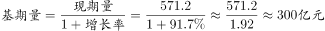，与B项最接近。

故正确答案为B。

**考点**：基期计算、文字资料

**来源**：2014年江西省法检系统招录考试《行测》题第111题

### 第 112 题

上半年，第二产业投资在三次产业投资中的比重：

A. 提高了3.8个百分点

B. 提高了19.5个百分点

C. 降低了3.9个百分点

D. 降低了6.6个百分点

第 112 题 · 答案与解析

**参考答案（粉笔题库参考内容）**

C

**解析**

由题干“上半年，第二产业投资在三次产业投资中的比重”，可判定本题为现期比重。定位文字材料可得，“三次产业投资比重由去年同期的2.0：59.5：38.5调整为2.1：55.6：42.3，第三产业投资比重提高3.8个百分点”。则上半年第二产业投资在三次产业投资中的比重相比去年变化了55.6%-59.5%=-3.9%，即下降了3.9个百分点。

故正确答案为C。

**考点**：文字资料、现期比重

**来源**：2014年江西省法检系统招录考试《行测》题第112题

### 第 113 题

上半年，三次产业投资增长率从高到低排序正确的是：

A. 第三产业，第二产业，第一产业

B. 第一产业，第二产业，第三产业

C. 第二产业，第三产业，第一产业

D. 第三产业，第一产业，第二产业

第 113 题 · 答案与解析

**参考答案（粉笔题库参考内容）**

D

**解析**

由题干“上半年，三次产业投资增长率从高到低排序正确的是”，可判定本题为增长率比较问题。定位文字材料可得，“上半年，第三产业投资增长29.9%，分别高于第一、第二产业8.6和19.5个百分点”。则第一产业同比增长率为29.9%-8.6%=21.3%，第二产业为29.9%-19.5%=10.4%，第三产业>第一产业>第二产业，与D项顺序一致。

故正确答案为D。

**考点**：一般增长率、文字资料

**来源**：2014年江西省法检系统招录考试《行测》题第113题

### 第 114 题

去年上半年，出口额增长率比进口额增长率：

A. 高23.3个百分点

B. 高17个百分点

C. 高40个百分点

D. 低16.3个百分点

第 114 题 · 答案与解析

**参考答案（粉笔题库参考内容）**

A

**解析**

由题干“去年上半年，出口额增长率比进口额增长率”，结合选项为高、低几个百分点，可判定本题为一般增长率问题。定位文字材料可得，“上半年，出口额增长10.4%，比去年同期回落6.6个百分点；进口额增长40.3%，比去年同期提高46.6个百分点”。则去年上半年出口额增长率为10.4%+6.6%=17%，进口额增长率为40.3%-46.6%=-6.3%，17%-(-6.3%)=23.3%，即去年上半年出口额增长率比进口额增长率高23.3个百分点。

故正确答案为A。

**考点**：一般增长率、文字资料

**来源**：2014年江西省法检系统招录考试《行测》题第114题

### 第 115 题

能够从上述材料中推出的是：

A. 城区零售额占城镇市场实现零售额的60%以上

B. 第三产业投资额占固定资产投资总额的60%以上

C. 南昌、赣州两市被列入国家电子商务示范城市

D. 机电产品和高新产品出口额占总出口额60%以上

第 115 题 · 答案与解析

**参考答案（粉笔题库参考内容）**

A

**解析**

A项：定位文字材料可得，“城镇市场实现零售额1931.8亿元，增长12.3%，其中，城区零售额1214.3亿元，增长13.3%”。则城区零售额占城镇市场实现零售额比重为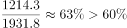，正确；

B项：定位文字材料可得，“三次产业投资比重由去年同期的2.0:59.5:38.5调整为2.1:55.6:42.3”。则第三产业投资额占固定资产投资总额的42.3%&lt;60%，错误；

C项：定位文字材料可得，“南昌、赣州两市列入国家电子商务示范城市建设试点”，并非国家电子商务示范城市，错误；

D项：材料未给出机电产品和高新产品出口额具体数值，无法计算占总出口额的比重，错误。

故正确答案为A。

**考点**：文字资料、综合分析

**来源**：2014年江西省法检系统招录考试《行测》题第115题

