# 2015年江西省法检系统招录考试《行测》题

<!-- gwy:overview:start -->
> **江西 · 2015 · 行测 · 法检** ｜ 115 题 · 图片 38 处 · 答案随题折叠

| 题型模块 | 题量 | 题号 |
| --- | ---: | ---: |
| 言语理解 | 40 | 1–40 |
| 常识判断 | 20 | 41–60 |
| 数量关系 | 10 | 61–70 |
| 判断推理 | 35 | 71–105 |
| 资料分析 | 10 | 106–115 |
| **合计** | **115** | |

导航：[题型与作答说明](#题型与作答说明) · [题目](#题目) · [材料 1](#材料-1)
<!-- gwy:overview:end -->

> 候选采集稿。参考答案及解析来自粉笔页面，不代表官方答案或真实高分答卷；来源使用许可与原卷对应关系仍需人工核实。

## 题型与作答说明

言语理解

（40题）

本部分包括表达与理解两方面的内容。请根据题目要求，在四个选项中选出一个最恰当的答案。

常识判断

（20题）

根据题目要求，在四个选项中选出一个最恰当的答案

数量关系

（10题）

在这部分试题中，每道题呈现一段表述数字关系的文字，要求你迅速、准确地计算出答案。

判断推理

（35题）

本部分包括图形推理、定义判断、类比推理与逻辑判断四种类型的试题。

资料分析

（10题）

所给出的图、表、文字或综合性资料均有若干个问题要你回答。你应根据资料提供的信息进行分析、比较、计算和判断处理。

## 题目

### 第 1 题

和微博相比，微信公众号虽然少了\_\_\_\_\_\_\_，但是在互动及私密性上显然\_\_\_\_\_\_\_。这也是为什么有许多人前仆后继涌入微信公众号的原因。

依次填入画横线部分最恰当的一项是：

A. 开放性 更胜一筹

B. 关注度 拔得头筹

C. 前瞻性 独树一帜

D. 包容性 优劣分明

第 1 题 · 答案与解析

**参考答案（粉笔题库参考内容）**

A

**解析**

第一空，横线后出现转折关联词“但是”，前后表达含义相反相对，故横线后强调的是“互动及私密性”，横线处填入的词语应该强调A项“开放性”。B项“关注度”侧重于关注的程度，文中没有出现“关注”的相关话题，应排除。C项“前瞻性”强调预见，原文也没有提及未来的发展方向，应排除。D项“包容性”指容纳、宽容大度，亦在文中没有体现，应排除。

验证第二空，文中是将微信和微博做的对比，转折前强调的是微博的优势，转折后应提及微信的优势，故应填入A项“更胜一筹”指比较起来，稍微好一些。拔得头筹指比赛中获得第一名；独树一帜指树立旗帜，比喻与众不同、自成一家；优劣分明侧重于强调优势和劣势都很明显。

故正确答案为A。

【出处】半月谈《原创与盈利：800万微信公众号如何不焦虑》

**考点**：关联关系-转折关系、混搭填空

**来源**：2015年江西省法检系统招录考试《行测》题第1题

### 第 2 题

乡村是村民的家，也是文化的源泉。在改善村民生活的同时，更应该\_\_\_\_\_\_\_历史文化，将历史文化与\_\_\_\_\_\_\_相融合，建设美丽乡村社区。

依次填入画横线部分最恰当的一项是:

A. 尊重 历史文明

B. 挖掘 现代文明

C. 体现 乡风道德

D. 弘扬 现代文化

第 2 题 · 答案与解析

**参考答案（粉笔题库参考内容）**

B

**解析**

先看第二空，文中强调将历史文化和······融合，建设美丽乡村社区。故应是将历史和现代进行融合，才能产生乡村社区，故应先排除A、C项。

第一空，文中强调乡村是文化的源泉，那么想要将历史和现代融合，必须先知道历史文化有哪些，故应填入B项“挖掘”，强调向下挖以发掘历史文化。D项“弘扬”指发扬光大，其前提是有要弘扬的事物，故不如B项“挖掘”好，应排除。

故正确答案为B。

【出处】半月谈《新型农村社区再调查：从“楼的社区”到“人的社区”》

**考点**：实词填空、对应关系-前后呼应

**来源**：2015年江西省法检系统招录考试《行测》题第2题

### 第 3 题

国以民为本，民以食为天。粮食既是人民\_\_\_\_\_\_\_的生活资料，也是关乎政局稳定、经济发展的主要\_\_\_\_\_\_\_物资。因此，从古至今，不论时代如何变迁，粮食问题对于世界上任何一个国家而言都是\_\_\_\_\_\_\_的头等大事。

依次填入画横线部分最恰当的一项是：

A. 不可或缺 生活 安邦定国

B. 心心念念 社会 无法回避

C. 维持生活 膳食 不容乐观

D. 赖以为生 战略 定国安邦

第 3 题 · 答案与解析

**参考答案（粉笔题库参考内容）**

D

**解析**

第一空，横线前提到“民以食为天”，强调的是粮食对于人民的重要性，所以横线处填入的成语的意思也应是粮食是一种重要的生活资料。C项“维持生活”和后文的“生活”重复，排除；B项“心心念念”意思是心里老是想着，指想做某件事或得到某种东西，文段中侧重于强调粮食的重要性，而不是人民的想法，排除。

第二空，横线前强调“也”，是在前一句的基础上补充说明，前面已经强调是一种生活资料，接下来就不能再填入A项的“生活”了，否则重复，排除。

第三空，代入验证，D项“定国安邦”意思是使国家安定巩固，照应前文，强调粮食对于一个国家的重要意义，符合语境，当选。

故正确答案为D。

【出处】半月谈《全球饥饿人口仍待消减》

**考点**：对应关系-前后呼应、混搭填空

**来源**：2015年江西省法检系统招录考试《行测》题第3题

### 第 4 题

现代中国大学生求职的压力＿＿＿＿＿＿，到毕业找工作的时候，很多同学都会有失落感和悲观情绪。如何提高心理承受能力，用更积极的心态去面对市场竞争，在更广阔的领域寻找就业机会和发展前景，对于大部分大学生来说，无疑需要＿＿＿＿＿＿的指导。

依次填入画横线部分最恰当的一项是：

A. 与日俱增 有针对性

B. 越来越大 切实有效

C. 无所不在 积极有效

D. 成倍增加 可操作性

第 4 题 · 答案与解析

**参考答案（粉笔题库参考内容）**

B

**解析**

第一空，横线后出现“到毕业找工作的时候，很多同学都会有失落感和悲观情绪”，说明现代中国大学生求职的压力在变大。C项“无所不在”侧重于到处都有，文中并没有强调压力在很多领域都是存在的，排除；D项“成倍增加”指成倍的增长，文中只是提到“有失落感和悲观情绪”，故“成倍增加”语义程度太重，排除。

第二空，A项“有针对性”侧重于强调针对不同的问题采取不一样的应对策略，而在文中只是说明大学生需要提高心理承受能力，没有出现“不同问题”，排除A项。B项“切实有效”指切实实际、实实在在的有效果，符合语境，当选。

故正确答案为B。

【出处】中国青年报《为成功点亮一盏心灯》

**考点**：对应关系-前后呼应、成语填空

**来源**：2015年江西省法检系统招录考试《行测》题第4题

### 第 5 题

纸质书信，已是＿＿＿＿＿＿。然而各人用富有个性的字体写出来的这些书信，＿＿＿＿＿＿，充满温馨，泛黄而不褪色。

依次填入画横线部分最恰当的一项是：

A. 时过境迁 字字珠玑

B. 明日黄花 面字如人

C. 昨日黄花 字如其人

D. 陈年往事 饱含深情

第 5 题 · 答案与解析

**参考答案（粉笔题库参考内容）**

B

**解析**

第一空，A项“时过境迁”指随着时间的推移，情况发生变化，B项“明日黄花”比喻过时或无意义的事物，均能说明当下纸质书信已经不再流行，照应了转折之后的“泛黄而不褪色”，保留。C项“昨日黄花”是对“明日黄花”的误用，不存在“昨日黄花”这一成语，排除。D项“陈年往事”强调的是过去的“事情”，而“纸质书信”不是事情，排除。

第二空，横线前强调各人用富有个性的字体写出来的，说明每个人的字体是不同的，B项“面字如人”，指看见这个人写的字，就好像看见这个人一样，强调字能代表人，当选。A项“字字珠玑”比喻说话、文章的词句十分优美，有时也延伸指说话或写文章言简意深，凝练有力，文中没有体现信的文字写得好，排除。

故正确答案为B。

【出处】《叶永烈：名人书信背后的有趣故事》

**考点**：关联关系-转折关系、对应关系-主题词、对应关系-前后呼应、成语填空

**来源**：2015年江西省法检系统招录考试《行测》题第5题

### 第 6 题

改变农业长久以来形成的劳作习惯并非一日可成，况且主要要\_\_\_\_\_\_\_农业的生产模式，这需要生产力的提高，显然不可能\_\_\_\_\_\_\_。

依次填入画横线部分最恰当的一项是：

A. 改变 一蹴而就

B. 提升 轻而易举

C. 适应 自然而然

D. 提高 一朝一夕

第 6 题 · 答案与解析

**参考答案（粉笔题库参考内容）**

A

**解析**

第一空，生产模式是劳作习惯的一个方面，故横线前强调的是要改变劳作习惯，接下来也应该是“改变”生产模式，答案选择A项。

第二空，文中已经提到“并非一日可成”，所以横线处填入的成语亦应有这层意思，A项“一蹴而就”指一下子就成功，符合文意，当选。B项“轻而易举”填入后侧重于强调事情不容易成功，而文中强调的“并非一日可成”，侧重于短时间内不可能取得成功，排除；C项“自然而然”指天然的，非人为的，文中没有这层意思，排除；D项“一朝一夕”指一个早晨或一个晚上，形容很短的时间。填入后句子成分不完整，缺少动词，应变为“一朝一夕完成的”，排除。

故正确答案为A。

**考点**：对应关系-前后呼应、混搭填空

**来源**：2015年江西省法检系统招录考试《行测》题第6题

### 第 7 题

宋代文体学的核心问题是本色与破体的错综纠葛、\_\_\_\_\_\_\_。宋代的文体本色论深入细致，在理论层面占优势地位，但破体相参在理论层面基本上是匮乏甚至\_\_\_\_\_\_\_的，所以会表现出一种自相矛盾的情形。

依次填入画横线部分最恰当的一项是：

A. 相互影响 缺乏

B. 相辅相成 缺乏

C. 相反相成 缺位

D. 相得益彰 缺位

第 7 题 · 答案与解析

**参考答案（粉笔题库参考内容）**

C

**解析**

先看第二空，横线前出现递进关联词“甚至”，说明所填词语程度应该比“匮乏”重，而“缺乏”比“匮乏”较轻，排除A、B两项。

第一空，文段最后说明本色论深入细致，而破体相参在理论层面基本上是匮乏的，两者是不同的表现，C项“相反相成”指两个对立的事物既互相排斥又互相促成，符合语境，当选。D项“相得益彰”指两个人或两件事物互相配合，双方的能力和作用更能显示出来，没有体现两者的不同，排除。

故正确答案为C。

【出处】《论宋代文体学的核心问题：本色与破体》

**考点**：对应关系-前后呼应、混搭填空、词的辨析-程度轻重

**来源**：2015年江西省法检系统招录考试《行测》题第7题

### 第 8 题

贾平凹的长篇小说《老生》以\_\_\_\_\_\_\_的笔触，\_\_\_\_\_\_\_的视角，描述了古老中国近百年历史所发生的重大变化，在字里行间能体会到贾平凹作品中丝丝缕缕渗透出的一个个时代的波澜。

依次填入画横线部分最恰当的一项是：

A. 练达 宏阔

B. 尖锐 宏大

C. 深沉 新颖

D. 灵动 独特

第 8 题 · 答案与解析

**参考答案（粉笔题库参考内容）**

A

**解析**

先看第二空，横线后强调“描绘了古老中国近百年历史所发生的重大变化······渗透出的一个个时代的波澜”。“近百年”“时代的波澜”说明作家贾平凹的视角是非常大的，故应填入A项“宏阔”和B项“宏大”，排除C、D两项。

第一空，文中提到“字里行间能体会到贾平凹作品中丝丝缕缕渗透出的······”，说明贾平凹的笔触是随时都能让人们感受到时代的波澜，故应填入A项“练达”指熟练通达。B项“尖锐”指对立激烈，原文并没有表达出这层意思，排除。

故正确答案为A。

【出处】《在阅读贾平凹时,触摸一个世纪——贾平凹长篇小说&lt;老生>读札》

**考点**：实词填空、对应关系-前后呼应

**来源**：2015年江西省法检系统招录考试《行测》题第8题

### 第 9 题

奥斯特洛夫斯基生活在一个光明为主而失误也极其严重的时代。他是一代热血青年的\_\_\_\_\_\_\_代表。他具有大无畏的自我牺牲精神，尤其是在病残日益严重的岁月中的经历与表现，更多地显示出他个人的特质和魅力。他曾被\_\_\_\_\_\_\_乃至神化，也曾被贬低乃至\_\_\_\_\_\_\_。但他仍是他，那么纯朴、真实。

依次填入画横线部分最恰当的一项是：

A. 主要 赞誉 忘却

B. 杰出 拔高 淡忘

C. 突出 表扬 遗忘

D. 卓越 推崇 忘记

第 9 题 · 答案与解析

**参考答案（粉笔题库参考内容）**

B

**解析**

先看第二空，横线后出现“乃至”，说明横线处填入的词语语义程度应该比“神化”轻一点。另外后文出现“也曾被贬低”，说明所填词语语义程度应该和“贬低”一致。A项“赞誉”指赞美、称扬，语义程度太轻，排除；C项“表扬”指对好人、好事公开称赞。原文中没有体现“公开”，排除。对比B项“拔高”和D项“推崇”，B项中的“高”刚好和后文中的“贬低”形成对应关系，故本题应选择B项。验证第一、三空，亦符合语境。

故正确答案为B。

【出处】《人中俊杰奥斯特洛夫斯基》

**考点**：实词填空、词的辨析-程度轻重

**来源**：2015年江西省法检系统招录考试《行测》题第9题

### 第 10 题

\_\_\_\_\_\_\_历史不可能重复，历史研究也不可能“复原”历史，\_\_\_\_\_\_\_决不能因此而否认“求真”“求实”的理念，\_\_\_\_\_\_\_历史研究：

A. 虽然 但 否则

B. 因为 所以 因此

C. 即使 但 所以

D. 尽管 所以 由此

第 10 题 · 答案与解析

**参考答案（粉笔题库参考内容）**

A

**解析**

此题突破口在第三空，横线前强调不能因此而否认“求真”“求实”的理念，横线后说明历史研究将“失去”最基本的功能。发现横线后的内容是对横线前进行的反面论证，即如果做不到“求真”“求实”，历史研究将失去最基本的功能。故应填入A项“否则”。“因此”“所以”“由此”都是结论引导词，前后意思表达应该是一致的，故应排除B、C、D三项。

验证前两空。历史研究不能复原历史，但是不能因此否认“求真”“求实”，两句话含义相对，通过转折关联词“虽然······但”连接，符合要求。

故正确答案为A。

【出处】《关于&lt;历史学研究中的四个“误区”>的几点想法》

**考点**：对应关系-前后呼应

**来源**：2015年江西省法检系统招录考试《行测》题第10题

### 第 11 题

各个学科最前沿的成果，反映了人类对这一领域的最新和最有价值的认识，但又可能离大众最为遥远，甚至最难以为大众所\_\_\_\_\_\_\_、所\_\_\_\_\_\_\_、所\_\_\_\_\_\_\_。

依次填入画横线部分最恰当的一项是：

A. 了解 认识 接受

B. 认识 了解 接受

C. 接受 认知 理解

D. 理解 接受 认知

第 11 题 · 答案与解析

**参考答案（粉笔题库参考内容）**

A

**解析**

横线处出现三个顿号，表示并列关系，结合选项可知，词语的顺序应该是和大众认识事物的思维顺序是一致的。“接受”应该是在对事物有了基本了解认知之后的结果，故应放在最后，排除C、D两项。“认识”是人脑反映客观事物的特性与联系，并揭露事物对人的意义与作用的思维活动。认识是一种信息加工过程。“了解”是知道的意思。故应先知道信息，才可对其进行加工，即先“了解”后“认识”，排除B项。

故正确答案为A。

【出处】《关于&lt;历史学研究中的四个“误区”>的几点想法》

**考点**：关联关系-并列关系、实词填空

**来源**：2015年江西省法检系统招录考试《行测》题第11题

### 第 12 题

①欧阳修是北宋名臣，\_\_\_\_\_\_\_，“月上柳梢头，人约黄昏后。”如此美丽清朗的\_\_\_\_\_\_\_，如此自然天成的句子，怎么会不流传为千古名句？

②即使细节的出入对于全部论证还不发生直接影响，也会使人对材料的全部可靠性产生怀疑，以至伤害了论证的说服力量，有时看来是\_\_\_\_\_\_\_的细节上的马虎，却会造成关键问题上的错误，那当然更是要警惕的。

依次填入画横线部分最恰当的一项是：

A. 才高八斗 情景 无足轻重

B. 博大精深 情怀 无伤大雅

C. 见多识广 意蕴 举足轻重

D. 学富五车 意境 无关大体

第 12 题 · 答案与解析

**参考答案（粉笔题库参考内容）**

D

**解析**

第一空，所填成语需要形容欧阳修的学问好，A项“才高八斗”形容人文才高超，C项“见多识广”指见过的多，知道的广，形容阅历深，经验多，D项“学富五车”形容学问渊博，填入均可，保留。B项“博大精深”多用于形容理论、学识、思想、作品等广博丰富、深奥精微，其形容对象多为某某内容，文中是人，排除。

第二空，“意境”指文学作品通过形象描写表现出来的境界和情调。“情景”多指具体场合或事件的情形、景象，文中没有具体场合。“意蕴”指事物的内容或含义，文中也没有体现“含义”。故此处应该填入“意境”，排除A项“情景”和C项“意蕴”。

第三空，代入验证，D项“无关大体”形容对全局没有关系或影响，照应了后文的“细节上的马虎”，当选。

故正确答案为D。

【出处】《宋人弦歌》

**考点**：对应关系-前后呼应、混搭填空、词的辨析-词义侧重

**来源**：2015年江西省法检系统招录考试《行测》题第12题

### 第 13 题

在价值观方面,中国哲学有一个基本的观点,那就是认为价值的根据不在彼岸世界,而就在此岸世界,主张在天人合一中寻找价值根源。用比较\_\_\_\_\_\_\_的话表述,就是强调价值的此岸性,选择内在\_\_\_\_\_\_\_的取向。这正是中国哲学的最大用处。

依次填入画横线部分最恰当的一项是:

A. 隐含 超过

B. 晦暗 赶超

C. 晦涩 超越

D. 隐晦 超逸

第 13 题 · 答案与解析

**参考答案（粉笔题库参考内容）**

C

**解析**

此题突破口在第二空。中国的哲学观点认为价值的根据是在此岸世界，说明是从内在寻找价值根源，说明内在是价值所在，“价值”是较为抽象的概念，和其搭配应选择C项“超越”。A项“超过”和B项“赶超”都指超出具体的事物，应排除。D项“超逸”特指不同凡俗，而文中没有出现“凡俗”，指的是“内在”，亦可排除。

验证第一空，“晦涩”指不易懂，符合语境，强调其后的观点不易被理解。

故正确答案为C。

【出处】《中国哲学与价值取向》

**考点**：实词填空、对应关系-前后呼应、词的辨析-搭配对象

**来源**：2015年江西省法检系统招录考试《行测》题第13题

### 第 14 题

①“文革”头三年的红色＿＿＿＿之中，父亲和他的大多数朋友都是被革命的对象。本地亲友关系近的、胆子大的偶尔还有来往，外地的几乎完全＿＿＿＿＿＿。

②城市地标是一座城市最具标志性的建筑或景观，它聚焦了一座城市的魅力，是这座城市区别于另一座城市的特色之所在。我国历史上唐代长安之曲江，南宋杭州之西湖，明清南京之秦淮河、北京之故宫，近代上海之外滩，都是历史上最具特色和标志性的城市景观，并积淀为一种独特的城市＿＿＿＿。

依次填入画横线部分最恰当的一项是：

A. 气氛 音讯全无 境像

B. 氛围 音讯全无 意像

C. 气氛 音书隔绝 意境

D. 氛围 音书隔绝 意象

第 14 题 · 答案与解析

**参考答案（粉笔题库参考内容）**

D

**解析**

第一空，“气氛”指特定环境中给人强烈感觉的景象或情调，气氛是一时的，在一个空间的一个群体间的互动情况。“氛围”指周围的气氛和情调，是一段时间或者较长时间比较稳定的状态。横线前强调“文革头三年”，持续时间较长，故应选择“氛围”，排除A、C两项。

第二空，关系近的、胆子大的才偶尔来往，那么外地的就几乎不来往了。D项“音书隔绝”指没有书信往来，引申为没有联系，符合语境，当选。B项“音讯全无”指没有任何消息，适用语境应该是某个人消失，文中强调双方来往问题，排除。

故正确答案为D。

【文段出处】澎湃新闻《一片冰心在玉壶——忆陈旭麓先生》

**考点**：对应关系-前后呼应、混搭填空、词的辨析-词义侧重

**来源**：2015年江西省法检系统招录考试《行测》题第14题

### 第 15 题

这些壁画使我相信英雄白求恩和艺术家白求恩就是这么＿＿＿＿＿＿地融在一起，多么丰富而有趣的白求恩，他不只是“一个高尚的人，一个纯粹的人，一个脱离了低级趣味的人，一个有益于人民的人”，他还是一个敏感细致多情的艺术家；他不只是一个不畏炮火勇于赴死的战士，他也是一个曾经被死亡打入谷底的肺结核病人。在白求恩身上，敏感细致的心灵和伟大＿＿＿＿的品格共存。

依次填入画横线部分最恰当的一项是：

A. 不可或缺 坚毅

B. 不期而遇 坚韧

C. 不约而同 坚强

D. 不可思议 坚毅

第 15 题 · 答案与解析

**参考答案（粉笔题库参考内容）**

D

**解析**

第一空，A项“不可或缺”强调的是某个事物很重要，在文中没有这层意思，应先排除。B项“不期而遇”指事先没有约定而遇见，侧重于“遇见”，而文中强调的是“融合”，故应排除。C项“不约而同”指事先没有约定而相互一致，侧重于强调两者一致，而文中强调的是两者融合，故应排除。D项“不可思议”指无法想象，在这里指我没有想到英雄白求恩和艺术家白求恩融于一身。符合语境，保留。

第二空，代入验证，文中提到白求恩是“不畏炮火勇于赴死的战士”。故其身上体现的是“坚毅”的品格，形容性格坚定刚毅，符合语境，D项当选。

故正确答案为D。

【文段出处】文汇报《白求恩：战士与诗人》

**考点**：对应关系-前后呼应、混搭填空

**来源**：2015年江西省法检系统招录考试《行测》题第15题

### 第 16 题

教育方法＿＿＿＿＿搞形式主义的“一刀切”，＿＿＿＿＿搞教条主义的“全盘西化”。教学方法、教学模式必须提倡多样化。＿＿＿＿教学通过多样化，＿＿＿＿能达到高效优质。

依次填入画横线部分最恰当的一项是：

A. 不可以 也不可以 只能 才

B. 不能 也不能 只有 才

C. 不能 也不能 只要 就

D. 不要 也不要 只要 就

第 16 题 · 答案与解析

**参考答案（粉笔题库参考内容）**

B

**解析**

此题突破口在后两个空。通过教学多样化，可以达到高效优质。说明教学多样化是实现高效优质的一种途径，也就是两者之间存在必要条件关系，故只能填入B项“只有······才”。C、D项“只要······就”是充分条件关联词，做到了教学多样化，不一定能达到高效优质，故两者之间不是充分条件关系，应排除C、D项。A项“只能”不能和“才”放在一起，应排除。

故正确答案为B。

【文段出处】《教师要学会提炼核心经验》

**考点**：对应关系-前后呼应

**来源**：2015年江西省法检系统招录考试《行测》题第16题

### 第 17 题

爱因斯坦的成长、成才、成就，源于他对科学的强烈兴趣、不懈＿＿＿＿和＿＿＿＿精神。青少年时期家庭亲友的影响和＿＿＿＿，科普读物、康德的哲学思想、自学物理学前沿研究进展，发现知识理论体系内的不自恰，以及已有理论与实验观察结果之间的矛盾，成为他追求创造更完美理论的根本动力。

依次填入画横线部分最恰当的一项是：

A. 探索 创造 启迪

B. 思索 创新 启蒙

C. 探索 创造 启蒙

D. 努力 创作 启示

第 17 题 · 答案与解析

**参考答案（粉笔题库参考内容）**

C

**解析**

第一空，B项“思索”侧重于“思”，强调“反复思考”，而文中更侧重于实际行动，排除。

第二空，D项“创作”指创造文学艺术作品，文中是科学，排除。

第三空，文中强调的是青少年时期受到家庭的影响，C项“启蒙”指使初学者得到基本的、入门的知识，当选。A项“启迪”指启发，不一定是“初学者”的身份，不能照应前面的“青少年时期”，排除。

故正确答案为C。

【文段出处】文汇报《领悟爱因斯坦的科学精神和人生哲理》

**考点**：实词填空、对应关系-前后呼应

**来源**：2015年江西省法检系统招录考试《行测》题第17题

### 第 18 题

①一个人拥有包容心态，在为人处事时就不会＿＿＿＿＿＿，也不会卑躬屈膝，他会平心静气，拒绝浮华，兼收并蓄，包容万物。

②常香玉是一位＿＿＿＿＿＿的豫剧表演艺术家。她的豫剧我有幸欣赏过，她吸取了河南曲剧、河南梆子、河北梆子等剧种的长处和旋律，还大胆吸收了京剧的唱腔和武功，结合自己的表演和唱腔，完美表演出豫剧剧目。

依次填入画横线部分最恰当的一项是：

A. 目空一切 德艺双馨

B. 狂妄自大 德高望重

C. 盛气凌人 德艺双馨

D. 仗势欺人 德才兼备

第 18 题 · 答案与解析

**参考答案（粉笔题库参考内容）**

C

**解析**

先看第二空，“德艺双馨”形容一个人的德行和技艺都具有良好的声誉。常香玉是一位豫剧表演艺术家，后文又提到她的表演很好，故填入“德艺双馨”合适。B项“德高望重”指品德高尚，声望很高。只说明常香玉德行好，没有体现其在艺术上的成就，排除；D项“德才兼备”一般指普通工作岗位的德行和才能都具备，这里是艺术领域的，“德艺双馨”更合适，排除。

第一空，“也”连接的两个词语应该表达同一事件的正反两个方面，“卑躬屈膝”指没有骨气，低声下气地讨好奉承别人。而C项“盛气凌人”指以威严或骄横的气势压人。两个成语都是表达对待别人的态度，故符合语境，当选。A项“目空一切”指眼睛里除了自己，就什么也没有。形容高傲自大，什么都瞧不起。不一定是对人的态度，排除。

故正确答案为C。

**考点**：关联关系-并列关系、对应关系-前后呼应、成语填空

**来源**：2015年江西省法检系统招录考试《行测》题第18题

### 第 19 题

①地铁一号线这项南昌市重点工程进展顺利，＿＿＿＿2015年9月下旬，已完成计划的95%。

②在强大的习惯面前，科学有时也会变得＿＿＿＿＿＿。

依次填入画横线部分最恰当的一项是：

A. 截止 似是而非

B. 截至 苍白无力

C. 截止 软弱可欺

D. 截至 一无是处

第 19 题 · 答案与解析

**参考答案（粉笔题库参考内容）**

B

**解析**

第一空，“截至”表示到某个时间停止，后面须带时间词语，例如：截至目前。“截止”表示停止于某个时间，一般用于时间词语之后。例如：报名工作已于昨日截止。故文段后面出现时间，应该选择“截至”，排除A、C两项。

第二空，横线前强调“有时”，所以填入的成语语义程度不能太重，D项“一无是处”指没有一点用处，程度过重，排除。B项“苍白无力”形容没有说服力，说明在强大的习惯面前，科学有时候也是无力改变的，符合语境，当选。

故正确答案为B。

**考点**：对应关系-前后呼应、混搭填空、词的辨析-搭配对象、词的辨析-程度轻重、词的辨析-词义侧重

**来源**：2015年江西省法检系统招录考试《行测》题第19题

### 第 20 题

按照乔麦的理论，看电影是一种基于＿＿＿＿的有效心理治疗途径，让人＿＿＿＿在别人的故事里流泪、欢笑、愤怒，泪是你的，怒是你的，但电影里的故事丝毫不会＿＿＿＿你的生活。你是安全的，在故事之外。

依次填入画横线部分最恰当的一项是：

A. 移情 沉醉 搅动

B. 情感 沉浸 感动

C. 移情 沉浸 撼动

D. 情感 沉酣 撼动

第 20 题 · 答案与解析

**参考答案（粉笔题库参考内容）**

C

**解析**

第一空，文中强调看电影是一种有效心理治疗途径，让人在别人的故事里流泪，说明是把自己的感情转移到别人身上去了，故应填入“移情”，排除B、D两项。

再看第三空，横线之后强调你在故事之外，说明电影不会改变你的生活，故应填入“撼动”。A项“搅动”指搅乱、搅扰，其程度不如“撼动”更重，原文强调的是“丝毫不会”，排除。

故正确答案为C。

【文段出处】《羽毛》

**考点**：实词填空、对应关系-前后呼应、词的辨析-程度轻重、词的辨析-词义侧重

**来源**：2015年江西省法检系统招录考试《行测》题第20题

### 第 21 题

返乡农民工经过在大城市的多年磨砺,已经获取了更多的社会经验和更加开阔的眼界,他们面临新的居住状况、人际关系和业缘关系,生存场景发生了很大变化,思想观念也因此会发生一系列的新转变,已然成为地方社会尤其是地方村庄社区的“草根精英”群体。事实上,绝大多数返乡农民工在自我认知等问题上仍然模糊不清、缺乏思考。这种思想认识上的模糊不清将不利于返乡农民工对未来生活做出正确的判断和选择。

通过这段文字,作者想要告诉我们的是:

A. 返乡农民工成为了“草根精英”群体

B. 返乡农民工自我认知的能力亟需提高

C. 返乡农民工对未来生活还不能做出正确的判断和选择

D. 返乡农民工对自我的认知能力有限

第 21 题 · 答案与解析

**参考答案（粉笔题库参考内容）**

B

**解析**

文段首句先说明返乡农民工经过大城市的磨砺，已经获取了更多的社会经验和更加开阔的眼界，他们的生存场景发生了很大变化，思想观念也因此发生一系列的新转变，成为地方社会的“草根精英”群体。随后通过转折关联词“事实上”，提到返乡农民工出现的问题：在自我认知等问题上仍然模糊不清、缺乏思考。最后说明这种问题的出现将不利于返乡农民工对未来生活做出正确的判断和选择。所以应改变这一问题，即返乡农民工自我认知能力亟需提高，答案选择B项。

A项，属于转折之前的内容，应排除。

C项，属于“问题”带来的消极影响，本身并不重要，提及消极影响是为了改变这一处境，应排除。另外原文最后一句提及的是：“将”不利于返乡农民工对未来生活做出正确的判断和选择，并没有说到现在就是不能做出正确的选择和判断。

D项，“能力有限”属于文中的字面表达意思，提问中问的是作者“想”要告诉我们的是。

故正确答案为B。

**考点**：关联词-对策、关联词-转折

**来源**：2015年江西省法检系统招录考试《行测》题第21题

### 第 22 题

在何为“真”的问题上,儒道两家共同的选择,都是以“真”为真。儒家注重人道,由真引申出诚,提倡有为的人生态度;道家注重天道,倡导无为的人生态度。“求真”是儒道两家共同倡导的价值取向,也是中国人最基本的价值理念,道家主张无为,儒家主张有为,无为和有为既是相反的,又是相成的。儒道互相补充,满足人们不同的精神需求,都有助于人格的完善。如果说儒家的价值导向是“张”的话,那么,道家的价值导向则是“驰”。“张而不弛,文武弗能也;弛而不张,文武弗为也。一张一驰,文武之道也。”

这段文字主要讲述的是:

A. 求真是儒道两家共同倡导的价值取向,是中国人最基本的价值理念

B. 儒家注重人道,提倡有为的人生态度;道家注重天道,注重无为的人生态度

C. 儒家和道家在求真问题上的观点相左

D. 儒道相反相成,共同满足人们的精神需求

第 22 题 · 答案与解析

**参考答案（粉笔题库参考内容）**

D

**解析**

文段首句提到儒道两家都是以“真”为真，儒家注重人道，由真引申出诚，提倡有为的人生态度；道家注重天道，倡导无为的人生态度。随后提到“求真”是儒道两家共同倡导的价值取向，也是中国人最基本的价值理念，“无为”和“有为”既是相反的，又是相成的，互相补充，满足人们不同的精神需求，都有助于人格的完善。最后举例说明“一张一弛，文武之道也”。故文段属于分总分结构，强调的就是儒道互补共同构成了中国人最基本的价值理念，共同满足人们的精神需要，即本题选择D项。

A项，表述片面，文段中强调的核心是儒道之间的关系“互补”，故应排除。

B项，表述片面，没有体现两者结合之后的对于中国人的影响，应排除。

C项，表述片面，“相左”只是文中的一方面，文中重点强调的是“相成”，故应排除。

故正确答案为D。

【出处】《中国哲学与价值取向》

**考点**：分述句特征-其他

**来源**：2015年江西省法检系统招录考试《行测》题第22题

### 第 23 题

新时期,由于网络舆情而引起人们对地方政府公信力质疑的事情屡屡发生,越来越成为地方政府亟待解决的主要问题。要提升地方政府公信力,首先要坚持科学决策、民主决策、依法决策,健全决策机制和程序;其次,要推进政务公开,增强公共政策制定透明度和公众参与度,这样就可以在很大程度上防止决策失误,增强公众对决策的认同感,减少决策执行的阻力;再次,要加强行政问责制,完善政府绩效评估是引导政府和公务员树立正确导向、尽职尽责的一项重要制度,也是实行行政问责的前提和基础;再其次,要重视行政人员的行政伦理建设,树立良好的政府形象;最后,要提高与媒体打交道的能力,建立良好的媒体公关关系。

最适合做这段文字标题的是:

A. 提升政府公信力

B. 提升地方政府公信力的途径

C. 应对地方政府公信力缺失的措施

D. 强化行政问责,应对地方政府公信力缺失

第 23 题 · 答案与解析

**参考答案（粉笔题库参考内容）**

B

**解析**

文段首句先说明新时期，由于网络舆情引起人们对地方政府公信力质疑的事情越来越多。接着提出提升地方政府公信力的一系列对策：一是要坚持科学决策、民主决策等，健全决策机制和程序；二是要推进政务公开，增强公共政策制定透明度和公众参与度；三是要加强行政问责制、完善政府绩效评估；四是要重视行政人员的行政伦理建设；五是要提高与媒体打交道的能力。对策是重点，文段重点强调的就是提升地方政府公信力的途径，标题需要照应文段主要内容，故本题答案为B项。

A项，文段中强调的是“地方政府”，应排除。

C项，“缺失”表述不准确，原文只是说明公信力遭受质疑，故应排除。

D项，表述片面，只是五条对策中的一个方面，应排除。

故正确答案为B。

【出处】《新时期地方政府公信力的提升路径》

**考点**：标题填入题

**来源**：2015年江西省法检系统招录考试《行测》题第23题

### 第 24 题

“我国每年有成千上万个家庭因吸毒而陷入痛苦的泥潭中,家庭有一个吸毒的,比家里有得癌症的人还要糟糕。”从事禁毒工作的一名专家表示,当前我国正面临一场持续升级的禁毒战。

从这段话可以看出,禁毒专家对我国当前禁毒战的态度是:

A. 悲观的

B. 怀疑的

C. 忧虑的

D. 遗憾的

第 24 题 · 答案与解析

**参考答案（粉笔题库参考内容）**

C

**解析**

文段中先提到我国每年有成千上万个家庭因吸毒陷入痛苦的泥潭中，接着专家表示，我国正面临一场持续升级的禁毒战。说明我国的禁毒形势非常严峻，故而专家的态度是C项“忧虑”的。其他几个选项的意思都是我国的禁毒战可能会失败，对我们打赢禁毒战没有信心，表达太消极，文中没有体现，应排除。

故正确答案为C。

**考点**：细节判断题

**来源**：2015年江西省法检系统招录考试《行测》题第24题

### 第 25 题

我们不能说先有历史后有现实,而只能说有历史就有现实;既不能笼统地说历史先在于现实,也不能抽象地说历史使现实得以存在。一切历史都是现实,现实之外别无历史。所谓“现实之外”同“世界之外”一样,只在纯粹的语言学意义上和逻辑学意义上才有可能。现实之外并不是“非历史”,现实之前也不是“前历史”。

下列说法符合文意的是:

A. 历史与现实并无差别

B. 现实存在于历史之中

C. “现实之外”是存在的

D. 没有现实就没有历史

第 25 题 · 答案与解析

**参考答案（粉笔题库参考内容）**

D

**解析**

A项，“并无差别”表述太绝对，原文只是强调“一切历史都是现实”，但并不代表两者之间没有任何的差别，故应排除。

B项，根据文中的“一切历史都是现实,现实之外别无历史”，说明历史是存在于现实中的，此项刚好表达反了，应排除。

C项，文段第三句提到：所谓“现实之外”同“世界之外”一样,只在纯粹的语言学意义上和逻辑学意义上才有可能。说明“现实之外”是不存在的，此项表述错误，应排除。

D项，文中提到“现实之外别无历史”，说明没有现实就没有历史，此项表述正确。

故正确答案为D。

**考点**：细节判断题

**来源**：2015年江西省法检系统招录考试《行测》题第25题

### 第 26 题

文化企业多为中小型“轻资产”企业,可用于抵押的固定资产少,而品牌、专利、技术等无形资产难于估值,因此从银行等传统渠道融资的门槛较高,而能够通过上述从资本市场融资的企业也不多。虽然我国投融资环境在不断改善,各地也普遍重视解决企业资金不畅的问题,出现了科技金融等创新金融产品及服务模式。但这些都还处在发展初期,仍然需要完善相关机制,为中小文化企业创造良好的融资环境。

这段文字主要讲述的是:

A. 文化企业融资渠道不畅

B. 中小文化企业融资环境有了较大改善

C. 文化企业融资机制需要进一步完善

D. 文化企业从银行传统渠道融资门槛较高

第 26 题 · 答案与解析

**参考答案（粉笔题库参考内容）**

C

**解析**

文段首句先说明文化企业存在的问题：可用于抵押的固定资产少，无形资产难于估值。接着通过结论引导词“因此”，引出结论文化企业从传统渠道融资的门槛较高。随后提到虽然我国的投融资环境在不断改善，出现了创新金融产品和服务模式，但是这些都处在发展的初期，仍然需要完善的相关机制，为中小文化企业创造良好的融资环境。故文段属于分总结构，重在最后，主要讲述的就是C项，文化企业融资机制需要进一步完善。

A项、B项、D项均属于“分”，本身并不重要，应排除。

故正确答案为C。

**考点**：关联词-转折

**来源**：2015年江西省法检系统招录考试《行测》题第26题

### 第 27 题

随着网络媒体的迅猛发展,网民在网络空间的言行与社会生活产生交互、融合。关注社会、关注普通大众生活状态的网络流行语迅速产生。2013年的网络流行语“女汉子”,就很具典型意义。在中国的传统文化里,“女”代表的是“温文而婉”,“汉子”代表的是“独立、勇猛”。“女汉子”指“带有纯爷们儿性格”的女性。它的流行,不仅反映了新时代女性面对社会竞争的激烈,为了生存与发展的需要,不得不让自己集温婉与彪悍于一身,把自己培养成既拥有女性的外表又具有汉子内质的“矛盾的结合体”的无奈。

这段文字意在探讨:

A. “女汉子”的文化内涵

B. “女汉子”的网络流行意义

C. 网络流行语的文化纵深意义

D. 网络流行语产生的社会背景

第 27 题 · 答案与解析

**参考答案（粉笔题库参考内容）**

C

**解析**

文段首句先提到网民在网络空间的言行与社会生活产生交互、融合，继而关注社会、关注普通大众生活状态的网络流行语迅速产生。后文开始举例说明，强调“女汉子”就很具有典型意义，它的流行反映了新时代女性面对激烈的社会竞争，不得不让自己集温婉与彪悍于一身。故文段就是在强调网络流行语的产生是反映了社会和普通大众的生活状态的，故这段文字意在探讨的就是网络流行语背后的文化纵深意义，答案选择C项。

A项、B项，“女汉子”在文中是举例论证，本身不重要，其论证的观点才重要，故应排除。

D项，“产生的社会背景”在文中应该是为什么会产生网络流行语，但是在举例论证部分，都是强调的网络流行语反映了什么，也就是其意义，故可排除D项。

故正确答案为C。

【出处】《近十年来我国网络流行语的演变及传播研究》

**考点**：分述句特征-举例子

**来源**：2015年江西省法检系统招录考试《行测》题第27题

### 第 28 题

历史学认为地理是历史的舞台,区域历史的研究更要注重地理的视角。\_\_\_\_\_\_\_\_\_\_,而军事活动是政治活动的工具,当政治矛盾尖锐到一定程度,军事斗争不可避免。地理条件的相对稳定,使得国际地缘政治有迹可寻,呈现出一定的规律性。

填入画横线部分最恰当的一项是:

A. 地理视角是军事斗争不可忽视的因素

B. 地理其实也是军事活动的舞台

C. 军事活动是在一定的环境中进行的

D. 国际地缘政治的规律性很强

第 28 题 · 答案与解析

**参考答案（粉笔题库参考内容）**

B

**解析**

空在中间，起到的作用应该是承上启下，前后话题相关。横线前讨论的话题是“地理”的意义，横线后说明的是“军事活动是政治活动的工具”，故横线处应该强调“地理”和“军事活动”之间的关系，才能得出后文的结论：当政治矛盾尖锐到一定程度,军事斗争不可避免。故本题答案只能选择B项。

A项，主体错误，横线后强调的是“军事活动”，而不是“军事斗争”，应排除。

C项，“环境”表述不精准，原文强调的是“地理”因素，应排除。

D项，主体错误，没有体现“军事活动”，应排除。

故正确答案为B。

【出处】《隋唐东北亚的地缘环境与政治博弈》

**考点**：横线在中间

**来源**：2015年江西省法检系统招录考试《行测》题第28题

### 第 29 题

一部作品要变成文化产品,固然需要编辑或编导的“精雕细刻”,同时也需要相应的设备辅助完成,印刷辅助需要设备,广播影视业需要设备,即使舞台艺术表演也需要乐器、舞台机械、灯光照明和音响设备。这是国民经济体系支撑文化产业发展的具体体现,文化产业因此而诞生一个新类别,即文化装备制造。

最适合做这段文字标题的是:

A. 文化装备制造的内涵

B. 文化装备制造的由来

C. 文化产品所需的设备

D. 文化装备的概念

第 29 题 · 答案与解析

**参考答案（粉笔题库参考内容）**

B

**解析**

首句先提到一部作品要变成文化产品，需要相应的设备辅助完成，接着举例说明。最后强调设备是国民经济体系支撑文化产业的具体体现，文化产业因此也诞生了一个新类别，即文化装备制造。故文段主要介绍了文化装备制造的由来，标题需要照应文段的主要内容，故答案选择B项。C、D项主体错误，应首先排除。A项的“内涵”在文中没有出现，应排除。

故正确答案为B。

【出处】《文化产业是个“321”体系》

**考点**：标题填入题

**来源**：2015年江西省法检系统招录考试《行测》题第29题

### 第 30 题

在古代典籍的解读和研究中，无论是“我注六经”还是“六经注我”，在古代乃至近代早期大多以训诂的方法为主；近代晚期和现代以来，在训诂方法的基础上，研究者又采用了“比较、实证、结构”等方法。以上的解读方法，虽推动了古籍研究的进步，但带来的问题也有目共睹，比如对文本的主题、原意、基本思想、基本概念及其关系的把握等难以形成令人信服的结论。笔者认为，正确解读不仅应建立在大量原始资料的挖掘、复原上，同时还应建立在正确而有效的解读原则和方法的利用上。

根据这段文字，作者支持的观点是：

A. 现代古籍研究采用的方法以训诂为主

B. 只要有正确的解读原则和方法，古籍的解读就可以达到预期的效果

C. 对古籍的解读，实证法比训诂法先进

D. 挖掘和复原原始资料是正确解读古籍的一项基础工作

第 30 题 · 答案与解析

**参考答案（粉笔题库参考内容）**

D

**解析**

文中问到的是作者支持的观点，在最后一句出现明确观点的标志词“笔者认为”，之后的内容应该是作者支持的观点。文中强调的是正确的解读不仅应建立在大量原始资料的挖掘、复原上，同时还应建立在正确而有效的解读原则和方法的利用上。符合这一观点的是D项，强调原始资料对于正确解读的重要性，故本题答案选择D项。

A项，文中第一句提到：在古代乃至近代早期大多以训诂的方法为主，近代晚期和现代以来，在训诂方法的基础上，研究者又采用了“比较、实证、结构”等方法。故文段中并没有说明现代古籍研究采用的方法以训诂为主，此项不符合作者的观点，应排除。

B项，“只要······就······”表达充分条件关系，原文说明正确的解读“应”建立在正确而有效的解读原则和方法的利用上，这是必要条件关系，故此项偷换逻辑，不符合作者的观点，应排除。

C项，“实证法比训诂法先进”属于无中生有，原文并没有将两者进行比较，故应排除。

故正确答案为D。

【出处】《&lt;老子>解读方法刍议》

**考点**：关联词-因果

**来源**：2015年江西省法检系统招录考试《行测》题第30题

### 第 31 题

初创时期的书院是作为唐中央政府组成机构，后有诸如白鹿洞书院、岳麓书院等教学型书院。若将传习儒家思想的教学型书院作为书院历史形态的正态，明清时期也不乏佛道书院、宗族家祠书院等与教学毫无关联的异态书院。书院形态的多样性让定义书院成为一项较为困难的任务，难用一种相对稳定的方式将其表征，各种表述总有意犹未尽的遗憾。

这段文字意在强调：

A. 书院有多种形态

B. 书院的发展历史曲折

C. 书院的文化存在形态值得深思

D. 学术型书院是正态的书院历史形态

第 31 题 · 答案与解析

**参考答案（粉笔题库参考内容）**

C

**解析**

文段首句先说明初创时期的书院是中央政府组成机构，后来有教书型书院，明清时期还有与教学毫无关联的异态书院。最后一句总结，强调书院形态的多样性让定义书院成为一项困难的任务，各种表述总有意犹未尽的遗憾。既然书院形态的多样性存在这样的问题，那么意在强调的就是应该深思这种问题，即书院的文化存在形态值得深思，答案选择C项。

A项，只对应前半部分的“分”，表述片面，没有体现出书院形态多样之后的影响，故应排除。

B项，“曲折”在文中没有出现，应排除。

D项，“学术型书院”只是众多学院形态中的一种，故此项表述片面，应排除。

故正确答案为C。

【出处】《书院，不一定就是“学堂”》

**考点**：分述句特征-引入铺垫

**来源**：2015年江西省法检系统招录考试《行测》题第31题

### 第 32 题

社会组织能够将社会个体连接在一起，使大家能够对治理现代化形成共同的心理感受和心理预期，并形成对治理现代化给予拥护与支持的强大精神力量；可以充当政府与民众之间的桥梁，使政府与民众之间形成良性互动，从而能够为民解惑并疏导民意，化解社会治理推进过程中的共识难题；可以随时随地深入到民众当中充分地获取民众对治理工作的意见和建议，并及时传递给政府，为政府制定科学与合理的决策提供依据；能够将民众力量汇聚，并将此力量投入到治理实践中，这不但有助于加强治理现代化的主体力量，更可以壮大和巩固政党的执政基础。

对这段文字概括最准确的是：

A. 社会组织能够促进治理现代化的原因

B. 社会组织能够凝聚民心为治理现代化提供精神支撑

C. 社会组织能够收集民情为治理现代化带来决策依据

D. 社会组织能够汇集民力为治理现代化打造坚实主体

第 32 题 · 答案与解析

**参考答案（粉笔题库参考内容）**

A

**解析**

文段整体是通过分号连接的并列关系。先描述了社会组织能使大家对治理现代化形成共同的心理感受和心理预期，并提供强大的精神力量，接着说明可以充当政府与民众之间的桥梁，化解社会治理推进过程中的共识难题，随后提到还可以随时随地了解民众的意见和建议，为政府制定科学与合理的决策提供依据，最后提到能够将民众力量汇聚，加强治理现代化的主体力量。发现文中这几句话的共同之处都是在强调社会组织对于现代化的重要作用，故本题答案选择A项。其他选项只是并列关系中的一个方面，表述片面，均可排除。

故正确答案为A。

【出处】和讯网《社会组织如何促进治理现代化》

**考点**：关联词-并列

**来源**：2015年江西省法检系统招录考试《行测》题第32题

### 第 33 题

每个国家都有自己的文化，每个企业也有自己独特的文化。如果文化相同或相似，那么企业兼并与合作就容易成功，反之则容易产生文化冲突和矛盾，导致并购失败，这就是为什么世界上大型和成功的收购案大多发生于同文同种社会的原因。如果收购者不去深入了解并购企业的文化，那么失败的可能性就比较大。

这段文字意在阐明：

A. 成功的收购案大多发生于同文同种社会的原因

B. 不同国家、不同企业间存在着一定的文化差异

C. 应重视企业间的文化差异

D. 应该深入了解并购企业的企业文化

第 33 题 · 答案与解析

**参考答案（粉笔题库参考内容）**

D

**解析**

文段首句先说明每个国家都有自己的文化，每个企业也是。如果文化相同，企业兼并与合作就容易成功，反之则不然。最后通过反面论证给出对策，强调如果不深入了解并购企业的文化，失败的可能性就比较大，所以并购时应去了解并购企业的文化，故本题答案选择D项。

A项，属于文段前半部分描述的内容，本身不重要，其存在的目的是为了引出最后的对策，故应排除。

B项，属于首句内容，作用是铺垫，本身并不重要，应排除。

C项，表达程度太轻，仅仅重视文化差异还不够，还需要深入了解，故应排除。

故正确答案为D。

【出处】《中国企业走出去如何破解文化障碍》

**考点**：关联词-对策

**来源**：2015年江西省法检系统招录考试《行测》题第33题

### 第 34 题

无论什么文章，一旦选进语文教材，就不再是原来意义上的、独立存在的作品，而是整个教材系统中一个有机组成部分，是“基本功训练的凭借”。

这段文字中“基本功训练的凭借”是指：

A. 那些保持原来意义、独立存在的作品

B. 收入语文教材中的各类作品

C. 整个教材系统中的一个有机组成部分

D. 那些不再是原来意义上的、独立存在的作品

第 34 题 · 答案与解析

**参考答案（粉笔题库参考内容）**

B

**解析**

定位文段，“基本功训练的凭借”出现在文段末尾。文段开篇指出文章一旦选进语文教材，就不再是原来的独立作品，而是教材系统的有机组成部分，是“基本功训练的凭借”。故“基本功训练的凭借”指的就是选进语文教材的文章，对应B项。

A项，与“一旦选进语文教材,就不再是原来意义上的、独立存在的作品”语义矛盾，排除；

C项，“整个教材系统中的一个有机组成部分”与“基本功训练的凭借”属于并列关系，均是对选进教材的文章性质的描述，不属于“基本功训练的凭借”所指的对象，排除；

D项，“不再是原来意义上的、独立存在的作品”是对选进教材文章的状态说明，并非“基本功训练的凭借”的实质内容，排除。

故正确答案为B。

**考点**：句子

**来源**：2015年江西省法检系统招录考试《行测》题第34题

### 第 35 题

人作为一种生命有机体的存在，必须满足不断增长的自然的物质需要，而解决人不断增长的需要和有限的自然供给之间的矛盾的根本途径就是创新实践。动物的需要是出于本能的，它们和自然界直接相统一，通过直接消灭对象的方式来满足自己的需要。人和动物不同，人的活动是远远超越于动物式的本能的，自然不可能自动满足人类无限复杂和不断发展着的需要。因此，人类必须要通过对象性活动，即社会实践来改变自然以满足自己不断发展着的需要。

这段文字意在说明：

A. 人的需要和动物的需要是不同的

B. 创新实践是解决人类物质需要的根本途径

C. 改变自然才能满足人们不断发展的需要

D. 人的活动比动物式的本能高级得多

第 35 题 · 答案与解析

**参考答案（粉笔题库参考内容）**

B

**解析**

文段首句先说明人必须满足不断增长的自然物质需要，而解决需要和供给之间的矛盾的途径就是创新实践。随后说明动物的需要是通过直接消灭对象的方式来满足自己的需要，而人却不同，自然不可能自动满足人类无限的需要。最后通过结论引导词“因此”，得出结论强调人类是通过社会实践来改变自然以满足自己的需要的。重在结论，故这段文字意在说明的是创新实践是解决人类物质需要的根本途径，答案选择B项。

A项，属于原因解释部分，本身不重要，应排除。

C项，表述模糊，没有说明怎么改变自然，文段结论强调的是通过“社会实践”，故应排除。

D项，人和动物本能的比较在原文中属于原因解释，不重要，应排除。

故正确答案为B。

**考点**：关联词-因果

**来源**：2015年江西省法检系统招录考试《行测》题第35题

### 第 36 题

按照马克思主义的观点，人类历史实际上就是一部技术进步史，不同阶段的技术精英通过自己的创造性劳动把人类生产力不断推向前进。在所有的人类社会中，创新性劳动是少数。虽然随着人类整体教育水平的提高，创造能力随之不断提高，但从总体看，能够进行创新性劳动的人口总是占人口的少数，而这少部分人推动了人类生产的发展。因此可以说，少部分技术精英进行的创新性劳动才是人类社会财富创造的源泉。

这段文字主要说明的是：

A. 技术精英占人口总量的少数

B. 少部分技术精英推动了人类生产的发展

C. 创造性劳动推动了人类生产的发展

D. 人类历史实际上就是一部技术进步史

第 36 题 · 答案与解析

**参考答案（粉笔题库参考内容）**

B

**解析**

文段首句先强调了不同阶段的技术精英通过自己的创造性劳动把人类生产力不断推向前进，接着说明创造性劳动是少数，虽然创造能力随着人类整体教育水平的提高而提高，但能够进行创新性劳动的人口总是占人口的少数。最后通过结论引导词“因此”，得出结论，说明少部分技术精英进行的创新性劳动才是人类社会财富创造的源泉。故这段文字主要说明的是少部分技术精英推动了人类生产的发展，答案选择B项。

A项，属于原因解释部分，应排除。

C项、D项没有体现少数技术精英对于社会进步的影响，应排除。

故正确答案为B。

【出处】《技术价值论与需求层次论对分配理论的重构及其现实意义》

**考点**：关联词-因果、关联词-转折

**来源**：2015年江西省法检系统招录考试《行测》题第36题

### 第 37 题

行为科学研究显示：工作中的人际关系通常不那么复杂，也宽松些。可能是由于这种人际关系更有规律，更易于预料，因此也很容易协调。因为人们知道他们每天都要共同努力、相互协作，才能完成一定的工作。

这段文字意在强调：

A. 工作人员之间的关系比较简单

B. 共同的目标使工作人员很团结

C. 维系良好的人际关系要靠共同努力

D. 普通的人际关系缺乏规律

第 37 题 · 答案与解析

**参考答案（粉笔题库参考内容）**

A

**解析**

文段首句先提出观点：工作中的人际关系不那么复杂。接下来开始解释原因：一是因为这种人际关系更容易协调；二是因为人们知道每天都要共同努力才能完成工作。故文段重点在首句，强调的即是工作人员之间的关系比较简单，答案选择A项。

B项、C项，对应最后一句，属于原因解释，非重点，应排除；

D项，“缺乏规律”在文段中没有出现，应排除。

故正确答案为A。

**考点**：分述句特征-其他

**来源**：2015年江西省法检系统招录考试《行测》题第37题

### 第 38 题

近年来，高职院校为了优化师资队伍结构、密切校企合作关系、增强教育教学效果和提升学生岗位能力等，在聘请大量兼职教师从事实践教学、实训学习指导等工作的同时，根据各自的专业建设实际，陆续从行业企业引进了一些技术或管理骨干担任专业教师或实训指导师，以期提高相关专业的总体建设水平。

作为一篇文章的引言，作者接下来最有可能介绍的是：

A. 高职院校兼职教师的主要职责

B. 高职院校的师资结构

C. 高职院校引进专业教师后的效果

D. 高职院校引进教师的流程

第 38 题 · 答案与解析

**参考答案（粉笔题库参考内容）**

C

**解析**

本题为接语选择题。文段先是描述了近年来高职院校为了优化师资队伍结构等目的，聘请了大量兼职老师，同时还从行业企业引进了一些技术或管理骨干。故文段最后重在强调引进专业技术教师，那么接下来应该继续围绕这一话题进行阐述，故答案选择C项。其他选项属于无关话题，均没有体现“专业教师”这一主体，和文段没有关系，应排除。

故正确答案为C。

【出处】《高职院校企业引进教师问题表征及破解策略》

**考点**：接语选择题

**来源**：2015年江西省法检系统招录考试《行测》题第38题

### 第 39 题

①它是一条连接苏皖的古驿道，穿村而过，所以有很多古代名人在这里驻足并留下了丰富的文化遗产

②蒋山村具有独特的自然条件和遍布的人文古迹

③这里自秦汉以来就建有一个古驿站——招贤驿

④蒋山文化的核心元素是“驿站文化”

⑤在现代社会中，蒋山村的文脉古风，正是人们向往的心灵驿站

⑥山水与浪漫传说成就了蒋山文化

将以上6个句子重新排列，语序正确的是：

A. ⑤②⑥④③①

B. ③①②⑤⑥④

C. ④③①②⑥⑤

D. ②⑥④③①⑤

第 39 题 · 答案与解析

**参考答案（粉笔题库参考内容）**

D

**解析**

观察选项，③出现代词“这里”，放在首句指代不清，应排除B项。⑤中出现“正是”“现代社会”，都不适合放首句，其应放在描述完蒋山文化的特点之后，排除A项。⑥的话题是“蒋山文化”，而④中强调的是蒋山文化的核心，两者话题一致，应捆绑一起，锁定⑥④顺序，排除C项。

故正确答案为D。

**考点**：确定捆绑、确定顺序、确定首句-非首句特征

**来源**：2015年江西省法检系统招录考试《行测》题第39题

### 第 40 题

①影视作品中弥漫着严重的虚假表演之风，要么演员演技严重不足，要么行为举止极为做作、夸张，同人物性格和剧情环境严重脱节

②影视作品的故事设计越来越脱离艺术创作因果律的要求，距离艺术真实渐行渐远

③影视剧作品中，剧情叙事、演员表演和声画语言是作品的三重根本要素

④国产影视剧中还充斥着许多虚假的场景道具和奇观设计

⑤国产影视剧所普遍存在着的虚假化现象，在此三要素层面都有着较为明显的表现

将以上5个句子重新排列，语序正确的是：

A. ⑤③①②④

B. ①③②⑤④

C. ③⑤②①④

D. ⑤②③④①

第 40 题 · 答案与解析

**参考答案（粉笔题库参考内容）**

C

**解析**

观察选项，⑤中出现“此三要素”，“此”放在首句指代不清，故应排除A、D两项。只有③中提到了“三要素”，故应该是③⑤构成指代词捆绑，排除B项，锁定C项。

验证C项逻辑，文段先是通过③说明剧情叙事、演员表演和声画语言是作品的三重根本要素，然后通过⑤说明当前国产影视剧存在的虚假化现象，在这三个要素上都有明显的体现，而②①④分别站在这三个角度说明国产影视剧中存在的虚假化问题。故C项逻辑畅通。

故正确答案为C。

【出处】《国产影视剧虚假化成因与管控》

**考点**：确定捆绑、确定首句-非首句特征

**来源**：2015年江西省法检系统招录考试《行测》题第40题

### 第 41 题

舞剧《天鹅湖》的作曲家是：

A. 贝多芬

B. 柴可夫斯基

C. 莫扎特

D. 肖邦

第 41 题 · 答案与解析

**参考答案（粉笔题库参考内容）**

B

**解析**

本题考查人文常识。

A项错误，贝多芬出生于德国波恩，是欧洲古典主义时期作曲家。代表作为《命运交响曲》《英雄交响曲》《田园交响曲》《欢乐颂》等。

B项正确，《天鹅湖》舞剧音乐创作于1876年，作者柴可夫斯基是十九世纪伟大的俄罗斯作曲家、音乐教育家，其代表作还有《悲怆交响曲》、舞剧《胡桃夹子》等。

C项错误，莫扎特是欧洲古典主义音乐作曲家，代表作为《奏鸣曲》《协奏曲》《安魂曲》等。

D项错误，肖邦是19世纪波兰作曲家、钢琴家，因大部分作品是钢琴曲，肖邦被誉为“钢琴诗人”，代表作有《第一叙事曲》《夜曲》《革命练习曲》等。

故正确答案为B。

**考点**：文化常识

**来源**：2015年江西省法检系统招录考试《行测》题第41题

### 第 42 题

至今已有30多个国家和地区使用了环境（生态）标志，用于表明产品不仅质量合格，而且连生产使用和处理处置过程都符合环境保护要求，中国使用的标志是：

A. 绿色印章

B. 生态标签

C. 蓝色天使

D. 十环标志

第 42 题 · 答案与解析

**参考答案（粉笔题库参考内容）**

D

**解析**

本题考查科技常识。

中国的环境标志图形（俗称“十环”）中心由青山、绿水、太阳组成，表示人类赖以生存的环境，外围十个环紧密结合，环环相扣，表示公众参与，共同保护环境。其寓意为“全民联合起来，共同保护人类赖以生存的环境”。

故正确答案为D。

**考点**：生活常识

**来源**：2015年江西省法检系统招录考试《行测》题第42题

### 第 43 题

对“鲸”的认识，下列说法错误的是：

A. 鲸的鼻孔位于头顶，一般有一到两个

B. 鲸是水栖哺乳动物

C. 鲸用腮呼吸，在水面呼吸后即潜入水中

D. 鲸一般以浮游动物、软体动物和鱼类为食，有的种类也食企鹅、海豹等

第 43 题 · 答案与解析

**参考答案（粉笔题库参考内容）**

C

**解析**

本题考查科技常识。

A项正确，鲸的外鼻孔一般有一到两个，位于头顶，俗称喷气孔，一般鼻孔位置越靠后者进化程度越高。鲸每隔一段时间必须要到水面上来呼吸。浮出水面时，会喷出水柱。

B项正确，鲸并不属于鱼类，而是水栖哺乳动物，用肺呼吸，其种类分为须鲸类、齿鲸类两类。

C项错误，鲸是生活在海洋中的哺乳动物，用肺呼吸而不是用腮。

D项正确，鲸一般以软体动物、鱼类和浮游动物为食，有的种类也能捕食企鹅、海豹、海狗等。

本题为选非题，故正确答案为C。

**考点**：生物常识

**来源**：2015年江西省法检系统招录考试《行测》题第43题

### 第 44 题

关于发酵过程，下列说法错误的是：

A. 发酵泛指利用微生物制造工业原料或者工业产品的过程

B. 发酵可以在无氧条件下进行，也可能在有氧条件下进行

C. 在微生物能量代谢中，发酵仅指专性厌氧微生物和兼性厌氧微生物在无氧的条件下分解各类有机物产生能量的一种方式

D. 柠檬酸和乳酸都可以作为发酵的催化剂

第 44 题 · 答案与解析

**参考答案（粉笔题库参考内容）**

D

**解析**

本题考查科技常识。

A项正确，发酵一般泛指利用微生物制造工业原料或产品的过程。由微生物（细菌、酵母等）、有机物（主要是碳水化合物）、培养基等在一定的温度和pH条件下进行。

B项正确，发酵可在无氧或有氧条件下进行，前者如酒精发酵、乳酸发酵和丙酮、丁醇发酵，后者如抗生素发酵、醋酸发酵、氨基酸发酵和维生素发酵等。

C项正确，在微生物能量代谢中，发酵仅指专性厌氧微生物和兼性厌氧微生物在无氧条件下分解各类有机物产生能量的一种方式。如某些酵母菌通过糖酵解途径从分解葡萄糖产生酒精的过程中获得能量。

D项错误，微生物合成的有机酸有50多种，其中在国民经济中具有较大用途并已工业生产的有：柠檬酸、乳酸、醋酸、葡萄糖酸、苹果酸等。因此柠檬酸和乳酸都属于发酵产物而不是催化剂，发酵的催化剂一般是微生物，如酵母菌、乳酸菌等。

本题为选非题，故正确答案为D。

**考点**：生物常识

**来源**：2015年江西省法检系统招录考试《行测》题第44题

### 第 45 题

下列说法正确的是：

A. 正常人每立方毫米血液中血小板的含量为10～30万个

B. 正常成年人每立方厘米血液里红细胞的数量，男性为600～800万个，女性为650～760万个

C. 呼吸系统由鼻、咽、喉、气管和肺组成

D. 消化系统由口腔、咽、食管、胃、小肠和大肠组成

第 45 题 · 答案与解析

**参考答案（粉笔题库参考内容）**

A

**解析**

本题考查科技常识。

A项正确，在正常血液中血小板有较恒定的数量，人的血小板数为每立方毫米10～30万个。

B项错误，正常成年人血液里红细胞的数量，男性为400~550万/立方毫米，女性为350~500万/立方毫米，凡低于以上指标的即是贫血。

C项错误，对呼吸系统的组成部分描述不完整。呼吸系统是人体与外界空气进行气体交换的一系列器官的总称，包括鼻、咽、喉、气管、支气管及由大量的肺泡、血管、淋巴管、神经构成的肺，以及胸膜等组织。临床上常将鼻、咽、喉称为上呼吸道，气管以下的气体通道（包括肺内各级支气管）部分称为下呼吸道。

D项错误，对消化系统的组成部分描述不完整。消化系统由消化道和消化腺两大部分组成。消化道包括口腔、咽、食道、胃、小肠（十二指肠、空肠、回肠）和大肠（盲肠、阑尾、结肠、直肠、肛门）等部。消化腺有小消化腺和大消化腺两种。小消化腺散在于消化管各部的管壁内，大消化腺有三对唾液腺（腮腺、下颌下腺、舌下腺）、肝和胰。

故正确答案为A。

**考点**：生物常识

**来源**：2015年江西省法检系统招录考试《行测》题第45题

### 第 46 题

下列说法错误的是：

A. 全世界最大的学术互联网是中国教育和科研计算机网

B. 2015年是中国全功能接入互联网21周年

C. 全球范围内首家上市的中文社交媒体是新浪微博

D. 2015年世界互联网大会主题为“互联互通共享共治”

第 46 题 · 答案与解析

**参考答案（粉笔题库参考内容）**

D

**解析**

本题考查科技常识。

A项正确，我国第一个全国性互联网——中国教育和科研计算机网(CERNET)，经过20多年的建设已经成为全世界最大的国家学术互联网。

B项正确，1994年4月20日，在国务院的明确支持下，经过科研工作者的艰辛努力，连接着数百台主机的中关村地区教育与科研示范网络工程，成功实现了与国际互联网的全功能链接。2015年是中国全功能接入互联网21周年。

C项正确，2014年4月17日，新浪公司宣布，旗下微博业务正式登陆纳斯达克，成为全球范围内首家上市的中文社交媒体。

D项错误，2015年12月，第二届世界互联网大会在浙江乌镇举行，大会的主题是“互联互通共享共治——构建网络空间命运共同体”，故选项表述不完整。

本题为选非题，故正确答案为D。

**考点**：科技理论与成就

**来源**：2015年江西省法检系统招录考试《行测》题第46题

### 第 47 题

于2015年1月1日起施行的新环保法被称为史上最严的环保法。内容主要包括＿＿＿＿＿＿＿＿＿＿＿＿。

①“按日计罚”加大违法成本

②对增强公民环境意识作出了具体规定

③首次明确“保护优先”

④雾霾治理入法，具有更多针对性

填入画横线部分最恰当的一项是：

A. ①②③

B. ①②③④

C. ①②④

D. ①③④

第 47 题 · 答案与解析

**参考答案（粉笔题库参考内容）**

B

**解析**

本题主要考查法律常识。

①正确，修订后的环保法，加大惩治力度成为立法重点之一。修订后的《环保法》第六章“法律责任”第五十九条第一款规定：“企业事业单位和其他生产经营者违法排放污染物，受到罚款处罚，被责令改正，拒不改正的，依法作出处罚决定的行政机关可以自责令更改之日的次日起，按照原处罚数额按日连续处罚。”

②正确，新修订的环境保护法对增强公民环保意识作出了一系列具体规定：规定公民应当增强环境保护意识，采取低碳、节俭的生活方式，自觉履行环境保护义务，配合实施环境保护措施，按照规定对生活废弃物进行分类放置，减少日常生活对环境造成的损害……

③正确，新修订的环保法明确规定“保护优先”的原则，第一次将环境保护置于优先位置，这是环保理念上的一次突破。

④正确，新修订的环保法对雾霾等大气污染治理作出了更多有针对性的规定，如国家建立跨行政区域的重点区域、流域环境污染和生态破坏联合防治协调机制；国家促进清洁生产和资源循环利用等。

故正确答案为B。

**考点**：其他法律法规

**来源**：2015年江西省法检系统招录考试《行测》题第47题

### 第 48 题

丝绸之路，指西汉（前202年-8年）时由张骞出使西域开辟的从长安（今西安）经＿＿＿＿，＿＿＿＿，到中亚，西亚，并联结地中海各国的陆上通道。

填入画横线部分最恰当的一项是：

A. 甘肃，新疆

B. 甘肃，西藏

C. 新疆，西藏

D. 新疆，云南

第 48 题 · 答案与解析

**参考答案（粉笔题库参考内容）**

A

**解析**

本题考查人文常识。

陆上丝绸之路起源于西汉（前202年—8年）汉武帝派张骞出使西域开辟的以首都长安（今西安）为起点，经甘肃、新疆，到中亚、西亚，并联结地中海各国的陆上通道。它的最初作用是运输中国古代出产的丝绸，故得此名。

故正确答案为A。

**考点**：中国历史

**来源**：2015年江西省法检系统招录考试《行测》题第48题

### 第 49 题

下列说法错误的是：

A. 第一本断代体史书——《汉书》

B. 第一部军事著作——《孙子兵法》

C. 第一部科普作品——《梦溪笔谈》

D. 第一部农业百科全书——《天工开物》

第 49 题 · 答案与解析

**参考答案（粉笔题库参考内容）**

D

**解析**

本题考查人文常识。

A项正确，《汉书》，东汉班固所著，是中国第一部纪传体断代史，“二十四史”之一。《汉书》是继《史记》之后中国古代又一部重要史书，与《史记》、《后汉书》、《三国志》并称为“前四史”。

B项正确，《孙子兵法》作者为春秋时祖籍齐国乐安的吴国将军孙武，是中国现存最早的兵书，也是世界上最早的军事著作，被誉为“兵学圣典”。

C项正确，《梦溪笔谈》作者为北宋沈括，是我国第一部科普作品，是一部涉及古代中国自然科学、工艺技术及社会历史现象的综合性笔记体著作。该书在国际亦受重视，英国科学史家李约瑟评价为“中国科学史上的里程碑”。

D项错误，第一部农业百科全书是《齐民要术》而不是《天工开物》。《齐民要术》大约成书于北魏末年，是中国杰出农学家贾思勰所著的一部综合性农学著作，也是世界农学史上最早的专著之一，是中国现存最早的一部完整的农书。

本题为选非题，故正确答案为D。

**考点**：文学常识

**来源**：2015年江西省法检系统招录考试《行测》题第49题

### 第 50 题

远东国际军事法庭由中国、苏联、美国、\_\_\_\_\_\_\_\_\_\_\_\_\_\_\_\_\_\_\_\_、澳大利亚、新西兰、印度、菲律宾各1名法官组成，共11名，11国又各派检察官1人。

A. 英国、法国、新加坡、马来西亚

B. 英国、法国、荷兰、加拿大

C. 英国、荷兰、加拿大、印度尼西亚

D. 英国、法国、荷兰、新加坡

第 50 题 · 答案与解析

**参考答案（粉笔题库参考内容）**

B

**解析**

本题考查人文常识。

远东国际军事法庭又称东京国际军事法庭，第二次世界大战结束后，1946年1月19日，远东最高盟国统帅部根据同盟国授权，公布《远东国际军事法庭宪章》，宣布成立远东国际军事法庭，在东京审判日本战犯（又称东京审判）。远东国际军事法庭由中国、美国、苏联、英国、法国、荷兰、澳大利亚、新西兰、加拿大、印度和菲律宾这些胜利的同盟国共同任命法官审理。

故正确答案为B。

**来源**：2015年江西省法检系统招录考试《行测》题第50题

### 第 51 题

“砰”的一声，郎平的一记重扣，激起了全场经久不息的欢呼声和鼓掌声，像波涛激岸，像山洪暴发，像飞流倾泻。

这句话用了哪些修辞格：

A. 比喻、排比、拟人、夸张

B. 比喻、排比、夸张、层递

C. 比喻、拟人、层递、夸张

D. 比喻、排比、层递、拟人

第 51 题 · 答案与解析

**参考答案（粉笔题库参考内容）**

B

**解析**

本题考查人文常识。

“郎平的一记重扣，激起了全场经久不息的欢呼声和鼓掌声，像波涛激岸，像山洪暴发，像飞流倾泻”。题目中这段话运用了多种修辞手法，连续三个“像”运用了排比的修辞手法，并将群众的掌声和欢呼声夸大，层层递进比喻为波涛激岸、山洪暴发、飞流倾泻。故采用的修辞手法有比喻、排比、夸张、层递。

故正确答案为B。

**考点**：文学常识

**来源**：2015年江西省法检系统招录考试《行测》题第51题

### 第 52 题

下列说法错误的是：

A. 在其他条件相同时，克服滚动摩擦所需的力比克服滑动摩擦的力要小得多

B. 原来不带电的两个物体摩擦起电时，他们所带的电量在数值上必然相等

C. 润滑是降低摩擦和减少磨损的最有效措施

D. 摩擦力是指相互接触的两个物体在接触面上发生的阻碍相对滑动的力

第 52 题 · 答案与解析

**参考答案（粉笔题库参考内容）**

D

**解析**

本题考查科技常识。

A项正确，相同条件下，滚动摩擦产生的摩擦力要比滑动摩擦产生的摩擦力小，因此克服滚动摩擦所需的力比克服滑动摩擦的力要小得多。

B项正确，摩擦起电的本质是电子从一个物体转移到另一个物体，失去电子的物体带正电，得到电子的物体带负电，它们所带的电量在数值上必然相等。

C项正确，生活中通常我们常用的减少摩擦阻力的方法是用润滑油使接触面变光滑或者以滚动接触代替滑动接触等方式降低摩擦阻力，使用润滑油对减少磨损是最有效的措施方法。

D项错误，摩擦力是指阻碍物体相对运动（或相对运动趋势）的力，而题干中“相互接触的两个物体在接触面上发生的阻碍相对滑动的力”仅指滑动摩擦力。摩擦力包括静摩擦力、滑动摩擦力、滚动摩擦力，故两者概念不对等。

本题为选非题，故正确答案为D。

**考点**：物理常识

**来源**：2015年江西省法检系统招录考试《行测》题第52题

### 第 53 题

二十四节气中位于“夏至”前面的一个节气是：

A. 清明

B. 谷雨

C. 芒种

D. 小满

第 53 题 · 答案与解析

**参考答案（粉笔题库参考内容）**

C

**解析**

本题考查文化常识。

我国传统的二十四节气即：立春、雨水、惊蛰、春分、清明、谷雨，立夏、小满、芒种、夏至、小暑、大暑，立秋、处暑、白露、秋分、寒露、霜降，立冬、小雪、大雪、冬至、小寒和大寒。

A项错误，清明是中国的二十四节气的第五个节气，每年公历4月4日至6日，太阳到达黄经15°时为清明节气。清明是表征物候的节气，含有天气晴朗、草木繁茂的意思。清明这天，民间有踏青、寒食、扫墓等习俗。

B项错误，谷雨是二十四节气的第六个节气，也是春季最后一个节气，每年4月19日至21日时太阳到达黄经30°时为谷雨，源自古人“雨生百谷”之说，指雨水增多，大大有利于谷类农作物生长。

C项正确，二十四节气中位于夏至前面的一个节气是芒种。芒种是二十四节气中的第九个节气，在公历6月6日或7日前后，是反映农业物候现象的节令。其中“芒”指大麦、小麦等有芒作物种子已经成熟，将要收割；“种”指晚谷、黍、稷等夏播作物正是播种最忙的季节。

D项错误，小满是二十四节气中的第八个节气，夏季的第二个节气。小满其含义是夏熟作物的籽粒开始灌浆饱满，但还未成熟，只是小满，还未大满。每年5月20日到22日之间视太阳到达黄经60°时为小满。

故正确答案为C。

**考点**：文化常识

**来源**：2015年江西省法检系统招录考试《行测》题第53题

### 第 54 题

明清时期科举考试乡试第一名为：

A. 榜眼

B. 会元

C. 解元

D. 状元

第 54 题 · 答案与解析

**参考答案（粉笔题库参考内容）**

C

**解析**

本题考查人文常识。

A项错误，榜眼是中国科举制度中的殿试中取得进士考试第二名的名称，与第一名状元、第三名探花合称“三鼎甲”。

B项错误，科举制度中，乡试后次年春天在京城礼部举行会试，由举人参加，这项考试的第一名被称为会元。

C项正确，明清科举考试乡试为省一级考试，考试合格者为举人，考试的第一名被称为解元。

D项错误，科举考试以名列第一者为“元”，乡试第一称解元，会试第一称会元，殿试第一称状元。

故正确答案为C。

**考点**：文化常识

**来源**：2015年江西省法检系统招录考试《行测》题第54题

### 第 55 题

2015年获得诺贝尔生理学或医学奖的中国人是：

A. 杨振宁

B. 李政道

C. 莫言

D. 屠呦呦

第 55 题 · 答案与解析

**参考答案（粉笔题库参考内容）**

D

**解析**

本题考查科技常识。

A项错误，杨振宁在1956年与李政道合作，提出“弱相互作用中宇称不守恒理论”，共同获1957年诺贝尔物理学奖。

B项错误，李政道，哥伦比亚大学全校级教授，美籍华裔物理学家，诺贝尔物理学奖获得者，因在宇称不守恒、李模型、相对论性重离子碰撞物理和非拓扑孤立子场论等领域的贡献闻名。

C项错误，莫言是中国当代著名作家，2012年莫言获得诺贝尔文学奖，获奖理由是他的作品可以通过幻觉现实主义将民间故事、历史与当代社会融合在一起。

D项正确，2015年10月，屠呦呦因发现青蒿素治疗疟疾的新疗法获诺贝尔生理学或医学奖。她是第一位获得诺贝尔科学奖项的中国本土科学家、第一位获得诺贝尔生理医学奖的华人科学家，是中国医学界迄今为止获得的最高奖项，也是中医药成果获得的最高奖项。

故正确答案为D。

**考点**：科技理论与成就

**来源**：2015年江西省法检系统招录考试《行测》题第55题

### 第 56 题

以下对应错误的是：

A. 小威廉姆斯——美国——网球

B. 劳尔——西班牙——足球

C. 科比——美国——篮球

D. 李宗伟——新加坡——羽毛球

第 56 题 · 答案与解析

**参考答案（粉笔题库参考内容）**

D

**解析**

本题考查人文常识。

A项正确，小威廉姆斯，美国女子职业网球运动员，是当代女网天后维纳斯·威廉姆斯的亲妹妹，人们简称其为“小威”。小威是典型的美国黑人选手，恐怖的力量、爆发力以及雄厚的比赛经验让她几乎统治了女子网坛。她是网球届力量、技术、心态和智慧完美结合的球员。

B项正确，劳尔·冈萨雷斯是西班牙职业足球运动员，司职前锋。他曾担任过皇家马德里足球俱乐部和西班牙国家队队长，后效力于北美足球联赛纽约宇宙队。2015年10月，北美足球联赛球队纽约宇宙通过官方网站宣布劳尔将在11月退役。

C项正确，科比·布莱恩特，美国职业篮球运动员，司职得分后卫，整个NBA生涯（1996年-2016年）一直效力于NBA洛杉矶湖人队。

D项错误，李宗伟是马来西亚羽毛球运动员，擅长单打，被誉为大马羽球一哥，与中国林丹、印尼陶菲克、丹麦皮特·盖德并列为世界羽毛球界四大天王。

本题为选非题，故正确答案为D。

**考点**：文化常识

**来源**：2015年江西省法检系统招录考试《行测》题第56题

### 第 57 题

中日甲午战争中邓世昌指挥的是哪一艘战舰：

A. 致远舰

B. 定远舰

C. 经远舰

D. 镇远舰

第 57 题 · 答案与解析

**参考答案（粉笔题库参考内容）**

A

**解析**

本题考查人文常识。

中日甲午战争是19世纪末日本侵略中国和朝鲜的战争。当时海军提督丁汝昌率北洋舰队完成护送援军任务准备返回旅顺时，在鸭绿江口的大东沟黄海海面上与日本舰队遭遇展开激战。战斗刚一打响，主帅丁汝昌就身负重伤，舰队失去了统一指挥，在这十分不利的危急时刻，“致远”号管带邓世昌挺身而出，主动担负起指挥舰队作战的重任。在日舰的炮火倾泻攻击下“致远”舰遭受重创，舰体起火严重倾斜。危机时刻，邓世昌指挥“致远”号决然撞向日舰吉野号，誓与日舰同归于尽。故中日甲午战争中邓世昌指挥的是致远舰。

故正确答案为A。

**考点**：中国历史

**来源**：2015年江西省法检系统招录考试《行测》题第57题

### 第 58 题

王五因犯抢劫罪，由a区法院审理，下列有权担任王五辩护人的是：

A. 王五的母亲曾因盗窃罪被判处刑罚，现刑满释放

B. 王五的朋友李四，熟悉法律，美国人

C. 王五的父亲，曾是a区法院的法官，因诈骗罪被判缓刑，正处于缓刑考验期内

D. 王五的女朋友，a区法院的人民陪审员

第 58 题 · 答案与解析

**参考答案（粉笔题库参考内容）**

A

**解析**

本题考查法律常识。

根据《刑事诉讼法》第三十二条规定：“犯罪嫌疑人、被告人除自己行使辩护权以外，还可以委托一至二人作为辩护人。下列的人可以被委托为辩护人：（一）律师；（二）人民团体或者犯罪嫌疑人、被告人所在单位推荐的人；（三）犯罪嫌疑人、被告人的监护人、亲友。正在被执行刑罚或者依法被剥夺、限制人身自由的人，不得担任辩护人。”

A项正确，王五的母亲属于被告人的监护人、亲友，符合辩护人的条件，故可以担任他的辩护人。

B项错误，王五的朋友是外国人，故不可担任辩护人。

C项错误，王五的父亲属于被宣告缓刑和刑罚尚未执行完毕的人，因此不能担任他的辩护人。

D项错误，王五女朋友是本院的人民陪审员，因此不能担任他的辩护人。

故正确答案为A。

**考点**：民法典

**来源**：2015年江西省法检系统招录考试《行测》题第58题

### 第 59 题

关于我国宪法的修改，以下说法错误的是：

A. 宪法没有专章规定修改程序

B. 宪法规定的修宪机关是全国人民代表大会

C. 立法规定宪法修正案由全国人大主席团公布

D. 我国2004年宪法修正案将反革命罪修改为危害国家安全罪

第 59 题 · 答案与解析

**参考答案（粉笔题库参考内容）**

D

**解析**

本题考查法律常识。

A项正确，我国宪法没有专章规定修改程序。

B项正确，《宪法》第六十二条中规定了全国人民代表大会行使的职权，明确规定全国人民代表大会有修改宪法的职权。所以全国人民代表大会是宪法规定的修宪机关。

C项正确，我国宪法中并未明确规定宪法修正案的公布机关，但是在数次修宪的过程中已经形成了公布修正案的宪法惯例，即由全国人大主席团公布宪法修正案。

D项错误，1997年刑法取消了反革命罪，修改为危害国家安全罪。

本题为选非题，故正确答案为D。

**考点**：宪法

**来源**：2015年江西省法检系统招录考试《行测》题第59题

### 第 60 题

干支纪年法是指十天干和十二地支中的两字相配，用以纪年的一种方法，据此2016年是：

A. 丙寅年

B. 丙申年

C. 辛卯年

D. 壬酉年

第 60 题 · 答案与解析

**参考答案（粉笔题库参考内容）**

B

**解析**

本题考查科技常识。

天干地支简称为干支。甲、乙、丙、丁、戊、己、庚、辛、壬、癸总称为十天干，子、丑、寅、卯、辰、巳、午、未、申、酉、戌、亥叫作十二地支。十干和十二支依次相配，组成六十个基本单位（60是10、12的最小公倍数，所以每60年为一周期），形成了一套干支纪法。

公历纪年与干支纪年有简单的换算方法，即公元后的年份数减3，除以10的商是天干（甲为1，依次排序），除以12得到的余数（保留到小数点后三位）再以商的小数部分除以0.083（即1/12）得到的是地支（子为1，依次排序）。本题中，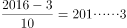，余数为3，得天干为“丙”；，0.750/0.083 ≈ 9，得地支为“申”。故2016年为丙申年。

故正确答案为B。

**考点**：生活常识

**来源**：2015年江西省法检系统招录考试《行测》题第60题

### 第 61 题

某班38名学生参加两次体能测试，测试成绩分为A、B两个等级，在第一次和第二次测试中分别有12人、16人的测试成绩为A。如果两次测试中都没得到A的学生有15人，那么两次测试中都获得A的人数是多少？

A. 5

B. 6

C. 8

D. 10

第 61 题 · 答案与解析

**参考答案（粉笔题库参考内容）**

A

**解析**

两集合容斥问题，套用公式：A+B-两个条件都满足的=总数-两个条件都不满足，代入数字为12+16-都=38-15，解得，两次测试中都获得A的人数是5人。

故正确答案为A。

**考点**：两集合

**来源**：2015年江西省法检系统招录考试《行测》题第61题

### 第 62 题

把7支笔分给参加会议的4名教师，每人至少1支，至多3支，共有多少种分法？

A. 32

B. 20

C. 16

D. 10

第 62 题 · 答案与解析

**参考答案（粉笔题库参考内容）**

C

**解析**

根据题意，“7支笔，每人至少1支，至多3支”，则方法数=总的方法数-有人有4支的方法数。根据插板法可知：总的方法数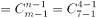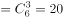种；有人有4支的方法数只能是1个人有4支，其他人各有1支，有4种，故方法数=20-4=16种。

故正确答案为C。

**考点**：同素分堆问题

**来源**：2015年江西省法检系统招录考试《行测》题第62题

### 第 63 题

甲、乙、丙三人一起种了29棵树，丙比甲多种了6棵，但只是乙种植数的2/3，那么甲、乙、丙种植数的比是多少？

A. 2：3：8

B. 1：4：7

C. 5：6：9

D. 4：15：10

第 63 题 · 答案与解析

**参考答案（粉笔题库参考内容）**

D

**解析**

方法一：假设甲种植数为x，乙种植数为y，丙种植数为z，根据题意得：x+y+z=29……①；x＋6=z……②；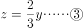；

解得，x=4，y=15，z=10，故甲、乙、丙种植数的比是4：15：10。

方法二：根据题意可得，总的种植数为29棵，故甲、乙、丙种植数的比值和能被29整除，只有D项符合。

故正确答案为D。

**考点**：和差倍比问题

**来源**：2015年江西省法检系统招录考试《行测》题第63题

### 第 64 题

某水池装有甲、乙、丙三根水管，独开甲管30分钟可注满全池，独开乙管24分钟可注满全池，独开丙管48分钟可注满全池，如果按照甲、乙、丙、甲、乙、丙、甲、······的顺序轮流放水，每次两分钟，那么注满这水池需要多少分钟？

A. 6.25

B. 31.25

C. 6

D. 31

第 64 题 · 答案与解析

**参考答案（粉笔题库参考内容）**

B

**解析**

根据题意，赋值工作总量为30，24，48的最小公倍数240，故甲的效率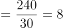，乙的效率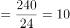，丙的效率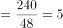，则甲、乙、丙每次2分钟循环的总效率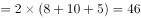，循环一次需要6分钟。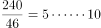，经过5个循环后剩余的水池容量为10，此时是甲进水，需要10/8=1.25分钟，故注满这水池需要的时间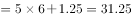分钟。

故正确答案为B。

**考点**：周期余数问题、给完工时间型

**来源**：2015年江西省法检系统招录考试《行测》题第64题

### 第 65 题

王老师是甲、乙、丙三个班的辅导员，甲、乙、丙三个班的班长分别每3天、5天、6天汇报一次班级情况，某天三人同时到王老师那儿做班级汇报，那么下次他们同时到王老师那儿做班级汇报至少要多少天？

A. 90

B. 36

C. 30

D. 18

第 65 题 · 答案与解析

**参考答案（粉笔题库参考内容）**

C

**解析**

根据题意，三人下次同时到王老师那儿做班级汇报至少需要的天数为3、5、6的最小公倍数30天。

故正确答案为C。

**考点**：周期相遇问题

**来源**：2015年江西省法检系统招录考试《行测》题第65题

### 第 66 题

一个纸箱中装有43本同样大小的教辅资料，其中物理教辅资料4本，化学教辅资料3本，语数英三种教辅资料各12本，那么一次至少拿出多少本教辅资料，才能保证取的教辅资料中至少有7本是同一种教辅资料？

A. 7

B. 26

C. 28

D. 29

第 66 题 · 答案与解析

**参考答案（粉笔题库参考内容）**

B

**解析**

根据问题“至少······才······”判断本题为最值问题，套用公式：方法数=最不利情况数＋1，最不利情况就是物理教辅资料取出4本，化学教辅资料取出3本，语数英三种教辅资料各取出6本，最不利情况+1即结果=4＋3＋3×6＋1=26本，故一次至少拿出26本教辅资料，才能保证取的教辅资料中至少有7本是同一种教辅资料。

故正确答案为B。

**考点**：最不利构造

**来源**：2015年江西省法检系统招录考试《行测》题第66题

### 第 67 题

某股民以每股25元的价格买了一公司的股票2000股，一段时间后，他以每股32元的价格卖掉了70%，剩余的十天后又以每股20元的价格卖出，那么他从这次股票买卖中获得多少元的利润？

A. 680

B. 4600

C. 6800

D. 12800

第 67 题 · 答案与解析

**参考答案（粉笔题库参考内容）**

C

**解析**

根据题意，利润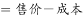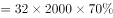元，故他从这次股票买卖中获得6800元的利润。

故正确答案为C。

**考点**：经济利润问题

**来源**：2015年江西省法检系统招录考试《行测》题第67题

### 第 68 题

表面为六种不同颜色的一个长方体，被分割成若干个体积相同的小正方体，如果在这些小正方体中，每面都不带颜色的小正方体的个数为11个，那么有且仅有两个面带颜色的小正方体的个数是多少？

A. 52

B. 48

C. 44

D. 32

第 68 题 · 答案与解析

**参考答案（粉笔题库参考内容）**

A

**解析**

根据题意“每面都不带颜色的小正方体的个数为11个”，11为质数，故这11个小正方体只能在内部且排成一排，有且仅有两个面带颜色的小正方体只能在长方体的棱上，故有且仅有两个面带颜色的小正方体的个数=11×4＋1×8=52个。

故正确答案为A。

**考点**：几何结论类-几何小题型

**来源**：2015年江西省法检系统招录考试《行测》题第68题

### 第 69 题

某单位职工分组讨论一个方案，若每组1个男职工和2个女职工，则剩14个女职工；若每组1个男职工3个女职工，则少8个女职工，该单位共有女职工多少人？

A. 22

B. 44

C. 58

D. 80

第 69 题 · 答案与解析

**参考答案（粉笔题库参考内容）**

C

**解析**

男职工总数是定值，两次分组每组都是1个男职工，可知前后分组的组数相同，假设有x个组，根据总人数相等可得，x＋2x＋14=x＋3x-8，解得，x=22人，故该单位女职工人数= 2×22＋14=58人。

故正确答案为C。

**考点**：和差倍比问题

**来源**：2015年江西省法检系统招录考试《行测》题第69题

### 第 70 题

小李从标有1、2、3、4、5的五张卡片中，任取两张卡片，则两张卡片上的数字相差2的概率是多少？

A. 1/5

B. 2/5

C. 3/4

D. 3/10

第 70 题 · 答案与解析

**参考答案（粉笔题库参考内容）**

D

**解析**

概率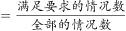，全部的情况数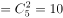种；满足两张卡片上的数字相差2的情况数只有（1，3）、（2，4）、（3，5）3种情况，故任取两张卡片，则两张卡片上的数字相差2的概率=3/10。

故正确答案为D。

**考点**：给情况求概率

**来源**：2015年江西省法检系统招录考试《行测》题第70题

### 第 71 题

从所给的四个选项中，选择最合适的一个填入问号处，使之呈现一定的规律性：

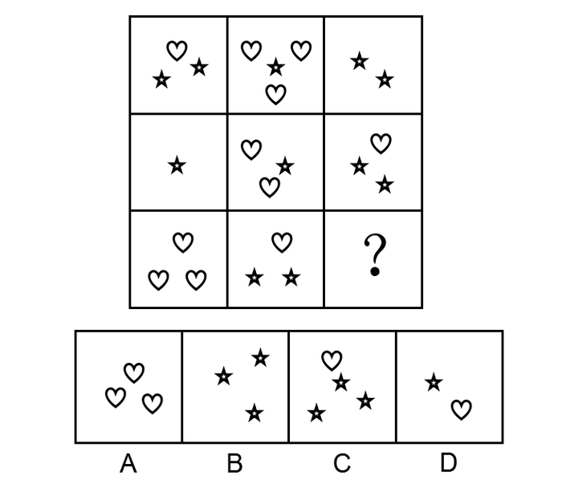

A. A

B. B

C. C

D. D

第 71 题 · 答案与解析

**参考答案（粉笔题库参考内容）**

B

**解析**

每幅图均由小元素组成，优先考虑数量规律中的素。九宫格先横行找规律，观察发现，每一行都是由桃心和五角星两种元素组成。每行元素数量分别是：（桃心4、五角星5）、（桃心3、五角星4）、（桃心4+？、五角星2+？），前两行规律为五角星数量-桃心数量=1，只有B项符合规律。

故正确答案为B。

**考点**：数量规律-素

**来源**：2015年江西省法检系统招录考试《行测》题第71题

### 第 72 题

从所给的四个选项中，选择最合适的一个填入问号处，使之呈现一定的规律性：

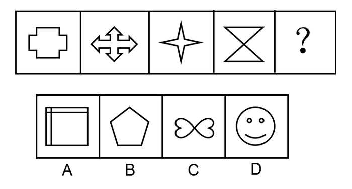

A. A

B. B

C. C

D. D

第 72 题 · 答案与解析

**参考答案（粉笔题库参考内容）**

C

**解析**

元素组成不同，优先考虑属性规律，图形比较规整，考虑对称性。观察发现题干均为轴对称+中心对称图形，只有C项符合。

故正确答案为C。

**考点**：属性规律-对称性

**来源**：2015年江西省法检系统招录考试《行测》题第72题

### 第 73 题

从所给的四个选项中，选择最合适的一个填入问号处，使之呈现一定的规律性：

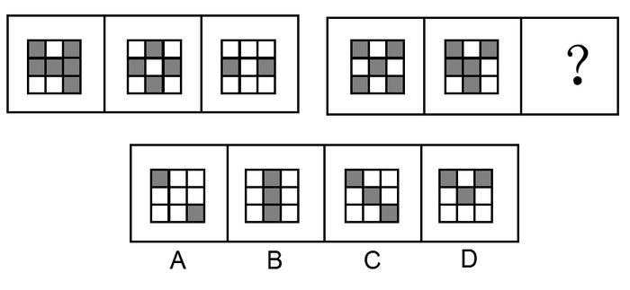

A. A

B. B

C. C

D. D

第 73 题 · 答案与解析

**参考答案（粉笔题库参考内容）**

D

**解析**

元素组成相似，黑白格中黑块数量不同，优先考虑样式规律中的黑白运算。观察第一组图得出规律，黑+白=白、白+黑=白、黑+黑=黑、白+白=白。？处右上角是黑+黑=黑，只有D项符合。

故正确答案为D。

**考点**：样式规律-黑白运算

**来源**：2015年江西省法检系统招录考试《行测》题第73题

### 第 74 题

从所给的四个选项中，选择最合适的一个填入问号处，使之呈现一定的规律性：

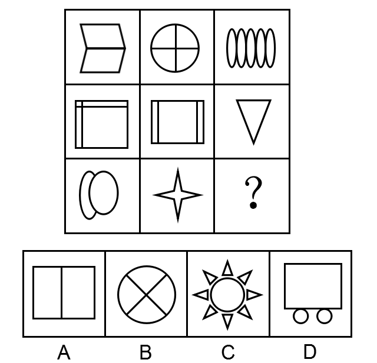

A. A

B. B

C. C

D. D

第 74 题 · 答案与解析

**参考答案（粉笔题库参考内容）**

A

**解析**

元素组成不同，无明显属性规律，考虑数量规律，题干均由封闭图形组成，优先考虑面数量。观察发现，横行面数量之和分别为：11、8、？，不成规律；竖列面数量之和分别为：8、8、？，恒定成规律，因此？处应有2个面，只有A项符合。

故正确答案为A。

**考点**：数量规律-面

**来源**：2015年江西省法检系统招录考试《行测》题第74题

### 第 75 题

从所给的四个选项中，选择最合适的一个填入问号处，使之呈现一定的规律性：

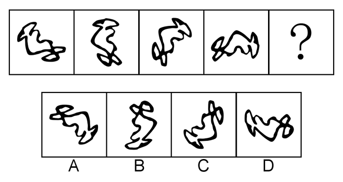

A. A

B. B

C. C

D. D

第 75 题 · 答案与解析

**参考答案（粉笔题库参考内容）**

A

**解析**

元素组成相同，优先考虑位置规律。观察发现，图形整体沿顺时针每次旋转45°，只有A项符合规律。

故正确答案为A。

**考点**：位置规律-旋转

**来源**：2015年江西省法检系统招录考试《行测》题第75题

### 第 76 题

新媒体传播是以数字化技术、多媒体技术和网络传输为标志的新型传播形式。

根据上述定义，下列不属于新媒体传播的是：

A. 小明以电子邮件的方式把建议发送给经理

B. N公司为了扩大品牌影响力，以高额的报酬聘请某知名艺人代言户外广告

C. 张老师使用投影仪给学生上课

D. 小刘使用手机给朋友发微信

第 76 题 · 答案与解析

**参考答案（粉笔题库参考内容）**

B

**解析**

第一步：找出定义关键词。

“数字化技术”、“多媒体技术”、“网络传输”。

第二步：逐一分析选项。

A项：小明以电子邮件的方式发送建议，符合“以网络传输为标志”，符合定义，排除；

B项：以高额的报酬聘请知名艺人代言广告，不符合“数字化技术”、“多媒体技术”、“网络传输”，不符合定义，当选；

C项：使用投影仪给学生上课，符合“以多媒体技术为标志”，符合定义，排除；

D项：使用手机给朋友发微信，符合“以网络传输为标志”，符合定义，排除。

本题为选非题，故正确答案为B。

**考点**：方式目的

**来源**：2015年江西省法检系统招录考试《行测》题第76题

### 第 77 题

娱乐体育是指人们在余暇时间进行的一种娱乐性极强的身体活动，它既是一种身体锻炼的手段，又是一种娱乐手段。

根据上述定义，下列不属于娱乐体育的是：

A. 为促进中国象棋事业发展，山东省和河南省举办了2015年“友谊杯”象棋对抗赛

B. 内蒙古每年举办“那达慕大会”

C. 为增进职工间的互相了解，某大学举办了一场新年交谊舞会

D. 第七届城运会期间，南昌银行组织员工进行踢毽子比赛

第 77 题 · 答案与解析

**参考答案（粉笔题库参考内容）**

A

**解析**

第一步：找出定义关键词。

“余暇时间”、“娱乐性极强”。

第二步：逐一分析选项。

A项：象棋对抗赛不是一种娱乐，目的是为了促进象棋事业发展，不符合定义，当选；

B项：“那达慕大会”是人们为了庆祝丰收而举行的文体娱乐大会，符合“娱乐性极强”，符合定义，排除；

C项：新年交谊舞会符合“娱乐性极强”，符合定义，排除；

D项：踢毽子比赛符合“娱乐性极强”，符合定义，排除。

本题为选非题，故正确答案为A。

**考点**：单定义-其他句式

**来源**：2015年江西省法检系统招录考试《行测》题第77题

### 第 78 题

危机公关是指由于企业管理不善，同行竞争甚至遭遇恶意破坏或者外界特殊事件的影响，而给企业或者品牌带来危机，企业针对危机所采取的一系列自救行动。

根据上述定义，下列属于危机公关的是：

A. 某公司由于生产材料被盗，严重影响生产，主管领导召开紧急会议，研究对策

B. 某酒店由于卫生状况差被曝光后，该酒店领导通过媒体向公众道歉，并发布新的酒店卫生标准

C. 由于下大雪，某公司的户外广告牌被雪压倒，公司派员工去修复

D. 某产品在行业竞争中失去领先地位，销售量大幅下滑

第 78 题 · 答案与解析

**参考答案（粉笔题库参考内容）**

B

**解析**

第一步：找出定义关键词。

“给企业或者品牌带来危机”、“采取自救行动”。

第二步：逐一分析选项。

A项：公司由于生产材料被盗，严重影响生产，不符合“给企业或者品牌带来危机”，不符合定义，排除；

B项：由于卫生状况差被曝光，给企业带来危机，酒店采取自救行动，向公众道歉并发布新的卫生标准，符合定义，当选；

C项：公司的户外广告牌被雪压倒，不符合“给企业或者品牌带来危机”，不符合定义，排除；

D项：某产品在行业竞争中失去领先地位，销售量下滑，给企业带来了危机，但不符合“采取自救行动”，不符合定义，排除。

故正确答案为B。

**考点**：原因结果

**来源**：2015年江西省法检系统招录考试《行测》题第78题

### 第 79 题

集合是指具有某种属性的事物的全体，组成集合的每个事物称为该集合的元素，具有互异性、确定性、无序性。

根据上述定义，下列不能构成集合的是：

A. 花果山小区的所有老人

B. 某大学所有学生

C. 玫瑰花、菊花、牡丹花、兰花

D. 1、2、56、78、45、33

第 79 题 · 答案与解析

**参考答案（粉笔题库参考内容）**

A

**解析**

第一步：找出定义关键词。

“具有某种属性”、“互异性、确定性、无序性”。

第二步：逐一分析选项。

A项：花果山小区的所有老人，但是多大年龄算老人是不确定的，不符合“互异性、确定性、无序性”，不符合定义，当选；

B项：某大学所有学生，属性是学生，可以构成集合，符合定义，排除；

C项：玫瑰花、菊花、牡丹花、兰花，属性是花，可以构成集合，符合定义，排除；

D项：1、2、56、78、45、33，属性是数字，可以构成集合，符合定义，排除。

本题为选非题，故正确答案为A。

**考点**：单定义-其他句式

**来源**：2015年江西省法检系统招录考试《行测》题第79题

### 第 80 题

生活噪音是指人为活动所产生的除工业噪音、建筑施工噪音和交通噪音之外的干扰周围生活环境的噪音。

根据上述定义，下列属于生活噪音的是：

A. 隔壁面粉厂传来的机器轰鸣声

B. 深夜楼下传来的小红的弹琴声

C. 办公楼后面的建筑工地施工的声音

D. 马路上的汽车轰鸣声

第 80 题 · 答案与解析

**参考答案（粉笔题库参考内容）**

B

**解析**

第一步：找出定义关键词。

“人为活动产生”、“除工业噪音、建筑施工噪音、交通噪音之外的噪音”。

第二步：逐一分析选项。

A项：面粉厂传来的机器轰鸣声，属于工业噪音，不符合定义，排除；

B项：楼下传来的小红的弹琴声，属于人为活动产生的噪音，符合定义，当选；

C项：建筑工地施工的声音，属于建筑施工噪音，不符合定义，排除；

D项：马路上的汽车轰鸣声，属于交通噪音，不符合定义，排除。

故正确答案为B。

**考点**：原因结果

**来源**：2015年江西省法检系统招录考试《行测》题第80题

### 第 81 题

非物质文化遗产是指各族人民世代相传并视其为文化遗产组成部分的各种传统文化表现形式，以及与传统文化表现形式相关的实物和场所。

根据上述定义，下列不属于非物质文化遗产的是：

A. 洪拳、热贡唐卡

B. 天津玉雕、中国书法

C. 黑龙江剪纸、中医养生文化

D. 热贡马术、采茶戏

第 81 题 · 答案与解析

**参考答案（粉笔题库参考内容）**

A

**解析**

第一步：找出定义关键词。

“各种传统文化表现形式”、“与传统文化表现形式相关的实物和场所”。

第二步：逐一分析选项。

A项：洪拳属于中国传统拳术中的南拳之一，但其仅代表南拳，范围较小，并不是各族人民世代相传的传统文化表现形式，不符合定义，当选；

B项：天津玉雕融入了天津特有的大气、磅礴的地域文化特色；中国书法是一门古老的汉字的书写艺术，符合关键词，符合定义，排除；

C项：黑龙江剪纸形成了黑龙江的传统剪纸的鲜明特色；中医养生文化是传统文化的表现形式，符合定义，排除；

D项：热贡马术(骑马点火枪)是传统表演赛,是省级民族体育非遗项目,体现了藏民族的杰出智慧；采茶戏是流行于江南地区和岭南一些省区的一种传统戏曲类别，符合定义，排除。

本题为选非题，故正确答案为A。

**考点**：单定义-其他句式

**来源**：2015年江西省法检系统招录考试《行测》题第81题

### 第 82 题

股东代表诉讼是指当董事、监事、高级管理人员或者他人的违反法律、行政法规或者公司章程的行为给公司造成损失，公司拒绝或者怠于向该违法行为人请求损害赔偿时，具备法定资格的股东有权代表其他股东，代替公司以自己的名义提起诉讼，请求违法行为人赔偿公司损失的行为。

根据上述定义，下列属于股东代表诉讼的是：

A. 孙某对其股份有限公司负债100万元到期不偿还，鉴于他是公司董事长的小舅子，公司负责人并没有打算追讨这笔债务。具备法定资格的股东周某可以书面请求监事会、董事会或者董事向人民法院起诉孙某，或者直接向人民法院起诉孙某

B. 刘某是甲有限责任公司的董事长兼总经理。任职期间，多次利用职务之便，指示公司会计将资金借贷给一家主要由刘某儿子投资设立的乙公司。对此，具备法定资格的股东赵某决定以自己的名义直接起诉乙公司还款

C. 某股份有限公司的董事张某，在公司存续期间违反法律规定，经营与本公司相同的业务，由此给公司其他股东造成了巨大损失。具备法定资格的股东陆某可以自己的名义起诉张某

D. 某上市公司董事会秘书李某执行公司职务时，违反公司章程的规定，给公司造成了损失。具备法定资格的股东王某可以直接以公司的名义起诉李某

第 82 题 · 答案与解析

**参考答案（粉笔题库参考内容）**

A

**解析**

第一步：找出定义关键词。

“公司拒绝或者怠于向该违法行为人请求损害赔偿”、“代替公司以自己的名义提起诉讼”。

第二步：逐一分析选项。

A项：孙某不偿还负债，公司负责人没有打算追讨债务，周某可以直接向人民法院起诉孙某，符合“以自己的名义提起诉讼”，符合定义，当选；

B项：刘某利用职务之便将资金借贷出去，但未提及关键词“公司拒绝或者怠于向该违法行为人请求损害赔偿”，不符合定义，排除；

C项：张某违反规定经营相同的业务，造成巨大损失，但未提及关键词“公司拒绝或者怠于向该违法行为人请求损害赔偿”，不符合定义，排除；

D项：李某违反规定给公司造成了损失，以公司的名义起诉李某，不符合关键词“以自己的名义提起诉讼”，不符合定义，排除。

故正确答案为A。

**考点**：大前提

**来源**：2015年江西省法检系统招录考试《行测》题第82题

### 第 83 题

不作为犯罪是指行为人负有实施某种积极行为的特定法律义务，并且能够实行而不实行以致构成犯罪。

根据上述定义，下列说法错误的是：

A. 卖淫女王某在嫖客李某住处与李某发生性关系，李某心脏病发作，王某扬长而去，之后李某死亡，王某没有救助李某的义务，故不成立不作为犯罪

B. 成年男子张某任由邻居幼女孙某对自己实施猥亵行为而不予制止的，不成立不作为犯罪

C. 出租车司机卢某对男乘客李某在出租车内强奸女乘客王某的行为不予制止的，不成立不作为犯罪

D. 崔某为窗户安装防护栏，之后发现其有散架的可能，而没有采取安全措施，导致行人被坍塌的防护栏砸成重伤的，成立不作为犯罪

第 83 题 · 答案与解析

**参考答案（粉笔题库参考内容）**

C

**解析**

第一步：找出定义关键词。

“行为人负有实施某种积极行为的特定法律义务”、“能够实行而不实行以致构成犯罪”。

第二步：逐一分析选项。

A项：李某心脏病发作，王某没有救助李某的特定法律义务，不成立不作为犯罪，说法正确，排除；

B项：张某任由邻居幼女对自己实施猥亵行为，张某没有特定法律义务，不成立不作为犯罪，说法正确，排除；

C项：卢某作为出租车司机，有义务保证乘客的安全，能够制止却没有，成立不作为犯罪，说法错误，当选；

D项：崔某发现散架的可能后没有采取安全措施，导致伤人，成立不作为犯罪，说法正确，排除。

本题为选非题，故正确答案为C。

**考点**：原因结果

**来源**：2015年江西省法检系统招录考试《行测》题第83题

### 第 84 题

会意是指用两个或两个以上的独体字会合起来表示一个新的意义的造字方法。

根据上述定义，下列不属于会意字的是：

A. 从

B. 息

C. 明

D. 江

第 84 题 · 答案与解析

**参考答案（粉笔题库参考内容）**

D

**解析**

第一步：找出定义关键词。

“两个或两个以上的独体字”、“表示一个新的意义”。

第二步：逐一分析选项。

A项：“从”由两个“人”字会合而成，表示一个新的意义，符合定义，排除；

B项：“息”由“自”和“心”会合而成，表示一个新的意义，符合定义，排除；

C项：“明”由“日”和“月”会合而成，表示一个新的意义，符合定义，排除；

D项：“江”由“氵”和“工”会合而成，但“氵”不是独体字，不符合定义，当选。

本题为选非题，故正确答案为D。

**考点**：主客体

**来源**：2015年江西省法检系统招录考试《行测》题第84题

### 第 85 题

工资、薪金所得是指个人因任职或者受雇而取得的工资、薪金、奖金、年终加薪、劳动分红、津贴、补贴以及与任职或者受雇有关的其他所得。

根据上述定义，下列属于工资、薪金所得的是：

A. 公司职工取得的用于购买企业国有股权的劳动分红

B. 某出租车属个人所有，但挂靠出租汽车经营单位，该车所有人向挂靠单位缴纳的管理费

C. 律师事务所向其投资者支付的工资

D. 南方某大学著名学者张某为科研培训班授课获得的讲课费

第 85 题 · 答案与解析

**参考答案（粉笔题库参考内容）**

A

**解析**

第一步：找出定义关键词。

“任职或者受雇”。

第二步：逐一分析选项。

A项：职工受雇于公司，购买企业国有股权活动的劳动分红，符合定义，当选；

B项：出租车挂靠到出租汽车经营单位的管理费，不符合“任职或者受雇”，不符合定义，排除；

C项：律师事务所的投资者，不符合“任职或者受雇”，不符合定义，排除；

D项：学者张某为科研培训班授课，并不是任职或者受雇，其任职单位是南方某大学，不符合定义，排除。

故正确答案为A。

**考点**：原因结果

**来源**：2015年江西省法检系统招录考试《行测》题第85题

### 第 86 题

权力：亵渎

A. 入侵：国家

B. 领土：维护

C. 隐私：侵犯

D. 结婚：夫妻

第 86 题 · 答案与解析

**参考答案（粉笔题库参考内容）**

C

**解析**

第一步：判断题干词语间逻辑关系。

亵渎权力，构成动宾短语，二者是语法关系。

第二步：判断选项词语间逻辑关系。

A项：入侵国家，二者是动宾关系，但两词顺序相反，与题干逻辑关系不一致，排除；

B项：维护领土，构成动宾短语，保留；

C项：侵犯隐私，构成动宾短语，保留；

D项：结婚后成为夫妻，与题干逻辑关系不一致，排除。

比较B、C两项，题干的权力和C项的隐私都是虚拟的事物，而B项中的领土是真实的事物，C项与题干更为一致，当选。

故正确答案为C。

**考点**：语法关系

**来源**：2015年江西省法检系统招录考试《行测》题第86题

### 第 87 题

歌手：中国人

A. 吉他手：演奏

B. 学者：研究

C. 王安石：江西人

D. 专家：教师

第 87 题 · 答案与解析

**参考答案（粉笔题库参考内容）**

D

**解析**

第一步：判断题干词语间逻辑关系。

有的歌手是中国人，有的中国人是歌手，二者为交叉关系。

第二步：判断选项词语间逻辑关系。

A项：吉他手演奏，二者是职业与行为的对应关系，与题干逻辑关系不一致，排除；

B项：学者研究，二者是职业与行为的对应关系，与题干逻辑关系不一致，排除；

C项：王安石是江西人，二者是人物与籍贯的对应关系，与题干逻辑关系不一致，排除；

D项：有的专家是教师，有的教师是专家，二者为交叉关系，与题干逻辑关系一致，当选。

故正确答案为D。

**考点**：逻辑关系-交叉关系

**来源**：2015年江西省法检系统招录考试《行测》题第87题

### 第 88 题

电脑：发邮件：记者

A. 耳机：听歌：运动员

B. 法庭：审理：法官

C. 橡皮擦：画画：儿童

D. 裁缝：做衣服：缝纫机

第 88 题 · 答案与解析

**参考答案（粉笔题库参考内容）**

A

**解析**

第一步：判断题干词语间逻辑关系。

造句子：记者用电脑发邮件。

第二步：判断选项词语间逻辑关系。

A项：运动员用耳机听歌，与题干逻辑关系一致，当选；

B项：法官在法庭审理，法官与法庭是地点的对应，与题干逻辑关系不一致，排除；

C项：儿童用画笔画画而不是橡皮擦，搭配不当，与题干逻辑关系不一致，排除；

D项：裁缝用缝纫机做衣服，但前一词与后一词顺序相反，与题干逻辑关系不一致，排除。

故正确答案为A。

**考点**：语法关系、逻辑关系-对应关系

**来源**：2015年江西省法检系统招录考试《行测》题第88题

### 第 89 题

贱内：妻子

A. 寡人：自己

B. 犬子：儿子

C. 家母：祖母

D. 红绿灯：信号灯

第 89 题 · 答案与解析

**参考答案（粉笔题库参考内容）**

B

**解析**

第一步：判断题干词语间逻辑关系。

贱内是对妻子的谦称，指的是同一人。

第二步：判断选项词语间逻辑关系。

A项：寡人是古代君主、诸侯王对自己的谦称，指的是同一人，保留；

B项：犬子是对自己儿子的谦称，指的是同一人，保留；

C项：家母是母亲，祖母是父亲的母亲，指的不是同一人，与题干逻辑关系不一致，排除；

D项：红绿灯是一种信号灯，二者是种属关系，与题干逻辑关系不一致，排除。

比较AB两项，题干妻子和B项中的儿子都是其他人，而非自己，A项是自己，B项与题干更为一致，当选。

故正确答案为B。

**考点**：逻辑关系-全同关系

**来源**：2015年江西省法检系统招录考试《行测》题第89题

### 第 90 题

柳树：植物：园丁

A. 钢笔：铅笔：学生

B. 汽车：火车：司机

C. 树木：树林：小鸟

D. 奶牛：母牛：牧民

第 90 题 · 答案与解析

**参考答案（粉笔题库参考内容）**

D

**解析**

第一步：判断题干词语间逻辑关系。

柳树是一种植物，园丁的工作对象是植物，前两者是种属关系，后两者是对应关系。

第二步：判断选项词语间逻辑关系。

A项：钢笔和铅笔都是文具，二者是并列关系，与题干逻辑关系不一致，排除；

B项：汽车和火车都是交通工具，二者是并列关系，与题干逻辑关系不一致，排除；

C项：树木是树林的组成部分，二者是组成关系，与题干逻辑关系不一致，排除；

D项：奶牛是母牛，二者是种属关系，母牛是牧民的工作对象，二者是对应关系，与题干逻辑关系一致，当选。

故正确答案为D。

**考点**：逻辑关系-包容关系

**来源**：2015年江西省法检系统招录考试《行测》题第90题

### 第 91 题

教师：学生

A. 主持人：影星

B. 售货员：收银员

C. 医生：病人

D. 经理：秘书

第 91 题 · 答案与解析

**参考答案（粉笔题库参考内容）**

C

**解析**

第一步：判断题干词语间逻辑关系。

教师教导学生，二者为语法关系中的主宾关系。

第二步：判断选项词语间逻辑关系。

A项：主持人和影星都是一种职业，二者为并列关系，与题干逻辑关系不一致，排除；

B项：售货员和收银员都是一种职业，二者为并列关系，与题干逻辑关系不一致，排除；

C项：医生治疗病人，二者为语法关系中的主宾关系，与题干逻辑关系一致，当选；

D项：经理和秘书都是一种职业，二者为并列关系，与题干逻辑关系不一致，排除。

故正确答案为C。

**考点**：语法关系

**来源**：2015年江西省法检系统招录考试《行测》题第91题

### 第 92 题

银行：利息

A. 母牛：小牛

B. 学校：学生

C. 医院：医生

D. 工厂：工人

第 92 题 · 答案与解析

**参考答案（粉笔题库参考内容）**

A

**解析**

第一步：判断题干词语间逻辑关系。

银行存款能产生利息，二者为对应关系。

第二步：判断选项词语间逻辑关系。

A项：母牛能生产出小牛，二者为对应关系，与题干逻辑关系一致，当选；

B项：学生在学校学习，二者为地点对应关系，与题干逻辑关系不一致，排除；

C项：医生在医院工作，二者为地点对应关系，与题干逻辑关系不一致，排除；

D项：工人在工厂工作，二者为地点对应关系，与题干逻辑关系不一致，排除。

故正确答案为A。

**考点**：逻辑关系-对应关系

**来源**：2015年江西省法检系统招录考试《行测》题第92题

### 第 93 题

稻谷：大米

A. 核桃：桃酥

B. 棉花：棉籽

C. 西瓜：瓜子

D. 手枪：子弹

第 93 题 · 答案与解析

**参考答案（粉笔题库参考内容）**

B

**解析**

第一步：判断题干词语间逻辑关系。

稻谷去壳后是大米，大米是稻谷的一部分，二者为包容关系中的组成关系。

第二步：判断选项词语间逻辑关系。

A项：核桃是制作桃酥的一种原材料，二者为原材料的对应关系，与题干逻辑关系不一致，排除；

B项：棉籽是棉花的一部分，二者为包容关系中的组成关系，与题干逻辑关系一致，当选；

C项：西瓜子是西瓜的一部分，但瓜子范围较广，除了西瓜子还包括南瓜子、黄瓜子、丝瓜子等，与题干逻辑关系不一致，排除；

D项：手枪和子弹是配套使用关系，与题干逻辑关系不一致，排除。

故正确答案为B。

**考点**：逻辑关系-包容关系

**来源**：2015年江西省法检系统招录考试《行测》题第93题

### 第 94 题

耕耘：收获

A. 生病：住院

B. 点灯：放火

C. 扶贫：账户

D. 扩招：失业

第 94 题 · 答案与解析

**参考答案（粉笔题库参考内容）**

A

**解析**

第一步：判断题干词语间逻辑关系。

先耕耘再收获，二者为时间先后的对应关系。

第二步：判断选项词语间逻辑关系。

A项：先生病再住院，二者为时间先后的对应关系，与题干逻辑关系一致，当选；

B项：点灯和放火之间没有明显的先后顺序，与题干逻辑关系不一致，排除；

C项：扶贫和账户之间没有明显的先后顺序，与题干逻辑关系不一致，排除；

D项：扩招和失业之间没有明显的先后顺序，与题干逻辑关系不一致，排除。

故正确答案为A。

**考点**：逻辑关系-对应关系

**来源**：2015年江西省法检系统招录考试《行测》题第94题

### 第 95 题

海上生明月，天涯共此时：唐：张九龄

A. 柴门闻犬吠，风雪夜归人：宋：刘长卿

B. 月出惊山鸟，时鸣春涧中：唐：杜甫

C. 欲穷千里目，更上一层楼：唐：王之涣

D. 读书破万卷，下笔如有神：东晋：陶渊明

第 95 题 · 答案与解析

**参考答案（粉笔题库参考内容）**

C

**解析**

第一步：判断题干词语间逻辑关系。

海上生明月，天涯共此时为唐代张九龄所著，三者为诗、朝代和作者的对应关系。

第二步：判断选项词语间逻辑关系。

A项：柴门闻犬吠，风雪夜归人为唐代刘长卿所著，不是宋代，与题干逻辑关系不一致，排除；

B项：月出惊山鸟，时鸣春涧中为唐代王维所著，不是杜甫，与题干逻辑关系不一致，排除；

C项：欲穷千里目，更上一层楼为唐代王之涣所著，与题干逻辑关系一致，当选；

D项：读书破万卷，下笔如有神为唐代杜甫所著，不是东晋陶渊明，与题干逻辑关系不一致，排除。

故正确答案为C。

**考点**：逻辑关系-对应关系

**来源**：2015年江西省法检系统招录考试《行测》题第95题

### 第 96 题

调查报告中写道：调查表明65%的戴眼镜的用户喜欢树脂镜框，35%的用户喜欢金属镜框。同时报告中还写道“还有10%的用户说他们两者都不喜欢。”

以下哪项最合理地解释了调查报告中的表面性矛盾？

A. 某些用户观点发生了变化

B. 调查的用户总数超过100

C. 喜欢金属镜框的用户都包括在65%的喜欢树脂镜框的用户中

D. 某些用户两种镜框都喜欢

第 96 题 · 答案与解析

**参考答案（粉笔题库参考内容）**

D

**解析**

第一步：找出题干矛盾。

调查报告中有65%的戴眼镜的用户喜欢树脂镜框，35%的用户喜欢金属镜框，但是还10%的用户说他们两者都不喜欢。

第二步：逐一分析选项。

A项：某些用户观点发生了变化，但是没有说明观点发生了怎样的变化，不能解释题干矛盾，排除；

B项：题干说的是百分比，而选项讨论的是人数，人数和百分比之间没有关系，不能解释题干矛盾，排除；

C项：喜欢金属镜框的35%用户都包括在喜欢树脂镜框的65%用户中，说明还有35%的用户两者都不喜欢，而题干说的10%的用户两者都不喜欢，不能解释题干矛盾，排除；

D项：某些用户两种镜框都喜欢，说明65%喜欢树脂镜框的用户和35%喜欢金属镜框的用户有部分重叠，有可能是10%的用户，因此就可能10%的用户两者都不喜欢，可以解释题干矛盾，当选。

故正确答案为D。

**考点**：原因解释

**来源**：2015年江西省法检系统招录考试《行测》题第96题

### 第 97 题

甲以杀人故意，乙以伤害故意，共同攻击丙，导致丙死亡。事后发现，丙身上只有一处致命伤，但查不清楚是甲还是乙的行为导致。

学说：

①杀人行为不包含伤害行为，杀人故意排除伤害故意

②杀人行为包含伤害行为，杀人故意包含伤害故意

根据上述学说，以下哪种说法不能成立？

A. 根据学说①，甲乙不成立共犯，甲乙的行为与丙的死亡之间都没有因果关系

B. 根据学说②，甲乙成立共犯，甲乙的行为与丙的死亡之间存在因果关系

C. 无论根据学说①还是学说②，甲总是成立故意杀人罪，乙总是成立故意伤害罪

D. 无论根据学说①还是学说②，甲乙二人对丙的死亡结果都要承担刑事责任

第 97 题 · 答案与解析

**参考答案（粉笔题库参考内容）**

A

**解析**

逐一分析选项。

A项：根据学说①，甲乙由于目的不同，不成立共犯，但是甲乙的行为导致丙死亡，与丙的死亡之间都有因果关系，因此这种说法不能成立，当选；

B项：根据学说②，乙的伤害故意被包含在杀人故意中，所以甲乙成立共犯，且甲乙的行为与丙的死亡之间存在因果关系，因此这种说法能够成立，排除；

C项：无论根据学说①还是学说②，由于甲的目的是杀人，乙的目的是伤害，且丙由于受到伤害死亡，所以甲总是成立故意杀人罪，乙总是成立故意伤害罪，因此这种说法能够成立，排除；

D项：无论根据学说①还是学说②，甲乙已经对丙造成伤害导致死亡，所以对丙的死亡结果都要承担刑事责任，因此这种说法能够成立，排除。

本题为选非题，故正确答案为A。

**考点**：日常结论

**来源**：2015年江西省法检系统招录考试《行测》题第97题

### 第 98 题

某小区发生一起盗窃案，经调查：

第一，盗窃数额或者是5万元或者是3万元，二者必居其一

第二，盗窃时间或者是在午夜12点或者是在凌晨4点

第三，盗窃者或者是甲，或者乙，二者必居其一

如果以上判定是真的，那么以下哪一项也一定为真？

A. 有证据证明甲在午夜12点没有作案，因此，乙在凌晨4点盗窃了财物5万元

B. 财物是甲在凌晨4点盗窃的，因此，财物不是乙在凌晨4点盗窃的

C. 盗窃的时间是午夜12点，但甲没有盗窃5万元，因此，一定是乙盗窃了3万元

D. 财物是甲在凌晨4点盗窃的，因此，甲一定盗窃了5万元

第 98 题 · 答案与解析

**参考答案（粉笔题库参考内容）**

B

**解析**

第一步：翻译题干。

①盗窃数额：5万元或3万元；

②盗窃时间：午夜12点或凌晨4点；

③盗窃者：甲或乙。

第二步：逐一分析选项。

A项：甲在午夜12点没有作案，说明乙在午夜12点或者凌晨4点盗窃了财物5万元或者3万元，无法推出，排除；

B项：财物是甲在凌晨4点盗窃的，说明乙在任何时间都没有盗窃，因此财物不是乙在凌晨4点盗窃的，可以推出，当选；

C项：盗窃的时间是午夜12点，但甲没有盗窃5万元，说明有可能是甲盗窃了3万元，或者乙盗窃了5万元或者3万元，无法推出，排除；

D项：财物是甲在凌晨4点盗窃的，那么甲有可能盗窃了5万元，也有可能盗窃了3万元，无法推出，排除。

故正确答案为B。

**考点**：常规翻译

**来源**：2015年江西省法检系统招录考试《行测》题第98题

### 第 99 题

某大型电器公司领导对其员工说，除非你们到年底能实现销售五百万台空调的目标，否则将扣除部分年终奖。

由此可以推出：

A. 若员工实现了销售目标，那么不会被扣除部分年终奖

B. 若员工没有实现销售目标，则一定会被扣除部分年终奖

C. 若员工被扣除了部分年终奖，则一定是没有完成销售目标

D. 只有员工不会被扣除部分年终奖，才会实现销售目标

第 99 题 · 答案与解析

**参考答案（粉笔题库参考内容）**

B

**解析**

第一步：翻译题干。

①—扣除部分年终奖→实现销售目标。

第二步：逐一分析选项。

A项：翻译为实现销售目标→—扣除部分年终奖，是对①的肯后，肯后得不到确定性的结论，排除；

B项：翻译为—实现销售目标→扣除部分年终奖，是对①的否后，否后必否前，当选；

C项：翻译为扣除了部分年终奖→—实现销售目标，是对①的否前，否前得不到确定性的结论，排除；

D项：翻译为实现销售目标→—扣除部分年终奖，是对①的肯后，肯后得不到确定性的结论，排除。

故正确答案为B。

**考点**：常规翻译

**来源**：2015年江西省法检系统招录考试《行测》题第99题

### 第 100 题

在某高校《大学语文》课程的选课系统中，如果甲和乙都没有选这门课程，那么丙一定选了。

上述前提中再增加以下哪项，可推出“甲选了这门课程”的结论？

A. 丙选了但乙没选

B. 丙和乙都选了

C. 丙和乙都没选

D. 丙没选但乙选了

第 100 题 · 答案与解析

**参考答案（粉笔题库参考内容）**

C

**解析**

第一步：翻译题干。

①—甲且—乙→丙

②甲

第二步：逐一分析选项。

将①逆否可以推出：③—丙→甲或乙。

因此，若丙没选这门课，否后必否前，可以推出甲或乙选了，若乙没选这门课，根据否一推一，可以推出甲选了这门课程，即若想推出“甲选了这门课程”，需要丙和乙都没选。

故正确答案为C。

**考点**：常规翻译

**来源**：2015年江西省法检系统招录考试《行测》题第100题

### 第 101 题

上海一家知名饭店，最近将一道菜的单价从过去的28元提高到58元，生意仍然非常好。然而，在提价后的一个月内，几个服务员却陆续辞职了。

以下哪项最能解释上述现象？

A. 由于提高菜价，该店市场占有率不断下滑

B. 菜价的提高并不能解决原材料涨价带来的利润下滑问题，店主只好降低员工薪酬

C. 尽管提价了，该店这道菜仍然比其他店卖得便宜

D. 由于提价带来利润增加，店主增加了服务员的薪酬

第 101 题 · 答案与解析

**参考答案（粉笔题库参考内容）**

B

**解析**

第一步：找出题干矛盾。

在提价后生意仍然非常好，但几个服务员却陆续辞职了。

第二步：逐一分析选项。

A项：市场占有率下滑和服务员辞职之间没有明显关系，不能解释题干矛盾，排除；

B项：降低员工薪酬有可能导致服务员陆续辞职，可以解释题干矛盾，当选；

C项：这道菜仍然比其他店卖得便宜和服务员辞职之间没有明显关系，不能解释题干矛盾，排除；

D项：增加了服务员的薪酬，服务员更不可能辞职，与题干现象相反，不能解释题干矛盾，排除。

故正确答案为B。

**考点**：原因解释

**来源**：2015年江西省法检系统招录考试《行测》题第101题

### 第 102 题

一个产品要想稳固地占领市场，产品本身的质量和产品的售后服务二者缺一不可。春雨牌汽车质量不错，但售后服务跟不上，因此，很难长期稳固地占领市场。

以下哪项推理的结构和题干的最为相似？

A. 富裕的家庭条件可以很好地帮助孩子成才。张明23岁就取得了法学博士学位，因此，他的家庭一定很富裕

B. 足球运动员的个人技术能够很好地提升团队水平，钟某的足球水平在国内首屈一指，今年其所在球队取得了联赛冠军，因此，钟某贡献最大

C. 一个医生要有良好的声誉，必须具备精湛的医术水平和优良的职业道德。赵某医术很高但医德缺失，因此，他不是一个好医生

D. 如果小乒每门考试成绩都在90分以上且在班级处于前三名，爸爸就会带他去吃肯德基。小乒语文只考了85分但仍是班级第一名，因此爸爸带他去吃了肯德基

第 102 题 · 答案与解析

**参考答案（粉笔题库参考内容）**

C

**解析**

第一步：分析题干论证方式。

题干先叙述了产品想要稳固市场的两个不可或缺的原因，是产品本身的质量和产品的售后服务，然后讨论了一个具体的产品缺少了其中一个条件，因此很难长期稳固地占领市场。先给出一个结论和两个条件，后讨论具体案例由于缺少其中一个条件而不符合结论。是从普遍性结论推理个体的演绎推理。

第二步：逐一分析选项。

A项：选项先讨论的是家庭富裕这个条件能够帮助孩子成才，后由张明成才推理出他家庭富裕这个条件，而题干是前后均由条件推出结论，与题干论证结构不一致，排除；

B项：选项先讨论的是提升团队水平的条件是足球运动员的个人技术，而钟某满足水平高的条件，团队取得了冠军，因此钟某贡献最大，但贡献最大这个结论没有在之前提出过，与题干论证结构不一致，排除；

C项：选项先讨论的是医生具有良好声誉的两个条件，是精湛的医术水平和优良的职业道德，而赵某缺失其中一个条件，所以得出不是一个好医生的结论，和题干论证结构一致，当选；

D项：选项先讨论的是小乒去吃肯德基的两个条件是每门考试成绩都在90分以上且在班级处于前三名，而小乒只满足其中一个条件，却实现了结论，与题干论证结构不一致，排除。

故正确答案为C。

**考点**：推理形式

**来源**：2015年江西省法检系统招录考试《行测》题第102题

### 第 103 题

一项研究显示，肥胖者参加体育锻炼的周平均量，只占正常体重者的45%，而肥胖者的食物摄入的周平均量，基本与正常体重者持平，由此得出结论，导致肥胖的主要原因是缺乏锻炼而不是摄入过多的食物。

以下哪项如果为真最能削弱上述论证？

A. 体育锻炼通常会刺激食欲，从而使肥胖者增加食物摄入量

B. 有些肥胖者体育锻炼的平均量要大于正常体重者

C. 肥胖者由于体重的负担，不乐意参加体育锻炼

D. 肥胖者的食物摄入平均量和正常体重者基本持平，但肥胖者中有人在节食

第 103 题 · 答案与解析

**参考答案（粉笔题库参考内容）**

C

**解析**

第一步：找出论点和论据。

论点：导致肥胖的主要原因是缺乏锻炼而不是摄入过多的食物。

论据：肥胖者参加体育锻炼的周平均量，只占正常体重者的45%，而肥胖者的食物摄入的周平均量，基本与正常体重者持平。

第二步：逐一分析选项。

A项：论点说的是导致肥胖的主要原因是缺乏锻炼而不是摄入过多的食物，该项说的是体育锻炼会使肥胖者增加食物摄入量，话题不一致，排除；

B项：有些肥胖者体育锻炼的平均量要大于正常体重者，举例说明缺乏锻炼不是导致肥胖的主要原因，可以削弱，保留；

C项：肥胖者由于体重的负担，不乐意参加体育锻炼，说明是肥胖导致了缺乏锻炼，属于因果倒置，可以削弱，保留；

D项：选项讨论的是部分肥胖者节食，而论点讨论的是导致肥胖的主要原因是缺乏锻炼而不是摄入过多的食物，话题不一致，排除。

对比B、C两项，因果倒置的力度强于举反例，因此择优选择C项。

故正确答案为C。

**考点**：因果倒置

**来源**：2015年江西省法检系统招录考试《行测》题第103题

### 第 104 题

某公司最近进行了一项有关奖金对销售人员销售业绩是否有促进作用的调查，结果表明：获得奖金的销售人员比那些没有获得奖金的销售人员的销售业绩要高百分之十，调查的内容包括销售的对象、销售的渠道、日平均销售量等许多指标，这充分说明，奖金对帮助销售人员提高销售业绩的作用是很明显的。以下哪项如果为真，最能削弱上述论证？

A. 获得奖金通常是因为那些销售人员有较好的销售方法和良好的销售业绩

B. 获得奖金的销售人员可以更容易通过改善销售策略来提高销售业绩

C. 销售业绩差的销售人员通常工作时间长而缺少正常的休息

D. 对销售业绩的高低与奖金的大小的关系的研究应当采取定量方法进行

第 104 题 · 答案与解析

**参考答案（粉笔题库参考内容）**

A

**解析**

第一步：找出论点和论据。

论点：奖金对帮助销售人员提高销售业绩的作用是很明显的。

论据：获得奖金的销售人员比那些没有获得奖金的销售人员的销售业绩要高百分之十。

第二步：逐一分析选项。

A项：选项说明销售人员有较好的销售方法和良好的销售业绩才获得奖金，而不是因为获得奖金才使他们提高业绩，属于因果倒置，可以削弱，当选；

B项：解释了获得奖金的销售人员如何提高销售业绩，属于加强项，排除；

C项：选项讨论的是销售业绩差的销售人员通常工作时间长而缺少正常的休息，而论点讨论的是奖金能够帮助销售人员提高销售业绩，话题不一致，属于无关项，排除；

D项：选项讨论的是如何研究销售业绩和奖金大小的关系，而论点讨论的是奖金能否帮助销售人员提高销售业绩，话题不一致，属于无关项，排除。

故正确答案为A。

**考点**：因果倒置

**来源**：2015年江西省法检系统招录考试《行测》题第104题

### 第 105 题

温馨和花园这两家酒店，对来他们酒店消费的顾客，提供了24小时的热线服务，顾客仅在入住过程中有困难时才打电话，并且，温馨收到的热线电话比花园收到的热线电话多四倍，因此，温馨的服务一定比花园的服务差。

以下哪项如果为真，最能有效支持上述论证？

A. 花园酒店每个热线电话的平均时间比温馨酒店的长

B. 这两家酒店收到的热线电话数量逐渐上升

C. 花园酒店收到的关于服务质量的投诉比温馨酒店多两倍

D. 入住花园酒店的顾客数比入住温馨酒店的多三倍

第 105 题 · 答案与解析

**参考答案（粉笔题库参考内容）**

D

**解析**

第一步：找出论点和论据。

论点：温馨的服务一定比花园的服务差。

论据：顾客仅在入住过程中有困难时才打电话，并且，温馨收到的热线电话比花园收到的热线电话多四倍。

第二步：逐一分析选项。

A项：花园酒店的热线电话比温馨酒店的时间长，说明虽然花园酒店电话少，但是可能顾客遇到的问题更多，所以温馨的服务不一定比花园的服务差，具有一定的削弱作用，排除；

B项：两家酒店收到的热线电话数量逐渐上升，说明两家的服务均有所下降，无关项，排除；

C项：花园酒店收到的关于服务质量的投诉比温馨酒店多两倍，说明花园酒店的服务比温馨酒店更差，削弱了论点，排除；

D项：入住花园酒店的顾客数量比入住温馨酒店的多三倍，但是温馨收到的热线电话比花园收到的热线电话多四倍，说明温馨酒店的顾客遇到困难的情况更多，补充论据，可以加强，当选。

故正确答案为D。

**考点**：补充论据

**来源**：2015年江西省法检系统招录考试《行测》题第105题

## 材料 1

2014年粮食再获丰收，全年粮食种植面积11274万公顷，比上年增加78万公顷，全年粮食产量为60710万吨，其中夏粮产量13660万吨，增产3.6%，早稻产量3401万吨，减产0.4%，秋粮产量43649万吨，增产0.1%.全年谷物产量55727万吨，比上年增产0.8%，其中，稻谷产量20634万吨，增产1.4%，小麦产量12617万吨，增产3.5%，玉米产量21567万吨，减产1.3%。

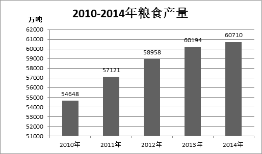

### 第 106 题

2014年粮食产量比上年增产多少？

A. 9%

B. 0.9%

C. 0.6%

D. 6%

第 106 题 · 答案与解析

**参考答案（粉笔题库参考内容）**

B

**解析**

根据题干“···比上年增产···”，结合选项均为百分数，可以判定本题为一般增长率问题。定位柱状图，2013年、2014年粮食产量分别为60194万吨、60710万吨。代入增长率计算公式：增长率可得2014年粮食增产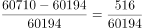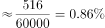，与B选项最为接近。

故正确答案为B。

**考点**：一般增长率、综合资料

**来源**：2015年江西省法检系统招录考试《行测》题第106题

### 第 107 题

2010-2014年间，粮食产量比上一年增加最多的年份是哪一年？

A. 2011年

B. 2012年

C. 2013年

D. 2014年

第 107 题 · 答案与解析

**参考答案（粉笔题库参考内容）**

A

**解析**

根据题干“2010-2014年间，···比上一年增加最多的年份···”，可以判定本题为增长量比较问题。定位柱状图，可以得到2010-2014年粮食产量。则可得各年粮食产量比上年分别增加：

2011年：57121-54648=2473万吨；

2012年：58958-57121=1837万吨；

2013年：60194-58958=1236万吨；

2014年：60710-60194=516万吨。

则可得2011年增加最多。

故正确答案为A。

**考点**：增长量比较、综合资料

**来源**：2015年江西省法检系统招录考试《行测》题第107题

### 第 108 题

2013年夏粮产量占该年粮食产量的比重是多少？

A. 22.5%

B. 20.4%

C. 32.4%

D. 21.9%

第 108 题 · 答案与解析

**参考答案（粉笔题库参考内容）**

D

**解析**

根据题干“2013年，···占···比重是···”，结合材料数据为2014年，可以判定本题为基期比重问题。定位材料，2014年夏粮产量13660万吨，增产3.6%，2013年粮食产量为60194万吨。结合基期计算公式：基期可得2013年夏粮产量占该年粮食产量比重为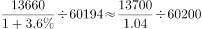≈21.88%，与D选项最为接近。

故正确答案为D。

**考点**：基期比重、综合资料

**来源**：2015年江西省法检系统招录考试《行测》题第108题

### 第 109 题

若以2014年秋粮产量同样的增长趋势，2015年秋粮产量为多少万吨？

A. 48013

B. 43693

C. 43065

D. 49314

第 109 题 · 答案与解析

**参考答案（粉笔题库参考内容）**

B

**解析**

根据题干“若···增长趋势，2015年秋粮产量···”，可以判定本题为现期计算问题。定位文字材料，2014年秋粮产量43649万吨，增产0.1%。代入现期计算公式：现期=基期×（1+增长率）可得，2015年秋粮产量为43649×（1+0.1%）=43649+43.649≈43693万吨。

故正确答案为B。

**考点**：现期计算、综合资料

**来源**：2015年江西省法检系统招录考试《行测》题第109题

### 第 110 题

2013年每公顷的粮食产量为多少吨？

A. 2.47

B. 8.66

C. 5.38

D. 4.25

第 110 题 · 答案与解析

**参考答案（粉笔题库参考内容）**

C

**解析**

根据题干“2013年每公顷的粮食产量···”，结合材料数据为2014年，可以判定本题为基期平均数问题。定位材料，2014年粮食种植面积11274万公顷，比上年增加78万公顷，2013年粮食产量为60194万吨。可得2013年每公顷粮食产量为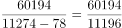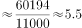吨，与C选项最为接近。

故正确答案为C。

**考点**：基期平均数、综合资料

**来源**：2015年江西省法检系统招录考试《行测》题第110题

## 材料 2

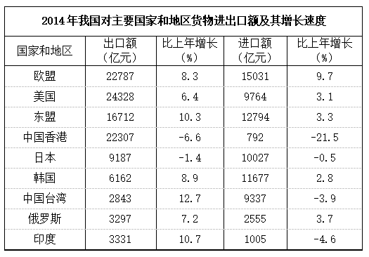

### 第 111 题

2013年我国对韩国的进出口总额为多少亿元？

A. 17017

B. 17839

C. 16498

D. 18426

第 111 题 · 答案与解析

**参考答案（粉笔题库参考内容）**

A

**解析**

根据题干“2013年我国对韩国的进出口总额为…”，结合材料数据为2014年，可以判定本题为基期和差问题。定位材料，2014年我国对韩国进、出口额分别为11677亿元、6162亿元，同比增长2.8%、8.9%。结合基期计算公式：。可得2013年我国对韩国的进出口总额为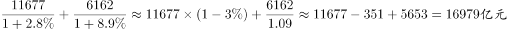，与A项最为接近。

故正确答案为A。

**考点**：基期和差、统计表

**来源**：2015年江西省法检系统招录考试《行测》题第111题

### 第 112 题

2014年我国对主要国家和地区的进出口情况为逆差的有几个？

A. 6

B. 5

C. 4

D. 3

第 112 题 · 答案与解析

**参考答案（粉笔题库参考内容）**

D

**解析**

贸易逆差即为进口额大于出口额，定位表格可得2014年我国对主要国家和地区的进出口情况为逆差的有日本、韩国、中国台湾共三个国家和地区。

故正确答案为D。

**考点**：直接找数、统计表

**来源**：2015年江西省法检系统招录考试《行测》题第112题

### 第 113 题

2014年我国对日本的进口额是对印度的多少倍？

A. 5.67

B. 6.24

C. 9.98

D. 12.48

第 113 题 · 答案与解析

**参考答案（粉笔题库参考内容）**

C

**解析**

根据题干“2014年···是对印度的···倍”，可以判定本题为现期倍数问题。定位材料，2014年我国对日本和印度进口额分别为10027亿元、1005亿元。2014年我国对日本的进口额是对印度的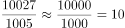，与C选项最为接近。

故正确答案为C。

**考点**：现期倍数、统计表

**来源**：2015年江西省法检系统招录考试《行测》题第113题

### 第 114 题

2014年我国对主要国家和地区的出口额中，占比最大的是哪个国家或地区？

A. 欧盟

B. 中国香港

C. 日本

D. 美国

第 114 题 · 答案与解析

**参考答案（粉笔题库参考内容）**

D

**解析**

由于占比的整体均为我国对主要国家和地区出口总额，则要求占比最大即为求我国对主要国家和地区出口额最大。定位材料，出口额最大的为美国（24328亿元）。

故正确答案为D。

**考点**：直接找数、统计表

**来源**：2015年江西省法检系统招录考试《行测》题第114题

### 第 115 题

若保持2014年的增长速度，哪一年我国对中国台湾的货物出口额开始超过对俄罗斯的货物出口额？

A. 2015年

B. 2016年

C. 2017年

D. 2018年

第 115 题 · 答案与解析

**参考答案（粉笔题库参考内容）**

C

**解析**

根据题干“若保持···增长速度，哪一年···开始超过···”，可以判定本题为现期追赶问题。定位材料，2014年我国对中国台湾、俄罗斯出口额分别为2843亿元、3297亿元，同比增长12.7%、7.2%。则可设x年后，我国对中国台湾出口额开始超过对俄罗斯，可得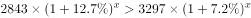，即为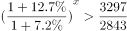，近似计算可得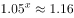，解得x=3，即为2017年。

故正确答案为C。

**考点**：现期计算、统计表

**来源**：2015年江西省法检系统招录考试《行测》题第115题

