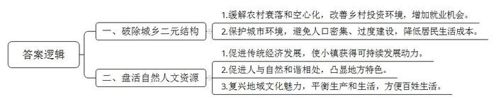
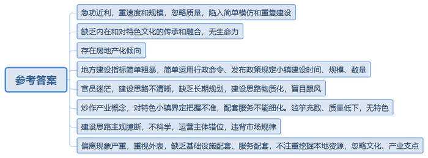
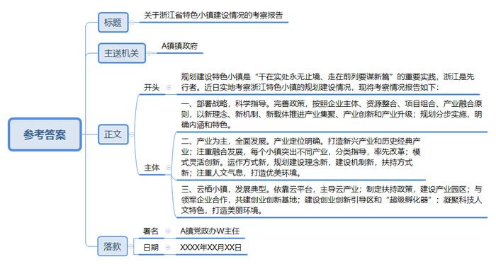
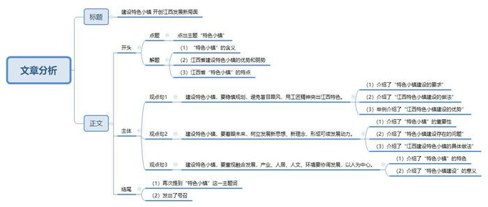

# 2017年公务员多省联考《申论》题（江西卷）

> 候选采集稿。参考答案及解析来自粉笔页面，不代表官方答案或真实高分答卷；来源使用许可与原卷对应关系仍需人工核实。

## 给定材料

### 材料 material-6e3b3dba5fdc4cd4

新型城镇化是增添经济发展动力、缩小城乡区域差距，加快经济转型升级的大平台，关系现代化全局大战略。当前城镇化的一项重要任务是适应人口流动的新形势，优化城镇格局。作为欠发达的地区，现在越来越多的农民工返乡就业创业，许多农村人口虽然仍从事农业生产，但就近生活在城镇，而良好的生态环境越来越吸引着饱尝“大都市病”之苦的都市人逆城市而居。因地制宜地加快发展一批文化旅游、科技创业、商贸物流、资源加工、交通枢纽、生态移民、边境口岸特色小镇尤为必要，也有利于破除城乡二元结构、缓解和解除盲目城市化出现的农村村落衰落和空心化问题。

据统计，截至2015年，中国的城镇化率已达到56.1%，城市人口有7.7亿。距2014年的统计，中国共有661个城市、1.9万个镇、2.2万个乡，“镇”和“乡”的数量远远大于“市”。然而，从城市人口的分布情况看，即使进入新世纪，居住在“镇”里的城市人口也只占到27%。这意味着，中国的城镇化，是以绝大多数人集中在大中城市为特点的，“镇”显然起到的作用比较小。从这些年的实际情况看，这种情况直接导致了城乡两极分化的加剧：城市方面，人口急剧膨胀，带来了房价高涨、交通拥堵、资源紧张等问题；乡镇方面，劳动力大量流失，带来了空巢老人、留守儿童、土地荒废等问题。这样的城镇化不利于城乡均衡发展，也影响着城乡居民生活水平的提高。

西方的城市化也曾经出现过类似的情况，像英国的曼彻斯特、德国的鲁尔，当年都因为工商业急剧扩张吸引了大量农村人口。很快，这种不均衡发展便衍生出各种社会问题，各国都不得不下大力气化解过分集中的人口与资源，为城乡的均衡化发展创造条件，出现了在生产方式和生活环境上各具特点的“卫星城市”和“小城市”。比如，德国城市化率已经高达97%，但是，其中有70%的人居住在小城市；美国城市化率是84%，其中90%的人生活在5万人左右的小城市；英国城市化率也很高，但只有9%的人居住在城市核心区，80%的人居住在郊区或小城市。

小城市现代化程度越高，越可以在城乡之间发挥积极作用——对城市而言，可以避免由于人口过于密集导致过度建设，以有效地保护城市环境，降低居民生活成本；对乡村而言，可以改善投资环境，增加就业机会。

### 材料 material-fd4809797b7567e3

记者从有关部门了解到，到2020年国家级层面要建设1000个特色小镇。从以往经验看，如果中央层面大力推进某项工作，再辅之以相关优惠政策和考核激励，地方所掀起的热情往往超出想象。特色小镇建设要保持头脑清醒，不能光看规模和速度，而是要把重心放在质量上，形成独有风格，打造特色小镇应有的品质。否则就可能陷入简单模仿和重复建设，甚至可能出现“千镇一面”的情况。

令人担心的是，一些特色小镇建设过程中，仅有光鲜外表而缺乏内在，或仅有实物堆砌而缺乏对特色文化的传承和融合，往往就失去了生命力。如果政策导向上把持不住搞得急功近利，乃至运动式地搞“几年大变样”，就很可能好事办成糟事。

另一方面，要坚持遏止住“房地产化”倾向。当前，特色小镇建设“房地产化”的迹象不能说没有，甚至有些地区已经暴露出这种不良苗头。国内一些号称“有情怀”的开发商，在小镇的空间和环境内，建设了大尺度和大容积率的商业地产和住宅，此种情形无论从空间尺度还是从环境匹配来说，都不符合特色小镇的特质。

记者进一步采访看到，一些省份已创建出各自的特色小镇名单，并下达具体任务，对未完成年底投资指标的特色小镇采取“摘帽子”措施。有的地方简单运用行政命令，发布相关政策，规定建设特色小镇建设的特定时间、数量及规模。

中西部一些欠发达地区的有关负责同志，对于特色小镇的发展很迷茫，现在只是请外包企业和高校做好了前期规划；准备招商引资，如何配置相关产业链条仍未考虑清楚；有些把特色小镇建设当作要“票子和帽子”的途径，争得特色小镇的帽子兴奋不已，认为来钱了。无论政府还是企业，都有分一杯羹的想法。各地出现的一批基金小镇、一批健康养老小镇、一批机器人小镇，多为不具备产业基础的“跟风”。

据目前情况来看，很多特色小镇没有围绕产业核心，而是炒作产业概念。对于什么是特色小镇，目前并没有相对明确的界定，这种情况下如果地方在出台配套措施时不能很好地细化规定，其软肋是显而易见的，也正因为如此，在全国各地涌现出一批质量很高的特色小镇的同时，也出现了滥竽充数、质量低下，甚至根本没有特色的“特色小镇”。

记者在采访中发现，部分地方政府在规划建设特色小镇时，按照自己的主观思维方式去创造市场，导致运营主体错位，违背市场规律。有些政府部门，尽管意识到“政府投资、招商引资”等传统做法不适用特色小镇，但“政府招商”的主体地位并没有大的改观，表现为招商企业领域分散、项目细碎化现象严重、核心产业不突出等现象，造成实质上的运营主体缺失。一些小镇还在组建开发公司，而另一些小镇尽管有名义上的市场化主体，但管理运营受政府影响仍然比较大。很多小镇是政府先导，前期地方政府投入大量财政，甚至用政府购买服务来变相举债，仍然是在做土地财政的文章。政府本应是掌舵的，企业是划船的，现在却是政府在划船，企业在坐船。

一些“特色小镇”从内涵到现实都在发生偏离，部分特色小镇“面子”好看，但基础设施配套、服务配套等“里子”不足，不注重挖掘本地资源，忽略文化、产业支点，小镇建设重“形”轻“魂”。西北某省拟建设旅游文化类特色小镇，然而在配套设施建造上，小镇连一家能接待游客住宿的像样的宾馆都没有，更谈不上旅游服务标准、旅游品质。有的小镇离市中心太远，面临着基础设施不完善、带动当地就业能力弱、人才储备不足等诸多问题。

### 材料 material-e3e14f1d199e9229

浙江可谓是特色小镇的先行者，规划建设特色小镇是“干在实处永无止境、走在前列要谋新篇”的重要实践。改革开放以来，浙江培育并形成了一大批块状经济和区域特色产业，“集聚”和“特色”，成为浙江产业发展的重要路径和重要“符号”，经济发展不断迈上新台阶，经历长期发展，传统块状经济强镇和区域特色产业在推进经济前行的进程中，渐显乏力，缺乏新动能，显现出“产业竞争力日趋下降，过度依赖低端产业，资源利用效率低，创新能力不足”等问题。为了走出转型升级的新路，浙江省在深化和集成各项转型升级政策措施基础上提出了创建特色小镇重要举措。

2016年4月14日至17日，A镇党政办W主任作为“S省M县浙江特色小镇建设学习考察团”成员，通过听取情况介绍、实地参观考察，了解了浙江省特色小镇建设情况。

2014年10月17日，云计算产业生态小镇---云栖小镇举行首场阿里云开发者大会，在参观小镇“梦想大道”后，与会者体味到“让杭州多一个美丽的特色小镇，天上多飘几朵创新‘彩云’”的喜悦。10月30日，首届世界互联网大会新闻发布会上东道主说：“小镇故事多，浙江将通过系列小镇建设，打造更有激情的创业生态系统。”此后，在乌镇召开的首届世界互联网大会上，互联网精英们汇聚论道，畅想着让古镇在承载厚重历史文化的同时接轨未来，孕育新经济，并指出“浙江可以有更多这样的小镇”。

2015年1月，浙江省第十二届人大第三次会议通过的《政府工作报告》中，“特色小镇”作为关键词被提出，重要性被提升到了新一轮更大范围的战略布局：“加快规划建设一批特色小镇，按照企业主体、资源整合、项目组合、产业融合原则，在全省建设一批聚集七大产业、兼顾丝绸黄酒等历史经典产业、具有独特文化内涵和旅游功能的特色小镇，以新理念、新机制、新载体推进产业集聚、产业创新和产业升级。”4月22日，浙江省政府公布《关于加快特色小镇规划建设的指导意见》，进一步要求产业文化旅游社区功能叠加、投资主体明确、项目具体可行，投资额达到50亿元以上。6月4日，第一批浙江省省级绿色特色小镇创建名单正式公布，全省10个设区市的37个小镇列入首批创建名单，计划三年投资2400亿元左右，预计2017年可实现税收收入190亿元左右。6月24日，特色小镇规划建设工作现场推进会召开，进一步明确了特色小镇规划建设工作的目标和主要任务。2016年1月，浙江省公布第二批42个省级特色小镇创建名单。

浙江的特色小镇被赋予了全新的时代内涵和地域特色，不是行政区划单元的“镇”，而是产业发展载体；也不是传统工业园区或旅游功能区的“区”，而是同业企业协同创新、合作共赢的企业社区；更不是政府大包大揽的行政平台，而是企业为主体、市场化运作、空间边界明确的创新创业空间。

产业定位面向未来，重点打造的信息经济、环保、健康、旅游、时尚、金融、高端装备制造七大万亿产业，以及茶叶、丝绸、黄酒、中药、青瓷、木雕、石雕等历史经典产业。每个小镇立足一个主导产业，打造完整的产业生态圈，培育具有行业竞争力的“单打冠军”；坚持产业、文化、旅游“三位一体”和生产、生活、生态融合发展。每个历史经典产业原则上只规划建设一个特色小镇。根据每个特色小镇功能定位实行分类指导。凡是国家、省级或是市级的改革举措率先在特色小镇推开。主要特点是运作方式新，采用分批建立创建对象，中间动态优胜劣汰，建成后验收命名的“创建制”。规划建设理念新，融入了四大功能叠加，培育上市公司等新理念。建设机制新，坚持“政府引导、企业主体、市场化运作”。扶持方式新，实施有奖有罚的土地供给方式，期权式的财政奖励方式，助力特色小镇务实建设。特色小镇是高校毕业生等90后、大企业高管、科技人员、留学归国人员创业者为主的“新四军”创新创业地，有望凝聚独特的人文气息；是历史经典产业的传承新生地，散发浓浓的历史底蕴；是“传统特色产业+互联网”的发展新高地，拥有活跃的创新文化；是新产业新业态的孵化诞生地，将形成独特的产业文化。特色小镇是远离城市中心，生产、生活、生态融合发展的美丽小镇。一般规划在城郊结合部，规划面积在3平方公里左右，建设用地面积在1平方公里左右，将按3A景区目标建设，其中旅游特色小镇按5A景区标准建设。每个小镇的建筑、旅游设施和植物群落、自然环境将与产业融合协调、相得益彰，形成“产、城、人、文”四位一体的新型空间、新型社区，建设成为城乡统筹协调发展的美丽新样板。

### 材料 material-7cd6d6f456cd019a

“十二五”时期，江西经济保持了平稳较快发展，全省经济总量在2011年突破万亿元大关后，2015年达到1.67万亿元，占全国GDP比重由2010年的2.31%提高到2015年的2.47%；全省人均地区生产总值由2010年的21253元提高到2015年的36724元，同期相当于全国人均GDP百分比由69.5%上升到74.4%，提高了4.9个百分点。按当年人民币兑美元平均汇率计算，全省人均地区生产总值由2010年的3140美元增加到2015年的5898美元；按照世界银行收入分组标准，从2012年开始，江西从中等偏下收入社会进入到中等偏上收入社会。从全面建成小康社会目标实现情况看，如果按照全国人均GDP(57000元，2010年价)的目标，实现了小康目标值的58.9%；按照江西经济总量自身翻一番的目标，实现了小康目标值的82.3%；如果按照《江西省国民经济和社会发展第十三个五年规划纲要》提出的“十三五”经济发展年均8.5%的预期目标，到2018年全省地区生产总值将提前实现翻番。

虽然,江西面貌发生了深刻的变化,但纵向比较经济总量还不够大,经济发展质量还不够优，产业层次总体处于中底端，城镇化发育水平不足，城乡居民收入不高，现代化进程还需要进一步提速；从横向比较，2015年生产总值全国排第18位，在中部6省中排第5位；人均生产总值排位落后于总量排位，在全国排24位，在中部排4位。不论是总产量还是人均，都远远落后于东部沿海发达省市，在中部地区也处于靠后的位置。因此，江西省第十四次党代会上做出了“发展不足仍然是江西的主要矛盾，欠发达仍然是江西的基本省情，相对落后仍然是江西的最大现实”的判断。要求全省上下必须清醒认识、深刻把握这个省情特征，始终扭住发展第一要务，始终贯彻新发展理念，始终坚持真抓实干，不断开创发展新局面，实现人民新期待。

## 题目

### 第 1 题

**根据材料**2**、**3**，指出“特色小镇”建设的意义。（10分）**

关联材料：material-6e3b3dba5fdc4cd4

作答要求：

要求：准确全面，条理清楚，文字简练，不超过150字。

### 第 2 题

**结合材料**6**，分析特色小镇建设中存在的问题。（20分）**

关联材料：material-fd4809797b7567e3

作答要求：

要求：准确全面，条理清楚，文字简练，不超过300字。

### 第 3 题

**根据材料**4**、**5**，假如你是A镇党政办W主任，请于考察后向A镇镇政府写一份《关于浙江省特色小镇建设情况的考察报告》。（30分）**

关联材料：material-e3e14f1d199e9229

作答要求：

要求：

（1）格式得当，条理清楚，简洁明了；

（2）建议合理；

（3）不超过500字。

### 第 4 题

**结合给定材料，以“特色小镇建设之我见”为话题，自拟题目，联系江西实际，写一篇议论文。（40分）**

关联材料：material-7cd6d6f456cd019a

作答要求：

要求：观点正确，论据充分，结构完整，逻辑清晰，语言流畅，800-1000字。

## 答案与解析

第 1 题

**参考答案（粉笔题库参考内容）**

一、破除城乡二元结构：1.缓解农村衰落和空心化，改善乡村投资环境，增加就业机会。2.保护城市环境，避免人口密集、过度建设，降低居民生活成本。

二、盘活自然人文资源：1.促进传统经济发展，使小镇获得可持续发展动力。2.促进人与自然和谐相处，凸显地方特色。3.复兴地域文化魅力，平衡生产和生活，方便百姓生活。

**解析**

**参考答案说明：**（1）答案根据“破除城乡二元结构”“盘活自然人文资源”这两个不同的话题进行了分类撰写。（2）根据“农村”和“城市”这两个主体对“破除城乡二元结构”进行了分条；根据“经济”“自然”“文化”三个方面的意义对“盘活自然人文资源”进行了分条。（3）每条要点之间内容上没有交叉。

  

**考点**：考点影响类

**来源**：来源2017年公务员多省联考《申论》题（江西卷）

粉笔申论页面对本题只提供「解析视频」入口，该入口是会员推广位，页面无视频地址与文字解析。

第 2 题

**参考答案（粉笔题库参考内容）**

一、急功近利，重速度和规模，忽略质量，陷入简单模仿和重复建设。

二、缺乏内在和对特色文化的传承和融合，无生命力。

三、存在房地产化倾向。

四、地方建设指标简单粗暴，简单运用行政命令、发布政策规定小镇建设时间、规模、数量。

五、官员迷茫，建设思路不清晰，缺乏长期规划，建设思路物质化，盲目跟风。

六、炒作产业概念，对特色小镇界定把握不准，配套服务不能细化。滥竽充数、质量低下，无特色。

七、建设思路主观臆断，不科学，运营主体错位，违背市场规律。

八、偏离现象严重，重视外表，缺乏基础设施配套、服务配套，不注重挖掘本地资源，忽略文化、产业支点。

**解析**

**参考答案说明：**本参考答案按照从微观到宏观、从内在到外在的逻辑，分别从“急功近利”“缺乏内在”“错误倾向”“地方建设指标简单粗暴”“官员迷茫”“炒作产业概念”“建设思路主观臆断”“偏离现象严重”等不同方面进行了分条撰写。各条要点之间在内容上是并列关系，没有交叉。

**考点**：考点问题类

**来源**：来源2017年公务员多省联考《申论》题（江西卷）

粉笔申论页面对本题只提供「解析视频」入口，该入口是会员推广位，页面无视频地址与文字解析。

第 3 题

**参考答案（粉笔题库参考内容）**

关于浙江省特色小镇建设情况的考察报告  

A镇镇政府：

规划建设特色小镇是“干在实处永无止境、走在前列要谋新篇”的重要实践，浙江是先行者。近日实地考察浙江特色小镇的规划建设情况，现将考察情况报告如下：

一、部署战略，科学指导。完善政策，按照企业主体、资源整合、项目组合、产业融合原则，以新理念、新机制、新载体推进产业集聚、产业创新和产业升级；规划分步实施，明确内涵和特色。

二、产业为主，全面发展。产业定位明确。打造新兴产业和历史经典产业；注重融合发展，每个小镇突出不同产业，分类指导，率先改革；模式灵活创新。运作方式新，规划建设理念新，建设机制新，扶持方式新；注重人文气息，打造优美环境。

三、云栖小镇，发展典型。依靠云平台，主导云产业；制定扶持政策，建设产业园区；与领军企业合作，共建创业创新基地；建设创业创新引导区和“超级孵化器”；凝聚科技人文特色，打造美丽环境。

A镇党政办W主任

XXXX年XX月XX日

**解析**

**参考答案说明：**（1）格式方面，本参考答案写到了“标题”“主送机关”“正文”“落款”。（2）正文部分，一方面从内容来看，围绕着“浙江省特色小镇建设情况”这一主题，本参考答案的开头先写到了“建设特色小镇的背景”；主体部分从“部署战略，科学指导”“产业为主，全面发展”“云栖小镇，发展典型”这三个方面给出了具体的对策。另一方面，形式上，本参考答案做到了分段、分条撰写，整体上条理较为清晰。（3）本参考答案能够结合题目要求“简洁明了”，在语言表达上做到了简洁、流畅。

**考点**：考点总结类

**来源**：来源2017年公务员多省联考《申论》题（江西卷）

第 4 题

**参考答案（粉笔题库参考内容）**

**建设特色小镇 开创江西发展新局面**

特色小镇顾名思义就是能突出地域特点、突显时代特征、凸显人文底蕴的小镇。小镇建设中要有小镇的核心产业，要把特色放在优先位置，要能持续发展。江西省具有丰富的历史和民族文化资源、生态环境良好、产业齐备、交通便利、区位优势明显，但是目前无论是经济发展速度还是居民收入都相对滞后。在此情况下，江西省第十四次党代会报告要求“**做精特色小镇，打造一批有活力、有魅力、有实力的中心城镇**”。

建设有江西特色的小镇，我们不是摸着石头过河，而是有经验可循的。特色小镇的先行者已经用实践证明：特色小镇要建设成什么样子，怎么建设，建设的过程中会遇到什么突出问题，应该坚持什么原则，避免哪些问题等事项都是有迹可循的。建设特色小镇以我之见应该科学规划，着眼未来，融合发展。

**建设特色小镇，要稳慎规划，避免盲目跟风，用工匠精神突出江西特色**。古人云，欲速则不达。建设特色小镇要力戒建设发展“快”字当头，弯道超车、“超常规发展”的求快心理。当沉下心来，科学规划，形成清晰思路，处处精雕细琢，体现江西特色。江西省物产丰富，人杰地灵。革命圣地可发展红色旅游；少数民族聚居地，民族风情独特；鄱阳湖经济带，产业链条完整，配套齐全；历史文化气息浓厚，陶渊明、欧阳修等文人墨客各领风骚……江西有着自己的独特之处，建设特色小镇，我们资源丰富。

**建设特色小镇，要着眼未来，树立发展新思想、新理念，形成可持续发展动力。**特色小镇是时代的产物，也是未来引领经济发展的重要动力。目前其他地区的特色小镇建设出现了产业空心化、未来的发展迷茫的情况。江西省要着眼于未来，发展具有潜力的核心产业，不断开拓创新，用新思路解决问题。可借鉴经验，同时避免千篇一律。例如，浙江的云栖小镇，突出的就是云平台，云产业。我们建设特色小镇可以向云栖小镇学习。

**建设特色小镇，要重视融合发展，产业、人居、人文、环境要协调发展，以人为中心。**特色小镇要突出人，服务人，发展人。人的生存离不开经济、人文、环境和生活，要建设特色小镇就要融合发展。让“绿水青山”“精神文明”成为群众致富的“金山银山”，让“社会发展”“经济腾飞”助推群众拥有“金山银山”。

建设特色小镇，任重而道远。全省上下必须拿出“干在实处永无止境、走在前列要谋新篇”的精神，不断攻坚克难，为建设有江西特色的小镇，开创江西发展的新局面而奋斗！

**解析**

**文章分析**

**建设特色小镇 开创江西发展新局面**

【**标题的优点：**首先，内容上范文的标题突出了“特色小镇建设”这一主题。其次，文字表达上具有发出展望这一倾向，使得标题更加形象生动，有吸引力。】

特色小镇（1）顾名思义就是能突出地域特点、突显时代特征、凸显人文底蕴的小镇。小镇建设中要有小镇的核心产业，要把特色放在优先位置，要能持续发展。（2）江西省具有丰富的历史和民族文化资源、生态环境良好、产业齐备、交通便利、区位优势明显，但是目前无论是经济发展速度还是居民收入都相对滞后。（3）在此情况下，江西省第十四次党代会报告要求“做精特色小镇，打造一批有活力、有魅力、有实力的中心城镇”。

【**开头的优点：**★内容方面：范文的开头是紧扣题目给定的“特色小镇”这一主题展开的。首先，**开头第一句话点出主题，做到了主题明确**。其次，**对“**特色小镇**”这一主题进行了分析阐述，指出了（****1****）“**特色小镇**”的含义。（****2****）江西省建设特色小镇的优势和弱势。（****3****）江西省“特色小镇”的特点。**注意以上三个方面的阐述在逻辑上有先后顺序：先写“含义”，再写“江西建设特色小镇的优势和弱势”，最后写“江西省特色小镇的特点”。★文字表达方面：使用了长短句配合使用，使语言表达有节奏感。】

建设有江西特色的小镇，我们不是摸着石头过河，而是有经验可循的。特色小镇的先行者已经用实践证明：特色小镇要建设成什么样子，怎么建设，建设的过程中会遇到什么突出问题，应该坚持什么原则，避免哪些问题等事项都是有迹可循的。建设特色小镇以我之见应该科学规划，着眼未来，融合发展。

【**过渡段的优点：**范文过渡段分析了建设“特色小镇”有经验可循等**方面等的内容**，此外，还要注意过渡段末尾的“建设特色小镇以我之见应该科学规划，着眼未来，融合发展”是用来引起下文的过渡句。】

**建设特色小镇，要稳慎规划，避免盲目跟风，用工匠精神突出江西特色。**（1）古人云，欲速则不达。建设特色小镇要力戒建设发展“快”字当头，弯道超车、“超常规发展”的求快心理。（2）当沉下心来，科学规划，形成清晰思路，处处精雕细琢，体现江西特色。（3）江西省物产丰富，人杰地灵。革命圣地可发展红色旅游；少数民族聚居地，民族风情独特；鄱阳湖经济带，产业链条完整，配套齐全；历史文化气息浓厚，陶渊明、欧阳修等文人墨客各领风骚……江西有着自己的独特之处，建设特色小镇，我们资源丰富。

【**论述段****1****的优点：**★观点句：范文的观点句是紧扣“特色小镇建设”这一文章主题提出的。形式上，它在段首处直接写出，位置突出，容易发现。内容上，关键词突出，内容要点明确，可以明显看出它是从“稳慎规划”入手，指出了“如何建设特色小镇”。★论述内容：（1）介绍了“特色小镇建设的要求”；（2）介绍了“江西特色小镇建设的做法”；（3）举例介绍了“江西特色小镇建设的优势”。注意：以上几个方面的内容都是紧扣“建设特色小镇，要稳慎规划，避免盲目跟风，用工匠精神突出江西特色”这个观点句进行分析论述的，论述的针对性强，内容层次丰富。★论述方法：采取了讲道理、举例子相结合，做到了丰富多样。】

**建设特色小镇，要着眼未来，树立发展新思想、新理念，形成可续发展动力。**（1）特色小镇是时代的产物，也是未来引领经济发展的重要动力。（2）目前其他地区的特色小镇建设出现了产业空心化、未来的发展迷茫的情况。（3）江西省要着眼于未来，发展具有潜力的核心产业，不断开拓创新，用新思路解决问题。可借鉴经验，同时避免千篇一律。例如，浙江的云栖小镇，突出的就是云平台，云产业。我们建设特色小镇可以向云栖小镇学习。

【**论述段****2****的优点：**★观点句：范文的观点句是紧扣“特色小镇建设”这一文章主题提出的。形式上，它在段首处直接写出，位置突出，容易发现。内容上，关键词突出，内容要点明确，可以明显看出它是从“树立发展新思想、新理念”入手，指出了“如何建设特色小镇”。★论述内容：（1）介绍了“特色小镇”的重要性；（2）介绍了“特色小镇建设存在的问题”；（3）介绍了“江西建设特色小镇的具体做法”。注意：以上几个方面的内容都是紧扣“建设特色小镇，要着眼未来，树立发展新思想、新理念，形成可续发展动力”这个观点句进行分析论述的，论述的针对性强，内容层次丰富。★论述方法：采取了讲道理、举例子相结合，做到了丰富多样。】

**建设特色小镇，要重视融合发展，产业、人居、人文、环境要协调发展，以人为中心。**（1）特色小镇要突出人，服务人，发展人。人的生存离不开经济、人文、环境和生活，要建设特色小镇就要融合发展。（2）让“绿水青山”“精神文明”成为群众致富的“金山银山”，让“社会发展”“经济腾飞”助推群众拥有“金山银山”。

【**论述段****3****的优点：**★观点句：范文的观点句是紧扣“特色小镇建设”这一文章主题提出的。形式上，它在段首处直接写出，位置突出，容易发现。内容上，关键词突出，内容要点明确，可以明显看出它是从“重视融合发展”入手，指出了“如何建设特色小镇”。★论述内容：（1）介绍了“特色小镇”的特色；（2）介绍了“特色小镇建设”的意义。注意：以上几个方面的内容都是紧扣“建设特色小镇，要重视融合发展，产业、人居、人文、环境要协调发展，以人为中心”这个观点句进行分析论述的，论述的针对性强，内容层次丰富。★论述方法：本段主要采取了讲道理的方式进行论证，在论述的时候做到了层次多样，内容丰富。】

【**论述段之间的关系**：★内容的内在逻辑：范文的论述段之间是依照“并列”的逻辑展开的。论述段1写的是“稳慎规划”方面的对策，论述段2写的是“树立发展新思想、新理念”方面的对策，论述段3接着写的是“重视融合发展”方面的对策。】

建设特色小镇，（1）任重而道远。全省上下必须拿出“干在实处永无止境、走在前列要谋新篇”的精神，不断攻坚克难，（2）为建设有江西特色的小镇，开创江西发展的新局面而奋斗！

【**结尾的优点**：范文的结尾回扣了“特色小镇”这一主题。（1）再次提到“特色小镇”；（2）发出了号召。】

**考点**：考点文章写作题

**来源**：来源2017年公务员多省联考《申论》题（江西卷）

粉笔申论页面对本题只提供「解析视频」入口，该入口是会员推广位，页面无视频地址与文字解析。

