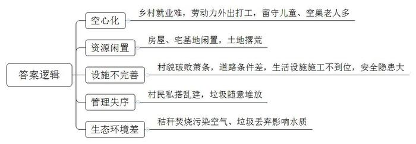
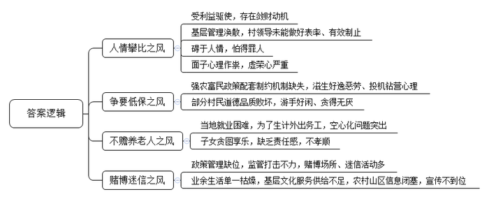
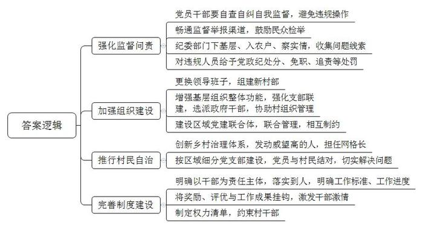
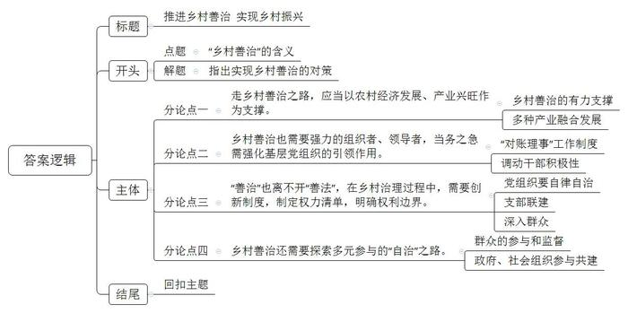

# 2018年公务员多省联考《申论》题（江西卷）

> 候选采集稿。参考答案及解析来自粉笔页面，不代表官方答案或真实高分答卷；来源使用许可与原卷对应关系仍需人工核实。

## 给定材料

### 材料 material-50d2e008070e50bb

近年来，除却城市出现以住房拥挤、环境恶化、交通拥堵、生活质量下降等为表征的“城市病”之外。广大农村地区也开始出现了“乡村病”。

“外面像个村，进村不见人，老屋少人住，地荒杂草生。”这首小诗形象地描绘了乡村的景况。滦水镇庄里村是有着810年历史的老村，如今坑洼不平的黄泥路积水成窝，枯黄的杂草在砖缝里飘摇，许多废弃房屋已经倒塌。村小组长介绍，800多常住人口，差不多有400人在外务工，一幢幢200多平方米的老屋仅住着祖孙三人或四人。还抱怨说：“我们组织办班培训，让中青年掌握一技之长，他们外出谋生没问题。可是，让他们在家门口就业就不是村里能做到的，留守儿童、空巢老人的问题也不好解决。”与此同时，许多村庄出现了多年无人使用的宅基地。

在安置新村里，新建的楼房都是一层地下室加三层住房的户式，四至六口人的家庭均能满足需求，但仍有部分村民擅自搭建违章建筑，有的用来堆柴和放置农具，有的作临时厕所，有的作为小厨房放置煤炉，还有的放置车辆，甚至有人违章搭建经营场所，用于卖菜卖早点、销售建筑石料等，还拉起或竖立各种广告牌。村民周师傅说，搬到新房一年多了，走的都是泥巴路，“晴天一身灰，雨天一身泥”；更让周师傅一家人担心的是，他家和邻居家中间空隙处设置了化粪池，但施工方没有将低洼处填平，导致积水很深，他特别担心5岁的孙子会掉进水坑。不远处的农田，村民正焚烧秸秆，现场浓烟滚滚，烟气刺鼻袭人。近边的池塘厚厚地覆盖了绿色的水藻，水面上还漂浮着各种垃圾、树枝等，水质泛黄，散发出一股难闻的气味。村民们说：“以前可以洗菜、洗衣服，如今拖把都不敢洗。”村道两边，尽管设立了很多垃圾桶，也新建有垃圾池，但仍然有装修垃圾和枯枝败叶等，随意堆放，无人问津。

### 材料 material-be7fc7436702fb78

汉滨区双龙镇某社区外出务工人员多、外来人住户多，冬腊月集中过事不断，有的“整酒挣回报、无事找事办”，同一户主新房一层封顶过事、二层完工也要过事，某一农民借了别人一辆路虎车，对外声称说是自己买了一辆新车，随即放鞭炮、办酒席。凡过事，必收礼，也叫“份子钱”，人情往来变味异化成为钱财往来。目前农村份子钱已由过去的三五十涨到百元起步，三五百普遍，千元以上也有，有些地方农户家庭年平均送礼三十余次，年礼金支出万元左右。据紫阳县调查。年户均送礼数34次，最多达110次，年送礼支出3万元以上占17％、1至3万元占78％、1万元以内占5％。镇坪县曙坪镇桃园村在2017年2月底以前，一般农户每年送礼支出1.5 至3万元，贫困户、低保户借债送礼支出5000至8000元左右。双龙镇某村支书、村主任2016年送出礼金分别为3万元和6万元，二人唉声叹气地说“我们村干部的报酬每年2.4万元，辛苦一年还不够送礼钱”；该村副主任张某说，去年他送礼5万元，其中有一天送礼24家，忙到半夜，回家吃了一碗酸菜面；该村贫困户王某，去年在信用社贷款2万元，过年花销了1万元、送礼1万元，他面带苦涩地说“我们农民低头不见抬头见，没钱借钱也得送，只有开春又去打工还”。

在农村一些地方，婚丧嫁娶一般要“四比”，即比放炮、比抽烟、比喝酒、比菜品，有些尚未脱贫的人家也“打肿脸充胖子”，掏空家底甚至借钱来“撑面子”。汉滨区问卷调查显示，50.5％的人认为人情攀比风太盛；47.7％的人表示，不想参加又不得不参加。阜阳镇镇政府周边，婚丧嫁娶、开业庆典仅放鞭炮少则三五万，多则七八万，相互斗响比长、暗自较劲。汉阴、白河、宁陕等农村山区，结婚彩礼一般都在5至10万元，迎亲车辆少则五六辆、多则十余辆，还要花钱请婚庆公司主持、表演节目、搭过街彩门。尤其是请客者大事小事都要办宴席，而每桌费用上涨到几百元甚至千元以上，大部分菜品实际被倒掉，浪费现象十分严重。凡此种种，不一而足。既苦了自己，又累及他人，因此致贫、返贫和引发事端的案例时有发生，广大群众对此深恶痛绝。

近些年来，在落实国家强农富民政策的过程中，由于配套的制约机制缺失，加之有些地方的优亲厚友，造成了“上面的钱是白给的”惯性导向，滋生了好逸恶劳、投机钻营的不良心理，先由坐等政府救济，再到争要低保政策，再到争当贫困户的现象，在一些地方有所蔓延。一些群众气愤地说“现在的好政策养了一批懒人”。宁陕县太山庙镇龙凤村、汉滨区双龙镇谢坪村、旬阳县铜钱关镇天宝寨村，目前大龄未婚的单身汉分别有80、70、60多个。村组干部反映，除居住条件差等客观因素外，也有部分是游手好闲、喝酒打牌造成的。旬阳县棕溪镇某村一位农民马某，三级残疾，丈夫患慢性病，两个子女在上学。镇政府通过低保、贫困学生补助、临时救助等办法给予帮扶，但马某仍多次缠闹，张口就向政府要130万元，虽然通过道德评议会，她放弃了无理要求，但由此也可见一斑。

该市常年外出务工达50多万人，伴随而来的农村“三留守”难题至今尚未得到有效破解。尤其是留守老人的赡养问题愈加突出，打工人员长期不管不顾家中老人的现象越来越多，有的子女对老人的赡养相互推诿扯皮、引发纠纷；有的子女图安逸、求享受，而家中老人还在为了生计起早贪黑干农活；有的子女把老人的“一折通”据为己有，坐收养老保险、高龄补贴；更有甚者采取拆分户口的办法，让老人当五保户、吃低保，或者挤进贫困户，把难题、矛盾推向政府。

现在到农村，无论是集镇还是村庄，麻将桌随处可见。白河县目前已登记注册的棋牌室就有198家，未登记注册的家庭棋牌室不计其数。汉滨区吉河镇某村一个有百余户的小社区，麻将馆就有3家。虽然大多数不以赢利为目的，但“玩钱”越来越大，从几元到几百元，个别地方白天黑夜连入牌场，留守、陪读的家庭妇女成了参赌的“主力”。尤其是农闲和春节期间“扎堆”打牌赌博的现象更为突出，有的“外出辛苦挣一年，春节输光就几天”。因赌致贫，引发矛盾纠纷甚至悲剧的事例时有发生。前不久，岚皋县就有一人因赌负债、债主逼债而服毒自尽。此外，有的农村山区“遇事看日子、看风水、算一卦”等迷信色彩依然较浓，有的甚至修庙宇供神灵，特别是家庭老人去世，听信于算命先生，既要做道场又要择日子，致使丧事没简化，越办越复杂。

### 材料 material-9a9715ac6605d385

五年来，江西省整合资金320亿元，建成高标准农田1957万亩，全省粮食总产2017年425.4亿斤，实现“十四连丰”；主要农产品监测合格率连续5年稳定在98%以上，被农业部列为全国唯一的“绿色有机农产品示范基地试点省”；现代农业产业技术体系、智慧农业平台建设日益完善，农田基础设施水平、农业信息化率、主要农作物综合机械化率、农业科技进步贡献率等关键性指标显著提升；基本建立农业农村改革的“四梁八柱”，新主体、新业态、新模式不断涌现，农地确权登记颁证工作全面完成，承包土地经营权流转率达到40.5%；共安排新农村建设村点6.22万个，受益农户311万户1269万人；“连点成线、拓线扩面、特色突出、整片推进” 建设格局初步形成；农村居民人均可支配收入13242元，增长9.1%，增速连续八年快于城镇居民人均可支配收入和GDP增速，全国排位从14位前移到11位，城乡居民收入差距持续缩小，农村农业发展呈现稳中有进、稳中向好的态势，为全省乡村善治提供了有力支撑。

## 题目

### 第 1 题

**根据“材料**2**”，对当前农村地区“乡村病”的具体表现进行概括。（15分）**

关联材料：material-50d2e008070e50bb

作答要求：

要求：

（1）全面，准确，简明；

（2）不超过150字。

### 第 2 题

**根据“材料**3**”，对乡村不良风气盛行的原因进行分析。（20分）**

关联材料：material-be7fc7436702fb78

作答要求：

要求：

（1）深刻，合理，清晰；

（2）不超过300字。

### 第 3 题

**结合给定资料，就如何加强农村基层干部队伍监督管理提出对策或建议。（25分）**

关联材料：material-9a9715ac6605d385

作答要求：

要求：

（1）有针对性，可行，合理；

（2）不超过300字。

### 第 4 题

**参考给定资料，以“乡村善治”为主题，联系实际，自选角度，自拟题目，写一篇议论文。（40分）**

关联材料：material-9a9715ac6605d385

作答要求：

要求：

（1）正确，充实，完整，流畅；

（2）参考“给定资料”，但不拘泥于“给定资料”；

（3）1000-1200字。

## 答案与解析

第 1 题

**参考答案（粉笔题库参考内容）**

一、空心化。乡村就业难，劳动力外出打工，留守儿童、空巢老人多。

二、资源闲置。房屋、宅基地闲置，土地撂荒。

三、设施不完善。村貌破败萧条，道路条件差，生活设施施工不到位，安全隐患大。

四、管理失序。村民私搭乱建，垃圾随意堆放。

五、生态环境差。秸秆焚烧污染空气、垃圾丢弃影响水质。

**解析**

**参考答案说明：**答案从“空心化”“资源闲置”“设施不完善”“管理失序”“生态环境差”等不同的角度对当前农村地区“乡村病”的具体表现进行了分条撰写。各条要点之间在内容上是并列关系，没有交叉。

**考点**：考点问题类

**来源**：来源2018年公务员多省联考《申论》题（江西卷）

粉笔申论页面对本题只提供「解析视频」入口，该入口是会员推广位，页面无视频地址与文字解析。

第 2 题

**参考答案（粉笔题库参考内容）**

1.人情攀比之风：受利益驱使，存在敛财动机；基层管理涣散，村领导未能做好表率、有效制止；碍于人情，怕得罪人；面子心理作祟，虚荣心严重。

2.争要低保之风：强农富民政策配套制约机制缺失，滋生好逸恶劳、投机钻营心理；部分村民道德品质败坏，游手好闲、贪得无厌。

3.不赡养老人之风：当地就业困难，为了生计外出务工，空心化问题突出；子女贪图享乐，缺乏责任感，不孝顺。

4.赌博迷信之风：政策管理缺位，监管打击不力，赌博场所、迷信活动多；业余生活单一枯燥，基层文化服务供给不足，农村山区信息闭塞，宣传不到位。

**解析**

**参考答案说明：**本参考答案从“人情攀比之风”“争要低保之风”“不赡养老人之风”“赌博迷信之风”这四个不同的方面对乡村不良风气盛行的原因进行了分条撰写，各条要点之间内容上没有交叉。

**考点**：考点原因类

**来源**：来源2018年公务员多省联考《申论》题（江西卷）

粉笔申论页面对本题只提供「解析视频」入口，该入口是会员推广位，页面无视频地址与文字解析。

第 3 题

**参考答案（粉笔题库参考内容）**

1.强化监督问责。党员干部要自查自纠自我监督，避免违规操作；畅通监督举报渠道，鼓励民众检举；纪委部门下基层、入农户、察实情，收集问题线索；对违规人员给予党政纪处分、免职、追责等处罚。

2.加强组织建设。更换领导班子，组建新村部；增强基层组织整体功能，强化支部联建，选派政府干部，协助村组织管理；建设区域党建联合体，联合管理，相互制约。

3.推行村民自治。创新乡村治理体系，发动威望高的人，担任网格长；按区域细分党支部建设，党员与村民结对，切实解决问题。

4.完善制度建设。明确以干部为责任主体，落实到人，明确工作标准、工作进度；将奖励、评优与工作成果挂钩，激发干部激情；制定权力清单，约束村干部。

**解析**

**参考答案说明：**本参考答案从“强化监督问责”“加强组织建设”“推行村民自治”“完善制度建设”这四个不同的方面对加强农村基层干部队伍监督管理进行了分条撰写，各条要点之间内容上没有交叉。

  

**考点**：考点提出对策类

**来源**：来源2018年公务员多省联考《申论》题（江西卷）

粉笔申论页面对本题只提供「解析视频」入口，该入口是会员推广位，页面无视频地址与文字解析。

第 4 题

**参考答案（粉笔题库参考内容）**

**推进乡村善治** **实现乡村振兴**

党的十九大报告提出乡村振兴战略，要实现乡村产业兴旺、生态宜居、乡风文明、治理有效、生活富裕的美好目标。实现乡村振兴，必须立足国情农情，创新乡村治理体系，走乡村善治之路。**乡村善治就****是要****大力发展乡村****产业****，强化基层党建工作，****进行制度创新，实现多元自治。**

**走乡村善治之路，应当以农村经济发展、产业兴旺作为支撑。****在****推动农业现代化发展****的****同时****，****利用改善农村环境的契机，****发展旅游****业****、****服务业****，****实现产业多元化****、****融合化。**当今社会，农业产业新模式不断涌现，农业技术、信息化水平显著提升，农村居民人均可支配收入增长迅速，农村经济呈现稳中向好的态势，为乡村善治提供了有力支撑。另外，多产业在乡村的融合渗透，是乡村振兴、善治的根本保证。乡村旅游依托农村自然生态环境和历史文化资源，实现农业与旅游业、服务业的融合，从而改善乡村整体环境，促进乡村农村全面可持续发展。

**乡村善治也需要强力的组织者、领导者，当务之急需强化基层党组织的引领作用。不仅可以通过建立党建联合体，保持基层组织的整体性；更要党员干部带头示范，引领社会风气。**“上面千条线，下面一根针”，基层党组织要将自身打造成战斗堡垒，团结一致为群众办事，提高党基层组织的威望。同时利用支部联建，资源共享，提升党建工作水平，促使工作规范化、制度化，引领乡村脱贫攻坚。除此之外，基层党员干部要深入群众，了解百姓情况、需求，发挥示范带动作用；摒弃人情随礼之风，公平合法办理业务，积极与村民结对帮扶，建设文明乡村。

**“善治”****也****离不开****“善法”，在乡村治理过程中，****需要创新****制度，制定权力清单，明确权力边界****。****一方面****明确干部责任****、****工作标准、工作进度，以制度倒逼干部履行职责；****另一方面，****将奖励、评优与工作成果挂钩，激发干部****热****情****。**全面深化农村“对账理事”工作制度，制定干部工作任务账单，以村两委干部作为责任主体，按任务清单定人、定责、定标准、定进度，理顺工作环节，从多维度创新工作机制，把权力关在制度的笼子里。但是制度的实施想要达到最好的效果，最重要的是调动村干部的积极性，可把年终奖、评先评优等与任务账单的实施结果相挂钩，实现奖罚分明、权责公平、权益对等。

**乡村善治还需要探索多元参与的****“自治”之路。****要****鼓励群众监督、议事****，引导****企业、社会组织****参与。**乡村治理制度的实施，需要群众的参与和监督，基层干部每月的工作进度应当全程纪实，向老百姓亮账；同时，乡村治理过程中要弱化政府角色，吸引企业社会团体的参与，平衡政府、社会组织等各方利益。基层党组织处在乡村治理一线，数量众多、责任重大，在这方面，浙江省邵家丘村堪称模范，实行网格化管理，通过微信群与村民加强沟通，参与村庄治理，调解村民矛盾。

乡村治，百姓安，国家稳。只有推进乡村善治，实现乡村振兴，才能让农民生活幸福，乡村充满活力，国家和谐有序发展！

**解析**

**文章分析**

**推进乡村善治** **实现乡村振兴**

【**标题的优点：**首先，范文的标题“推进乡村善治 实现乡村振兴”突出了“乡村善治”这一主题。其次，它在形式上采用对称式结构，前半句点出主题，后半句点出了意义，使标题更加完整、饱满。】

（1）党的十九大报告提出乡村振兴战略，要实现乡村产业兴旺、生态宜居、乡风文明、治理有效、生活富裕的美好目标。（2）实现乡村振兴，必须立足国情农情，创新乡村治理体系，走乡村善治之路。**乡村善治就是要大力发展乡村产业，强化基层党建工作，进行制度创新，实现多元自治。**

【**开头的优点：**★内容方面。范文的开头是紧扣题目给定的“乡村善治”这一主题展开的。首先，开篇即点出主题，做到了主题明确。其次，对“乡村善治”这一主题进行了分析阐述，指出了（1）乡村振兴战略，（2）走乡村善治之路。注意：以上两个方面的阐述在逻辑上有先后顺序：先写理论背景，然后写对策。★文字表达方面：长短句配合使用，使语言表达有节奏感。】

**走乡村善治之路，应当以农村经济发展、产业兴旺作为支撑。在推动农业现代化发展的同时，利用改善农村环境的契机，发展旅游业、服务业，实现产业多元化、融合化。**（1）当今社会，农业产业新模式不断涌现，农业技术、信息化水平显著提升，农村居民人均可支配收入增长迅速，农村经济呈现稳中向好的态势，为乡村善治提供了有力支撑。（2）另外，多产业在乡村的融合渗透，是乡村振兴、善治的根本保证。乡村旅游依托农村自然生态环境和历史文化资源，实现农业与旅游业、服务业的融合，从而改善乡村整体环境，促进乡村农村全面可持续发展。

【**论述段****1****的优点**：范文的观点句是紧扣“乡村善治”这一文章主题提出的。形式上，它在段首处直接写出，位置突出，容易被发现；内容上，内容要点明确，可以明显看出它是从“发展乡村产业经济”入手，指出了如何实现“乡村善治”。★论述内容：（1）介绍了“农业发展为乡村善治提供了有力支撑”；（2）介绍了“多种产业融合发展”。注意：以上两个方面的内容都是紧扣“走乡村善治之路，应当以农村经济发展、产业兴旺作为支撑”这个观点句进行分析论述的，论述的针对性强、内容层次丰富。在论证方法和论据选取方面，以讲道理为主，论述透彻。】

**乡村善治也需要强力的组织者、领导者，当务之急需强化基层党组织的引领作用。不仅可以通过建立党建联合体，保持基层组织的整体性；更要党员干部带头示范，引领社会风气。**（1）“上面千条线，下面一根针”，基层党组织要将自身打造成战斗堡垒，团结一致为群众办事，提高党基层组织的威望。（2）同时利用支部联建，资源共享，提升党建工作水平，促使工作规范化、制度化，引领乡村脱贫攻坚。（3）除此之外，基层党员干部要深入群众，了解百姓情况、需求，发挥示范带动作用；摒弃人情随礼之风，公平合法办理业务，积极与村民结对帮扶，建设文明乡村。

【**论述段****2****的优点**：范文的观点句是紧扣“乡村善治”这一文章主题提出的。形式上，它在段首处直接写出，位置突出，容易被发现；内容上，内容要点明确，可以明显看出它是从“基层党组织的引领作用”，指出了如何实现“乡村善治”。★论述内容：（1）介绍了“基层党组织要加强自身”；（2）介绍了“支部联建”；（3）介绍了“要深入群众”。注意：以上三个方面的内容都是紧扣“走乡村善治也需要强力的组织者、领导者，当务之急需强化基层党组织的引领作用”这个观点句进行分析论述的，论述的针对性强、内容层次丰富。在论证方法和论据选取方面，以讲道理为主，论述透彻。】

**“善治”****也****离不开****“善法”，在乡村治理过程中，****需要创新****制度，制定权力清单，明确权力边界****。****一方面****明确干部责任****、****工作标准、工作进度，以制度倒逼干部履行职责；****另一方面，****将奖励、评优与工作成果挂钩，激发干部****热****情****。**（1）全面深化农村“对账理事”工作制度，制定干部工作任务账单，以村两委干部作为责任主体，按任务清单定人、定责、定标准、定进度，理顺工作环节，从多维度创新工作机制，把权力关在制度的笼子里。（2）但是制度的实施想要达到最好的效果，最重要的是调动村干部的积极性，可把年终奖、评先评优等与任务账单的实施结果相挂钩，实现奖罚分明、权责公平、权益对等。

【**论述段****3****的优点**：范文的观点句是紧扣“乡村善治”这一文章主题提出的。形式上，它在段首处直接写出，位置突出，容易被发现；内容上，内容要点明确，可以明显看出它是从“法治”，指出了如何实现“乡村善治”。★论述内容：（1）介绍了“全面深化‘对账理事’制度”；（2）介绍了“调动干部积极性”。注意：以上两个方面的内容都是紧扣“‘善治’更离不开‘善法’，在乡村治理过程中，应当不断进行制度创新，制定权力清单，明确权力边界”这个观点句进行分析论述的，论述的针对性强、内容层次丰富。在论证方法和论据选取方面，讲道理和举例子相结合，做到了丰富多样。】

**乡村善治还需要探索多元参与的****“自治”之路。****要****鼓励群众监督、议事****，引导****企业、社会组织****参与。**（1）乡村治理制度的实施，需要群众的参与和监督，基层干部每月的工作进度应当全程纪实，向老百姓亮账；（2）同时，乡村治理过程中要弱化政府角色，吸引企业社会团体的参与，平衡政府、社会组织等各方利益。（3）基层党组织处在乡村治理一线，数量众多、责任重大，在这方面，浙江省邵家丘村堪称模范，实行网格化管理，通过微信群与村民加强沟通，参与村庄治理，调解村民矛盾。

【**论述段****4****的优点**：范文的观点句是紧扣“乡村善治”这一文章主题提出的。形式上，它在段首处直接写出，位置突出，容易被发现；内容上，内容要点明确，可以明显看出它是从“多元主体参与”，指出了如何实现“乡村善治”。★论述内容：（1）介绍了“群众的参与和监督”；（2）介绍了“政府、社会组织共建”；（3）介绍了“网格化管理”。注意：以上三个方面的内容都是紧扣“乡村善治还需要探索多元参与的‘自治’之路”这个观点句进行分析论述的，论述的针对性强、内容层次丰富。在论证方法和论据选取方面，讲道理和举例子相结合，做到了丰富多样。】

【**论述段之间的关系**：★内容的内在逻辑：范文的论述段之间是依照并列的逻辑展开的。论述段1写的是发展农村产业经济；论述段2写的是加强基层组织建设；论述段3写的是乡村治理的制度；论述段4写的是自治。★段与段的外在衔接：论述段2开头的“也需要”起到承接论述段1的作用，引起论述段3的作用。论述段3开头的“更离不开”起到承接论述段2的作用，引起论述段4的作用。论述段4开头的“还需要”起到承接论述段3的作用。这些关联词汇，使得各个论述段之间逻辑关系更加清晰。】

乡村治，百姓安，国家稳。只有推进乡村善治，实现乡村振兴，才能让农民生活幸福，乡村充满活力，国家和谐有序发展！

【**结尾的优点**：范文的结尾回扣了“乡村善治”这一主题。再次提到了“乡村善治”，并阐述了意义，升华了主题。】

**考点**：考点文章写作题

**来源**：来源2018年公务员多省联考《申论》题（江西卷）

粉笔申论页面对本题只提供「解析视频」入口，该入口是会员推广位，页面无视频地址与文字解析。

