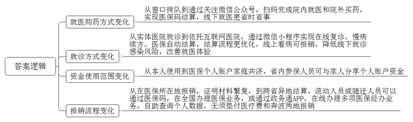
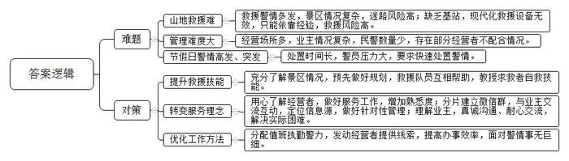
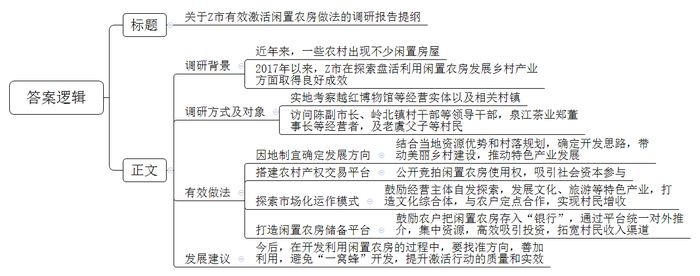

# 2021年公务员多省联考《申论》题（江西乡镇卷）

> 候选采集稿。参考答案及解析来自粉笔页面，不代表官方答案或真实高分答卷；来源使用许可与原卷对应关系仍需人工核实。

## 给定材料

### 材料 material-acc49b13a26251cb

新春伊始，《新农村》记者小梁到基层调研，以下是他在两个村庄采访的片段。

“村子真干净”，这是外来人对东各村的第一印象。村道上见不到一张纸片，家家院里院外也清清爽爽。79岁的高大妈笑着把小梁往屋里迎。冬季取暖煤改电以后，高大妈家装了地暖，外面再冷屋里也舒服。高大妈自己收拾得利索，家里拾掇得干净，屋里屋外的花儿都修剪得齐齐整整。她言语间透着喜悦：“儿子孝顺，春节前辞了城里的工作回来，专门照顾我们老两口。”“爸妈上了年纪，身体都不大好，有个头疼脑热，身边没个人照顾那肯定不成。”高大妈的儿子小曾买完菜刚一进门就接过了话头。

东各村是太行山脉的一个小山村。村子不大，一共250多人，但老龄化程度不低，60岁以上的老人就有70多位。平时，村里就是这些老人“守着”。村委会一周放两次公益电影，捧场的也都是这些老人。“村里的大爷大妈都是居家养老，儿女负责赡养。子女外出打工的，只能是老两口互相照顾。村里打算建个‘托老所’，解决老人的日间吃饭、活动和照料问题。”村党支部委员李大姐介绍说，她时常会到高大妈家来看看，帮衬帮衬。听说要建“托老所”，高大妈觉得不错，“老姊妹能时常见上一面，唠唠嗑。”“老爸腿脚不好，出不了门，还得我们在跟前伺候着放心。”小曾说。村里买东西不太方便，买点油盐酱醋、买点菜都得去镇上，单程4公里，走到公交站就得一刻钟，这对老年人是个大挑战。儿子能在身边尽孝，高大妈心里高兴，可也着急。她跟李大姐商量，“咱村里能不能办个产业，让我儿子也能有点收入，不然他光照顾我们了，以后咋办？”

东各村边有条远近闻名的宋代古道，村内还保留着古道上唯一的一座三孔拱桥，来的游客不少。村里已经有10多户拿到了农家乐的经营执照，李大姐说：“要是乡村旅游搞起来，不愁您儿子没事儿干！”

坐落在太湖之滨的水乡小村开弓村，则是另外一种景象。弯弯的小清河穿村而过，如箭在弦，村名由此而来。上世纪30年代，费孝通先生来此调研，写下著名的经济调研报告。岁月变迁，费老留下的精神财富，成了开弓村重要的文化资源和发展动力。

甜茶、昆曲、桥文化……在开弓村文化纪念馆，或图文，或影像，或模型，地方风土人情跃然眼前。陈列厅里，一件件旧物什，散发着浓浓的年代感。“有不少是村民自己捐赠的，像这排老式碗橱，还有那套八仙桌椅，现在已经很难看到了。”被村里人称为“农民教授”的老姚感叹，这里存放的是村民共同的乡村文化记忆。开弓村越来越富，村民的生活越来越好，但老姚喜中有忧，开弓村的曾经是“处处倚蚕箔，家家下鱼筌”；如今，农耕文化、蚕桑文化却有淡化之势，“这是我们的根啊！”老姚颇有感慨。

如何传承乡风民俗？“首先要发挥好乡贤的力量。大家都有共识，要有个乡贤议事会。”老姚说。在成立后的乡贤议事会上，大家一致认为，要以有形的形式展现开弓村文化，如熏豆制作工艺，婚嫁习俗，摇三橹船，桑、蚕、丝到蚕丝被的一条龙产业……为什么要以“有形的形式”？老姚说：“让来到开弓村的人，从亲身参与民俗活动中体味到农耕文化和蚕桑文化的韵味。”村民的文化活动要有载体，开弓村发展较早，能用的土地已经不多，怎么解决？经过商议，村里准备把老仓库改造成文化礼堂。“脚手架已经搭起来了，估计5月份就能启用。”老姚说，按照规划，礼堂能容纳100人左右，今后村里的党员活动、小型培训、会议、文艺演出都可以使用。

未来，开弓村的文化回味必定更加悠长。

### 材料 material-98d78dfda4f93515

这天，老王正巧经过F省老年医院，心想最近血压波动比较大，不如到医院问问医生需不需要调整用药。进入医院，他询问导诊员：“我今天没带医保卡，能不能用医保电子凭证二维码（以下简称医保码）看病？”“当然可以！”在导诊员的指引下，老王通过手机关注医院微信公众号，对着机器扫医保码，完成了挂号、诊间结算、取药取报告、预约复诊等就医环节，全程不到半小时。他高兴地说：“太方便了，不用再到窗口排队缴费，省时省事多了。”

随着医保码落地，F省从“卡时代”跨入“码时代”，“码”不仅运用于院内的就医流程，还可用于院外买药。据省医疗保障局统计，医生花费数秒扫码的时间，就可为患者平均节省在医院就医等待的时间约43分钟。截至去年底，全省已有630万余名参保人员开通了医保码，推广使用量在全国位居前列，有236家医院、近7500家药店实现了医保码结算。

蔡先生首次体验到了“云医疗”的便捷。这天，他通过省级机关医院客户端微信小程序，向省级机关医院心内科张主任发起了复诊高血压病的申请。通过视频问诊，张主任在线为蔡先生开出了一张电子处方，经过药师在线审方，就完成医保在线结算了。接下来，蔡先生在家就能收到由医院寄来的药品。“根据患者之前的检查结果和线下就诊记录，我可以延续之前的处方，直接在线为他开电子处方，指导他用药剂量和服用周期。这样他就不用为了开个药，特意跑趟医院了。”张主任说。这家医院是全国首家使用医保码实现医保在线结算的互联网医院。截至去年底，F省已有多家医院开通线上医保结算权限。市民开通了医保码，只要近3个月在互联网医院所属的实体医院有就诊记录，就可以在互联网医院进行在线复诊、慢病续方、医保自动结算等。实行医保码扫码结算，不仅优化了结算流程，解决人们线上看病买药不能报销的痛点，还有效降低了线下就诊感染风险，改善了老百姓的就医体验。

“我丈夫帮我绑定了他的医保卡，说是能用他卡里的钱，怎么用呢？”64岁的黄阿姨正在某连锁药店询问店员。黄阿姨是城乡居民医保参保人。在店员的指点下，她凭借微信上的医保码，用丈夫医保个人账户里的钱买了药。省医保中心信息科项科长介绍，2020年7月以来，F省在全国率先实现医保个人账户家庭共济，家庭成员在省内不同地方的，也支持加入共济账户。加入家庭共济账户后，参保人员还可以和家人一起分享共济账户里的个人账户资金。

60岁的林阿姨到广州帮儿子照顾孩子已有10年，这些年因大小疾病在广州的医院做过多次手术。她说，住院治疗所产生的医疗费用垫付压力大，而且可选择的省外定点医疗机构也不多，每年她都要奔波一千多公里往返广州与F省，还要准备各种证明材料，才能报销医保，十分麻烦。随着医保码落地，流动人口或随迁人员再也不用垫付医疗费，也不用大老远奔波报销医保了。一方面，参保人可以通过医保码在全国办理有关医保业务；另一方面，通过电子政务平台政务通App，F省居民可在线办理跨省异地就医备案、参保关系转移、参保缴费证明打印等多项医保经办业务，同时可以自助查询个人账户、个人待遇、消费明细、报销结果等个人数据。

### 材料 material-dfa05cb3346621a7

古城派出所辖区，有古城、古塔、世界地质公园等知名景区。“辖区就是景区，景区就是辖区，居民区也是景区”，这给古城民警提出了不小的挑战。最大的挑战是什么？“山地救援！”派出所杨副所长脱口而出。入职20年来，他和同事们平均每年接到山地救援警情百起左右，解救上百名迷路、被困、遇险群众。景区林中古木参天，山势险要，一些缺少经验的游客可能会迷路，由于山中没有基站，手机定位、无人机巡航常常派不上用场，搜救只能靠杨副所长对山中一草一木的记忆。“从哪里出发、附近是什么植物”“见过什么石头、翻过哪些河谷”“正对面能看到哪些景色”……几个问题一问，杨副所长就能判断个八九不离十。

对救援者而言，进山救援同样面临极大的安全挑战。尤其是入冬后，有的地方积雪四五十厘米，一旦落入石缝或者滑下深渊，后果不堪设想。

有天凌晨，游客赖先生报警求援，当天山上寒风夹着大雪，能见度仅5米。在地图上标注好大致位置、规划好路线，顶着寒风，踏着齐腰的深雪，杨副所长和同事们凭着经验前去救援。经过一处斜坡时，一名队员脚下打滑差点摔下去，大家拿绳子把他拉上来一看，下面是万丈悬崖。一路上，杨副所长每隔十几分钟，就电话联系赖先生，一再叮嘱他不能睡觉，一定要不停走动增加身体热量。最终，民警在海拔3700米处的烟雨亭附近找到了他。上百次救援，并非每次都能成功。“如果游客私自进入非游览区域，特别危险。”杨副所长说，他希望游客不要贸然进山。“毕竟一旦救援不成功，可就是一条命啊！”

古城有4000多家酒吧客栈，杨副所长认识九成以上的客栈经营者，“这家的老板来自南京，他有个女儿”“那家是浙江人”……沿街走一圈，才知道杨副所长所言不虚。别人问他怎么做到的，他说上心了就能记住。刚入职时，古城仅有70多家客栈，剩下的4000多家，都是他看着建起来的。开设客栈要到派出所办证，通过协调手续，他认识了绝大多数客栈经营者。“登记办证，给人家出主意；遇到纠纷，去帮忙调解。时间久了，大家就都熟了。”杨副所长说，记住人不难，关键还是转变理念，“别只想着怎么管理，多想想怎么服务。”

杨副所长将4000多家客栈分片建立了34个微信群，通过微信群与业主交流互动。尽管这些群每天“嘀嘀嘀”响个不停，杨副所长却很心安。因为只要“嘀嘀嘀”的声音在，就有信息源，也就能有的放矢，抓好旅店行业管理。“要是用脚走，我们14名民警，即便每人每天走访20户，也要半个多月时间，开展其他工作的时间就少了。”杨副所长把客栈经营者当朋友，客栈经营者自然不会把他当外人。“我是派出所民警老杨，我知道生态搬迁大家有想不通的地方，我过来就是想和大家聊聊，有啥实际困难尽管说……”在内湖生态保护拆迁过程中，一名客栈经营者拒不配合，杨副所长带领民警赶到现场，聊了3个多小时，终于做通了工作。

对游客来说，假期漫步在古城大街小巷，也许意味着浪漫与惬意。而对杨副所长来说，却意味着陪伴家人的时间更少了。尽管家就在当地，可从警以来，每一年春节杨副所长都没能在家。“游客的事，都是大事！不管归哪个部门管，只要游客打了110，古城派出所就不会不管。”派出所李所长说，大多数人放假时，是民警最忙的时间。有时候饭刚吃了一口，就要出警；夜晚遇到警情，经常一宿无眠。李所长说：“越是节假日，对我们快速处置警情的要求就越高。所里只留几个人值守，其他全部布置到岗亭和街面，以便发生警情后5分钟就能出警。”“为的就是给游客安全感。”杨副所长说。11月的一天，一对从外省来的夫妇报警称其儿子小吴离家出走已半年，最近在古城有活动轨迹，请求帮助寻找。杨副所长立即开展工作，发现小吴于前几日曾在古城某网吧上网。他将小吴照片及基本信息发到每个客栈群后，一家客栈的经营者马上回话，称小吴就在其客栈内，失踪大半年的小吴终于被找到。

“游客的事，都是大事！不管归哪个部门管，只要游客拨打了110，古城派出所就不会不管。”杨副所长说。

### 材料 material-f2df09e32a8e8b0f

近年来，一些农村出现不少闲置房屋。2017年以来，Z市不少地方着力探索盘活利用闲置农房发展乡村产业的有效途径和措施，取得良好成效。

位于东湖镇新泉村的新泉中学，因优化农村学校布局，多年前已不再办学，老教学楼被列入闲置农房，有人提议拆掉建住宅，但村两委最终统一意见：拆掉“太可惜”，还是应该盘活利用。东湖镇产茶历史悠久，“老房子”联手茶产业，能发挥盘活利用的效益。确定发展方向后，村里通过镇里的农村产权交易平台公开竞拍老楼使用权。

主楼木板开始腐烂，副楼已几乎成了危房——这是泉江茶业有限公司郑董事长与老教学楼初次相遇时的情景。但透过蛛网积尘，郑董事长脑中闪出一个念头：竞拍租下来，改造成专题博物馆。2017年11月，越红博物馆正式开放，曾经凋敝的老屋重焕生机。同时，作为青少年茶文化教育基地，博物馆还常举办特色研学活动。“去年接待游客3万多人次。”郑董事长说。经村镇牵线，博物馆与村里的农户定点合作，帮助他们实施绿色无公害茶叶种植管理。每斤40至60元的收购价，比以前高出一截，从闲置教学楼到茶文化综合体的蝶变，折射出闲置农房盘活后“包袱变财富”的改革之效。

Z市陈副市长认为，一些闲置的农村住房、厂房破旧不堪，要修缮很费钱，弃之拆之又可惜；而同时，拓宽农民增收渠道，促进农民收入持续增长，需要建立健全农民财产性收入增长机制。

截至2020年底，Z市有激活意愿、尚待开发利用的闲置农房近50万平方米，是扎堆搞农家乐、民宿，还是避免“一窝蜂”开发，直接关系到激活行动的质量和实效。陈副市长说：“怎么找准方向、善加利用，至关重要。这段时间，唐书记和村干部正忙着与外地客商对接，将闲置农房激活同古村落的新规划有机结合起来，串联带动起美丽乡村建设、特色产业发展的‘面’。”

岭北镇孚家村老虞同儿子住在外地，老宅空置多年。去年上半年，一位村干部建议他把闲置农房存进“银行”。闲置农房存进“银行”，这个特殊的“银行”就是镇里的闲置农房储备平台，“正式‘激活’前，房子归自己管，激活后再按照租赁合同得收益。”村干部介绍。没过多久，一位外县企业家通过平台相中了老虞等五户村民的闲居房，准备修缮用于民宿经营。前不久，北周村废旧织布厂通过平台统一对外推介，由社会资本、乡贤和村集体共同入股出资，将老厂房改造成土特产展销中心，销售额已达100多万元。

## 题目

### 第 1 题

**根据给定资料**1**，请分别概括高大妈的“喜”和“盼”、老姚的“喜”和“盼”。（20分）**

关联材料：material-acc49b13a26251cb、material-98d78dfda4f93515、material-dfa05cb3346621a7、material-f2df09e32a8e8b0f

作答要求：

要求：全面、准确、有条理，不超过250字。

### 第 2 题

**给定资料**2**中提到，F省医保从“卡时代”跨入“码时代”。请你说说其中的变化。（20分）**

关联材料：material-acc49b13a26251cb、material-98d78dfda4f93515、material-dfa05cb3346621a7、material-f2df09e32a8e8b0f

作答要求：

要求：全面、准确、有条理，不超过300字。

### 第 3 题

**根据给定资料**3**，请谈谈古城民警在工作中遇到了哪些难题，他们是如何解决的？（25分）**

关联材料：material-acc49b13a26251cb、material-98d78dfda4f93515、material-dfa05cb3346621a7、material-f2df09e32a8e8b0f

作答要求：

要求：内容全面，条理清晰，不超过350字。

### 第 4 题

**假设你是调研组成员，请根据给定资料**4**就Z市有效激活闲置农房的做法，写一份调研****报告****提纲。（****35分）**

关联材料：material-acc49b13a26251cb、material-98d78dfda4f93515、material-dfa05cb3346621a7、material-f2df09e32a8e8b0f

作答要求：

要求：

（1）紧扣资料，内容全面；

（2）层次分明，逻辑清晰；

（3）不超过600字。

## 答案与解析

第 1 题

**参考答案（粉笔题库参考内容）**

高大妈的喜：1.村容村貌改善。硬件设施完善，生活舒适，居家环境洁净。2.老有所依所养。帮衬留守老人，定期放映公益电影；子女孝顺，返乡照顾父母。盼：1.开办养老机构。建造“托老所”，提供日常服务，满足交流需求。2.发展乡村产业。开发旅游业，提高收入。3.完善基础设施。增设售货点，优化公交站点，方便出行。

老姚的喜：1.文化纪念馆建成。保留风土人情，存放文化记忆。2.经济水平提升。村民富裕，乡村生活水平提高。盼：传承乡风民俗。发挥乡贤作用；复兴并让游客体会桑蚕与农耕文化；搭建活动载体，改造文化礼堂，开展活动。

**解析**

**参考答案说明**：本参考答案宏观上围绕高大妈的“喜”和“盼”，以及老姚的“喜”和“盼”展开。高大妈“喜”的方面，分别从“村容村貌改善”“老有所依所养”两个方面分条撰写，高大妈“盼”的方面分别从“开办养老机构”“发展乡村产业”“完善基础设施”三个方面分条撰写；老姚“喜”的方面，分别从“文化纪念馆建成”“经济水平提升”两个方面分条撰写，老姚“盼”的方面主要围绕“传承乡风民俗”展开。各条要点在内容上是并列且无交叉的。

**考点**：考点其他类

**来源**：来源2021年公务员多省联考《申论》题（江西乡镇卷）

粉笔申论页面对本题只提供「解析视频」入口，该入口是会员推广位，页面无视频地址与文字解析。

第 2 题

**参考答案（粉笔题库参考内容）**

1.就医购药方式变化。从窗口排队到通过关注微信公众号，扫码完成院内就医和院外买药，实现医保码结算，线下就医更省时省事。

2.就诊方式变化。从实体医院就诊到依托互联网医院，通过微信小程序实现在线复诊、慢病续方、医保自动结算，结算流程更优化，线上看病可报销，降低线下就诊感染风险，改善就医体验。

3.资金使用范围变化。从本人使用到医保个人账户家庭共济，省内参保人员可与家人分享个人账户资金。

4.报销流程变化。从在医保所在地报销，证明材料繁复，到跨省异地结算，流动人员或随迁人员可以通过医保码，在全国办理医保业务，或通过政务通APP，在线办理多项医保经办业务，自助查询个人数据，无须垫付医疗费和奔波两地报销。

**解析**

**参考答案说明：**本参考答案从“就医购药方式变化”“就诊方式变化”“资金使用范围变化”“报销流程变化”这四个方面入手，对F省医保从“卡时代”跨入“码时代”发生的变化进行了阐述，并分条撰写。各条答案要点之间在内容上是并列关系，没有交叉。

**考点**：考点变化类

**来源**：来源2021年公务员多省联考《申论》题（江西乡镇卷）

粉笔申论页面对本题只提供「解析视频」入口，该入口是会员推广位，页面无视频地址与文字解析。

第 3 题

**参考答案（粉笔题库参考内容）**

难题：1.山地救援难。救援警情多发，景区情况复杂，迷路风险高；缺乏基站，现代化救援设备无效，只能依靠经验，救援风险高。2.管理难度大。经营场所多，业主情况复杂，民警数量少，存在部分经营者不配合情况。3.节假日警情高发、突发。处置时间长，警员压力大，要求快速处置警情。

对策：1.提升救援技能。充分了解景区情况，预先做好规划，救援队员互相帮助，教授求救者自救技能。2.转变服务理念。用心了解经营者，做好服务工作，增加熟悉度；分片建立微信群，与业主交流互动，定位信息源，做好针对性管理；理解业主，真诚沟通、耐心交流，解决实际困难。3.优化工作方法。分配值班执勤警力，发动经营者提供线索，提高办事效率，面对警情事无巨细。

**解析**

**参考答案说明：**本参考答案整体上分为难题、对策两大类。在“难题”方面，从“山地救援难”“管理难度大”“节假日警情高发、突发”三个方面进行了分条撰写；在“对策”方面，本参考答案从“提升救援技能”“转变服务理念”“优化工作方法”三个方面进行了分条撰写。同时，各条答案要点之间在内容上相互并列，没有交叉。

  

**考点**：考点多要素组合类

**来源**：来源2021年公务员多省联考《申论》题（江西乡镇卷）

粉笔申论页面对本题只提供「解析视频」入口，该入口是会员推广位，页面无视频地址与文字解析。

第 4 题

**参考答案（粉笔题库参考内容）**

关于Z市有效激活闲置农房做法的调研报告提纲

一、调研背景：近年来，一些农村出现不少闲置房屋。2017年以来，Z市在探索盘活利用闲置农房发展乡村产业方面取得良好成效。为此，开展了本次调研。

二、调研方式及对象：实地考察越红博物馆等经营实体以及相关村镇；访问陈副市长、岭北镇村干部等领导干部，泉江茶业郑董事长等经营者，及老虞父子等村民。

三、有效做法：

1.因地制宜确定发展方向。结合当地资源优势和村落规划，确定开发思路，带动美丽乡村建设，推动特色产业发展。

2.搭建农村产权交易平台。公开竞拍闲置农房使用权，吸引社会资本参与。

3.探索市场化运作模式。鼓励经营主体自发探索，发展文化、旅游等特色产业，打造文化综合体，与农户定点合作，实现村民增收。

4.打造闲置农房储备平台。鼓励农户把闲置农房存入“银行”，通过平台统一对外推介，集中资源，高效吸引投资，拓宽村民收入渠道。

四、发展建议：今后，在开发利用闲置农房的过程中，要找准方向，善加利用，避免“一窝蜂”开发，提升激活行动的质量和实效。

**解析**

**参考答案说明**：（1）本题是公文题，要求写一份调研报告提纲，不必考虑格式，只写正文即可，但为了保险起见，建议加上标题。（2）本参考答案的内容方面，围绕着“Z市有效激活闲置农房做法”这一主题，先介绍了调研背景、调研方式及对象；接着又从“因地制宜确定发展方向”“搭建农村产权交易平台”“探索市场化运作模式”“打造闲置农房储备平台”四个方面阐述了Z市激活闲置农房的“有效做法”；最后给出了发展建议。形式方面，本参考答案做到了分段、分条撰写，整体上条理较为清晰。

**考点**：考点总结类

**来源**：来源2021年公务员多省联考《申论》题（江西乡镇卷）

粉笔申论页面对本题只提供「解析视频」入口，该入口是会员推广位，页面无视频地址与文字解析。

