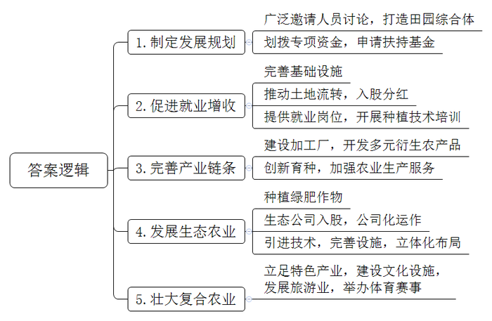
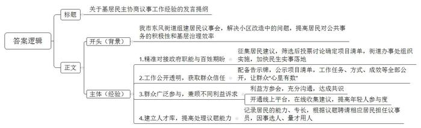
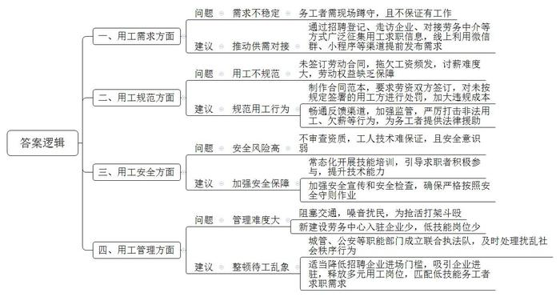
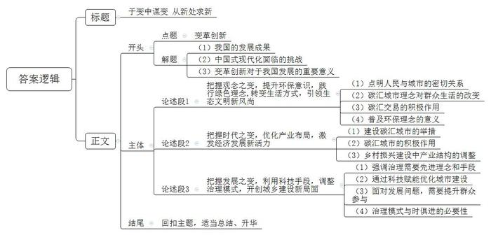

# 2023年公务员多省联考《申论》题（江西省市卷）

<!-- gwy:overview:start -->
> **江西 · 2023 · 申论 · 省市卷** ｜ 4 题 · 图片 4 处 · 答案随题折叠

导航：[题目](#题目) · [材料 1](#材料-1)
<!-- gwy:overview:end -->

> 候选采集稿。参考答案及解析来自粉笔页面，不代表官方答案或真实高分答卷；来源使用许可与原卷对应关系仍需人工核实。

## 给定材料

### 材料 1

群山环绕，万亩橘林。在一处农家屋前，人来人往，主人小黄微笑着迎上来，端着剥好的橘子说：“来尝尝，自家产的，好吃！”小黄在橘乡田园综合体承包的橘园今年大丰收。依托全县36万亩柑橘产业，乙县打造的橘乡田园综合体正大步向前发展。乙县有种植柑橘的传统、产业基础较好，但柑橘却卖不出去。乙县人不服气，主动求变，探索乡村振兴致富路。“我们先后开了二十多场会，邀请专家学者、企业家以及我们县在外工作的人一起来为乡村振兴出谋划策。”乙县方县长说，“最后县委县政府决定兴办橘乡田园综合体，走特色农业之路。县政府划拨专项资金，还向省里申请了乡村振兴示范点基金。”

小黄家在双桂村，以前也种柑橘，但因品种不佳、管理不善，盈利不多，他就把橘园交给父母打理，自己出去打工了。常年在外务工，家里年迈的父母和年幼的孩子是小黄最放心不下的牵挂。既能照顾家又能实现就业增收，是他多年以来的心愿。听说县里要在老家兴办田园综合体，小黄赶紧把家里的土地流转入股。“现在我们这里大变样了，政府修建了四车道的水泥路，直通高速公路，还开通了5G网络。土地流转到田园综合体后，利用率明显提高，我们每年都能拿到土地分红。”小黄说，“政府还帮流转了土地的村民解决就业问题，开展种植技术培训。我们可以在田园综合体中当长期固定工人，每月领工资，也可以自己承包橘园。”小黄从田园综合体承包的12亩橘园今年产了一万斤果子。以前产量小，还得操心销售，现在产量大了，小黄却一点都不担心：“工厂会来收购。”他说的工厂，是田园综合体内的柑橘加工厂。走进工厂车间，圆滚滚的新鲜柑橘，在智能化生产线上排列整齐。生产线的尽头，柑橘已变成橙汁。橙汁，只是柑橘加工产业链上的一个点。生产线上，柑橘变成20余种产品：果肉制成橙汁、果酒、橘蓉等，皮渣则提炼出抗癌药物原料——橘皮甙，连废渣都制成了有机肥和橘饲料。吃橘饲料长大的橘香猪，肉价是普通猪肉价的4倍。“有了完整的加工产业链，我们就能充分利用每一颗柑橘的价值，实现经济效益最大化，乡村振兴才有了最有力的保障。”田园综合体吴书记说。柑橘新品种培育中心、检验检测中心、柑橘交易中心……从创新育种到服务果农，一个完整的柑橘产业链条正在不断成长。

郁郁葱葱的柑橘树下，三叶草、苕子正茂盛生长。“这是绿肥作物，可以抑制杂草生长，等叶子干枯了，还能作有机肥。”吴书记说。为了减少化肥农药用量，田园综合体里全部采用太阳能杀虫灯、生物有机肥，确保绿色环保。绿油油的脆李压弯了枝头，池塘里的荷花开满了水面，金黄的稻田里鱼儿在嬉戏……好一幅生态优美的现代农业图。田园综合体兴建之初，乙县积极招商，引进一家大型生态农业公司入股，“县政府对这家公司进行了深入调查，的确是有资质、有经验、有技术，口碑比较好。”吴书记说，“在他们的帮助下，我们确立了生态农业的发展路径，对田园综合体进行公司化运作，以便更适应市场竞争。”田园综合体一开始就立体化布局柑橘、水稻、蔬菜、蜜蜂等种养业，还引进生态环境检测技术，完善垃圾污水处理等基础设施。如今，这里已建成特色生态农业基地1.8万亩，带动上万农民就业，农民年人均可支配收入达到2.5万元以上。

毗邻田园综合体办公区的是刚开放的柑橘品种博览园。进入大门，400多个柑橘品种跃然眼前，形态各异：小如豌豆的“金豆”、大个的香橙……“田园综合体规划了3平方公里的柑橘文化博览区，柑橘品种博览园只是其中的一部分。”吴书记说，“这是我们以柑橘产业为基础融合文化旅游的尝试。”田园综合体内已经建成了橘乡荷海、智慧橘园，桃李梦园等，成为当地的人气休闲旅游地。在游玩之余，游客还可在柑橘文化博览区了解我国柑橘种植历史，观看现代柑橘种植技术的展示，加深对柑橘文化的认识。“冬春摘橘、夏季赏荷、秋季观稻，我们这里四季有风景。”吴书记表示，未来还会开展马拉松，山地自行车等体育赛事，“随着以柑橘产业为主导、多种产业融合的复合型农业不断壮大，我们的田园综合体一定会更加蒸蒸日上。”

从普通的山村到现代田园综合体，迈向幸福的故事每天都在这里上演。“未来我们还会不断改革创新，以变应变，释放乡村振兴新动能，走出一条新型城镇化之路。”方县长信心满满地说道。

### 材料 2

自从小区改造列入县民生实事项目，各小区微信群里就议论纷纷，这家要先装灯，那户提出停车难，诉求复杂多样，怎么让大家都满意？由86名成员组成的东风街道第一届居民议事会成立，解了难题。居民议事会成员向居民征集建议后，列出了包含楼道灯安装、停车位改造等25个诉求的建议清单。“街道党工委对建议清单进行筛选，形成候选清单，再提交居民议事会讨论和投票。居民议事会确定项目清单并提出处理建议后，由街道党工委交由街道办事处组织实施。”街道党工委孙书记说，“议事协商议的是民生话题，瞄准的是更好地解决民生问题。确定议题过程中，街道党工委要发挥主动作用，将政府职能与百姓期盼精准对接，让议事协商直击痛点，契合居民心意，推动民生实事加快落地。”

东风街道居民议事会是县基层协商议事试点之一。走进居民议事会，10多套活动桌椅整齐地摆放着，可根据不同议事主题排列组合，同时还配套发言台和LED显示屏。一块大大的告示牌悬挂在墙壁上，上面正在公示居民议事会近期表决的项目清单，包含了项目名称、提出人、解决方案、办理主体、办理进度等等，通过这个清单，居民议事会所做的事情一目了然。“议事会在做什么、怎么做、做得怎么样，一切都是公开透明的，大伙儿心里有数，才会信任议事会。”议事员老陈笑言，“以前大家有问题，没有商量的地方，现在有了这个阵地，大家遇到问题都喜欢来聊一聊，敞开心扉，把问题摊开，不知不觉就找到了解决办法。”老陈退休前是一名教师，为人公道，热心社区事务，被聘请来当议事员。“议事员由居民推荐、街道遴选，大多是党员，政治素质过硬。有的是像老陈这样的老住户，在居民中威望较高；有的是有专长的行家，能为大家出谋划策。”孙书记说，每个议事员都要联系一个片区，负责收集居民关心的问题。

“车乱停，有时堵楼门口，出行难。”停车乱，无车户难以忍受。“我们也想按车位停，可哪有车位？”停车难，有车户也感到无奈。东风街道的一次居民议事会上，社区居委会、物业、业委会、议事员、有车户代表、无车户代表畅所欲言。“没有车位的统一停小区外吧，不影响小区环境。”无车户提出。“还是停小区内，安全可管理。”有车户有异议。意见不同，大家一起分析：停小区外可能妨碍交通，可行性差，还是要在小区内挖掘潜力，将废弃绿地、边角地划成车位。方案公示，车位边一楼的无车户担忧噪声影响休息。议事会再次启动，决定在车位与住房之间种植花草，同时对受影响住户进行补偿。现在，有车居民自觉泊车入位，一排排车辆整整齐齐。“议事会已经形成行之有效的程序，街道工作人员主持，将参会人员分成不同小组进行讨论，由各组代表汇总上台发言，投票选出可行性高的解决方案。”孙书记说，不少事项牵涉到不同利益主体，议事会要尊重和照顾不同利益诉求。虽然很多时候协商的过程很曲折，甚至有争吵，但充分沟通后达成共识，能兼顾不同的利益方促进彼此理解，消除了矛盾和怨气。日前，东风街道居民议事会还开通了线上平台。“如今讲共建、共治、共享，最重要的就是老百姓肯参与进来！”孙书记说，议事会开到线上以后，居民只需要扫二维码，就能在平台上提交意见和建议，这让年轻人的参与度大大提高，这样议事会就能更广泛地听取群众的心声。

议事协商有结果，更要落地，切实解决群众诉求，把民生实事办到群众心坎上，才会得到群众信任。前不久，街道的新城中心改造项目通过验收，居民眼前一亮：小广场铺上了花岗岩，游乐场传来孩子们的欢笑声，休闲步道上多了散步的居民。“去年，大家还抱怨这小广场环境脏、蚊虫多，有和没有一个样。”高先生笑着说。高先生是建筑设计研究院的工程师，受聘为议事会特别议事员，负责新城中心改造的监督。高先生每天都要到工地上看看，周末更是经常一待就是半天，增设小广场铺装场地、展示墙和儿童游乐场所等，就是他看完设计图纸后提出的建议。东风街道根据居民的议事能力、专业特长和工作经历，建立人才库。议题确定后，街道就会联系相应的居民，聘请他们担任特别议事员，让“适合”的人参加“适合”的会，从而提高议事会处理议题的能力。

“议而能决，商而能行，理顺群众的‘气’，很多事情都好办了，毕竟大家在根本利益上是一致的。这便是运用柔的方法，取得好的效果。”孙书记说。

### 材料 3

为了解零工市场发展状况，R市由相关部门组成调研组进行专题调研，以下是获得的部分调研资料。

占唐路是R市最大的零工市场，每天几千名务工人员聚集在此讨生活。他们并未选择背井离乡去务工，而是呈现“候鸟”般的生活，一般凌晨5：00左右就赶到占唐路揽工，夜晚归家陪伴妻子儿女。

占唐路处于瑶江区城乡结合部，很多进城务工人员在此租赁廉价的房屋，工地上的小包工头也发现这里能找到工人，久而久之，人越聚越多，占唐路也成了“自由劳动力市场”的代名词。

今年52岁的老李家住瑶江区隆岗社区，因为自身文化程度较低，学过木工的他，多年来一直在占唐路打零工。“年轻的时候也在工地上待过，后来老婆孩子都来R市了，我就在这儿买了房子。”老李笑言，“我们打零工的收入总体还可以，大部分都是日结，干一天算一天，每天的工钱平均下来有两三百，但不是每天都有活干，有时在这里连续蹲几天也没有适合的工作，就算白蹲也必须守着。趁着还干得动，就多干点，存点钱养老、看病。”现在，妻子在家门口摆摊卖小吃，他在占唐路打零工，虽然生活并不富裕，但比老家的生活好多了，老李已经感到很知足了。

“下雨了，下雨了……”不少人一边喊着，一边跑向周边的建筑下面去躲雨，但还有一半左右的人坚守原地，并没有离开，似乎已经习惯大雨的突袭。50岁的靳大姐就是在这样的雨天继续坚守的人，她拿出随身携带的雨衣套上，已经六天没找到活干，遇到下雨天更是心急，期盼着包工头的到来。

突然，她转身走向马路对面，急匆匆地走到一辆红色三轮车旁边，大家以为她去抢工作，没想到是讨薪去了。或许是下着大雨的原因，靳大姐被拖欠了一个月的200元钱，今天讨回得格外顺利，她脸上终于露出了笑容。在占唐路，日结工资虽然听起来痛快，但被拖欠工资也是家常便饭，由于没签合同，更为日后讨薪埋下隐患。

来自月东县的小刘今年刚满18岁，第一次跟着老乡来到占唐路，想跟着去工地上学点电焊技术，养家糊口。“你会不会电焊呀？还是学徒？”一个包工头样子的人大声问他。“我会了会了，家里好几个人都干电焊呢！”小刘赶紧回答。“那你们几个跟我走吧！”小刘和老乡赶紧收拾东西上了车。“这里的技工等级相差很大，有干了十几年的老技工，也有这样初出茅庐、缺乏经验的新人，基本都是靠老人手把手带出来，没有参加过任何培训，且不说技术过不过关，这安全意识就不够，你看那小子，安全帽都没带。”老李吸着一支烟，意味深长地说，“没发生事故就好，如果发生安全事故，他们这零工身份，没有签任何劳动合同，最后都是自己倒霉。”

几百号流动人员聚集在一个路口，虽然给揽活的务工人员和招人的包工头带来了便利，但却给城市管理造成了困扰。他们是城市的建设者，理应受到关照，但规模性地占马路等活，造成交通拥堵不说，凌晨噪音扰民也多次引来周边居民的投诉，甚至还发生过为了抢活打架斗殴的事。为了规范零工市场发展，去年瑶江区在占唐路两公里外设立了“瑶江区劳务中心”，本想取代现有的占唐路零工市场，但中心设立一年，入驻企业却寥寥无几，而占唐路零工市场却依然火热。经常去占唐路揽工的包工头老王说，由于劳务中心对进场招聘的企业有相关资质规定，没有企业资质的小包工头根本无法进驻。“我们招揽零工，主要都是一些工程赶工期，人手不够用，需要临时找一些人来干活，即使让我们进驻劳务中心，招人的程序也更复杂。”老王说。占唐路零工市场刚好提供了这样的供给。实际上，劳务中心的座椅、空调、饮水机等舒适的环境对务工者并不是没有吸引力，而是因为他们大多是上了年纪的低技能务工者，在劳务中心很难找到他们能够匹配的工作。

“零工市场作为就业‘蓄水池’，为就业者和企业搭建了一座供需桥梁，对务工人员找工作和企业的灵活用工，都有着十分重要的作用。”瑶江区人社局张局长说，“要盘活零工市场的社会闲置资源，还需补齐各方短板，为务工者系好‘安全带’，真正让‘蓄水池’发挥作用。”

### 材料 4

在C市环境交易所，当天的碳汇交易信息正在大屏幕上实时滚动，交易员小冯正在为企业办理碳汇交易账户。“朋友都觉得我的工作很‘洋气’。”谈及自己的工作，小冯露出了笑容。碳汇是指通过植树造林、植被恢复等措施，吸收大气中的二氧化碳，从而减少温室气体在大气中浓度的过程、活动或机制。碳汇交易则是一方通过减少排放或者吸收二氧化碳，将多余的碳排放指标转卖给有需要的另一方，以抵消他们的减排任务，也就是平常所说的“卖空气”。“目前碳汇的交易活跃度和金融化程度还比较低，相关制度规则还有待完善。”小冯说，“但是环境交易所的成立标志着碳汇交易开启了正规化的新局面，这个新局面将促使企业更加意识到碳排放权的价值，相信未来的碳汇交易市场会有更多新机遇。”

C市正在全面探索提升碳汇能力的新途径，成立环境交易所只是其打造“碳汇城市”的一个侧影。C市近年引进的10个亿元项目中，大多为低碳产业。其中，新引进的生物质发电公司年发电量约2.1亿千瓦时。分布式光伏发电项目年发电量约140万千瓦时，年均节省标煤耗量9.5万吨，年均减少二氧化碳排放量24万吨。“我们将着力重塑产业结构，推动产业生态化，借助建设‘碳汇城市’的新机遇，打开城市经济发展的新局面。”C市龙市长说。

在市区的一座公园内，工人们正忙着植树，树与树之间不再讲究“整齐”，而是自然随机布点、“无序”栽植。“与一般造林不同，我们践行的是目前比较先进的‘近自然造林’理念——遵循‘尊重自然、顺应自然、保护自然’的原则，最大限度地模拟自然界中森林生长的环境，让树木实现个性生长，自然演替，从而形成一个生命力和包容性都极强的生态系统。”市城市管理局张局长说，经过多年不懈努力，C市森林覆盖率达40.2%，生态碳汇能力大大提高，“步步见绿”的城市空间新局面逐渐成型。

碳汇理念正不知不觉地浸润到C市治理的方方面面。以前，C市的一座高架桥下，经常有大量砖石、渣土等建筑废料高高低低绵延上百米，犹如一块灰色调的“城市疮疤”。现在再经过这里，上有蓝天白云，中有高架桥穿过，下有花海绿廊，这个变化是怎么发生的？“我们给这里覆盖了一层‘营养土’，这层营养土与建筑渣土混合后，能有效改善土壤营养成分，为植物的生长提供优质条件。”张局长说，这些“营养土”是市政污泥等有机固废制成的。市政污泥是污水处理过程中产生的固体沉淀物质，过去一般填埋和焚烧处理，但会污染环境，增加碳排放量。C市引入高新技术团队，把市政污泥制成有机发酵物，调配成花卉用土，覆盖在建筑渣土上，再播撒花草，“城市疮疤”很快就变成了新的城市风景线。“这种‘碳汇’模式一举两得，既治理建筑垃圾，也解决市政污泥。”张局长说，“我市已有47万平方米城市裸土完成土壤改良及花草种植，一年可实现固碳近3000吨。”

在C市，随着碳汇理念的普及，绿色低碳正成为全民新风尚。点开“碳汇积分”小程序，小苗骄傲地展示自己的4位数积分。“我在绿色商城兑换了好多奖励，现在又在攒积分。”她笑道。“碳汇积分”小程序是C市推出的碳减排数字账本，市民衣食住行游的每次减排行为，都会在小程序上进行量化和记录，形成个人“碳账本”。乘坐公共交通、旧物回收……“举手之劳”的绿色低碳行为都可以收获碳汇积分，这些碳汇积分可以兑换奖品，推动着从“环保意识”到“环保行为”的转化。如今碳汇积分成为了小苗和朋友天天“比拼”的项目。“与其说是我们为‘碳汇城市’建设贡献力量，不如说是碳汇理念改变了我们的生活习惯。”

“空气卖出近4万元！”浦上村村支书老舒兴奋地说。浦上村位于C市郊区，今年以单价100元/吨的价格向一家企业出售了375吨碳汇资源。碳汇交易给这个山村带来了新机遇，让村民们当上了“卖碳翁”。老舒算了一笔账，村里有1.3万亩毛竹林，按照现在的碳汇价格计算，碳汇收入能有20多万元。近年毛竹价格连年走低，有时候卖一季毛竹成本都收不回来，村民都不愿意照管。有了碳汇，只要把毛竹林养好，“竹叶子”就能变成“钱票子”。“这片林子荒得比较厉害，要赶紧梳理，加强养护”……老舒带着村民爬山头、定规划，大家重新背上砍刀修起了竹梢，村民细致养护、培育毛竹林这样多年未见的场景又回来了。

“新局蕴新机，新机生新局。我们正在以城乡一体、协调发展的新思路推动‘碳汇城市’建设，点‘碳’成金，把‘碳汇城市’打造成我们的金字招牌。”龙市长说，“<u>以变促变，以新求新</u>，‘碳汇城市’建设将给我们带来一场从个人到城市，从观念到行为的全方位变革。”

## 题目

### 第 1 题

**给定资料**1**中介绍****村民生活由****“****空心村****”****变成****“实心村”“开心村”，谈谈是如何改变的。（15分）**

关联材料：材料 1

作答要求：

要求：准确，全面，不超过200字。

第 1 题 · 答案与解析

**参考答案（粉笔题库参考内容）**

1.制定发展规划。广泛邀请人员讨论，打造田园综合体；划拨专项资金，申请扶持基金。

2.促进就业增收。完善基础设施；推动土地流转，入股分红；提供就业岗位，开展种植技术培训。

3.完善产业链条。建设加工厂，开发多元衍生农产品；创新育种，加强农业生产服务。

4.发展生态农业。种植绿肥作物；生态公司入股，公司化运作；引进技术，完善设施，立体化布局。

5.壮大复合农业。立足特色产业，建设文化设施，发展旅游业，举办体育赛事。

**解析**

**参考答案说明：**本参考答案从“制定发展规划”“促进就业增收”“完善产业链条”“发展生态农业”“壮大复合农业”五个方面介绍了村民生活变好的具体对策。每条答案要点之间在内容上是并列关系，没有交叉。

**考点**：概括措施类

**来源**：2023年公务员多省联考《申论》题（江西省市卷）

### 第 2 题

**给定资料**2**中孙书记要参加市里基层民主协商议事工作经验交流会，帮他写一份发言提纲。（20分）**

关联材料：材料 2

作答要求：

要求：逻辑清晰，内容全面，不超过300字。

第 2 题 · 答案与解析

**参考答案（粉笔题库参考内容）**

关于基层民主协商议事工作经验的发言提纲

背景：我市东风街道组建居民议事会，解决小区改造中的问题，提高居民对公共事务的积极性和基层治理效率。

经验：1.精准对接政府职能与百姓期盼。征集居民建议，筛选后投票讨论确定项目清单，街道办事处组织实施，加快民生实事落地。2.工作公开透明，获取群众信任。配备告示牌，公示项目清单，工作任务、方式、成效等全部公开，让群众“心里有数”。3.群众广泛参与，兼顾不同利益诉求。利益方参会，充分沟通，达成共识；开通线上平台，在线收集建议，提高年轻人参与度。4.建立人才库，提高处理议题能力。记录居民的能力、专长，根据议题聘请相应居民担任议事员，因事选人、量才用人。

**解析**

**参考答案说明：**（1）格式方面，本参考答案写到了“标题”“正文”两个部分。（2）正文部分，一方面从内容上来看，本参考答案围绕“协商议事工作”这一主题，开头先简单介绍了背景，主体分别从“精准对接政府职能与百姓期盼”“工作公开透明，获取群众信任”“群众广泛参与，兼顾不同利益诉求”和“建立人才库，提高处理议题能力”四个方面介绍了议事工作经验。另一方面，形式上，本参考答案做到了分段、分层撰写，整体上条理较为清晰。

**考点**：总结类

**来源**：2023年公务员多省联考《申论》题（江西省市卷）

### 第 3 题

**根据给定资料**3**，梳理****占唐路****零工市场存在的问题，并提出解决问题的建议。（25分）**

关联材料：材料 3

作答要求：

要求：

（1）问题梳理全面、准确、有条理；

（2）所提建议与问题相对应，具体明确、切实可行；

（3）不超过450字。

第 3 题 · 答案与解析

**参考答案（粉笔题库参考内容）**

一、问题：需求不稳定。务工者需现场蹲守，且不保证有工作。建议：推动供需对接。通过招聘登记、走访企业、对接劳务中介等方式广泛征集用工求职信息，线上利用微信群、小程序等渠道提前发布需求。

二、问题：用工不规范。未签订劳动合同，拖欠工资频发，讨薪难度大，劳动权益缺乏保障。建议：规范用工行为。制作合同范本，要求劳资双方签订，对未按规定签署的用工方进行处罚，加大违规成本；畅通反馈渠道，加强监管，严厉打击非法用工、欠薪等行为，为务工者提供法律援助。

三、问题：安全风险高。不审查资质，工人技术难保证，且安全意识弱。建议：加强安全保障。常态化开展技能培训，引导求职者积极参与，提升技术能力；加强安全宣传和安全检查，确保严格按照安全守则作业。

四、问题：管理难度大。阻塞交通，噪音扰民，为抢活打架斗殴；新建设劳务中心入驻企业少，低技能岗位少。建议：整顿待工乱象。城管、公安等职能部门成立联合执法队，及时处理扰乱社会秩序行为；适当降低招聘企业进场门槛，吸引企业进驻，释放多元用工岗位，匹配低技能务工者求职需求。

**解析**

**参考答案说明：**本参考答案从“用工需求”“用工规范”“用工安全”“用工管理”这四个方面展开，各条答案要点之间在内容上相互并列，没有交叉。

**考点**：提出对策类

**来源**：2023年公务员多省联考《申论》题（江西省市卷）

### 第 4 题

**给定资料**4**中提到“以变促变，以新求新”，结合你对这句话的理解，参考给定资料，联系实际，自选角度，自拟标题，写一篇议论文。（40分）**

关联材料：材料 1、材料 2、材料 3、材料 4

作答要求：

要求：

（1）观点明确，见解深刻；

（2）参考给定资料，但不拘泥于“给定资料”；

（3）思路清晰，语言流畅；

（4）总字数1000字左右。

第 4 题 · 答案与解析

**参考答案（粉笔题库参考内容）**

**于变中谋变 从新处求新**

改革开放以来，我国经历了世界历史上规模最大、速度最快的城镇化进程，人民幸福指数不断攀升，现代化建设稳步推进。然而，中国式现代化是人口规模巨大的现代化，新型城镇化建设仍面临诸多挑战。新局蕴新机，新机生新局。在新的历史时期，唯有全方位的创新变革，以变促变，以新求新，才能持续推进城乡协调发展，为中国式现代化建设提供充足的动力。

**把握观念之变，提升环保意识，践行绿色理念，转变生活方式，引领生态文明新风尚。**人民城市人民建，人民城市为人民，城市的发展与居民的行为息息相关。碳汇城市理念的普及改变了群众的生活方式，通过积累“碳汇积分”，群众在日常生活中主动进行减排行为，实现了从“环保意识”到“环保行为”的转化。与此同时，碳汇交易也给乡村带来了新的风貌，村民自觉梳理、修复植被，保护生态环境的积极性大幅提升。环保理念的普及与人的绿色生活方式有机结合，让人们充分享受到绿色发展所带来的便利和舒适，有效推进城乡生态文明建设。

**把握时代之变，优化产业布局，激发经济发展新活力。**面对新的时代之机，只有集聚创新合力，调整产业结构，才能推动城乡经济高质量发展。在碳汇城市的建设过程中，一方面通过成立环境交易所带动城市碳汇交易正规化，引导企业重视碳排放权价值。另一方面大力引进低碳产业，推进节能减排取得显著成效。碳汇城市的打造实现了产业生态化，激发经济活力的同时保障了生态效益。在乡村振兴的建设中，通过打造现代田园综合体，进行公司化运作，盘活了乡村自然资源，促进产业融合发展。从城市到乡村，产业结构之变正持续促进经济发展释放新动能。

**把握发展之变，利用科技手段，调整治理模式，开创城乡建设新局面。**随着社会的发展，治理需要先进的理念和手段。城市的建设应遵循尊重自然的原则，持续保护健康的生态系统，运用科技赋能，提升碳汇能力，着力打造“步步见绿”的城市空间。同时，面对发展过程中涌现的各类新问题，我们应广泛倾听民意，积极搭建群众参与社会治理的平台，激发群众参与社会治理的积极性。东风街道居民议事会便是一个生动的例子，通过线上平台高效解决群众问题，使得群众满意度大幅提升。这充分证明，只有治理模式与时俱进，不断创新，我们才能开拓城乡高水平发展的时代新局，共同绘就美好未来的新篇章。

时代前进的脚步永不停歇，身处百年未有之变局，唯有开拓思路，于变化中求变化，于新局中求新机，才能不断跨越险滩，把握历史主动权，绘就城乡可持续发展的新画卷。

**文章分析**

**于变中谋变 从新处求新**

【**标题的优点：**标题直接采用给定句子的表述，使文章主题更突出、明确。其次，在形式上采用了对称式标题，使标题更加完整、饱满。】

（1）<u>改革开放以来</u>，<u>我国经历了世界历史上规模最大</u>、<u>速度最快的城镇化进程</u>，人民幸福指数不断攀升，<u>现代化建设稳步推进</u>。（2）然而，中国式现代化是人口规模巨大的现代化，<u>新型城镇化建设仍面临诸多挑战</u>。（3）新局蕴新机，新机生新局。<u>在新的历史时期</u>，<u>唯有全方位的创新变革</u>，以变促变，以新求新，<u>才能持续推进城乡协调发展</u>，<u>为中国式现代化建设提供充足的动力</u>。

【**开头的优点：**★内容方面。范文的开头是紧扣“变革创新”这一主题展开的。首先，开头点出主题，做到了主题明确。其次，对“变革创新”这一主题进行了分析阐述，指出了（1）我国的发展成果；（2）中国式现代化面临的挑战；（3）变革创新对于我国发展的重要意义。★文字表达方面。使用了“然而”“唯有……才……”等关联词，使语言表达有逻辑性。】

**把握观念之变，提升环保意识，践行绿色理念，转变生活方式，引领生态文明新风尚**。（1）<u>人民城市人民建</u>，<u>人民城市为人民</u>，<u>城市的发展与居民的行为息息相关</u>。（2）<u>碳汇城市理念的普及改变了群众的生活方式</u>，通过积累“碳汇积分”，群众在日常生活中主动进行减排行为，<u>实现了从</u>“<u>环保意识</u>”到“<u>环保行为</u>”<u>的转化</u>。（3）与此同时，<u>碳汇交易也给乡村带来了新的风貌</u>，<u>村民自觉梳理</u>、<u>修复植被</u>，<u>保护生态环境的积极性大幅提升</u>。（4）<u>环保理念的普及与人的绿色生活方式有机结合</u>，<u>让人们充分享受到绿色发展所带来的便利和舒适</u>，<u>有效推进城乡生态文明建设</u>。

【**论述段****1的优点：**★观点句：范文的观点句是紧扣“变革创新”这一文章主题提出的。形式上，它在段首处直接写出，位置突出，容易发现。内容上，关键词突出，内容要点明确，可以明显看出是从“观念变化”的角度展开论述。★论述内容：（1）先介绍了人民与城市的密切关系；（2）接着介绍了碳汇城市理念对群众生活的改变；（3）碳汇交易的积极作用；（4）最后强调普及环保理念的意义。注意：以上四个方面的内容都是紧扣“把握观念之变，提升环保意识，践行绿色理念,转变生活方式，引领生态文明新风尚”这个观点句进行分析论述的，论述的针对性强，内容层次丰富。在论述方法上主要采用了讲道理的方式，论述清晰透彻。】

**把握时代之变，优化产业布局，激发经济发展新活力。**面对新的时代之机，只有集聚创新合力，调整产业结构，才能推动城乡经济高质量发展。（1）在<u>碳汇城市的建设</u>过程中，一方面<u>通过成立</u><u>环境</u><u>交易所带动城市碳汇交易正规化</u>，引导企业重视碳排放权价值。另一方面<u>大力引进低碳产业</u>，推进节能减排取得显著成效。（2）<u>碳汇城市的打造实现了产业生态化</u>，<u>激发经济活力的同时保障了生态效益</u>。（3）在<u>乡村振兴的建设</u>中，通过<u>打造现代田园综合体</u>，进行公司化运作，盘活了乡村自然资源，<u>促进产业融合发展</u>。从城市到乡村，产业结构之变正持续促进经济发展释放新动能。

【**论述段****2的优点：**★观点句：范文的观点句是紧扣“变革创新”这一文章主题提出的。形式上，它在段首处直接写出，位置突出，容易发现。内容上，关键词突出，内容要点明确，可以明显看出是从“时代变化”的角度展开论述。★论述内容：（1）先介绍了建设碳汇城市的举措；（2）接着指出了碳汇城市的积极作用；（3）最后介绍了乡村振兴建设中产业结构的调整。注意：以上三个方面的内容都是紧扣“把握时代之变，优化产业布局，激发经济发展新活力”这个观点句进行分析论述的，论述的针对性强，内容层次丰富。在论述方法上主要采用了讲道理的方式，论述清晰透彻。】

**把握发展之变，利用科技手段，调整治理模式，开创城乡建设新局面**。（1）<u>随着社会的发展</u>，<u>治理需要先进的理念和手段</u>。（2）<u>城市的建设应遵循尊重自然的原则</u>，持续保护健康的生态系统，<u>运用科技赋能</u>，提升碳汇能力，着力打造“步步见绿”的城市空间。（3）同时，<u>面对发展过程中</u><u>涌现</u><u>的各类新问题</u>，<u>我们应</u><u>广泛</u><u>倾听</u><u>民意</u>，<u>积极搭建群众参与社会治理的平台</u>，<u>激发</u><u>群众参与社会治理的积极性</u>。东风街道居民议事会便是一个生动的例子，通过线上平台高效解决群众问题，使得群众满意度大幅提升。（4）这充分证明，<u>只有治理模式与时俱进</u>，<u>不断创新</u>，我们<u>才能开拓城乡高水平发展的时代新局</u>，共同绘就美好未来的新篇章。

【**论述段****3的优点：**★观点句：范文的观点句是紧扣“变革创新”这一文章主题提出的。形式上，它在段首处直接写出，位置突出，容易发现。内容上，关键词突出，内容要点明确，可以明显看出是从“发展变化”的角度展开论述。★论述内容：（1）先介绍了治理需要先进理念和手段；（2）接着介绍了通过科技赋能优化城市建设；（3）介绍了面对发展问题，需要提升群众参与；（4）最后介绍了治理模式与时俱进的必要性。注意：以上四个方面的内容都是紧扣“把握发展之变，利用科技手段，调整治理模式，开创城乡建设新局面”这个观点句进行分析论述的，论述的针对性强，内容层次丰富。在论述方法上主要采用了讲道理的方式，论述清晰透彻。】

【**论述段之间的关系：**三个论述段分别从“观念之变”“时代之变”“发展之变”的角度，对文章主题“变革创新”展开了论述，彼此之间呈现出并列的逻辑。】

时代前进的脚步永不停歇，身处百年未有之变局，唯有开拓思路，于变化中求变化，于新局中求新机，才能不断跨越险滩，把握历史主动权，绘就城乡可持续发展的新画卷。

【**结尾的优点：**范文的结尾回扣了“变革创新”这个主题，并且进行了总结升华。】

**解析状态：unknown（来源未提供）**

**考点**：文章写作题

**来源**：2023年公务员多省联考《申论》题（江西省市卷）

