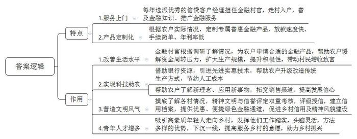
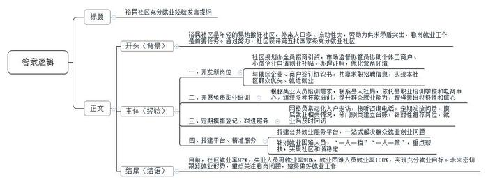

# 2024年公务员多省联考《申论》题（江西县乡卷）

<!-- gwy:overview:start -->
> **江西 · 2024 · 申论 · 县乡卷** ｜ 4 题 · 图片 4 处 · 答案随题折叠

导航：[题目](#题目) · [材料 1](#材料-1)
<!-- gwy:overview:end -->

> 候选采集稿。参考答案及解析来自粉笔页面，不代表官方答案或真实高分答卷；来源使用许可与原卷对应关系仍需人工核实。

## 给定材料

### 材料 1

普惠金融，顾名思义，就是将优惠的金融服务提供给更多的人，特别是急需资金支持的小微企业、“三农”和偏远地区的人们。普惠金融服务如何落地？在多山多水的F市，为了将金融服务送到山间、沿海的家家户户，当地探索形成了别具特色的“背包银行”模式。啥是“背包银行”？“说的是银行的客户经理背上包包就进村了，挨家挨户去普及金融知识、推广金融服务。”F市某国有银行支行刘行长说。

2019年以来，为发展普惠金融，助推乡村振兴，F市每年都选派100名优秀的信贷客户经理到100个特色产业村担任金融村官，他们背上背包，走出柜台，走进村组农户和田间地头，向这片乡村热土浇灌金融活水。

蟹苗养殖培育是七房村的主导产业，每年三四月份，正是养殖户采购蟹苗、饲料，扩大生产经营的时节，不少养殖户都面临较大的资金周转压力。2023年3月，金融村官小梅根据前期调研的结果，在充分掌握了蟹苗养殖信用户相关情况的基础上，向上级部门申请了专属金融产品“蟹苗贷”。“我们一直把服务‘三农’作为普惠金融的重点，不仅放款速度快，手续简单，年利率也低，比市面上大多数金融贷款要低1.5至4个点，按照借10万元来算，一年能省至少1500元。”小梅说。有了金融支持，七房村蟹苗养殖规模大幅度提高，村民的养殖意愿越发强烈。“2023年养殖收入增加了快一倍，好多村民都买了小车，今年又引入了新的蟹苗品种，规模进一步扩大，村民们日子越来越好啦！”小梅的声音难掩喜悦。

“虽然我是残疾人，但我致富的决心可不比其他人差！”村民老陈原是西界村建档立卡贫困户，早年间因意外不幸失去左手，劳力较差。在得知老陈打算养猪却苦于没有启动资金后，金融村官小刘积极对接，了解到他有丰富的养殖技术和经验，且家里边有约600平方米的场地可以用来办养猪场后，小刘为其制定了无抵押的信贷支持计划，发放了扶贫小额贷款。

今年，老陈想扩大养殖规模，小刘继续为其争取资金支持，又发放了贷款5万元供其购买猪仔，目前养殖规模已增加到了300头。有了信贷资金支持，勤劳肯干的老陈成了村里的致富能手。

“打药用上无人机，原本几天的工作现在两小时就能完成了，高科技的东西就是不一样，多亏了我们的金融村官小李啊！”老钟指着不远处正在喷洒农药的无人机，开心地说道。老钟是茗香茶厂的老板，随着茶园的扩大，传统的人工喷药方式费时费力，如何改造升级？农民出身的老钟没了主意。一天，小李到家闲聊，老钟把他的困扰告诉了小李。虽然这项业务和金融服务无关，但小李总觉得可以为老钟做点什么。他上网查阅相关资料，了解到植保无人机可将农药喷洒到茎叶背面和根部，能节约农药并有利于减少农药残留和环境污染。在帮助老钟明确了升级方向后，小李又借助省行资源帮助他成功引入了先进实惠的无人机施药技术。“现在，我们这个无人机每启动一次，就可以节约人工成本1万元左右。”老钟对这项新技术赞不绝口，“我们对很多新鲜事物不了解，是小李把城里一些新的东西、新的理念带给了我们。最近他又教会了我直播带货，现在我的茶都卖到国外去了……”老钟对未来的发展充满了信心。

“背包银行不仅为农村送去了普惠金融服务，对农村的信用建设、精神文明建设也起到了很大的促进作用。”刘行长说，随着金融村官对各村情况的摸底了解，F市对上万户农村家庭进行了评级、授信，初步建立了农户信用档案，半数以上农村家庭被认定为“信用户”，可以享受到更优惠、便捷的绿色金融通道。由于大部分农民无抵押、无担保，在评估“信用户”的时候，F市就采用精神文明与信誉评定双重考核标准，把邻里和谐、孝道等道德元素纳入考核，在推进乡村信用建设的同时，也推进了农村的精神风貌。

“在背包银行模式形成之初，我们担心年轻人不愿意舍弃城里的舒适生活奔赴偏远的农村，几年过去了，事实证明我们的担心是多余的。这些高素质的青年才俊到了乡村之后，工作踏实，头脑灵活，方法多样，都能够下沉一线，真心地服务农民。”刘行长说，去年以来，越来越多的年轻人主动报名要加入背包队伍，参与到乡村振兴的时代浪潮中，“我们看到这么多年轻人愿意走向农村、服务乡村，既有喜悦也有欣慰，准备在F市更多的村庄开启普惠金融背包之旅。”

### 材料 2

在裕民社区“爱上锅巴饭”的后厨，老曹忙活着给客人制作餐点，门店里络绎不绝的客人，让老曹没有休息的时间，一年前还在外漂泊的他，如今已经是小店的老板；梅姐是裕民信合花园物业公司的一名员工，曾经在家待业的她如今通过应聘完成了从“家庭主妇”到“职场女性”的转变。

这样的“变形记”每天都在裕民社区上演。

“我们裕民社区是在县城‘南扩北升’基础上建起来的‘年轻’社区，属于易地搬迁社区。去年，我们社区被评为第五批国家级充分就业社区，这实属不易啊。我们社区外来人口多、人口流动性大，劳动力供大于求的矛盾在我们这个社区表现得尤为突出。”社区党支部张书记说，“我和这些搬迁群众一样，都是这个小区的新人，这里就业岗位不多，做好原住居民以及搬迁群众稳岗就业工作，就是我到任后要破解的首要难题。”

就业岗位不多，那就想办法开发新的岗位。为了实现就业岗位“开源”，社区规划办全员出动拉项目、谈项目、筹资金；社区市场监督协管员成了“店小二”，负责协助个体工商户、小微企业在社区内申请创业补贴、办理相关证照。社区营商环境的优化，带来的是源源不断的就业岗位。“短短两年，我们社区就促成一个大型超市、一批商户的开业和发展，为居民提供了收银员、理货员等600余个工作岗位，我们还引进1个公园、1个景观廊桥项目的建设和4个楼盘的开发，这能为社区居民提供建筑类岗位300余个。”社区建设办翁主任说。此外，裕民社区还与辖区企业、商户签订《促进充分就业合作协议书》，双方共享求职招聘信息，鼓励企业、个体工商户为本社区群众优先就业、就近就业积极创造条件。

农村搬迁劳动力绝大多数没有一技之长，文化素质参差不齐，转移就业难度大。促进搬迁劳动力充分就业，社区的出路在哪里？

家住裕民社区的叶女士原本是一名普通的家庭主妇，待业在家的她日常喜欢刷短视频。令她没有想到的是，一年前参加的电商中高级培训班改变了她的生活，让她的日常爱好变成了谋生手段，从此打开了直播带货的大门。

裕民社区通过开展职业培训，让原本就业“单选题”变为了择业“多选题”。根据失业人员的培训需求，社区主动联系县人社局组织开展技能培训。“2022年，我们依托县职业培训学校和电商中心，组织220名搬迁群众参加月嫂、烹饪、电商直播等培训，进一步提高了社区群众的就业能力、增加了失业人员的就业砝码，90%的群众都通过培训开创了自己就业的新路……”张书记信心满满地说，“这些培训都是免费的，大家积极性都很高。我们就是要让搬迁群众头脑灵起来、信心强起来、思想活起来！”

夏大姐是裕民社区第四网格的网格长，定期做好片区劳动力的摸排登记和后期跟进服务是她的重要工作之一。无论春夏秋冬，夏大姐得空就去入户走访，平日里群众咨询电话不断，定期她还要发放调查问卷，对社区的家庭劳动力状况、就业情况、搬迁群众的技能水平和培训意愿等情况做摸排，并将摸底情况分门别类建立台账。平时她都会随身携带自制的“劳动力小册子”，随时翻看补充，还经常“点对点”推荐合适岗位，就业后一个月内还会回访。夏大姐说：“看似简单的工作，其实需要耗费大量的心血。”

“政策咨询、岗位推荐、技能培训、创业扶持、托底安置”，裕民社区办公室的任务栏上赫然写着这些大字……在裕民社区的公共就业服务平台，居民只需要“走进一扇门”，便可办好就业创业相关的事情。此外，针对就业困难人员，裕民社区还实施“一人一档”“一人一策”，重点解决帮扶问题。2022年，58岁的老周找到夏大姐，想要找份工作，但他既无年龄优势又无技术长处。这样一个几乎“不可能完成的任务”，却在夏大姐及社区工作人员的共同努力下圆满完成。最终，老周在社区里的一家公司当上了保安。“安置一人，稳定一家，和谐一片”，这是夏大姐在工作中的深切感受。

“目前，我们社区4028名劳动力的就业率达到了97%，失业人员再就业率达到了98%，认定就业困难人员的就业率达到了100%。”张书记兴奋地介绍说，“在创建充分就业社区的过程中，老百姓找到了好工作，日子更有奔头；企业解决了用工需求，发展更有底气；社区收获了群众的肯定和沉甸甸的荣誉，大家做好工作也更有劲了。”

如今的裕民社区已经实现了充分就业目标，但张书记却不敢有丝毫的懈怠，他说：“接下来，我们要密切跟踪就业形势发展变化，重点关注现有就业人员的稳岗问题，扎扎实实做好当前和下一阶段稳就业工作，更好地服务社区居民。”

### 材料 3

近年来，S县乘着新时代改革东风，发展了一批特色产业，经济实现了快速发展，加上毗邻省会城市，吸引了许多大学生来此就业。为进一步优化人才发展环境，县委人才办、县融媒体中心联合开展了“人才服务大家谈”线上意见征集活动，不少网友就人才落户、住房保障、医疗保障等方面提出意见建议。以下是一些关于大学生租房问题的留言：

●中介的欺骗行为很让人恼火！要么就搪塞你，图上的房子已经租出去了；要么先把人骗出来看房，然后敷衍说现在价格翻倍了。很多人看了几套，觉得累了，可能就直接签了。朋友们，我就想知道你们的一居室都是怎么找到的？

●2023年，我在S县找到了一份实习工作，朋友说她租的套房还空一间，邀请我与她合租。由于实习时长是3个月，我朋友跟房东反复强调只租3个月。房东满口答应，但提供的合同上租期却是一年。房东表示这只是中介公司的合同模板，实际操作可以按聊天记录的约定来，我们就签下了租房合同。然而入住仅两个月，房东就开始催缴下一季度的房租，否则就让我们搬离。后来协商无果，我们只能搬走，房东扣除了第三个月的租金和全部押金。虽然很生气，但因为这是合同中规定的，我们也没有办法。

●我在校内“租房信息交流群”找到一套与自己需求较为匹配的房子，价格也比较满意。临近约定看房的时间，房东提出需要预交300元定金，以体现看房的“诚意”。虽然将信将疑，但一时半会儿也找不到比这个看起来更合适的，就将钱打了过去。看房后感觉也还行，正准备签约，房东却将原本标价一个月1000元租金的房子，涨到了1500元。我当然不愿接受，于是被房东扣除了200元的定金。房东说我看房不租导致他损失了今天的生意，所以我需要承担这部分损失。

●除了房屋的租金，电费1.5元一度，水费5元一吨，还有其他乱七八糟的费用，实在太贵了。我们刚毕业，本身就没什么钱，还要一年起租、押二付一或押三付一，真的很难承受。退租的时候还经常会以各种理由克扣一部分押金。

●刚来时因为没有多少钱，我就找了一个三居室隔成六七间的群租房，租了其中一间，价格倒是很便宜。但没多久，这里就被举报了，我们被强制清退。找房东退押金时，才知道租给我们的“二房东”早就跑得不见踪影了！

●房租有时候还不是最头疼的问题，关键是花了钱可能还住得不舒心，比如说押金难退、水电乱跑、随意清退等等，非常折腾人。

●我们大学生刚毕业，资历浅，县里人才房只有几栋，太少了，根本轮不到我们。现在，连很多大城市都在出台政策吸引人才，我们县更要多建一些公租房、人才公寓，最好能给应届大学生和实习生提供最长三个月的免费公租房。只有这样，才能吸引人才、留住人才，未来才能发展得更好更强大。

●租房平台的信息一点都不真实，价格和房源都不透明。网上图片说好1500元/月，去到那里给你找2000元/月的，还是差的那种。找中介又怕被坑，太难了。能不能建一个由政府背书的平台，免费发布住房信息。对发布假房源的，一定要严惩！

●招租各种好，入住坑不少，满眼都是泪！退租时被告知合同下面写了一行小字，设备使用费500元，房屋清扫费200元。

●我们虽然在这里工作、居住，但户口还在老家。因为房东不愿意配合我们办暂住证，所以很多市民权益我们没法享受。还有，同住一个小区，我们租房的和业主待遇大不一样。比如说停车费，业主都是50元/月，而我们要100元/月。

●作为被伤害过的租客，真心希望政府能够建立有效的制度，整顿房屋中介公司的乱象；对已违法的公司保持追责，请一定要严惩他们。大多数人生活不易，还请相关部门不要再让他们伤害我们！

●刚毕业或者正在实习的学生工作一般还没有稳定下来，要是工作变动，押金都没得退。可否解决租期必须“一年”“半年”起租，否则扣押金的问题呢？

## 题目

### 第 1 题

**根据“给定材料1”，请你谈谈F市“背包银行”模式的特点及其在推动乡村振兴过程中起到了哪些作用。（20分）**

关联材料：材料 1

作答要求：全面、准确、有条理。不超过400字。

第 1 题 · 答案与解析

**参考答案（粉笔题库参考内容）**

特点：1.服务上门。每年选派优秀的信贷客户经理担任金融村官，走村入户，普及金融知识、推广金融服务。2.产品定制化。根据农户实际情况，定制专属普惠金融产品，放款速度快、手续简单、年利率低。

作用：1.改善生活水平。金融村官根据调研了解情况，为农户申请合适的金融产品，帮助农户缓解资金周转压力，扩大生产规模，提升积极性，带动村民增收致富。2.实现科技助农。借助银行资源，引进先进实惠技术，帮助农户升级改造传统生产方式，节约人工成本；帮助农户了解新理念、应用新事物，拓宽销售渠道，提高发展信心。3.营造文明风气。摸底了解各村情况，精神文明与信誉评定双重考核，评级授信，建立信用档案，提供优惠、便捷绿色金融通道，促进乡村信用及精神风貌建设。4.青年人才增多。吸引高素质年轻人走向乡村，发挥他们工作踏实，头脑灵活，方法多样的优势，下沉一线，提高服务乡村的意愿，助力乡村振兴。

**解析**

**参考答案说明**：在内容上，一方面分别从“背包银行”具有“服务上门”“产品定制化”这两方面特点展开，另一方面指出“背包银行”在推动乡村振兴过程中起到的“改善生活水平”“实现科技助农”“营造文明风气”“青年人才增多”这四个方面的作用。在形式上，分条撰写，每条要点之间内容上没有交叉。

**考点**：多要素组合类

**来源**：2024年公务员多省联考《申论》题（江西县乡卷）

粉笔申论页面对本题只提供「解析视频」入口，该入口是会员推广位，页面无视频地址与文字解析。

### 第 2 题

**县里准备召开“社区充分就业经验交流座谈会”，裕民社区将在座谈会上发言，请根据“给定材料2”，为裕民社区张书记拟写一份发言提纲。（20分）**

关联材料：材料 2

作答要求：

（1）紧扣资料，内容全面；

（2）逻辑清晰，语言准确；

（3）不超过500字。

第 2 题 · 答案与解析

**参考答案（粉笔题库参考内容）**

裕民社区充分就业经验发言提纲

背景：裕民社区是年轻的易地搬迁社区，外来人口多、流动性大，劳动力供求矛盾突出，稳岗就业工作是首要任务。通过努力，社区获评第五批国家级充分就业社区。

经验：一、开发新岗位。社区规划办全员招商引资，市场监督协管员协助个体工商户、小微企业申请创业补贴、办理证照，优化营商环境；与辖区企业、商户签订协议书，共享求职招聘信息，实现本社区群众优先、就近就业。二、开展免费职业培训。根据失业人员培训需求，联系县人社局，依托县职业培训学校和电商中心，组织多种技能培训，提升群众就业能力，增强参培积极性和信心。三、定期摸排登记、跟进服务。网格员常态化入户走访，接听咨询电话，定期发放问卷，摸底就业相关情况，分门别类建立台账，针对性推荐岗位，就业后及时回访。四、搭建平台、精准服务。搭建公共就业服务平台，一站式解决群众就业创业问题；针对就业困难人员，“一人一档”“一人一策”，重点帮扶，实现社区和谐稳定。

结语：目前，社区就业率97%，失业人员再就业率98%，就业困难人员就业率100%，实现充分就业目标。未来密切跟踪就业形势，重点关注稳岗问题，始终做好就业工作。

**解析**

**参考答案说明**：（1）格式方面，本参考答案写到了“标题”“正文”两个部分。（2）正文部分，一方面从内容上来看，围绕“社区充分就业”这一主题，本参考答案的开头先写到了裕民社区开展就业工作的背景；主体部分从“开发新岗位”“开展免费职业培训”“定期摸排登记、跟进服务”“搭建平台、精准服务”这四个方面给出了具体的经验；结尾进行了总结、展望。另一方面，形式上，本参考答案做到了分段、分条撰写，整体上条理较为清晰。

**考点**：总结类

**来源**：2024年公务员多省联考《申论》题（江西县乡卷）

粉笔申论页面对本题只提供「解析视频」入口，该入口是会员推广位，页面无视频地址与文字解析。

### 第 3 题

**请根据“给定材料3”，对当前S县大学生租房面临的问题进行梳理，并提出相应的解决建议。（25分）**

关联材料：材料 3

作答要求：

（1）问题梳理全面、准确；

（2）所提建议与问题相对应，具体明确、切实可行；

（3）不超过500字。

第 3 题 · 答案与解析

**参考答案（粉笔题库参考内容）**

1.问题：中介和房东存在欺骗违法行为。如虚假宣传、临时涨价，违法隔断房屋、承诺与合同不符、合同不规范，随意清退。对策：建立有效监管制度，畅通监督举报渠道，整顿租房乱象；对擅自隔断、使用不规范合同、擅自违约的房东，依法追责，加大惩处力度。

2.问题：大学生法律意识淡薄。如对合同、定金等不了解。对策：加大宣传教育力度，通过讲座等方式普及法律知识，依法维护自身权益。

3.问题：收费不规范。如水电乱跑，乱收费项目多，费用高，租期长、克扣押金等。对策：按照城市水电价格规定标准收费，使用符合政府标准水电表防止水电乱跑；收费前应当出具收费清单，明码标价，提供收据；严厉处罚乱收费行为。

4.问题：人才房少。对策：建设公租房、人才公寓，给应届大学生和实习生提供最长三个月的免费公租房；对大学生租房给予补贴优惠政策，减轻租房费用压力。

5.问题：租房平台乱象多。如信息不真实，价格和房源不透明。对策：建立由政府背书的平台，免费发布住房信息，处罚假房源的发布等，保证价格和房源的公开透明。

6.问题：租购不同权。如无法享受市民权益，物业费用不一致。对策：放宽暂住证办理，享受市民权益；加强物业管理，保障租购同权。

**解析**

**参考答案说明：**本参考答案从“欺骗违法”“法律意识”“收费标准”“人才房”“租房平台”“租购权益”这六个方面展开，每个方面内部先阐释问题，再给出相应的解决建议，做到了所提建议与问题相对应。各条答案要点之间在内容上相互并列，没有交叉。

**考点**：提出对策类

**来源**：2024年公务员多省联考《申论》题（江西县乡卷）

粉笔申论页面对本题只提供「解析视频」入口，该入口是会员推广位，页面无视频地址与文字解析。

### 第 4 题

**“给定材料4”中提到“创新是有风险的，但它又是规避风险的最好方式”，请深入思考这句话，参考给定材料，联系实际，自选角度，自拟题目，写一篇文章。（35分）**

关联材料：材料 1

作答要求：

（1）观点明确，见解深刻；

（2）参考给定材料，但不拘泥于给定材料；

（3）思路清晰，语言流畅；

（4）总字数800-1000字。

第 4 题 · 答案与解析

**参考答案（粉笔题库参考内容）**

**创新：风险与机遇并存**

“创新是有风险的，但它又是规避风险的最好方式。”这句话深刻揭示了创新在现代社会发展中的核心地位。创新不仅是推动社会进步的重要动力，也是企业和个人在激烈竞争中脱颖而出的关键。然而，创新并非坦途，它伴随着风险与挑战，但正是这种不确定性，促使我们不断探索、不断突破，最终实现更大的安全与发展。

**创新带来未知风险，但也能开辟新机遇**。创新的本质是对未知的探索和尝试，往往会面临技术尚未成熟、市场需求不确定等多重风险，但创新可以实现新的市场需求，创造新的价值，从而开辟出一片蓝海。一方面，产业创新必然伴随着大量资金、劳动力等资源要素的投入，一旦失败则会带来较大的经济损失，而新质生产力的出现也可能会对传统行业及人群产生较大冲击，造成“创造性毁灭”。另一方面，创新又是发展的第一动力，有助于摆脱传统的经济增长方式，克服发展瓶颈，寻求新的增长点，推动经济持续、健康发展，降低发展风险。

因此，发展中要尽力平衡好创新和风险的辩证关系，贯彻落实“坚持稳中求进、以进促稳、先立后破”的科学发展论。

**创新必须要立足实际，发挥自身优势，明确主攻方向，推动产业转型，从而降低创新风险**。各地优势资源禀赋不同，优势产业各异，要在稳住传统产业“基本盘”的基础上，用新技术改造提升传统产业，推动特色产业和主导产业的转型发展，推进现代化产业体系建设。同时，要持续打好技术攻坚战，进一步挖掘壮大新兴产业、培育未来产业，比如新能源、新材料、人工智能、大数据等领域，在新赛道上继续奋勇争先，实现科技创新和产业创新深度融合。

另外，**政府需要进行充分的市场调研，制定科学的创新策略，建立完善的创新支持体系，为创新提供有力的保障**。各地要充分调研研究，学习借鉴先进经验，以市场为导向推动创新，确保符合当今消费潮流，提高创新成功率。另外，政府应聚焦重点领域和关键环节，强化人才、资金、技术等政策支撑，推动资源要素集聚，加快完善知识产权保护、市场准入等相关制度机制，持续优化营商环境，打通堵点卡点，为产业创新发展保驾护航。

机遇与风险并存，困难与希望同在。创新是有风险的，但也是规避风险的最好方式，要平衡好创新和风险的关系，蹄疾步稳推动创新发展。

**解析**

**文章分析**

**创新：风险与机遇并存**

【**标题的优点：**首先，范文的标题突出了“创新与风险”这一主题。其次，形式上，文字简洁明快，不拖沓。】

（1）“创新是有风险的，但它又是规避风险的最好方式。”这句话深刻揭示了创新在现代社会发展中的核心地位。创新不仅是推动社会进步的重要动力，也是企业和个人在激烈竞争中脱颖而出的关键。（2）然而，创新并非坦途，它伴随着风险与挑战，但正是这种不确定性，促使我们不断探索、不断突破，最终实现更大的安全与发展。

【**开头的优点：**★内容方面。范文的开头是紧扣“创新与风险”这一主题展开的。首先，开头点出主题，做到了主题明确。其次，对“创新与风险”这一主题进行了分析阐述：（1）强调了创新的重要性；（2）引出核心观点，阐明创新既伴随风险，又能助力实现更大的安全与发展。★文字表达方面。使用了“不仅是……也是……”等连接词，使语言表达更有气势。】

**创新带来未知风险，但也能开辟新机遇**。（1）创新的本质是对未知的探索和尝试，往往会面临技术尚未成熟、市场需求不确定等多重风险，但创新可以实现新的市场需求，创造新的价值，从而开辟出一片蓝海。（2）一方面，产业创新必然伴随着大量资金、劳动力等资源要素的投入，一旦失败则会带来较大的经济损失，而新质生产力的出现也可能会对传统行业及人群产生较大冲击，造成“创造性毁灭”。（2）另一方面，创新又是发展的第一动力，有助于摆脱传统的经济增长方式，克服发展瓶颈，寻求新的增长点，推动经济持续、健康发展，降低发展风险。

【**论述段1的优点：**★观点句：范文的观点句是紧扣“创新与风险”这一文章主题提出的。形式上，它在段首处直接写出，位置突出，容易发现。内容上，关键词突出，内容要点明确，可以明显看出是从“创新和风险的辩证关系”的角度展开论述。★论述内容：（1）先介绍创新的本质决定其既面临风险，也能创造新价值；（2）接着介绍产业创新所面临的各种风险；（3）最后，指出创新为发展提供动力，推动经济持续、健康发展。注意：以上三个方面的内容都是紧扣“创新带来未知风险，但也能开辟新机遇”这个观点句进行分析论述的，论述的针对性强，内容层次丰富。在论述方法上主要采用了讲道理的方式，论述清晰透彻。】

因此，发展中要尽力平衡好创新和风险的辩证关系，贯彻落实“坚持稳中求进、以进促稳、先立后破”的科学发展论。

【**过渡段的优点：**本段承上启下，既总结性指出要平衡创新和风险的关系，还引出下文对降低创新风险和保障持续创新的论述。】

**创新必须要立足实际，发挥自身优势，明确主攻方向，推动产业转型，从而降低创新风险**。（1）各地优势资源禀赋不同，优势产业各异，要在稳住传统产业“基本盘”的基础上，用新技术改造提升传统产业，推动特色产业和主导产业的转型发展，推进现代化产业体系建设。（2）同时，要持续打好技术攻坚战，进一步挖掘壮大新兴产业、培育未来产业，比如新能源、新材料、人工智能、大数据等领域，在新赛道上继续奋勇争先，实现科技创新和产业创新深度融合。

【**论述段2的优点：**★观点句：范文的观点句是紧扣“创新与风险”这一文章主题提出的。形式上，它在段首处直接写出，位置突出，容易发现。内容上，关键词突出，内容要点明确，可以明显看出是从“降低创新风险”的角度展开论述。★论述内容：（1）先介绍各地要结合自身优势，利用新技术推动产业转型升级；（2）接着指出要持续创新技术，培育新产业，实现科技和产业创新融合。注意：以上两个方面的内容都是紧扣“创新必须要立足实际，发挥自身优势，明确主攻方向，推动产业转型，从而降低创新风险”这个观点句进行分析论述的，论述的针对性强，内容层次丰富。在论述方法上采用了举例子、讲道理相结合的方式，论证充实有力。】

另外，**政府需要进行充分的市场调研，制定科学的创新策略，建立完善的创新支持体系，为创新提供有力的保障**。（1）各地要充分调研研究，学习借鉴先进经验，以市场为导向推动创新，确保符合当今消费潮流，提高创新成功率。（2）另外，政府应聚焦重点领域和关键环节，强化人才、资金、技术等政策支撑，推动资源要素集聚，加快完善知识产权保护、市场准入等相关制度机制，持续优化营商环境，打通堵点卡点，为产业创新发展保驾护航。

【**论述段3的优点：**★观点句：范文的观点句是紧扣“创新与风险”这一文章主题提出的。形式上，它在段首处直接写出，位置突出，容易发现。内容上，关键词突出，内容要点明确，可以明显看出是从“政府为创新提供保障”的角度展开论述。★论述内容：（1）先指出各地要充分调研，学习经验，提高创新成功率；（2）接着强调了政府要强化政策和制度支撑，为创新保驾护航。注意：以上两个方面的内容都是紧扣“政府需要进行充分的市场调研，制定科学的创新策略，建立完善的创新支持体系，为创新提供有力的保障”这个观点句进行分析论述的，论述的针对性强，内容层次丰富。在论述方法上主要采用了讲道理的方式，论述清晰有力。】

【**论述段之间的关系：**★内容的内在逻辑：范文的三个论述段整体上呈现递进的逻辑，论述段1先整体上阐明“创新和风险的辩证关系”；论述段2和论述段3接着论述了如何降低创新风险和如何保障持续创新。★段与段的外在衔接：论述段1后面的过渡句起到了承接论述段1，引出论述段2和论述段3的作用。】

机遇与风险并存，困难与希望同在。创新是有风险的，但也是规避风险的最好方式，要平衡好创新和风险的关系，蹄疾步稳推动创新发展。

【**结尾的优点：**范文的结尾回扣了“创新与风险”这个主题，并且进行了总结升华。】

**考点**：文章写作题

**来源**：2024年公务员多省联考《申论》题（江西县乡卷）

粉笔申论页面对本题只提供「解析视频」入口，该入口是会员推广位，页面无视频地址与文字解析。

