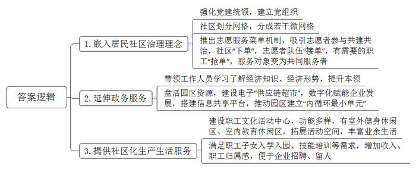
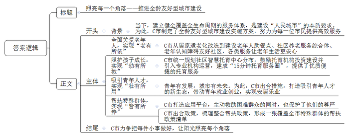

# 2024年公务员多省联考《申论》题（江西省市卷）

> 候选采集稿。参考答案及解析来自粉笔页面，不代表官方答案或真实高分答卷；来源使用许可与原卷对应关系仍需人工核实。

## 给定材料

### 材料 material-e441eed2abf801cd

H市以南山工业园区为试点，推出了工业社区的治理模式，将居民社区治理理念嵌入产业园区，延伸政务服务内容和触角，为企业和员工提供社区化服务。

“小社区也能完成大治理。”H市南山工业社区党委书记老柯说，“党建统领是‘定盘星’。”南山工业社区只有6名社区工作人员，而各类企业有500多家、员工近8万名。南山工业社区在成立之初就建立了党组织，书记主要推选优秀社区工作人员担任。社区划分成几个网格，每个网格再进一步分成若干个微网格，微网格细化到企业甚至车间，是社区掌握基层信息的触角，也是治理和服务的抓手。“大家的园区大家建，我们还推出了志愿服务菜单机制，吸引志愿者参与社区共建共治。”老柯说。交通引导、平安夜巡、家园美化……社区有服务需求“下单”，志愿者队伍“接单”，有落户、子女入学积分需要的职工“抢单”，服务对象摇身一变成为共同服务者，让社区服务更加及时高效。如今，志愿者已成为了园区治理的重要参与力量。

“作为工业社区，我们的工作跟着经济形势走。”南山工业社区党委书记老柯说。平日里，他带领社区工作人员学习经济知识，了解经济形势，个个都成了“市场通”。“原来一听到社区，总觉得跟企业无关，现在发现小社区有大本领。”某电子材料有限公司的张经理说，张经理的公司曾遇到如何加快上市的难题，没想到社区专门组织了一场园区内科技企业和金融机构的对接会，帮助其入选上市企业后备库。“工业社区已经从简单为职工衣食住行提供服务的配角，变成盘活园区资源、推动园区发展的主角之一。”张经理说，“有他们的暖心帮助，我们这些做企业的感到放心。”去年，南山工业社区还牵头建设电子平台“供应链超市”，承担起了供需信息播报、物流信息共享、降成本方案共通等功能。老柯最近就在忙两件事：一是与银行加强协调，建立一个5亿元规模的贷款资金池，用于缓解园区内企业资金压力；二是联系园区的售电公司，把百余家中小企业组织起来，共商如何降低用电成本。“‘供应链超市’以数字化赋能企业发展，搭建了园区内企业的信息共享平台，推动园区内成百上千家企业建立起‘内循环最小单元’。”老柯说。

南山工业社区的职工文化活动中心不久前正式投入使用，宽敞的室外健身休闲区和多功能的室内教育休闲活动区解决了众多企业职工活动空间少的问题。每天晚上，篮球场、健身房、图书馆、咖啡吧里，都有职工前来享受丰富的夜间生活。“在这里，不管是职工子女入学入园，还是年轻人交友婚恋、技能培训，都有了充足的条件。”某公司的人事专员万女士感慨道，“社区化的生产生活环境，成了企业招聘、留人的一大亮点，职工们都安心在这里发展。”自从成为试点以来，南山工业社区的职工收入年均增速高于全市4.2个百分点。

H市计划总结推广南山工业社区试点经验，拟将全市的产业园区都升级为配套完善、绿色智慧的工业社区，成为融产业园区、邻里中心、创意中心为一体的城市新形态。“不能因为是产业园区就只关注当前的生产效益，而忽视影响深远的精神文明建设，我们的发展就是要满足人民日益增长的美好生活需要。”老柯说。

### 材料 material-55f02e203861eba3

2020年，W市开始试点推进庭院经济，经过几年努力，庭院经济初显蓬勃之势。2023年中央一号文件提出，鼓励脱贫地区有条件的农户发展庭院经济。为评估庭院经济发展情况，进一步助力乡村振兴，W市农业农村局在学习贯彻习近平新时代中国特色社会主义思想主题教育期间，深入W市乡村开展调研工作。以下是调研组成员小江的部分调研笔记内容。

●陈村村民老陈因地制宜，把自家庭院重新装修，在家里开起农家乐。老陈：“我们这里是山区，风景好，而且山里的菜新鲜、地道、有特色，隔三岔五就有游客来山上游玩，顺便品尝我们的农家菜，都夸我们家的菜好。经常有客人提前打电话来，点名要吃我们家的炖鸡，现在政府鼓励发展庭院经济，我这房前屋后都种了菜，加工出来就能变现钱，庭院经济有赚头！有点可惜的是，家里的地方还是太小了，客人一多就没地方坐，种的菜也不够招待，有时候单凭家里的几口人也忙不过来。”

●郭家村党支部书记老郭：“我们村算是找准了庭院经济的发展方向，就是在自家庭院加工软体沙发。现在我们村的软体沙发加工业已初具规模，村民们逐渐走上了一条致富的道路。这都是因为我们村有小章啊！他懂技术，也懂市场。”

村民小章：“我以前在沿海一家沙发公司上班，回家过年时，正遇上郭书记在宣传庭院经济，我在外很多年，也想回家发展，就抱着试一试的想法，利用自家庭院干起软体沙发的加工。现在，我们通过网络把小庭院和大市场联系起来，在多家电商平台开设网店，也和直播带货的主播合作，每天订单有一百多单。”

老郭：“我们村在自家庭院加工软体沙发的农户超过20家，不仅收益可观，还带动了近200名村民就业。周边村子的很多人纷纷前来取经，也准备从事沙发加工。”

小章：“其实我们的市场是受限的，因为沙发的工艺技术、设计理念和款式风格一直在变化，而我们与市场前沿有些脱节，产品始终稍微滞后。很多人没有技术，也不懂市场，一窝蜂来学做沙发，这未必是件好事。”

●赵村是一个有着300多年铁编加工历史的村庄，村里80%的人都有铁编手艺，但一直以来，铁编生产都是家庭作坊，自产自销，这导致村子的铁编产业一直走不出“庭院”。村党支部书记老赵带着铁编加工户代表到沿海发达地区考察学习。回来后，赵村成立了金属制品产业合作社。合作社有人专门负责采购原材料和推广产品，铁编加工户只需要按统一标准在自家庭院加工制作。

老赵：“我们之前太局限于传统小农经济的思想。要面向市场！市场需要什么，我们就生产什么。小作坊创造大产业，去年一年，我们村铁编销售额突破了2亿元。现在随着规模不断扩大，合作社的事情越来越多，资金往来也越来越复杂，我们没有经营大企业的经验，觉得还是很有压力。”

●方沟村村民小方通过网络直播销售花卉。这些花卉都是她在自家庭院里种的，品种虽然比较少，但都是市面上比较少见的。小方：“我最喜欢的工作就是每天在自家小院直播推销花卉。我的客户主要是一些对新奇植物抱有好奇心的城市白领，她们一般不太在乎价格，主要看颜值。我还想扩大一些规模，但这些花卉成本很高，我的资金有限，经不起风险，后面再找机会吧。”

●张店村党支部夏书记联系5户不在村里居住的村民召开协商会，与他们协商将院子流转给村里发展民宿。

夏书记：“院子流转给村里发展民宿，我们把‘小’而‘散’的庭院打造出各自的特色，通过设计形成一个大旅馆。这样大家不仅获得租金和分红，还可以在民宿就业。”

村民老韩：“之前隔壁石条村老江家办过民宿，开始红火过一阵子，后来因为激烈的同质化竞争，老江只能通过压低报价来吸引客户，可是报价降低了，服务品质也跟着降低了，无法吸引客户，最终陷入了恶性循环。”

村民老张：“我觉得我们村现在这样子就很好，干干净净，又安静，顺其自然就行了。有的地方办民宿，一下子迎来很多客人，吵吵嚷嚷，还带来很多垃圾。”

由于大家意见不一，协商会最后没有达成结果。“庭院经济有奔头，我们周围很多村都搞得红红火火，我们村没有搞不好的道理。”夏书记会后说，“浪头会不断起伏，但浪潮永远向前，只要我们沿着党指引的方向不懈努力，就一定能把村里的庭院经济搞起来。”

### 材料 material-222acc528e36b773

坐落于C市良峰社区的智惠食堂今年上半年正式运营，很快吸引了大量“铁粉”。每天傍晚，食堂门口都排起了长队，有8岁的孩童，也有80岁的老人，类似这样的社区食堂，在C市已建成近1000家。这正是C市推进全龄友好型城市建设的一抹亮色。“建设全龄友好型城市，就是要建立健全覆盖全生命周期的服务体系，全面回应各年龄群体对美好生活的需求。”C市王市长说。这是“人民城市”的本质要求，在当今人口快速老龄化和生育政策逐步放开的背景下，将全龄友好的理念融入城市建设是未来的必然趋势。为此，C市制定了全龄友好型城市建设实施方案，围绕全生命周期努力为每一位市民提供高效服务。

在C市，像智惠食堂这样拥有大量“铁粉”的地方，并不在少数。河源社区养老服务综合体内，李大爷正在练习毛笔字，他使用的笔墨纸砚，正是由养老服务综合体免费提供的。现年78岁的李大爷，是这里的常客，从居住地到这里，他步行只需要20分钟。目前，这样的社区养老服务综合体项目在C市已建成35个，每天都吸引着不少老年人的到来。幸福晚年生活不仅落地社区，更是走进了老人们的家中。“有了这个小小的按钮，只要按一下，就有人来帮助我，心里感到踏实、安全多了。”市民罗大爷口中的小小按钮，正是社区为他安装的一套家庭智能报警设备——门磁检测器、燃气报警器、SOS紧急呼叫器……一个个“智能管家”，为老人的生活增添了一份安心。“按照市政府的部署，全市将开展养老护老设施智能化工作，我们社区是先行试点之一，这套家庭智能报警设备有利于社区及时了解老人的健康状况和居家生活情况。”社区党委李书记说。在C市，从空巢老人居家适老化改造到建设老年人助餐点、社区养老服务综合体、老年认知障碍友好社区，对老年人的关爱正全面开花。

一块块积木堆叠，没多久便成了大厦，几个孩子合力，一座“城市”慢慢就有了雏形。C市欣荣社区的智慧托育中心里，孩子们正在保育师的指导下发散着想象力。过去，每到暑假，孩子们的照护问题令许多家长感到心累——托育机构离家远、托位紧俏，好不容易找到，收费又超出预期。“民生的关键小事就是政府的头等大事，别看事儿小，意义却不小。”市教育局林局长说，“我们统一规划了社区智慧托育中心的分布，正在逐步铺开建设。”C市鼓励国有企业、示范性托育机构参与投资建设，并支持以公建民营、购买服务等方式引入专业机构规范化管理运营。“这样既降低成本，又能保证服务的质量，实现降本增效。”林局长说。目前，C市已建成社区智慧托育中心40余家，初步建成“15分钟托育服务圈”，优质便捷的托育服务正在被送到越来越多的市民家门口。

关注民生从不只是“一老一幼”，更是要让全龄人群获得幸福感。C市在青年就业创业、安居保障等方面出台支持措施，为符合条件的青年创业者发放创业担保贷款，申请青年创业扶持基金。张先生是一家机器人公司的董事长，这家机器人公司已经成长为全国同行业中的头部企业。回忆起创业经历，张先生满怀感动。“由于前期研发费用较高，到了成果转化和推广阶段，我们公司的资金链出现了问题。”张先生说，“怀着试一试的心理，我们向政府申请了青年创业扶持基金。没想到，我们的申请材料递交上去不到一周，资金就到账了，解了我们的燃眉之急。别看这事儿不大，但做这么好也不容易！”在C市创新创业的这几年，张先生和他的伙伴们真真切切地看到了光明的未来。“青年有发展，城市有未来。”王市长说。C市正铆足了劲打造吸引青年人才的新生态：一边加快构建与城市发展相适应的产业体系，营造良好的就业环境；一边强化公共服务能力，营造良好的生活环境。

日前，刘女士在手机短信上看到，一笔临时救助款到账了。这是C市通过打造低收入群体“幸福码”应用平台对困难群众实施主动救助的缩影。这笔救助款缓解了刘女士的生活困难，也保护了她的尊严。这无声的援助彰显城市治理的浓浓暖意。“建设全龄友好型城市一个都不能少，要让全体市民共享社会发展的成果。”王市长说。对于特殊群体的帮扶，C市织就了全面的保障网。今年印发的《关于进一步帮扶特殊群体推进共同富裕的若干政策意见》，围绕困难群众、残障人士、老年人、困境儿童等各类特殊群体，梳理整合基本生活保障、住房、教育、医疗、就业等综合帮扶政策，形成一张覆盖全市特殊群体的帮扶政策清单。

“我们就是要把每件小事都做好，让阳光照亮城市的每一个角落。”王市长说，“我们把高质量发展的理念落实到城市建设中，一件一件抓落实，一年一年接着干。”

## 题目

### 第 1 题

**根据****“给定资料**1**”，谈谈南山工业社区的治理模式有哪些特点。（15分）**

关联材料：material-e441eed2abf801cd

作答要求：

要求：全面、准确、有条理。不超过300字。

### 第 2 题

**根据****“给定资料**2**”，请对W市在发展庭院经济时遇到的问题进行梳理，并结合实际给出合理的建议。（20分）**

关联材料：material-55f02e203861eba3

作答要求：

要求：

（1）问题梳理全面、精准、有条理；

（2）所提建议与问题相对应，具体明确、切实可行；

（3）不超过400字。

### 第 3 题

**“给定****资料**3**”是C市晚报报导当地推进全龄友好型城市建设的一篇文章，请你以《照亮每一个角落——推进全龄友好型城市建设》为题，为这篇报导稿写一则短评。（25分）**

关联材料：material-222acc528e36b773

作答要求：

要求：

（1）观点明确，简明深刻；

（2）紧扣材料，重点突出；

（3）有逻辑性，语言流畅；

（4）不超过500字。

### 第 4 题

**“给定资料**4**”中提到“青山绿水是无价之宝”，又提到“生态有价”。生活中也有许多既有价又无价的事物，请对此进行深入思考，参考给定资料，联系实际，自选角度，自拟题目，写一篇文章。（40分）**

关联材料：material-e441eed2abf801cd

作答要求：

要求：

（1）观点明确，见解深刻；

（2）参考给定资料，但不拘泥于给定资料；

（3）思路清晰，语言流畅；

（4）总字数1000-1200字。

## 答案与解析

第 1 题

**参考答案（粉笔题库参考内容）**

1.嵌入居民社区治理理念。强化党建统领，建立党组织；社区划分网格，分成若干微网格；推出志愿服务菜单机制，吸引志愿者参与共建共治，社区“下单”，志愿者队伍“接单”，有需要的职工“抢单”，服务对象变为共同服务者。

2.延伸政务服务。带领工作人员学习了解经济知识、经济形势，提升本领；盘活园区资源，建设电子“供应链超市”，数字化赋能企业发展，搭建信息共享平台，推动园区建立“内循环最小单元”。

3.提供社区化生产生活服务。建设职工文化活动中心，功能多样，有室外健身休闲区、室内教育休闲区，拓展活动空间，丰富业余生活；满足职工子女入学入园、技能培训等需求，增加收入、职工归属感，便于企业招聘、留人。

**解析**

**参考答案说明：**本题答案分别从“嵌入居民社区治理理念”“延伸政务服务”“提供社区化生产生活服务”三个方面介绍了南山工业社区治理模式的特点，各条答案要点之间在内容上相互并列，没有交叉。

**考点**：考点特点类

**来源**：来源2024年公务员多省联考《申论》题（江西省市卷）

粉笔申论页面对本题只提供「解析视频」入口，该入口是会员推广位，页面无视频地址与文字解析。

第 2 题

**参考答案（粉笔题库参考内容）**

1.问题：庭院小，人手少，承载力不足。建议：鼓励农户间增加合作，共享资源；将庭院进行流转，扩大经营规模，招募、培训服务人员，提升服务能力。

2.问题：产品滞后，与市场前沿脱节；部分村民缺乏技术，盲目跟风。建议：走访调研，积极了解市场前沿信息，推动产品创新；引进专业人才，对村民进行技术及市场信息培训，走个性化发展道路。

3.问题：大企业经营经验不足。建议：政府搭建平台，提供企业经营指导培训，引导当地企业与大企业合作交流。

4.问题：资金有限，抗风险能力弱。建议：政府提供专项资金；政府与金融机构开展合作，打造普惠性金融产品，如提供低息贷款或无息贷款，降低经营风险。

5.问题：发展思路不统一。建议：针对分歧引导群众积极充分讨论协商，打造利益共同体，制定符合大多数人利益的庭院经济发展方案。

**解析**

**参考答案说明：**本参考答案从“资源”“人员能力”“经验”“资金”“思路”五个方面介绍了问题，并针对每一方面的问题给出了相应的建议。此外，形式方面，本答案做到了分类分条撰写，各条要点之间在内容上是并列关系，没有交叉。

**考点**：考点提出对策类

**来源**：来源2024年公务员多省联考《申论》题（江西省市卷）

粉笔申论页面对本题只提供「解析视频」入口，该入口是会员推广位，页面无视频地址与文字解析。

第 3 题

**参考答案（粉笔题库参考内容）**

照亮每一个角落——推进全龄友好型城市建设

建设全龄友好型城市，是要建立健全覆盖全生命周期的服务体系，全面回应各年龄群体对美好生活的需求，是“人民城市”的本质要求。为此，C市制定了全龄友好型城市建设实施方案，努力为每一位市民提供高效服务。

全面关爱老年人，实现“老有所依”。从居家适老化改造到建设老年人助餐点、社区养老服务综合体、老年认知障碍友好社区，提供各类服务，全面关爱老年人。

照护孩子成长，实现“幼有所教”。依托现有公共服务设施，统一规划社区智慧托育中心分布，建成“15分钟托育服务圈”，逐步缓解了“入托难”“入托贵”。

吸引青年人才，实现“壮有所用”。出台支持就业创业、安居保障等措施，构建与城市发展相适应的产业体系，强化公共服务能力，打造吸引青年人才的新生态。

帮扶特殊群体，实现“皆有所养”。打造应用平台，主动救助，保护困难群众的尊严。同时，出台政策，梳理整合帮扶政策，形成一张覆盖全市特殊群体的帮扶政策清单。

C市力争把每件小事做好，让阳光照亮每个角落。

**解析**

**参考答案说明：**（1）格式方面，本参考答案写到了“标题”“正文”两个部分。（2）正文部分，一方面从内容上来看，围绕着“全龄友好型城市”这一主题，本参考答案的开头先介绍了全龄友好型城市建设的背景，并给出评价；主体部分从“全面关爱老年人，实现‘老有所依’”“照护孩子成长，实现‘幼有所教’”“吸引青年人才，实现‘壮有所用’”“帮扶特殊群体，实现‘皆有所养’”这四个方面介绍了全龄友好型城市建设的措施；结尾部分进行了总结。另一方面，形式上，本参考答案做到了分段、分条撰写，整体上条理较为清晰。

**考点**：考点评论类

**来源**：来源2024年公务员多省联考《申论》题（江西省市卷）

粉笔申论页面对本题只提供「解析视频」入口，该入口是会员推广位，页面无视频地址与文字解析。

第 4 题

**参考答案（粉笔题库参考内容）**

**论有价与无价的统一**

习总书记提出，绿水青山就是金山银山。“金山银山”，既有字面含义上的经济之义，也深层次体现出深刻、长远的思想。从这个角度上说，生态环境是有价的，有经济价值，又是无价的，利于长远发展，是二者的有机统一。生活中也有许多既有价又无价的事物，社会治理、文化建设、经济发展新思路等，都是有价又无价的生动体现。

**有价，指的是有直接的价值，强调实用性，主要体现在经济、市场等层面；无价，指的是无法计算价值，比喻极为珍贵的事物，这种价值往往是丰富多元、深刻、长远的**。既有价又无价的事物还有很多，这给我们的启发是：既要重视现在，还要看到未来；既要看到表层价值，还要挖掘深层价值。兼顾有价与无价，我们应树立系统思维，坚持两点论和重点论的统一。

**生态建设是有价与无价的统一。**生态有价，主要体现在生态资源可以通过确权、入股经营等市场化方式产生经济价值。如有的地方自然环境优美，发展了旅游业，促进经济发展；有的地方森林覆盖率高，利用碳汇交易，带动了增收。生态有价，也无价。生态好了，经济发展了，生产要素流向改变了，民众建设家乡的积极性也提高了，社会治理更顺畅了，也为子孙后代发展攒下了“家底”。生态的无价，是丰富、深刻、长远的。

**社会治理是有价与无价的统一。**治理有价，它能给人以安定有序的环境、高效便捷的服务，也能为经济发展提供保障。如厦门市开启平安小区建设，为民众带去安宁；宁波市开展“无柜台”服务模式，为民众、企业提供贴心、优质服务；丽江市黎光村动员村民，群策群力，发展了旅游经济。治理有价，也无价。好的治理，能给人归属感，促进人的长远发展，满足人民日益增长的美好生活需要。如有的工业园区将居民社区治理理念嵌入产业园区，延伸政务服务内容和触角，为企业和员工提供社区化服务。好的治理，是有价与无价的统一。

**新发展思路是有价与无价的统一。**新发展思路中的内核是创新、协调、绿色、开放、共享等理念，在这种理念的推动下，乡村开始探索发展新路径，如发展庭院经济，走小而精的路线，带动了特色产业的发展，促进了群众增收致富，助力地区经济发展，这是新发展思路的有价。同时思路的变革，也转变了群众的思想，激发了群众的内生动力，带领大家奔赴美好生活，这便有了无形的社会价值。所以在发展中，要以有价为最终的目标，辅以无价的思考，将长远、可持续的思路落实在社会发展的更多领域，走富强、复兴之路。

老子说：“凿户牖以为室，有之以为利，无之以为用。”有价与无价，统一在一起，才能彰显事物的全部价值。这也为我们在做人生选择时提供了一些启示：心怀梦想，脚踏实地。

**解析**

**文章分析**

**论有价与无价的统一**

【**标题的优点：**标题中含有主题词，使文章主题更突出、清晰。】

（1）习总书记提出，绿水青山就是金山银山。“金山银山”，既有字面含义上的经济之义，也深层次体现出深刻、长远的思想。从这个角度上说，生态环境是有价的，有经济价值，又是无价的，利于长远发展，是二者的有机统一。（2）生活中也有许多既有价又无价的事物，社会治理、文化建设、经济发展新思路等，都是有价又无价的生动体现。

（3）有价，指的是有直接的价值，强调实用性，主要体现在经济、市场等层面；无价，指的是无法计算价值，比喻极为珍贵的事物，这种价值往往是丰富多元、深刻、长远的。既有价又无价的事物还有很多，（4）这给我们的启发是：既要重视现在，还要看到未来；既要看到表层价值，还要挖掘深层价值。兼顾有价与无价，我们应树立系统思维，坚持两点论和重点论的统一。

【**开头的优点：**★内容方面。范文的开头是紧扣“有价和无价”这一主题展开的。（1）首先通过习总书记的话解释了题干给定句的含义；（2）指出了在现实生活中既有价又无价的事物有哪些；（3）指出了“有价”和“无价”的含义；（4）指出了既有价又无价的事物带给我们启发。★文字表达方面。使用了“从这个角度上说”“这给我们的启发是”等过渡句，使语言表达有逻辑性；长短句配合使用，使得语言表达有节奏感。】

**生态建设是有价与无价的统一**。（1）生态有价，主要体现在生态资源可以通过确权、入股经营等市场化方式产生经济价值。如有的地方自然环境优美，发展了旅游业，促进经济发展；有的地方森林覆盖率高，利用碳汇交易，带动了增收。（2）生态有价，也无价。生态好了，经济发展了，生产要素流向改变了，民众建设家乡的积极性也提高了，社会治理更顺畅了，也为子孙后代发展攒下了“家底”。生态的无价，是丰富、深刻、长远的。

【**论述段****1的优点：**★观点句：范文的观点句是紧扣“有价和无价”这一文章主题提出的。形式上，它在段首处直接写出，位置突出，容易发现。内容上，关键词突出，内容要点明确，可以明显看出主要论述“生态建设是有价与无价的统一”。★论述内容：（1）先介绍了生态是有价的；（2）然后介绍了生态是无价的。注意：以上两个方面的内容都是紧扣“生态建设是有价与无价的统一”这个观点句进行分析论述的，论述的针对性强，内容层次丰富。在论述方法上主要采用了讲道理、举例子相结合的方式，论述充实深刻。】

**社会治理是有价与无价的统一**。（1）治理有价，它能给人以安定有序的环境、高效便捷的服务，也能为经济发展提供保障。如厦门市开启平安小区建设，为民众带去安宁；宁波市开展“无柜台”服务模式，为民众、企业提供贴心、优质服务；丽江市黎光村动员村民，群策群力，发展了旅游经济。（2）治理有价，也无价。好的治理，能给人归属感，促进人的长远发展，满足人民日益增长的美好生活需要。如有的工业园区将居民社区治理理念嵌入产业园区，延伸政务服务内容和触角，为企业和员工提供社区化服务。好的治理，是有价与无价的统一。

【**论述段****2****的优点：**★观点句：范文的观点句是紧扣“有价和无价”这一文章主题提出的。形式上，它在段首处直接写出，位置突出，容易发现。内容上，关键词突出，内容要点明确，可以明显看出主要论述“社会治理是有价与无价的统一”。★论述内容：（1）先介绍了社会治理是有价的；（2）然后介绍了社会治理是无价的。注意：以上两个方面的内容都是紧扣“社会治理是有价与无价的统一”这个观点句进行分析论述的，论述的针对性强，内容层次丰富。在论述方法上主要采用了讲道理、举例子相结合的方式，论述充实深刻。】

**新发展思路是有价与无价的统一。**（1）新发展思路中的内核是创新、协调、绿色、开放、共享等理念，在这种理念的推动下，（2）乡村开始探索发展新路径，如发展庭院经济，走小而精的路线，带动了特色产业的发展，促进了群众增收致富，助力地区经济发展，这是新发展思路的有价。同时思路的变革，也转变了群众的思想，激发了群众的内生动力，带领大家奔赴美好生活，这便有了无形的社会价值。所以在发展中，要以有价为最终的目标，辅以无价的思考，将长远、可持续的思路落实在社会发展的更多领域，走富强、复兴之路。

【**论述段****3****的优点：**★观点句：范文的观点句是紧扣“有价和无价”这一文章主题提出的。形式上，它在段首处直接写出，位置突出，容易发现。内容上，关键词突出，内容要点明确，可以明显看出主要论述“新发展思路是有价与无价的统一”。★论述内容：（1）先介绍了新发展思路的发展理念；（2）然后介绍了新发展思路是有价和无价的。注意：以上两个方面的内容都是紧扣“新发展思路是有价与无价的统一”这个观点句进行分析论述的，论述的针对性强，内容层次丰富。在论述方法上主要采用了讲道理、举例子相结合的方式，论述充实深刻。】

【**论述段之间的关系**：★内在逻辑上：文章先论述“生态建设是有价与无价的统一”，再论述“社会治理是有价与无价的统一”，最后论述“新发展思路是有价与无价的统一”，并列逻辑清晰严谨。】

老子说：“凿户牖以为室，有之以为利，无之以为用。”有价与无价，统一在一起，才能彰显事物的全部价值。这也为我们在做人生选择时提供了一些启示：心怀梦想，脚踏实地。

【**结尾的优点：**范文的结尾回扣了“有价和无价”这个主题，并且进行了展望，发出了号召。】

**考点**：考点文章写作题

**来源**：来源2024年公务员多省联考《申论》题（江西省市卷）

粉笔申论页面对本题只提供「解析视频」入口，该入口是会员推广位，页面无视频地址与文字解析。

