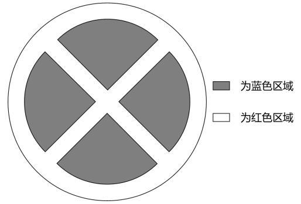
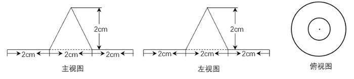

# 2024年江西省公务员录用考试《行测》题（网友回忆版）

> 候选采集稿。参考答案及解析来自粉笔页面，不代表官方答案或真实高分答卷；来源使用许可与原卷对应关系仍需人工核实。

## 题型与作答说明

常识判断

（25题）

根据题目要求，在四个选项中选出一个最恰当的答案。

言语理解与表达

（40题）

本部分包括表达与理解两方面的内容。请根据题目要求，在四个选项中选出一个最恰当的答案。

数量关系

（15题）

在这部分试题中，每道题呈现一段表述数字关系的文字，要求你迅速、准确地计算出答案。

判断推理

（35题）

本部分包括图形推理、定义判断、类比推理与逻辑判断四种类型的试题，在四个选项中选出一个最恰当的答案。

资料分析

（20题）

所给出的图、表、文字或综合性资料均有若干个问题要你回答。你应根据资料提供的信息进行分析、比较、计算和判断处理。

## 给定材料

### 材料 dom-material-53634a548dc4e174

### 材料 dom-material-7d8a1cfae892e10a

### 材料 dom-material-41144e1464981c6e

2022年，我国废钢铁、废有色金属等十个品种（详见表格）再生资源回收总重量约为37067.7万吨，同比下降2.62%，回收总金额约为13140.6亿元，同比下降4.05%。2022年废有色金属中废铅回收重量同比增长5.56%。2022年我国报废机动车回收数量399.1万辆，同比增长32.9%，回收数量占我国机动车保有量的9.57‰。

### 材料 dom-material-d310cc59d474b366

2022年，全国共有260家银行机构和29家理财公司累计新发理财产品2.94万只，同比下降38.23%，降幅比上年同期扩大7.22个百分点；累计募集资金89.62万亿元，同比减少32.57万亿元。

截至2022年底，全国共有278家银行机构和29家理财公司有存续的理财产品，共存续产品3.47万只，同比下降4.41%；存续规模27.65万亿元，同比下降4.66%。分机构类型来看，理财公司存续产品13947只，存续规模22.24万亿元，同比增长29.36%。银行机构中，城商行存续产品9064只，存续规模2.45万亿元，同比下降32.34%；农村金融机构存续产品7808只，存续规模1.09万亿元，同比下降2.63%；股份制银行存续产品1208只，存续规模0.88万亿元，同比下降82.99%；大型银行存续产品668只，存续规模0.92万亿元，同比下降49.26%；其他机构存续产品1980只，存续规模0.07万亿元，同比下降13.42%。

截至2022年底，持有理财产品的投资者数量为9671.27万个，较年初增长18.96%，其中机构投资者数量为95.95万个，数量占比同比提升了0.22个百分点；在持有理财产品的个人投资者中，数量最多的是风险偏好为二级（稳健型）的投资者，占比35.44%。

## 题目

### 第 1 题

习近平新时代中国特色社会主义思想是当代中国马克思主义、21世纪马克思主义。下列对此理解正确的有几项：

①党的十九大把习近平新时代中国特色社会主义思想确立为党必须长期坚持的指导思想并庄严地写入党章

②习近平新时代中国特色社会主义思想是马克思主义中国化最新成果，是当今时代最现实、最鲜活的马克思主义

③今天我们所处的时代同马克思所处的时代相比发生了巨大而深刻的变化，已经脱离了马克思主义所指明的历史时代

④习近平新时代中国特色社会主义思想，始终把马克思主义作为中国共产党人的“真经”，始终坚持马克思主义基本原理

A. 1项

B. 2项

C. 3项

D. 4项

### 第 2 题

2023年，《习近平著作选读》第一卷、第二卷出版发行，这是党和国家政治生活中的一件大事。下列著作内容和篇名对应正确的是：

A. 生态环境是关系党的使命宗旨的重大政治问题，也是关系民生的重大社会问题——《加强生态文明建设必须坚持的原则》

B. 做好新形势下宣传思想工作，必须自觉承担起举旗帜、聚民心、育新人、兴文化、展形象的使命任务——《开展党史学习教育要突出重点》

C. 我们说的共同富裕是全体人民共同富裕，是人民群众物质生活和精神生活都富裕，不是少数人的富裕，也不是整齐划一的平均主义——《在全国脱贫攻坚总结表彰大会上的讲话》

D. “两个维护”要体现在坚决贯彻党中央决策部署的行动上，体现在履职尽责、做好本职工作的实效上，体现在党员、干部的日常言行上——《不断提高政治判断力、政治领悟力、政治执行力》

### 第 3 题

在2023年12月召开的中央经济工作会议上，习近平总书记全面总结2023年经济工作，深刻分析当前经济形势，系统部署2024年经济工作。下列关于做好2024年经济工作的要求，表述正确的有：

①强化宏观政策逆周期和跨周期调节

②坚持稳中求进、以进促稳、先立后破

③积极的财政政策要适度加力、提质增效

④稳健的货币政策要灵活适度、精准有效

A. ①②

B. ①②③

C. ②③④

D. ①②③④

### 第 4 题

2023年是习近平总书记提出共建“一带一路”倡议10周年。10年来，“一带一路””合作从“大写意”进入“工笔画”阶段，实现了从硬联通扩展到软联通的愿景。下列关于“一带一路”的表述正确的有：

①截止2023年底，已有150多个国家、30多个国际组织签署共建“一带一路”合作文件

②落地落实了“鲁班工坊”“丝路一家亲”等人文交流项目

③建成了中老铁路、雅万高铁等一批标志性项目

④“一带一路”合作从亚欧大陆延伸到非洲和拉美

⑤现已举办5届“一带一路”国际合作高峰论坛

A. 2项

B. 3项

C. 4项

D. 5项

### 第 5 题

党的二十大报告提出，在社会基层坚持和发展新时代“枫桥经验”，完善正确处理新形势下人民内部矛盾机制，及时把矛盾纠纷化解在基层、化解在萌芽状态。下列关于新时代“枫桥经验”的表述不正确的是：

A. 党建引领是新时代“枫桥经验”的政治灵魂

B. 人民主体是新时代“枫桥经验”的核心价值

C. 新时代“枫桥经验”是以制度现代化为优先价值导向的基层治理现代化经验

D. 新时代“枫桥经验”主要内容是变群众上访为领导下访，深入基层，联系群众，真下真访民情，实心实意办事

### 第 6 题

党的十八大以来，以习近平同志为核心的党中央始终把未成年人工作摆在突出位置。2024年1月1日起施行的《未成年人网络保护条例》是我国第一部针对未成年人网络保护的专门性综合立法，是贯彻落实习近平法治思想的生动体现。下列关于该条例内容表述正确的有几项？

①国家教育部门负责统筹协调未成年人网络保护工作

②网络产品和服务提供者不得为未成年人提供游戏账号租售服务

③网络产品和服务提供者不得通过自动化决策方式向未成年人进行商业营销

④网络直播服务提供者应当建立网络直播发布者真实身份信息动态核验机制

⑤网络服务提供者可根据实际引导未成年人参与应援集资、投票打榜、刷量控评等网络活动

A. 2项

B. 3项

C. 4项

D. 5项

### 第 7 题

党的十八大以来，我国贯彻“绿水青山就是金山银山”的发展理念，由北到南，从生态保护实践到体制保障，美丽中国踏绿而来。下列有关我国生态文明建设的表述错误的是：

A. 2023年5月31日是首个全国生态日

B. 2018年宪法修正案将“生态文明”写入宪法

C. 福建、江西、贵州被列为首批国家生态文明试验区

D. 生态文明建设被纳入中国特色社会主义事业“五位一体”总体布局

### 第 8 题

习近平总书记强调，要坚定维护宪法权威和尊严，推动宪法完善和发展，更好发挥宪法在治国理政中的重要作用。下列有关表述正确的有几项：

①要加强宪法理论研究和宣传教育，坚持知识普及、理论阐释、观念引导全面发力

②加快完善以宪法为核心的中国特色社会主义法律体系，不断提高宪法实施和监督水平

③坚持宪法确定的中国共产党领导地位不动摇，坚持宪法确定的人民民主专政的国体和人民代表大会制度的政体不动摇

④宪法是治国安邦的总章程，是我们党治国理政的根本法律依据，是国家政治和社会生活的最高法律规范

A. 1项

B. 2项

C. 3项

D. 4项

### 第 9 题

司机王某骑电动自行车载其外籍女友去艺术馆参观，二人均未佩戴头盔，被交警发现。对于二人可能面临的行政处罚，下列表述正确的是：

A. 交警可以当场对王某进行罚款

B. 交警可以暂扣王某的机动车驾驶证

C. 王某女友适用《中华人民共和国行政处罚法》，可予以行政拘留

D. 王某女友不适用《中华人民共和国行政处罚法》的规定，不予处罚

### 第 10 题

《中华人民共和国法律援助法》对于规范和促进法律援助工作、保障公民和有关当事人合法权益具有重大意义。下列情况属于可经指派获得法律援助的是：

①15岁的学生小明涉嫌贩卖毒品，没有委托辩护人

②25岁的精神病人赵某涉嫌抢劫，其患病多年经济困难，没有委托辩护人

③35岁的村民张某因向村中水井投毒，可能被判处死刑，没有委托辩护人

④45岁的聋哑人李某创设公司后涉嫌逃税罪，其个人资产过亿，没有委托辩护人

A. ①②③

B. ②③④

C. ①③④

D. ①②③④

### 第 11 题

下列诗句中涉及的典故人物与其时代对应说法不正确的一项是：

A. 林暗草惊风，将军夜引弓。平明寻白羽，没在石棱中——西汉

B. 闲来垂钓碧溪上，忽复乘舟梦日边——先秦

C. 怀旧空吟闻笛赋，到乡翻似烂柯人——东汉

D. 求田问舍，怕应羞见，刘郎才气——三国

### 第 12 题

唐代是丝绸之路的鼎盛时期，当时丝绸之路上的商队可能携带的商品是：

A. 线装本的《史记》

B. 精心制作的宣德炉

C. 《司马温公神道碑》拓片

D. 鎏金工艺制作的莲瓣银茶托

### 第 13 题

戏曲是中华优秀传统文化的重要组成部分，下列有关说法错误的是：

A. 京剧、豫剧、评剧、黄梅戏、越剧是中国戏剧五大剧种

B. 《群英会》是依据《水浒传》改编的传统京剧

C. 黄梅戏代表剧目中有《天仙配》和《女驸马》

D. 豫剧与梆子腔关系紧密

### 第 14 题

下列选项描述的历史场景与时代不符的是：

A. 唐玄宗时期，百姓可以在祠堂祭拜祖先

B. 南宋时期，人们可以到商业街购买东西

C. 永乐年间，大部分州县由粮长负责征解税粮

D. 道光年间，福建、广东等地的百姓可以用银元完纳钱粮

### 第 15 题

下列所描述现象与相关专业术语对应正确的是：

A. 某商品的价格越高，其需求量越大——价值悖论

B. 工资率随劳动供求的变动而及时迅速地变动——工资粘性

C. 人们倾向于将从小样本中得到的结论错误地移植到大样本中——小数定律

D. 在完全竞争的市场上，相同交易产品经过汇率调整后，在世界范围内其交易成本是相同的——一价定律

### 第 16 题

宝石是用于装饰的、有经济价值的矿物及生物矿物和岩石的总称，呈现晶体、集合体等形态，是地球送给人类的珍贵礼物。下列不属于宝石形成机制的是（ ）。

A. 由炽热岩浆喷发所生成的熔岩蒸汽冷凝产生

B. 岩浆冷却凝固时浓缩的成分结晶后形成

C. 在地核内部高温高压变质瘤结成型

D. 从岩浆产生的热液中结晶生长

### 第 17 题

下列关于我国之“最”说法错误的是：

A. 东北平原是我国最大平原，北部为松嫩平原，南部为辽河平原

B. 三沙市成立于2012年，隶属海南省，是我国位置最南的地级市

C. 台湾岛位于东海南部，是我国第一大岛，有“东海瀛洲”之称

D. 新疆维吾尔自治区是我国陆地面积最大、交界邻国最多的省级行政区

### 第 18 题

振动多以波的形式传播，下列均不能在真空中传播的“波”是：

A. 微波，地震波

B. 电波，超声波

C. 声波，地震波

D. 光波，超声波

### 第 19 题

下列关于我国科技成就说法正确的是：

①“三峡氢舟1号”——助推我国首次在南海海域成功开采可燃冰

②“可持续发展科学卫星1号”——专门服务联合国2030年可持续发展议程的科学卫星

③“蓝鲸1号”——我国首艘氢燃料电池动力示范船

④“耕海1号”——将渔业养殖、海上旅游、科技研发等功能相结合的海洋牧场综合体

A. ①③

B. ②③

C. ①④

D. ②④

### 第 20 题

下列关于国债逆回购的说法正确的是：

A. 投资者可以通过银行网点购买国债逆回购

B. 国债逆回购是以国家为主体进行债券回购

C. 国债逆回购本质上是一种短期资金借贷方式

D. 国债逆回购利率上行20个基点表示利率增加2%

### 第 21 题

太阳镜片往往会改变外界景物颜色。改变原有颜色最小的是：

A. 灰色太阳镜片

B. 黄色太阳镜片

C. 茶色太阳镜片

D. 绿色太阳镜片

### 第 22 题

2022年7月，美国宇航局（NASA）公布韦伯太空望远镜（JWST）拍摄的遥远气态星云一颗新生恒星的照片，其边缘区域的下半部尘埃和上半部气体形成的明显分界线，被天文学家称为“宇宙悬崖”。那么下列哪项最可能是“宇宙悬崖”的形成原因？

A. 由天体内力作用，产生断层

B. 受重力作用，因滑坡或坍塌造成

C. 受流水及重力作用，沿断层节理面形成

D. 由新生恒星强烈的紫外线辐射侵蚀而成

### 第 23 题

小明被困在一个无人、无食物来源但有淡水的荒岛上。假如他在等待救援期间可以从相同重量的葡萄、馒头、酸奶、花生仁这四种食物中选择一种，那么为了能在岛上生存的时间最长，他应该选择的食物是（ ）。

A. 葡萄

B. 馒头

C. 酸奶

D. 花生仁

### 第 24 题

下列病毒与其主要感染的人体系统对应正确的是：

A. 狂犬病毒——免疫系统

B. 流感病毒——神经系统

C. 乙肝病毒——消化系统

D. 艾滋病毒——生殖系统

### 第 25 题

下列表述不符合物理常识的是：

A. 一杯泡好的茶，用勺子作圆形搅动茶叶会向杯底中心聚集

B. 用洗衣机洗裤子并脱干后，取出时经常会看到裤兜被翻出来

C. 在河流的弯道上，外圈河床要比内圈浅，因为泥沙会被河水带到外圈

D. 锅里剩下最后几根面条时，用筷子在锅中作圆形搅动，使面汤旋转起来，面条会集中到锅底中心

### 第 26 题

数字社会中，用户已经离不开各种必须的应用软件，一些应用软件虽然是在用户知情的前提下收集用户个人信息，但很多时候用户都是被逼无奈地同意。比如，下载App后，要么同意其收集自己的个人信息，要么放弃注册使用。这种貌似        的“二选一”，实际上是通过霸王条款限制了用户的选择自由。

填入划横线部分最恰当的一项是：

A. 均等

B. 自由

C. 恰当

D. 公平

### 第 27 题

音乐诗画《听此青绿——乐咏千里江山》以十三幅        图景展现传世名画《千里江山图》中的景观和风情，借鉴《高山流水》《渔舟唱晚》《梅花三弄》等古曲的艺术表达，融合编钟、箜篌、筑等民族乐器和西洋铜管乐，加入绘画、书法、意境化舞蹈等表现方式，为千山万壑、江河交错的盛景注入        而深邃、浑厚而轻盈的悠远神韵。

依次填入划横线部分最恰当的一项是：

A. 壮丽 磅礴

B. 华丽 壮阔

C. 宏伟 清雅

D. 绮丽 恢宏

### 第 28 题

鸿雁南飞、菊花盛开之时，文人墨客秋思绵延，绘就一幅幅绚丽多姿的晚秋画卷。卢纶笔下的寒露是“数派清泉黄菊盛，一林寒露紫梨繁”，一派明艳繁茂；王安石眼中却是“空庭得秋长漫漫，寒露入暮愁衣单”，满眼的寂寥惆怅；元稹诗里描绘“寒露惊秋晚，朝看菊渐黄。千家风扫叶，万里雁随阳”，充盈着            。

依次填入划横线部分最恰当的一项是：

A. 恬淡之意

B. 肃杀之气

C. 离愁之情

D. 清丽之美

### 第 29 题

20世纪下半叶兴起的信息通信技术等高新科技，有两个明显特征：一是与每个人的日常生活            ，无人能须臾脱离高新科技的影响；二是高新科技发展速度        ，科技风险随之增加且难以预测。科技创新活动一旦脱靶，将造成不可逆的负面影响甚至巨大灾难。为此，需努力控制科技伦理问题的出现，避免被动治理局面。

依次填入画横线部分最恰当的一项是：

A. 休戚与共 惊人

B. 如影随形 迅速

C. 息息相关 迅猛

D. 一脉相连 飞快

### 第 30 题

从遏制“舌尖上的浪费”，到刹住“车轮上的腐败”，再到        “会所里的歪风”；从多措并举遏制“天价月饼”“天价烟酒”，到厉行节约、反对浪费成为社会新风尚，再到婚事新办、丧事简办被越来越多人接受······党风政风        社风民风，人民群众成了作风建设的参与者和受益者。

依次填入画横线部分最恰当的一项是：

A. 取缔 指引

B. 遏止 引导

C. 整治 引领

D. 整顿 指点

### 第 31 题

腾冲地震台主要采取的是监测火山地震、地表变形、火山气体这三类手段。这也是世界范围内在火山监测中应用最多的传统“地基”监测手段。不过，如果仅依赖“地基”手段，由于监测点位        、范围小、成本高、效率低等问题，无法实现整个火山区的大范围场式监测，难以为火山活动        及危险性评估提供全面、准确的信息保障。

依次填入画横线部分最恰当的一项是：

A. 稀少 形态

B. 稀疏 状态

C. 稀奇 状况

D. 稀零 形状

### 第 32 题

金秋时节，五彩斑斓的丰收画卷在广袤大地徐徐展开。14亿人的饭碗，依赖有限耕地上的产出，良种的重要性不言而喻。“种地不选种，累死落个空”“好种多打粮”“千算万算，不如良种合算”······一句句        而直白的农谚，道出一粒小小的种子如何承载粮食安全这“国之大者”。当良种与土地相遇，丰收的希望便开始\_\_\_\_。

依次填入画横线部分最恰当的一项是：

A. 质朴 发酵

B. 朴实 滋生

C. 俭朴 点燃

D. 朴素 孕育

### 第 33 题

党的十八大以来，经过艰苦卓绝的努力，我们打赢了人类历史上最大规模脱贫攻坚战；经济总量从54万亿元提升到114万亿元，占世界经济的比重从11.3%提升到18.5%；港珠澳大桥通车        ，北斗卫星导航系统全面开通，第三艘航空母舰下水······一个个改天换地的创举，一件件惊天动地的大事，谱写了时代变迁的        乐章，拓展了历史前行的宽阔航道。

依次填入划横线部分最恰当的一项是：

A. 运行 宽宏

B. 运营 恢宏

C. 运转 宏伟

D. 运载 宏大

### 第 34 题

中华民族的历史是各民族共同创造的。其间汉族的发展也是因为有其他民族        、        而不断进步。汉族人口多，原本是由许多少数民族混血形成的，故汉族的贡献也包含了许多少数民族的贡献。

依次填入划横线部分最恰当的一项是：

A. 参加 融合

B. 参与 融入

C. 汇合 创造

D. 凝聚 交融

### 第 35 题

雷暴是夏季最常见的天气现象之一，在一般人眼中，雷暴意味着电闪雷鸣、暴雨倾盆，常常造成严重的            。但在热爱天象的摄影师眼中，雷暴是融“声、光、电”为一体的独特            。尤其是充满压迫感的雷暴云，云团犹如巨大的飞碟悬浮于天空，旋转凝聚的同时云中闪电不断、雷声滚滚，彰显着大自然的威力。

依次填入画横线部分最恰当的一项是：

A. 自然灾害 自然景观

B. 自然灾荒 自然景况

C. 自然灾变 自然景象

D. 自然灾患 自然景物

### 第 36 题

就常理而言，阳春白雪似乎和下里巴人“            ”，除非下里巴人能够在绵延的历史长河中不断升级，最后跻身阳春白雪之列。可下里巴人转化为阳春白雪，往往又是以失去大量受众为代价的，这仿佛已是艺术史上一条            的定律。

依次填入画横线部分最恰当的一项是：

A. 南辕北辙 亘古不变

B. 势不两立 颠扑不破

C. 判若云泥 屡试不爽

D. 各自为阵 毋庸置疑

### 第 37 题

当下涌现的这一批新国风文艺作品既有美之内涵，亦有美之意蕴；既在内容创作层面上        了既有模式的窠臼，又用别具一格的创意        了文化传承的密码。

依次填入画横线部分最恰当的一项是：

A. 突破 激活

B. 推动 打造

C. 超越 激发

D. 保持 打通

### 第 38 题

中国地理位置相对独立，南有热带丛林，西南有世界屋脊喜马拉雅山和青藏高原， 西有昆仑山、天山、阿尔泰山等高山和中亚沙漠，北有蒙古高原和戈壁荒滩，东方则面海。它们虽不能构成人类迁徙的绝对        ，但会给大规模人群的流动带来挑战，尤其在环境恶化时更是如此。在这样相对封闭的生态环境中，于气候适宜期迁徙至此的早期直立人生存繁衍，            。

依次填入画横线部分最恰当的一项是：

A. 隔断 代代相传

B. 阻碍 绵绵不绝

C. 障碍 开花结果

D. 屏障 开枝散叶

### 第 39 题

蜱虫具有恐怖的吸血能力，它会找到皮肤上隐蔽的角落            地吸血好几天，人却无法察觉。这是因为蜱虫的唾液就像鸡尾酒一样，由各种蛋白质“        ”而成，其中一些让人不痛不痒，一些让血液不会凝固，还有一些保证不会        人的免疫系统。多种病原体便会趁机入侵人体。

依次填入画横线部分最恰当的一项是：

A. 不声不响 搅拌 启动

B. 堂而皇之 调配 惊扰

C. 明目张胆 凝结 触发

D. 有恃无恐 混合 唤醒

### 第 40 题

近年来，以云计算、大数据、人工智能等技术引领的新一代数字化浪潮            。数字化转型按下“加速键”，数字技术应用深度和广度不断拓展，新技术新业态新模式            ，数字经济日渐成为继农业经济、工业经济之后的新兴经济形态。

依次填入画横线部分最恰当的一项是:

A. 汹涌澎湃 此起彼伏

B. 浩浩荡荡 层出不穷

C. 波澜壮阔 生生不息

D. 气壮山河 方兴未艾

### 第 41 题

党的十八大以来的党中央重要文献是从整体上把握习近平新时代中国特色社会主义思想丰富内容及其相互关系的重要文本和专题教材，需要我们认真学习、        研读，努力把其中每一个方面的内容都理解        、领悟        、贯彻落实。

依次填入画横线部分最恰当的一项是：

A. 重复 得当 精准

B. 不断 全面 准确

C. 一再 到位 完整

D. 反复 深刻 透彻

### 第 42 题

历史上的关羽之所以经历由人到神的        跃升，从根本上讲，是因为他的道德品行和人格气质满足了不同时代价值信仰重构的精神需求，即在关公身上蕴含着中华优秀文化            的核心价值。那么这种核心价值是什么？主张刚、毅、直、俭者有之，认为孝、悌、忠、信者有之，可谓众说多歧，            。

依次填入画横线部分最恰当的一项是：

A. 提高 一脉相承 鞭辟入里

B. 擢拔 一以贯之 莫衷一是

C. 提携 一如既往 各执一词

D. 擢用 自始至终 众口难调

### 第 43 题

短视频已成为互联网的底层应用。某研究报告显示，目前我国短视频用户有10.12亿，青年是绝对主力军。作为互联网原住民一代，青年会被短视频“集体        ”并不奇怪：“短”        了信息时代消费内容快餐化的需求，而“视觉化”带来的生动直观、即时满足等特点，        了对年青一代沉浸式体验的“注意力抓取”。

依次填入画横线部分最恰当的一项是：

A. 攻陷 迎合 实现

B. 攻陷 满足 弥补

C. 沦陷 逢迎 达成

D. 沦陷 契合 兑现

### 第 44 题

暗物质，一种在物质起源和宇宙        过程中具有重要地位的物质，约占整个宇宙物质质量的85%。但它看不见、摸不着，几乎不和任何物体发生作用。为了捕捉到这        又“腼腆”的暗物质，21世纪以来，国际上        开展了20多个探测实验。人们相信，谁先揭开它的面纱，谁就将促成人类对物质世界和宇宙认识的又一次重大飞跃。

依次填入画横线部分最恰当的一项是：

A. 蜕变 严肃 持续

B. 演化 神秘 相继

C. 运动 神奇 广泛

D. 膨胀 冷酷 及时

### 第 45 题

中国汉字经历岁月洗礼，            ，如今已发展出成熟而多样的字体系统。随着科学技术的        ，激光照排技术替代活字印刷，让汉字的传播方式发生了革命性变化，而数字媒体的        使汉字字体的设计迎来了质的飞跃。当我们以全新的视角重新审视汉字时，会发现其创新的设计方法如万花筒般千姿百态、绚丽多彩。

依次填入划横线部分最恰当的一项是：

A. 久久为功 提升 创新

B. 历久弥新 增长 融合

C. 薪火相传 更迭 介入

D. 厚积薄发 普及 应用

### 第 46 题

伴随着城市化快速发展的步伐，今天的少年儿童与乡土田园渐行渐远。如何开展既符合时代特色又“接地气”的耕读教育？这道“考题”，考验的是学校与教师勇于创新的意识、因地制宜的本领。很多学校意识到：“耕”离不开土地和自然，“读”重在学习广博有趣的各类知识、涵养自强不息的人格品德、树立报效国家的崇高志气。于是，越来越多的学生被老师们带到原野田间，越来越多的课堂开设在了大自然里。学生们饶有兴致地学习农耕知识、活泼健朗地舒展心胸情怀，耕读教育的真正意义由此得以实现。

对这段文字概括最恰当的一项是：

A. 耕读为本，计之久远

B. 古为今用.耕读传家

C. 劳动教育能够激发内生动力

D. 在“土味”课堂实现耕读教育的价值

### 第 47 题

到2030年，我国数字人整体市场规模将达2700亿元。数字人应用的多元拓展，得益于我国数字技术的不断进步和产业布局的持续完善。我国数字人产业上下游均已具备一定规模的企业集群，有较深厚的技术积累。看上游，成像设备产品已发展成熟，智能传感器等关键技术正被集中攻坚；看下游，应用领域加速从文娱行业向制造业、现代服务业延伸。同时，数字人产品制作企业高速发展、相关服务平台正加快打造，数字人制作水平明显提升，数字人产业将加快走向成熟。

对这段文字理解不正确的是：

A. 数字人应用场景将更为广泛

B. 目前数字人产业仍处在成长期

C. 我国数字人市场发展前景良好

D. 智能传感器等关键技术已有重大突破

### 第 48 题

冰冻圈主要分布在地球两极和中低纬度的高山地区，在气候系统和气候变化中扮演着重要角色。极地温度对于全球的影响力也许比我们想象中要大得多。可以说，极地温度就像一个遥控器，控制着地球上其他地方的“恒定”温度。卫星数据显示，北极的浮冰正在加速消融、减少。冰越来越少，意味着地球能够反射到太空的阳光变少了，也意味着更多深海海水被暴露出来去吸收阳光而变暖，地球会变得更暖，冰会融化得更快，而且很难恢复，如此往复，会放大全球的温度变化情况。

与这段文字的意思相符的一项是：

A. 极地和高山地区地表上存在多年冰体

B. 极地温度决定着地球上其他地方的温度

C. 北极冰冻圈的加速融化会导致全球变暖

D. 极地冰冻圈的融化速度慢于中低纬度高山冰冻圈

### 第 49 题

如今无论什么季节，任何水果都能随时买回家尝鲜，很多人对此并不赞同，理由是反季水果的种植过程中总会有不利于健康的因素，因此他们在选购水果的时候，会侧重购买当季、当地产的水果。但是，果蔬中是否存在不利于健康的因素，与自然栽种还是大棚栽种没有必然联系。随着现代化农业技术的推广应用，大棚栽种水果技术越来越成熟，所有的保鲜剂、食品添加剂、植物生长调节剂，只要是国家相关标准允许使用的，且在规定的用量下，对人体健康是没有危害的。

这段文字旨在说明：

A. 人们倾向于购买当季当地产的水果

B. 反季水果在种植过程中会产生不利于健康的因素

C. 水果是否存在不利于健康的因素与栽种方式的选择无关

D. 应加强现代农业技术的推广应用，减少添加剂对健康的危害

### 第 50 题

2012年至2021年，国家知识产权局累计授权发明专利395.3万件，年均增长13.8%，累计注册商标3556.3万件，年均增长25.5%，累计评出中国专利金奖310项，获奖项目新增销售额超过2.5万亿元。我国知识产权使用费进出口总额累计2.19万亿元，年均增长13.7%，其中出口年均增长31.2%，超过进口增速近20个百分点。知识产权有力支撑了创新型经济、品牌经济、区域特色经济和开放型经济发展。

这段文字旨在说明：

A. 知识产权运用的效益快速增长

B. 知识产权助力优化营商环境

C. 知识产权创新专利的数量上升

D. 知识产权国际合作持续深化

### 第 51 题

伴随着人类社会的发展进步，我们对时间精准度和稳定性的要求越来越高。目前氢钟的计时已经非常精准，但从长远来看，仍然存在着稳定性不够的问题。研究脉冲星的一个重要价值，就在于弥补这一问题。脉冲星具有稳定的旋转周期，每万亿年才会慢1秒，具有长期的稳定性。而且，脉冲星是永不“断电”的，不像氢钟这样的精密仪器需要精心的保护，脉冲星则没有这样的担忧，没有什么能够干扰到脉冲星，只要几架大型射电望远镜便可接收到它们的信号。

这段文字主要说明了：

A. 脉冲星可以满足人类对时间精准度和稳定性的要求

B. 脉冲星有稳定旋转周期，能满足对时间稳定性的要求

C. 脉冲星具有极强精准性和稳定性，有很多潜在的应用

D. 将氢钟和脉冲星结合，可得到精准、稳定的时间系统

### 第 52 题

神经科学领域已有研究揭示脑衰老的分子、细胞、器官、系统多层级多种生物学特征，它们相互依赖、彼此互为联系，共同构成脑衰老特征及其发生机制的复杂性。此外，该领域新技术和新方法的应用也使研究内容得到极大丰富与发展。在对抗衰老过程中维持脑健康及其功能，是一项挑战，运动可以通过改善脑衰老的生物学特征及生理功能，促进脑的可塑性。因此，临床实践中运动干预可作为补充策略，改善衰老人群及相关慢性疾病患者的脑健康。

最适合做这段文字标题的是：

A. 运动促进脑生长：加强认知与记忆

B. 运动干预脑衰老：新进展与再认识

C. 运动改变脑结构：挑战性与安全性

D. 运动影响脑健康：运动疗法有前景

### 第 53 题

元素周期表是化学科学的基石，在化学发展史上具有里程碑意义。作为元素周期表中的“住户”，元素的发现几乎与人类文明相伴。像铁、铜、金、银等容易以单质形态存在的元素发现得最早，之后从铁器时代到青铜时代，从炼金术到电解技术，从核辐射到核裂变，                    ，新“住户”不断占据各自的位置。直至今日，仍然有新的元素被发现（合成），而且关于元素在生命起源、物种进化中的作用以及元素如何精准调控材料性能及生命过程等仍然是科学家们非常关注的科学问题。

填入划横线处最恰当的一句是:

A. 元素周期表逐步被填充并扩展

B. 元素周期表被有序地组织起来

C. 元素周期表得到较完美的呈现

D. 元素在周期表不同行列排列着

### 第 54 题

转眼间，《舌尖上的中国》播出已过去多年。多年来，作为纪录片从业者和美食研究者，我们见证了食物从满足温饱到追求风味享受的飞跃；见证了餐饮业从规模扩张到精细化经营的转型；见证了中国人从吃饱到吃好，从讲求质量到开始关注食物背后的情感与文化。其中折射的，不仅是美食的发展与演变，更是经济与社会的进步和变迁。这期间，人们的口味也发生了巨大的改变，涌现出许多新的饮食风尚。最显著的一个变化，恐怕要属“辣”了。

紧承这段文字最可能谈论的内容是：

A. “辣”味成为饮食新风尚的原因

B. 人们对“辣”味的口味偏好之变

C. “辣”在传统饮食文化中的地位

D. 不同群体对“辣”味的不同偏好

### 第 55 题

文艺评价是评价主体拥有对文艺作品的鉴赏能力，结合自己的价值观念表达自己对作品的感受。从本质上来说，文艺评价是一种以人类的价值判断为基础的审美行为，审美产生的根本原因是人类的社会实践活动，人的感觉和认知必须和人所处的身体和环境相结合，这构成审美判断的有机组成部分。人工智能应用于文艺评价，是将评价的主体由人变成了智能机器。人工智能通过机器学习、自然语言处理等技术，对文艺作品的评论只能是一种认知性的识别，机器需要通过对人类以往文艺作品的学习而产生评判标准。

关于人工智能应用于文艺评价，作者的观点是：

A. 人工智能可为文艺评价提供技术性标准但无法产生审美

B. 人工智能可以从整体意识的层面来评价和鉴赏文艺作品

C. 人工智能进行的文艺评价会比以人为主体的评价更科学

D. 人工智能评价会对大众的审美标准和评价尺度产生影响

### 第 56 题

各地景区大规模免门票提振旅游业，加快推进景区转型，景区出现了几个新变化：一是旅游门槛降低、吸引力竞争力提升；二是创新活力激发，探索摆脱门票经济，许多景区免门票后收入不降反升，通过发展二次消费增加综合收入；三是“景区+”和“+景区”趋势凸显，景区免门票与民宿、户外等新热点新业态加快融合，形成新的文旅消费空间和场景。各地政府和景区运营者逐渐认识到，要以创新理念推动景区发展，单纯依赖门票收入很难适应新形势下的市场竞争和大众旅游多元化消费需求，应更注重提升旅游综合消费、释放综合效益。

这段文字意在说明：

A. 持续推进完善景区门票价格形成机制

B. 疫情冲击下旅游业发生了几个新变化

C. 要用旅游新理念推动景区新发展

D. “景区+”和“+景区”趋势凸显

### 第 57 题

经济活动的可持续性和相关金融资产的价值依赖于生物多样性和环境提供的生态系统服务。与气候变化类似，生物多样性丧失也是本世纪面临的最大危机之一。导致环境恶化和气候变化的罪魁祸首是大量不考虑环境影响、破坏生物多样性、只顾赚钱的投资活动。因此，                  。

填入划横线部分最恰当的一句是：

A. 在保护生物多样性方面金融业有着不可推卸的责任

B. 人类将面临气候变化和生物多样性丧失的巨大危机

C. 应逐步建立对金融机构管理的监管框架和稳定机制

D. 导致环境恶化的根本原因是大量经济活动的可持续性

### 第 58 题

随着大数据、物联网、云计算等现代智能技术的发展，人类社会进入了智慧治理时代。智慧治理对于推进国家治理体系和治理能力现代化具有重要现实意义。当前正在推进的智慧治理面临治理效率低下、数据信息安全存在隐患等困境和风险。对智慧治理面临新任务新期待的理论认识不足、主动适应不够，以及过度依赖智能技术对智慧治理的定位不准是导致困境和风险的重要原因。解决智慧治理中存在的问题，需要实现从智能技术赋能到技术融合的转变，理念融合、过程融合及目标融合是实现这一转变的重要路径。

假如这是一篇文章的摘要，那么这篇文章的标题可能是：

A. 迈向技术融合的智慧治理

B. 理论认识不足制约智慧治理

C. 智能技术赋能的智慧治理路径

D. 智慧治理存在的问题及成因分析

### 第 59 题

人类特别喜欢读到和关注有关他人和社会的负面信息，媒体从业者则是顺应这种喜好，这使人们接触到更多的负面信息而非正面信息。这种“有偏见的暴露效应”解释了为什么人们认为当前的道德水平相对较低。而当人们回忆过去时，负面事件更可能被遗忘，这是由于大脑的内在机制要求不良事件引起的负面反应情绪必须被平复，因此时过境迁，再大的悲剧也可以慢慢放下。这种“有偏见的记忆效应”又解释了为什么人们认为过去的道德水平相对较高。

这段文字意在说明：

A. “世风日下”可能是一种群体心理错觉

B. 心理层面人们更愿记住过去美好的事件

C. 道德水平的高低取决于负面事件的影响

D. 媒体传播强化了人们对负面信息的接收

### 第 60 题

①作为研究文化遗存的一门学科，考古学无法与人相割裂，在科研中，应力求“透物见人”，抓住人类历史进程的发展规律

②公共考古学应积极搭建考古知识的传播与共享平台，加快考古学文化的普及化与大众化，促进考古学知识与民众的沟通交流

③以公众为中心，进行考古和文化遗产的公共文化传播是考古工作者的社会责任

④在这一过程中，考古工作者只是启蒙者，公众才是真正的践行者

⑤坚持考古学的大众化，以公众为中心是应该坚持的原则之一

⑥在共享中，更要以人为中心，以多方式、多角度、多层次对考古学知识进行阐释，提供更多的“文明的碎片”和观点，拉近公众与考古的距离，帮助公众完成自己的“文明拼图”

将以上6个句子重新排列，语序正确的一项是：

A. ③②⑤①⑥④

B. ⑤④③②①⑥

C. ③⑤⑥②①④

D. ⑤②④③①⑥

### 第 61 题

科创企业往往轻资产、高风险，缺乏担保资金和抵质押物，与银行传统的信贷模式不匹配。科创企业在发展过程中还存在研发资金投入大、技术转化周期长等问题。当前，大多数银行的科创金融产品依赖于传统信贷模式，对于大量科技创新企业信贷融资存在不敢贷、不愿贷的情况。实践中，金融机构对于企业知识产权质押融资的应用依然存在一定阻碍，现有产品仍以短期为主，缺乏针对科创企业的中长期贷款产品。

这段文字意在强调：

A. 科创企业的贷款不足

B. 科创企业创业风险高

C. 缺少适合科创企业的金融产品

D. 金融机构对科创企业信心不足

### 第 62 题

数字文化产业是数字技术与文化创意的融合创生。数字技术从根本上改变了文化生产的创意、生产、传播、流通和消费等价值链的生成机制与内生结构，提高了文化创意的产生速度，丰富了文化内容的创意数量，提高了文化传播和流通的精准度和互动性，拓展了文化消费的体验感和辐射面。文化产品在创意、生产、传播、流通与消费等环节中，运用各类数字技术，将文化符号、审美感知和价值观念等文化内容转化为具有可感知性、可复制性、可推广性的数字文化产品，提升了文化产业高感知、高技术和高品质的价值内涵。

与这段文字的意思不相符的一项是:

A. 数字技术改变了文化产业的机制和形态

B. 文化创意是文化运用数字技术后的结果

C. 数字技术具有转化文化产品形象的功能

D. 数字技术渗透于文化产业的各个环节中

### 第 63 题

①设施农业大有可为，要发展日光温室、植物工厂和集约化畜禽养殖，推进陆基和深远海养殖渔场建设，拓宽农业生产空间领域

②要构建多元化食物供给体系，在保护好生态环境前提下，从耕地资源向整个国土资源拓展，从传统农作物和畜禽资源向更丰富的生物资源拓展

③“吃饭”不仅仅是消费粮食，肉蛋奶、果菜鱼、菌菇笋等样样都是美食

④向森林、草原、江河湖海要食物，向植物动物微生物要热量、要蛋白，多途径开发食物来源

⑤耕地以外，我国还有40多亿亩林地、近40亿亩草地和大量的江河湖海等资源

⑥解决吃饭问题，不能光盯着有限的耕地，要把思路打开，树立大食物观

将以上6个句子重新排列，语序正确的是：

A. ①⑥⑤③②④

B. ⑥①②④③⑤

C. ⑥③⑤②④①

D. ①⑥②④③⑤

### 第 64 题

①已经投入应用的主要是针对健康人群开发的、精准性稍差一些的非植入式设备

②到目前为止，科学家们已经发明了多种获取脑电波的设备

③近些年来，科学家们则在开发用于特殊病人的植入式设备上花费了大量精力

④但基于安全性、伦理性等方面的考虑，一直没有在人类的临床上取得突破

⑤这类设备被称为脑机芯片或干脆简称为脑机接口，它能获得更加精准的脑电信息，也能将外界电信号更加精准地输入大脑

⑥然而随着人工智能相关技术和工程技术、材料技术的飞速发展，不少科学家又开始了这类尝试

将以上6个句子重新排列，语序正确的是：

A. ③②①⑥⑤④

B. ③⑥④①②⑤

C. ②①③⑤④⑥

D. ②④①③⑤⑥

### 第 65 题

实践是人的思维方式得以形成的最切近的现实基础，人的思维方式是实践的要素、结构、过程、程序、规律的观念反映，是实践方式的内化与积淀。没有实践活动，也就没有思维方式或思维结构。而思维方式或思维结构一经形成，又成为人们进行认知活动、评价活动和实践活动的思维的框架、定势、模式、取向。实践方式作为由实践的各种要素、活动构成的实践逻辑，经过实践的无数次的重复，逐步扬弃了具体实践活动的个别性、特殊性与偶然性而具备了一般性、普遍性与必然性，人类实践也逐渐趋向稳定、成熟并形成了相对稳定的模式。

与这段文字的意思相符的一项是：

A. 实践即是一种思维方式

B. 思维即是一种实践方式

C. 实践方式形成思维方式

D. 思维方式形成实践方式

### 第 66 题

大学生创业主要集中在高科技、智力服务、连锁加盟和自媒体运营四个领域。某学院今年选择创业的大学毕业生不到50人，其中选择智力服务领域、连锁加盟领域和自媒体运营领域的分别占，和。那么该学院今年选择高科技领域创业的大学毕业生有多少人?

A. 1

B. 3

C. 5

D. 7

### 第 67 题

某旅游公司定制甲、乙两种纪念品，第一次共定制50个。试销后根据反馈，第二次定制两种纪念品共70个，其中乙纪念品个数是第一次的。已知甲纪念品单价为15元，第一次定制花费1150元，那么第二次定制花费多少元?

A. 1150

B. 1725

C. 2300

D. 2875

### 第 68 题

某公园绿化管理部门采购了100片围栏，每片长1米且不可弯折。现拆分拟围成5块周长相等且互不相邻的矩形花卉区域。若不考虑拼接间隙，那么这5块区域的最大与最小面积最多可相差多少平方米？

A. 10

B. 12

C. 16

D. 25

### 第 69 题

某农产品基地对外供应一批农副产品。假设这批农副产品每天都有定量的自然损耗，如果提货方每天运走1.5吨产品，则50天运完；如果提货方每天运走2吨产品，则40天运完。那么这批农副产品有多少吨?

A. 75

B. 80

C. 100

D. 110

### 第 70 题

运输公司准备将475箱相同的救灾物资运往灾区。现在有足够多的大、小两种货车可供选择，大货车每辆最多可装载48箱物资，小货车每辆最多可装载32箱物资。每辆大货车配两名驾驶员，每辆小货车配一名驾驶员，目前公司有17名驾驶员可供派遣。若装载物资时，应先装满大货车，再依次装满小货车，且最后一辆小货车的装载率至少要达到三分之二，则可选择的派车方案有多少种?

A. 2

B. 3

C. 4

D. 5

### 第 71 题

中秋节前夕，小赵买了6个外观相同的月饼，其中有3个是蛋黄馅的。回到家后，小赵从中任取3个月饼，里面恰好有1个是蛋黄馅的概率是：

A. 

B. 

C. 

D. 

### 第 72 题

为弘扬耕读文化，某校打造多样化“校外+校内”耕读文化教育基地，有种植、绘画、编织、美食四个主题基地供同学们选学。假设每位学生选择1个主题基地参与学习，那么甲、乙、丙、丁4名学生中至少有3名学生选择不同主题基地的方法有多少种？

A. 24

B. 60

C. 144

D. 168

### 第 73 题

中国空间站主体由天和核心舱、问天实验舱、梦天实验舱构成。某次实验需要5名宇航员同时在三个舱中开展，每个人只能去一个舱，每个舱至少安排1名宇航员，其中甲宇航员只能去问天实验舱和梦天实验舱中的一个，则不同的安排方法有多少种？

A. 72

B. 88

C. 100

D. 144

### 第 74 题

某公司开展迎新春三分球投篮比赛。3个部门分别派出2、4、4个选手共计10人参加。规则要求同一个部门的选手顺序相连、全部投完再安排另一个部门的人员开始投篮，则这10人不同的投篮顺序种数的范围是：

A. 小于1000

B. 1000~5000

C. 5001~10000

D. 10000以上

### 第 75 题

某单面圆形交通禁停标志牌如图所示，标志牌直径为60cm，牌中各处红色区域宽度均为5cm，某工厂承接30个该种标志牌的喷绘业务，已知每个标志牌的蓝色区域喷绘价格是112.5元，红蓝区域喷绘单价相同（价格仅按面积计算），那么30个标志牌喷绘共需：

A. 3375元

B. 6000元

C. 6750元

D. 8437.5元

### 第 76 题

某地人工湖景区开辟了沿湖福道和环湖乐道两条圆形观景道供市民休闲健身（如下图所示）。小李和他的妈妈分别沿乐道和福道从A、B两地同时同向而行（A、B两点间距离为50米），小李骑自行车的速度是妈妈步行速度的6倍，已知妈妈步行速度为每小时5千米，妈妈沿福道步行一周的时间是小李骑行乐道时间的4倍，那么这个湖面的面积约多少万平方米?（圆周率取3）

A. 2

B. 3

C. 4

D. 6

### 第 77 题

气象学中，24小时内降落在某面积上的雨水深度叫做日降雨量（不考虑渗漏、蒸发、流失等损耗，单位：mm），将日降雨量记为w，其等级划分如下：小雨（），中雨（），大雨（），暴雨（）。某地某日用一个圆锥形容器接了24小时的雨水（如下图所示），则该地日降雨量等级是：

A. 暴雨

B. 大雨

C. 中雨

D. 小雨

### 第 78 题

原油A每吨的价格为0.3万元，可提炼苯乙烯0.5吨，提炼过程中每吨原油产生的废气量为0.4吨；原油B每吨的价格为0.4万元，可提炼苯乙烯0.7吨，提炼过程中每吨原油产生的废气量为0.3吨。若要提炼至少1.9吨的苯乙烯且产生的废气量不超过1吨，则购买原油的最低费用为多少万元？

A. 1

B. 1.1

C. 1.2

D. 1.3

### 第 79 题

A、D两地设有通信基站（如下图所示），发射信号范围分别是以A、D为圆心，AE和DB为半径的圆形区域，小林从B地出发，沿与DB垂直的BA方向匀速行进，步行速度为4千米/小时，那么步行约多少分钟后小林的手机能够重新接收到信号？（）

A. 8

B. 10

C. 12

D. 14

### 第 80 题

一个机器零部件的三视图如下图所示。为防生锈，要给其内部以及外表面均匀涂抹机油，若零件厚度忽略不计，则涂抹机油的面积为多少平方厘米？

A. 

B. 

C. 

D. 

### 第 81 题

把下面的六个图形分为两类，使每一类图形都有各自的共同特征或规律，分类正确的一项是：

A. ①④⑥，②③⑤

B. ①②③，④⑤⑥

C. ①⑤⑥，②③④

D. ①③⑤，②④⑥

### 第 82 题

从所给四个选项中，选择最合适的一个填入问号处，使之呈现一定的规律性。

A. A

B. B

C. C

D. D

### 第 83 题

从所给四个选项中，选择最合适的一个填入问号处，使之呈现一定的规律性。

A. A

B. B

C. C

D. D

### 第 84 题

左边为给定的立体图形，从任一角度观看，下面哪项不是该多面体的视图？

A. A

B. B

C. C

D. D

### 第 85 题

下列两图分别是从正面和后面观察某个多面体所得的立体图形，下列哪项是其正确的外表面展开图？

A. A

B. B

C. C

D. D

### 第 86 题

湖陆风是指湖陆之间相互转换的热力环流现象。入夜以后，陆地降温速度比湖水快，近地面空气变冷变重，而湖水降温慢，温度比陆地高，空气暖而轻，形成上升气流，陆上气流流向湖心形成陆风。太阳升起后，陆地吸热和升温速度比湖水快，直至陆上空气升温形成上升气流，湖面空气流向陆地形成湖风。

根据上述定义，下列诗句最能体现湖陆风现象的是：

A. 轮台九月风夜吼，一川碎石大如斗，随风满地石乱走

B. 潮没具区薮，潦深云梦田。朝随北风去，暮逐南风旋

C. 鸱枭养子庭树上，曲墙空屋多旋风

D. 鹊飞山月曙，蝉噪野风秋

### 第 87 题

合同法大多属于缺省规则，当事人可以就同一事项做出不同约定，只有在没有约定时，才把合同法规定填补到合同中。缺省规则包括两种类型：一种是符合当事人预期的正向缺省规则，当事人无需事无巨细地对合同进行约定，只要适用合同法规定就能实现合同目的，有利于节约订立合同的成本；另一种是与当事人预期相悖的反向缺省规则，适用该类缺省规则会产生与合同目的相反的结果，以督促当事人事先对相关事项做出约定。

根据上述定义，下列属于反向缺省规则的是：

A. 标的数量没有约定的，视为合同没有成立

B. 质量要求没有约定的，按照强制性国家标准履行

C. 价款没有约定的，按照缔约时履行地的市场价格履行

D. 履行方式没有约定的，按照有利于实现合同目的的方式履行

### 第 88 题

正常化偏见，就是指大家对某个事物感到习惯后，就会产生安于现状、不愿意再去尝试新事物的惰性心理。

根据上述定义，下列不属于正常化偏见的是：

A. 某些喜欢看西医的病人排斥看中医

B. 上了年纪的老年人更倾向去菜市场买菜

C. 只要吃外卖，小张就只使用某平台下单

D. 当人们试吃样品满意后更有可能进店消费

### 第 89 题

磁滞现象指的是磁场把未带磁性的铁磁性物质（如铁、钴、镍及其合金等）磁化，使之带有磁性，但外加磁场去除后，铁磁性物质的磁性也不会马上消除，仍保有磁性的现象。

根据上述定义，下列属于磁滞现象的是：

A. 当水中溶解了某些铁磁性物质，水在强磁场下流过时，周围金属物体中会产生磁感应现象，金属中有电流流过

B. 由导线将电池、小灯泡、电流表、开关连接成闭合电路，闭合开关时，灯泡亮暗、电流表指针的指向等都会有变化

C. 电饭锅中的温控元件都有设置好的温度值，电饭锅运行达到一定温度后，感温磁钢会消磁，依靠弹簧的反作用力断开电源

D. 把烧红的铁片放置在子午线的方向，使铁分子顺着地球磁场方向排列，达到磁化目的，之后挪动铁片，铁分子仍然按照磁场方向排列

### 第 90 题

蒸发冷却是一种通过水的蒸发来冷却空气的过程，即水会吸收空气的热量而蒸发从而冷却空气。空气越干燥，其容纳水分的能力越强，当用水喷淋空气时，则空气温度的降低幅度越大。如果采用温度更低的自来水或井水，其空气的降温效果更佳。

根据上述定义，下列未体现蒸发冷却的是:

A. 用喷水壶装满冰凉刺骨的井水，然后喷淋房屋周边

B. 在逆风处设置风井，使空气沿风井流入楼内喷泉处

C. 沿海国家在风口建造风车，利用空气流动驱动扇叶

D. 将冷水输送到屋顶，冷水从房檐四周流下形成水帘

### 第 91 题

在统计学中，生态谬误是指用一种高层次的分析单位做调查，却用另一种低层次的分析单位做结论，即运用数据时错误地将整组的汇总结果应用到组内的单位中。

根据以上定义，下列属于生态谬误的是：

A. 一项调研发现甲地居民的收入普遍比乙地居民的收入更高，由此认为甲地教师的收入高于乙地教师的收入

B. 服务业占比大的区域比服务业占比小的区域更容易吸引高层次人才，由此认为服务业占比大的区域高层次人才更多

C. 某杂志开设了读者意见反馈邮箱，几天后收到28个不喜欢时装栏目的反馈邮件。某编辑认为有读者不喜欢，就一定有读者喜欢

D. 某公司规定，上一年工资数额在公司前6%的要降低工资，小王上一年的工资低于公司的平均水平，可以推出小王今年的工资可能降低

### 第 92 题

政策合成谬误，是指从各部门来看，每项政策都是对的，组合起来实施时却是错的。政策分解谬误，是指不该分解的系统性任务被分解了，有的分解到各部门、各地方，有的分解到各个时间段。

根据上述定义，下列属于政策分解谬误的是：

A. 为了让居民买得起房，某省各部门实施了一系列举措调控房价，几年后该省的房地产商数量明显减少

B. 为了推动乡村振兴，某乡镇决定帮扶辖区内村民养殖黑山羊，一年后黑山羊数量剧增，导致附近山林遭到破坏

C. 为了加快新能源产业的发展，某省出台政策鼓励居民购买电动汽车，半年后发现，该省范围内充电桩数量严重不足

D. 某地政府欲出台一部环境卫生管理条例，其中各部分内容被分配到相关部门草拟，但最终统筹草案后发现各部分之间难以衔接

### 第 93 题

相变指的是物质微观粒子在不同聚集状态间的转变。在等温等压条件下，从一相转变为另一相时吸收或放出的热量是相变潜热。第一类相变是指伴有相变潜热和体积突变的相变。第二类相变则不伴有相变潜热和体积突变，但有热容跃变。

根据上述定义，下列属于第一类相变的是：

A. 热致变色印刷工艺采用遇热可产生色变的物质，如金属碘化物、络合物等，制成油墨在印品上形成色变层

B. 在1个大气压的情况下，1公斤的冰转变成同温度的水，要吸收79.6千卡的热量，与此同时体积亦收缩

C. 含羞草叶茎部的叶褥含有很多水分，当叶片振动时，叶褥中的水分流向其它地方，叶片逐渐干瘪蜷缩到一起

D. 核磁共振成像是通过使人体本身的磁场和仪器自身的磁性物质相互作用形成检测显影，进而查看到病变的位置

### 第 94 题

生物学重复是指对不同生物个体或者不同生物群体的样品采用相同的处理方式进行实验。技术重复则是指对同一样品进行的多次相同实验。

根据上述定义，下列属于生物学重复的是：

A. 采集小王的血样一次并采用三种不同方式分别进行一次检测

B. 采用三种不同方式对分三次采集的小王血样各进行一次检测

C. 采集小王、小李、小张三人的血样并用同样方式分别进行一次检测

D. 采集小王、小李、小张三人的血样混合后用三种方式进行三次检测

### 第 95 题

“嗜睡”是一种睡眠失调现象，患者会持续感到极端疲倦，昏昏欲睡，往往会在毫无预警的情况下睡着，甚至是在活动中途突然入睡。“醉睡”则指酒醒后并没有完全清醒的状态，“醉睡”往往伴随混乱、迷惑、甚至暴力反应和失忆。

根据上述定义，下列选项未体现“嗜睡”或“醉睡”的是：

A. 昨夜雨疏风骤，浓睡不消残酒

B. 终日昏昏醉梦间，忽闻春尽强登山

C. 老眠早觉常残夜，病力先衰不待年

D. 临川税驾忽数月，嗜睡爱闲常闭门

### 第 96 题

牡丹花：牵牛花

A. 金枪鱼：八爪鱼

B. 东北菜：黄花菜

C. 布谷鸟：啄木鸟

D. 变色龙：霸王龙

### 第 97 题

伸延：延伸

A. 登攀：攀登

B. 喜欢：欢喜

C. 生产：产生

D. 等次：次等

### 第 98 题

虫害：植物受损

A. 雾霾：慢性肺炎

B. 除名：查无此人

C. 赤潮：海水污染

D. 失眠：辗转反侧

### 第 99 题

政通人和：国泰民安

A. 深思熟虑：不假思索

B. 星罗棋布：漫山遍野

C. 心领神会：心照不宣

D. 奋起直追：迎头赶上

### 第 100 题

兵符：信物

A. 七律：绝句

B. 汉字：偏旁

C. 干戈：战争

D. 寒露：节气

### 第 101 题

数字经济 对于 （ ） 相当于 （ ） 对于 人工智能

A. 信息工具 家用电器

B. 信息技术 无人驾驶

C. 数字资源 现代农业

D. 数字货币 远程医疗

### 第 102 题

热传递：热传导：热辐射

A. 隔离：冷却：灭火

B. 混合物：化合物：纯净物

C. 播种：撒播：条播

D. 说明文：举例子：作比较

### 第 103 题

锁骨：肋骨：坐骨

A. 头脑：头皮：头发

B. 腹腔：口腔：鼻腔

C. 盲肠：大肠：直肠

D. 颈椎：胸椎：腰椎

### 第 104 题

缘木求鱼 对于 （ ） 相当于 （ ） 对于 抱薪救火

A. 事与愿违 抽薪止沸

B. 南辕北辙 通宵达旦

C. 刻舟求剑 纵风止燎

D. 扬汤止沸 凿壁偷光

### 第 105 题

泡沫经济：实体经济：通货膨胀

A. 生态农业：传统农业：稻田养鱼

B. 清洁能源：传统能源：污染减少

C. 生理反应：心理反应：望梅止渴

D. 自然现象：社会现象：火山爆发

### 第 106 题

对世界上最常见的火山类型而言，含水量较高的岩浆往往储存在地壳更深处。水在很大程度上引发并助长了火山爆发，岩浆的含水量越多，岩浆上升得越快，喷发就越猛烈。此时，岩浆的浮力不再是岩浆喷发的关键，岩浆中越多的水分含量才意味着越多的气泡和潜在更猛烈的喷发。

以下哪项如果为真，最能加强上述研究发现？

A. 岩浆之所以能通过地壳裂缝上升，是因为岩浆比周围岩石的浮力更大

B. 若除水外还有额外的浮力，也会在火山被触发时将更多的岩浆带到地面

C. 水和岩浆的混合物在上升过程中有时会发生脱气现象，使混合物变得更加粘稠，导致上升缓慢甚至停滞

D. 水和岩浆的混合物储存在火山中，当岩浆上升到地表附近后，压力下降就会形成气泡，气泡迅速膨胀导致岩浆喷射而出

### 第 107 题

某智库调查表明，某省2022年的长租房成交量呈不断上涨的趋势，排在全国前列，成交总量超过3000套，较去年增长超过40%，有效解决了新市民、青年人等群体的住房难题。因此有专家认为，加快发展长租房市场是我国解决住房难题的一剂良药。

以下哪项如果为真，最能削弱上述结论？

A. 长租房市场发展时间短，目前缺乏有效监管

B. 2022年，我国的长租房市场规模已达1.73万亿元

C. 长租房无法享受与购房者同等的公共服务，在一二线城市难以推广

D. 有数据表明，我国租赁人口约有2.2亿，占流动人口总数的90%左右

### 第 108 题

白居易在《荔枝图序》中言道：“若离本枝，一日而色变，二日而香变，三日而味变，四五日外，色香味尽去矣。”研究表明，荔枝难以保鲜是因为果实的呼吸强度很高，导致果实品质急剧下降。

以下哪项如果为真，最能支持上述研究结论？

A. 荔枝的可食用部位不是像桃子那样的果皮，而是“假果皮”，它与外皮之间没有直接的维管束相连，外皮失水时不能直接从果肉处获得补充

B. 荔枝离枝后会继续分解糖分：氧气充足时，糖分会分解为二氧化碳；氧气不足时，糖分会转化为一些影响风味的醇、醛类物质

C. 荔枝自身会不断产生乙烯，加速果实成熟甚至腐烂，自然更容易变质

D. 荔枝花能产生花蜜，并且它们的蜜腺很发达，是很好的蜜源植物

### 第 109 题

河西走廊西部的荒原地处内陆，气候干燥，大部分地方都是戈壁沙漠，绿洲面积仅占总面积的很小一部分。千百年来，这里留下了一座又一座的古城址，它们有的彼此连缀，仿佛庞大的星座，有的则间断闪耀，形成多层结构。专家认为，水源变化是形成多个古城址的原因。

以下哪项如果为真，最能支持上述专家的观点？

A. 河西走廊西部的部分地区素有“世界风库”之称，每年三分之一的时间刮着七级以上大风

B. 一旦水量减少，耕地很快会沙化，古城烟火无以为继，人们就会寻找新的绿洲再建一座城

C. 在1000多年的时间中，河西走廊骆驼城的地下水位下降了几十米

D. 在河西走廊，古城都是依水而建

### 第 110 题

科学家一直在对珠峰顶部积雪的厚度进行测量研究，过去由于没有探地雷达，测量研究结果具有不确定性，一般认为珠峰顶部积雪深度在0.92到3.5米之间。最近，中国研究人员在珠峰北坡，利用探地雷达沿着海拔7000米以上的山脊设置了26个测量点，通过采集大量数据得出结论，珠峰顶部积雪比以前认为的要深得多，平均达9.5米。

以下哪项如果为真，最能支持上述结论?

A. 探地雷达的测量结果证明了珠峰山脊的地形相对平坦

B. 集中于珠峰山脊的26个测量点显示，各点积雪深度均为9.5米

C. 探地雷达对珠峰北坡海拔7000米以上山脊反复测量的结果可靠

D. 雪和岩石表面差异很大，探地雷达可准确确定这两种物质的边界

### 第 111 题

某研究机构发布两项关于史前女性的研究表明，史前女性完全有能力胜任狩猎这一艰巨的体力任务，该研究表明，从新陈代谢的角度看，女性的身体更适合耐力活动，消耗同样的能量可以跑更远，因此，同史前男性比，史前女性是更优秀的猎手。

以下陈述如果为真，哪项是上述观点的前提？

A. 我们关于史前女性采集的假设是错误的

B. 史前男性的耐力不足以胜任长时间的狩猎

C. 在其他方面，史前女性比男性更有优势

D. 耐力和效率是决定狩猎成败的关键要素

### 第 112 题

心理学家曾做过一个实验，将被试者分为两组，给他们看同一张交通事故的照片，并询问有关车速的问题。对第一组问“你认为是以多快的速度相撞的”，而对第二组则问“你认为是以多快的速度猛烈撞击到一起的”。后者是让人想到撞击非常猛烈的表达方式。一周后，再询问被试者“汽车的挡风玻璃是否撞碎了”（实际上并没有撞碎）。结果显示，回答“是”的人，第二组的比例比第一组多两倍以上。心理学家由此得出结论：人类的记忆并不是固定的，而是根据之后获取的信息而变化。

以下哪项如果为真，最能削弱心理学家的结论？

A. 第二组被试者的人数比第一组的多

B. 第二组被试者的记忆力本来就偏弱

C. 时隔一周再询问的合理性有待斟酌

D. 两组被试者在认知水平上没有差距

### 第 113 题

目前，研究人员已可以利用基因组编辑技术，破坏致病基因或插入外源基因，来预防或治疗疾病。艾滋病（AIDS）是具有免疫功能的淋巴细胞感染了艾滋病病毒（HIV）造成的，在感染淋巴细胞时，HIV通过识别淋巴细胞表面一种名为CCR5的蛋白质，以此为记号并进行侵入。研究人员可以从患者身上采集淋巴细胞，对其进行基因组编辑，再把编辑后的淋巴细胞送回患者体内，达到治疗效果。

要得到上述结论，需要补充的前提是：

A. CCR5基因是AIDS的相关基因

B. 患者的淋巴细胞可以由直系亲属的淋巴细胞代替

C. HIV面对丧失功能的CCR5，会找到淋巴细胞上的另一种CXCR4细胞来侵入

D. 基因组编辑技术可以使CCR5基因丧失功能，这样HIV就无法感染淋巴细胞了

### 第 114 题

学校计划开展暑期夏令营活动，就陈老师和林老师是否担任夏令营带队老师，几个家长纷纷猜测：

吴妈妈：如果陈老师没去带队，林老师肯定也没去；

李妈妈：陈老师是这个夏令营活动的策划者，她一定会去带队；

郑妈妈：你们等着看吧，陈老师和林老师至少有一个人会去；

张妈妈：我认为林老师会去带队，陈老师要回家探亲不会去。

结果发现其中两个妈妈猜对了，两个妈妈猜错了。请问猜对了的妈妈是：

A. 李妈妈和郑妈妈

B. 吴妈妈和张妈妈

C. 吴妈妈和李妈妈

D. 郑妈妈和张妈妈

### 第 115 题

某单位由于工作需要，本周六必须安排赵、钱、孙、李、周、吴、郑7名工作人员值班，每个人都要值半天班，上午安排4人一起值班，下午安排3人一起值班。值班人员的分配满足下列条件：

(1）赵和孙不在一起值班；

(2）周和孙不在一起值班；

(3）如果郑在下午值班，那么赵和李也在下午值班；

(4）或者钱在上午值班，或者郑在下午值班。

根据以上信息，必须在上午值班的工作人员是：

A. 钱和郑

B. 赵和郑

C. 赵和周

D. 吴和孙

### 第 116 题

表格所列国家中，相较于2012年，2022年全球创新指数增长最快的国家是：

关联材料：dom-material-53634a548dc4e174

A. 美国

B. 中国

C. 英国

D. 印度

### 第 117 题

表格所列国家中，2022年全球创新指数排名前五位国家的平均创新指数是：

关联材料：dom-material-53634a548dc4e174

A. 58.54

B. 59.74

C. 60.84

D. 61.14

### 第 118 题

2022年，中国、巴西、俄罗斯、印度、南非五国创新指数之和同比：

关联材料：dom-material-53634a548dc4e174

A. 增长约3.2%

B. 增长约4.8%

C. 下降约3.2%

D. 下降约4.8%

### 第 119 题

关于2021年，下列国家全球创新指数大小比较，错误的是：

关联材料：dom-material-53634a548dc4e174

A. 瑞士>瑞典>美国

B. 英国>韩国>荷兰

C. 芬兰>新加坡>丹麦

D. 俄罗斯>巴西>印度

### 第 120 题

能够从上述资料推出的是：

关联材料：dom-material-53634a548dc4e174

A. 2022年，韩国创新指数同比下降幅度超过丹麦

B. 2022年，中国创新指数在全球的排名比2012年上升20位

C. 表格所列年份中，全球创新指数均在58及以上的国家有5个

D. 2022年，表格所列全球创新指数同比增长的国家中，其创新指数同比增量均不少于0.5

### 第 121 题

2019~2022年全国体育场地面积增长最快的年份是：

关联材料：dom-material-7d8a1cfae892e10a

A. 2019年

B. 2020年

C. 2021年

D. 2022年

### 第 122 题

2022年全国人均体育场地面积同比增量约为2018~2022年年均增长量的：

关联材料：dom-material-7d8a1cfae892e10a

A. 108.7%

B. 110.5%

C. 115.6%

D. 118.2%

### 第 123 题

2022年，按体育场地类型的数量，从大到小排位第二的约占全国体育场地数量的：

关联材料：dom-material-7d8a1cfae892e10a

A. 5.4%

B. 23.2%

C. 29.6%

D. 62.1%

### 第 124 题

2022年，按运动项目划分场地数量之和最接近全国体育场地数量25%的是：

关联材料：dom-material-7d8a1cfae892e10a

A. 游泳场地+全民健身路径

B. 健身步道+全民健身路径

C. 篮球场地+滑雪场地

D. 排球场地+乒乓球场地

### 第 125 题

能够从上述资料推出的是：

关联材料：dom-material-7d8a1cfae892e10a

A. 2022年全国每个体育场地平均面积大于900平方米

B. 2022年足球、篮球、排球场地数量之和少于体育健身场地数量

C. 2022年全国体育场地数量同比增速比2021年提高了2个百分点

D. 2022年全国主要分项体育场地数量占全国体育场地数量的95%以上

### 第 126 题

相比2021年，2022年我国十个品种再生资源回收总金额同比下降了约：

关联材料：dom-material-41144e1464981c6e

A. 511亿元

B. 532亿元

C. 555亿元

D. 578亿元

### 第 127 题

相比2021年，2022年我国废纸平均回收价格（平均回收价格）：

关联材料：dom-material-41144e1464981c6e

A. 下调约170元/吨

B. 下调约347元/吨

C. 上调约170元/吨

D. 上调约347元/吨

### 第 128 题

按2022年我国十个品种再生资源回收重量从大到小进行排序，以下哪个折线图能准确反映排名前5位再生资源同比增量的变化趋势？

关联材料：dom-material-41144e1464981c6e

A. 

B. 

C. 

D. 

### 第 129 题

2022年我国废有色金属中废铅回收重量约为：

关联材料：dom-material-41144e1464981c6e

A. 261万吨

B. 275万吨

C. 285万吨

D. 291万吨

### 第 130 题

能够从上述资料中推出的是：

关联材料：dom-material-41144e1464981c6e

A. 截止2022年底，我国机动车保有量约为4170万辆

B. 2022年我国十个品种再生资源平均回收价格最高的是废有色金属

C. 2021年回收金额排前两名的再生资源回收金额之和的比值超过75%

D. 2022年除废铅以外的废有色金属回收重量总和比2021年的有所下降

### 第 131 题

2022年全国银行机构和理财公司累计新发理财产品只数与2020年相比约：

关联材料：dom-material-d310cc59d474b366

A. 下降45%

B. 下降57%

C. 下降66%

D. 下降69%

### 第 132 题

2022年不同机构每只存续理财产品平均存续金额从大到小排前三名的是：

关联材料：dom-material-d310cc59d474b366

A. 大型银行、理财公司、城商行

B. 理财公司、大型银行、城商行

C. 大型银行、理财公司、股份制银行

D. 理财公司、大型银行、股份制银行

### 第 133 题

以存续规模计算市场份额，2022年理财公司存续理财产品的市场份额是2021年理财公司的多少倍？

关联材料：dom-material-d310cc59d474b366

A. 0.45

B. 0.78

C. 1.36

D. 1.56

### 第 134 题

按存续产品只数、存续规模分别对2022年6类机构（理财公司、大型银行、股份制银行、城商行、农村金融机构、其他机构）从大到小进行排列，两种排列中位次不一致的机构数量有：

关联材料：dom-material-d310cc59d474b366

A. 1个

B. 2个

C. 3个

D. 4个

### 第 135 题

能够从上述资料中推出的是：

关联材料：dom-material-d310cc59d474b366

A. 2021年持有理财产品的个人投资者数量占比为98.88%

B. 2022年新发理财产品中平均每只产品募集资金低于2021年

C. 2022年城商行存续产品存续金额在银行机构存续产品中比例为8.85%

D. 2022年持有理财产品的个人投资者中风险偏好为二级的数量约为3393万个

## 答案与解析

第 1 题

**答案状态：unknown（来源未提供）**

**解析状态：unknown（来源未提供）**

第 2 题

**答案状态：unknown（来源未提供）**

**解析状态：unknown（来源未提供）**

第 3 题

**答案状态：unknown（来源未提供）**

**解析状态：unknown（来源未提供）**

第 4 题

**答案状态：unknown（来源未提供）**

**解析状态：unknown（来源未提供）**

第 5 题

**答案状态：unknown（来源未提供）**

**解析状态：unknown（来源未提供）**

第 6 题

**答案状态：unknown（来源未提供）**

**解析状态：unknown（来源未提供）**

第 7 题

**答案状态：unknown（来源未提供）**

**解析状态：unknown（来源未提供）**

第 8 题

**答案状态：unknown（来源未提供）**

**解析状态：unknown（来源未提供）**

第 9 题

**答案状态：unknown（来源未提供）**

**解析状态：unknown（来源未提供）**

第 10 题

**答案状态：unknown（来源未提供）**

**解析状态：unknown（来源未提供）**

第 11 题

**答案状态：unknown（来源未提供）**

**解析状态：unknown（来源未提供）**

第 12 题

**答案状态：unknown（来源未提供）**

**解析状态：unknown（来源未提供）**

第 13 题

**答案状态：unknown（来源未提供）**

**解析状态：unknown（来源未提供）**

第 14 题

**答案状态：unknown（来源未提供）**

**解析状态：unknown（来源未提供）**

第 15 题

**答案状态：unknown（来源未提供）**

**解析状态：unknown（来源未提供）**

第 16 题

**答案状态：unknown（来源未提供）**

**解析状态：unknown（来源未提供）**

第 17 题

**答案状态：unknown（来源未提供）**

**解析状态：unknown（来源未提供）**

第 18 题

**答案状态：unknown（来源未提供）**

**解析状态：unknown（来源未提供）**

第 19 题

**答案状态：unknown（来源未提供）**

**解析状态：unknown（来源未提供）**

第 20 题

**答案状态：unknown（来源未提供）**

**解析状态：unknown（来源未提供）**

第 21 题

**答案状态：unknown（来源未提供）**

**解析状态：unknown（来源未提供）**

第 22 题

**答案状态：unknown（来源未提供）**

**解析状态：unknown（来源未提供）**

第 23 题

**答案状态：unknown（来源未提供）**

**解析状态：unknown（来源未提供）**

第 24 题

**答案状态：unknown（来源未提供）**

**解析状态：unknown（来源未提供）**

第 25 题

**答案状态：unknown（来源未提供）**

**解析状态：unknown（来源未提供）**

第 26 题

**答案状态：unknown（来源未提供）**

**解析状态：unknown（来源未提供）**

第 27 题

**答案状态：unknown（来源未提供）**

**解析状态：unknown（来源未提供）**

第 28 题

**答案状态：unknown（来源未提供）**

**解析状态：unknown（来源未提供）**

第 29 题

**答案状态：unknown（来源未提供）**

**解析状态：unknown（来源未提供）**

第 30 题

**答案状态：unknown（来源未提供）**

**解析状态：unknown（来源未提供）**

第 31 题

**答案状态：unknown（来源未提供）**

**解析状态：unknown（来源未提供）**

第 32 题

**答案状态：unknown（来源未提供）**

**解析状态：unknown（来源未提供）**

第 33 题

**答案状态：unknown（来源未提供）**

**解析状态：unknown（来源未提供）**

第 34 题

**答案状态：unknown（来源未提供）**

**解析状态：unknown（来源未提供）**

第 35 题

**答案状态：unknown（来源未提供）**

**解析状态：unknown（来源未提供）**

第 36 题

**答案状态：unknown（来源未提供）**

**解析状态：unknown（来源未提供）**

第 37 题

**答案状态：unknown（来源未提供）**

**解析状态：unknown（来源未提供）**

第 38 题

**答案状态：unknown（来源未提供）**

**解析状态：unknown（来源未提供）**

第 39 题

**答案状态：unknown（来源未提供）**

**解析状态：unknown（来源未提供）**

第 40 题

**答案状态：unknown（来源未提供）**

**解析状态：unknown（来源未提供）**

第 41 题

**答案状态：unknown（来源未提供）**

**解析状态：unknown（来源未提供）**

第 42 题

**答案状态：unknown（来源未提供）**

**解析状态：unknown（来源未提供）**

第 43 题

**答案状态：unknown（来源未提供）**

**解析状态：unknown（来源未提供）**

第 44 题

**答案状态：unknown（来源未提供）**

**解析状态：unknown（来源未提供）**

第 45 题

**答案状态：unknown（来源未提供）**

**解析状态：unknown（来源未提供）**

第 46 题

**答案状态：unknown（来源未提供）**

**解析状态：unknown（来源未提供）**

第 47 题

**答案状态：unknown（来源未提供）**

**解析状态：unknown（来源未提供）**

第 48 题

**答案状态：unknown（来源未提供）**

**解析状态：unknown（来源未提供）**

第 49 题

**答案状态：unknown（来源未提供）**

**解析状态：unknown（来源未提供）**

第 50 题

**答案状态：unknown（来源未提供）**

**解析状态：unknown（来源未提供）**

第 51 题

**答案状态：unknown（来源未提供）**

**解析状态：unknown（来源未提供）**

第 52 题

**答案状态：unknown（来源未提供）**

**解析状态：unknown（来源未提供）**

第 53 题

**答案状态：unknown（来源未提供）**

**解析状态：unknown（来源未提供）**

第 54 题

**答案状态：unknown（来源未提供）**

**解析状态：unknown（来源未提供）**

第 55 题

**答案状态：unknown（来源未提供）**

**解析状态：unknown（来源未提供）**

第 56 题

**答案状态：unknown（来源未提供）**

**解析状态：unknown（来源未提供）**

第 57 题

**答案状态：unknown（来源未提供）**

**解析状态：unknown（来源未提供）**

第 58 题

**答案状态：unknown（来源未提供）**

**解析状态：unknown（来源未提供）**

第 59 题

**答案状态：unknown（来源未提供）**

**解析状态：unknown（来源未提供）**

第 60 题

**答案状态：unknown（来源未提供）**

**解析状态：unknown（来源未提供）**

第 61 题

**答案状态：unknown（来源未提供）**

**解析状态：unknown（来源未提供）**

第 62 题

**答案状态：unknown（来源未提供）**

**解析状态：unknown（来源未提供）**

第 63 题

**答案状态：unknown（来源未提供）**

**解析状态：unknown（来源未提供）**

第 64 题

**答案状态：unknown（来源未提供）**

**解析状态：unknown（来源未提供）**

第 65 题

**答案状态：unknown（来源未提供）**

**解析状态：unknown（来源未提供）**

第 66 题

**答案状态：unknown（来源未提供）**

**解析状态：unknown（来源未提供）**

第 67 题

**答案状态：unknown（来源未提供）**

**解析状态：unknown（来源未提供）**

第 68 题

**答案状态：unknown（来源未提供）**

**解析状态：unknown（来源未提供）**

第 69 题

**答案状态：unknown（来源未提供）**

**解析状态：unknown（来源未提供）**

第 70 题

**答案状态：unknown（来源未提供）**

**解析状态：unknown（来源未提供）**

第 71 题

**答案状态：unknown（来源未提供）**

**解析状态：unknown（来源未提供）**

第 72 题

**答案状态：unknown（来源未提供）**

**解析状态：unknown（来源未提供）**

第 73 题

**答案状态：unknown（来源未提供）**

**解析状态：unknown（来源未提供）**

第 74 题

**答案状态：unknown（来源未提供）**

**解析状态：unknown（来源未提供）**

第 75 题

**答案状态：unknown（来源未提供）**

**解析状态：unknown（来源未提供）**

第 76 题

**答案状态：unknown（来源未提供）**

**解析状态：unknown（来源未提供）**

第 77 题

**答案状态：unknown（来源未提供）**

**解析状态：unknown（来源未提供）**

第 78 题

**答案状态：unknown（来源未提供）**

**解析状态：unknown（来源未提供）**

第 79 题

**答案状态：unknown（来源未提供）**

**解析状态：unknown（来源未提供）**

第 80 题

**答案状态：unknown（来源未提供）**

**解析状态：unknown（来源未提供）**

第 81 题

**答案状态：unknown（来源未提供）**

**解析状态：unknown（来源未提供）**

第 82 题

**答案状态：unknown（来源未提供）**

**解析状态：unknown（来源未提供）**

第 83 题

**答案状态：unknown（来源未提供）**

**解析状态：unknown（来源未提供）**

第 84 题

**答案状态：unknown（来源未提供）**

**解析状态：unknown（来源未提供）**

第 85 题

**答案状态：unknown（来源未提供）**

**解析状态：unknown（来源未提供）**

第 86 题

**答案状态：unknown（来源未提供）**

**解析状态：unknown（来源未提供）**

第 87 题

**答案状态：unknown（来源未提供）**

**解析状态：unknown（来源未提供）**

第 88 题

**答案状态：unknown（来源未提供）**

**解析状态：unknown（来源未提供）**

第 89 题

**答案状态：unknown（来源未提供）**

**解析状态：unknown（来源未提供）**

第 90 题

**答案状态：unknown（来源未提供）**

**解析状态：unknown（来源未提供）**

第 91 题

**答案状态：unknown（来源未提供）**

**解析状态：unknown（来源未提供）**

第 92 题

**答案状态：unknown（来源未提供）**

**解析状态：unknown（来源未提供）**

第 93 题

**答案状态：unknown（来源未提供）**

**解析状态：unknown（来源未提供）**

第 94 题

**答案状态：unknown（来源未提供）**

**解析状态：unknown（来源未提供）**

第 95 题

**答案状态：unknown（来源未提供）**

**解析状态：unknown（来源未提供）**

第 96 题

**答案状态：unknown（来源未提供）**

**解析状态：unknown（来源未提供）**

第 97 题

**答案状态：unknown（来源未提供）**

**解析状态：unknown（来源未提供）**

第 98 题

**答案状态：unknown（来源未提供）**

**解析状态：unknown（来源未提供）**

第 99 题

**答案状态：unknown（来源未提供）**

**解析状态：unknown（来源未提供）**

第 100 题

**答案状态：unknown（来源未提供）**

**解析状态：unknown（来源未提供）**

第 101 题

**答案状态：unknown（来源未提供）**

**解析状态：unknown（来源未提供）**

第 102 题

**答案状态：unknown（来源未提供）**

**解析状态：unknown（来源未提供）**

第 103 题

**答案状态：unknown（来源未提供）**

**解析状态：unknown（来源未提供）**

第 104 题

**答案状态：unknown（来源未提供）**

**解析状态：unknown（来源未提供）**

第 105 题

**答案状态：unknown（来源未提供）**

**解析状态：unknown（来源未提供）**

第 106 题

**答案状态：unknown（来源未提供）**

**解析状态：unknown（来源未提供）**

第 107 题

**答案状态：unknown（来源未提供）**

**解析状态：unknown（来源未提供）**

第 108 题

**答案状态：unknown（来源未提供）**

**解析状态：unknown（来源未提供）**

第 109 题

**答案状态：unknown（来源未提供）**

**解析状态：unknown（来源未提供）**

第 110 题

**答案状态：unknown（来源未提供）**

**解析状态：unknown（来源未提供）**

第 111 题

**答案状态：unknown（来源未提供）**

**解析状态：unknown（来源未提供）**

第 112 题

**答案状态：unknown（来源未提供）**

**解析状态：unknown（来源未提供）**

第 113 题

**答案状态：unknown（来源未提供）**

**解析状态：unknown（来源未提供）**

第 114 题

**答案状态：unknown（来源未提供）**

**解析状态：unknown（来源未提供）**

第 115 题

**答案状态：unknown（来源未提供）**

**解析状态：unknown（来源未提供）**

第 116 题

**答案状态：unknown（来源未提供）**

**解析状态：unknown（来源未提供）**

第 117 题

**答案状态：unknown（来源未提供）**

**解析状态：unknown（来源未提供）**

第 118 题

**答案状态：unknown（来源未提供）**

**解析状态：unknown（来源未提供）**

第 119 题

**答案状态：unknown（来源未提供）**

**解析状态：unknown（来源未提供）**

第 120 题

**答案状态：unknown（来源未提供）**

**解析状态：unknown（来源未提供）**

第 121 题

**答案状态：unknown（来源未提供）**

**解析状态：unknown（来源未提供）**

第 122 题

**答案状态：unknown（来源未提供）**

**解析状态：unknown（来源未提供）**

第 123 题

**答案状态：unknown（来源未提供）**

**解析状态：unknown（来源未提供）**

第 124 题

**答案状态：unknown（来源未提供）**

**解析状态：unknown（来源未提供）**

第 125 题

**答案状态：unknown（来源未提供）**

**解析状态：unknown（来源未提供）**

第 126 题

**答案状态：unknown（来源未提供）**

**解析状态：unknown（来源未提供）**

第 127 题

**答案状态：unknown（来源未提供）**

**解析状态：unknown（来源未提供）**

第 128 题

**答案状态：unknown（来源未提供）**

**解析状态：unknown（来源未提供）**

第 129 题

**答案状态：unknown（来源未提供）**

**解析状态：unknown（来源未提供）**

第 130 题

**答案状态：unknown（来源未提供）**

**解析状态：unknown（来源未提供）**

第 131 题

**答案状态：unknown（来源未提供）**

**解析状态：unknown（来源未提供）**

第 132 题

**答案状态：unknown（来源未提供）**

**解析状态：unknown（来源未提供）**

第 133 题

**答案状态：unknown（来源未提供）**

**解析状态：unknown（来源未提供）**

第 134 题

**答案状态：unknown（来源未提供）**

**解析状态：unknown（来源未提供）**

第 135 题

**答案状态：unknown（来源未提供）**

**解析状态：unknown（来源未提供）**

