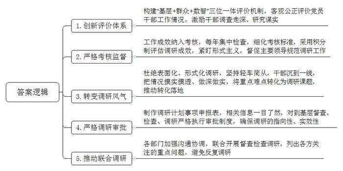
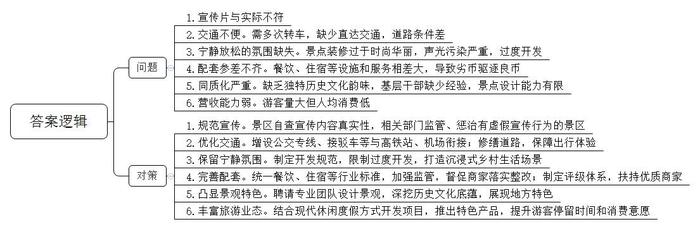
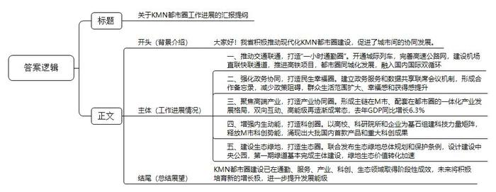
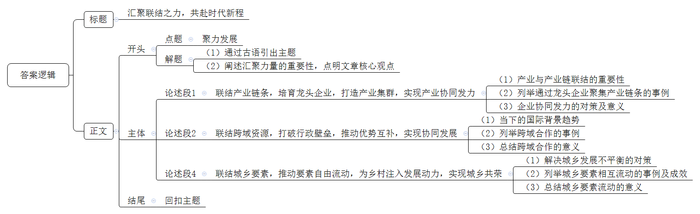

# 2025年公务员多省联考《申论》题（江西省市卷）

> 候选采集稿。参考答案及解析来自粉笔页面，不代表官方答案或真实高分答卷；来源使用许可与原卷对应关系仍需人工核实。

## 给定材料

### 材料 material-4b5c4329b0a4dc0f

“现在的调研越来越规范了，都是带着问题来，实地看情况，然后协调相关部门帮助解决。书面调研也不再对字数有硬性要求，而是统一下发模板，大家只需填上相关数据，逐条列出问题、工作方向就行，更加简洁了。”E县来水乡党委阳书记说。不久前，县领导带着调研组来来水乡调研农村基础设施建设，调研后帮助乡里硬化了12公里道路、改造升级了三个村的自来水管道。“和从前不一样了，我们现在是盼着领导来调研。”阳书记说。

转变源自E县制定的“做实每一项”调研工作机制。县委在调研工作机制中融入“基层评、群众评、数智评”的“三位一体”评价体系，客观公正评价党员干部开展调查研究工作情况，激励干部调查走深、研究落实。县纪委将“做实每一项”调研工作成效纳入考核，每年集中检查县直单位和部门开展调研工作情况，细化考核标准，采用积分制评估县直单位调研成效，紧盯调研活动中的形式主义，督促主要领导规范本单位、本部门调研工作。“现在的调研需求坚持轻车简从，干部们必须下足真功夫，扑下身子、沉到一线，把情况摸实摸透，做深做实。”县纪委赵书记表示，“接下来，我们将持续紧盯调研工作，抓好监督，查处不规范调研等问题，为基层减负松绑。”

说到调研风气的变化，E县福春镇党委孙书记也感触颇深。他坦言，以前的一些调研活动重点在于提交高要求的调研文章，这不仅给基层干部增加了负担，还让工作流于表面。“现在，我们按照‘做实每一项’的调研工作要求，让干部真正沉下去发现问题，将群众急难愁盼、镇村发展等重点难点转化为调研课题，然后想办法去解决。”为此，福春镇梳理了一批调研事项，由镇干部立足村情实际、群众所盼、干部所能、职责所在，围绕招商引才、低效土地盘活等项目化工作开展调研，让干部把更多精力聚焦到镇村经济社会发展上，减少低效调研。前不久，镇里就将黄沙村的“招引服务车厘子项目落地”纳入村调研规划，通过协调网格团队、镇村农业骨干、县农业农村局专家组建调研组，帮助车厘子项目成功落地。过去一年，福春镇12个调研主题全部转化落地。截至2024年底，E县形成了特色商业外摆打造、汽车零部件行业资源共享等一大批接地气、解民忧的调研成果，全县各级党员干部的调研课题和认领难题办结率超95%。

不久前，一个由县生态环境、卫生、住建等部门共同组成的调研组就生活垃圾分类管理进行调研。调研组先后在社区里的厨余垃圾投放点、环保小屋同居民交流，并前往多处调研。“调研组直奔一线查看生活垃圾的分类处理过程，和我们面对面了解情况，从全流程操作到我们的工作细节，问的问题都很实在，我们也没啥额外的负担。”垃圾处理场工作人员小马介绍。调研发现，部分居民对生活垃圾分类嫌麻烦，不够自觉，生活垃圾分类的设施和网点基本齐备，但分类分拣设备还不够完善，处理能力有待提高。县生态环境局赵局长说：“我们将出台针对性的整改措施，提高生活垃圾处理能力，明确主体责任，落实奖惩制度，真正解决生活垃圾分类及处置问题。”

在此次调研开展前，县生态环境局按“做实每一项”调研机制的规定，提交了调研计划事项申报表。在这张表上，调研名称、计划开展时间、牵头单位和参加单位、开展方式及对象范围、开展依据等信息一目了然。“县里对到基层督查、检查、调研严格执行审批制度，确保调研的指向性和实效性。”赵局长表示。除了对单独部门的调研作出规定，E县还要求各部门各单位加强沟通协调，尽可能联合开展督查检查调研。“一次调研就是一次全面体检，这样可以避免同一件事反复调研。”调研组出发前多次与发展改革、自然资源、商务和交通运输等部门沟通，列出各方关注的重点问题。

“调研成果落了地，解决了问题，调研工作才能谈得上做实。”赵书记说。

### 材料 material-2dfc2db415559a4e

开窗见景、出门见绿、抬头见蓝……S省火热的文旅市场中，许多游客愿意把假期交给“小”地方。

小邹是大学生，第一次乡村旅游是爸爸带着去的，从那次起他喜欢上乡村旅游。“虽然我不是来自农村，但农村的风土和人情常让人依恋，现在我也有了乡愁。”不过小邹说去的次数多了也会有踩坑的时候，明明宣传片很美，但实际却不是。乡村旅游的舟车劳顿也令他印象颇深：基本都是坐火车、飞机到一个城市，再一级一级往下转，甚至最后没有直达的公共交通，很不方便。有的地方道路还凹凸不平，拖着行李不好走。

小韩是在读研究生，研究方向为传统民居与乡土村落，他到过S省多个风格不同的景点做实地调研。“有些乡村景点过于时尚，装修得华丽张扬，尤其晚上灯光耀眼，震耳欲聋。”他感觉这样的景点和城市露天市场没有太大差别，旅游资源过度开发，旅游者想在紧张城市生活的疲惫中感受乡村的宁静放松，却发现和城市一样喧闹，当然只会让旅游者来去匆匆。小韩说，随着国家乡村振兴战略的逐步推进，乡村旅游其实大有可为，“发展乡村旅游，既要守，也要新”。

李女士的儿子正在读小学，他一直生活在城市里，李女士就想带他到乡村开拓视野，增长见识。这些年，李女士带儿子去过很多乡村景点。“有的饭店环境整洁，主打当地特色食材，不仅品质新鲜，且‘土味十足’；但也有饭店打着‘当天采摘’的招牌，卖的却是菜场批发的食材；有的旅馆条件好，房间干净卫生，配套齐全，设计也有乡土风情，收费公道；但有的没有私人卫生间和淋浴设施，同一片区旅游配套的硬件设施和服务水平相差这么大，会导致对好的商家不公平，劣币驱逐良币。”李女士说。

70后的旅游爱好者老庄喜欢经常到各地看看。“一个地方有自己的精气神，眼里看得多了，心里就活起来了。”乡村景点的独特风情和历史文化让老庄眼界大开，收获不少。去的地方多了，老庄注意到S省有些地方开发出的古镇景点大同小异，没有独特的历史文化韵味。“乡村古镇的文化底蕴，既需要深入挖掘，还需要别具匠心的表现，这对开发者提出了很大的挑战。”老庄说，乡村景观设计有自身的特性，急需人才。对此，不少基层干部也有同感。旅游业是不冒烟的工厂。不少地方正致力于将乡村的生态、环境优势转化为产业优势，通过发展旅游为乡村增收，基层干部对此充满热情但点子不多，只能在网上学样子。小徐是刚毕业的乡镇干部，领导让他牵头打造一处村级文旅项目。苦于没有文旅项目经验，他只能找旅游攻略，依样画葫芦。小徐说：“反复推敲的方案还是难逃‘百村一面’的窠臼。”

“景区看上去热热闹闹，但没有实现很好的营收。重要节假日每天接待游客近万名，但人均消费不足10元。”一家乡镇田园旅游综合体负责人高总说。近年来，休闲旅游生态发生大变化，随着智能通讯和汽车的普及，人们休闲度假方式更多样化，如自驾、露营等，乡村有时候只是一个暂留地。高总说，乡村旅游业既要立足自身特色和优势，也要与时俱进，才能迎来自己的辉煌。

### 材料 material-470dcdc363dc2191

每天早上7点，家住M市的倪女士都会乘坐城际列车，到同一都市圈的K市上班。“40分钟就能到。”倪女士说，“每班列车间隔只有几分钟，非常方便。”某知名高科技公司先后在KMN都市圈内的三个城市设立园区。“我们开车走高速公路，从M市中心到这些园区不用一个小时。”公司总裁杨总说。K、M、N三市建设都市圈内主要城市机场直联快联通道，打造国际航空客货运双枢纽；推进高铁项目，加快构建四通八达的高铁网……改善“微循环”，促进都市圈同城化发展；贯通主动脉，融入国内国际双循环，KMN都市圈“一小时通勤圈”正在成型。

近年来，KMN都市圈的市民惊喜地发现：公积金、医保和户籍等事项都能在城市政务服务数字平台和实体大厅“跨域通办”；都市圈内公立医疗机构全面实现就医“一卡通”；M市名校开始向K、N市延伸，三市义务教育学校师资开展交流轮岗试点……随着都市圈一体化程度不断加深，缩短的是时空距离，扩大的是生活范围，减少的是政策阻碍，提升的是群众幸福感与获得感。“省政府确定K、M、N三个城市共同建设都市圈，牵头组织三市成立了都市圈建设办公室，建立了政务服务和数据共享联席会议机制，形成了合作备忘录，协调推进一体化工作。”KMN都市圈建设办公室吴主任介绍，都市圈建设有“破”有“联”，只有城市破除自身单一的圈子，彼此高度协同，才能使KMN都市圈真正成为民生幸福圈。

位于N市开发区的一家电子电路股份有限公司的车间内，一套套自动化生产设备开足马力；车间外，一批批液晶面板、5G通讯等产品正等待交货。这家公司原来在M市，后来为了与N市其他电子材料企业形成产业配套，就搬迁到N市，有效推动了当地电子信息产业供应链优化升级。与此同时，N市电子信息产业还直接为M市的大型光电面板企业、汽车制造企业提供产品配套，有效补强了M市光电显示产业链条，实现KMN都市圈的圈内循环。

“我们签订了都市圈产业协同发展合作协议，并且每年举办市长联席会议，规划都市圈的产业发展。”M市张市长说。根据合作协议，KMN都市圈聚焦光电子信息、生命健康、高端装备等产业，推动优势产业协同联动，提升中心城市M市的经济密度；促进M市一般制造业向周边的K、N市有序转移，逐步形成主链在M市、配套在都市圈的一体化产业发展格局。在KMN都市圈，双向互动、高能级再造渐成常态，产业链上“你中有我、我中有你”的格局有效激活了各城市资源禀赋优势。去年，KMN都市圈GDP同比增长6.3%，占全省GDP近60%，产业链韧性和竞争力有效提升。

M市有众多高校和科研机构，科创资源丰富。“都市圈的产业定位决定了我们必须紧紧抓住科学技术这个第一生产力。”张市长说。怎样有效释放M市的科创势能，增强都市圈的内生动能？N市在M市成立离岸科创中心，N市企业纷纷签约入驻。“成立离岸科创中心，有利于企业就近利用M市的人才和科创资源。”N市一家工艺有限公司执行董事吴先生说，企业深入对接M市的广电创意产业园、省美术学院等资源，更好地在数字文化产业、文化科技融合、新材料开发与应用等领域发力。K市积极搭建科创平台，鼓励企业建立研发机构和博士后工作站，吸引科技人才，加快科技创新和成果转化。目前，K市与M市14所高校院所开展合作，在研科技合作重点项目达99个，创历史新高……靠过去、引进来，科技同兴，产业同旺，都市圈也是科创圈。KMN都市圈以高校、科研院所和企业为基石组建科技力量矩阵，近年涌现出大批国内首款产品及国家急需的重大科技创新成果，有力带动了都市圈的蓬勃发展。

“生态环境是高质量发展的核心目标之一，是衡量区域现代化进程的重要标尺。”张市长说。KMN都市圈中心地带有一块总面积500多平方公里的生态绿地，它不仅是地理版图上的一抹绿，更是都市圈的“绿肺”。三市联合发布都市圈生态绿地总体规划和保护条例，保护这块绿地不受城市化进程的“蚕食”。去年，三市共同委托一家设计研究院制定《生态绿地中央公园总体设计方案》。目前，第一期的绿道已基本完成主体建设，原始的山林土路变身健身绿道，沿线还建有科普、诗词、地方文化等多个不同风格、主题的“驿站”，成为了三市居民休闲游玩的好去处。绿地的生态价值转化正在加速，在KMN都市圈内，一幅人与自然和谐共生的现代化图景正在铺展开来。

## 题目

### 第 1 题

**根据****“给定资料**1**”，请你谈谈E县“做实每一项”调研工作机制的“做实”体现在哪些地方。（15分）**

关联材料：material-4b5c4329b0a4dc0f

作答要求：

要求：

（1）全面、准确，有条理；

（2）不超过300字。

### 第 2 题

**请根据****“给定资料**2**”，梳理S省乡村旅游中存在的问题，并提出解决建议。（20分）**

关联材料：material-2dfc2db415559a4e

作答要求：

要求：

（1）问题梳理全面、准确、有条理；

（2）所提建议有针对性、切实可行；

（3）不超过400字。

### 第 3 题

**省政府即将召开****KMN都市圈阶段性建设成果报告会，吴主任将在会上汇报工作进展情况。请根据“给定资料**3**”，为吴主任拟写一份汇报提纲。（25分）**

关联材料：material-470dcdc363dc2191

作答要求：

要求：

（1）紧扣资料，内容全面；

（2）条理清晰，语言准确；

（3）不超过500字。

### 第 4 题

**“给定资料**4**”中提到“在当今这个充满活力的时代，我们要善于汇聚各种力量形成合力。联结好当下，就能畅通奔向未来的路”。请你对此进行深入思考，参考给定资料，联系实际，自选角度，自拟题目，写一篇文章。（40分）**

关联材料：material-4b5c4329b0a4dc0f

作答要求：

要求：

（1）观点明确，见解深刻，内容充实；

（2）参考给定资料，但不拘泥于给定资料；

（3）思路清晰，语言流畅；

（4）总字数1000-1200字。

## 答案与解析

第 1 题

**参考答案（粉笔题库参考内容）**

1.创新评价体系。构建“基层+群众+数智”三位一体评价机制，客观公正评价党员干部工作情况，激励干部调查走深、研究谋实。

2.严格考核监督。工作成效纳入考核，每年集中检查，细化考核标准，采用积分制评估调研成效，紧盯形式主义，督促主要领导规范调研工作。

3.转变调研风气。杜绝表面化、形式化调研，坚持轻车简从，干部沉到一线，把情况摸实摸透、做深做实，将重点难点转化为调研课题，推动转化落地。

4.严格调研审批。制作调研计划事项申报表，相关信息一目了然，对到基层督查、检查、调研严格执行审批制度，确保调研的指向性、实效性。

5.推动联合调研。各部门加强沟通协调，联合开展督查检查调研，列出各方关注的重点问题，避免反复调研。

**解析**

**参考答案说明**：本参考答案从“创新评价体系”“严格考核监督”“转变调研风气”“严格调研审批”“推动联合调研”这五个方面展开，各条答案要点之间在内容上相互并列，没有交叉。

**考点**：考点概括措施类

**来源**：来源2025年公务员多省联考《申论》题（江西省市卷）

粉笔申论页面对本题只提供「解析视频」入口，该入口是会员推广位，页面无视频地址与文字解析。

第 2 题

**参考答案（粉笔题库参考内容）**

问题：1.宣传片与实际不符。2.交通不便。需多次转车，缺少直达交通，道路条件差。3.宁静放松氛围缺失。景点装修过于时尚华丽，声光污染严重，过度开发。4.配套参差不齐。餐饮、住宿等设施和服务相差大，导致劣币驱逐良币。5.同质化严重。缺乏独特历史文化韵味，基层干部缺少经验，景点设计能力有限。6.营收能力弱。游客量大但人均消费低。

建议：1.规范宣传。景区自查宣传内容真实性，相关部门监管、惩治有虚假宣传行为的景区。2.优化交通。增设公交专线、接驳车等与高铁站、机场衔接；修缮道路，保障出行体验。3.保留宁静氛围。制定开发规范，限制过度开发，打造沉浸式乡村生活场景。4.完善配套。统一餐饮、住宿等行业标准，加强监管，督促商家落实整改；制定评级体系，扶持优质商家。5.凸显景观特色。聘请专业团队设计景观，深挖历史文化底蕴，展现地方特色。6.丰富旅游业态。结合现代休闲度假方式开发项目，推出特色产品，提升游客停留时间和消费意愿。

**解析**

**参考答案说明****：**本参考答案宏观上从“问题”和“对策”两个方面展开。在“问题”方面，围绕“虚假宣传”“交通不便”“氛围缺失”“配套差距”“景区雷同”“营收较少”六个方面进行分条撰写；在“对策”方面，围绕“规范宣传”“优化交通”“保留宁静氛围”“完善配套”“凸显景观特色”“丰富旅游业态”这六个方面展开。各条要点之间在内容上相互并列，没有交叉。

**考点**：考点提出对策类

**来源**：来源2025年公务员多省联考《申论》题（江西省市卷）

粉笔申论页面对本题只提供「解析视频」入口，该入口是会员推广位，页面无视频地址与文字解析。

第 3 题

**参考答案（粉笔题库参考内容）**

关于KMN都市圈工作进展的汇报提纲

背景介绍：大家好！我省积极推动现代化KMN都市圈建设，促进了城市间的协同发展。

工作进展情况：一、推动交通联通，打造“一小时通勤圈”。开通城际列车，完善高速公路网，建设机场直联快联通道，推进高铁项目，都市圈同城化发展，融入国内国际双循环。二、强化政务协同，打造民生幸福圈。建立政务服务和数据共享联席会议机制，形成合作备忘录，减少政策阻碍，群众生活范围扩大、幸福感和获得感提升。三、聚焦高端产业，打造产业协同圈。形成主链在M市、配套在都市圈的一体化产业发展格局，双向互动、高能级再造渐成常态，去年GDP同比增长6.3%。四、增强内生动能，打造科创圈。以高校、科研院所和企业为基石组建科技力量矩阵，释放M市科创势能，涌现出大批国内首款产品和重大科创成果。五、建设生态绿地，打造生态圈。联合发布生态绿地总体规划和保护条例，设计建设中央公园，第一期绿道基本完成主体建设，绿地生态价值转化加速。

总结展望：KMN都市圈建设已在通勤、服务、产业、科创、生态领域取得阶段性成效，未来将积极培育新的增长极，进一步提升发展能级。

**解析**

**参考答案说明：**（1）格式方面，本参考答案写到了“标题+正文”两个部分。（2）正文部分，从内容上来看，本参考答案的开头部分先介绍了KMN都市圈的整体建设成果；接着，主体从“推动交通联通，打造‘一小时通勤圈’”“强化政务协同，打造民生幸福圈”“聚焦高端产业，打造产业协同圈”“增强内生动能，打造科创圈”“建设生态绿地，打造生态圈”五个方面介绍了KMN都市圈的具体建设经验；最后，结尾部分进行了简要总结与展望。从形式来看，本参考答案做到了分段、分条撰写，整体上条理较为清晰。

**考点**：考点总结类

**来源**：来源2025年公务员多省联考《申论》题（江西省市卷）

粉笔申论页面对本题只提供「解析视频」入口，该入口是会员推广位，页面无视频地址与文字解析。

第 4 题

**参考答案（粉笔题库参考内容）**

**汇聚联结之力，共赴时代新程**

“积力之所举，则无不胜也；众智之所为，则无不成也。”在当今充满活力的时代，汇聚各种力量形成合力，已成为推动社会进步与发展的关键。联结当下各方资源，畅通奔向未来的路，这不仅是一种发展智慧，更是时代赋予我们的使命。

**联结产业链条，培育龙头企业，打造产业集群，实现产业协同发力。**产业是经济发展的基石，而产业链的紧密联结与协同共生，则是驱动产业持续创新、突破发展瓶颈的核心引擎。以深圳的电子信息产业为例，华为、腾讯等龙头企业凭借强大的研发实力和市场影响力，吸引上下游众多中小企业集聚，形成了涵盖芯片设计、软件开发等完整的产业链条。这不仅仅是企业的简单扎堆，而是通过市场机制与政策引导，形成了专业化分工精细、本地化配套齐全、创新链条完整的产业生态体系。在激烈的市场竞争中，各企业协同发力，共同抵御风险，推动了产业在全球占据领先地位，成为城市经济发展的重要支柱。

**联结跨域资源，打破行政壁垒，推动优势互补，实现协同发展。**在经济全球化与区域一体化深入发展的大背景下，加强区域合作、促进要素高效配置，不仅是提升整体竞争力的内在需要，更是构建新发展格局的必然选择。长江三角洲地区便是实践的典范。上海作为经济中心，拥有强大的金融、科技与人才资源；江苏制造业基础雄厚；浙江民营经济活跃。三地打破行政壁垒，加强区域合作，通过产业转移、技术共享、人才流动等方式，实现优势互补，形成了一体化发展的强大合力。这种深度的跨域合作，促进了区域内部经济的强劲增长与结构升级，提升了长三角整体在全球资源配置中的能级与影响力。

**联结城乡要素，推动要素自由流动，为乡村注入发展动力，实现城乡共荣。**城乡发展不平衡是我国面临的重要问题，联结城乡要素是解决这一问题的有效途径。随着城乡融合发展不断深化，城市资本、技术、人才等要素加速向乡村集聚，催生了乡村旅游、特色农业、精品民宿等新业态。这些新业态不仅盘活了乡村闲置资源，更带动农民增收致富，为乡村振兴注入了强劲动能。同时，乡村的绿水青山、优质农产品、传统文化等资源也为城市居民提供了高品质的生态产品和文化体验，满足了城市居民日益增长的多元化需求。城乡要素的自由流动，使乡村焕发出新的活力，城市也获得了更广阔的发展腹地，实现了城乡的共同繁荣。

“孤举者难起，众行者易趋。”在时代的浪潮中，我们唯有联结各方力量，形成强大合力，才能在发展的道路上披荆斩棘，实现国泰民安的美好愿景。

**解析**

**文章分析**

**汇聚联结之力，共赴时代新程**

【**标题的优点：**首先，范文的标题突出了“聚力发展”这一主题。其次，形式上，文字简洁明快，不拖沓。】

（1）“积力之所举，则无不胜也；众智之所为，则无不成也。”（2）在当今充满活力的时代，汇聚各种力量形成合力，已成为推动社会进步与发展的关键。联结当下各方资源，畅通奔向未来的路，这不仅是一种发展智慧，更是时代赋予我们的使命。

【**开头的优点：**★内容方面：范文的开头是紧扣“聚力发展”这一主题展开的。首先，开头点出主题，做到了主题明确。其次，对“聚力发展”这一主题进行了分析阐述：（1）通过古语引出主题；（2）阐述汇聚力量的重要性，点明文章核心观点。★文字表达方面：使用了“不仅……更……”的关联词，使语言表达有逻辑性。】

**联结产业链条，培育龙头企业，打造产业集群，实现产业协同发力。**（1）产业是经济发展的基石，而产业链的紧密联结与协同共生，则是驱动产业持续创新、突破发展瓶颈的核心引擎。（2）以深圳的电子信息产业为例，华为、腾讯等龙头企业凭借强大的研发实力和市场影响力，吸引上下游众多中小企业集聚，形成了涵盖芯片设计、软件开发等完整的产业链条。（3）这不仅仅是企业的简单扎堆，而是通过市场机制与政策引导，形成了专业化分工精细、本地化配套齐全、创新链条完整的产业生态体系。在激烈的市场竞争中，各企业协同发力，共同抵御风险，推动了产业在全球占据领先地位，成为城市经济发展的重要支柱。

【**论述段****1的优点：**★观点句：范文的观点句是紧扣“聚力发展”这一文章主题提出的。形式上，它在段首处直接写出，位置突出，容易发现。内容上，关键词突出，内容要点明确，可以明显看出它是从“联结产业链”这个角度入手。★论述内容：（1）首先指出产业与产业链联结的重要性；（2）其次列举通过龙头企业聚集产业链条的事例效；（3）最后总结企业协同发力的对策及意义。注意：以上三个方面的内容都是紧扣“联结产业链条，培育龙头企业，打造产业集群，实现产业协同发力”这个观点句进行分析论述的，论述的针对性强，内容层次丰富。最后，在论述方法上主要采用了讲道理与举例子结合，做到了丰富多样。】

**联结跨域资源，打破行政壁垒，推动优势互补，实现协同发展。**（1）在经济全球化与区域一体化深入发展的大背景下，加强区域合作、促进要素高效配置，不仅是提升整体竞争力的内在需要，更是构建新发展格局的必然选择。（2）长江三角洲地区便是实践的典范。上海作为经济中心，拥有强大的金融、科技与人才资源；江苏制造业基础雄厚；浙江民营经济活跃。三地打破行政壁垒，加强区域合作，通过产业转移、技术共享、人才流动等方式，实现优势互补，形成了一体化发展的强大合力。（3）这种深度的跨域合作，促进了区域内部经济的强劲增长与结构升级，提升了长三角整体在全球资源配置中的能级与影响力。

【**论述段****2****的优点：**★观点句：范文的观点句是紧扣“聚力发展”这一文章主题提出的。形式上，它在段首处直接写出，位置突出，容易发现。内容上，关键词突出，内容要点明确，可以明显看出它是从“联结区域”这个角度入手。★论述内容：（1）首先指出当下的国际背景趋势；（2）其次列举跨域合作的事例；（3）最后总结跨域合作的意义。注意：以上三个方面的内容都是紧扣“联结跨域资源，打破行政壁垒，推动优势互补，实现协同发展”这个观点句进行分析论述的，论述的针对性强，内容层次丰富。最后，在论述方法上主要采用了讲道理与举例子结合，做到了丰富多样。】

**联结城乡要素，推动要素自由流动，为乡村注入发展动力，实现城乡共荣。**（1）城乡发展不平衡是我国面临的重要问题，联结城乡要素是解决这一问题的有效途径。（2）随着城乡融合发展不断深化，城市资本、技术、人才等要素加速向乡村集聚，催生了乡村旅游、特色农业、精品民宿等新业态。这些新业态不仅盘活了乡村闲置资源，更带动农民增收致富，为乡村振兴注入了强劲动能。同时，乡村的绿水青山、优质农产品、传统文化等资源也为城市居民提供了高品质的生态产品和文化体验，满足了城市居民日益增长的多元化需求。（3）城乡要素的自由流动，使乡村焕发出新的活力，城市也获得了更广阔的发展腹地，实现了城乡的共同繁荣。

【**论述段****3****的优点：**★观点句：范文的观点句是紧扣“聚力发展”这一文章主题提出的。形式上，它在段首处直接写出，位置突出，容易发现。内容上，关键词突出，内容要点明确，可以明显看出它是从“联结城乡”这个角度入手。★论述内容：（1）首先指出解决城乡发展不平衡的对策；（2）其次列举城乡要素相互流动的事例及成效；（3）最后总结城乡要素流动的意义。注意：以上三个方面的内容都是紧扣“联结城乡要素，推动要素自由流动，为乡村注入发展动力，实现城乡共荣”这个观点句进行分析论述的，论述的针对性强，内容层次丰富。最后，在论述方法上主要采用了讲道理的方式，论述清晰透彻。】

【**论述段之间的关系：**★内容的内在逻辑：范文的论述段之间是依照并列的逻辑展开的。论述段1先写了“联结产业链条，培育龙头企业，打造产业集群，实现产业协同发力”，论述段2接着写了“联结跨域资源，打破行政壁垒，推动优势互补，实现协同发展”，论述段3最后写了“联结城乡要素，推动要素自由流动，为乡村注入发展动力，实现城乡共荣”。这三个论述段分别从“联结产业链”“联结区域”“联结城乡”展开，相互并列，逻辑清晰。】

“孤举者难起，众行者易趋。”在时代的浪潮中，我们唯有联结各方力量，形成强大合力，才能在发展的道路上披荆斩棘，实现国泰民安的美好愿景。

【**结尾的优点：**范文的结尾回扣了“聚力发展”这个主题，并且进行了总结呼吁。】

**考点**：考点文章写作题

**来源**：来源2025年公务员多省联考《申论》题（江西省市卷）

粉笔申论页面对本题只提供「解析视频」入口，该入口是会员推广位，页面无视频地址与文字解析。

