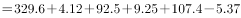
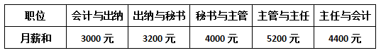
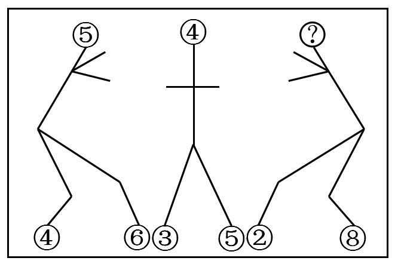
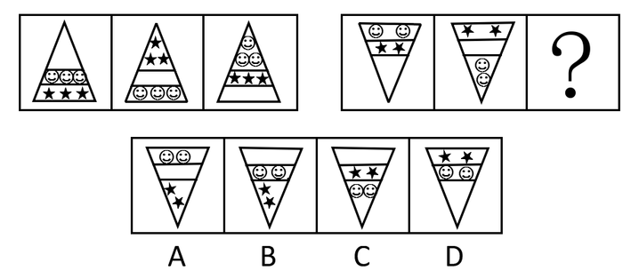
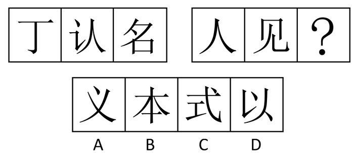
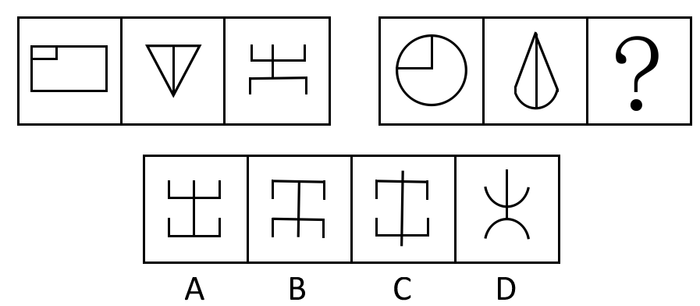
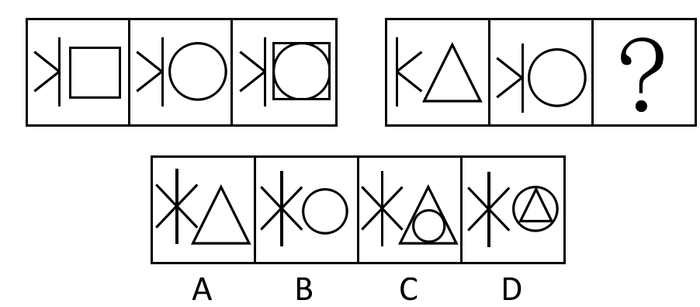
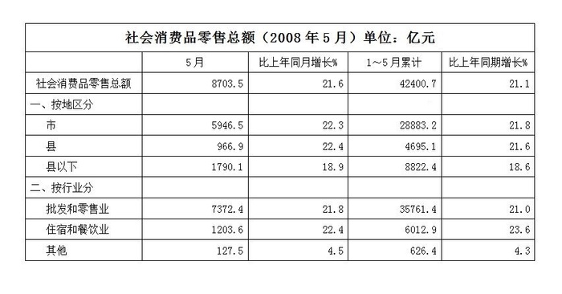
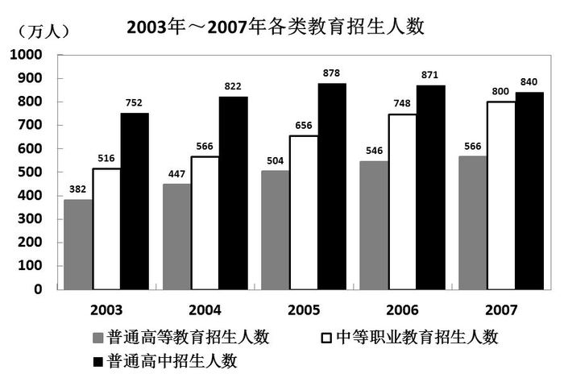

# 2008年河北省公务员录用考试《行测》题

<!-- gwy:overview:start -->
> **河北 · 2008 · 行测 · 统考** ｜ 130 题 · 图片 52 处 · 答案随题折叠

| 题型模块 | 题量 | 题号 |
| --- | ---: | ---: |
| 言语理解与表达 | 40 | 1–40 |
| 数量关系 | 20 | 41–60 |
| 判断推理 | 35 | 61–95 |
| 常识判断 | 20 | 96–115 |
| 资料分析 | 15 | 116–130 |
| **合计** | **130** | |

导航：[题型与作答说明](#题型与作答说明) · [题目](#题目) · [材料 1](#材料-1)
<!-- gwy:overview:end -->

> 候选采集稿。参考答案及解析来自粉笔页面，不代表官方答案或真实高分答卷；来源使用许可与原卷对应关系仍需人工核实。

## 题型与作答说明

言语理解与表达

（40题）

本部分中每道题包含一段话、一个句子或一篇短文，后面是一个不完整的陈述，要求你从四个选项中选出一个来完成陈述。注意：答案可能是完成对所给文字主要意思的提要，也可能是满足陈述中其他方面的要求，你的选择应与所提要求最相符合。

数量关系

（20题）

本部分包括数字推理与数学运算两种类型的题目。

判断推理

（35题）

本部分包括图形推理、定义判断、类比推理与逻辑判断四种类型的试题。

常识判断

（20题）

根据题目要求，在四个选项中选出一个正确答案。

资料分析

（15题）

针对下列图、表或文字回答问题。你应该根据资料提供的信息进行分析、比较、计算、处理。

## 题目

### 第 1 题

中国传统的言说方式是“以言去言”，《老子》首章“道可道，非常道；名可名，非常名”非常清楚地表述了这一点。老子的论述可以从两方面来理解：首先，“道”“名”是可以道、可以名的；其次，可道、可名的“道”“名”并非那恒常的“道”“名”。可见，在老子看来，作为世界本真的“道”“名”与作为言说工具的道、名是不一样的。真正的“道”“名”虽然可以被言说，但被言说的并不是真正的“道”“名”；然而，如果完全不用言说，则根本无法论述“道”“名”。因此，老子提倡一种“以言去言”的言说方式，即通过使人认识、领悟所言之道，达到“无言”，撤去语言的迷障，直达“道”之本真。

根据这段话，以下说法正确的一项是：

A. 老子认为“道”“名”是不可言说的

B. 老子认为被言说的“道”“名”与作为世界本真的“道”“名”是同一的

C. 老子言说“道”“名”最终是为了使人认识、领悟“道”的本真

D. 老子认为不应用言说的方式论述“道”“名”

第 1 题 · 答案与解析

**参考答案（粉笔题库参考内容）**

C

**解析**

据提问可知本题是细节判断题。

通过本文最后一句“老子提倡一种‘以言去言’的言说方式······直达‘道’之本真”可知老子通过言说的“道”“名”，最终是为了达到使人领悟“道”的本真的目的。

所以C项表达正确。

根据“首先，‘道’‘名’是可以道、可以名的”判断A项与原文语意相反；根据“在老子看来，作为世界本真的‘道’‘名’与作为言说工具的道、名是不一样的”可知B项中“同一”的表述是错误的；同时根据最后一句老子提倡的正是“以言去言”的方式可知D项错误。

故正确答案为C。

**考点**：细节判断题

**来源**：2008年河北省公务员录用考试《行测》题第1题

### 第 2 题

“信息”一词在古拉丁语中有“描述、陈述、概要”等意思，在英语中有“通知、报告、消息、报道、情报、知识、资料、数据”等多种含义。在汉语中“信”和“息”合成一个词，最早见于唐代《暮春怀故人》诗中“梦断美人沉信息”句。在日常用语中指“音信、消息”。

这段文字主要说明了：

A. “信息”概念的本质属性

B. “信息”是事物运动状态的陈述

C. “信息”的意思

D. “信息”的含义是变化发展的

第 2 题 · 答案与解析

**参考答案（粉笔题库参考内容）**

C

**解析**

据提问可知此题是中心理解题。

文中依次从古拉丁语、英语、汉语和日常用语的角度解释“信息”一词含义，论述对象为“信息”的意思。

因此C项正确。

A项的“本质属性”在文中并没有体现；B项本身表述错误，“信息”没有此含义；文中仅客观并列陈述了“信息”一词的不同含义，并没有表达“信息”含义的变化过程，所以D项也错误。

故正确答案为C。

**考点**：关联词-并列

**来源**：2008年河北省公务员录用考试《行测》题第2题

### 第 3 题

记忆没有体积，它却既可以让人敞开襟怀去拥抱整个世界，又可以使人的心眼儿狭窄得芥蒂难容。

这段话的意思是：

A. 记忆的作用巨大，无所不包

B. 记忆可让人宽容，也可让人妒忌

C. 记忆的作用无法把握，可大可小

D. 记忆提醒人们做事不可太死板

第 3 题 · 答案与解析

**参考答案（粉笔题库参考内容）**

B

**解析**

根据提问可知该题为中心理解题。

本题主要讲述记忆带来的两面性作用。

“敞开襟怀去拥抱整个世界”即意为宽容，“使人的心眼儿狭窄得芥蒂难容”则相对地指让人妒忌，所以选择B项。

A项仅提到包容这一作用，片面错误；C项表述有误，题干并未提到记忆的作用是否可以把握，所以不选；D项没有抓住材料的重点是谈记忆的作用，也不选。

故正确答案为B。

**考点**：关联词-并列

**来源**：2008年河北省公务员录用考试《行测》题第3题

### 第 4 题

清代有人写了这样一副对联：“不要百姓半文钱，原非异事；但问一官二千石，所造何功？”此联告诉官吏，不拿百姓半文钱是起码的为官之德，并非什么特殊的事迹，重要的是要问一问享受着国家的俸禄做出了什么政绩。

最能概括上面文字的一项是：

A. 为政不在言多，须息息从省身克己而出

B. 为官要一心为民，两袖清风，三思而行，四方太平

C. 为官既要廉政，还要勤政

D. 为官不光要廉政，还要勤政，要有功于民

第 4 题 · 答案与解析

**参考答案（粉笔题库参考内容）**

D

**解析**

据提问知该题为中心理解题。

材料由一副对联指明为官之道，上联是说为官需要清廉，下联则言为官还需对民有所作为。根据对联中的“但”和后文解释中的“重要的是”，可知重心在后半句。

D项“不光······还要”关联词表示递进，指出为官需廉政和勤政的同时，更强调要勤政，故选D。

A项提到的为政要省身克己，与对联主旨无关；B项仅提到为官清廉一方面，片面化；C项表述中的廉政和勤政二者是并列关系，不符合材料更强调后者这一点。

故正确答案为D。

**来源**：2008年河北省公务员录用考试《行测》题第4题

### 第 5 题

“国学”研究在20世纪90年代之所以能够形成热潮，原因还在于历史对于80年代“文化批判”之矫枉过正倾向的一种修正和制衡。许多中国知识分子清醒地看到，将中国现实中一切丑恶现象都与传统文化挂起钩来，是对传统文化的莫大误解；传统文化中许多有价值的东西不但不可以否定，而且是应当大力弘扬的。

下列关于这段话的理解，错误的一项是：

A. 80年代的“文化批判”存在矫枉过正的倾向

B. 人们对于文化的认识存在着误解

C. “国学”研究热潮始于80年代的“文化批判”

D. 传统文化中有许多有价值的东西应当大力弘扬

第 5 题 · 答案与解析

**参考答案（粉笔题库参考内容）**

C

**解析**

据提问可知此题是细节判断题。

根据文段第一句话可知“国学”研究在90年代形成热潮，而“历史对于80年代‘文化批判’之矫枉过正倾向的一种修正和制衡”是其原因，但并不能因此得出热潮就始于80年代的“文化批判”。

因此C项表述不准确。

A项从“历史对于80年代‘文化批判’之矫枉过正倾向的一种修正和制衡”中可知正确；B项据“许多中国知识分子······是对传统文化的莫大误解”这句可知表述正确；D项是文中最后一句的同义表述。

本题为选非题，故正确答案为C。

**考点**：细节判断题

**来源**：2008年河北省公务员录用考试《行测》题第5题

### 第 6 题

在对美国总统政绩的衡量中，一般在没有战争等非常事件的情况之下，对外关系占的比重是非常小的，对外关系只要不犯什么大的错误，就过得去了，主要看的还是总统对美国本身发展所做出的贡献。

这段话的主要意思是：

A. 衡量美国总统的政绩主要看他在对外关系上的表现

B. 美国总统在战争中的表现是评价其政绩的主要标准

C. 在没有战争等非常事件的情况之下，对外关系不太重要

D. 在没有战争等非常事件和对外关系过得去的情况下，对美国总统政绩的评价主要看他对美国发国发展做出的贡献

第 6 题 · 答案与解析

**参考答案（粉笔题库参考内容）**

D

**解析**

据提问可知该题为中心理解题。

本段话是谈对美国总统政绩衡量的主要标准。材料由“主要看的还是”引导递进关系，最后“总统对美国发展所做的贡献”才是主旨，而前面“一般在没有战争等非常事件的情况之下”和“对外关系过得去”则是这个主旨的两个前提条件。

所以D表述最完整正确。

A项表述不是材料所述的重点，而且在没有战争等非常事件的情况下，对外关系在衡量总统政绩上占的比重很小，并不是衡量的主要方面；B项也不是材料所述重点，材料讨论的是在没有战争前提下的衡量；C项更是与主旨无关，表述的是对外关系的重要性。

故正确答案为D。

**来源**：2008年河北省公务员录用考试《行测》题第6题

### 第 7 题

不要过分地依赖语言。不要总是企图在语言上占上风。语言解不开的，事实可以解开。语言解开了而事实没有解开的话，语言会失去价值，甚至于只能添乱。

这段话的主要观点是：

A. 事实比语言更有力量

B. 平常不要说太多的话以免惹出是非

C. 没有事实基础的语言是毫无价值的

D. 语言是不重要的，事实才是重要的

第 7 题 · 答案与解析

**参考答案（粉笔题库参考内容）**

A

**解析**

据提问可知该题为中心理解题。

材料先提出不要过度依赖语言，之后由此引出“语言解不开的，事实可以解开。语言解开了而事实没有解开的话，语言会失去价值”，说明事实比语言更有力量，这是文段的主旨。

所以A项正确。

B项无中生有，在原文中找不到根据；C项是干扰项，选项表述的主干是“语言是毫无价值”，而文段强调的是事实的重要性，重点是事实而非语言，所以不选；D项“语言是不重要的”本身表述错误。

故正确答案为A。

**考点**：分述句特征-其他

**来源**：2008年河北省公务员录用考试《行测》题第7题

### 第 8 题

相对主义作为一种历史悠久的哲学学说以拒斥确定性为其基本理论特色。表现在本体论上，它否认存在永恒的、超历史的“本体”；表现在认识论上，它否认存在绝对真理和可独立存在的“最终语汇”；表现在价值论上，它否认存在终极的、确定的价值原则。当代相对主义融合了后现代主义的某些因素，对于历史上的相对主义有所发展，但从根本上说，其基本价值立场并无改变，它反对思维上的一元性、封闭性和独断性，否定同一性，强调“差异性”，要求理论思维从一元走向多元，从封闭走向开放，从独断走向宽容，从单调走向杂色。

下列关于这段话内容的理解，错误的一项是：

A. 相对主义的基本理论特色是拒斥确定性

B. 在本体论意义上，相对主义否认终极的、确定的价值原则

C. 当代相对主义与历史上的相对主义的基本价值立场是一致的

D. 当代相对主义和历史上的各种相对主义都否定“同一性”，强调“差异性”

第 8 题 · 答案与解析

**参考答案（粉笔题库参考内容）**

B

**解析**

据提问可知此题是细节判断题。

B项中“相对主义否认终极的、确定的价值原则”是其在价值论意义上的阐释，而不是选项中的本体论意义上。

故选B。

由首句可知A项与原文表述相符；由“当代相对主义······其基本价值立场并无改变”可知C项表述也正确；D项是原文最后一句的同义替换。

本题为选非题，故正确答案为B。

**考点**：细节判断题

**来源**：2008年河北省公务员录用考试《行测》题第8题

### 第 9 题

我们当下有些报刊，其文化品格每况愈下。其一是过于看重时尚，娱乐要摩登，明星要刺激，迎合大众的猎奇心理来寻找话题。二是炒作公众人物，将平凡的公众形象神秘化和庸俗化。细看近几年一部分媒体的热门话题，有许多走时尚的路子，唯独与民众的生活远了。

这段话指出了当下有些报刊存在的问题是：

A. 看重时尚，迎合大众的猎奇心理

B. 炒作公众人物，将其神秘化和庸俗化

C. 过于看重时尚，热衷炒作公众人物

D. 走时尚的路子，脱离民众

第 9 题 · 答案与解析

**参考答案（粉笔题库参考内容）**

C

**解析**

据材料和提问可知该题为中心理解题。

根据结构层次可知材料是总——分结构。原文先提出观点：当下一些报刊存在问题，文化品格每况愈下，接着分析这种现象的两种具体表现。后面的两点即是当下有些报刊存在的具体问题。

C项同时综合了这两点问题，故正确。

A、B、D三项都只片面的提到一点。

故正确答案为C。

**考点**：关联词-并列、特殊问法

**来源**：2008年河北省公务员录用考试《行测》题第9题

### 第 10 题

卢梭是伟大的思想家。他构思20年，写作3年，完成了教育巨著《爱弥尔》，提出了较为系统的自然教育理论，从根本上否定了封建宗教教育，在世界教育史上具有划时代的伟大意义。卢梭很重视体育，在《爱弥尔》中，从婴儿出生到成人各个年龄阶段的教育中都有身体教育的内容。

对这段文字含义的正确理解是：

A. 卢梭对教育发展有贡献

B. 卢梭的贡献主要在体育

C. 卢梭的贡献在教育领域

D. 卢梭发展了自然教育理论

第 10 题 · 答案与解析

**参考答案（粉笔题库参考内容）**

A

**解析**

据提问可知该题为中心理解题。

原文中“他构思20年······在世界教育史上具有划时代的伟大意义”论述卢梭对教育发展上的贡献，是整段文字的重点。而后半段文字虽然提出的是卢梭重视体育，但依然也是从他的教育巨著《爱弥尔》中的身体教育方面阐发。

故A项正确。

B项、D项都未全面理解全文，仅提出了卢梭贡献的一部分；C项是干扰项，文中论述的是卢梭在教育领域所做出的具体贡献，而C项表述片面地认为卢梭的贡献仅在教育领域，故不选。

故正确答案为A。

**考点**：关联词-并列

**来源**：2008年河北省公务员录用考试《行测》题第10题

### 第 11 题

不能说你在一个领域干得好，就借此可以进入其他领域。每个学科每个领域都有它的积累、尊严和门槛儿，明星们随便跨越这个门槛儿就是一种特权，是对公平的一种践踏。另外，高校对教授的聘用和职称的评定，有着严格、规范的程序，聘请明星任教授如果不能按照程序进行，对其他教授来说就是不公平，损害了程序的公平和正义。

这段话的主要观点是：

A. 明星担任教授是对学术尊严的亵渎

B. 不按照评聘职称的程序聘请明星任教授是对学术公平的一种践踏

C. 学术界有学术界的尊严

D. 聘请明星任教授损害了评聘职称程序的公平和正义

第 11 题 · 答案与解析

**参考答案（粉笔题库参考内容）**

B

**解析**

据提问可知该题为中心理解题。

根据“另外”引导的并列关系可知表面主旨是“另外”前后两部分的结合，前半段文字谈明星随便的跨领域是对公平的践踏，后半段文字则具体指出现在高校不按严格程序聘请明星当教授造成不公平这种随意跨领域现象。

综合二者，B项是全面的概括，故选B。

A项、D项理解片面，都少了这种践踏公平的前提条件，即不按照评聘职称的规范程序；C项表述过于空泛，没有抓住重点。

故正确答案为B。

**考点**：关联词-并列

**来源**：2008年河北省公务员录用考试《行测》题第11题

### 第 12 题

与自然科学对传统的超越是对传统的不断证伪不同，人文科学对传统的超越不是对传统的证伪并弃置的过程，而是表现为对传统的不断兼容，因此，尽管在人文科学发展中的每一次创新都以突破传统为前提，但传统总是具有某种恒定的价值，成为后人进行研究和创新的参照，甚至在某些方面是后人无法企及的典范。

上面这段话表明：

A. 人文科学的发展是在对传统不断证伪的过程中寻求超越的

B. 人文科学与自然科学有着不同的发展模式

C. 人文科学发展中的创新都是以继承传统为前提的

D. 传统的东西都是后人难以望其项背的

第 12 题 · 答案与解析

**参考答案（粉笔题库参考内容）**

B

**解析**

据提问可知该题为中心理解题。

材料首句说明了人文科学发展模式和自然科学发展模式存在着不同，之后则具体分析了人文科学发展模式的不同之处。

故B项正确。

由第一句话可知A项表述错误，在对传统不断证伪的过程中寻求超越的是自然科学，而不是人文科学；由原文“人文科学发展中的每一次创新都以突破传统为前提”可知C项中“以继承传统为前提”的表述错误；D项以偏概全，由原文“甚至在某些方面是后人无法企及的典范”这一表述，可知传统的东西并不是后人完全无法超越的。

故正确答案为B。

**考点**：关联词-因果

**来源**：2008年河北省公务员录用考试《行测》题第12题

### 第 13 题

20世纪50年代初，海明威在《老人与海》中宣告：“······一个人并不是生来要给打败的”，“你可以把他消灭掉，可就是打不败他。”这种铮铮鸣响的语言，充满了对人的同情与崇高的信仰。而几乎就是在同时，当人们被战争的阴云所困扰，福克纳大声宣告：“我不想接受人类末日的说法······人是不朽的”，“作家的特殊的光荣就是振奋人心，提醒人们记住勇气、荣誉、希望、同情、怜悯之心和牺牲精神，这就是人类昔日的荣耀。”人的生存的挫折感是真实的存在。在人遭受苦难陷入迷惘的时刻，看来只有那些具有海明威、福克纳精神力量的作家，会给人们以鼓舞，让人们勇敢地生存下去。

下列关于这段话的理解，正确的一项是：

A. 海明威、福克纳的作品都集中展现了人们在苦难与挫折面前的迷惘

B. 海明威、福克纳的作品都表达了乐观主义的主题

C. 海明威、福克纳都过分夸大了人的精神力量

D. 海明威、福克纳都强调作家要以自己的作品振奋人心、给人们以鼓舞

第 13 题 · 答案与解析

**参考答案（粉笔题库参考内容）**

B

**解析**

通过阅读材料，海明威的宣言表明人是打不败的；福克纳的宣言表明人是不朽的，勇气、希望、荣誉等都不应该被忘记，他们两位作家都通过这种积极向上的宣告给人以正面的精神鼓励。

因此B项符合原文含义。

由末句可知A项理解错误；C项对海明威和福克纳显然持否定态度，与原文体现出的态度不符；材料中并未提及他们两位强调要以自己作品给人以鼓舞，故也不选D项。

故正确答案为B。

**考点**：细节判断题

**来源**：2008年河北省公务员录用考试《行测》题第13题

### 第 14 题

一个城市展现的文化常潜藏在语言文字中，因为它像呼吸一样平常，所以极易被忽略，然而它又是不可或缺的。

能够最正确地复述上面这段话的一项是：

A. 潜藏在语言文字中的城市文化极易被忽略，但不可或缺

B. 城市文化潜藏在语言文字中，极易被忽略

C. 潜藏着城市文化的语言像呼吸一样容易被忽略，但不可或缺

D. 一个城市的文化常常通过它的城市文学表现出来

第 14 题 · 答案与解析

**参考答案（粉笔题库参考内容）**

A

**解析**

据提问可知此题是中心理解题。

阅读材料可知，这段文字主要讲潜藏在语言文字中的城市文化极易被忽略。

A项表述符合原文，所以选A。

B项是干扰项，它与A项的区别是，A项中主语是“城市文化”，“潜藏在语言文字中”是其修饰定语，而B项的主语是“城市文化潜藏在语言文字中”这个整体，将城市文化界定在语言文字中，绝对化，故不选；C项表述的主旨是语言易被忽略，与原文主旨不符；D项无中生有，材料中并未提及“城市文学”。

故正确答案为A。

**考点**：特殊问法

**来源**：2008年河北省公务员录用考试《行测》题第14题

### 第 15 题

这里是典型的黄土高原沟壑区，水土流失非常严重，土地贫瘠，十年九旱。尽管有国家的支持，使部分群众走上了致富道路，但仍有不少农民挣扎在贫困线上。

这段话主要说明了：

A. 黄土高原地区经济落后，文化匮乏

B. 与其等待国家的政策救助，当地政府不如因地制宜，发展地区特色经济

C. 恶劣的自然环境是当地人民走向富裕的一个主要障碍

D. 解决部分西北贫困地区人民群众的温饱问题是当务之急

第 15 题 · 答案与解析

**参考答案（粉笔题库参考内容）**

C

**解析**

据提问可知此题是中心理解题。

材料首先说明这里自然环境恶劣的情形，之后引出这种情况导致的后果，而由“尽管······但”这一关联词可知重点在转折之后的内容。综合来看，文段想表述的是恶劣的自然环境使当地部分人们无法走向富裕。

C项符合主旨。

A项偷换概念，材料提到的是“黄土高原沟壑区”，而非整个黄土高原，且材料中并没有提到文化；B项是针对问题提出的解决办法，并不是材料的主旨；D项亦不是材料重点，文中并未提及西北地区。

故正确答案为C。

**考点**：关联词-转折

**来源**：2008年河北省公务员录用考试《行测》题第15题

### 第 16 题

民族主义是一个极为复杂的概念，国内外学术界至今也没有一个可为大多数人所接受的民族主义的界定。现代民族观念和现代民族主义都发源于西方。在西方向东方的政治、经济、文化的扩张中，东方国家整合与弘扬自身的民族传统与民族文化并吸取西方现代民族和民族主义的历史经验和理论观念，将来自西方的思想意识和本土的精神传统结合起来，逐步唤起了民族意识的觉醒，发起了反对西方统治和掠夺的民族主义运动，从而缔造了一个不同于传统东方世界的全新的东方。

下列观点不能直接从以上文字中推出的是：

A. 东西方的民族主义都有着非常悠久的传统

B. 东方民族主义在其形成过程中吸取了西方现代民族和民族主义的历史经验和理论观念

C. 东方民族主义建立在东方民族意识觉醒的基础上

D. 东方民族主义是反对西方统治和掠夺的民族运动

第 16 题 · 答案与解析

**参考答案（粉笔题库参考内容）**

A

**解析**

据提问可知本题是细节判断题。

材料中论述的是民族主义这个概念和东方民族主义的特点，并没有提及东西方民族主义概念产生的时间。

所以不能推出A项，选A。

B项由原文“东方国家整合与弘扬······理论观念”可推出；C项由原文“逐步唤起了民族意识······全新的东方”可以推出；D项由原文“发起了反对西方统治和掠夺的民族主义运动”可以推出。

本题为选非题，故正确答案为A。

**考点**：细节判断题

**来源**：2008年河北省公务员录用考试《行测》题第16题

### 第 17 题

随着科学技术、经济、社会的发展和人们认识能力的提高，软科学作为独立的学科开始受到普遍重视。在世界范围内，从当前的发展速度看，软科学必将在广泛的领域发挥越来越大的作用。

这段话强调了：

A. 人们对软科学重要性的认识在不断提高

B. 软科学应当受到重视

C. 软科学发展的原因及前景

D. 人们重视软科学的原因

第 17 题 · 答案与解析

**参考答案（粉笔题库参考内容）**

C

**解析**

文段中第一句指出了软科学发展的原因，接着在后面提到在世界范围内，从当前的发展速度看，软科学必将在广泛的领域发挥越来越大的作用，这是对软科学前景的描述。因此整个文段强调的就是软科学发展的原因和前景。

C项正确。

A项，只概括了软科学发展的原因，不全面。

B项，文段描述了软科学已经受到了重视，而不是应该受到重视，该项偷换了时态。

D项，对文段内容概括不全面，没有提到软科学的前景。

故正确答案为C。

**来源**：2008年河北省公务员录用考试《行测》题第17题

### 第 18 题

正是对于理性的崇奉，使得人们对人类的力量与社会的前景充满乐观。这一乐观情绪的产生是有根据的，因为理性取代了上帝，为社会灌输了现代化所必需的观念，如知识、科学、自由、民主等等，建立起了现代社会的价值基础，确认了社会的发展目标及其操作手段。我们难以设想，没有理性的启蒙，人类社会是否还会沉浸在宗教神学的黑暗之中。但是，当理性被无限度地抬升时，它可能替代原有的上帝变成另一个“上帝”，导致任意操纵自然与社会的严重后果。

下列关于这段话内容的理解，错误的一项是：

A. 没有理性的启蒙，人类社会可能还沉浸在宗教神学的黑暗之中

B. 对理性的崇奉使人们对人类的力量与社会的前景充满了乐观情绪

C. 对理性的崇奉导致任意操纵自然与社会的严重后果

D. 对理性的崇奉使人类建立起了现代社会的价值基础，确认了社会的发展目标及其操作手段

第 18 题 · 答案与解析

**参考答案（粉笔题库参考内容）**

C

**解析**

据提问可知此题是细节判断题。

由原文最后一句可知，导致任意操纵自然与社会的严重后果的前提是对理性的过度崇奉，而且这种情况下也只是“有可能”产生此后果。

C项表述与此有误，所以选C。

A、B、D项都可以在原文中找到同义出处。

本题为选非题，故正确答案为C。

**考点**：细节判断题

**来源**：2008年河北省公务员录用考试《行测》题第18题

### 第 19 题

不论动机多么伟大，不论出于多么善良的心地，想要改变一个人，哪怕只是改变一个孩子，都是徒然的，如果他并不理解这种改变。

这段话的意思是说：

A. 人是很难改变的

B. 没有善良的动机就不能使人改变

C. 孩子和成人一样不容易改变

D. 只有当人自己理解改变时他才会改变

第 19 题 · 答案与解析

**参考答案（粉笔题库参考内容）**

D

**解析**

据提问和选项可知此题是中心理解题。

材料的题干是“改变一个孩子是徒然的”，而得出这个结论则是由“如果”引导的重要条件，即如果不理解这种改变，那么任何情况下想改变一个人都是徒然的。

D项是这段话的同义替换，故选D。

A项没有指明难以改变的前提，过于空泛，不能准确地解释文段；B项“没有善良的动机”并不是不能使人改变的必要条件；C项未抓住重点，材料只是用孩子来强调改变的困难性，并未将其与成人作对比。

故正确答案为D。

**考点**：特殊问法

**来源**：2008年河北省公务员录用考试《行测》题第19题

### 第 20 题

如何理解人和看待人的存在问题？马克思主义的创始人对此有明确的论述。马克思在《1844年经济学哲学手稿》中说：“有意识的生命活动把人同动物的生命活动直接区别开来。正是由于这一点，人才是类存在物。”在《关于费尔巴哈的提纲》中，马克思批评费尔巴哈“没有把人的活动本身理解为客观的活动”，“不是把它们当作感性的人的感性活动，当作实践去理解，不是从主观方面去理解”。同时指出，“人的本质并不是单个人所固有的抽象物在其现实性上。它是一切社会关系的总和。”在《关于费尔巴哈的提纲》中，马克思和恩格斯又把人的存在理解为人的“现实生活过程”。马克思主义的人学理论为正确理解人和看待人的存在提供了坚实的理论基础。

根据上述材料，下列表述错误的一项是：

A. 马克思主义的人学理论有效吸收了费尔巴哈人学理论的主要观点

B. 马克思主义的人学理论揭示了人作为“类存在物”的主要原因和根据

C. 马克思主义的人学理论肯定了人作为“社会关系的总和”的“现实性”和作为“现实生活过程”的承担者的客体性质

D. 马克思主义的人学理论强调了人的实践的主体性质

第 20 题 · 答案与解析

**参考答案（粉笔题库参考内容）**

A

**解析**

据提问和选项可知此题是细节判断题。

由“马克思批评费尔巴哈‘没有把人的活动本身理解为客观的活动’”一句可知马克思对费尔巴哈持批评否定态度。

材料中也没有提及他吸收费尔巴哈的人学理论，故A项错误。

B项由原文“有意识的生命活动······人才是类存在物”可以推出；C项由原文“人的本质······是一切社会关系的总和”和“马克思和恩格斯又把人的存在理解为人的‘现实生活过程’”这两句可以推出；D项由原文“不是把它们当作感性的人的感性活动，当作实践去理解”一句可以推出。

本题为选非题，故正确答案为A。

**考点**：细节判断题

**来源**：2008年河北省公务员录用考试《行测》题第20题

### 第 21 题

一部影视作品，要想有高的收视率或票房价值，作品本身的质量和必要的包装宣传缺一不可。电影《暖》上映以来票房价值不佳但实际上质量堪称上乘。因此，看来它缺少必要的广告宣传和媒介炒作。

这段话表明：

A. 影视作品的收视率或价值是作品本身的质量决定的

B. 一个影视作品的收视率或票房价值不高，可能与它缺少必要的广告宣传和媒介炒作有关

C. 影视作品本身的质量不能影响到它的收视率或票房价值

D. 只要加强广告宣传和媒介炒作，质量不高的作品也一样可以有高的收视率或票房价值

第 21 题 · 答案与解析

**参考答案（粉笔题库参考内容）**

B

**解析**

据提问可知此题是中心理解题。

材料首句为主旨句，提出一个影视作品要想有高收视率或票房价值需要具备两个必要条件，接着举例说明这个观点，质量好的作品没有高票房，可能就是因为宣传不到位。

选项中B项符合材料观点。

A项和D项都片面地只强调一点，故不选；C项表述与材料原意相反，作品质量是影响它的收视率和票房价值的必要条件。

故正确答案为B。

**考点**：分述句特征-举例子

**来源**：2008年河北省公务员录用考试《行测》题第21题

### 第 22 题

全球化成为今天的一个热门话题，并不意味着人们关于它的任何谈论都是合理的或建立在理性分析的基础上。常常出现的情况倒是：一个问题越是成为讨论的焦点，人们关于它的谈论就越模糊、越混乱，问题的实质就越容易被疏忽和遮蔽。仅就字面而言，全球化是一个无主语的模糊概念，包含了“成为全球性的”、“扩展到全球范围”、“上升到全球水平”、“在全球范围内紧密联系在一起”、“在全球范围内组成一个整体”、“着眼全球范围内进行思考”、“在全球范围内采取行动”等多种含义。经合组织的一份报告指出，“全球化”这个术语最早是由T·莱维于1985年提出的，用来形容此前20年间国际经济发生的巨大变化，即商品、服务、资本和技术在世界性生产、消费和投资领域中的扩散。

下列表述符合这段文字原意的是：

A. 人们熟知某一话题，意味着人们对它的理解都是清楚的

B. “全球化”是一个歧义丛生的概念

C. “全球化”主要描述了1985年以来国际经济发生的巨大变化

D. “全球化”已经成为今天人们熟知并明确把握的一个概念

第 22 题 · 答案与解析

**参考答案（粉笔题库参考内容）**

B

**解析**

据提问可知此题是细节判断题。

材料的主要论述对象是“全球化”这一概念，通过前二句，说明随着全球化的热议，观点不一、模糊，其实质越易被疏忽。

又据“仅就字面而言，全球化是一个模糊的无主语概念”可知B选项正确。

由“一个问题越是成为讨论的焦点，人们关于它的谈论就越模糊、越混乱，问题的实质就越容易被疏忽和遮蔽”可知A项错误；由最后一句可知全球化描述的是1985年以前20年国际经济发生的巨大变化，所以C项错误；由材料前面几句可知“全球化”已为今天人们熟知，但并未明确把握其概念，所以D项错误。

故正确答案为B。

**考点**：细节判断题

**来源**：2008年河北省公务员录用考试《行测》题第22题

### 第 23 题

广义的对话的目的是寻求“对于相关主题的真正理解”，即通过不同主体间的平等对话，达到对于具体问题的“视界的融合”，它不是对主体间关于相关主题的理解和阐释的差异的简单抹平与消解，而是在承认差异的基础上寻求某种共识，从而促进不同主体在求同存异基础上对于具体问题的深层次理解和阐释。

根据这段话，下列表述正确的一项是：

A. 对话是为了消除误解和差异，在具体问题的理解上达到平等协调统一

B. 对话是为了更好地彼此沟通，建立友谊

C. 对话是对于不同具体问题的不同理解的自由表达

D. 对话是为了寻求对于具体问题的深层理解和阐释，但并不否认差异的存在

第 23 题 · 答案与解析

**参考答案（粉笔题库参考内容）**

D

**解析**

据提问可知此题是中心理解题。

据首句可知材料的主旨是论述对话的目的。由后面“不是······而是······”一句可知对话的目的是在承认差异的基础上寻求共识，从而促进对于具体问题的深层次理解。

故D项表述正确。

据“它不是对主体间关于相关主题的理解和阐释的差异的简单抹平与消解”一句可知A项错误；B项的“彼此沟通，建立友谊”在材料中未谈到，没有根据；由最后一句可知C项表述的仅是一个基础前提，不是对“对话”的正确理解。

故正确答案为D。

**考点**：细节判断题

**来源**：2008年河北省公务员录用考试《行测》题第23题

### 第 24 题

\_\_\_\_我们能够根据自己对历史的体会或自己对某种社会政治观念的信仰而自由地选择某种立场和倾向的史学理论，然后努力向前挖掘，\_\_\_\_我们必定会形成一种逻辑上较为一贯的理论“体系”（内在体系），\_\_\_\_\_也就可以在史学领域展开切实的交流和论辩等，推动史学理论走向健康有效的发展状态。

依次填入以上段落中三个画横线处的关联词，最恰当的一组是：

A. 如果 那么 从而

B. 假如 那么 无疑

C. 虽然 但是 从而

D. 尽管 但是 因而

第 24 题 · 答案与解析

**参考答案（粉笔题库参考内容）**

A

**解析**

第一、二空，根据“我们能够根据自己对历史的体会或自己对某种社会政治观念的信仰而自由地选择某种立场和倾向的史学理论，然后努力向前挖掘”与“我们必定会形成一种逻辑上较为一贯的理论‘体系’（内在体系）”可知，前后为假设关系，前文提出假设条件，后文引出该假设带来的结果。A项“如果······那么”、B项“假如······那么”均为假设关联词，符合文意，保留。C项“虽然······但是”、D项“尽管······但是”表转折关系，与文段逻辑不符，排除。

第三空，横线后“也就可以在史学领域展开切实的交流和论辩等，推动史学理论走向健康有效的发展状态”，是形成理论“体系”之后带来的进一步结果。A项“从而”表示因果关系，引出后续结果，符合文意，当选。B项“无疑”意为毫无疑问，侧重加强肯定语气，不能体现前后语句的因果关系，排除。

故正确答案为A。

**考点**：对应关系-前后呼应

**来源**：2008年河北省公务员录用考试《行测》题第24题

### 第 25 题

①王晓华外语能力和公关能力很强，被学校\_\_\_\_\_\_到国际交流处负责外籍教师的引进和管理工作。

②尽管天气恶劣，这些初到庐山的外国朋友还是\_\_\_\_\_\_。

③有时她偷偷塞一点口香糖、瓜子什么的给小王，小王不想要，又不便当众\_\_\_\_\_\_。

依次填入以上各句横线处的词语，最恰当的一组是：

A. 委派 不为所动 推却

B. 委任 不为所动 推诿

C. 委派 游兴盎然 推却

D. 委任 游兴盎然 推诿

第 25 题 · 答案与解析

**参考答案（粉笔题库参考内容）**

C

**解析**

第一空，搭配“国际交流处”，A、C两项“委派”指委托安排担任某职务或完成某项任务，后常搭配地点，搭配恰当，保留。B、D两项“委任”指任命某人担任职务，后常搭配某项职务，搭配不当，排除。

第二空，根据文意可知，横线处表达乐于游览之意，C项“游兴盎然”指游玩时心情愉悦、旷达自由的状态，符合文意，保留。A项“不为所动”指不受外力影响而变动，与文意不符，排除。

第三空，代入验证。根据文意可知，横线处应体现拒绝之意，C项“推却”指拒绝接受，符合文意，当选。

故正确答案为C。

**考点**：关联关系-转折关系、混搭填空、词的辨析-搭配对象

**来源**：2008年河北省公务员录用考试《行测》题第25题

### 第 26 题

①只有真正做到对知识智力资源的有效配置和运用，才可能\_\_\_\_\_科技创新能力。

②经济学家认为，金融体系脆弱、法制体系不\_\_\_\_\_、政府保护、体制惰性等弱点对中国“入世”后融入国际经济构成不小的阻力。

③这件事情盘根错节，个中\_\_\_\_\_绝非三言两语能说清楚的。

依次填入以上各句横线处的词语，最恰当的一组是：

A. 加强 规范 原因

B. 增强 健全 委曲

C. 增加 健全 委屈

D. 加强 完善 缘由

第 26 题 · 答案与解析

**参考答案（粉笔题库参考内容）**

B

**解析**

此题考查实词语境搭配。

第一个空，“增加”、“加强”和“增强”意思相近，但“增加”侧重具体的方面增加，如增加重量，而“加强”和“增强”则更侧重加强抽象的东西；而“加强”和“增强”的区别在于，一般“加强”后跟动词，如加强锻炼，而“增强”后常跟名词，如增强信心。由第一空格的句意，可知“增强科技创新能力”更合适，据此已经可以知道本题选B。

第二个空，“健全”表示的是在欠缺的基础上使完备，而“规范”是指按照既定标准的要求进行操作，使合乎规范，侧重在固有的基础修改完善，所以“健全”用在此处修饰“体系”更合适。

第三个空，“委曲”是指事情的底细和原委；“委屈”是指受到不应该有的指责或待遇，心里难过；“缘由”指原因。根据上下文可知第三空格应填与“事情从头到尾的经过”同义的词语，故选“委曲”。

故正确答案为B。

**考点**：实词填空、词的辨析-词义侧重

**来源**：2008年河北省公务员录用考试《行测》题第26题

### 第 27 题

中国妇女发展基金会将委托专业金融机构对中国女足发展基金进行\_\_\_\_和\_\_\_\_\_\_，其收益部分用于\_\_\_\_\_\_中国女足队改善生活和训练条件，开展交流与合作，培养选拔后备力量。

依次填入以上段落中三个划横线处的词语，最恰当的一组是：

A. 管理 运作 资助

B. 经营 运作 援助

C. 管理 使用 资助

D. 经营 使用 援助

第 27 题 · 答案与解析

**参考答案（粉笔题库参考内容）**

A

**解析**

此题考查近义实词对象搭配的辨析。

第一个空，“经营”搭配的是企业等盈利性机构。而对于有专门用途的中国女足发展基金，只能用来“管理”而非“经营”，所以第一个空格选择“管理”。

第二个空，“运作”指运行和操作；而“使用”则指使资金、人员、器物为某种目的服务。根据语境，管理基金的同时还要运行基金，而不是简单具体地使用基金，故第二空格选择“运行”。

第三个空，“资助”是指以财物相助；“援助”则指支援、帮助，与财物无关，据“其收益用于”可知应选“资助”。综上选A。

故正确答案为A。

**考点**：实词填空、对应关系-前后呼应、词的辨析-搭配对象、词的辨析-词义侧重

**来源**：2008年河北省公务员录用考试《行测》题第27题

### 第 28 题

为了研究和预报空间天气灾变规律，\_\_\_\_\_或减轻灾害性空间天气可能给人类活动带来的灾害和损失，一门把空间天气的监测、研究、模式、预报、效应、信息传输与处理以及对人类活动的影响加以综合与集成的新学科\_\_\_\_\_。

填入划横线部分最恰当的一项是：

A. 消除 水到渠成

B. 消除 脱颖而出

C. 避免 浮出水面

D. 避免 应运而生

第 28 题 · 答案与解析

**参考答案（粉笔题库参考内容）**

D

**解析**

第一空，根据前文“为了研究和预测空间天气灾变规律”以及后文“空间天气的监测、研究、模式、预报、效应、信息传输与处理”可知，横线处应体现新学科的作用是为了提前预测到灾变天气，从而尽可能规避灾害和损失，C、D两项“避免”指设法不使某种情形发生，符合文意，保留。A、B两项“消除”指除去，侧重事后除去，后文提到的新学科无法做到消除灾变天气带来的灾害和损失，与文意不符，排除。

第二空，搭配“新学科”，且根据文意可知，横线处应体现这门新学科是顺应研究和应对空间天气灾害的需求而产生的。D项“应运而生”指适应时机而产生，符合文意，当选。C项“浮出水面”比喻隐藏的事物显露出来，侧重“从隐藏到显现”，但文中的新学科是全新形成的，与文意不符，排除。

故正确答案为D。

**考点**：对应关系-前后呼应、混搭填空

**来源**：2008年河北省公务员录用考试《行测》题第28题

### 第 29 题

下列各句中，有语病的一句是：

A. 你当时对他当代表不是很同意吗？为什么现在又不同意了呢？

B. 你当时不是同意推选他当代表吗？为什么现在又不同意了呢？

C. 你当时不是反对推选他当代表吗？为什么现在又不同意了呢？

D. 你当时对他当代表不是没意见吗？为什么现在又不同意了呢？

第 29 题 · 答案与解析

**参考答案（粉笔题库参考内容）**

C

**解析**

此题是病句辨析题。

C项前后矛盾，前半句的意思是“你当时是反对推选他当代表”，按此逻辑和语境，下半句应该接“为什么现在又同意了”，但C项后半句却与此相反，所以选C。

A、B、D三项表述均没有语病。

故正确答案为C。

**来源**：2008年河北省公务员录用考试《行测》题第29题

### 第 30 题

下列各句中，有语病的一句是：

A. 国务院决定在农村进行税费改革，是为了切实减轻农民的负担

B. 《通知》严禁上级部门不得违反有关规定干预下级机关的机构设置和人员编制配置，强调机构改革涉及的人员要正确对待进退留转，服从组织分配

C. 美国总统10月16日在白宫正式签署了国会上周通过的授权总统对伊拉克使用武力的决议

D. 能否抓住机遇，加快发展，是关系一个政党、一个国家、一个民族兴衰成败的重大问题

第 30 题 · 答案与解析

**参考答案（粉笔题库参考内容）**

B

**解析**

此题考查病句辨析的能力。

B项“严禁”和“不得”构成双重否定，即为肯定，意为上级部门可以违反有关规定，表达出来的意思相反，应去掉“不得”。

A、C、D项表述无误。

故正确答案为B。

**来源**：2008年河北省公务员录用考试《行测》题第30题

### 第 31 题

下列各句中，没有语病的一句是：

A. 由于计算机应用技术的提高和普及，为各级各类学校开展多媒体教学工作提供了良好的条件

B. 采取各种办法，大力提高和培养工人的现代技术水平，是加快制造业发展的一件迫在眉睫的大事

C. 这家乒乓球馆设施齐全，可为乒乓球爱好者提供不同档次的球台、球拍、球衣、球鞋等乒乓器材

D. 政治体制能不能和日益市场化的经济体制相适应，是当今中国能否实现社会和谐的关键问题

第 31 题 · 答案与解析

**参考答案（粉笔题库参考内容）**

D

**解析**

A项，句子成分残缺，缺少主语，可去掉“由于”，如此“计算机应用技术的提高和普及”成为句子主语；

B项，“培养”与“现代技术水平”搭配不当，；

C项，分类不当，“球台、球拍”属于乒乓器材，而“球衣、球鞋”则不归属于乒乓器材，；

D项，语句通顺，语义恰当，没有语病。

故正确答案为D。

**来源**：2008年河北省公务员录用考试《行测》题第31题

### 第 32 题

下列各句中，没有语病的一句是：

A. 生物学和医学的研究已经确定了人类寿命的生物学上的最大值，不过目前尚不能证明人类的最高寿命有多高

B. 为了避免再发生类似的错误，我们一定要从这次事件中吸取教训，并切实加以改正

C. 只有坚持改革开放的方针，我们国家就会富强起来

D. 能否提高学习成绩，很大程度上取决于自己刻苦努力和积极进取

第 32 题 · 答案与解析

**参考答案（粉笔题库参考内容）**

B

**解析**

此题是病句辨析的能力。

B项表述无误。

A项前后矛盾，前半句说已经确定人类寿命的最大值，后半句却又说目前尚不能证明最高寿命；C项关联词搭配不当，“只有······才”为固定搭配；D项犯了两面对一面的错误。“能否提高学习成绩”表示两个方面结果，所以对应的条件也应该是两个方面，而“刻苦努力和积极进取”只表示了其中积极的方面，明显前后不对应。

故正确答案为B。

**来源**：2008年河北省公务员录用考试《行测》题第32题

### 第 33 题

下列各句中，没有歧义的是：

A. 李玲同学生日那天收到了许多朋友送来的礼物

B. 今天来了三个学校的老师

C. 艰苦的环境能激发有理想的人奋发向上

D. 他知道这件事没什么大不了的

第 33 题 · 答案与解析

**参考答案（粉笔题库参考内容）**

C

**解析**

此题考查歧义辨析的能力。

C项没有歧义。

A项中是李玲的生日，还是李玲的同学的生日，存在歧义；B项有两种理解，一是“来了三个老师”，二是“来的老师分别来自三所不同的学校”；D项歧义在于是“他知道了没什么大不了”，还是“这件事没什么大不了”。

故正确答案为C。

**来源**：2008年河北省公务员录用考试《行测》题第33题

### 第 34 题

下列各句中括号内的词语使用不恰当的一句是：

A. 举国上下纷纷捐款捐物，向遭受地震灾难的四川人民伸出援助之手，你却无动于衷，（细大不捐）。真该想一想，这样做，你不感到羞愧吗?

B. 一些地方的执法者缺乏反家庭暴力的法律意识，一句（“清官难断家务事”），就把家庭暴力排除在“法”的管辖之外，这直接影响法律的制定和执行。

C. （一方水土养一方人）。该地人才成长欣欣向荣，这种变化的奥秘就在于他们努力营造人才成长的良好环境。

D. 不能否认，工业造成的大气污染已经到了一定程度，如果没有纯洁的空气可供呼吸，买气将继买水之后（堂而皇之）地进入我们的生活。

第 34 题 · 答案与解析

**参考答案（粉笔题库参考内容）**

A

**解析**

此题考查熟语使用对错辨析的能力。

A项中“细大不捐”意为大的小的都不抛弃，形容所有东西都兼收并蓄，常用来指收罗的东西多，毫无遗漏。而A项句中表述的是捐款而非收罗，根据语境显然用“细大不捐”不合适。故选A；

B项“清官难断家务事”是指家庭内部的矛盾纠纷别人难以介入处理；

C项“一方水土养一方人”是指一定的环境下造就一定的人才，多含褒义；

D项“堂而皇之”是指公然毫无隐讳地，多含贬义。三项括号内词语均符合语境，使用正确。

本题为选非题，故正确答案为A。

**来源**：2008年河北省公务员录用考试《行测》题第34题

### 第 35 题

下列各句中，没有语病、语意明确的一句是：

A. 娃哈哈AD钙奶，运用高科技手段，解决了维生素A易氧化、不稳定，确保维生素被充分吸收，发挥保护视力之功效

B. 这批进口的种子保管没问题，我们的工作绝对一流的

C. 一些地方产生“电荒”是有原因的，冰冻三尺非一日之寒，除了冬季取暖用电量上升、江河缺水等原因之外，更与地方煤炭、电力行业长期存在的体制弊端有直接关系

D. 我们兄弟手足情深，怎能丢下生病的哥哥和弟弟去看演出呢

第 35 题 · 答案与解析

**参考答案（粉笔题库参考内容）**

C

**解析**

此题考查病句辨析的能力。

C项表述无误。

A项成分残缺，“解决了维生素A易氧化、不稳定”后缺少宾语，应加上“的问题”；B项“保管”一词在句中造成语意不明确，可理解为“这批进口的种子，保管没问题”，又可理解为“这批进口的种子保管，没问题”；D项表意不明，“和”字的词性不同造成歧义，若“和”为介词，表述的则是丢下生病的哥哥一个人，和弟弟去看演出，若“和”为连词，则表达的是丢下哥哥和弟弟两个人。

故正确答案为C。

**来源**：2008年河北省公务员录用考试《行测》题第35题

## 材料 1

阅读下列短文，完成以下各题：

        古人比较重视步行，无论是走路的速度，还是步形、体态都有较为明确的划定和区别。步行须遵制合礼是古代礼法的一个重要内容。古代以右、前为尊。道路之上，男居右行，女居左行；与父辈外出，小辈随后相从，不得逾前；与兄弟朋友外出，须并行，有如雁阵，不得超速领先。否则为越位，越位即越礼，要受到非议。在古人看来，走路的速度、方式须在不同的场合有所区别。《尔雅》说：“堂上谓之行，堂下谓之步，门外谓之趋，中庭谓之走，大路谓之奔。”东汉人解释，两脚进曰“行”，徐行曰“步”，疾行曰“趋”，疾趋曰“走”，“奔”即后人所说的奔跑，如果不遵此行走，无疑既不合礼，又不合理。汉代还明文规定在帝王面前要“疾趋”。对朝廷有特殊贡献的人或皇上特别亲近的人，可以免去此礼，当然那是独沐皇恩、荣耀无比的事了。在官场之中，则有“趋礼”之说。对趋礼的要求也非常严格。如若行走迟缓则要遭到斥责，甚至有降职免官的危险。县令拜谒知府若行步迟缓，知府的守门人便可斥责县令。

        在丰富多彩的社会生活中，在不背道逾礼的情况下，古人也十分讲究步行美，以此体现人的性格情趣和风度教养。先秦君子步行鸣佩玉，既喻示着君子言行举止要符合德行的要求，而佩玉之声伴随着步行的节奏，又显示出一种庄重和谐的美。对待步行，儒道两家态度素不相同。儒家容美于善，道家容美于真。因此，庄子曾尖刻地批评了学行于邯郸的寿陵余子和亦步亦趋效仿孔子走路的颜回，借此嘲讽了儒士们拘守礼义、失去故我的荒唐。但同时，寿陵余子和颜回的行为又侧面反映了一种“时尚”。寿陵余子认为首都邯郸人的步法独特优美，有节有度，有仪有威，是有许多可学之处的。颜回步、趋、走、奔处处要学孔子，除了他遵守纪律外，起码在他的眼里，这些是非学到手不可的特技，是他人无法企及的极美的东西。汉末至魏晋时代，随着儒学的日益衰落和人们思想的逐渐解放，人们对美的崇尚与追求更为显著，因此节度迟缓不迫、举止舒泰优雅的步行，作为衡量一个人的修养、气质和风度的重要标准，常为品评者称誉。乐府民歌《陌上桑》载秦罗敷在拒绝使君求婚时，就夸说自己的丈夫：“盈盈公府步，冉冉府中趋。”

        古人还把与步行有关的词语用来表情达意。如常见的徘徊、彷惶、踟躇、容与等，就被演化为举步不定、犹豫不决的意思。“徒跣”一词，原义是脱掉鞋子赤脚走路，后演化为表示发怒、着急、匆忙和痛苦的情感。徒跣又如倒屣，碰到身份特殊的人或情状特殊的事，需急遽迎接或前往以示重视时常用此词。刘邦赦免了萧何，萧何“徒跣入谢”，即是表示急速前往致谢的意思。

        步行这个简单的行为所蕴含的文化内涵丰富多彩，我们从中可以看到某些历史文化现象，这对我们是不无裨益的。

### 第 36 题

不能说明第1段中提到的“步行须遵制合礼”的一项是：

A. 在道路上行走，须受男女、长幼、尊卑的严格限制

B. 走路的速度、方式在不同场合有明显的划定和区别

C. 汉代规定除个别功臣或宠臣外，臣子在皇帝面前须疾趋

D. 官场中，下级在上级面前办事须依礼，不得怠慢放肆

第 36 题 · 答案与解析

**参考答案（粉笔题库参考内容）**

D

**解析**

此题属于细节判断题。

第1段最后几句只是说官场中“步行不得迟缓”，并没有提及下级在上级面前办事需依礼，D项表述扩大了内涵，故选D。

A项由原文“道路之上······要受到非议”可以推出；B项由原文“在古人看来，走路的速度、方式须在不同的场合有所区别”可以推出；C项由原文“汉代还明文规定在帝王面前要‘疾趋’。对朝廷有特殊贡献的人或皇上特别亲近的人，可以免去此礼”可以推出。

本题为选非题，故正确答案为D。

**来源**：2008年河北省公务员录用考试《行测》题第36题

### 第 37 题

对下列词语在文中的意义，理解正确的一项是：

A. 徒跣：本义是表达着急、重视、感谢等感情

B. 鸣佩玉：行走时，要用手摇动佩玉，以显示步行之美

C. 踟躇：举步不定、犹豫不决

D. 趋礼：古代官场中的一种行走的礼仪，要求行走时要保持迟缓不迫、举止舒泰优雅的步行姿态

第 37 题 · 答案与解析

**参考答案（粉笔题库参考内容）**

C

**解析**

此题考查词语理解。

C项由原文“如常见的徘徊、彷徨、踟躇等，就被演化为举步不定、犹豫不决的意思”可知是对“踟躇”的理解正确。

A项由原文可知“表达着急、重视、感谢等感情”是“徒跣”后演化出来的引申义，并非本义；B项由原文“先秦君子步行鸣佩玉······又显示一种庄重和谐的美”可知“鸣佩玉”是指君子步行之时，佩玉自动发出的声音，并非要用手摇动，且它喻示的含义不仅是显步行之美，还喻示君子言行举止要符合德行的要求；D项“行走时要保持迟缓不迫”的理解有误，文中首段最后指出对趋礼的要求也非常严格，如若行走迟缓则要遭到斥责。

故正确答案为C。

**来源**：2008年河北省公务员录用考试《行测》题第37题

### 第 38 题

不是作者所说的“某一历史文化现象”的一项是：

A. 语言文字的发展历史

B. 思想意识的不同表现

C. 文化素养的品评标准

D. 礼法制度的某些侧面

第 38 题 · 答案与解析

**参考答案（粉笔题库参考内容）**

A

**解析**

此题是细节判断题。

A项表述为“语言文字的发展历史”概念过大，文章在第一段和第三段确实有提到一些字词的含义，但只是客观解释，并没有深入到阐释语言文字发展历史这一层面，所以选A。

其余三个选项在文章中均有体现，B项可以从第二段中对步行的不同态度反映儒道两家不同思想意识得到体现；C项可以从第二段中“汉末至魏晋时代······作为衡量一个人的修养、气质和风度的重要标准”得以体现；由第一段论述了大量古人对于步行的各种礼仪制度可知，了解步行的内涵可从中看出礼法制度的某些侧面，所以D项也正确。

本题为选非题，故正确答案为A。

**来源**：2008年河北省公务员录用考试《行测》题第38题

### 第 39 题

对颜回效仿孔子走路的原因的理解，下面正确的一项是：

A. 颜回崇拜孔子，想要学习孔子的一切

B. 颜回走路太难看，常受到他人的嘲笑

C. 在颜回眼里，孔子的步法是他人无法企及的极美的东西

D. 在当时，孔子被确定为君子的典范

第 39 题 · 答案与解析

**参考答案（粉笔题库参考内容）**

C

**解析**

此题属于细节判断题。

原文第二段说颜回效仿孔子走路受到批评，后文给出了辩解，说明他这么做的原因是“除了他要遵守纪律外，起码在他的眼里，这些是非学到手不可的特技，是他人无法企及的极美的东西”，C项表述符合文意。

A项表述过于绝对；B项无中生有，文中并没有提到此点；D项在文中也没有体现。

故正确答案为C。

**来源**：2008年河北省公务员录用考试《行测》题第39题

### 第 40 题

综观全文的内容，以下推断合乎作者观点态度的一项是：

A. 作者对古人步行要受礼法的严格限制颇不以为然。

B. 作者写作本文主要是为了介绍一些历史文化现象

C. 汉末之后人们对步行美的崇尚象征着儒学的衰亡

D. 写儒道两家对步行的不同态度表明作者尊道

第 40 题 · 答案与解析

**参考答案（粉笔题库参考内容）**

B

**解析**

此题属于态度理解题。

整个材料构成分——总结构，文章最后一句总结全文，“步行这个简单的行为所蕴含的文化内涵丰富多彩，我们从中可以看到某些历史文化现象”，而前面几段文字也正是在这个主旨下举例分别介绍从“步行”蕴含的文化内涵所反映出的不同历史文化现象，可知B项符合作者观点态度。

A项在原文中无根据，文章首段介绍古人步行受礼法严格限制，仅是客观陈述历史文化现象，并未表态；C项表述与原文不符，由原文第二段可知，儒学的衰亡是导致人们对美的崇尚更显著的原因之一，而并非C项中人们对步行美的崇尚象征着儒学的衰亡；D项属主观臆断，作者在文中第二段也仅是客观陈述了儒道两家对步行的不同态度，并未透露出自己态度，“尊道”一说没有根据。

故正确答案为B。

**来源**：2008年河北省公务员录用考试《行测》题第40题

### 第 41 题

21648，2165，217，22，( )。

A. 4

B. 3

C. 2

D. 1

第 41 题 · 答案与解析

**参考答案（粉笔题库参考内容）**

B

**解析**

前一项去掉个位数加1为后项，故22舍掉个位为2，再加1得到3。

故正确答案为B。

易错点：前一项末位数字四舍五入后为后一项，这样就得到答案C，但给出的条件没有“舍”，全是“入”，不存在“四舍”的递推关系。答案要从题目中完全确定的关系来得到，而不是主观判断，否则容易选错。

**来源**：2008年河北省公务员录用考试《行测》题第41题

### 第 42 题

1，2，2，4，16，( )。

A. 64

B. 128

C. 160

D. 256

第 42 题 · 答案与解析

**参考答案（粉笔题库参考内容）**

D

**解析**

数列无明显特征，且作差、作和均无明显规律，考虑递推数列。观察发现：1×2＝2，1×2×2＝4，1×2×2×4＝16，即从第三项起，每项等于前面所有项的乘积，故所求项为1×2×2×4×16＝256。

故正确答案为D。

**来源**：2008年河北省公务员录用考试《行测》题第42题

### 第 43 题

1269，999，900，330，（    ）。

A. 190

B. 299

C. 270

D. 1900

第 43 题 · 答案与解析

**参考答案（粉笔题库参考内容）**

D

**解析**

观察数列，发现，，即，因此下一项。

故正确答案为D。

**来源**：2008年河北省公务员录用考试《行测》题第43题

### 第 44 题

5，7，11，13，( )。

A. 15

B. 17

C. 19

D. 21

第 44 题 · 答案与解析

**参考答案（粉笔题库参考内容）**

B

**解析**

原数列为基础数列中的质数数列。

原数列为连续四个质数，而紧跟13的质数是17。

故正确答案为B。

**来源**：2008年河北省公务员录用考试《行测》题第44题

### 第 45 题

827，635，443，( )。

A. 251

B. 243

C. 220

D. 222

第 45 题 · 答案与解析

**参考答案（粉笔题库参考内容）**

A

**解析**

机械划分：8|27、6|35、4|43、（ ）

看作交叉数列：

左侧部分：8、6、4、（2），为等差数列；

右侧部分：27、35、43、（51），为等差数列；

因此原数列未知项为251。

故正确答案为A。

**来源**：2008年河北省公务员录用考试《行测》题第45题

### 第 46 题

41.2×8.1 + 11×9.25 + 537×0.19 =

A. 527.8

B. 536.3

C. 537.5

D. 539.6

第 46 题 · 答案与解析

**参考答案（粉笔题库参考内容）**

C

**解析**

\=(329.6+107.4)+(4.12+92.5+9.25-5.37)＝437＋100.5＝537.5

故正确答案为C。

**来源**：2008年河北省公务员录用考试《行测》题第46题

### 第 47 题

一个两位数的中间再加上一个0，那么所得的这个数是原数的9倍，原来这个两位数是多少？

A. 15

B. 25

C. 35

D. 45

第 47 题 · 答案与解析

**参考答案（粉笔题库参考内容）**

D

**解析**

解析1：

设这个两位数个位是x，十位是y，则100y＋x=9(10y＋x)，4x=5y，符合要求的个位数x只有5，所以y=4，所以结果为45。

解析2：

四个选项直接代入，只有D项符合要求。

故正确答案为D。

**来源**：2008年河北省公务员录用考试《行测》题第47题

### 第 48 题

商店里花布的米数是白布的两倍，如果每天卖30米白布和40米花布，几天后，白布全部卖完，而花布还剩下120米，商店里原来有花布多少米？

A. 360

B. 300

C. 240

D. 180

第 48 题 · 答案与解析

**参考答案（粉笔题库参考内容）**

A

**解析**

设白布为x米，则花布为2x米，则，可得x=180，故花布为360米。

故正确答案为A。

**考点**：和差倍比问题

**来源**：2008年河北省公务员录用考试《行测》题第48题

### 第 49 题

大小猴子共35只，它们一起去采摘水蜜桃。猴王不在的时候，一只大猴子一小时可采15千克，一只小猴子一小时可采摘11千克。猴王在场监督的时候，每只猴子不论大小每小时都可多采摘12千克。有一天，采摘了8小时，其中只有第一小时和最后—小时有猴王在场监督，结果共采摘了4400千克水蜜桃。

在这个猴群中，共有小猴子多少只？

A. 18

B. 20

C. 22

D. 24

第 49 题 · 答案与解析

**参考答案（粉笔题库参考内容）**

B

**解析**

方法一：设共有x只小猴子，则有(35-x)只大猴子，由题意可列式为：，解得x=20。

方法二：若无猴王监督，35只猴子8小时共可采摘桃子千克，每小时采摘量为千克。假设35只猴子都是大猴子，每小时可采千克，比实际多525-445=80千克，而每只小猴子比大猴子每小时少采15-11=4千克，所以共有小猴子只。

故正确答案为B。

**考点**：和差倍比问题

**来源**：2008年河北省公务员录用考试《行测》题第49题

### 第 50 题

由1、2、3、4四个数字组成的四位数共有24个，将它们从小到大排列起来，第18个数是以下哪项：

A. 3241

B. 3421

C. 3412

D. 3214

第 50 题 · 答案与解析

**参考答案（粉笔题库参考内容）**

B

**解析**

由排列组合可知，分别由1、2、3、4开头的四位数分别有A_3^3=6个。

则可知，排第18个的肯定是以3开头的最大的四位数，故为3421。

故正确答案为B。

**考点**：基础排列组合

**来源**：2008年河北省公务员录用考试《行测》题第50题

### 第 51 题

甲班有42名学生，乙班有48名学生。已知在某次数学考试中按百分制评卷，评卷结果各班的数学总成绩相同，各班的平均成绩都是整数，并且平均成绩都高于80分，那么甲班的平均成绩比乙班高多少分？

A. 10

B. 11

C. 12

D. 13

第 51 题 · 答案与解析

**参考答案（粉笔题库参考内容）**

C

**解析**

解析1：

设乙班学生的平均成绩为x分，甲班比乙班平均成绩高y分，则可得方程：42(x+y)=48x，x＝7y。将选项分别代入等式，x分别等于70，77，84，91。根据已知条件各班平均成绩都高于80分，可排A、B项。将C、D项代入已知条件算出甲班的平均成绩分别为96、104，因为考试按百分制评卷，排除D。

解析2：

由题干总成绩相同，可知总成绩是42和48的公倍数。两个数的最小公倍数为336，所以总成绩是336的倍数，记作336n（n为整数），则平均分差异为336n÷42－336n÷48=n。又试卷为百分制，且平均分都高于80分，那么48×80&lt;336n&lt;42×100，故，则12≤n≤12，n=12。

故正确答案为C。

**来源**：2008年河北省公务员录用考试《行测》题第51题

### 第 52 题

一个小于200的数，它除以11余8，除以13余10，那么这个数是多少？

A. 118

B. 140

C. 153

D. 162

第 52 题 · 答案与解析

**参考答案（粉笔题库参考内容）**

B

**解析**

解析1：

可直接将4个选项代入，只有B符合题干要求。

解析2：

根据同余问题口诀“余同取余，和同加和，差同减差，公倍数做周期”，此处符合差同情形，也即除数与余数的差相同，而公倍数为11×13＝143，因此被除数的表达式可写为143n－3，符合此表达式的仅B选项。

故正确答案为B。

**来源**：2008年河北省公务员录用考试《行测》题第52题

### 第 53 题

三个容积相同的瓶子里装满了酒精溶液，酒精与水的比分别是2:1，3:1，4:1。当把三瓶酒精溶液混合后，酒精与水的比是多少？

A. 133:47

B. 131:49

C. 33:12

D. 3:1

第 53 题 · 答案与解析

**参考答案（粉笔题库参考内容）**

A

**解析**

将三瓶溶液的总量赋值为2+1=3、3+1=4、4+1=5的最小公倍数60，则三瓶溶液的比例分别为40:20、45:15、48:12，酒精总量为40+45+48=133，水的总量为20+15+12=47，二者比例为133:47。

故正确答案为A。

**来源**：2008年河北省公务员录用考试《行测》题第53题

### 第 54 题

大年三十彩灯悬，彩灯齐明光灿灿，三三数时能数尽，五五数时剩一盏，七七数时刚刚好，八八数时还缺三，彩灯至少有几盏？

A. 21

B. 27

C. 36

D. 42

第 54 题 · 答案与解析

**参考答案（粉笔题库参考内容）**

A

**解析**

由题干可知，盏数能被7整除，可排除B和C；又满足除5余1，排除D项。

故正确答案为A。

**考点**：和差倍比问题

**来源**：2008年河北省公务员录用考试《行测》题第54题

### 第 55 题

下面显示的是某公司职位和每两个职位的月薪和。根据表格，主任的月薪是多少元：

A. 2600

B. 2800

C. 2900

D. 3100

第 55 题 · 答案与解析

**参考答案（粉笔题库参考内容）**

C

**解析**

第一栏－第二栏＋第三栏=会计+主管＝3000－3200＋4000＝3800；

第四栏＋第五栏=会计+主管+2主任＝5200＋4400＝9600；

由上述两式可得，2主任=9600－3800＝5800，即主任月薪2900元。

故正确答案为C。

**来源**：2008年河北省公务员录用考试《行测》题第55题

### 第 56 题

一个长方形，若将短边长度增加4厘米，长边长度增加一倍，则面积是原来的3倍，若将长边缩短8厘米，就成正方形，则原长方形面积是多少平方厘米？

A. 180

B. 128

C. 84

D. 48

第 56 题 · 答案与解析

**参考答案（粉笔题库参考内容）**

B

**解析**

根据题干设短边为n，则长边为n＋8。则有2(n+4)(n+8)=3n(n+8)，可得n＝8，故原长方形面积＝8×16＝128。

故正确答案为B。

**考点**：几何公式类-平面图形

**来源**：2008年河北省公务员录用考试《行测》题第56题

### 第 57 题

二十几个小朋友围成一圈，按顺时针方向一圈一圈地从1开始连续报数，如果报2和200的是同—个人，共有多少个小朋友？

A. 26

B. 25

C. 24

D. 22

第 57 题 · 答案与解析

**参考答案（粉笔题库参考内容）**

D

**解析**

由题干可知，200减去2后是小朋友数的整数倍，即198是正确答案的整数倍。

将四个选项代入，只有D符合要求。

故正确答案为D。

**考点**：和差倍比问题

**来源**：2008年河北省公务员录用考试《行测》题第57题

### 第 58 题

自然数N是一个两位数，它是—个质数，而且N的个位数字与十位数字都是质数，这样的自然数有多少个？

A. 4

B. 6

C. 8

D. 12

第 58 题 · 答案与解析

**参考答案（粉笔题库参考内容）**

A

**解析**

由条件“N的个位数字与十位数字都是质数”可知，N只能是由2、3、5、7四个质数组合构成，可一一列举。此四个数字组合后构成如下质数：23、37、73、53。

故正确答案为A。

**考点**：基础排列组合

**来源**：2008年河北省公务员录用考试《行测》题第58题

### 第 59 题

某人有350万元遗产，在临终前，他给怀孕的妻子写下这样的一份遗嘱：如果生下来是个男孩，就把遗产的三分之二给儿子，妻子拿三分之一；如果生下来是个女孩，就把遗产的三分之一给女儿，三分之二给妻子。结果他的妻子生了双胞胎(一男一女)，按遗嘱的要求，妻子可以得到多少万元？

A. 90

B. 100

C. 120

D. 150

第 59 题 · 答案与解析

**参考答案（粉笔题库参考内容）**

B

**解析**

由题干设妻子得到x，则儿子得到2x，女儿得到0.5x。

故3.5x＝350，x＝100。

故正确答案为B。

**考点**：和差倍比问题

**来源**：2008年河北省公务员录用考试《行测》题第59题

### 第 60 题

小华每分钟吹一次肥皂泡，每次恰好吹100个。肥皂泡吹出之后，经过一分钟有一半破裂，经过两分钟还有1/20没有破裂，经过两分半钟肥皂泡全部破裂，小华在第20次吹出100个新的肥皂泡的时候，没有破裂的肥皂泡共有多少个？

A. 100

B. 150

C. 155

D. 165

第 60 题 · 答案与解析

**参考答案（粉笔题库参考内容）**

C

**解析**

第20次吹出100个新肥皂泡时，前一分钟（第19分钟）吹的100个肥皂泡还有一半未破，同时，第18分钟吹出100个肥皂泡还余5个未破，因此，小华在第20次吹出100个新的肥皂泡时，没破的共有100＋50＋5＝155个。

故正确答案为C。

**考点**：和差倍比问题

**来源**：2008年河北省公务员录用考试《行测》题第60题

### 第 61 题

从所给四个选项中，选择最合适的一个填入问号处，使之呈现一定的规律性：

A. 5

B. 3

C. 2

D. 0

第 61 题 · 答案与解析

**参考答案（粉笔题库参考内容）**

A

**解析**

简单的数字运算题目，每个图形中两个“脚”上的两个数字之和等于对应“头”上数字的两倍。

故正确答案为A。

**来源**：2008年河北省公务员录用考试《行测》题第61题

### 第 62 题

从所给四个选项中，选择最合适的一个填入问号处，使之呈现一定的规律性：

A. A

B. B

C. C

D. D

第 62 题 · 答案与解析

**参考答案（粉笔题库参考内容）**

B

**解析**

元素组成相似，考查元素周遍规律。

第一组图中，图形中的每个小图案依次向下移动一层即为下一个图形；第二组图中，图形中的每个小图形依次向上移动一层即为下一个图形。

故正确答案为B。

**考点**：位置规律-平移

**来源**：2008年河北省公务员录用考试《行测》题第62题

### 第 63 题

从所给四个选项中，选择最合适的一个填入问号处，使之呈现一定的规律性：

A. A

B. B

C. C

D. D

第 63 题 · 答案与解析

**参考答案（粉笔题库参考内容）**

C

**解析**

数汉字笔画，每个组图中汉字的笔画数分别为2，4，6。选项中汉字的笔画数依次是3、5、6、4。

故正确答案为C。

**考点**：数量规律-线、文字/字母/数字类

**来源**：2008年河北省公务员录用考试《行测》题第63题

### 第 64 题

从所给四个选项中，选择最合适的一个填入问号处，使之呈现一定的规律性：

A. A

B. B

C. C

D. D

第 64 题 · 答案与解析

**参考答案（粉笔题库参考内容）**

D

**解析**

元素组成的对应，第二组图中的三个图形分别是第一组图三个图形中某些直线变曲线的结果。

故正确答案为D。

**考点**：属性规律-曲直性

**来源**：2008年河北省公务员录用考试《行测》题第64题

### 第 65 题

从所给四个选项中，选择最合适的一个填入问号处，使之呈现一定的规律性：

A. A

B. B

C. C

D. D

第 65 题 · 答案与解析

**参考答案（粉笔题库参考内容）**

C

**解析**

每组图中前两个图形相加得第三个图形。

故正确答案为C。

**考点**：样式规律-加减同异

**来源**：2008年河北省公务员录用考试《行测》题第65题

### 第 66 题

公务员权利是指法律对公务员在履行职责、执行国家公务的过程中可以做出的一定行为，要求他人做出某种行为或者抑制一定行为的许可和保障。

根据以上定义，下列不属于公务员权利的是：

A. 公务员全心全意为人民服务

B. 公务员获得工资报酬，享受福利、保险待遇

C. 公务员获得履行职责应当具有的工作条件

D. 公务员对机关工作和领导人员提出批评和建议

第 66 题 · 答案与解析

**参考答案（粉笔题库参考内容）**

A

**解析**

第一步：抓住定义中的关键词。

定义中强调“在履行职责、执行国家公务的过程中”，“可以做出”，“要求他人”和“许可和保障”。

第二步：逐一判断选项。

A项中为人民服务为公务员职责本身，属于义务之一，而不是权利，因此不符合定义。

本题为选非题，故正确答案为A。

**考点**：拆词

**来源**：2008年河北省公务员录用考试《行测》题第66题

### 第 67 题

公文是指国家机关在处理公务的过程中，形成的具有法律效力和规范体式的文字材料。

下列不属于公文的一项是：

A. 石家庄市人民政府《关于授予滹沱河生态开发整治工程市长特别奖的决定》

B. 文化部《关于同意邀请新加坡歌手林俊到江苏演出的批复》

C. 北京市人民政府《关于2007年北京地区普通中等专业学校毕业生就业派遣工作安排的通知》

D. 东北师范大学教务处《关于2008年度工作情况的报告》

第 67 题 · 答案与解析

**参考答案（粉笔题库参考内容）**

D

**解析**

第一步：抓住定义中的关键词。

定义中强调“国家机关”，“具有法律效力和规范体式”，“文字材料”等。

第二步：逐一判断选项。

D项中东北师范大学教务处不属于国家机关，因此不符合定义。

本题为选非题，故正确答案为D。

**考点**：主客体

**来源**：2008年河北省公务员录用考试《行测》题第67题

### 第 68 题

产品定位是指企业为了满足目标市场，确定产品（或服务）的功能、质量、价格、包装、销售渠道、服务方式等。

根据以上定义，下列不属于产品定位的是：

A. 我们的产品将为在校学生服务

B. 考虑到消费人群的收入状况，我们的产品将定价在1000元上下

C. 我们的服务主要将通过上门维修来实现

D. 我们的服务会让你有美的享受

第 68 题 · 答案与解析

**参考答案（粉笔题库参考内容）**

D

**解析**

第一步：判断定义中的关键词。

关键词强调“确定产品（或服务）的功能、质量、价格、包装、销售渠道、服务方式等”。

第二步：逐一判断选项。

A项属于产品的销售渠道，B项为确定产品的价格，C项为确定产品的服务方式，均符合定义；

D项是产品的体验，不符合定义中的任何一项。

本题为选非题，故正确答案为D。

**考点**：方式目的

**来源**：2008年河北省公务员录用考试《行测》题第68题

### 第 69 题

基层群众性自治组织是指依照有关法律规定，以城乡居民（村民）一定的居住地为纽带和范围设立，并由居民（村民）选举产生的成员组成的，实行自我管理、自我教育、自我服务的社会组织。

根据以上定义，下列属于基层群众性自治组织的是：

A. 归阳镇人民政府

B. 南王村村民委员会

C. 槐底街道办事处

D. 石家庄阳光物业管理服务公司

第 69 题 · 答案与解析

**参考答案（粉笔题库参考内容）**

B

**解析**

第一步：判断定义中的关键词。

定义中强调“以城乡居民（村民）一定的居住地为纽带和范围设立”，“由居民（村民）选举产生的成员组成的”，“社会组织”等。

第二步：逐一判断选项。

A项中归阳镇人民政府属于国家机关，不符合定义；

C项中槐底街道办事处属于国家机关的派出机构，不符合定义；

D项中石家庄阳光物业管理服务公司不是以一定的居住地为纽带和范围设立，不符合定义。

故正确答案为B。

**考点**：方式目的

**来源**：2008年河北省公务员录用考试《行测》题第69题

### 第 70 题

国家赔偿是指国家机关及其工作人员违法行使行政、侦察、检查、审判、监狱管理等职权，侵犯公司、法人和其他组织的合法权益并造成损害的，由法律规定的赔偿义务机关对受害人予以赔偿的法律制度。

根据以上定义，下列属于国家赔偿的是：

A. 某战士因公殉职，国家追认其为烈士，并发给其家人每年1万元的抚恤金

B. 公务员李某因丢失从邻居处借来的一条金项链，赔了人家3000多块钱

C. 工商机关因错误地吊销某个体户的营业执照，使其蒙受经济损失，因此给予一次性2万元赔偿

D. 国家财政每年从税收中拿出一部分用于扶贫建设

第 70 题 · 答案与解析

**参考答案（粉笔题库参考内容）**

C

**解析**

第一步：抓住定义中的关键词。

定义中强调“国家机关”，“违法行使职权”等。

第二步：逐一判断选项。

A项不涉及违法行使职权；

B项中李某行为是个人行为，不是行使职权；

C项中工商机关为国家机关，错误吊销属于违法行使职权，符合定义；

D项中的行为合法，不符合定义。

故正确答案为C。

**考点**：原因结果

**来源**：2008年河北省公务员录用考试《行测》题第70题

### 第 71 题

刻板印象是指人们通过直接或间接经验形成起来的，对社会中某一群体或事物较为固定的看法。

根据以上定义，下列不属于刻板印象的是：

A. 商人是唯利是图的

B. 娱乐圈是乌七八糟的

C. 北方人是豪爽的

D. 静止是相对的

第 71 题 · 答案与解析

**参考答案（粉笔题库参考内容）**

D

**解析**

第一步：抓住定义中的关键词。

定义中强调“对社会中某一群体或事物”、“较为固定的看法”。

第二步：逐一判断选项。

D项中的“静止”是事物本身固有的某种状态，不是社会中某一群体或事物，不符合定义。

本题为选非题，故正确答案为D。

**考点**：拆词

**来源**：2008年河北省公务员录用考试《行测》题第71题

### 第 72 题

法院调解是指在人民法院审判人员主持下，双方当事人自愿就民事权益争议平等协商，达成协议，从而解决纠纷所进行的活动。

根据上述定义，下列情况属于法院调解的是：

A. 某地区林业机关与农业机关因权限交叉产生冲突，告之法庭，后在上级机关的调解下达成协议并撤诉

B. 两家因一件小事发生纠纷，打起了漫长的官司，花费巨大，后都感到不值得，于是私下和解后纷纷撤诉

C. 两姐妹合开一家理发馆，后因分红问题发生纠纷，但在她们即将闹上法庭的时候，终于达成谅解

D. 两夫妻一方提出要离婚，另一方则拿不定主意，后来法院审判员在对他们讲明是非的基础上使他们又和好如初

第 72 题 · 答案与解析

**参考答案（粉笔题库参考内容）**

D

**解析**

第一步：抓住定义中的关键词。

定义中强调“在人民法院审判人员主持下”，“自愿”，“民事权益”等。

第二步：逐一判断选项。

A、B、C项均没有在人民法院审判人员的主持下，不符合定义。

故正确答案为D。

**考点**：大前提

**来源**：2008年河北省公务员录用考试《行测》题第72题

### 第 73 题

回避条件作用是指当厌恶、刺激或不愉快的情境预示出现时，个体做出某种反应从而逃避了厌恶、刺激或不愉快情景，该反应在以后的类似情景中发生的概率增加。

下列不属于回避条件作用的是：

A. 因为贪睡不愿起来吃早餐

B. 碰到烫的东西，赶紧缩回手来

C. 感觉屋内人声嘈杂时暂时离去

D. 看见地上的垃圾后绕开

第 73 题 · 答案与解析

**参考答案（粉笔题库参考内容）**

B

**解析**

第一步：找出定义关键词。
“当厌恶、刺激或不愉快的情境预示出现时”、“个体做出某种反应”、“逃避了厌恶、刺激或不愉快情景”。
第二步：逐一分析选项。
A项：因为贪睡不愿起来吃早餐，说明个体逃避了厌恶、刺激或不愉快的情景，符合定义，排除；
B项：碰到烫的东西赶紧缩回手，是一种无条件反射，并没有体现个体逃避了厌恶、刺激或不愉快的情景，不符合定义，当选；
C项：感觉嘈杂暂时离去，说明个体逃避了厌恶、刺激或不愉快的情景，符合定义，排除；
D项：看见垃圾绕道走开，说明个体逃避了厌恶、刺激或不愉快的情景，符合定义，排除。
本题为选非题，故正确答案为B。

**考点**：原因结果

**来源**：2008年河北省公务员录用考试《行测》题第73题

### 第 74 题

委任制是指国家机关在其任免权限范围内，直接确定任用人选，委派其担任一定职务。

根据以上定义，下列属于委任制的是：

A. 河北省通过公开考试的方式选拔村官

B. 省委决定任命王远华同志担任X县县委书记

C. 大明参加上海的公务员考试，被录用在市委工作

D. 省行政学院任命刘大鹏担任人事处处长

第 74 题 · 答案与解析

**参考答案（粉笔题库参考内容）**

B

**解析**

第一步：抓住定义中的关键词。

定义中强调“国家机关”，“直接确定任用人选”等。

第二步：逐一判断选项。

A项中的公开考试、C项中的公务员考试均是通过选拔，而不是直接确定人选；

B项中的省委是国家机关，且为直接确定人选，符合定义；

D项中的省行政学院不是国家机关，不符合定义。

故正确答案为B。

**考点**：单定义-其他句式

**来源**：2008年河北省公务员录用考试《行测》题第74题

### 第 75 题

摩擦性失业是劳动者正常流动或生产中不可避免的摩擦造成的短期、局部性失业。

根据以上定义，以下属于摩擦性失业的是：

A. 由于冬季是旅游淡季，导游小张被公司以节省开支为名炒了鱿鱼

B. 李女士在生完孩子后还没有找到新的工作

C. 刘三放弃了在石家庄的工作，跑到北京发展，但还没有找到合适的工作

D. 小王刚大学毕业，还没有找到自己满意的工作

第 75 题 · 答案与解析

**参考答案（粉笔题库参考内容）**

C

**解析**

第一步：抓住定义中的关键词。

定义中强调“正常流动”，“生产中不可避免的摩擦”，“短期、局部性失业”。

第二步：逐一判断选项。

A项中公司开除小张不是由公司不可避免的摩擦造成的；

B项中没有提到李女士的失业是由生孩子造成的；

C项属于正常的流动，符合定义；

D项中小王还没有职业，因此不存在失业的问题，均不符合定义。

故正确答案为C。

**考点**：原因结果

**来源**：2008年河北省公务员录用考试《行测》题第75题

### 第 76 题

《李尔王》：莎士比亚

A. 《奥赛罗》：狄更斯

B. 《钦差大臣》：果戈理

C. 《海上劳工》：高尔基

D. 《阴谋与爱情》：歌德

第 76 题 · 答案与解析

**参考答案（粉笔题库参考内容）**

B

**解析**

第一步：判断题干词语间的逻辑关系。

题干两词为对应关系，是文学作品和作者的对应。

第二步：判断选项词语间的对应关系。

A项中《奥赛罗》的作者是莎士比亚；

B项中《钦差大臣》的作者是果戈理；

C项中《海上劳工》的作者是雨果；

D项中《阴谋与爱情》的作者是席勒。

故正确答案为B。

**考点**：逻辑关系-对应关系

**来源**：2008年河北省公务员录用考试《行测》题第76题

### 第 77 题

丝线：刺绣

A. 中国：国家

B. 牙膏：刷牙

C. 山脉：山峦

D. 课本：读书

第 77 题 · 答案与解析

**参考答案（粉笔题库参考内容）**

B

**解析**

第一步：判断题干词语间的对应关系。

题干两词为对应关系，是物品与其作用的对应。

第二步：判断选项词语间的对应关系。

A项为种属关系；

B项为对应关系中的物品与作用的对应；

C项为全同关系；

D项为对应关系中的动宾关系。

故正确答案为B。

**考点**：逻辑关系-对应关系

**来源**：2008年河北省公务员录用考试《行测》题第77题

### 第 78 题

洞庭湖：湖南

A. 洪泽湖：江苏

B. 太湖：安徽

C. 鄱阳湖：湖北

D. 洪湖：江西

第 78 题 · 答案与解析

**参考答案（粉笔题库参考内容）**

A

**解析**

第一步：判断题干词语间逻辑关系。

题干两个词属于对应关系，即湖泊与其所在省份，洞庭湖位于湖南省境内。

第二步：判断选项词语间逻辑关系。

A项，两者为对应关系，洪泽湖位于江苏省境内，符合题意。

B项，太湖位于江苏省境内，而非安徽省境内，与题干不符。

C项，鄱阳湖位于江西省境内，不是湖北省境内，与题干不符。

D项，洪湖位于湖北省境内，不是江西省境内，与题干不符。

第三步：再次标注答案

故正确答案为A。

**考点**：逻辑关系-对应关系

**来源**：2008年河北省公务员录用考试《行测》题第78题

### 第 79 题

希望：渴望

A. 精确：正确

B. 提升：提拔

C. 讨厌：厌恶

D. 接收：接受

第 79 题 · 答案与解析

**参考答案（粉笔题库参考内容）**

C

**解析**

第一步：判断题干词语间的逻辑关系。

题干两词为近义词，且后者程度更深。

第二步：判断选项词语间的逻辑关系。

A、B、D三项都不是近义词，其中A项中的精确强调精，正确强调对，与题干逻辑关系不一致，排除；

C项中两词为近义词，且后者程度更深，与题干逻辑关系一致，当选。

故正确答案为C。

**考点**：语义-其他

**来源**：2008年河北省公务员录用考试《行测》题第79题

### 第 80 题

山：山脉

A. 学生会：学生

B. 资本家：工人

C. 地主：佃户

D. 树木：森林

第 80 题 · 答案与解析

**参考答案（粉笔题库参考内容）**

D

**解析**

第一步：判断题干词语间逻辑关系。

山脉指向一定方向延展、像脉络似的群山，山是山脉的组成部分，二者为组成关系。

第二步：判断选项词语间逻辑关系。

A项：学生会是学生自己的群众组织，二者为组成关系，但词语顺序与题干不一致，排除；

B项：资本家指占有生产资料并通过剥削工人剩余价值获取财富的群体，工人指不占有生产资料、依靠工资收入为生的劳动者，二者为并列关系，与题干逻辑关系不一致，排除；

C项：佃户指旧时租地主地的农民，二者为土地出租方与承租方的对应关系，与题干逻辑关系不一致，排除；

D项：森林是指以乔木为主体，包括灌木、草本植物以及其他生物在内的、占据一定空间的生物群落，树木是森林的组成部分，二者为组成关系，与题干逻辑关系一致，当选。

故正确答案为D。

**考点**：逻辑关系-包容关系

**来源**：2008年河北省公务员录用考试《行测》题第80题

### 第 81 题

书写：钢笔

A. 篮筐：篮球

B. 米饭：饭碗

C. 性格：坚强

D. 投掷：石头

第 81 题 · 答案与解析

**参考答案（粉笔题库参考内容）**

D

**解析**

第一步：判断题干词语间的逻辑关系。

题干两词为对应关系，为用途与工具的对应。

第二步：判断选项词语间的逻辑关系。

A、B两项中两词均是位置与事物的对应关系；

C项为属性关系；

D项为用途与工具的对应关系。

故正确答案为D。

**考点**：逻辑关系-对应关系

**来源**：2008年河北省公务员录用考试《行测》题第81题

### 第 82 题

阿胶：山东

A. 天山雪莲：内蒙古

B. 雪梨：四川

C. 宣纸：安徽

D. 人参：海南

第 82 题 · 答案与解析

**参考答案（粉笔题库参考内容）**

C

**解析**

第一步：判断题干词语间的逻辑关系。

题干两词为对应关系，是地区与其特产的对应。

第二步：判断选项词语间的逻辑关系。

C项中安徽的特产是宣纸。

故正确答案为C。

**考点**：逻辑关系-对应关系

**来源**：2008年河北省公务员录用考试《行测》题第82题

### 第 83 题

西红柿：番茄

A. 土豆：玉米

B. 蝉：知了

C. 棉花：花生

D. 冬瓜：南瓜

第 83 题 · 答案与解析

**参考答案（粉笔题库参考内容）**

B

**解析**

第一步：判断题干词语间的逻辑关系。

题干两词为全同关系，同义词。

第二步：判断选项词语间的逻辑关系。

B项中知了和蝉是同一事物的不同名称，为同义词。

故正确答案为B。

**考点**：逻辑关系-全同关系

**来源**：2008年河北省公务员录用考试《行测》题第83题

### 第 84 题

可口：饭菜

A. 高兴：开心

B. 郑重：答案

C. 活跃：气氛

D. 团圆：月亮

第 84 题 · 答案与解析

**参考答案（粉笔题库参考内容）**

C

**解析**

第一步：判断题干两词间的逻辑关系。

可口的饭菜，二者为偏正结构。

第二步：判断选项两词间的逻辑关系。

A项，二者为近义关系，与题干逻辑关系不一致，排除；

B项，二者无明显逻辑关系，排除；

C项，活跃的气氛，二者为偏正结构，与题干逻辑关系一致，当选；

D项，月亮可以象征团圆，与题干逻辑关系不一致，排除。

故正确答案为C。

**考点**：语法关系

**来源**：2008年河北省公务员录用考试《行测》题第84题

### 第 85 题

自由：放纵

A. 纪律：禁忌

B. 民主：科学

C. 理智：情感

D. 灵魂：肉体

第 85 题 · 答案与解析

**参考答案（粉笔题库参考内容）**

A

**解析**

第一步：判断题干词语间的逻辑关系。

题干两词为近义词，且后者程度更重。

第二步：判断选项词语间的逻辑关系。

A项两词为近义词，且后者程度更重，当选；

B、C、D三项两词均不是近义词，排除。

故正确答案为A。

**考点**：语义关系-近义关系

**来源**：2008年河北省公务员录用考试《行测》题第85题

### 第 86 题

张三：只有正式党员才可以举手表决。

李四：不对吧，孙凤也是正式党员但他并未举手表决。

李四的回答是把张三的话错误地理解为以下哪一项：

A. 所有举手表决的人都是正式党员

B. 孙凤要举手表决

C. 所有正式党员都举手表决了

D. 没有正式党员举手表决

第 86 题 · 答案与解析

**参考答案（粉笔题库参考内容）**

C

**解析**

第一步：翻译题干。

张三：举手表决→正式党员。

由李四的意思可知，正式党员就应该举手表决，因此李四的意思可翻译为：正式党员→举手表决。

第二步：逐一判断选项。

根据上述结论，C项表述符合题意。

故正确答案为C。

**考点**：集合推理

**来源**：2008年河北省公务员录用考试《行测》题第86题

### 第 87 题

一桩投毒谋杀案，作案者要么是甲，要么是乙，二者必有其一，所用毒药或者是毒鼠强或者是乐果，二者至少其一。

如果上述断定为真，则以下哪项推断一定成立？

I该投毒案不是甲投毒鼠强所为，因此一定是乙投乐果所为

II在该案侦破中发现甲投了毒鼠强，因此案中投的毒药不可能是乐果

III该投毒案的作案者不是甲，并且所投毒药不是毒鼠强，因此一定是乙投乐果所为

A. 只有Ⅰ

B. 只有Ⅱ

C. 只有Ⅲ

D. 只有Ⅰ和Ⅲ

第 87 题 · 答案与解析

**参考答案（粉笔题库参考内容）**

C

**解析**

第一步：翻译题干。

作案者中，甲和乙为不相容选言关系；毒药中，毒鼠强和乐果为相容选言关系。

第二步：逐一判断I II III。

Ⅰ中，不是甲投毒，不能推出是乙投乐果所为，也可能是乙投毒，或者甲投乐果，或者乙投乐果，因此错误；

由上述结论，毒鼠强和乐果是相容选言关系，因此肯定一个选言支无法得出否定另一个选言支，故Ⅱ错误；

由选言命题性质可知，否定其中一个选言支必然推出另外一个选言支，因此不是毒鼠强必是投乐果；不是甲必是乙，故Ⅲ正确。

故正确答案为C。

**考点**：常规翻译

**来源**：2008年河北省公务员录用考试《行测》题第87题

### 第 88 题

某足球教练这样教导他的队员：“足球比赛从来是以结果论英雄。在足球比赛中，你不是赢家就是输家；在球迷的眼里，你要么是勇敢者，要么是懦弱者。由于所有的赢家在球迷眼里都是勇敢者，所以每个输家在球迷眼里都是懦弱者。”

为使上述足球教练的论证成立，以下哪项是必须假设的？

A. 在球迷们看来，球场上勇敢者必胜

B. 球迷具有区分勇敢和懦弱的准确判断力

C. 球迷眼中的勇敢者，不一定是真正的勇敢者

D. 即使在球场上，输赢也不是区别勇敢者和懦弱者的唯一标准

第 88 题 · 答案与解析

**参考答案（粉笔题库参考内容）**

A

**解析**

第一步：找到论点和论据。

论点：每个输家在球迷眼里都是懦弱者。

论据：所有的赢家在球迷眼里都是勇敢者。

本题问题为“前提假设”，加强优先考虑搭桥和必要条件。

第二步：逐一分析选项。

A项：选项是论点成立必须假设的前提，如果不假设球场上勇敢者必胜的话，则可能存在勇敢者是输家的情况，那么论点中每个输家都是懦弱者就无法成立。球场上勇敢者必胜，实际上是每个输家在球迷眼里都是懦弱者的逆否，绝对排除了勇敢者是输家的可能性，当选；

B项：球迷是否具有区分勇敢和懦弱的准确判断力，无法说明赢家就是勇敢者，输家就是懦弱者的对应关系，属无关选项，排除；

C项：球迷眼中的勇敢者是不是真正的勇敢者，无法说明赢家就是勇敢者，输家就是懦弱者的对应关系，属无关选项，排除；

D项中输赢是不是区分勇者和弱者的唯一标准，跟赢家就是勇敢者，输家就是懦弱者无关，排除。

故正确答案为A。

**考点**：必要条件

**来源**：2008年河北省公务员录用考试《行测》题第88题

### 第 89 题

哺乳动物是不会灭绝的，华南虎是哺乳动物，所以华南虎是不会灭绝的。

对于这个推理，以下哪一项为真？

A. 这个推理是错误的，因为它违反了排中律

B. 这个推理是错误的，因为它违反了同一律

C. 这个推理是正确的，因为它的前提是正确的

D. 不能确定这个推理正确与否

第 89 题 · 答案与解析

**参考答案（粉笔题库参考内容）**

B

**解析**

第一步：翻译题干。

哺乳动物→不会灭绝；华南虎→哺乳动物；结论：华南虎→不会灭绝。

第二步：分析题干。

题干第一个“哺乳动物”是指哺乳动物这一整体所具有的属性，是集合概念；第二个“哺乳动物”是指华南虎这一个体，不具备整体属性，两者不可以互换。题干将这两者等同，违反了同一律。

故正确答案为B。

**知识点补充：**同一律是逻辑基本规律之一。在某一论述中，使用的概念必须保持同一，即必须在同一意义上使用概念和判断，不能混淆不相同的概念和判断。题干出现的两个哺乳动物意义不同，故违反同一律。

**来源**：2008年河北省公务员录用考试《行测》题第89题

### 第 90 题

去年国庆某商场2天时间的销售额为2000万元。今年该商场预计，国庆期间销售额达到7000万元是不成问题的。

以下哪一项最能支持上述推理？

A. 在前年国庆期间，前5天的销售额就达到5000万元

B. 国庆期间，逛商场购物成为人们的主要选择

C. 该商场不仅交通便利，购物环境舒适，而且商品质量上乘，服务热情周到，当地人都喜欢去该商场购物

D. 在每年国庆期间，该商场发现每天的销售额是差不多的

第 90 题 · 答案与解析

**参考答案（粉笔题库参考内容）**

D

**解析**

第一步：找出论点和论据。

论点：今年该商场在国庆期间销售额可达7000万元。

论据：去年某商场在国庆2天时间的销售额达到2000万元。

第二步：判断加强方式。

论点强调的是今年国庆的销售额，论据强调的是去年国庆的销售额，论点和论据的范围不同，需要加强论证，在论点和论据之间搭桥。

第三步：逐一判断选项的作用。

A项说的是前年的情况，并没有说明去年和今年的情况之间的关系，无法加强论证；

B项人们选择在国庆期间购物和C项人们喜欢到该商场购物，都无法说明可以根据去年销售额的情况来推知今年销售额的情况；

D项说的是每年国庆期间每天的销售额差不多，表明去年的情况和今年的情况具有可比性，加强题干的论证；

A、B、C都属于无关选项。

故正确答案为D。

**考点**：搭桥

**来源**：2008年河北省公务员录用考试《行测》题第90题

### 第 91 题

厂长：采用新的工艺流程可以大大减少炼铜车间所产生的二氧化硫。这一新流程的要点是用封闭式熔炉替代原来的开放式熔炉。但是，不仅购置和安装新的设备是笔大的开支，而且运作新流程的成本也高于目前的流程。因此，从总体上说，采用新的工艺流程将大大增加生产成本而使本厂无利可图。

总工程师：我有不同意见。事实上，最新的封闭式熔炉的熔炼能力是现有的开放式熔炉无法相比的。

在以下哪个问题上，总工程师和厂长最可能有不同意见：

A. 采用新的工艺流程是否一定使本厂无利可图

B. 运作新流程的成本是否一定高于目前的流程

C. 采用新的工艺流程是否确实可以大大减少炼铜车间所产生的二氧化硫

D. 最新的封闭式熔炉的熔炼能力是否确实明显优于现有的开放式熔炉

第 91 题 · 答案与解析

**参考答案（粉笔题库参考内容）**

A

**解析**

第一步：翻译题干。

本题关键在于找出厂长的结论，即文段的最后一句，“采用新的工艺流程将大大增加生产成本而使本厂无利可图”。前几句话意在说明新工艺会增加生产成本。

厂长的话可翻译为：采用新的工艺→成本增加→本厂无利可图；

总工程师的意见则为：采用新的工艺→生产能力强→本厂有利可图。

第二步：分析题干信息，结合选项得出答案。

A项：由第一步可知，厂长和总工程师争论的焦点在于采用新的工艺流程是否会使本厂无利可图，故选项A正确；

B、C、D项：运作新流程的成本和新工艺减少二氧化硫，是厂长得出本厂无利可图这一结论的论据，最新的封闭式熔炉与现有熔炉的熔炼能力的比较，是总工程师得出有利可图这一结论的论据，这三点均不是厂长和总工程师的最终意见，故B、C、D项均不选。

故正确答案为A。

**来源**：2008年河北省公务员录用考试《行测》题第91题

### 第 92 题

有甲、乙、丙、丁四个朋友，他们分别是音乐家、科学家、天文学家和逻辑学家。在少年时代，他们曾经在一起对未来做过预测，当时，甲预测说：我无论如何也成不了科学家。乙预测说：丙将来要做逻辑学家。丙预测说：丁不会成为音乐家。丁预测说：乙成不了天文学家。事实上，只有逻辑学家一个人预测对了。

那么，这四位朋友都是什么“家”呢？

A. 乙是逻辑学家，丁是天文学家，甲是科学家，丙是音乐家

B. 甲是逻辑学家，乙是天文学家，丙是科学家，丁是音乐家

C. 丙是逻辑学家，甲是天文学家，丁是科学家，乙是音乐家

D. 丁是逻辑学家，丙是天文学家，乙是科学家，甲是音乐家

第 92 题 · 答案与解析

**参考答案（粉笔题库参考内容）**

B

**解析**

第一步：找突破口。

乙预测丙将来要做逻辑学家，而事实上只有逻辑学家预测对了，如果丙是逻辑学家，那么乙的预测是对的，丙的预测也是对的，这与“只有逻辑学家预测对了”不相符，因此乙、丙的话都是假的，即乙、丙都不是逻辑学家。

第二步：看其他的话，结合选项得出答案。

由丙的话为假，可推知丁是音乐家。由乙、丙都不是逻辑学家，丁是音乐家，可知逻辑学家是甲。因为丁不是逻辑学家，故丁的话也为假，可推知乙是天文学家，丙则是科学家。综上分析，四人的身份分别为甲是逻辑学家、乙是天文学家、丙是科学家、丁是音乐家。

故正确答案为B。

**考点**：框架题

**来源**：2008年河北省公务员录用考试《行测》题第92题

### 第 93 题

某单位选派出国留学人员，条件是：业务精通，并且英语流利或者法语流利。小洪没有被选派上。

以下哪项解释可以从上面得出？

A. 小洪只有英语流利是不够的，还需要法语也比其他候选人流利

B. 如果小洪业务精通的话，那么她的英语和法语都不够流利

C. 小洪业务精通，但英语不流利

D. 小洪业务精通，但法语不流利

第 93 题 · 答案与解析

**参考答案（粉笔题库参考内容）**

B

**解析**

第一步：翻译题干。

业务精通∧（英语∨法语）→出国留学，小洪：-出国留学。

第二步：由事实信息推出结论。

由逆否规则可知，小洪：-出国留学→—业务精通∨—（英语∨法语）＝业务不精通∨（英语不好∧法语不好）。因此C、D两项错误。再根据选言命题规则，可得到业务精通→（英语不好∧法语不好）。

故正确答案为B。

**考点**：常规翻译

**来源**：2008年河北省公务员录用考试《行测》题第93题

### 第 94 题

“萧贺或者是教师，或者是公务员。”

上述判断是以下哪种情况：

A. 无所谓真假

B. 真的

C. 假的

D. 或者是真的，或者是假的

第 94 题 · 答案与解析

**参考答案（粉笔题库参考内容）**

D

**解析**

第一步：翻译题干。

萧贺＝教师∨公务员。

第二步：逐一判断选项。

由于教师与公务员是反对关系，而非矛盾关系，即除了教师和公务员以外还有其他职业。因此当萧贺为教师或公务员时，结论为真；当萧贺是教师和公务员以外职业时，结论为假。

故正确答案为D。

**考点**：常规翻译

**来源**：2008年河北省公务员录用考试《行测》题第94题

### 第 95 题

我不在犯罪现场。如果我在，那么，我没有犯罪。如果我犯了罪，那么，一定是我神志不清。

以下哪项与上述论证最相似？

A. 我只吃鸡或鱼或鸭。如果我没吃鸡，那么，一定吃鱼或鸭。如果我没吃鸭，那么，一定吃鱼

B. 我从不说谎，如果我说了谎，那么，一定是被迫的，如果我被迫说了谎，那么，责任不在我

C. 我没借你的书。如果我借了，我不会把书弄破。如果我把书弄破了，那是我不小心

D. 她每天按时完成作业。如果她没完成作业，那么，她不会睡觉。如果她睡觉了，那一定是她完成了作业

第 95 题 · 答案与解析

**参考答案（粉笔题库参考内容）**

C

**解析**

第一步：翻译题干。

A；-A→B；-B→C。

第二步：逐一翻译选项。

A项，；；-C→B；

B项，A；-A→B；B→C；

C项，A；-A→B；-B→C；

D项，A；-A→B；-B→A。

对比题干和选项的推理形式，C项的格式与题干最为相似。

故正确答案为C。

**考点**：推理形式

**来源**：2008年河北省公务员录用考试《行测》题第95题

### 第 96 题

根据宪法和法律，下列机关中有权利制定自治条例的不包括：

A. 自治县人民代表大会

B. 民族乡人民代表大会

C. 自治州人民代表大会

D. 自治区人民代表大会

第 96 题 · 答案与解析

**参考答案（粉笔题库参考内容）**

B

**解析**

《宪法》第112条规定：民族自治地方的自治机关是自治区、自治州、自治县的人民代表大会和人民政府。

《宪法》第116条规定：民族自治地方的人民代表大会有权依照当地民族的政治、经济和文化的特点，制定自治条例和单行条例。自治区的自治条例和单行条例，报全国人民代表大会常务委员会批准后生效。自治州、自治县的自治条例和单行条例，报省或者自治区的人民代表大会常务委员会批准后生效，并报全国人民代表大会常务委员会备案。

《立法法》第66条规定：民族自治地方的人民代表大会有权依照当地民族的政治、经济和文化的特点，制定自治条例和单行条例。自治区的自治条例和单行条例，报全国人民代表大会常务委员会批准后生效。自治州、自治县的自治条例和单行条例，报省、自治区、直辖市的人民代表大会常务委员会批准后生效。

综上所述，民族自治条例的制定机关并不包括民族乡人民代表大会。

本题为选非题，故正确答案为B。

**考点**：宪法

**来源**：2008年河北省公务员录用考试《行测》题第96题

### 第 97 题

根据《中华人民共和国禁毒法》的规定，下列吸毒成瘾的人适用强制隔离戒毒的是：

A. 怀孕的妇女

B. 年龄超过60周岁的

C. 正在哺乳自己不满1周岁婴儿的妇女

D. 不满16周岁的未成年人

第 97 题 · 答案与解析

**参考答案（粉笔题库参考内容）**

B

**解析**

《禁毒法》第三十九条规定：“怀孕或者正在哺乳自己不满一周岁婴儿的妇女吸毒成瘾的，不适用强制隔离戒毒。不满十六周岁的未成年人吸毒成瘾的，可以不适用强制隔离戒毒。”因此排除A、C、D三项，适用强制隔离戒毒的是B项。

故正确答案为B。

**考点**：其他法律法规

**来源**：2008年河北省公务员录用考试《行测》题第97题

### 第 98 题

《刑法》规定，个人贪污数额在5000元以上不满1万元，犯罪后有悔改表现、积极退赃的，对犯罪人：

A. 可以减轻处罚或免予刑事处罚

B. 应当从轻或减轻处罚

C. 应当减轻或免除处罚

D. 可以从轻或减轻处罚

第 98 题 · 答案与解析

**参考答案（粉笔题库参考内容）**

A

**解析**

根据《刑法》第三百八十三条规定：“对犯贪污罪的，根据情节轻重，分别依照下列规定处罚：（一）贪污数额较大或者有其他较重情节的，处三年以下有期徒刑或者拘役，并处罚金。（二）贪污数额巨大或者有其他严重情节的，处三年以上十年以下有期徒刑，并处罚金或者没收财产。（三）贪污数额特别巨大或者有其他特别严重情节的，处十年以上有期徒刑或者无期徒刑，并处罚金或者没收财产；数额特别巨大，并使国家和人民利益遭受特别重大损失的，处无期徒刑或者死刑，并处没收财产。对多次贪污未经处理的，按照累计贪污数额处罚。犯第一款罪，在提起公诉前如实供述自己罪行、真诚悔罪、积极退赃，避免、减少损害结果的发生，有第一项规定情形的，可以从轻、减轻或者免除处罚；有第二项、第三项规定情形的，可以从轻处罚。犯第一款罪，有第三项规定情形被判处死刑缓期执行的，人民法院根据犯罪情节等情况可以同时决定在其死刑缓期执行二年期满依法减为无期徒刑后，终身监禁，不得减刑、假释。”

故正确答案为A。

根据《最高人民法院 最高人民检察院关于办理贪污贿赂刑事案件适用法律若干问题的解释》，贪污罪的起刑点从5000元调至3万元，本题已过时。

**考点**：刑法

**来源**：2008年河北省公务员录用考试《行测》题第98题

### 第 99 题

根据《宪法》规定，下列有关人民代表大会制度的表述，不正确的一项是：

A. 人民代表大会制度是我国的政体

B. 人民代表大会制度是我国的根本政治制度

C. 人民代表大会制度是共和制政体的一种具体表现形式

D. 人民代表大会是我国的政权组织形式

第 99 题 · 答案与解析

**参考答案（粉笔题库参考内容）**

D

**解析**

A项正确，政体指一个国家政府的组织结构和管理体制，人民代表大会制度是我国人民民主专政的政权组织形式，是我国的政体。

B项正确，人民代表大会制度是我国的根本政治制度，中华人民共和国的一切权力属于人民。人民行使国家权力的机关是全国人民代表大会和地方各级人民代表大会。

C项正确，共和制即共和政体，泛指国家代表机关和国家元首由选举产生的一种政治制度。人民代表大会制度是共和制政体的一种具体表现形式。

D项错误，人民代表大会制度是我国的政权组织形式，而人民代表大会是我国宪法规定的权力机关。

本题为选非题，故正确答案为D。

**考点**：宪法

**来源**：2008年河北省公务员录用考试《行测》题第99题

### 第 100 题

根据民法规定，如果公民在战争期间下落不明，申请宣告其失踪的法定期间应自＿＿＿＿＿＿起计算。

A. 失踪人最后离开住所之日

B. 失踪人最后离开居所之日

C. 战争结束之日或者有关机关确定的下落不明之日

D. 公民音讯消失之日

第 100 题 · 答案与解析

**参考答案（粉笔题库参考内容）**

C

**解析**

《中华人民共和国民法典》第四十一条规定：“自然人下落不明的时间从其失去音讯之日起计算。战争期间下落不明的，下落不明的时间自战争结束之日或者有关机关确定的下落不明之日起计算。”

故正确答案为C。

**考点**：民法典

**来源**：2008年河北省公务员录用考试《行测》题第100题

### 第 101 题

根据《宪法》的相关规定，非法拆阅邮件或窃听公民电话等通讯内容的行为是侵犯公民＿＿＿＿＿＿＿的行为。

A. 通信自由

B. 隐私权

C. 通讯秘密

D. 人格权

第 101 题 · 答案与解析

**参考答案（粉笔题库参考内容）**

A

**解析**

《宪法》第40条规定：“中华人民共和国公民的通信自由和通信秘密受法律的保护。除因国家安全或者追查刑事犯罪的需要，由公安机关或者检察机关依照法律规定的程序对通信进行检查外，任何组织或者个人不得以任何理由侵犯公民的通信自由和通信秘密。”因此，题干中的行为是侵犯了公民的通信自由和通信秘密。注意没有“通讯秘密”这一概念，C项为干扰项。

故正确答案为A。

**考点**：宪法

**来源**：2008年河北省公务员录用考试《行测》题第101题

### 第 102 题

下列现象中，违反民法平等原则的是：

A. 甲公民（年满25周岁）可以结婚，而乙公民（13周岁）不能结婚

B. 甲公司（登记为综合证券公司）可以从事证券业务，而乙公司（登记为房地产公司）则不可以从事证券业务

C. 国家税务机关可以在征收法律关系中使用强制措施，无视纳税人的意志而依法征税

D. 某市合同管理干部认为，在本市建筑工程的招投标中，市委领导的亲戚具有优先订立合同的权利

第 102 题 · 答案与解析

**参考答案（粉笔题库参考内容）**

D

**解析**

A项错误，是基于公序良俗原则而定；

B项错误，未涉及平等主体的权利义务关系，与平等原则无关；

C项错误，未涉及平等主体的权利义务关系，与平等原则无关；

D项正确，在招投标过程中，参与者应当具有同等资格，不能因为任何其他与招投标活动无关的因素而使之享受差别待遇，否则就违背了平等原则。

故正确答案为D。

**考点**：民法典

**来源**：2008年河北省公务员录用考试《行测》题第102题

### 第 103 题

根据《公务员法》的有关规定，公务员的处分形式不包括：

A. 记大过

B. 降级

C. 降职

D. 撤职

第 103 题 · 答案与解析

**参考答案（粉笔题库参考内容）**

C

**解析**

根据《公务员法》第六十二条：“处分分为：警告、记过、记大过、降级、撤职、开除。”

本题为选非题，故正确答案为C。

**考点**：行政法

**来源**：2008年河北省公务员录用考试《行测》题第103题

### 第 104 题

宁某系某公安局刑事警察，在下班回家路上发现有人斗殴，便上前制止。当宁某发现其中一方为有过嫌隙的李某时，便叱喝其住手。李某发现是宁某遂破口大骂。宁某听得怒火顿起，拔枪将李某大腿击伤。

根据《国家赔偿法》相关规定，李某能否获得国家赔偿？

A. 能，因为宁某系公安人员，且损害是在执行职务的过程中发生

B. 不能，因为宁某的行为属于与行使职权无关的个人行为

C. 能，因宁某的行为属于违法使用武器、警械造成公民身体伤害的情形

D. 不能，因宁某是刑事警察，无治安管理职权，且宁某是在下班时间做出的行为

第 104 题 · 答案与解析

**参考答案（粉笔题库参考内容）**

C

**解析**

《人民警察使用警械和武器条例》第14条规定：“人民警察违法使用警械、武器，造成不应有的人员伤亡、财产损失，构成犯罪的，依法追究刑事责任；尚不构成犯罪的，依法给予行政处分；对受到伤亡或者财产损失的人员，由该人民警察所属机关依照《中华人民共和国国家赔偿法》的有关规定给予赔偿。”本条设定的国家赔偿条件是“人民警察违法使用警械、武器”，并无职务行为与非职务行为之分。也就是说，只要警察“违法使用警械、武器”，不管是职务行为还是个人行为，国家都要赔偿。

故正确答案为C。

**考点**：行政法

**来源**：2008年河北省公务员录用考试《行测》题第104题

### 第 105 题

根据《行政许可法》规定，行政机关实施行政许可，不得向申请人提出＿＿＿＿＿＿等不正当要求。

A. 违法行政收费，购买指定商品

B. 索取财物，提供赞助

C. 接受有偿服务，超越范围检查

D. 购买指定商品，接受有偿服务

第 105 题 · 答案与解析

**参考答案（粉笔题库参考内容）**

D

**解析**

《行政许可法》第27条规定：“行政机关实施行政许可，不得向申请人提出购买指定商品、接受有偿服务等不正当要求。行政机关工作人员办理行政许可，不得索取或者收受申请人的财物，不得谋取其他利益。”

故正确答案为D。

**考点**：行政法

**来源**：2008年河北省公务员录用考试《行测》题第105题

### 第 106 题

《行政机关公务员处分条例》第三十二条规定，行政机关公务员挪用公款赌博的，给予＿＿＿＿＿＿处分。

A. 撤职或者开除

B. 降级或者撤职

C. 记过或者降级

D. 警告或者记过

第 106 题 · 答案与解析

**参考答案（粉笔题库参考内容）**

A

**解析**

《行政机关公务员处分条例》第32条规定：“参与赌博的，给予警告或者记过处分；情节较重的，给予记大过或者降级处分；情节严重的，给予撤职或者开除处分。为赌博活动提供场所或者其他便利条件的，给予警告、记过或者记大过处分；情节严重的，给予撤职或者开除处分。在工作时间赌博的，给予记过、记大过或者降级处分；屡教不改的，给予撤职或者开除处分。挪用公款赌博的，给予撤职或者开除处分。利用赌博索贿、受贿或者行贿的，依照本条例第二十三条的规定给予处分。”

故正确答案为A。

**考点**：行政法

**来源**：2008年河北省公务员录用考试《行测》题第106题

### 第 107 题

根据《劳动合同法》规定，在直接涉及劳动者切身利益的规章制度和重大事项决定实施过程中，工会或者职工认为不适当的，有权：

A. 不遵照执行

B. 宣布废止

C. 向用人单位提出，通过协商予以修改完善

D. 请求劳动行政部门给予用人单位处罚

第 107 题 · 答案与解析

**参考答案（粉笔题库参考内容）**

C

**解析**

我国《劳动合同法》第四条规定：“用人单位应当依法建立和完善劳动规章制度，保障劳动者享有劳动权利、履行劳动义务。用人单位在制定、修改或者决定有关劳动报酬、工作时间、休息休假、劳动安全卫生、保险福利、职工培训、劳动纪律以及劳动定额管理等直接涉及劳动者切身利益的规章制度或者重大事项时，应当经职工代表大会或者全体职工讨论，提出方案和意见，与工会或者职工代表平等协商确定。在规章制度和重大事项决定实施过程中，工会或者职工认为不适当的，有权向用人单位提出，通过协商予以修改完善。用人单位应当将直接涉及劳动者切身利益的规章制度和重大事项决定公示，或者告知劳动者。”

故正确答案为C。

**考点**：劳动法和经济法

**来源**：2008年河北省公务员录用考试《行测》题第107题

### 第 108 题

根据《民事诉讼法》的有关规定，关于撤回上诉的说法正确是：

A. 民事上诉人可以任意撤回其上诉，这是其有处分权的表现

B. 民事上诉人在上诉被人民法院受理后就不能撤回上诉

C. 民事上诉人只有在人民法院认定其上诉理由不充分时，方可撤回上诉

D. 民事上诉人可申请撤回上诉，但是否准许，由二审人民法院审查后做出裁定

第 108 题 · 答案与解析

**参考答案（粉笔题库参考内容）**

D

**解析**

《民事诉讼法》第156条规定：“二审人民法院判决宣告前，上诉人申请撤回上诉的，是否准许，由第二审人民法院裁定。”

故正确答案为D。

**考点**：诉讼法

**来源**：2008年河北省公务员录用考试《行测》题第108题

### 第 109 题

根据我国《宪法》规定，下列关于私有财产权的表述不正确的一项是：

A. 任何人不得剥夺公民的私有财产

B. 国家依照法律规定保护公民的私有财产权和继承权

C. 公民合法的私有财产不受侵犯

D. 国家为了公共利益的需要，可以依照法律规定对公民的私有财产实行征收或者征用，并给予补偿

第 109 题 · 答案与解析

**参考答案（粉笔题库参考内容）**

A

**解析**

《宪法》第13条规定：“公民的合法的私有财产不受侵犯。国家依照法律规定保护公民的私有财产权和继承权。国家为了公共利益的需要，可以依照法律规定对公民的私有财产实行征收或者征用并给予补偿。”

A项错误，选项表述过于绝对，符合一定条件时，可以依照法律规定对公民的私有财产实行征收或者征用。

B、C、D三项正确，表述符合《宪法》第13条的规定。

本题为选非题，故正确答案为A。

**考点**：宪法

**来源**：2008年河北省公务员录用考试《行测》题第109题

### 第 110 题

公文的语言应当：

A. 诙谐幽默

B. 古朴典雅

C. 庄重规范

D. 华丽流畅

第 110 题 · 答案与解析

**参考答案（粉笔题库参考内容）**

C

**解析**

公文是一种正式文件，是各级各类国家机构、社会团体和企事业单位在处理公务活动中有着特定效能和广泛用途的文书，其语言风格必须庄重规范，以体现权威性和公共性。

故正确答案为C。

**来源**：2008年河北省公务员录用考试《行测》题第110题

### 第 111 题

处置突发性公共事件的首要原则是：

A. 迅速性原则

B. 安全性原则

C. 组织性原则

D. 慎重性原则

第 111 题 · 答案与解析

**参考答案（粉笔题库参考内容）**

A

**解析**

突发性公共事件的主要特点在于突发性、不可预测性，因此应对过程中最重要的是反应迅速，处置及时，所以A项是首要原则。

故正确答案为A。

**来源**：2008年河北省公务员录用考试《行测》题第111题

### 第 112 题

“中国”作为我国国名的简称，开始于：

A. 夏朝

B. 秦朝

C. 清朝

D. 辛亥革命后

第 112 题 · 答案与解析

**参考答案（粉笔题库参考内容）**

D

**解析**

“中国”一词最早出现在《诗经》中，指京师、京都；后来指汉族、华夏族居住地，当时中原汉族以外称为“四夷”，“东方一隅为中国，余皆夷狄”。

汉族、华夏族居中，称“中国”，即中央之国，是地理概念。

大约到19世纪中叶，“中国”一词才作为国家概念出现，到辛亥革命时，“中国”才正式作为国号固定下来，1911年10月11日，革命军在咨议局议定13条重要方针，其中第二条即为：“称中国为中华民国。”

故正确答案为D。

**考点**：中国历史

**来源**：2008年河北省公务员录用考试《行测》题第112题

### 第 113 题

奥林匹克的旗帜由五种不同颜色的环圈组成，分别是代表五大洲，其中红色代表的是：

A. 欧洲

B. 美洲

C. 亚洲

D. 非洲

第 113 题 · 答案与解析

**参考答案（粉笔题库参考内容）**

B

**解析**

奥运五环分别代表的是：黄环——亚洲、蓝环——欧洲、黑环——非洲、红环——美洲、绿环——大洋洲。

故正确答案为B。

**考点**：文化常识

**来源**：2008年河北省公务员录用考试《行测》题第113题

### 第 114 题

著名的意大利比萨斜塔倾斜的主要原因是：

A. 塔底地层下陷的缘故

B. 受到地震的影响

C. 常年遭受飓风吹袭的结果

D. 钟塔的木料砖石年久破损失修

第 114 题 · 答案与解析

**参考答案（粉笔题库参考内容）**

A

**解析**

比萨斜塔始建于1173年，设计时为垂直建造，但是在工程开始后不久（1178年）便由于地基不均匀和土层松软而倾斜。1372年完工时，塔身倾斜向东南，至今已有几百年，但仍屹立不倒。

故正确答案为A。

**考点**：世界地理

**来源**：2008年河北省公务员录用考试《行测》题第114题

### 第 115 题

公务员在涉外活动中，要特别注意国际礼仪。

以下不符合国际礼仪的是：

A. 一起乘坐电梯及上车时，请女士先行

B. 闲谈时询问美国客人前一段时间得了什么病

C. 接待来访的外国客人时，请客人坐右边的座位

D. 在德国，提前抵达访问地点后等到了约定时间再敲门

第 115 题 · 答案与解析

**参考答案（粉笔题库参考内容）**

B

**解析**

A项正确，女士优先是国际通行惯例，A项的行为符合国际礼仪；

B项错误，对于美国人而言，疾病是个人隐私问题，他人不能随意打听；

C项正确，右侧座位对于欧美人士来说是上座，体现礼让，C项的做法也符合国际礼仪；

D项正确，德国人以严谨著称，到时间再敲门，也符合礼仪。

本题为选非题，故正确答案为B。

**考点**：文化常识

**来源**：2008年河北省公务员录用考试《行测》题第115题

## 材料 2

2008年1～5月份，我国规模以上工业企业（年主营业务收入500万元以上的企业，下同）实现利润10944亿元，同比增长20.9%。

        在规模以上工业企业中，国有及国有控股企业实现利润4246亿元，同比增长1.5%；集体企业实现利润283亿元，增长35.3%；股份合作企业实现利润63亿元，增长16.6%。股份制企业实现利润6010亿元，增长24.1%；外商及港澳台商投资企业实现利润3119亿元，增长22.4%。私营企业实现利润2105亿元，增长51.0%。

        在39个工业大类中，石油和天然气开采业利润同比增长54.3%，煤炭行业增长97.8%，钢铁行业增长25.6%，化工行业增长26.0%，有色金属冶炼及压延加工业增长3.9%，建材行业增长50.9%，专用设备制造业增长25.9%，交通运输设备制造业增长46.3%，电子通信设备制造业增长36.5%，电力行业利润下降74.0%，化纤行业利润下降26.8%，石油加工及炼焦业由去年同期盈利352亿元转为净亏损443亿元。

        规模以上工业企业税金总额7889亿元，同比增长26.4%。规模以上工业实现主营业务收入183768亿元，同比增长29.3%。

        5月末，规模以上工业应收账款40312亿元，同比增长17.2%。产成品资金20083亿元，同比增长26.1%。

### 第 116 题

2007年1～5月份，我国规模以上工业企业中，国有及国有控股企业的利润比私营企业的利润多：

A. 2141亿元

B. 2041亿元

C. 2789.21亿元

D. 3012.21亿元

第 116 题 · 答案与解析

**参考答案（粉笔题库参考内容）**

C

**解析**

根据“2008年1～5月份，在规模以上工业企业中，国有及国有控股企业实现利润4246亿元，同比增长1.5％······私营企业实现利润2105亿元，增长51.0％。”可得：。

故正确答案为C。

**考点**：基期和差、文字资料

**来源**：2008年河北省公务员录用考试《行测》题第116题

### 第 117 题

以下企业中，2007年1～5月份＿＿＿＿＿＿＿实现利润最低。

A. 国有及国有控股企业

B. 股份制企业

C. 外商及港澳台商投资企业

D. 私营企业

第 117 题 · 答案与解析

**参考答案（粉笔题库参考内容）**

D

**解析**

根据材料可知四个选项分别为：

国有及国有控股企业：；

股份制企业：；

外商及港澳台商投资企业：；

私营企业：。

最小，该数分子最小，分母最大。

故正确答案为D。

**考点**：基期比较、文字资料

**来源**：2008年河北省公务员录用考试《行测》题第117题

### 第 118 题

2008年1～5月份，全国规模以上工业企业的税金总额占主营业务收入的：

A. 4.29

B. 4.29%

C. 4.59

D. 4.59%

第 118 题 · 答案与解析

**参考答案（粉笔题库参考内容）**

B

**解析**

根据“规模以上工业企业税金总额7889亿元，规模以上工业实现主营业务收入183768亿元”得，根据乘除相抵法，原式，与B项最接近。

故正确答案为B。

**考点**：文字资料、现期比重

**来源**：2008年河北省公务员录用考试《行测》题第118题

### 第 119 题

根据以上材料，下列说法正确的是：

A. 材料列举的工业大类中，有四个行业的利润同比下降了

B. 材料列举的工业大类中，利润同比增长最大的是煤炭行业

C. 材料列举的工业大类中，利润同比增长最少的是专用设备制造业

D. 材料列举的工业大类中，利润同比下降最多的是电力行业

第 119 题 · 答案与解析

**参考答案（粉笔题库参考内容）**

B

**解析**

根据材料可知三个行业利润同比下降，A项错误；

根据材料可知煤炭行业同比增长最大，为97.8%，B项正确；

根据材料可知，有色金属冶炼及压延加工业增长3.9％，为最低，C项错误；

根据材料可知，石油加工及炼焦业增长率，为最多，D项错误。

故正确答案为B。

**考点**：文字资料、综合分析

**来源**：2008年河北省公务员录用考试《行测》题第119题

### 第 120 题

根据材料，下列说法错误的是：

A. 在规模以上工业企业中，2008年1～5月份股份制企业实现的利润最高

B. 在规模以上工业企业中，2008年1～5月份股份制企业实现的利润最低

C. 在规模以上工业企业中，2008年1～5月份股份制企业的利润比私营企业的利润高3905亿元

D. 在规模以上工业企业中，2008年1～5月份利润同比增长最快的是私营企业

第 120 题 · 答案与解析

**参考答案（粉笔题库参考内容）**

B

**解析**

根据材料可知，股份制企业利润最高，A项正确，B项错误；

根据材料可得，股份制企业的利润比私营企业高6010-2105＝3905亿元，C项正确；

根据材料可知，私营企业同比增长最高，为51%，D项正确。

本题为选非题，故正确答案为B。

**考点**：文字资料、综合分析

**来源**：2008年河北省公务员录用考试《行测》题第120题

## 材料 3

二、根据下表提供的信息完成下列各题。

### 第 121 题

2007年5月，全国社会消费品零售总额为多少亿元？

A. 7157.48

B. 7458.59

C. 6978.03

D. 8703.5

第 121 题 · 答案与解析

**参考答案（粉笔题库参考内容）**

A

**解析**

根据表格可得，利用估算法，原式，与A项最接近。

故正确答案为A。

**考点**：基期计算、统计表

**来源**：2008年河北省公务员录用考试《行测》题第121题

### 第 122 题

2007年5月全国社会消费品零售总额占2007年1～5月累计的社会消费品零售总额的：

A. 30.56%

B. 20.53%

C. 20.44%

D. 25.08%

第 122 题 · 答案与解析

**参考答案（粉笔题库参考内容）**

C

**解析**

根据题干“2007年······占······”，结合材料时间为2008年，可判定本题为基期比重问题。定位表格材料第一行可得2008年数据。根据基期比重公式：，所求=，略小于20.5%，与C项最接近。

故正确答案为C。

**考点**：基期比重、统计表

**来源**：2008年河北省公务员录用考试《行测》题第122题

### 第 123 题

2008年5月，社会消费品零售总额按地区分，总额最高的比总额最低的多多少亿元？

A. 883.2

B. 4979.6

C. 4156.4

D. 4567.8

第 123 题 · 答案与解析

**参考答案（粉笔题库参考内容）**

B

**解析**

根据表格可得5946.5-966.9，根据加减定位法：

原式定位首数：59-9=50，B项最接近。

原式定位尾数：15-9=6，B项符合。

故正确答案为B。

**考点**：简单加减计算、统计表

**来源**：2008年河北省公务员录用考试《行测》题第123题

### 第 124 题

2008年1～5月累计的社会消费品零售总额按行业分，与上年同期比较，增长最少的比增长最多的其增速少多少个百分点？

A. 2.6

B. 16.7

C. 18.6

D. 19.3

第 124 题 · 答案与解析

**参考答案（粉笔题库参考内容）**

B

**解析**

由表格可得，，

所以增速差为21.0－4.3＝16.7。

故正确答案为B。

易错点：原题描述是增长最多/少，是指绝对量，所以不能直接用23.6减去4.3。否则容易误选D。

**考点**：增长量比较、统计表

**来源**：2008年河北省公务员录用考试《行测》题第124题

### 第 125 题

2008年1～5月累计的社会消费品零售总额中，住宿和餐饮业的总额比批发和零售业的总额少百分之多少？

A. 97.82

B. 88.91

C. 74.67

D. 83.19

第 125 题 · 答案与解析

**参考答案（粉笔题库参考内容）**

D

**解析**

由表格可得，根据估算法，，与D项最接近。

故正确答案为D。

**考点**：现期倍数、统计表

**来源**：2008年河北省公务员录用考试《行测》题第125题

## 材料 4

三、根据下图提供的信息完成以下各题。

### 第 126 题

年招生人数增长最多的是：

A. 普通高等教育

B. 中等职业教育

C. 普通高中

D. 普通中学

第 126 题 · 答案与解析

**参考答案（粉笔题库参考内容）**

B

**解析**

由图可得：

普通高等教育566-382=184；

中等职业教育800-516=284；

普通高中教育840-752=88。

所以中等职业教育增长最多。

故正确答案为B。

**考点**：简单加减计算、统计图

**来源**：2008年河北省公务员录用考试《行测》题第126题

### 第 127 题

年中等职业教育招生人数增长最多的一年是：

A. 2004年

B. 2005年

C. 2006年

D. 2007年

第 127 题 · 答案与解析

**参考答案（粉笔题库参考内容）**

C

**解析**

根据统计图简单计算可得，2004、2005、2006、2007年分别增长50、90、92、52，2006年最高。

故正确答案为C。

**考点**：简单加减计算、统计图

**来源**：2008年河北省公务员录用考试《行测》题第127题

### 第 128 题

年中，普通高等教育招生人数增长最少的那年增长了多少万人？

A. 42万

B. 42

C. 20万

D. 20

第 128 题 · 答案与解析

**参考答案（粉笔题库参考内容）**

D

**解析**

根据统计图简单计算可得，四次增长量分别为65、57、42、20（单位为万）。而题干中已有单位。

故正确答案为D。

**考点**：增长量计算、统计图

**来源**：2008年河北省公务员录用考试《行测》题第128题

### 第 129 题

年中，普通高中招生人数增长最少的那年增长了多少人？

A. 56万

B. 70万

C. 7万

D. 31万

第 129 题 · 答案与解析

**参考答案（粉笔题库参考内容）**

A

**解析**

根据统计图简单计算可得，年增长量分别为70、56、-7、-31（单位是万），后两年为下降，不是增长，所以增长最少的那年增长了56万人。

故正确答案为A。

**考点**：简单加减计算、统计图

**来源**：2008年河北省公务员录用考试《行测》题第129题

### 第 130 题

根据资料，下列说法正确的是：

A. 2003~2007年普通高等教育招生的人数最多

B. 2003~2007年三类教育的招生人数呈上升趋势

C. 2003~2007年高中毕业后进入大学念书的人逐年增加

D. 因为考大学相对容易了，所以2003~2007年普通高中招生的人数越来越多

第 130 题 · 答案与解析

**参考答案（粉笔题库参考内容）**

C

**解析**

由图目测可知，A项错误；

由图目测可知，普通高中招生人数2006、2007年为下降趋势，B项错误；

普通高等教育招生人数逐年增加，而普通高等教育指主要招收高中毕业生进行全日制学习的学历教育，故C项正确；

D项不能由图中所给数据推出，错误。

故正确答案为C。

**考点**：统计图、综合分析

**来源**：2008年河北省公务员录用考试《行测》题第130题

