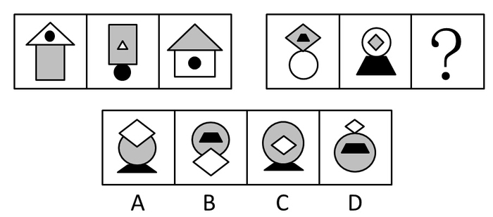
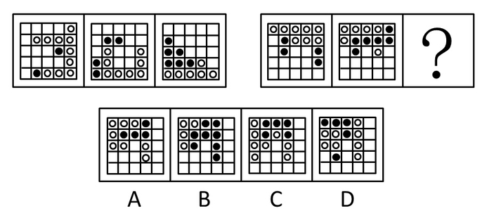
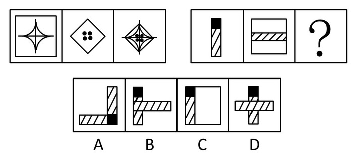
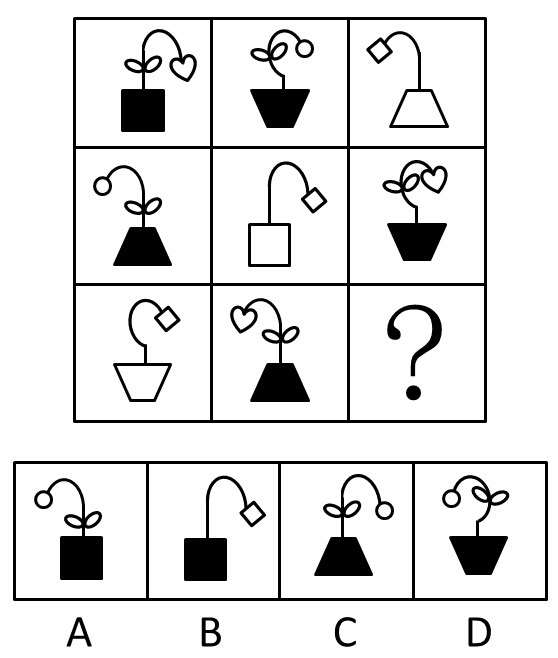
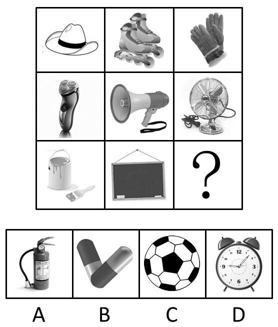
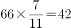
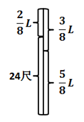
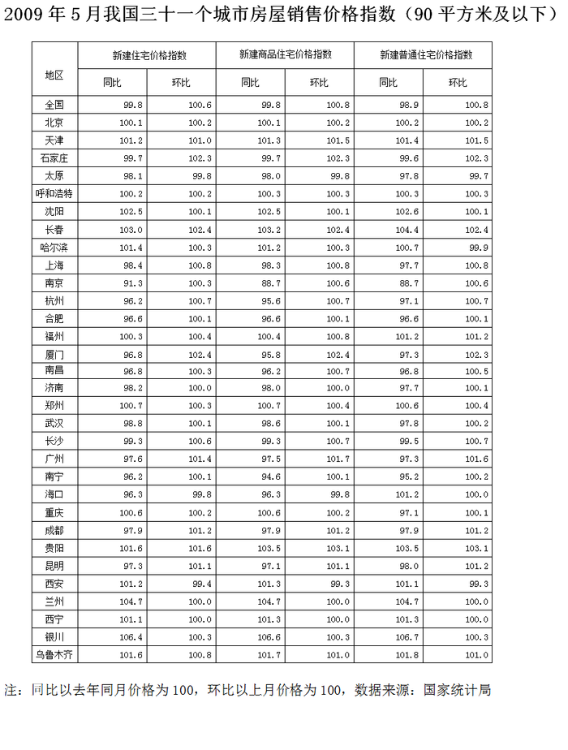
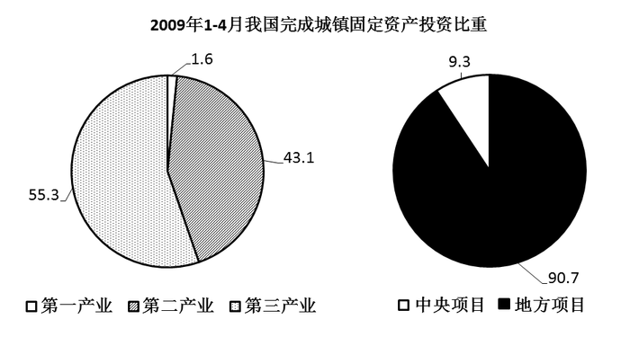
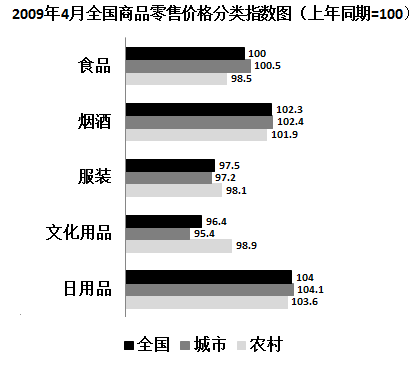

# 2009年河北省公务员录用考试《行测》题

<!-- gwy:overview:start -->
> **河北 · 2009 · 行测 · 统考** ｜ 140 题 · 图片 72 处 · 答案随题折叠

| 题型模块 | 题量 | 题号 |
| --- | ---: | ---: |
| 常识判断 | 25 | 1–25 |
| 言语理解与表达 | 40 | 26–65 |
| 判断推理 | 35 | 66–100 |
| 数量关系 | 20 | 101–120 |
| 资料分析 | 20 | 121–140 |
| **合计** | **140** | |

导航：[题型与作答说明](#题型与作答说明) · [题目](#题目) · [材料 1](#材料-1)
<!-- gwy:overview:end -->

> 候选采集稿。参考答案及解析来自粉笔页面，不代表官方答案或真实高分答卷；来源使用许可与原卷对应关系仍需人工核实。

## 题型与作答说明

常识判断

（25题）

根据题目要求，在四个选项中选出一个最恰当的答案。

言语理解与表达

（40题）

本部分包括表达与理解两方面的内容，请根据题目要求，在四个选项中选出一个最恰当的答案。

判断推理

（35题）

本部分包括图形推理、定义判断、类比推理与逻辑判断四种类型的试题。

数量关系

（20题）

本部分包括数字推理与数学运算两种类型的试题。

资料分析

（20题）

所给出的图、表、文字或综合性资料均有若干个问题要你回答，你应根据资料提供的信息进行分析、比较、计算和判断处理。

## 题目

### 第 1 题

为了进一步深化学习实践科学发展观活动，2009年2月13日河北省委、省政府决定在全省各级干部中开展“干部作风建设年”活动。省委书记张云川强调，加强干部队伍作风建设，其目的是：

A. 推动科学发展、促进社会和谐、实现富民强省

B. 在“两个转变”、“一个完善”上真正见到实效

C. 抓好“五项活动”，建立完善“五项制度”

D. 使全省干部队伍作风明显改进

第 1 题 · 答案与解析

**参考答案（粉笔题库参考内容）**

A

**解析**

本题考查时政要闻。

这次“干部作风建设年”的活动旨在加强干部队伍作风建设，其目的即“推动科学发展、促进社会和谐、实现富民强省”。

故正确答案为A。

**来源**：2009年河北省公务员录用考试《行测》题第1题

### 第 2 题

2009年中共中央办公厅、国务院办公厅印发的《关于实行党政领导干部问责的暂行规定》中所规定的对党政领导干部问责的方式不包括：

A. 公开道歉

B. 引咎辞职

C. 责令辞职

D. 免职

第 2 题 · 答案与解析

**参考答案（粉笔题库参考内容）**

A

**解析**

本题考查行政管理。

2009年中共中央办公厅、国务院办公厅印发的《关于实行党政领导干部问责的暂行规定》指出，对党政领导干部实行问责的方式分为：责令公开道歉、停职检查、引咎辞职、责令辞职、免职。不包括公开道歉。

本题为选非题，故正确答案为A。

**来源**：2009年河北省公务员录用考试《行测》题第2题

### 第 3 题

世界上最早种植棉花的国家是：

A. 中国

B. 美国

C. 印度

D. 埃及

第 3 题 · 答案与解析

**参考答案（粉笔题库参考内容）**

C

**解析**

本题考查人文历史。

棉花种植最早出现在公元前5-4千年的印度河流域文明中。公元1世纪，阿拉伯商人将精美的细棉布带到了意大利和西班牙。大约9世纪的时候，摩尔人将棉花种植方法传到了西班牙。15世纪，棉花传入英国，然后传入英国在北美的殖民地。

棉花传入我国至迟在南北朝时期，但是多在边疆种植；棉花大量传入内地，是在宋末元初。

故正确答案为C。

**来源**：2009年河北省公务员录用考试《行测》题第3题

### 第 4 题

村民自治是中国共产党领导亿万农民发展中国特色社会主义民主政治的伟大创举。扩大农村基层民主，实行村民自治，大大激发了广大农民当家作主的积极性、创造性和责任感，掀开了中国农村民主政治建设的新篇章。

下列关于村民自治的表述错误的一项是：

A. 乡政府与村民委员会不是领导与被领导的关系

B. 村民委员会成员由村民选举产生，每届任期三年，可连选连任

C. 村民委员会成员不脱离生产，根据情况，乡政府给予适当财政补贴

D. 村民会议是村的“权力机关”，村委会要执行或办理村民会议通过的决定，向村民会议负责并报告工作

第 4 题 · 答案与解析

**参考答案（粉笔题库参考内容）**

D

**解析**

本题考查新思想。

村民会议是村民实现直接民主的基本形式，而非村的“权力机关”，D选项表述有误。

本题为选非题，故正确答案为D。

**本题相关知识点：**

开村民会议，应当有本村18周岁以上村民的过半数参加，或者有本村三分之二以上的户的代表参加，所作决定应当经到会人员的过半数通过。村民会议由村民委员会召集。有十分之一以上的村民提议，应当召集村民会议。村民会议或村民代表会议的主要职权有：制定规章权；人事任免权；议事决策权；民主监督权。

**考点**：政治建设

**来源**：2009年河北省公务员录用考试《行测》题第4题

### 第 5 题

专利权的客体是指能够取得专利法保护的发明创造，我国专利法规定专利权的客体包括：

A. 发明专利权、实用新型专利权和科学发现专利权

B. 发明专利权、科学发现专利权和疾病治疗专利权

C. 外观设计专利权、实用新型专利权和疾病治疗专利权

D. 发明专利权、外观设计专利权和实用新型专利权

第 5 题 · 答案与解析

**参考答案（粉笔题库参考内容）**

D

**解析**

本题考查民法。

《中华人民共和国专利法》第二条规定：“本法所称的发明创造是指发明、实用新型和外观设计。发明，是指对产品、方法或者其改进所提出的新的技术方案。实用新型，是指对产品的形状、构造或者其结合所提出的适于实用的新的技术方案。外观设计，是指对产品的形状、图案或者其结合以及色彩与形状、图案的结合所作出的富有美感并适于工业应用的新设计。”因此，A、B、C三项不符合题意。

故正确答案为D。

**考点**：民法典

**来源**：2009年河北省公务员录用考试《行测》题第5题

### 第 6 题

复杂劳动被当作简单劳动的倍加，是因为：

A. 从事简单劳动不需要专门的学习和训练

B. 从事复杂劳动需要专门的学习和训练

C. 决定商品价值量的社会必要劳动时间以简单劳动为尺度

D. 脑力劳动比体力劳动更加繁琐

第 6 题 · 答案与解析

**参考答案（粉笔题库参考内容）**

C

**解析**

本题考查市场经济。

因为商品的价值量是由社会必要劳动时间决定的，生产某种商品所用的社会必要劳动时间越多，其价值量就越大；反之，则越小。正因为复杂劳动耗费的时间是简单劳动耗费时间的倍加，所以复杂劳动被当作简单劳动的倍加。

故正确答案为C。

**考点**：微观经济

**来源**：2009年河北省公务员录用考试《行测》题第6题

### 第 7 题

古代六艺“礼、乐、射、御、书、数”中的“御”是指：

A. 骑马

B. 杂技

C. 驾车

D. 防御

第 7 题 · 答案与解析

**参考答案（粉笔题库参考内容）**

C

**解析**

本题考查文化常识。

孔子将“礼、乐、射、御、书、数”合称“六艺”。礼，主要指德育，古人认为不学“礼”无以立，不学礼就没有做人的根本；乐包括音乐、舞蹈、诗歌等内容；射，射箭；御，驾车；书，书法；数，数学。用现在的话讲，大体上就是要德、智、体、美、劳全面发展。

故正确答案为C。

**考点**：文化常识

**来源**：2009年河北省公务员录用考试《行测》题第7题

### 第 8 题

国际金融危机对实体经济的影响日趋加深，经济增长方式转型需要全面提速。实体经济领域暴露的突出问题集中反映了经济增长方式转型的严重滞后，以投资驱动为主的增长方式已经到了难以为继、非改不可的地步，我国通过出口化解国内生产相对过剩危机的空间明显缩小。我国现阶段改革发展的基本目标和主要任务是：

A. 扩大国内需求，特别是消费需求，保持经济平稳较快增长

B. 扩大投资需求，特别是住房投资，保持经济更好更快增长

C. 扩大国外需求，特别是技术需求，保持经济平稳较快增长

D. 扩大消费需求，特别是服务需求，保持经济更好更快增长

第 8 题 · 答案与解析

**参考答案（粉笔题库参考内容）**

A

**解析**

本题考查宏观经济与调控政策。

根据题干，我国通过出口化解国内生产相对过剩危机的空间明显缩小，那么扩大国内需求，特别是消费需求，才能保持经济平稳较快增长，这已成为我国现阶段改革发展的基本目标和主要任务。

故正确答案为A。

**考点**：宏观经济与调控政策

**来源**：2009年河北省公务员录用考试《行测》题第8题

### 第 9 题

我国社会主义道德建设的核心是为人民服务，我国《公民道德建设实施纲要》中的20字基本道德规范，除了“爱国守法、明礼诚信、团结友善、勤俭自强”还有：

A. 助人为乐

B. 爱岗敬业

C. 敬业奉献

D. 尊老爱幼

第 9 题 · 答案与解析

**参考答案（粉笔题库参考内容）**

C

**解析**

本题考查毛中特。

我国《公民道德建设实施纲要》中的20字基本道德规范是爱国守法、明礼诚信、团结友善、勤俭自强、敬业奉献。

故正确答案为C。

**来源**：2009年河北省公务员录用考试《行测》题第9题

### 第 10 题

地方各级人民代表大会经过＿＿＿＿＿＿以上代表提议，可以临时召集本级人大会议。

A. 1/2

B. 1/3

C. 1/4

D. 1/5

第 10 题 · 答案与解析

**参考答案（粉笔题库参考内容）**

D

**解析**

本题考查宪法。

《地方各级人民代表大会和地方各级人民政府组织法》第11条规定：地方各级人民代表大会会议每年至少举行一次。经过五分之一以上代表提议，可以临时召集本级人民代表大会会议。

故正确答案为D。

**考点**：宪法

**来源**：2009年河北省公务员录用考试《行测》题第10题

### 第 11 题

因紧急避险造成损失的，如果险情是由于人的原因引起的，则：

A. 由引起险情发生的人承担民事责任

B. 由紧急避险人承担民事责任

C. 由紧急避险人和引起险情发生的人共同承担民事责任

D. 由受有损失的人自己承担民事责任

第 11 题 · 答案与解析

**参考答案（粉笔题库参考内容）**

A

**解析**

本题考查民法。

《中华人民共和国民法典》第一百八十二条规定：“因紧急避险造成损害的，由引起险情发生的人承担民事责任。危险由自然原因引起的，紧急避险人不承担民事责任，可以给予适当补偿。紧急避险采取措施不当或者超过必要的限度，造成不应有的损害的，紧急避险人应当承担适当的民事责任。”因此，B、C、D项不符合题意。

故正确答案为A。

**考点**：民法典

**来源**：2009年河北省公务员录用考试《行测》题第11题

### 第 12 题

以下各项列举了我国常见气象灾害与其发生地区的对应关系，其中正确的一项是：

A. 洪涝—西北地区

B. 洪涝—东北地区

C. 春旱—华南地区

D. 伏旱—华北地区

第 12 题 · 答案与解析

**参考答案（粉笔题库参考内容）**

B

**解析**

本题考查自然常识。

A选项错误，因为降水少，我国西北地区不存在洪涝灾害；

B选项正确，东北地区处于季风区，降水集中；

C选项错误，华北地区会出现春旱，而不是华南地区；

D选项错误，长江中下游地区会出现伏旱，而不是华北地区。

故正确答案为B。

**考点**：中国地理

**来源**：2009年河北省公务员录用考试《行测》题第12题

### 第 13 题

空气中粒径小于10微米的颗粒物能通过呼吸进入人体肺部，特别是小于2.5微米的细粒子还会被吸收到人体血液和淋巴液中。我国空气质量报告中的“可吸入颗粒物”是指：

A. 粒径小于25微米的颗粒物

B. 粒径小于10微米的颗粒物

C. 粒径小于5微米的颗粒物

D. 粒径小于2.5微米的颗粒物

第 13 题 · 答案与解析

**参考答案（粉笔题库参考内容）**

B

**解析**

本题考查环境常识。

粒径小于10微米的颗粒物用PM10来表示；粒径小于2.5微米的颗粒物用PM2.5来表示。这些细小的颗粒能够通过呼吸进入人体的呼吸道和肺部。因此，粒径小于10微米的颗粒物通常又称为可吸入颗粒物。

故正确答案为B。

**考点**：其他

**来源**：2009年河北省公务员录用考试《行测》题第13题

### 第 14 题

通货膨胀一般指因货币供给大于货币实际需求而引起的一段时间内物价持续而普遍上涨的现象。通货膨胀的实质是：

A. 社会总需求大于社会总供给

B. 物价很快地上涨，使货币失去价值

C. 货币供给量大于需求量

D. 社会总需求小于社会总供给

第 14 题 · 答案与解析

**参考答案（粉笔题库参考内容）**

A

**解析**

本题考查宏观经济与调控政策。

实质是社会总需求大于社会总供给（供远小于求）。通货膨胀(Inflation)指在纸币流通条件下，因货币供给大于货币实际需求，也即现实购买力大于产出供给，导致货币贬值，而引起的一段时间内物价持续而普遍地上涨现象。其实质是社会总需求大于社会总供给（供远小于求）。

故正确答案为A。

**考点**：宏观经济与调控政策

**来源**：2009年河北省公务员录用考试《行测》题第14题

### 第 15 题

“稳步推进扩权强县改革试点，鼓励有条件的省份率先减少行政层次，依法探索省直接管理县（市）的体制”是在下列哪个文件中提出的？

A. 《中共中央国务院关于地方政府机构改革的意见》（中发〔1999〕2号）

B. 《关于深化行政管理体制改革的意见》（中发〔2008〕5号）

C. 《国务院关于编制2009年中央预算和地方预算的通知》（国发〔2008〕35号）

D. 《中共中央国务院关于2009年促进农业稳定发展农民持续增收的若干意见》（中发〔2009〕1号）

第 15 题 · 答案与解析

**参考答案（粉笔题库参考内容）**

D

**解析**

本题考查时事政治。

《中共中央国务院关于2009年促进农业稳定发展农民持续增收的若干意见》中提出：“稳步推进扩权强县改革试点，鼓励有条件的省份率先减少行政层次，依法探索省直接管理县（市）的体制。”

故正确答案为D。

**考点**：重要文件

**来源**：2009年河北省公务员录用考试《行测》题第15题

### 第 16 题

根据我国《劳动合同法》的规定，下列关于劳动合同的表述错误的一项是：

A. 用人单位自用工之日起满一年不与劳动者订立书面劳动合同的，视为用人单位与劳动者已订立无固定期限劳动合同

B. 劳动合同期限三个月以上不满一年的，试用期不得超过一个月

C. 三年以上固定期限和无固定期限的劳动合同，试用期不得超过六个月

D. 用人单位发生合并或者分立等情况，劳动合同由原用人单位解除

第 16 题 · 答案与解析

**参考答案（粉笔题库参考内容）**

D

**解析**

本题考查劳动法。

《劳动合同法》规定，用人单位发生合并或者分立等情况，原劳动合同继续有效，劳动合同由承继其权利义务的用人单位继续履行。

本题为选非题，故正确答案为D。

**考点**：劳动法和经济法

**来源**：2009年河北省公务员录用考试《行测》题第16题

### 第 17 题

当你乘坐火车时，车站工作人员都要在乘客持有的车票上剪一小口，剪口的意思是：

A. 强制保险

B. 统计乘车人数

C. 防止重复使用

D. 防止乘客逃票

第 17 题 · 答案与解析

**参考答案（粉笔题库参考内容）**

A

**解析**

本题考查生活常识。

在火车票上剪口的目的是表明铁路部门对旅客的意外伤害开始实行强制保险。也就是说旅客在买火车票时，就已经向铁路部门投了保，车票里包含着旅客的保险金，强制保险的时间是从旅客剪票后开始到缴票出站时为止。如果因意外事故发生人身伤亡，由铁路部门负责向旅客支付医疗保险金。这就是火车票剪口的由来。

故正确答案为A。

**考点**：生活常识

**来源**：2009年河北省公务员录用考试《行测》题第17题

### 第 18 题

1980年9月，中共中央发布《关于进一步加强和完善农业生产责任制的几个问题》，我国农村绝大部分地区都建立和稳定了家庭联产承包责任制。1998年4月，新修订的《土地管理法》首次以法律的形式明确农村土地承包30年不变。2008年10月十七届三中全会通过的《中共中央关于推进农村改革发展若干重大问题的决定》对土地承包关系是如何规定的？

A. 现有土地承包关系要保持稳定并长久不变

B. 将农村土地的承包期从现在的30年延长到70年

C. 允许农民以转包、出租、股份合作等形式流转土地

D. 培育农民新型合作组织，发展农业龙头企业

第 18 题 · 答案与解析

**参考答案（粉笔题库参考内容）**

A

**解析**

本题考查国情社情。

《中共中央关于推进农村改革发展若干重大问题的决定》在大力推进改革创新、加强农村制度建设中谈到：“赋予农民更加充分而有保障的土地承包经营权，现有土地承包关系要保持稳定并长久不变。”

故正确答案为A。

**考点**：中国地理

**来源**：2009年河北省公务员录用考试《行测》题第18题

### 第 19 题

甲因犯盗窃罪被公安机关逮捕，在审查期间，甲又主动交代曾实施抢劫犯罪。甲交代出抢劫案件的行为属于：

A. 自首

B. 坦白

C. 立功

D. 悔改表现

第 19 题 · 答案与解析

**参考答案（粉笔题库参考内容）**

A

**解析**

本题考查刑法。

自首分为一般自首和特别自首两种。特别自首是指被采取强制措施的犯罪嫌疑人、被告人和正在服刑的罪犯，如实供述司法机关还未掌握的本人其他罪刑的行为。本题中，甲抢劫的行为是公安机关尚未掌握的，因此单就抢劫案件来说，属于特别自首。

故正确答案为A。

**考点**：刑法

**来源**：2009年河北省公务员录用考试《行测》题第19题

### 第 20 题

一般情况下，男人比女人长得要高一些，这是因为：

A. 雄性激素对骨骼生长有促进作用

B. 雄性激素对抑制骨骼生长的作用较小

C. 男性能较好地利用食物中的蛋白质来使骨骼生长

D. 男孩从小就比女孩运动量大，因而长大后长得高

第 20 题 · 答案与解析

**参考答案（粉笔题库参考内容）**

A

**解析**

本题考查生物常识。

人体的高矮取决于骨骼的发育，人到了青春期以后，骨骼的生长速度不断减慢，最后停止增长。但是雄性激素能刺激机体生长，使新陈代谢增强，促进骨骼生长，因此相对来说，男人比女人长得要高一些。

故正确答案为A。

**考点**：生物常识

**来源**：2009年河北省公务员录用考试《行测》题第20题

### 第 21 题

2008年10月23日，新华社授权发布《全国土地利用总体规划纲要（年）》，对全国耕地保有量提出了约束性目标。温家宝总理在2009年《政府工作报告》中强调，一定要守住全国耕地这条红线。这条红线是指：

A. 不少于17亿亩

B. 不少于18亿亩

C. 不少于19亿亩

D. 不少于20亿亩

第 21 题 · 答案与解析

**参考答案（粉笔题库参考内容）**

B

**解析**

本题考查时事政治。

早在2007年3月5日，温家宝总理在作《政府工作报告》时就提出“一定要守住全国耕地不少于18亿亩这条红线”。2009年3月5日，温家宝总理在《政府工作报告》中强调：“坚持和落实最严格的耕地保护制度和最严格的节约用地制度，严守18亿亩耕地红线不动摇。”

故正确答案为B。

**考点**：重要文件

**来源**：2009年河北省公务员录用考试《行测》题第21题

### 第 22 题

国家工作人员在国内公务活动或者对外交往中接受礼物，依照国家规定应当交公而不交公且数额较大的，应以＿＿＿＿＿＿＿＿定罪处罚。

A. 受贿罪

B. 贪污罪

C. 职务侵占罪

D. 徇私枉法罪

第 22 题 · 答案与解析

**参考答案（粉笔题库参考内容）**

B

**解析**

本题考查刑法。

我国《刑法》第394条规定：“国家工作人员在国内公务活动或者对外交往中接受礼物，依照国家规定应当交公而不交公，数额较大的，以贪污罪论处。”

故正确答案为B。

**本题相关知识点：**

受贿罪是指国家工作人员利用职务上的便利，索取他人财物，或者非法收受他人财物，为他人谋取利益的行为。受贿罪在主观方面表现为故意，目的是非法占有公私财物。在客观方面表现为利用职务便利，索取他人财物，或非法收受他人财物为他人谋取利益。

职务侵占罪是指公司、企业或者其他单位的工作人员，利用职务上的便利，将本单位财物非法占为己有，数额较大的，处三年以下有期徒刑或者拘役，并处罚金；数额巨大的，处三年以上十年以下有期徒刑，并处罚金；数额特别巨大的，处十年以上有期徒刑或者无期徒刑，并处罚金。

徇私枉法罪是指司法工作人员徇私枉法、徇情枉法，对明知是无罪的人而使他受追诉，对明知是有罪的人而故意包庇不使他受追诉或者在刑事审判活动中故意违背事实和法律作枉法裁判的行为。

**考点**：刑法

**来源**：2009年河北省公务员录用考试《行测》题第22题

### 第 23 题

某工商行政管理局执法人员在查处一商贩强买强卖违法行为时，被该商贩持刀扎伤。执法人员为查明违法行凶事实，将该商贩带回工商局关押数日。

下列对执法人员做法的评述哪项是正确的？

A. 工商局应向法院提起行政诉讼

B. 部委规章明文授权，工商局有权拘押该商贩

C. 工商行政管理机关是国家的执法机关，有权对违法行凶人员采取拘押措施，构成犯罪的才移交法院

D. 工商局应及时将该商贩交公安机关处理

第 23 题 · 答案与解析

**参考答案（粉笔题库参考内容）**

D

**解析**

本题考查刑法。

A选项错误，故意伤害行为涉嫌刑事案件，不能提起行政诉讼；

B、C选项错误，工商局无权拘押该商贩，应及时将该商贩交公安机关处理；

D选项正确，是适当的做法。

故正确答案为D。

**考点**：刑法

**来源**：2009年河北省公务员录用考试《行测》题第23题

### 第 24 题

“勿以恶小而为之，勿以善小而不为”这句名言出自：

A. 《三国志》

B. 《论语》

C. 《中庸》

D. 《道德经》

第 24 题 · 答案与解析

**参考答案（粉笔题库参考内容）**

A

**解析**

本题考查文学常识。

“勿以恶小而为之，勿以善小而不为”是刘备给其子刘禅的遗诏中的话，劝勉他要进德修业，有所作为，出自陈寿的《三国志》。

故正确答案为A。

**考点**：文学常识

**来源**：2009年河北省公务员录用考试《行测》题第24题

### 第 25 题

被称为“国际会议之都”的城市是：

A. 纽约

B. 日内瓦

C. 伦敦

D. 北京

第 25 题 · 答案与解析

**参考答案（粉笔题库参考内容）**

B

**解析**

本题考查文化常识。

瑞士的日内瓦是国际名城，西临汝拉山，南倚阿尔卑斯山最高峰——勃朗峰，全城为湖山环绕，冬无严寒，夏少酷暑，一年四季风光不同，山明水秀宛如图卷，充满了诗情画意，享有“游览者的圣地”之誉。因为每年在日内瓦召开的国际会议最多，所以被称作“国际会议之都”。

故正确答案为B。

**考点**：文化常识

**来源**：2009年河北省公务员录用考试《行测》题第25题

### 第 26 题

在自然科学领域，那种从低级到高级、从落后到先进的发展序列是清晰可见的，其进步发展史是一个旧理论不断被新理论扬弃取代、科学体系与科学思想不断新陈代谢的过程，那种随着时间的推移而呈现出的向着更高更新的目标发展的趋势十分明显；而人文科学领域虽然也有知识体系与话语的新陈代谢与不断更新，但是在人文科学领域还有另外一种更突出的现象，那就是一些基本主题与命题的重复性与永恒性，这使得人文科学的发展常常呈现为对于既有的知识与问题不断赋予新的时代内容和气息的人类精神观念的演进过程。

下列对于这段话的理解，错误的一项是：

A. 自然科学的发展呈现为一个不断超越、不断进步的过程

B. 基本主题与命题的重复性与永恒性是人文科学发展中的一个突出现象

C. 随着时间的推移，科学总是向着更高更新的目标发展

D. 人文科学的历史进程呈现为清晰的从低级到高级、从落后到先进的发展序列

第 26 题 · 答案与解析

**参考答案（粉笔题库参考内容）**

D

**解析**

据提问可知此题是细节判断题。

原文意在对比自然科学和人文科学的异同。虽然二者都有“知识体系与话语的新陈代谢与不断更新”，但人文科学还突出表现在“基本主题与命题的重复性与永恒性”。

D项更适用于自然科学而非人文科学，可从首句推知。

A、B、C三项均是对原文的正确概括。

本题为选非题，故正确答案为D。

**考点**：细节判断题

**来源**：2009年河北省公务员录用考试《行测》题第26题

### 第 27 题

音乐电视这种＿＿＿＿＿的艺术形式，已在中国民族化的过程中，＿＿＿＿＿出了一条成功的路子。

依次填入画横线部分最恰当的一组是：

A. 舶来 探索

B. 传统 摸索

C. 引进 创造

D. 外来 发展

第 27 题 · 答案与解析

**参考答案（粉笔题库参考内容）**

A

**解析**

本题考查近义实词的辨析。

第一空，原句“民族化的过程”可以推断音乐电视不是中国所固有的，B项“传统”错误。

第二空，A项“探索”意为“多方寻求答案”，可与“路子”搭配；C项“创造”后跟的宾语一般是新方法、理论、成绩或具体的某样东西，“创造出了一条成功的路子”搭配不当；D项“发展出······的路子”搭配不当，发展一般不带宾语。

故正确答案为A。

**考点**：实词填空、对应关系-前后呼应、词的辨析-搭配对象

**来源**：2009年河北省公务员录用考试《行测》题第27题

### 第 28 题

自20世纪以来，随着世界范围内经济研究的不断深入和经济活动的不断拓展，人们在使用资本这一概念时对它产生了不同理解：一种是继续把“资本”作为政治经济学中的一个阶级属性概念，用来研究资本主义的运动；一种是把资本作为商品经济学中的一个自然属性概念，即单纯的经济概念，用来研究“货币生出更多的货币”这一客观经济规律。后者又被称为现代资本概念。

从这段话中可以看出，20世纪的“资本”这一概念是指（    ）。

A. 不断拓展的政治经济学概念

B. 阶级属性概念让位于单纯的经济概念

C. 世界范围内的现代资本概念

D. 阶级属性概念与自然属性概念

第 28 题 · 答案与解析

**参考答案（粉笔题库参考内容）**

D

**解析**

本题属词句理解题。

文段是并列结构，介绍了自20世纪以来，对“资本”的两种认识，即一种是政治经济学中的阶级属性概念，一种是商品经济学中的自然属性概念。结合选项，D项符合文意。

A项，只针对文段提到的“政治经济学中的阶级属性概念”，不全面，故排除。

B项，原文是并列结构，两种理解是并重的，未指出两种理解的发展趋势，故排除。

C项，只针对文段提到的“商品经济学中的自然属性概念”，不全面，故排除。

故正确答案为D。

**考点**：实词

**来源**：2009年河北省公务员录用考试《行测》题第28题

### 第 29 题

依次填入下列划横线部分最恰当的一组是：

①＿＿＿＿＿目前对于地球磁场的变化和倒转提出了不少理论或模型，＿＿＿＿＿基本上都处在假设和推测的阶段，并没有一个十分成熟的理论。

②在评价标准上，＿＿＿＿＿看数字，＿＿＿＿＿不能只看数字，要防止“干部出数字”、“数字出干部”的现象。

③汪曾祺先生终生主要从事创作，即使偶尔也写些评论，甚至这些评论可以归入学术论文一类，＿＿＿＿＿总的说来，他天生就是一个作家，＿＿＿＿＿很难算是一个纯粹的学者。

A. 即使/也 虽然/但是 但/而

B. 即使/也 既/又 不过/也

C. 尽管/但 虽然/但是 不过/也

D. 尽管/但 既/又 但/而

第 29 题 · 答案与解析

**参考答案（粉笔题库参考内容）**

D

**解析**

根据提问可知此题考查的是虚词的辨析。

虽然同是表转折关系的关联词，“即使······也······”表示的情况一般是假设性的，而“尽管······但······”是表示一种事实，因为句①表示的是事实，因而排除A、B项。

句②填入“既······又······”，“又”后面表示进一步补充说明，C项关联词“虽然······但是······”属于转折关系，排除C项。句③前一个空需要填入表转折关系的关联词，“但”比“不过”转折意味重。后一个空也需要转折关联词，“也”不表示转折，“而”表示转折，D项正确。

故正确答案为D。

**来源**：2009年河北省公务员录用考试《行测》题第29题

### 第 30 题

莱布尼茨认为，认识可分为模糊的和明晰的，明晰的认识又可以进一步分为明确的和混乱的。模糊的认识不可能成为知识，因此用不着去研究它。明确的明晰认识即理性认识，是逻辑学研究的对象。而那种既混乱又明晰的认识值不值得研究呢？从明晰的角度来说，是值得研究的；从混乱的角度来看，研究起来会有很大困难。

下列对莱布尼茨的观点理解正确的一项的是：

A. 模糊的认识虽然是一种知识，但研究起来会有很大困难

B. 明晰的认识可分为明确的认识和模糊的认识

C. 那种混乱又明晰的认识是没有研究价值的

D. 逻辑学的研究对象是理性认识即明确的明晰认识

第 30 题 · 答案与解析

**参考答案（粉笔题库参考内容）**

D

**解析**

据提问可知此题是细节判断题。

A项错误，由“模糊的认识不可能成为知识”可知；

B项错误，由“明晰的认识又可以进一步分为明确的和混乱的”可知；

C项错误，由“那种既混乱又明晰的认识······是值得研究的”可知；

D项正确，由原文出现的“明确的明晰认识即理性认识，是逻辑学研究的对象”可知。

故正确答案为D。

**考点**：细节判断题

**来源**：2009年河北省公务员录用考试《行测》题第30题

### 第 31 题

依次填入下列划横线部分最恰当的一组是：

①邹强虽然十分小心，但还是被狡猾的犯罪分子＿＿＿＿＿了辛辛苦苦挣来的血汗钱。

②现代化的北京城需要现代舞艺术，现代舞艺术更需要扎根于现代化的北京城，这已是无可＿＿＿＿＿的事实。

③本人昨天下午在操场遗失黑色书包一个，有捡到并归还者，本人定当重谢，决不＿＿＿＿＿。

A. 骗去 置疑 食言

B. 骗取 置疑 失言

C. 骗去 质疑 食言

D. 骗取 质疑 失言

第 31 题 · 答案与解析

**参考答案（粉笔题库参考内容）**

A

**解析**

根据提问可知此题考查近义实词的辨析。

B、D项错误，“骗去”指被骗走，“骗取”指骗得，原句是被动句，因此用“骗去”，排除B、D项；

C项错误，“置疑”常用于否定，“质疑”常用于肯定句，排除C项；

A项正确，“失言”意为“不该对某人说却对他说了；无意中说出不该说的话”与原句“违背诺言；失信”的意思不符，所以这里应该是“食言”。

故正确答案为A。

**考点**：实词填空、对应关系-前后呼应、词的辨析-词义侧重

**来源**：2009年河北省公务员录用考试《行测》题第31题

### 第 32 题

不少新建、扩建企业没有在投资中按比例安排相应的自由流动资金。有的企业甚至靠挪用流动资金来盲目争上新的项目；历年清产核资中发生的损失也有一部分用企业流动资金减除；一些企业甚至挪用流动资金炒房地产、股票等；此外，物价上涨也吃掉了一部分资金。

这段话主要支持了这样一种观点：

A. 盲目争上项目造成了企业流动资金的不足

B. 在不少企业中存在着自由流动资金紧张的现象

C. 多数企业只能依靠银行来解决流动资金问题

D. 企业自有流动资金数量逐年下降是正常趋势

第 32 题 · 答案与解析

**参考答案（粉笔题库参考内容）**

B

**解析**

根据提问可知此题为中心理解题。

A项错误，表述片面，只说了企业出现流动资金紧张的一方面原因；

B项正确，题干从多个角度说明有些企业流动资金为何紧张；

C项错误，表述在文段中未提及，排除；

D项错误，该观点属于主观臆断，排除。

故正确答案为B。

**考点**：关联词-并列

**来源**：2009年河北省公务员录用考试《行测》题第32题

### 第 33 题

人为了追求自己的功利目的和物质＿＿＿＿＿，利用高科技无限度地向自然＿＿＿＿＿，不顾一切，不计后果。这种做法，＿＿＿＿＿和当今世界流行的价值观念有关，＿＿＿＿＿可能和西方文化的传统精神有关。

依次填入划横线部分最恰当的一组是：

A. 利益 开发 既 又

B. 享受 追求 不但 而且

C. 享受 索取 一方面 另一方面

D. 利益 进军 或者 或者

第 33 题 · 答案与解析

**参考答案（粉笔题库参考内容）**

C

**解析**

本题考查近义实词和虚词的混搭填空。

单看第一个空，追求“物质利益”追求“物质享受”都说得通，而第二空“向自然开发/追求”都不能搭配，因而排除A、B项。不论从语义还是搭配来看，“无限度地索取”都比“无限度地进军”更合适。第三、四空填入表并列关系的关联词比选择关系的关联词更符合原意，排除D项。

故正确答案为C。

**考点**：混搭填空、词的辨析-搭配对象

**来源**：2009年河北省公务员录用考试《行测》题第33题

### 第 34 题

一个人的日常生活，衣、食、住、行，包括一些生活细节，都能反映他的精神境界，反映他的生存心态、生活风格和文化品位。巴尔扎克在《风雅生活论》中曾引用两句谚语来说明这个道理，一句是：“一个人的灵魂，看他持手杖的姿势，便可以知晓。”另一句是：“请你讲话，走路，吃饭，穿衣，然后我就可以告诉你，你是什么人。”

这段话的主旨是：

A. 巴尔扎克发现人的精神境界可以通过生活细节表现出来

B. 一个人的精神境界必然会从他日常生活的一举一动中表现出来

C. 一个人的精神境界如何主要看他对待生活的态度是怎样的

D. 一个有较高生活质量的人才会具有较高的人生境界

第 34 题 · 答案与解析

**参考答案（粉笔题库参考内容）**

B

**解析**

据提问知此题为中心理解题。

文段从行文脉络上看属于典型的总分式结构。首句即是主旨句，后面引用巴尔扎克的例子进一步说明文段主旨，故首先排除A项。C提到的“生活态度”和D提到的“人生境界”偷换概念，显然和文段中的“生活细节”不符，排除C、D项。

故正确答案为B。

**考点**：分述句特征-举例子

**来源**：2009年河北省公务员录用考试《行测》题第34题

### 第 35 题

古代动物中有一类动物叫蜥螈，它＿＿＿＿具有两栖动物的特征，＿＿＿＿具有爬行动物的特征。＿＿＿＿古生物学工作者不容易弄清楚它到底是两栖动物还是爬行动物，＿＿＿＿过去把它放在爬行动物中，＿＿＿＿现在又把它放到两栖动物中去。

依次填入划横线部分最恰当的一组是：

A. 既 又 因此 以至 而

B. 不但 而且 不过 尽管 但是

C. 既 又 因此 以致 而

D. 不但 而且 因此 尽管 但是

第 35 题 · 答案与解析

**参考答案（粉笔题库参考内容）**

C

**解析**

本题考查虚词的辨析。

第三空后半句与前几句属于因果关系，B项却用转折连词“不过”，因而排除。

第四空后句与前句的因果关系，可排除D项的转折连词“尽管”。

“以致”，有“因而造成、致使”的意思，表示由于前面所说的原因而造成某种结果，多指不良结果或者不希望出现的结局。 根据句意，本题第四空选“以致”比较恰当。“以至”，有“一直到”的意思，表范围、数量、程度、时间等延伸和发展，一般指从小到大，从少到多，从浅到深。 另外，“以至”有甚至的意思，用在一句开头，表示由于前一分句的情况而产生某种结果（一般是好的或者正面的结果），排除A项。

故正确答案为C。

**考点**：关联关系-因果关系、词的辨析-词义侧重

**来源**：2009年河北省公务员录用考试《行测》题第35题

### 第 36 题

由于目前缺乏相关法律支撑，城管在行使集中行政处罚权的过程中面临许多问题和困惑，目前涉及城市管理的法律法规多达50多部，但没有一部专门针对城市管理的独立法律法规，相互之间缺乏系统性和连贯性，到底该怎么管，没有一个标准，这给城管的实际工作带来诸多不便。

根据文意，下列说法正确的一项是：

A. 城管在行使集中行政处罚权的过程中经常有法不依

B. 缺少专门针对城市管理的独立法律法规导致城管在执法过程中面临许多问题和困惑

C. 没有足够的涉及城市管理的法律法规使得城管执法缺少法律依据

D. 造成城管执法中产生诸多问题的关键不在于法律法规，而在于如何执法

第 36 题 · 答案与解析

**参考答案（粉笔题库参考内容）**

B

**解析**

据提问知此题为细节判断题。

B项较完整地概括了文意。

A项无中生有；C项偷换概念，是没有一部“专门针对城市管理的独立法律法规”，而非没有一部“涉及城市管理的法律法规”；D项的意思与文段相悖。

故正确答案为B。

**考点**：细节判断题

**来源**：2009年河北省公务员录用考试《行测》题第36题

### 第 37 题

依次填入下列划横线部分最恰当的一组是：

①英国是一个议会制的君主立宪国家，它的君主是世袭的，但议会并没给他过多的＿＿＿＿＿，国家的一切决定都要经过漫长的协商。

②据了解，北京市目前拥有家庭装修监理上岗证的监理员只有100多人，即使这个数字再＿＿＿＿＿，也无法满足众多家庭用户的需求。

③我去过江浙一带，几乎每到一个县，都发现那里的博物馆会有一张登有几个＿＿＿＿＿几十个中过状元的人的名单表，这真令我瞠目结舌。

A. 权力 翻一翻 以及

B. 权力 翻一番 甚至

C. 权利 翻一番 以及

D. 权利 翻一翻 甚至

第 37 题 · 答案与解析

**参考答案（粉笔题库参考内容）**

B

**解析**

据提问知此题为实词和虚词的混搭填空。

“翻一番”表示数字增加一倍，“翻一翻”表示翻一下这个动作，因而第二空填“翻一番”。最后一个空表示递进而非并列关系，因而填“甚至”，排除A项；“权利”是指按照法律和章程应当享有的权力和利益，和义务相对；“权力”表示的是一种政治上的强制力量，很明显，议会没给君主更多的“权力”，所以排除C、D两项。

故正确答案为B。

**考点**：混搭填空、词的辨析-程度轻重

**来源**：2009年河北省公务员录用考试《行测》题第37题

### 第 38 题

“启蒙”是“启蒙时代”和“启蒙运动”时代思想意蕴的代名词，在其本质意义上，启蒙首先是指资产阶级人文主义与封建主义思想体系的冲突；其次，它“主要不是一种政治运动”或者说是一种超越政治运动的思想文化运动。康德提出：“启蒙运动就是人类脱离自己所加之于自己的不成熟状态。”严格地说，它是思想文化领域的内容，其目标是全新人格的觉醒。

这段话意在说明：

A. “启蒙”主要是思想文化领域的运动

B. “启蒙运动”包含了重要的政治内容

C. “启蒙”意味着新旧两种思想的斗争

D. “启蒙”意味着一种新的思想体系的建立

第 38 题 · 答案与解析

**参考答案（粉笔题库参考内容）**

A

**解析**

文段首句指出“启蒙”首先指资产阶级人文主义与封建主义思想体系的冲突，接着通过“其次”指出“启蒙”是“超越政治的思想文化运动”。后文通过引用康德的观点及尾句的解读指出启蒙是思想文化领域的内容，其目标是全新人格的觉醒。故文段重点在于强调“启蒙”是思想文化领域的内容，对应A项。

B项，根据“它‘主要不是一种政治运动’”可知，该项说法与文意相悖，排除；

C项，“新旧两种思想的斗争”是“启蒙”本质意义的其中一个方面，表述片面，排除；

D项，根据尾句表述，完成启蒙可能意味着一种新思想体系的建立，但启蒙本身不是，排除。

故正确答案为A。

**考点**：关联词-因果、分述句特征-引入铺垫

**来源**：2009年河北省公务员录用考试《行测》题第38题

### 第 39 题

下列各句中，没有歧义的一句是：

A. 今天在互联网上，全球华人签名反对日本谋求联合国常任理事国席位，此举也遭到了国际社会的强烈反对

B. 柏林反对申办奥运的暴力活动升级

C. 孩子们非常喜欢张爷爷，一来到这儿就有说有笑，十分高兴

D. 出席表彰大会的各条战线的劳动模范和先进工作者，人人情绪高涨、精神振奋

第 39 题 · 答案与解析

**参考答案（粉笔题库参考内容）**

D

**解析**

据提问知此题为歧义辨析题。

A项错误，“此举”是指“全球华人签名”的行为，还是“日本谋求联合国常任理事国席位”的行为有歧义；

B项错误，可以理解为反对申办奥运的暴力活动升级，还可以理解为申办奥运的暴力活动升级；

C项错误，到底是张爷爷有说有笑，还是孩子们有说有笑存在歧义；

D项正确，表述清晰，没有歧义。

故正确答案为D。

**来源**：2009年河北省公务员录用考试《行测》题第39题

### 第 40 题

无论是发达国家还是发展中国家，其幼稚工业或成熟工业一旦被政府所“保护”，就会形成新的既得利益团体，从而对政府产生新的压力，迫使其进一步实施“保护”，使暂时的保护演变为永久的保护。

对上面这段话的理解不正确的一项是：

A. 受政府“保护”的既可能是幼稚工业，也可能是成熟工业

B. 受政府“保护”的结果是形成了新的既得利益集团

C. 政府的“保护”会由暂时演变为永久

D. 政府的“保护”能对工业发展产生促进作用

第 40 题 · 答案与解析

**参考答案（粉笔题库参考内容）**

D

**解析**

据提问知此题为细节判断题。

本题为选非题。

A、B、C项均可在文中找出原句。从文中对保护一词加引号可知此处政府的“保护”带有贬义，故D项不正确。

本题从常识的角度也可得出正确答案，即从长远来看，政府的“保护”只会对工业发展产生抑制作用。

本题为选非题，故正确答案为D。

**考点**：细节判断题

**来源**：2009年河北省公务员录用考试《行测》题第40题

### 第 41 题

下列各句中，有语病的一句是：

A. 无论美国或其他什么国家，都不能把自己的价值观念强加于他国人民

B. 本书作者希望这本书能引导读者在学习英语句型方面起举一反三的作用

C. 我本想这次能在北京与你见面，到京后才知你正忙于创办合资企业，已经到深圳了

D. 经过经理耐心解释，顾客才怒气渐消，带着所购物品离开商场

第 41 题 · 答案与解析

**参考答案（粉笔题库参考内容）**

B

**解析**

据提问知此题为病句辨析题。

B项语序有误，应改为“本书作者希望这本书能在引导读者学习英语句型方面起举一反三的作用”。

A、C、D项没有语病。

故正确答案为B。

**来源**：2009年河北省公务员录用考试《行测》题第41题

### 第 42 题

近年来的“文化相对主义”承认每一种文化都会产生自己的价值体系，人民的信仰和行为准则来自特定的社会环境，任何一种行为，如信仰、风俗等等都只能用它本身所从属的价值体系来评价，不可能有一种一切社会都承认的绝对的价值标准，更不能以自己群体的价值标准来评价别的民族的文化。但是，文化相对主义貌似公允，却有其自身的矛盾和弱点。因为反对文化间的交往而极力维护本身民族文化的纯洁性，由此仍可能重新回归文化孤立主义。

下列关于这段话的理解，正确的一项是：

A. 文化相对主义本质上是一种文化孤立主义

B. 文化相对主义表达了一种正确的文化价值观

C. 文化相对主义者相信存在着一种普遍的文化价值

D. 文化相对主义者反对以自己群体的价值标准来评价别的民族的文化

第 42 题 · 答案与解析

**参考答案（粉笔题库参考内容）**

D

**解析**

据提问知此题为细节判断题。

A项错误，由“······仍可能重新回归文化孤立主义”可知，A项说法过于绝对；

B项错误，由“但是，文化相对主义貌似公允······”可知B项理解有误；

C项错误，由“人民的信仰和行为准则来自特定的社会环境······不可能有一种一切社会都承认的绝对的价值标准，更不能以自己群体的价值标准来评价别的民族的文化”可知，C项错误。

故正确答案为D。

**考点**：细节判断题

**来源**：2009年河北省公务员录用考试《行测》题第42题

### 第 43 题

下列各句中所用的修辞方法与句后括号内所标注的不符的一项是：

A. 人家是火车头，咱得向人家学习。（暗喻）

B. “现钱，打酒来！”阿Ｑ从腰间伸出手来，满把是银的和铜的。（借代）

C. 松涛呜咽，白雪泪坠，乌云罩日，青天披纱。（拟人）

D. 说的是马克思主义，行的是自由主义；对人是马克思主义，对己是自由主义。（排比）

第 43 题 · 答案与解析

**参考答案（粉笔题库参考内容）**

D

**解析**

据提问知此题为修辞手法辨析题。

A项说法正确，没有出现“像/似/好像”等比喻词，因而属于暗喻；

B项说法正确，“银的/铜的”借代银钱/铜钱；

C项说法正确，“呜咽”“泪坠”的主语一般是人，这里是“松涛”和“白雪”，因而是拟人句；

D项说法错误，排比是一种修辞手法，利用三个或三个以上意义相关或相近，结构相同或相似和语气相同的词组（主谓/动宾）或句子并排，达到一种加强语势的效果。D项只有两个分句，不构成排比。

本题为选非题，故正确答案为D。

**来源**：2009年河北省公务员录用考试《行测》题第43题

### 第 44 题

不发达国家粮食仍要靠进口，在自然灾害面前无能为力。农牧业、矿业是其主要的经济部门，劳动人口主要在这类部门工作。文化教育水平和人民的生活水平都很低。

这段话主要支持了这样一种观点，即不发达国家：

A. 在自然灾害面前无能为力

B. 只有农牧业和矿业两个经济部门

C. 仍处于极端落后的农业国或农牧业阶段

D. 人们生活水平很低，文盲很多

第 44 题 · 答案与解析

**参考答案（粉笔题库参考内容）**

C

**解析**

据提问知此题为中心理解题。

只有C项表述的极端落后，对不发达国家的状态有较全面的概括。

A、D项都只涵盖了文段内容的一方面；由“农牧业、矿业是其主要经济部门”可以判断B项错误。

故正确答案为C。

**考点**：关联词-并列

**来源**：2009年河北省公务员录用考试《行测》题第44题

### 第 45 题

＿＿＿＿＿不分青红皂白，＿＿＿＿＿是和亲＿＿＿＿＿一律加以反对，＿＿＿＿＿在封建时代还有什么更好的方法可以取得民族之间的和解呢？

依次填入划横线部分最恰当的一组是：

A. 因为 所以 就 可是

B. 由于 因此 那 然而

C. 倘若 倘若 就 那么

D. 如果 只要 就 那么

第 45 题 · 答案与解析

**参考答案（粉笔题库参考内容）**

D

**解析**

本题考查虚词的辨析。

很明显句首是假设关系，所以排除A、B两项；“和亲”和“反对和亲”之间想表达一种充分条件关系，因而填入“只要……就……”，所以排除C项。

故正确答案为D。

**来源**：2009年河北省公务员录用考试《行测》题第45题

### 第 46 题

我省在多民族长期融合中，各民族的历史文化和风俗民情相互交流，形成了丰富独特的文化积累。在这些丰富而独特的文化资源中，我们还拥有众多知名品牌，如民间文化品牌有吴桥杂技、唐山皮影、井陉拉花、常山战鼓、俏夕阳等；戏剧品牌有《长剑歌》、《宝莲灯》、《窦娥冤》、《大登殿》、《钟馗》、《紫塞风华》等；文化活动品牌有被称为世界三大赛场之一的中国吴桥国际杂技艺术节、我省首创的“彩色周末”、“小康文化工程”等。

这段话主要是为了说明：

A. 我省拥有众多的知名文化品牌

B. 我省拥有丰富而独特的文化艺术资源

C. 我省具有悠久而深厚的文化艺术传统

D. 我省的文化艺术在全国广有影响

第 46 题 · 答案与解析

**参考答案（粉笔题库参考内容）**

B

**解析**

据提问知此题为中心理解题。

文段为总—分结构，首句点明主旨，即经过多民族长期融合，我省具有丰富独特的文化积累。B项是对这一主旨的同义替换。

A项提到的知名文化品牌是对主旨的佐证；C项表述片面，文段还提到了丰富独特的文化资源；D项在文段中未被提及。

故正确答案为B。

**考点**：分述句特征-举例子、分述句特征-多角度论述

**来源**：2009年河北省公务员录用考试《行测》题第46题

### 第 47 题

下列各句中，没有语病的一句是：

A. 在高等教育规模迅速扩大的新形势下，对高校的管理工作提出了更高的要求

B. 这些经验值得广大管理干部，特别是各企业主要领导的重视

C. 在客观事实面前，谁也无法否认他的确完成了常人难以完成的工作

D. 小赵看到了领导的批示，才使他心里的一块石头落了地

第 47 题 · 答案与解析

**参考答案（粉笔题库参考内容）**

C

**解析**

A项，主语残缺，应在“对高校的管理工作提出了更高的要求”之前添加主语，排除；

B项，搭配不当，应删去“的”，改为“值得······重视”，排除；

C项，表意明确，没有语病，当选；

D项，暗中更换主语，前半句主语为“小赵”，后半句主语为“小赵看到了领导的批示”这件事，可以改为“小赵看到了领导的批示，心里的一块石头终于落了地”，排除。

故正确答案为C。

**来源**：2009年河北省公务员录用考试《行测》题第47题

### 第 48 题

就好比古代中国的读书人绕不开《易经》一样，现代中国的读书人是避不开《红楼梦》的。所以，自王国维发表《＜红楼梦＞评论》以来，中国现代各路“文化豪杰”在学有所成后都会在“红学”里一试身手，似乎不露一手就不足以显示自己的学问如何了得。也正是在这种意义上，《红楼梦》产生了一种“正典效应”。

作者接下来最有可能重点介绍的是：

A. 王国维的《＜红楼梦＞评论》

B. 《红楼梦》的“正典效应”

C. 各路“文化豪杰”的“红学成就”

D. 现代中国的读书人避不开《红楼梦》的原因

第 48 题 · 答案与解析

**参考答案（粉笔题库参考内容）**

B

**解析**

据提问知此题为接语选择题。

根据文段的起承转合可知，下文应该围绕文段最后一句中出现的“正典效应”进行阐述。

故正确答案为B。

**考点**：接语选择题

**来源**：2009年河北省公务员录用考试《行测》题第48题

### 第 49 题

依次填入划横线部分最恰当的一组是：

①深圳女孩黄慧＿＿＿＿＿的脊髓植入广西男中学生程金波体内，这是内地首例非亲缘异性间骨髓移植的手术。

②社会实践的继续，使人们在实践中引起感觉和印象的东西＿＿＿＿＿出现，于是人们头脑里便发生了一个认识的突变，产生了概念。

③肖老比我年长30岁，他无愧为我们的师长。每次相见，我都以晚辈、学生的身份向他请教，带着几分＿＿＿＿＿。

A. 捐赠 重复 拘谨

B. 捐献 反复 拘谨

C. 捐赠 反复 拘束

D. 捐献 重复 拘束

第 49 题 · 答案与解析

**参考答案（粉笔题库参考内容）**

B

**解析**

据提问知此题为实词辨析题。

第一空，“捐赠”后一般搭配的是礼物、纪念品等，“捐献”指舍弃、献出财物等。这儿应填“捐献”，因此排除A、C两项。

第二空，“重复”指按照原样再来一次，也可是多次；“反复”指一遍又一遍，多次重复。所以选“反复”，因此排除D项。

第三空，“拘谨”侧重于因过分谨慎而表现为小心翼翼，主要指内心活动，多用于书面语；“拘束”侧重于因自我过分约束而放不开，主要指外在表现，通用于口语和书面语。这里应该是内心活动，所以填“拘谨”。

故正确答案为B。

**考点**：实词填空、词的辨析-词义侧重

**来源**：2009年河北省公务员录用考试《行测》题第49题

### 第 50 题

经济优势往往造就文化强势，文化强势则借助经济优势向经济相对落后的地区辐射，这是文化传播的一个规律。在这一过程中，会存在泥沙俱下的问题，弱势文化可能受到强势文化中某些不好的东西的影响。

根据这段话，可以知道：

A. 经济状况影响文化传播的方向

B. 经济上有优势，文化上一定也是先进的

C. 弱势文化有很强的抵御外来文化入侵的能力

D. 经济基础决定上层建筑

第 50 题 · 答案与解析

**参考答案（粉笔题库参考内容）**

A

**解析**

据提问知此题为细节判断题。

A项正确，文段首句“经济优势往往造就文化强势”可知，经济状况影响文化传播的方向；

B项错误，过于绝对，不合文意；

C项错误，曲解文意，文中“弱势文化可能受到强势文化中某些不好的东西的影响”可证；

D项错误，“经济基础决定上层建筑”是马克思主义政治经济学的观点，但文段并未论及经济基础与上层建筑的关系，因而选项D属于过度推断，排除。

故正确答案为A。

**考点**：细节判断题

**来源**：2009年河北省公务员录用考试《行测》题第50题

### 第 51 题

这一套百科全书，内容涉及各个领域、各门学科，真是\_\_\_\_\_\_，丰富多彩。

填入划横线部分最恰当的一项是：

A. 洋洋大观

B. 蔚为大观

C. 汗牛充栋

D. 包罗万象

第 51 题 · 答案与解析

**参考答案（粉笔题库参考内容）**

D

**解析**

本题考查成语填空。

第一步：分析文段

文中“各个领域、各门学科”“丰富多彩”都在强调百科全书涵盖的知识面很广。

第二步：分析选项。

A项，“洋洋大观”形容事物繁多，与文中的一套百科全书不搭，故排除。

B项，“蔚为大观”形容景象盛大，不合文意，故排除。

C项，“汗牛充栋”形容藏书量大，文中只有一套书，故排除。

D项，“包罗万象”形容内容丰富、应有尽有，可对应文中百科全书内容丰富之意。

第三步：再次标注答案。

故正确答案为D。

**考点**：对应关系-前后呼应、成语填空、词的辨析-搭配对象、词的辨析-词义侧重

**来源**：2009年河北省公务员录用考试《行测》题第51题

### 第 52 题

现在很多地方往往把衡量医院管理者的标准简化为“收入就是硬道理”，使得院长整天要想点子创收，考虑员工“吃饭”的问题，往往忽视了提高医疗质量、培养专业人才等长远大计。

这段话说明了这样一个观点：

A. 对医院管理者的衡量标准不应简单化

B. 提高医疗质量、培养专业人才是长远大计

C. 强调“收入就是硬道理”是各个医院的现状

D. 医院院长不应想点子创收，考虑员工“吃饭”的问题

第 52 题 · 答案与解析

**参考答案（粉笔题库参考内容）**

A

**解析**

据提问知此题为中心理解题。

文段想说明这样一个问题：衡量标准的简化会造成医院将重点放在创收，而非关注提高医疗质量、培养专业人才等长远大计上。可以推知作者对衡量标准的简化持否定态度，后几句为该观点产生的一系列后果，目的是补充说明该观点的严重性。

B项说法本身正确，但不是文段想要说明的观点，不足以概括本文段。

C项说法过于绝对，并非是“各个医院”都如此。

D项说法曲解文意，说法本身错误。

故正确答案为A。

**考点**：关联词-对策

**来源**：2009年河北省公务员录用考试《行测》题第52题

### 第 53 题

爱因斯坦曾经明确表示，他思考问题时不是用语言进行思考，而是用活动的跳跃的形象进行思考，当这种思考完成以后，他要花很大力气把它们转换成语言。由此可见，思维是一个极为复杂的过程，形象思维与抽象思维本来就是同一思维中的水乳交融的有机组成部分。

这段话主要支持了这样一种观点：

A. 爱因斯坦其实并不懂得用语言进行思考

B. 形象思维是比抽象思维更优越的一种思维方式

C. 形象思维与抽象思维是密不可分的

D. 提升思维水平的关键在于发展抽象思维能力

第 53 题 · 答案与解析

**参考答案（粉笔题库参考内容）**

C

**解析**

据提问知此题为中心理解题。

A项错误，爱因斯坦是不用语言进行思考，而非不懂得用；

B、D项错误，曲解文意，刻意把一种思维凌驾于另一种思维之上，故错误；

C项正确，据“由此可见”可知，其后是文段主旨。

故正确答案为C。

**考点**：关联词-因果

**来源**：2009年河北省公务员录用考试《行测》题第53题

### 第 54 题

下列各句有歧义的一句是：

A. 要控制全球变暖，必须改变能源结构，大力植树造林

B. 小路边长着青草，小溪流唱着歌谣

C. 人类对外物的认识比对自己的认识要早得多，也深得多

D. 两个单位的代表都来到了现场

第 54 题 · 答案与解析

**参考答案（粉笔题库参考内容）**

D

**解析**

据提问知此题为歧义辨析题。

D项的歧义在于这一句可以理解为不同结构关系，可能是同一单位的两个代表到了现场，或是两个不同单位的代表到了现场；A、B、C三项没有歧义。

故正确答案为D。

**来源**：2009年河北省公务员录用考试《行测》题第54题

### 第 55 题

随着经济的不断发展和城市化的扩大，列岛之国有限的土地资源已经越来越不能满足日本人传统的独门独院住宅的奢望。特别是在东京这样的现代化大城市里，越来越多的高层居民楼拔地而起，占住宅总数的比例越来越大。

这段话说明了这样一个观点：

A. 日本人如今已不再奢望居住在独门独院

B. 东京的居民住宅中，高层居民楼已经取代了传统的独门独院

C. 经济发展和城市化扩大，使日本的土地资源越来越紧张

D. 日本是列岛之国，土地资源十分有限，必须发展高层建筑

第 55 题 · 答案与解析

**参考答案（粉笔题库参考内容）**

C

**解析**

据提问知此题为中心理解题。

A项错误，表述有误，通过“······越来越不能满足日本人传统的独门独院住宅的奢望”可知；

B项错误，表述过于绝对，通过“越来越多的高层居民楼拔地而起，占住宅总数的比例越来越大”可知；

C项正确，文段首句为主旨句，C选项是对该主旨句的同义替换；

D项错误，过度推断，通过首句“随着经济的不断发展和城市化的扩大······”可知，如果人口稀少，经济落后，即使土地资源有限，也不会发展高层建筑。

故正确答案为C。

**考点**：分述句特征-举例子

**来源**：2009年河北省公务员录用考试《行测》题第55题

### 第 56 题

达·芬奇在科学的诸多领域都有不少＿＿＿＿＿和研究成果，因此获得诺贝尔物理奖是＿＿＿＿＿的，而且有资格获得不止一次的＿＿＿＿＿。与此同时，他给人类创造的艺术财富是如此巨大，足以戴上“诺贝尔艺术奖”的＿＿＿＿＿。

依次填入划横线部分最恰当的一组是：

A. 发明 绰绰有余 提名 桂冠

B. 发明 理所当然 提名 王冠

C. 发现 水到渠成 奖励 桂冠

D. 发现 实至名归 奖励 王冠

第 56 题 · 答案与解析

**参考答案（粉笔题库参考内容）**

A

**解析**

本题考查近义实词与成语混搭填空。

第一空，“发明”强调从无到有，“发现”强调以前就有，却不被前人知道。我们知道达·芬奇在诸多科学领域有过不少发明，由此可排除C、D项。

第二空，“理所当然”强调没有例外，“水到渠成”强调一个发展的过程，“实至名归”强调名副其实。单看这一小句似乎三者都对，而从后面一个小句中的“不止一次”可知“绰绰有余”才是正确答案，排除B项。

第三空，由于达·芬奇有资格获得不止一次的诺贝尔物理学奖，所以第三空应该填“提名”，而非“奖励”。

第四空，“桂冠”是指光荣的称号。“王冠”指国王戴的帽子，或喻国家主权。因而最后一空应填入“桂冠”。

故正确答案为A。

**考点**：对应关系-前后呼应、混搭填空、词的辨析-词义侧重

**来源**：2009年河北省公务员录用考试《行测》题第56题

### 第 57 题

桂林的山主要由石灰岩构成，在地质学上属喀斯特地形，这在中国南方是很多的，如果仅就其地质学意义来讲，桂林的山水比之别的地方的山水未必有什么优势，但如若从审美意义上讲，它们的审美潜能是大不一样的。桂林的山远优于其他的同样由石灰岩构成的山，桂林的水远胜于其他地方的水。有诗咏桂林的山水，云：“江作青罗带，山如碧玉簪。”这如青罗带的漓江与像碧玉簪的青山才是桂林山水优于别处山水的地方。正因如此，人们才说“桂林山水甲天下”。

下列对这段话的理解，正确的一项是：

A. 别的地方的山水也很美，只是没有桂林的山水那么有名

B. 人们之所以说“桂林山水甲天下”是因为有诗人写诗赞美了它们美丽的景色

C. 桂林的山水有着别的地方的山水所不具有的审美潜能

D. 桂林山水之美源于它独特的地质结构和人文蕴涵

第 57 题 · 答案与解析

**参考答案（粉笔题库参考内容）**

C

**解析**

文段主要介绍了“桂林山水甲天下”的原因：喀斯特地形并非桂林独有，桂林山水的优势在于审美潜能。

C项是对文段“但如若从审美意义上讲，它们的审美潜能是大不一样的”的同义概括。

A、B项文段未曾提及。D项错在桂林山水之美并不是源于它独特的地质结构。

故正确答案为C。

**考点**：细节判断题

**来源**：2009年河北省公务员录用考试《行测》题第57题

### 第 58 题

下列各句所用的修辞方法与句后括号内所标注的不符的是：

A. 东风来了，春天的脚步近了。（拟人）

B. 春天像刚落地的娃娃，从头到脚都是新的，他生长着。（比喻）

C. 它们盛赞它是“引出知识迷宫的线索”、“打开一切科学宝库的钥匙”，给它以极高的地位。（引用）

D. 为什么某些生物的分布广泛而繁多，而它的邻种却分布得狭小而稀少呢？（反问）

第 58 题 · 答案与解析

**参考答案（粉笔题库参考内容）**

D

**解析**

据提问知此题为修辞辨析题。

反问是“无疑而问”，用疑问的形式表达确定的意思，从而加重语气的一种修辞手法。反问只问不答，答案暗含在反问句中。人们可以从反问句中领会到表达者的真意。根据定义，D项是一般的疑问，而非反问。A、B、C标注的修辞手法是正确的。

本题为选非题，故正确答案为D。

**来源**：2009年河北省公务员录用考试《行测》题第58题

### 第 59 题

我们无论做任何事情，或做出任何的决定，都必须考虑到在不同方面求取平衡。当然，不同的人的平衡技巧和“功力”各不相同，但关键在于做任何事情时，千万别让自己陷入对于潮流的盲目追逐之中，以至于迷失自己，错过人生美好的事物。

对这段话，理解不准确的一项是：

A. 做任何事情都要注意在不同方面的平衡

B. 人们的平衡技巧存在着个性差异

C. 追逐潮流是每个人应有的权利

D. 无论做任何事情都不要盲目追逐潮流

第 59 题 · 答案与解析

**参考答案（粉笔题库参考内容）**

C

**解析**

据提问知此题为细节判断题。

A项说法正确，可通过“我们无论做任何事情，或做出任何的决定，都必须考虑到在不同方面求取平衡”推知；

B项说法正确，由“不同的人的平衡技巧和‘功力’各不相同”可知；

C项说法错误，文段未论及追逐潮流是每个人的权利，属于无中生有；

D项说法正确，由“做任何事情时，千万别让自己陷入对于潮流的盲目追逐之中”可知。

本题为选非题，故正确答案为C。

**考点**：细节判断题

**来源**：2009年河北省公务员录用考试《行测》题第59题

### 第 60 题

颐和园附近要建的电塔工程在一片反对的\_\_\_\_\_\_\_\_中进入环保听证程序。事件到此并没有画上句号，它不仅\_\_\_\_\_\_\_\_着市民维护家园的决心和城市决策者的智慧，还关系到类似颐和园的众多风景名胜资源和文物的\_\_\_\_\_\_\_\_。

依次填入划横线部分最恰当的一组词语是：

A. 状态 反映 命运

B. 声浪 考验 命运

C. 尴尬 考验 前途

D. 过程 反映 前途

第 60 题 · 答案与解析

**参考答案（粉笔题库参考内容）**

B

**解析**

这是一道实词填空题。

第一个空，由“一片反对”可知，此处只能填入“声浪”形成固定搭配。故此题答案为B。

第二个空，验证答案，“决心”是一种抽象概念，“考验”一般和抽象词语搭配，“反映”的一般是具体事实，和具体现象搭配。故此处“考验”更符合语境。

第三个空，“前途”一般和人搭配，而“命运”的搭配范围更加宽广一些。故“命运”更符合语境。

故正确答案为B。

**考点**：实词填空、词的辨析-搭配对象

**来源**：2009年河北省公务员录用考试《行测》题第60题

### 第 61 题

中国近代人物都比较复杂，它的意识形态方面的代表更是如此。社会解体的迅速，政治斗争的剧烈，新旧观念的交错，使人们思想经常处在动荡、变化和不平衡的状态中。先进者已接受或迈向社会主义思想，落后者仍抱住“子曰诗云”、“正心诚意”不放。同一人物，思想或行为的这一部分已经很开通很进步了，另一方面或另一部分却很保守很落后。政治思想是先进的，世界观可能仍是唯心主义；文艺学术观点可能是资产阶级的，而政治主张却依旧是封建主义。如此等等，不一而足，构成了中国近代思想一幅极为错杂矛盾的图景。

这段话支持了这样一个观点：

A. 中国近代思想总体上还没有现代思想元素

B. 中国近代人物或者是保守落后的，或者是开放进步的

C. 中国近代思想的发展是错综复杂、充满矛盾的

D. 中国近代思想的复杂性源于西方列强的侵略与经济发展的落后

第 61 题 · 答案与解析

**参考答案（粉笔题库参考内容）**

C

**解析**

据提问知此题为中心理解题。

A项错误，由文段“先进者已接受或迈向社会主义思想”可知，中国近代思想中存在现代思想元素；

B项错误，由文段“同一人物，思想或行为的这一部分已经很开通很进步了，另一方面或另一部分却很保守很落后”可知；

C项正确，是对原文“构成了中国近代思想一幅极为错杂矛盾的图景”的原意复述；

D项错误，文段未提及该项表述的内容。

故正确答案为C。

**考点**：分述句特征-引入铺垫

**来源**：2009年河北省公务员录用考试《行测》题第61题

### 第 62 题

依次填入划横线部分最恰当的一组是：

①日本政界的一些人＿＿＿＿＿篡改日本侵华的历史，引起中日两国人民的强烈反对。

②端午节，民间有在身上挂香荷包的＿＿＿＿＿，据说这样可以祛除疾病。

③见到这一情景，她那满腔＿＿＿＿＿，似乎一下子都融解了。

A. 竟然 风俗 怒火

B. 妄图 习俗 怨恨

C. 试图 习惯 愤怒

D. 妄图 风气 怨恨

第 62 题 · 答案与解析

**参考答案（粉笔题库参考内容）**

B

**解析**

据提问知此题为近义实词的辨析。

第一个空，根据“篡改历史”可知作者是否定的态度，“妄图”具有贬义色彩，“试图”是中性词，无法反映作者的态度。“竟然”表示出乎意料。

第二个空，“习俗”指风俗和习惯，最全面表达了原句的意思。“风俗”“习惯”都不够全面。“风气”侧重社会或团体某一阶段流行的爱好或习惯而非一以贯之的传统。

第三个空，能与“融解”搭配的只能是“怨恨”，不能融解“怒火”和“愤怒”。

故正确答案为B。

**考点**：实词填空、词的辨析-感情色彩、词的辨析-词义侧重

**来源**：2009年河北省公务员录用考试《行测》题第62题

### 第 63 题

汉字作为典型的表意文字，虽然其象形部分目前已不占重要地位，占主导地位的造字方式是形声字，但汉字形声字的形符仍然具有表意功能。形符的作用除了和声符结合成字外，就是显示字义的性质和类属，或表示与字有关联的事物与现象。

下列对这段话的理解，正确的一项是：

A. 汉字之所以是典型的表意文字，就在于其象形部分占有重要地位

B. 汉字形声字的形符的表意功能已经消失

C. 形声字的形符可以显示字义的性质和类属

D. 形声字的声符的主要作用是与形符结合成文字，表示与字有关联的事物或现象

第 63 题 · 答案与解析

**参考答案（粉笔题库参考内容）**

C

**解析**

据提问知此题为细节判断题。

A项错误，由文段“其象形部分目前已不占重要地位”可知；

B项错误，由“汉字形声字的形符仍然具有表意功能”可知；

C项正确，由“形符的作用……就是显示字义的性质和类属”可知；

D项错误，是形符的作用，而不是声符，排除。

故正确答案为C。

**考点**：细节判断题

**来源**：2009年河北省公务员录用考试《行测》题第63题

### 第 64 题

下列各句中，没有语病的一句是：

A. 在他的那个寂静的世界里，他像一头牛、一块石头、一弯清澈明净的溪水坦荡地流着······

B. 作者着力刻画了两位主要人物，这两位主要人物的一言一行、一举一动都体现了作者对这两类不同女性的深刻理解和深切同情。

C. 焦裕禄这个名字对青年人可能还有些陌生，可对四十岁以上的人却是很熟悉的。

D. 江西的瓷器是全国产量最高、质量最好的省份之一。

第 64 题 · 答案与解析

**参考答案（粉笔题库参考内容）**

B

**解析**

据提问知此题为病句辨析题。

A项错误，主谓搭配不当，牛和石头是不会“流着”的；

B项正确，没有语病；

C项错误，应改为“青年人对焦裕禄这个名字可能还有些陌生，可四十岁以上的人却对它很熟悉”；

D项错误，搭配不当，可改为“江西是全国瓷器产量最高、质量最好的省份之一”。

故正确答案为B。

**来源**：2009年河北省公务员录用考试《行测》题第64题

### 第 65 题

下列各句中，表述不当的一句是：

A. 展望21世纪，中国文化和东方文化的伟大复兴，必将改变西方文化片面主宰世界的格局。

B. 远处那座大山十分荒凉，有时晚上还能听到饿狼的哀嚎。

C. 几乎所有的严肃文艺期刊都面临难以为继的尴尬局面。

D. 一般说来，智力超常的人和智力落后的人在人群中都占少数。

第 65 题 · 答案与解析

**参考答案（粉笔题库参考内容）**

A

**解析**

据提问知此题为病句辨析题。

A项不合逻辑，东方文化包含中国文化。

B、C、D的表述都没有问题。

本题为选非题，故正确答案为A。

**来源**：2009年河北省公务员录用考试《行测》题第65题

### 第 66 题

从所给四个选项中，选择最合适的一个填入问号处，使之呈现一定的规律性：

A. A

B. B

C. C

D. D

第 66 题 · 答案与解析

**参考答案（粉笔题库参考内容）**

D

**解析**

已知图形组成元素相似，考位置。

第一组图形中包含三个图案，黑色圆圈，三角形和四边形。四边形分别位于组合图形的下方、上方、下方；黑色小圆圈出现三次，分别位于四边形上方且不与四边形相切、四边形下方且与四边形相切，四边形中心。

第二组图形也包含三个图案，黑色梯形、菱形和圆形。圆形分别位于组合图形的下方、上方，黑色梯形位于圆形上方且不与圆形相切、圆形下方且与圆形相切；根据第一组图形的规律，可知未知图形中，圆形应该位于组合图形的下方，且黑色梯形位于圆形中心。

四个选项中只有D项符合此规律。

故正确答案为D。

**考点**：特殊规律-图形间关系

**来源**：2009年河北省公务员录用考试《行测》题第66题

### 第 67 题

从所给四个选项中，选择最合适的一个填入问号处，使之呈现一定的规律性：

A. A

B. B

C. C

D. D

第 67 题 · 答案与解析

**参考答案（粉笔题库参考内容）**

B

**解析**

本题考查数素。

黑白色分开数。从已知图例可知，第一组图白圆圈个数依次为10、8、6，呈等差数列递减；黑圆圈个数依次为2、4、6，呈等差数列递增。

在第二组图中，前两个图形白圆圈个数为8、6，黑圆圈个数为4、6。按照前一组图的规律，下一个图中白圆圈个数应为4，黑圆圈个数应为8，B项符合。

故正确答案为B。

**考点**：数量规律-素

**来源**：2009年河北省公务员录用考试《行测》题第67题

### 第 68 题

从所给四个选项中，选择最合适的一个填入问号处，使之呈现一定的规律性：

A. A

B. B

C. C

D. D

第 68 题 · 答案与解析

**参考答案（粉笔题库参考内容）**

D

**解析**

已知图形组成元素相似，考元素叠加。

已知图形中，前两图简单叠加后去掉外面的边框得到第三幅图。四个选项中只有D项满足第二组图形的这一规律。

故正确答案为D。

**考点**：样式规律-加减同异

**来源**：2009年河北省公务员录用考试《行测》题第68题

### 第 69 题

从所给四个选项中，选择最合适的一个填入问号处，使之呈现一定的规律性：

A. A

B. B

C. C

D. D

第 69 题 · 答案与解析

**参考答案（粉笔题库参考内容）**

A

**解析**

组成元素相似，考元素周遍。

首先，每行花盆的形状分别为正方形、倒梯形和梯形，且有两个花盆为黑色，依此规律，第三行的未知图形，花盆形状应为黑色正方形，四个选项中只有A、B两项符合；其次，每一行中，有两个图形带叶子，一个没带叶子，依此规律，第三行的未知图形应该带叶子，只有A项符合。

故正确答案为A。

**考点**：样式规律-遍历

**来源**：2009年河北省公务员录用考试《行测》题第69题

### 第 70 题

从所给四个选项中，选择最合适的一个填入问号处，使之呈现一定的规律性：

A. A

B. B

C. C

D. D

第 70 题 · 答案与解析

**参考答案（粉笔题库参考内容）**

A

**解析**

观察可发现，第一行三个图里的物品都是穿戴用品，第二行三个图里的物品都是以电作为动力的，第三行前两图的物品是某些职业的特殊用品。

四个选项中，只有A项灭火器符合条件，B、C、D项均属于日常生活用品。

故正确答案为A。

**来源**：2009年河北省公务员录用考试《行测》题第70题

### 第 71 题

倒装是一种通过词序颠倒以增强表现力的修辞方式。在格律诗中，有些倒装句是为了迁就格律；有些是为了强调某一形象，加强语气、音节，突出话语的表现力。

下列诗句未使用倒装的修辞方式的是：

A. 明月松间照，清泉石上流

B. 竹喧归浣女，莲动下渔舟

C. 香稻啄余鹦鹉粒，碧梧栖老凤凰枝

D. 葡萄美酒夜光杯，欲饮琵琶马上催

第 71 题 · 答案与解析

**参考答案（粉笔题库参考内容）**

D

**解析**

第一步：抓住定义中的关键词。

该定义项的关键词是“词序颠倒”。

第二步：逐一判断选项。

A项，“明月松间照，清泉石上流”（王维《山居秋暝》）正常的语序应为“明月照松间，清泉流石上”，这里的倒装主要是为了迁就格律；

B项，“竹喧归浣女，莲动下渔舟”（王维《山居秋暝》）正常的语序应为“浣女归（使）竹喧，渔舟下（使）莲动”，主语“浣女”及“渔舟”都分别放在动词“归”和“下”之后，这里的倒装增强了诗句的表现力；

C项，“香稻啄余鹦鹉粒，碧梧栖老凤凰枝”（杜甫《秋兴八首》）正常语序应为“鹦鹉啄余香稻粒，凤凰栖老碧梧枝”。诗人把“香稻”“碧梧”放在前面，表示诗人所吟咏的对象是香稻和碧梧，如果把“鹦鹉”“凤凰”都挪到前面去，吟咏对象就变为鹦鹉与凤凰，秋兴的意韵就大打折扣了，这里的倒装是为了突出话语的表现力；

D项，“葡萄美酒夜光杯，欲饮琵琶马上催”（王翰《凉州曲》），这一句没有采用倒装，翻译成白话文为“举起夜光杯，葡萄美酒多滋味；正当畅饮时，马上的琵琶把人催”。

本题为选非题，故正确答案为D。

**考点**：方式目的

**来源**：2009年河北省公务员录用考试《行测》题第71题

### 第 72 题

归纳推理是指从特殊到一般的推理。

以下属于归纳推理的一项是：

A. 爱心是人的非常重要的素质，因此没有爱心的人不能说是一个真正的人

B. 凡是老师必定是从师范学院毕业的，刘凡是老师，所以他是从师范学院毕业的

C. 张启是老师，戴一副眼镜；刘乐是工程师，戴一副眼镜；所以知识分子都戴眼镜

D. 中国是一个文明古国，我是中国人，所以我很讲究文明礼貌

第 72 题 · 答案与解析

**参考答案（粉笔题库参考内容）**

C

**解析**

第一步：抓住定义中的关键词。

该定义项的关键词是“从特殊到一般”。

第二步：逐一判断选项。

A项只是围绕“爱心”这个概念在阐述；

B项是从一般到特殊的推理；

C项从具体的“张启”和“刘乐”戴眼镜推出“知识分子”都戴眼镜，符合定义；

D项也是从一般到特殊的推理。

故正确答案为C。

**考点**：单定义-其他句式

**来源**：2009年河北省公务员录用考试《行测》题第72题

### 第 73 题

所谓记忆表象，是指人感知过的事物在人的头脑中再现出来的形象。

下列活动中涉及的记忆内容不属于记忆表象的是：

A. 汤姆现在还记得他在中国吃全聚德烤鸭时的情景

B. 老李常常回忆他童年时代的艰苦生活

C. 他耳边回响着那美丽的琴声

D. 小红已经会熟练背诵乘法口诀

第 73 题 · 答案与解析

**参考答案（粉笔题库参考内容）**

D

**解析**

第一步：抓住定义中的关键词。

题干问的是“涉及的记忆内容”，故应抓住定义项中的关键词“形象”。

第二步：逐一判断选项。

A项中“在中国吃全聚德烤鸭时的情景”、B项中“童年时代的艰苦生活”、C项中“美丽的琴声”都是具体的形象；

D项中的“乘法口诀”是知识，不属于形象的范畴。

本题为选非题，故正确答案为D。

**考点**：单定义-其他句式

**来源**：2009年河北省公务员录用考试《行测》题第73题

### 第 74 题

信用卡诈骗罪是指违反有关信用卡管理规定，采取使用伪造或作废的信用卡、冒用他人信用卡或者恶意透支等方式，诈骗公私财物，数额较大的行为。

下列行为不属于信用卡诈骗罪的是：

A. 刘某领取长城信用卡后一直多取少存，高额透支10万余元后外逃

B. 王某在某宾馆拾到一张万事达信用卡后，以卡主的名义在该宾馆消费5万余元

C. 秦某趁邻居不备之际，进入其家中拿走信用卡，并消费5万余元

D. 赵某利用工作之便伪造了多张信用卡，并利用这些信用卡进行高额消费

第 74 题 · 答案与解析

**参考答案（粉笔题库参考内容）**

C

**解析**

第一步：找出定义关键词。

“使用伪造或作废的信用卡”、“冒用他人信用卡”、“恶意透支”、“诈骗公私财物”。

第二步：逐一分析选项。

A项：“高额透支10万余元后外逃”属于“恶意透支”行为，符合定义，排除；

B项：王某捡到信用卡后以卡主的名义消费，属于“冒用他人信用卡”行为，符合定义，排除；

C项：秦某虽然拿的是邻居的信用卡，其行为本身不当，但没有强调冒用他人名义，不符合“冒用他人信用卡”，不符合定义，当选；

D项：赵某用伪造的信用卡进行高额消费，符合“使用伪造的信用卡”，符合定义，排除。

本题为选非题，故正确答案为C。

**考点**：方式目的

**来源**：2009年河北省公务员录用考试《行测》题第74题

### 第 75 题

法人是指具有民事权利能力和民事行为能力，依法独立享有民事权利、承担民事义务的组织。法人需要具备四个条件：必须依法成立；必须有自主经营的财产；必须有明确的组织机构、名称和场所；必须能够独立地承担民事责任。

根据上述定义，下列属于法人的是：

A. 山西省军区

B. 国营百货大楼

C. 中国人民大学文学院

D. 省高教自考办公室

第 75 题 · 答案与解析

**参考答案（粉笔题库参考内容）**

B

**解析**

第一步：抓住定义中的关键词。

该定义项中规定了法人需要具备的四个条件：

（1）必须依法成立；

（2）必须有自主经营的财产；

（3）必须有明确的组织机构、名称和场所；

（4）必须能够独立地承担民事责任。

第二步：逐一判断选项。

四个选项中，只有B项符合定义中列出的四个条件。

A项是国家军事机关、C项是公立大学的分学院、D项是国家行政机关的下属部门，三者都不具有“自主经营的财产”。

故正确答案为B。

**考点**：单定义-其他句式

**来源**：2009年河北省公务员录用考试《行测》题第75题

### 第 76 题

所谓神话，是上古时代的人们为解释和描述其所接触的自然现象、社会现象而幻想出来的带有艺术意味的集体口头创作。

以下各项所列全部属于神话的一项是：

A. 女娲补天 姜子牙斩将封神

B. 牛郎织女 盘古开天辟地

C. 夸父逐日 黄帝大战蚩尤

D. 后羿射日 孟姜女哭长城

第 76 题 · 答案与解析

**参考答案（粉笔题库参考内容）**

B

**解析**

第一步：抓住定义中的关键词。

该定义项中的关键词强调神话是“上古时代的人们”、“为解释和描述其所接触的自然现象、社会现象而幻想出来的”、“集体口头创作”。

第二步：逐一判断选项。

A项，“姜子牙斩将封神”出自神魔小说《封神演义》，该书是明代陆西星创作的，不符合定义项中的“集体口头创作”，A项排除；

B项，“牛郎”“织女”二词最早出现在《诗经·小雅·大东》中，牛郎织女的神话是为了解释牛郎星与织女星的运行规律；盘古是中国古代传说时期中开天辟地的神，“盘古开天辟地”是解释天地这一自然现象的成因，这两项都符合题干关于“神话”的定义；

C项，“夸父追日”反映的是古代人民征服大自然的强烈愿望和顽强意志，不符合定义项中的“为解释和描述其所接触的自然现象、社会现象而幻想出来的”，“黄帝大战蚩尤”讲的是上古时代的战争，同样不符合定义项中的“为解释和描述其所接触的自然现象、社会现象而幻想出来的”，C项排除；

D项，“孟姜女哭长城”反映的是忠于爱情、勇于挑战暴政的女性形象，这个故事是民间在真人真事的基础上创作出来的，不符合定义中的“幻想出来的”，D项排除。

故正确答案为B。

**考点**：拆词

**来源**：2009年河北省公务员录用考试《行测》题第76题

### 第 77 题

演出艺术，亦可称之为舞台艺术或表演艺术，指的是通过演员在舞台上的现场表演来完成艺术形象创造的艺术形式。

下列属于演出艺术的是：

A. 电视连续剧《士兵突击》

B. 石家庄评剧团排演的《西柏坡》

C. 公园里举办的交谊舞大赛

D. 魔术师刘谦表演的精妙的魔术

第 77 题 · 答案与解析

**参考答案（粉笔题库参考内容）**

B

**解析**

第一步：抓住定义中的关键词。

该定义项中的关键词为“演员”、“现场表演”、“完成艺术形象创造”。

第二步：逐一判断选项。

A项，不符合定义项中的“现场表演”；

B项，“石家庄评剧团”（对应“演员”）“排演”（对应“现场表演”）《西柏坡》（对应“艺术形象”），符合定义；

C项，缺少定义项中的“演员”；

D项，魔术表演不属于“艺术形象创造”。

故正确答案为B。

**考点**：方式目的

**来源**：2009年河北省公务员录用考试《行测》题第77题

### 第 78 题

生态移民是指为了保护某个地区特殊的生态或让某个地区的生态得到修复而进行的移民，也指因自然环境恶劣，不具备就地扶贫的条件而将当地人民整体迁出的移民。

下列属于生态移民的是：

A. 贵州省某山区因土地出现石质化现象，该地区村民被迁往他乡

B. 几百年前，中原一带的居民为躲避战争，整体迁到南方，成为客家人

C. 某村落位于山谷中，交通十分不便，为更快致富，村民集体研究决定移居山外

D. 张三的父母家住三峡库区，由于修水库，其父母将家产变卖，来到上海与张三一起居住

第 78 题 · 答案与解析

**参考答案（粉笔题库参考内容）**

A

**解析**

第一步：抓住定义中的关键词。

该定义项中的关键词强调“为了保护某个地区特殊的生态或让某个地区的生态得到修复”、“因自然环境恶劣”。

第二步：逐一判断选项。

A项，村民迁往他乡的原因是“土地出现石质化现象”，符合定义，当选；

B项是“为躲避战争”、C项是因为“交通十分不便”、D项是因为“修水库”，与定义不对应，均排除。

故正确答案为A。

**考点**：原因结果

**来源**：2016年重庆市选调优秀大学生到基层工作考试《行测》题第68题

### 第 79 题

什么是移情作用？用简单的话来说，它就是人在观察外界事物时，设身处在事物的境地，把原来没有生命的东西看成有生命的东西，仿佛它也有感觉、思想、情感、意志和活动，同时，人自己也受到对事物的这种错觉的影响，多少和事物发生同情和共鸣。

下列描述中不包含移情作用的一项是：

A. 感时花溅泪，恨别鸟惊心

B. 我们同松柏一起昂首挺立，同大风一起狂吼，和波浪一起拍打岸石

C. 情绪颓唐时读《刺客传》或听贝多芬的《第五交响曲》便觉慷慨淋漓

D. 咣地一声，黑夜就到来了。一个昏黄的、方方的大月亮出现在对面墙上

第 79 题 · 答案与解析

**参考答案（粉笔题库参考内容）**

D

**解析**

第一步：抓住题干中的关键词。

定义项强调“设身处地”、“把原来没有生命的东西看成有生命的东西”、“人和事物发生同情和共鸣”。

第二步：逐一判断选项。

A项中，“感时花溅泪，恨别鸟惊心”中的“花”和“鸟”本是没有生命的事物，在这一诗句中被人格化，在伤感离别时，花会“溅泪”，鸟会“惊心”；

B项中，“松柏”“大风”“波浪”本是没有生命的事物，但在该描述中，它们也被赋予人的特点，“松柏”是“昂首挺立”的，“大风”会“狂吼”。同时“我们”也因错觉的影响，觉得“同波浪一起拍打岸石”；

C项中，《刺客传》和《第五交响曲》都是能够让人觉得精神振奋的作品，读《刺客传》或听《第五交响曲》后，与它们产生共鸣，觉得慷慨淋漓，这属于移情作用；

D项中，只是用平实的语言描述黑夜到来时的情景，没有把无生命的事物看成有生命的事物，没有“设身处地”，也没有“发生同情和共鸣”，不符合定义。

本题为选非题，故正确答案为D。

**考点**：方式目的

**来源**：2009年河北省公务员录用考试《行测》题第79题

### 第 80 题

所谓控制是指为了实现企业的计划目标而对企业的生产经营活动进行纠偏校正的行为。控制的目的在于保证企业的实际生产经营活动成效与预期目标相一致。

下列关于控制的说法，不正确的一项是：

A. 控制的对象应具有一定范围发展变化的可能性空间

B. 所确定的控制目标必须包含在事物发展变化的可能性空间中

C. 控制的对象也可能只有一种发展变化的可能性

D. 实施控制者必须具备一定的控制能力

第 80 题 · 答案与解析

**参考答案（粉笔题库参考内容）**

C

**解析**

第一步：抓住定义中的关键词。

控制是“纠偏校正的行为”，目的是“实现企业的计划目标”、“保证企业的实际生产经营活动成效与预期目标相一致”。

第二步：逐一判断选项。

A项，控制是一种纠偏校正的行为，可知控制对象应该具有被“纠偏校正”的可能性，换句话说，控制的对象要具有发展变化的可能性。A项说法正确；

B项，控制的目的是实现企业的计划目标，所以这个目标应该具有可行性、可实现性，也就是必须包含在事物发展变化的可能性空间中。B项说法正确；

C项，如果控制的对象只有一种发展变化的可能性的话，那就无法对对象进行纠偏校正，所以控制的对象必须具有一定范围的发展变化的可能性空间。C项说法有误；

D项，由控制是纠偏校正的行为可知，控制实施者应当具备相应的纠偏校正的能力，即一定的控制能力。D项说法正确。

本题为选非题，故正确答案为C。

**考点**：单定义-其他句式

**来源**：2009年河北省公务员录用考试《行测》题第80题

### 第 81 题

海鸥：天空

A. 芦苇：河流

B. 飞船：太空

C. 轮船：海洋

D. 火车：铁轨

第 81 题 · 答案与解析

**参考答案（粉笔题库参考内容）**

B

**解析**

第一步：判断题干词语间逻辑关系。

海鸥在天空中飞翔，题干两词构成飞行物与飞行环境之间的对应关系。

第二步：判断选项词语间逻辑关系。

A项芦苇是不运动的，排除；

B项飞船在太空中运行，符合题干逻辑；

C项轮船在海洋上航行，D项火车在铁轨上行进，都不是飞行状态，与题干逻辑不符。

故正确答案为B。

**考点**：逻辑关系-对应关系

**来源**：2009年河北省公务员录用考试《行测》题第81题

### 第 82 题

荀子：锲而不舍

A. 老子：天长地久

B. 孔子：上善若水

C. 庄子：尽善尽美

D. 孟子：自强不息

第 82 题 · 答案与解析

**参考答案（粉笔题库参考内容）**

A

**解析**

第一步：判断题干词语间逻辑关系。

“锲而不舍”出自《荀子》。题干两个词构成成语与成语出处的对应关系。

第二步：判断选项词语间逻辑关系。

A项，“天长地久”出自《老子》，与题干逻辑对应；

B项，“上善若水”出自《老子》；

C项，“尽善尽美”出自《论语》；

D项，“自强不息”出自《周易》。

故正确答案为A。

**考点**：逻辑关系-对应关系

**来源**：2009年河北省公务员录用考试《行测》题第82题

### 第 83 题

化学家：实验室

A. 医生：病床

B. 设计师：图纸

C. 工人：工厂

D. 演员：排练场

第 83 题 · 答案与解析

**参考答案（粉笔题库参考内容）**

C

**解析**

第一步：判断题干词语间逻辑关系。

化学家在实验室工作。题干两个词构成人员与相对固定的工作地点之间的对应关系。

第二步：判断选项词语间逻辑关系。

四个选项中，只有C项的逻辑关系与题干最为相似；

选项A、B对应的不是工作地点，选项D演员的工作地点是不固定的。

故正确答案为C。

**考点**：逻辑关系-对应关系

**来源**：2009年河北省公务员录用考试《行测》题第83题

### 第 84 题

理解：明白

A. 知道：糊涂

B. 了解：清楚

C. 学会：学习

D. 精通：掌握

第 84 题 · 答案与解析

**参考答案（粉笔题库参考内容）**

B

**解析**

第一步：判断题干词语间逻辑关系。

“理解”和“明白”词义相近，都表示对事物认识的程度，且后者的程度比前者更深。

第二步：判断选项词语间逻辑关系。

A项：“知道”和“糊涂”不是近义词，与题干逻辑关系不一致，排除；

B项：“了解”和“清楚”词义相近，也是表示对事物认识的程度，且“清楚”的程度比“了解”更深，与题干逻辑关系一致，当选；

C项：“学会”和“学习”中，“学会”是“学习”的一种结果，与题干逻辑关系不一致，排除；

D项：“精通”和“掌握”是近义词，但在程度上，“精通”是建立在“掌握”之上的，顺序与题干相反，与题干逻辑关系不一致，排除。

故正确答案为B。

**考点**：语义-其他

**来源**：2009年河北省公务员录用考试《行测》题第84题

### 第 85 题

曹禺：日出

A. 戴望舒：雨巷

B. 巴金：寒夜

C. 郭沫若：屈原

D. 朱自清：匆匆

第 85 题 · 答案与解析

**参考答案（粉笔题库参考内容）**

C

**解析**

第一步：判断题干词语间逻辑关系。

题干两个词属于对应关系，曹禺是《日出》的作者，《日出》是一部话剧。

第二步：判断选项词语间逻辑关系。

A项，戴望舒是《雨巷》的作者，《雨巷》是一首现代诗，与题干结构不符，排除。

B项，巴金是《寒夜》的作者，《寒夜》是一部长篇小说，与题干结构不符，排除。

C项，郭沫若是《屈原》的作者，《屈原》是一部话剧，和题干结构一致，符合题意。

D项，朱自清是《匆匆》的作者，《匆匆》是一篇散文，与题干结构不符，排除。

第三步：再次标注答案。

故正确答案为C。

**考点**：逻辑关系-对应关系

**来源**：2009年河北省公务员录用考试《行测》题第85题

### 第 86 题

美国：可口可乐

A. 中国：陶瓷

B. 澳大利亚：袋鼠

C. 日本：寿司

D. 伊朗：石油

第 86 题 · 答案与解析

**参考答案（粉笔题库参考内容）**

C

**解析**

第一步：判断题干词语间逻辑关系。

可口可乐起源于美国，是美国的特色食品。题干两词间构成国家与特色食品之间的对应关系。

第二步：判断选项词语间逻辑关系。

A、B、D三项中第二个词均不是食品；

C项中寿司是日本人的特色食品，符合题干逻辑。

故正确答案为C。

**考点**：逻辑关系-对应关系

**来源**：2009年河北省公务员录用考试《行测》题第86题

### 第 87 题

疾病：抑郁

A. 赢利：质量

B. 感冒：寒冷

C. 书法：文雅

D. 虫灾：减产

第 87 题 · 答案与解析

**参考答案（粉笔题库参考内容）**

B

**解析**

第一步：判断题干词语间逻辑关系。

因患疾病而感到抑郁，也能因抑郁而产生疾病，互为因果。

第二步：判断选项词语间逻辑关系。

B项是因为寒冷而感冒，还可以因感冒而感到寒冷，也是互为因果。

故正确答案为B。

**考点**：逻辑关系-对应关系

**来源**：2009年河北省公务员录用考试《行测》题第87题

### 第 88 题

李白：李商隐

A. 王维：王之涣

B. 杜甫：杜牧

C. 刘禹锡：刘长卿

D. 孟郊：孟浩然

第 88 题 · 答案与解析

**参考答案（粉笔题库参考内容）**

B

**解析**

第一步：判断题干词语间逻辑关系。

李白和李商隐都是唐代诗人，且“李白”和“杜甫”有“李杜”之称；“李商隐”与“杜牧”有“小李杜”之称。

第二步：判断选项词语间逻辑关系。

A、B、C、D四项全都是唐代诗人，但在匹配程度上，B项最恰当，即题干与选项一起，构成“李杜”和“小李杜”的对应关系。

故正确答案为B。

**考点**：逻辑关系-对应关系

**来源**：2009年河北省公务员录用考试《行测》题第88题

### 第 89 题

北京：故宫

A. 唐山：曹妃甸

B. 泰山：迎客松

C. 庐山：仙人洞

D. 乐山：大佛

第 89 题 · 答案与解析

**参考答案（粉笔题库参考内容）**

D

**解析**

第一步：判断题干词语间逻辑关系。

故宫是北京市的著名景点之一，且故宫是人工建造的。题干两词间构成著名景点与其所在城市的对应关系。

第二步：判断选项词语间逻辑关系。

A、B、C三项中，景点和所在地都能对应上，但“曹妃甸”“迎客松”和“仙人洞”都不是人工建造的景点，与题干逻辑不符；

D项，大佛是乐山市的著名景点之一，且大佛也是人工建造的，符合题干逻辑。

故正确答案为D。

**考点**：逻辑关系-对应关系

**来源**：2009年河北省公务员录用考试《行测》题第89题

### 第 90 题

白露：寒露

A. 立春：立秋

B. 立冬：冬至

C. 秋分：霜降

D. 小寒：大寒

第 90 题 · 答案与解析

**参考答案（粉笔题库参考内容）**

C

**解析**

第一步：判断题干词语间逻辑关系。

白露和寒露之间相隔一个节气。

第二步：判断选项词语间逻辑关系。

A项立春和立秋之间相隔十一个节气；

B项立冬和冬至之间相隔两个节气；

C项秋分和霜降之间相隔一个节气，与题干逻辑相符；

D项小寒和大寒两个节气是紧挨着的。

故正确答案为C。

**考点**：逻辑关系-对应关系

**来源**：2009年河北省公务员录用考试《行测》题第90题

### 第 91 题

在对某起生产事故原因的调查中，70%的人认为是设备故障，30%的人认为是违章操作，25%的人认为原因不清，需要深入调查。

以下哪项最能合理地解释上述看来包含矛盾的陈述：

A. 被调查的有125人

B. 有的被调查者后来改变了自己的观点

C. 有的被调查者认为事故的发生既有设备故障的原因，也有违章操作的原因

D. 很多认为原因不清的被调查者实际上有自己倾向性的判断，但是不愿意透露

第 91 题 · 答案与解析

**参考答案（粉笔题库参考内容）**

C

**解析**

第一步：找出题干中的矛盾之处。

调查中，70％的人认为是设备故障，30％的人认为是违章操作，25％的人认为原因不清。矛盾之处在于，这三个百分比的总和超过100%。

第二步：逐一判断选项。

A项错误，人数多少不影响百分比的计算，B项调查者改变观点、D项调查者有自己的倾向性判断都不影响最后百分比的计算。A、B、D三项都解释不了题干的矛盾。

C项，有人认为既有设备故障的原因，也有违章操作的原因，计算百分比时，认为是这两种原因导致的人，既被算入“认为是设备故障”的那组人中，又被算入“认为是违章操作”的那组人中，重复计算导致三个百分比的总和超过100%，解释了题干的矛盾。

故正确答案为C。

**考点**：原因解释

**来源**：2009年河北省公务员录用考试《行测》题第91题

### 第 92 题

国王要为自己的女儿挑选一个最聪明勇敢的女婿，他向所有的求婚者宣称他已经把公主和两只狮子分别关进了三间房子，然后在三间房子门上分别写了一句话，让求婚者们去打开自己认为可以打开的门。第一间房门上写着：“这间房子里有狮子。”第二间房门上写着：“公主在第一间房子里。”第三间房门上写着：“这间房子里有狮子。”其实这三句话中，只有一句话是真的。

据此可以推断：

A. 公主在第一间房子里

B. 公主在第二间房子里

C. 公主在第三间房子里

D. 三间房子里关的都是狮子

第 92 题 · 答案与解析

**参考答案（粉笔题库参考内容）**

C

**解析**

第一步：找突破口。

本题突破口在第一句话和第二句话之间的矛盾关系，两句话中必有一真一假。

第二步：看其他的话。

本题中只有一句是真的，说明第三句话是假的，即狮子不在第三间房里。因为三间房里分别关着两头狮子和公主，因此第三个房间里如果没有关着狮子，肯定是关着公主。

故正确答案为C。

**考点**：只有一真/一假

**来源**：2009年河北省公务员录用考试《行测》题第92题

### 第 93 题

最近公布的一项国家特别咨询委员会的调查报告声明，在选择了大量的研究对象进行对比实验后，发现在名人家族中才能出众者是普通人家族中才能出众者人数的23倍，因此我们可以得出可信度很高的结论：人的素质主要是由遗传决定的。

以下哪项如果为真，则最能削弱上述结论：

A. 美国心理学界普遍有这样的认识：一两的遗传胜过一吨的教育。而事实也确实如此

B. “家无三代兴”，才能再出众也避免不了兴衰轮回的历史规律

C. 普通人家族中才能出众的表现方式与名人家族不同，需要另外的衡量规则

D. 一个人的才能培养与他的成长环境和个人努力之间有很强的正相关性

第 93 题 · 答案与解析

**参考答案（粉笔题库参考内容）**

D

**解析**

第一步：找出论点和论据。

论点：人的素质主要是由遗传决定的。

论据：在名人家族中才能出众者是普通人家族中才能出众者人数的23倍。

第二步：判断削弱方式。

本题论点和论据之间存在因果关系，所以需削弱论点。

第三步：逐一判断选项。

A项说明跟教育相比，遗传对人的影响更大，支持论点；

B项提到的兴衰轮回与遗传没有关系，C项中提到的表现方式不同不能说明遗传是否决定人的素质，B、C两项均属于无关选项；

D项强调一个人的素质跟成长环境和个人努力之间存在很大的关系，直接否定“人的素质主要是由遗传决定的”这一论点。

故正确答案为D。

**考点**：削弱论点

**来源**：2009年河北省公务员录用考试《行测》题第93题

### 第 94 题

甲、乙、丙、丁四人涉嫌某案被传讯。

甲说：作案者是乙。

乙说：作案者是甲。

丙说：作案者不是我。

丁说：作案者在我们四人中。

如果四人中有且只有一个说真话，则以下断定成立的是：

A. 作案者是甲

B. 作案者是乙

C. 作案者是丙

D. 题干中的条件不足以断定谁是作案者

第 94 题 · 答案与解析

**参考答案（粉笔题库参考内容）**

D

**解析**

第一步：找突破口。

题干已说明，四人中有且只有一个说真话，假设甲的话为真，那丁必为真，故甲的话必定为假。同理可推出乙的话也必定为假。故真话在丙和丁之间。

第二步：看其他的话。

假如丙说的是真话，那甲、乙、丁是假话，那就无法断定谁是作案者。

假如丁说的是真话，那甲、乙、丙是假话，可断定作案者是丙。

由于丙和丁不存在矛盾关系，无法推断谁的话必定为真，谁的话必定为假，故无法断定谁是作案者。

故正确答案为D。

**考点**：真假推理-其他

**来源**：2009年河北省公务员录用考试《行测》题第94题

### 第 95 题

有些艺术家留大胡子，因此，有些留大胡子的人是大嗓门。

为使上述推理成立，必须补充以下哪项作为前提：

A. 有些艺术家是大嗓门

B. 所有大嗓门的人都是艺术家

C. 所有艺术家都是大嗓门

D. 有些大嗓门的人不是艺术家

第 95 题 · 答案与解析

**参考答案（粉笔题库参考内容）**

C

**解析**

第一步：分析题干信息。

条件：艺术家和留大胡子的关系。

结论：留大胡子的人和大嗓门的关系。

第二步：根据三段论特点得到以下步骤，直接得出结论。

1.在条件和结论不同的对象之间搭桥，即在艺术家和大嗓门之间搭桥；

2.搭桥的方向：由条件的对象指向结论的对象，即由艺术家推出大嗓门；

3.该表达必须是充分的表达，即所有艺术家都是大嗓门。

第三部：分析选项得出答案。

C项跟第二步中的结论一致。

故正确答案为C。

**考点**：搭桥

**来源**：2009年河北省公务员录用考试《行测》题第95题

### 第 96 题

时尚的一个特点是影响面广，往往不分社会地位和社会阶层，也不分男女老幼。

以下哪项如果为真，最能对上述观点提出质疑：

A. 在欧洲君主制时代，追求奢侈是一种时尚。宫廷和贵族当然不用说了，乡下姑娘进了城也追求奢华的生活，贵族阿·圣克拉拉对此感到不能容忍

B. 近来动画片《喜羊羊和灰太狼》热播，很多孩子都很喜欢看，有不少成年人还买了喜羊羊毛绒玩具放在沙发上或汽车里

C. 17、18世纪的法国，男人普遍喜欢戴假发，当然上层人和下层人的假发的等级和价格是不一样的

D. 有人把花上千元人民币去听世界顶尖钢琴家的演奏看作一种流行时尚，几个退休老工人说起此事都觉得不可理解

第 96 题 · 答案与解析

**参考答案（粉笔题库参考内容）**

D

**解析**

第一步：找到论点和论据。

论点：时尚的影响面广，不分社会地位和社会阶层，不分男女老幼。

论据：题干中没有论据。

第二步：判断削弱方式。

本题只有论点，没有论据，所以需削弱论点。

第三步：逐一判断选项。

A项中“宫廷和贵族”追求奢侈、“乡下姑娘”也追求奢侈，说明追求奢侈这一时尚不分社会地位和阶层，加强了论点；

B项中说明喜羊羊这一动画形象受到人们的喜爱，且不分老幼，加强了论点；

C项说明17、18世纪的法国，男人喜欢戴假发，这一潮流是不分阶层的，加强了论点；

D项“几个退休老人”不能理解有些人花高价去听演奏，说明“听世界顶尖钢琴家的演奏”这种时尚在不同的年龄层中存在分歧，通过举反例削弱论点。

故正确答案为D。

**考点**：削弱论点

**来源**：2009年河北省公务员录用考试《行测》题第96题

### 第 97 题

一份对北方某县先天性心脏病患者的调查统计显示，大部分患者都出生在冬季。专家们指出，其原因很可能是那些临产的孕妇营养不良。因为在一年中最寒冷的季节里，人们很难买到新鲜食品。

以下哪项如果为真，能支持题干中的专家的结论：

A. 调查中相当比例的患者有家族遗传病史

B. 在心脏病患者中，先天性患者只占很小的比例

C. 与引起心脏病有关的心血管区域的发育，大部分发生在产前一个月

D. 新鲜食品与腌制食品中的营养成分对心血管发育的影响相同

第 97 题 · 答案与解析

**参考答案（粉笔题库参考内容）**

C

**解析**

第一步：找出论点和论据。

论点：大部分先天性心脏病患者出生在冬季的原因很可能是那些临产的孕妇营养不良。

论据：在一年中最寒冷的季节里，人们很难买到新鲜食品。

论点说大部分先天性心脏病患者出生在冬季很可能因为临产孕妇营养不良，论据说冬天很难买到新鲜食品，论点论据话题不一致，加强可以考虑搭桥，若无搭桥也可补充论据。

第二步：逐一分析选项。

A项：家族遗传病史很可能也是患先天性心脏病的原因，他因削弱，无法加强，排除；

B项：先天性患者在心脏病患者中占比小，未提及其患病原因，无关项，无法加强，排除；

C项：产前一个月应处于冬季，此时临产孕妇若营养不良，很可能影响与引起心脏病有关的心血管区域的发育，进而导致先天性心脏病，解释原因，补充论据加强，当选；

D项：说明能否买到新鲜食品对胎儿心血管的发育无关，削弱了论点，无法加强，排除。

故正确答案为C。

**考点**：补充论据

**来源**：2009年河北省公务员录用考试《行测》题第97题

### 第 98 题

某公司为渡过暂时的经济危机决定减少业务员的数量。公司董事会计划首先解雇效率较低的业务员，而不是简单按照业务员业务量多少决定解雇哪些业务员。

以下哪项是公司董事会做出这个决定的前提：

A. 业务员的报酬是根据业务量的多少决定的

B. 最具有业务经验的业务员是最好的业务员

C. 一个业务员的效率不会与另一个业务员的相同

D. 董事会有能比较准确地判定业务员效率的方法

第 98 题 · 答案与解析

**参考答案（粉笔题库参考内容）**

D

**解析**

第一步：找到论点和论据。

论点：公司董事会计划首先解雇效率较低的业务员。

没有论据。

第二步：判断加强方式。

从题干可知，本题需要加强论点，即找出公司董事会做出该决定，需要先满足什么条件。

第三步：注意判断选项。

A项谈的是业务员的报酬，B项说的是业务员的业务经验，C项说的是业务员的效率是否相同，这些因素均与业务员是否会被解雇无关，属于无关选项；

D项可加强论点，要想解雇效率较低的业务员，必须先能够判定业务员的效率，才能确定哪些是效率较低的。

故正确答案为D。

**考点**：必要条件

**来源**：2009年河北省公务员录用考试《行测》题第98题

### 第 99 题

数学是做研究，奥数是做题目。获得奥数金奖只能证明考试的能力，而不代表研究的能力，研究的根本是找问题。奥数只训练别人的题目，而不知道去做自己的题目。

以下哪项如果为真，能够最有力地削弱上述观点：

A. 只要获得省级奥林匹克数学竞赛二等奖以上，就有机会被重点大学免试录取

B. 很多奥数竞赛获奖后被保送到大学的学生，在大学里考试成绩也很好

C. 有五名在中学奥数竞赛中获奖的学生后来到国外留学

D. 数学系的博士生有不少在读中学时都参加过奥数竞赛

第 99 题 · 答案与解析

**参考答案（粉笔题库参考内容）**

D

**解析**

第一步：找出论点和论据。

论点：获得奥数金奖只能证明考试的能力，不代表研究的能力。

第二步：判断削弱方式。

本题只有论点没有论据，所以需要削弱论点。

第三步：逐一判断选项。

A、B、C三项中提到的是在奥数中获奖的好处和获奖学生的去向，但这些都不能说明“研究的能力”，不能削弱题干的观点；

D项“数学系的博士生”是具有研究能力的人，他们中不少在读中学时参加过奥数竞赛，加强“获得奥数金奖”与“代表研究的能力”之间的关系，直接否定论点。

故正确答案为D。

**考点**：削弱论点

**来源**：2009年河北省公务员录用考试《行测》题第99题

### 第 100 题

提出一个问题往往比解决问题更重要，因为解决问题也许是一个数学上或试验上的技能而已。而提出新问题，则需要有创造性和想象力，而且标志着科学的真正进步。

据此可知：

A. 提出问题比解决问题更难

B. 善于提出问题的人更善于解决问题

C. 只有提出问题才标志科学的进步

D. 缺乏创造性和想象力的人不善于提出问题

第 100 题 · 答案与解析

**参考答案（粉笔题库参考内容）**

D

**解析**

第一步：翻译题干。

①提出新问题→有创造性和想象力；

②提出新问题→标志科学的真正进步。

第二步：逐一翻译选项并判断正确选项。

A项，题干中只说“提出一个问题”更重要，没有说“提出一个问题”更难，属于偷换概念；

B项，题干没有给出相关信息，属于无由猜测；

C项，标志科学的进步→提出新问题，属于肯后件的推理错误；

D项，-有创造性和想象力→-提出新问题，推导过程为-（有创造性和想象力）→-提出新问题。D项正确。

故正确答案为D。

**考点**：常规翻译

**来源**：2009年河北省公务员录用考试《行测》题第100题

### 第 101 题

1，1，3，18，180，（    ）。

A. 1800

B. 2700

C. 540

D. 3600

第 101 题 · 答案与解析

**参考答案（粉笔题库参考内容）**

B

**解析**

数列中相邻项倍数关系明显，考虑作商。后项÷前项得到新数列：1、3、6、10、（    ）；新数列无明显规律，变化趋势平缓，考虑作差。后项减前项可得：2、3、4、（    ），是公差为1的等差数列，则下一项为4+1=5。故新数列的下一项为10+5=15，故所求项为。

故正确答案为B。

**来源**：2018年重庆市选调优秀大学生到基层工作考试《行测》题第48题

### 第 102 题

25，30，50，75，（    ），190。

A. 100

B. 125

C. 110

D. 120

第 102 题 · 答案与解析

**参考答案（粉笔题库参考内容）**

D

**解析**

观察数列，无明显特征，变化趋势平缓，且作差作和均无规律，考虑递推。圈三数，找规律。观察发现25+30-5=50，即第一项+第二项-5=第三项；验证此规律，30+50-5=75，则所求项为50+75-5=(120)。验证后项，75+(120)-5=190，满足规律。

故正确答案为D。

**来源**：2009年河北省公务员录用考试《行测》题第102题

### 第 103 题

12，13，28，87，352，（    ）。

A. 715

B. 1756

C. 1765

D. 785

第 103 题 · 答案与解析

**参考答案（粉笔题库参考内容）**

C

**解析**

数列呈递增趋势且变化较快，考虑递推数列。观察发现，，，，规律为第二项=第一项×连续自然数列+修正项，修正项是公差为1的等差数列。则自然数和修正项的下一项均为5，故所求项为。

故正确答案为C。

注：本题计算可用尾数法，通过估算所求项>1000，且尾数为5进而锁定答案。

**来源**：2009年河北省公务员录用考试《行测》题第103题

### 第 104 题

1，2，3，7，16，（    ）。

A. 66

B. 65

C. 64

D. 63

第 104 题 · 答案与解析

**参考答案（粉笔题库参考内容）**

B

**解析**

数列无明显特征，作差、作和均无规律，考虑递推数列。观察发现：，，，即规律为：。故所求项为。

故正确答案为B。

**来源**：2009年河北省公务员录用考试《行测》题第104题

### 第 105 题

0，10，24，68，（    ）。

A. 96

B. 120

C. 194

D. 254

第 105 题 · 答案与解析

**参考答案（粉笔题库参考内容）**

B

**解析**

观察数列，每项周围均有幂次数，考虑幂次修正数列。原数列可转化为：1^3-1、2^3+2、3^3-3、4^3+4，幂次项的底数构成公差为1的等差数列，下一项为5；指数均为3；修正项为-1、2、-3、4，是正负交替的自然数列，下一项为-5。故所求项为。

故正确答案为B。

**来源**：2009年河北省公务员录用考试《行测》题第105题

### 第 106 题

的值是：

A. 13507495

B. 13574795

C. 13704675

D. 13704795

第 106 题 · 答案与解析

**参考答案（粉笔题库参考内容）**

D

**解析**

原式。

故正确答案为D。

**来源**：2009年河北省公务员录用考试《行测》题第106题

### 第 107 题

服装厂的工人每人每天可以生产4件上衣或7条裤子，一件上衣和一条裤子为一套服装。现有66名工人生产，每天最多能生产多少套服装：

A. 168

B. 188

C. 218

D. 246

第 107 题 · 答案与解析

**参考答案（粉笔题库参考内容）**

A

**解析**

方法一：根据一件上衣和一条裤子为一套服装，要使生产的服装套数最多，则生产上衣和裤子的数量要相同。由每个工人每天可以生产的上衣和裤子的比例为 4:7，可知生产上衣和裤子的工人比例为 7:4，现有66名工人，则生产上衣的工人数量为名，故每天最多能生产服装42×4＝168套。

方法二：由一件上衣和一条裤子为一套服装，且每人每天可以生产4件上衣或7条裤子，可知不管有多少工人，生产衣服的套数应既是4的倍数又是7的倍数，只有A项满足。

故正确答案为A。

**考点**：非典型最值问题

**来源**：2009年河北省公务员录用考试《行测》题第107题

### 第 108 题

100名村民选一名代表，候选人是甲、乙、丙三人，选举时每人只能投票选举一人，得票最多的人当选。开票中途累计，前61张选票中，甲得35票，乙得10票，丙得16票。在尚未统计的选票中，甲至少再得多少票就一定当选？

A. 11

B. 12

C. 13

D. 14

第 108 题 · 答案与解析

**参考答案（粉笔题库参考内容）**

A

**解析**

票总数一定，如果其他人投票给落后的乙，则甲更容易当选，求至少则尽可能让第二名多拿票。已知在前61张票中，甲领先第二名丙35-16=19张。因此在剩下的100-61=39张票中，首先分配19张给丙，还剩20张。甲要保证一定当选，则应该获得剩余票量的过半数即11张。

故正确答案为A。

**考点**：最不利构造

**来源**：2009年河北省公务员录用考试《行测》题第108题

### 第 109 题

的值是：

A. 985032092

B. 3510326292

C. 3945467232

D. 3610494042

第 109 题 · 答案与解析

**参考答案（粉笔题库参考内容）**

C

**解析**

，只有C项符合条件。

故正确答案为C。

**来源**：2009年河北省公务员录用考试《行测》题第109题

### 第 110 题

有甲、乙两只蜗牛，它们爬树的速度相等。甲蜗牛爬树24尺，然后乙蜗牛开始爬树；甲蜗牛爬到树顶，回过头来又往回爬，当它爬到距离顶点3/8树高处，恰好碰到乙蜗牛。树的高度是多少尺？

A. 30

B. 36

C. 42

D. 32

第 110 题 · 答案与解析

**参考答案（粉笔题库参考内容）**

D

**解析**

设树的高度为L，甲、乙两蜗牛相遇时，甲的位置是离树顶3/8树高处，则乙的位置是离地面5/8的高处。两个蜗牛的速度相等，在相等的时间内爬的距离相等，因此甲蜗牛爬过的距离为，乙蜗牛爬过的距离为5/8 L，则，解得L=32尺。

故正确答案为D。

**考点**：普通行程

**来源**：2009年河北省公务员录用考试《行测》题第110题

### 第 111 题

某商店将某种打印机按进价提高35%后，打出“九折优惠酬宾，外送50元出租车费”的广告，结果每台仍旧获利208元，那么每台打印机的进价是多少元：

A. 1050

B. 1200

C. 1345

D. 1500

第 111 题 · 答案与解析

**参考答案（粉笔题库参考内容）**

B

**解析**

设打印机原价为a元，则定价为(1+35%)a。由“九折优惠，外送50元之后每台仍旧获利208元”，可列方程：，解得a=1200元。

故正确答案为B。

**考点**：经济利润问题

**来源**：2009年河北省公务员录用考试《行测》题第111题

### 第 112 题

有六个人的平均年龄是16岁，把其中一个人换成另外一个13岁少年后，再增加一个20岁的青年，这七个人的平均年龄则变为18岁。被换掉的那个人的年龄是多少：

A. 6岁

B. 3岁

C. 5岁

D. 4岁

第 112 题 · 答案与解析

**参考答案（粉笔题库参考内容）**

B

**解析**

六个人平均年龄是16岁，则他们年龄的和为6×16＝96岁，7个人平均年龄是18岁，则他们年龄的和为7×18＝126岁，设被换掉的那个人年龄为x岁，由题意得：96-x+13+20=126，解得x=3。

故正确答案为B。

**来源**：2009年河北省公务员录用考试《行测》题第112题

### 第 113 题

一个快钟每小时比标准时间快3分钟，一个慢钟每小时比标准时间慢2分钟。如果将两个钟同时调到标准时间，结果在24小时内，快钟显示11点整时，慢钟显示9点半。则此时的标准时间是：

A. 10点35分

B. 10点10分

C. 10点15分

D. 10点06分

第 113 题 · 答案与解析

**参考答案（粉笔题库参考内容）**

D

**解析**

时钟匀速转动，因此时钟每小时转动盘面时间之比等于总转动盘面时间之比，因此每小时快钟与标准时间之差、慢钟与标准时间之差两者比值为3：2，则总体快钟与标准时间差、慢钟与标准时间差两者比值也为3：2，又已知最终时间快钟、慢钟相差1.5小时，因此快钟与标准时间之差为1.5×3/5=0.9小时=54分钟，则标准时间为快钟显示的11点往前推54分钟，是10点06分。

故正确答案为D。

**来源**：2009年河北省公务员录用考试《行测》题第113题

### 第 114 题

打印一份稿件，小张5小时可以打完这份稿件的1/3，小李3小时可以打完这份稿件的1/4，如果两人合打多少小时可以完成：

A. 6

B. 20/3

C. 7

D. 22/3

第 114 题 · 答案与解析

**参考答案（粉笔题库参考内容）**

B

**解析**

根据题意，赋值稿件总量为60张。则小张每小时可打印稿件张，小李每小时可打印稿件张。两人合作，用时为小时。

故正确答案为B。

**考点**：给完工时间型

**来源**：2009年河北省公务员录用考试《行测》题第114题

### 第 115 题

假如今天是2010年的8月25日，那么再过260天是2011年的几月几日：

A. 5月11日

B. 5月12日

C. 4月13日

D. 5月13日

第 115 题 · 答案与解析

**参考答案（粉笔题库参考内容）**

B

**解析**

方法一：今天是2010年8月25日，经过365天是2011年8月25日，因为需要求经过260天后的日期，因此可以往前推105天，8月是25天，7月是31天，6月是30天，5月再需要往前推19天(25+31+30+19=105)，因为5月共有31天，所以31-19=12，因此从2010年8月25日经过260天的日期是2011年5月12日。

方法二：2010年8月25日距2010年年底还剩6+30+31+30+31=128天；即260天后是2011年的第260-128=132天；2011年1至4月共31+28+31+30=120天，还剩132-120=12天，即所求为5月12日。

故正确答案为B。

**考点**：星期日期问题

**来源**：2009年河北省公务员录用考试《行测》题第115题

### 第 116 题

甲乙两队合挖一条水渠，甲队从东往西挖，乙队从西往东挖，甲队每天挖75米，比乙队每天多挖2.5米，两队合作8天后还差52米完工。这条水渠长多少米：

A. 1232

B. 1323

C. 1275

D. 1352

第 116 题 · 答案与解析

**参考答案（粉笔题库参考内容）**

A

**解析**

根据题意，乙队每天挖75-2.5=72.5米，则两队合作8天共挖了米，故水渠长1180+52=1232米。

故正确答案为A。

**考点**：给具体单位型

**来源**：2009年河北省公务员录用考试《行测》题第116题

### 第 117 题

小雨把平时节省下来的全部1角的硬币先围成一个正三角形，正好用完，后来又改围成一个正方形，也正好用完。如果正方形的每条边比三角形的每条边少用5枚硬币，则小雨所有的1角硬币合起来总共是多少钱：

A. 3元

B. 5元

C. 4元

D. 6元

第 117 题 · 答案与解析

**参考答案（粉笔题库参考内容）**

D

**解析**

解析1：由硬币可围成正三角形、正方形可知，硬币总数既是3的倍数又是4的倍数，即3、4的最小公倍数是12，结合选项只有6元（即60角）满足条件。

解析2：设围成的正方形每条边硬币个数为x，则围成的三角形每条边硬币个数为x＋5，根据硬币总数一定，可列方程：4(x－1)＝3(x＋5－1)，解得x＝16。则硬币总个数为4×(16－1)＝60，因此，小雨所有的1角硬币合起来总共是6元。

故正确答案为D。

**来源**：2009年河北省公务员录用考试《行测》题第117题

### 第 118 题

在一个家庭里，现在所有成员的年龄加在一起是73岁。家庭成员中有父亲、母亲、一个女儿和一个儿子，父亲比母亲大3岁，女儿比儿子大2岁。四年前家庭所有人的年龄总和是58岁，现在儿子多少岁：

A. 3

B. 4

C. 5

D. 6

第 118 题 · 答案与解析

**参考答案（粉笔题库参考内容）**

A

**解析**

四年前家庭里所有的人的年龄总和是58岁，则四年后家庭所有成员各长4岁，即58+(4×4)=74岁，而由题目可知是73岁，比74少了1岁，则说明四年前最小的儿子还没有出生，即最小的儿子现在是3岁。

故正确答案为A。

**考点**：年龄问题

**来源**：2009年河北省公务员录用考试《行测》题第118题

### 第 119 题

单位安排职工到会议室听报告，如果每3人坐一条长椅，那么剩下48人没有座；如果每5人坐一条长椅，则刚好空出两条长椅，听报告的职工有多少人：

A. 128

B. 135

C. 146

D. 152

第 119 题 · 答案与解析

**参考答案（粉笔题库参考内容）**

B

**解析**

方法一：由“如果每3人坐一条长椅，那么剩下48人没有座”可知职工总数是3的倍数，由“如果每5人坐一条长椅，则刚好空出两条长椅”可知职工总数是5的倍数，结合选项只有135满足。

方法二：设会议室有长椅x条，根据题意可列方程：3x+48=5(x-2)，解得x=29。故听报告的职工有人。

故正确答案为B。

**考点**：和差倍比问题

**来源**：2009年河北省公务员录用考试《行测》题第119题

### 第 120 题

铁路沿线的电线杆间隔是40米，某旅客在运行的火车中，从看到第一根电线杆到看到第51根电线杆正好是2分钟。这列火车每小时运行多少千米：

A. 50

B. 60

C. 70

D. 80

第 120 题 · 答案与解析

**参考答案（粉笔题库参考内容）**

B

**解析**

从第一根电线杆到第51根电线杆，共51-1=50个间隔。因此，火车经过的距离米，2分钟行驶2000米，则火车每小时运行。

故正确答案为B。

**考点**：普通行程

**来源**：2009年河北省公务员录用考试《行测》题第120题

## 材料 1

一、根据以下资料，完成各题。

        国家统计局公布的数据显示，截止到2009年4月，今年我国累计生产原煤82779.81万吨，比去年同期增长6.8%，本月生产原煤22979.98万吨，比去年同期增长7.9%；累计生产原油6174.63万吨，比去年同期增长0.8%，本月生产原油1559.38万吨，比去年同期增长-0.9%；累计生产钢材19698.06万吨，比去年同期增长2.7%，本月生产钢材5291.45万吨，比去年同期增长2.6%。

### 第 121 题

到2009年4月，今年我国累计生产原油是生产原煤的百分之几：

A. 6.58%

B. 6.92%

C. 7.46%

D. 7.53%

第 121 题 · 答案与解析

**参考答案（粉笔题库参考内容）**

C

**解析**

根据题干“到2009年4月······是······的百分之几”，结合材料时间为2009年，可判定本题为现期倍数问题。定位文字材料可知：截止到2009年4月，我国累计生产原煤82779.81（B）万吨，累计生产原油6174.63（A）万吨。代入公式：现期倍数=A/B≈6175/82800≈7.46%。

故正确答案为C。

**考点**：文字资料、现期倍数

**来源**：2009年河北省公务员录用考试《行测》题第121题

### 第 122 题

2008年4月，我国累计生产原煤多少万吨：

A. 73455.23

B. 77509.19

C. 79737.29

D. 80765.41

第 122 题 · 答案与解析

**参考答案（粉笔题库参考内容）**

B

**解析**

根据题干“2008年4月，······多少万吨”，结合材料时间为2009年，可判定本题为基期计算问题。定位文字材料可知：截止到2009年4月，我国累计生产原煤82779.81万吨，比去年同期增长6.8%。根据公式：基期量，则2008年4月，我国累计生产原煤≈82780/1.07≈77364万吨，与B项最为接近。

故正确答案为B。

**考点**：基期计算、文字资料

**来源**：2009年河北省公务员录用考试《行测》题第122题

### 第 123 题

2008年4月，我国生产原油多少万吨：

A. 1203.34

B. 1573.54

C. 1582.13

D. 1643.56

第 123 题 · 答案与解析

**参考答案（粉笔题库参考内容）**

B

**解析**

根据题干“2008年4月，······多少万吨”，结合材料时间为2009年，可判定本题为基期计算问题。定位文字材料可知：2009年4月生产原油1559.38万吨，比去年同期增长-0.9%。根据公式：基期量，则2008年4月生产的原油为=1575.6万吨，与B项最为接近。

故正确答案为B。

**考点**：基期计算、文字资料

**来源**：2009年河北省公务员录用考试《行测》题第123题

### 第 124 题

截止到2009年4月，我国原煤、原油和钢材生产增长速度比较快的是：

A. 原煤

B. 原油

C. 钢材

D. 无可比性

第 124 题 · 答案与解析

**参考答案（粉笔题库参考内容）**

A

**解析**

定位文字材料可得：截止到2009年4月，今年我国累计生产原煤······比去年同期增长6.8%；累计生产原油······比去年同期增长0.8%；累计生产钢材······比去年同期增长2.7%。比较可知，增长速度最快的是原煤。

故正确答案为A。

**考点**：文字资料、直接找数

**来源**：2009年河北省公务员录用考试《行测》题第124题

### 第 125 题

下面哪一项是正确的：

A. 2009年4月，我国原油生产出现了负增长

B. 资料中的“比去年同期增长”就是环比发展速度

C. 2009年1~4月，我国钢材生产增长速度趋缓

D. 2009年1~4月，我国原煤、原油生产保持着较快的增长速度

第 125 题 · 答案与解析

**参考答案（粉笔题库参考内容）**

A

**解析**

A项：定位文字材料可得：2009年4月，本月生产原油比去年同期增长-0.9%，即2009年4月，我国原油生产出现了负增长，正确；

B项：同比是指与上一年同一个时期相比，用以反映本期与上一年同期相比的发展情况；环比是指与上一个统计周期相比，用以说明逐期的发展情况。因此“比去年同期增长”是指同比增长速度，错误；

C项：材料中未给出2009年1月、2月、3月数据，无法判定钢材生产增长速度是否趋缓，错误；

D项：定位文字材料可得：截止到2009年4月，本月生产原油1559.38万吨，比去年同期增长-0.9%。原油4月出现负增长，错误。

故正确答案为A。

**考点**：文字资料、综合分析

**来源**：2009年河北省公务员录用考试《行测》题第125题

## 材料 2

根据以下资料，完成以下各题。

### 第 126 题

2009年5月新建普通住宅价格指数比4月涨幅最大的城市是：

A. 石家庄

B. 长春

C. 厦门

D. 贵阳

第 126 题 · 答案与解析

**参考答案（粉笔题库参考内容）**

D

**解析**

定位表格最右侧一列可得：2009年5月石家庄、长春、厦门、贵阳新建普通住宅环比价格指数分别为102.3、102.4、102.3、103.1，结合注释“环比以上月价格为100”，现期指数最高的环比涨幅最大。则2009年5月环比涨幅最大的城市是贵阳。

故正确答案为D。

**考点**：直接找数、统计表

**来源**：2009年河北省公务员录用考试《行测》题第126题

### 第 127 题

到2009年5月我国新建住宅价格指数比去年5月降幅最大的城市是：

A. 南京

B. 石家庄

C. 太原

D. 南宁

第 127 题 · 答案与解析

**参考答案（粉笔题库参考内容）**

A

**解析**

定位表格第二列可得：2009年5月南京、石家庄、太原、南宁新建住宅同比价格指数分别为91.3、99.7、98.1、96.2，结合注释“同比以去年同月价格为100”，现期指数最低的为同比降幅最大。则2009年5月同比降幅最大的城市是南京。

故正确答案为A。

**考点**：直接找数、统计表

**来源**：2009年河北省公务员录用考试《行测》题第127题

### 第 128 题

2009年5月我国三十一个城市有多少个城市新建商品住宅价格指数同比上升：

A. 14

B. 15

C. 16

D. 17

第 128 题 · 答案与解析

**参考答案（粉笔题库参考内容）**

B

**解析**

定位表格数据第四列，可知2009年5月我国三十一个城市新建商品住宅同比价格指数，结合注释“同比以去年同月价格为100”，可知新建商品住宅价格指数同比上升，只需要查找同比价格指数大于100的即可。查找可知，同比指数大于100的城市有15个（北京、天津、呼和浩特、沈阳、长春、哈尔滨、福州、郑州、重庆、贵阳、西安、兰州、西宁、银川、乌鲁木齐）。

故正确答案为B。

**考点**：直接找数、统计表

**来源**：2009年河北省公务员录用考试《行测》题第128题

### 第 129 题

2009年5月我国新建住宅价格指数同比涨幅最高达到多少：

A. 6.4%

B. 6.5%

C. 6.6%

D. 6.7%

第 129 题 · 答案与解析

**参考答案（粉笔题库参考内容）**

A

**解析**

根据题干“······同比涨幅最高达······”，结合选项带百分号，可判定本题为一般增长率计算问题。定位表格数据第二列可得：2009年5月我国新建住宅价格指数同比最高的是银川106.4，结合注释“同比以去年同月价格为100”，可知同比涨幅最高的增长率。

故正确答案为A。

**考点**：一般增长率、统计表

**来源**：2009年河北省公务员录用考试《行测》题第129题

### 第 130 题

2009年5月，就全国而言，关于三十一个大城市住宅价格指数表述正确的是：

A. 各类新建住宅价格指数除17个城市外比去年都有不同程度的上涨

B. 各类新建住宅价格指数除17个城市外比去年都有不同程度的回落

C. 各类新建住宅价格指数除6个城市外比4月份都有不同程度的上涨

D. 各类新建住宅价格指数除27个城市外比4月份都有不同程度的回落

第 130 题 · 答案与解析

**参考答案（粉笔题库参考内容）**

C

**解析**

A项：定位表格数据第二列，三十一个城市中新建住宅价格指数同比小于100的有16个城市，无指数同比等于100的城市。因此，各类新建住宅价格指数除16个城市外比去年都有不同程度的上涨，错误；

B项：定位表格数据第二列，三十一个城市中新建住宅价格指数同比大于100的有15个城市，无指数同比等于100的城市。因此，各类新建住宅价格指数除15个城市外比去年都有不同程度的回落，错误；

C项：定位表格数据第三列，三十一个城市中新建住宅价格指数环比小于100的有3个城市，指数环比等于100的有3个城市。因此，除6个城市外比4月份都有不同程度的上涨，正确；

D项：定位表格数据第三列，三十一个城市中新建住宅价格指数环比大于100的有25个城市，指数环比等于100的有3个城市。各类新建住宅价格指数除28个城市外比4月份都有不同程度的回落，错误。

故正确答案为C。

**考点**：统计表、综合分析

**来源**：2009年河北省公务员录用考试《行测》题第130题

## 材料 3

根据以下资料，完成各题。

2009年1—4月我国完成城镇固定资产投资为37082.30亿元，比去年同期增长30.5%，其中第一产业比去年同期增长82.1%，投资比重见下图。

### 第 131 题

2009年1—4月我国完成城镇固定资产投资中第三产业投资多少亿元：

A. 20506.51

B. 21451.68

C. 23456.64

D. 24536.52

第 131 题 · 答案与解析

**参考答案（粉笔题库参考内容）**

A

**解析**

根据题干“2009年1—4月我国完成城镇固定资产投资中第三产业投资······”，结合材料已知2009年1—4月我国完成城镇固定资产投资额和第三产业所占比重，可判定本题为现期比重问题。定位文字材料可得：2009年1—4月我国完成城镇固定资产投资为37082.30亿元；定位饼状图可得：2009年1—4月第三产业占我国完成城镇固定资产投资的比重为55.3%。则第三产业投资额=总体×占比亿元，最接近A项。

故正确答案为A。

**考点**：现期比重、综合资料

**来源**：2009年河北省公务员录用考试《行测》题第131题

### 第 132 题

2009年1—4月我国完成的城镇固定资产投资项目中，地方项目完成多少亿元：

A. 30346.34

B. 31236.61

C. 33633.65

D. 34580.12

第 132 题 · 答案与解析

**参考答案（粉笔题库参考内容）**

C

**解析**

根据题干“2009年1—4月我国完成的城镇固定资产投资项目中，地方项目······”，结合材料已知2009年1—4月我国完成城镇固定资产投资额和地方项目所占比重，可判定本题为现期比重问题。定位文字材料可得：2009年1—4月我国完成城镇固定资产投资为37082.30亿元；定位饼状图可得：2009年1—4月地方项目占我国完成城镇固定资产投资的比重为90.7%。则地方项目投资额亿元，最接近C项。

故正确答案为C。

**考点**：现期比重、综合资料

**来源**：2009年河北省公务员录用考试《行测》题第132题

### 第 133 题

2009年1—4月我国完成的城镇固定资产投资中，第二产业投资比第三产业投资少多少：

A. 3125亿元

B. 3628亿元

C. 4257亿元

D. 4524亿元

第 133 题 · 答案与解析

**参考答案（粉笔题库参考内容）**

D

**解析**

根据题干“2009年1—4月我国完成的城镇固定资产投资中，第二产业投资比第三产业投资少······”，结合材料已知2009年1—4月我国完成城镇固定资产投资额和第二、第三产业所占比重，可判定本题为现期比重问题。定位文字材料可得：2009年1—4月我国完成城镇固定资产投资为37082.30亿元；定位饼状图可得：2009年1—4月第二产业、第三产业占我国完成城镇固定资产投资的比重分别为43.1%、55.3%。第二产业投资比第三产业投资少的额度=总体×(第三产业占比-第二产业占比)=37082.30×(55.3%-43.1%)亿元，最接近D项。

故正确答案为D。

**考点**：现期比重、综合资料

**来源**：2009年河北省公务员录用考试《行测》题第133题

### 第 134 题

与去年同期相比，2009年1—4月我国新增城镇固定资产投资多少亿元：

A. 8666.74

B. 9002.43

C. 10000.01

D. 12003.26

第 134 题 · 答案与解析

**参考答案（粉笔题库参考内容）**

A

**解析**

根据题干“与去年同期相比······我国新增······多少亿元”，可判定本题为增长量计算问题。定位文字材料可得：2009年1—4月我国完成城镇固定资产投资为37082.30亿元，比去年同期增长30.5%。城镇固定资产投资增长量亿元，最接近A项。

故正确答案为A。

**考点**：增长量计算、综合资料

**来源**：2009年河北省公务员录用考试《行测》题第134题

### 第 135 题

2008年1—4月我国完成的城镇固定资产投资中，第一产业投资多少亿元：

A. 286.14

B. 325.82

C. 345.37

D. 386.13

第 135 题 · 答案与解析

**参考答案（粉笔题库参考内容）**

B

**解析**

根据题干“2008年1—4月······第一产业投资多少亿元”，结合材料时间为2009年1—4月，可判定本题为基期计算问题。定位文字材料可得：2009年1—4月我国完成城镇固定资产投资为37082.30亿元，比去年同期增长30.5%，其中第一产业比去年同期增长82.1%；定位饼状图可得：2009年1—4月第一产业占我国完成城镇固定资产投资的比重为1.6%。则2009年1—4月第一产业投资额=总体×占比=37082.30×1.6%，2008年1—4月第一产业投资额亿元，最接近B项。

故正确答案为B。

**考点**：基期计算、综合资料

**来源**：2009年河北省公务员录用考试《行测》题第135题

## 材料 4

根据以下资料，完成各题。

### 第 136 题

2009年4月我国城乡零售价格同比上涨最多的商品是：

A. 烟酒

B. 日用品

C. 食品

D. 不确定

第 136 题 · 答案与解析

**参考答案（粉笔题库参考内容）**

B

**解析**

定位柱形图可得：2009年4月全国食品、烟酒、日用品类商品零售价格指数分别为100、102.3、104，在上年同期为100的基础上，同比上涨最多的是现期价格指数最大的，即日用品。

故正确答案为B。

**考点**：直接找数、统计图

**来源**：2009年河北省公务员录用考试《行测》题第136题

### 第 137 题

2009年4月我国城乡零售价格同比变化差距最大的商品是：

A. 食品

B. 烟酒

C. 服装

D. 文化用品

第 137 题 · 答案与解析

**参考答案（粉笔题库参考内容）**

D

**解析**

定位柱形图可得：城市和农村食品类商品零售价格指数分别为100.5、98.5，两者相差100.5-98.5=2；城市和农村烟酒类零售价格指数分别为102.4、101.9，两者相差102.4-101.9=0.5；城市和农村服装类零售价格指数分别为97.2、98.1，两者相差98.1-97.2=0.9；城市和农村文化用品类零售价格指数分别为95.4、98.9，两者相差98.9-95.4=3.5。比较可知，城乡零售价格同比变化差距最大的商品是文化用品。

故正确答案为D。

备注：以上年同期为100，则同比变化差距可用价格指数之差表示。

**考点**：简单加减计算、统计图

**来源**：2009年河北省公务员录用考试《行测》题第137题

### 第 138 题

2009年4月我国城市零售价格涨幅超过全国平均水平最多的商品是：

A. 食品

B. 烟酒

C. 服装

D. 文化用品

第 138 题 · 答案与解析

**参考答案（粉笔题库参考内容）**

A

**解析**

定位柱状图可得：2009年4月全国的食品、烟酒、服装、文化用品类商品零售价格指数分别为100、102.3、97.5、96.4，城市对应的数据分别为100.5、102.4、97.2、95.4。全国和城市均以上年同期为100，因此我国城市零售价格涨幅与全国水平的差值为，即(城市指数-全国指数)%。因此，食品、烟酒、服装、文化用品城市零售价格涨幅超过全国平均水平的值分别为：(100.5-100)%=0.5%、(102.4-102.3)%=0.1%、(97.2-97.5)%=-0.3%、(95.4-96.4)%=-1%。比较可知，城市零售价格涨幅超过全国平均水平最多的是食品。

故正确答案为A。

**考点**：简单加减计算、统计图

**来源**：2009年河北省公务员录用考试《行测》题第138题

### 第 139 题

与2008年同期相比，2009年4月农村服装价格降幅比城市服装价格降幅小多少：

A. 0.9个百分点

B. 0.9%

C. 9个百分点

D. 9%

第 139 题 · 答案与解析

**参考答案（粉笔题库参考内容）**

A

**解析**

定位柱形图可得：2009年4月农村服装价格指数是98.1，城市服装价格指数是97.2，上年同期价格指数为100。因此2009年4月农村服装价格降幅与城市服装价格降幅的差值为=(-0.9)/100，即小0.9个百分点。

故正确答案为A。

注：同比以上年同期为100，故同比指数等同于百分比变化。指数之间比较用百分点表述。

**考点**：简单加减计算、统计图

**来源**：2009年河北省公务员录用考试《行测》题第139题

### 第 140 题

如果某种酒2008年4月在石家庄售价为168元/瓶，2009年4月其价格是多少：

A. 165元/瓶

B. 170元/瓶

C. 172元/瓶

D. 176元/瓶

第 140 题 · 答案与解析

**参考答案（粉笔题库参考内容）**

C

**解析**

根据题干“如果······2008年4月······2009年4月其价格是多少”，可判定本题为现期计算问题。定位柱形图可得：2009年4月城市烟酒零售价格指数为102.4。在上年同期为100的基础上，其增长率为：。2009年4月此类酒的价格为：现期量=基期量×(1+增长率)元/瓶，最接近C项。

故正确答案为C。

**考点**：现期计算、统计图

**来源**：2009年河北省公务员录用考试《行测》题第140题

