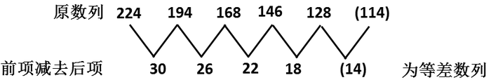
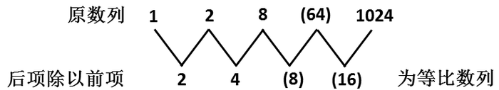
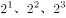
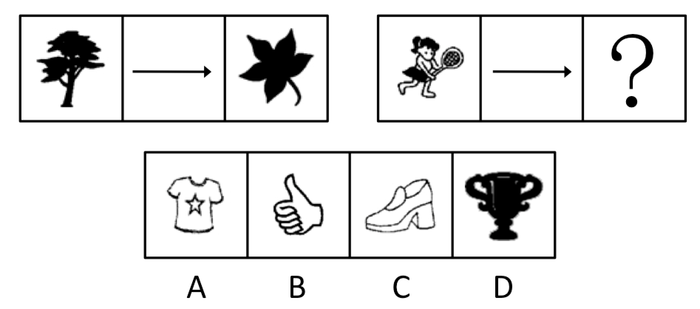
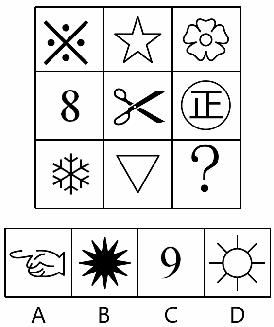
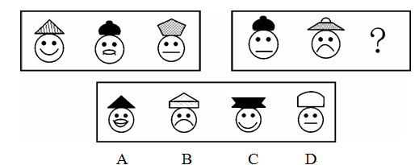
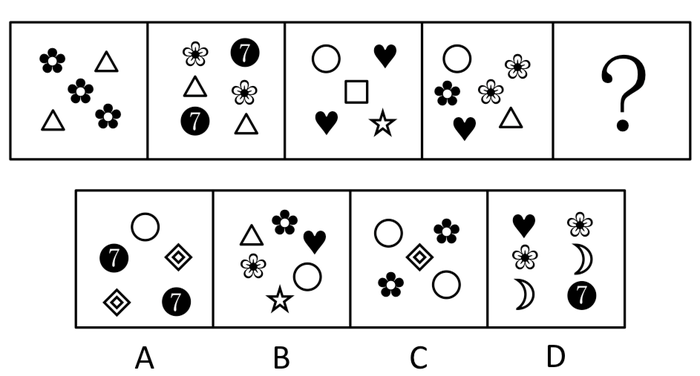
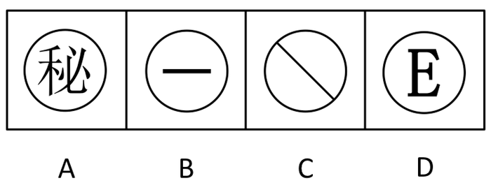
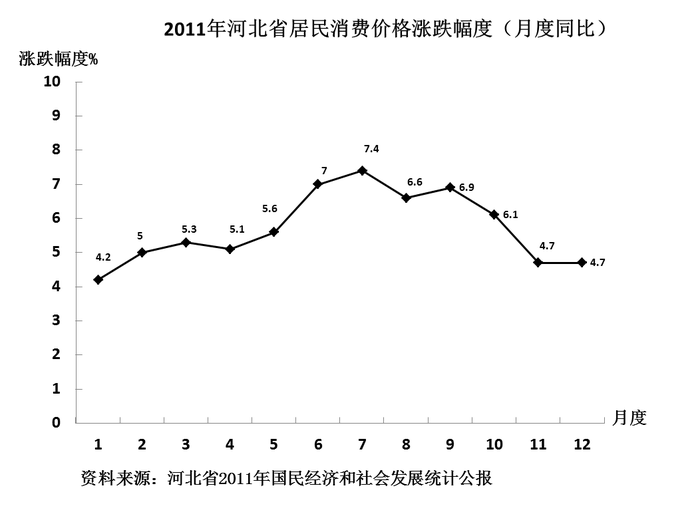
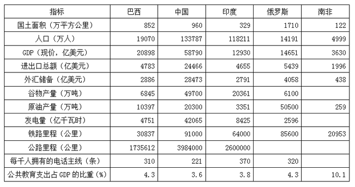

# 2012年河北省公务员录用考试《行测》题

<!-- gwy:overview:start -->
> **河北 · 2012 · 行测 · 统考** ｜ 125 题 · 图片 59 处 · 答案随题折叠

| 题型模块 | 题量 | 题号 |
| --- | ---: | ---: |
| 言语理解与表达 | 35 | 1–35 |
| 数量关系 | 15 | 36–50 |
| 判断推理 | 35 | 51–85 |
| 资料分析 | 15 | 86–100 |
| 常识判断 | 25 | 101–125 |
| **合计** | **125** | |

导航：[题型与作答说明](#题型与作答说明) · [题目](#题目) · [材料 1](#材料-1)
<!-- gwy:overview:end -->

> 候选采集稿。参考答案及解析来自粉笔页面，不代表官方答案或真实高分答卷；来源使用许可与原卷对应关系仍需人工核实。

## 题型与作答说明

言语理解与表达

（35题）

本部分包括阅读理解、逻辑填空与语句表达三种类型的试题。

数量关系

（15题）

本部分包括数字推理与数学运算两种类型的试题。

判断推理

（35题）

本部分包括图形推理、定义判断、类比推理与逻辑判断四种类型的试题。

资料分析

（15题）

所给出的文字和图表资料均有几个问题需要回答。请你根据资料提供的信息进行分析、比较，作出判断选择。

常识判断

（25题）

根据题目要求，在四个选项中选出一个最恰当的答案。

## 题目

### 第 1 题

有的人有一个轰轰烈烈的生，却留下一个默默无闻的死；有的人有一个默默无闻的生，却有一个轰轰烈烈的死。有的人显赫一时，却只能成为匆匆的过客；有的人潦倒终生，却成为历史天空闪亮的星斗。

这段话谈论的是：

A. 人的生命价值

B. 人的生活方式

C. 人的地位区别

D. 人生变幻无常

第 1 题 · 答案与解析

**参考答案（粉笔题库参考内容）**

A

**解析**

本题为中心理解题。

本句中“轰轰烈烈”“默默无闻”的生死，“过客”和“星斗”都是体现生命价值的比喻，一前一后，反复对照，突出生命价值和意义的改变。因此A项正确。

本句没有讨论生活方式，没有地位的比喻，所以B、C项错误；而D项过于宽泛，不涉及比较，所以排除。

故正确答案为A。

### 第 2 题

古语云：“疾风知劲草。”经历严峻的考验，方可知晓谁才是真正坚强的人。那么，换在一个顺风顺水的环境里，难道就无法试炼出一个人的意志、品格吗？

这段文字表述的观点是：

A. 顺意的环境很难考验一个人的意志

B. 关键时刻才能识别谁是真正的强者

C. 日常工作照样能够考验一个人的意志

D. 平淡的生活也能了解一个人的品格

第 2 题 · 答案与解析

**参考答案（粉笔题库参考内容）**

C

**解析**

根据提问方式可知本题为中心理解题。

文段首先引用古文阐述了一种观点“经历严峻的考验，方可知晓谁才是真正坚强的人”，以此引出论题。之后用反问句强烈地质疑了前面的观点，也就是肯定“顺风顺水的环境也可以试炼出一个人的意志、品格”的观点。

反问句的观点才是文段要表达的核心意思，选择C项。

A项与反问句表达的观点相左，排除；B项为被反问句质疑的观点，即文段中引出论点的部分，没有抓住文段重点，排除；比较C、D两项，“日常工作”“平淡的生活”都与文段中“顺风顺水的环境”契合，C项的“考验”比D项的“了解”更贴近文段中的“试炼”，而原文中“意志”也是放在“品格”之前的，故选择C项。

故正确答案为C。

### 第 3 题

辛亥年到来的时候，似乎没有迹象表明，这将是这个铁血帝国的最后一年。这一年是从隆裕皇太后万寿圣节（正月初十）的歌舞升平开始的，而在这一年行将结束的十二月二十五（公元1912年2月12日），隆裕却颁布了一纸退位诏书，中国的封建政权就此曲终人散。历史的急转直下，在当时绝大多数人（包括革命领袖）看来，都是不可思议的。

上面一段文字，意在说明：

A. 大清帝国何以灭亡

B. 历史潮流不可阻挡

C. 辛亥革命何以成功

D. 历史发展有其规律

第 3 题 · 答案与解析

**参考答案（粉笔题库参考内容）**

B

**解析**

据提问可知本题为中心理解题。

本文段从一开头“似乎没有迹象”到“却颁布了······退位诏书”，再到后来的“历史的急转直下······不可思议”这一切都说明历史潮流不可阻挡。因此B项正确。

文段中并没有解释大清灭亡的原因，所以A项错误；C项过于发散，文段并没有提及辛亥革命何以成功；D项过于宽泛，并非文段最终主旨。

故正确答案为B。

### 第 4 题

在社会生活中，每一个人都渴望得到别人的欣赏，同样，每一个人也要学会欣赏别人。欣赏与被欣赏是一种互动的力量源泉，欣赏必然具有愉悦之心、仁爱之怀、成人之美之善念；被欣赏必然产生自尊之心、奋进之力、向上之志。因此，让我们在生活中多一些欣赏。

最能概括这段文字的是：

A. 欣赏与被欣赏

B. 欣赏是一种善良

C. 欣赏是一种理解

D. 我们要学会欣赏

第 4 题 · 答案与解析

**参考答案（粉笔题库参考内容）**

D

**解析**

文段开头引出“欣赏”的话题，接着具体阐释欣赏的作用，尾句通过“因此”进行总结，强调生活中要多一些欣赏，故文段为分总结构，强调欣赏的重要性，对应D项。

A项，表述过于宽泛，未能体现欣赏的重要性，排除；

B项，“是一种善良”对应解释说明部分，非重点，排除；

C项，“是一种理解”文段未提及，无中生有，排除。

故正确答案为D。

### 第 5 题

纬度差异是影响物候的一个因素。凡是近海的地方，比同纬度的内陆，冬天温和，春天反而寒冷。所以沿海地区春天的来临比内陆要迟若干天，如大连在北京以南约一度，但在大连，连翘和榆叶梅的盛开都比北京要迟一个星期。又如石家庄苹果树开花在四月中或谷雨节，沧州要到立夏。两地纬度相差无几，但沧州靠海，春天便来得迟了。

这段文字说明的内容是：

A. 相同纬度沿海地区比内陆春天来得晚

B. 经度差异不是影响物候的主要因素

C. 凡是近海地方的春天都比内陆要迟

D. 沿海地区的春天一般会比内陆要迟

第 5 题 · 答案与解析

**参考答案（粉笔题库参考内容）**

A

**解析**

根据提问方式可知本题为中心理解题。

文段先说明“纬度差异是影响物候的一个因素”，然后阐释近海的普遍惯例，结论词“所以”之后的是重点，说明纬度影响中的海洋特例，所以文段核心是相同纬度沿海地区比内陆春天来得晚。结合选项应该选A。

B项与文意不符；C项属于绝对化；D项与文本不符。

故正确答案为A。

### 第 6 题

生活中，一个好的心态，可以使你乐观豁达；一个好的心态，可以使你战胜面临的苦难；一个好的心态，可以使你淡泊名利，过上真正快乐的生活。人类几千年的文明史告诉我们，积极的心态能帮助我们获取健康、幸福和财富。

以上这段文字告诉我们：

A. 人与人之间千差万别，但心态决定人生

B. 一个人成功与否，主要取决于他的心态

C. 一个健全的心态，比一百种智慧更有力量

D. 你不能控制环境，你可以调整自己的心态

第 6 题 · 答案与解析

**参考答案（粉笔题库参考内容）**

D

**解析**

本题为中心理解题。

文段的中心围绕着“好心态”展开，整个文段在说明好心态的重要性。“苦难”“名利”“千年文明”都说明，环境易变，但心态却在人自己手中，所以言下之意便是环境很难改变，但心态可以调整，正确答案选D。

文段中并没有强调人与人的差异，也没有强调人生，故A项错误；文中没有定义所谓的成功，所以B项也错误；文中没有拿心态和智慧作比较，所以C项也不对。

故正确答案为D。

### 第 7 题

孤独是一个人的狂欢，是心灵的独舞。能够忍受孤独、勇于享受孤独的人并不多，在孤独中有大成者就更少。面对孤独，尤其是长时间的孤独，是需要很大的勇气的。所以，孤独是勇敢者的专利。小说家赫胥黎说：“越伟大，越有独创精神的人越喜欢孤独。”因为人可以在社会中学习，灵感却只有孤独的时候才会涌现出来。

最适合做本段文字标题的是：

A. 孤独是勇敢者的专利

B. 孤独需要勇气

C. 伟大的心灵需要独舞

D. 孤独激发灵感

第 7 题 · 答案与解析

**参考答案（粉笔题库参考内容）**

C

**解析**

本题为标题选择题。

本文段探讨孤独，由于出现了关键词“所以”，可以看出，文段前后是因果关系，重点部分在所以之后，也就是“孤独是勇敢者的专利”开始，整个文段到最后点破，“灵感却只有孤独的时候才会涌现出来”，所以最适合的标题应该是C项“伟大的心灵需要独舞”。

A选项流于表面，没有体现最后“独创”的意味；B选项不是重点，在文段中也只是一笔带过；D选项只是文段最后一句的同义替换，没有引申意义，不能概括全文。

故正确答案为C。

### 第 8 题

大爆炸模型已被科学界广泛接受，但它没有解决宇宙起源的问题。宇宙起源的学说有若干，但只有霍金的量子宇宙学是既自给又自足的。宇宙的边界条件是它没有边界，这样就把宇宙的量子态确定下来，赋予宇宙学以可预见性。霍金和他的合作者利用费恩曼的路径积分给出宇宙的波函数，人们可以将宇宙视为演化的过程，也可以认为整个演化就是存在。

这段文字主要介绍的是：

A. 科学家是如何解决宇宙起源问题的

B. 量子宇宙学如何描述宇宙的存在

C. 霍金是个伟大的宇宙科学家

D. 霍金和他的合作者一起创立了量子宇宙学

第 8 题 · 答案与解析

**参考答案（粉笔题库参考内容）**

B

**解析**

本题为中心理解题。

材料首先提出宇宙起源学说中霍金的量子宇宙学的独特之处，后文都是阐述量子宇宙学如何解释关于宇宙的问题，因此材料的论述主体是量子宇宙学，B项正确。

A、C、D项都没有抓住重点，没有把握住材料主体。

故正确答案为B。

### 第 9 题

关于贫困，巴菲特是这样看待的：“对于一个人的成长来说，贫困可以磨砺一个人的志气，可以使人养成吃苦耐劳的品质，知道更加珍惜现有的一切，从这个角度讲贫困是事业成功的推动器。贫困就像深埋在地下的煤炭，能挖掘出来就是财富，挖不出来，还是贫困。而要把潜在财富变为现实财富，则取决于多种因素，环境机遇、人的能力品质、正确判断、奋斗精神，缺一不可。贫困是财富还是苦难，关键在于我们自己，有人被贫困压倒，一辈子窝窝囊囊，有人则在贫困面前崛起，终究成就了一番大事业，强者与弱者的区别仅此而已。”

上面这段文字意在强调：

A. 贫困可以使人养成吃苦耐劳的品质，是事业成功的推动器

B. 把潜在的贫困挖掘出来变成财富取决于多种不可或缺的因素

C. 强者与弱者的区别就在于是否被贫困压倒

D. 贫困可以是财富，也可以是苦难，关键是看你怎么去对待

第 9 题 · 答案与解析

**参考答案（粉笔题库参考内容）**

D

**解析**

本题为中心理解题。

巴菲特主要是从正反两面阐述对待贫困的态度：“贫困是财富还是苦难，关键在于我们自己”，D项是其观点的同义替换。

A项只从正面阐述贫困，观点片面；B项是材料信息之一，但不是重点；C项说的是强者和弱者的区别，而材料强调的是对贫困的正反面态度，因此未把握重点。

故正确答案为D。

### 第 10 题

蚂蚁大抵不会欣赏猎豹，也无法欣赏猎豹，因为两者之间的距离相去甚远。蚂蚁在地上爬，猎豹一掠而过，蚂蚁从何欣赏起呢？就算蚂蚁有幸爬上了猎豹的身子，它能欣赏到的也只是猎豹的皮毛，怎能欣赏到猎豹的矫健？再幸运一些，蚂蚁上了树，自上而下看猎豹，能看到些什么呢？也一样什么都看不到，既然无法欣赏，也就绝对无从知道猎豹是什么样的动物。

对这段文字的正确理解是：

A. 蚂蚁和猎豹是两种差别很大的动物

B. 蚂蚁不知道猎豹是什么样的动物

C. 蚂蚁不具备欣赏猎豹的基本能力

D. 蚂蚁的欣赏能力与自身的条件有关

第 10 题 · 答案与解析

**参考答案（粉笔题库参考内容）**

D

**解析**

D项正确，材料首先提出蚂蚁不会也无法欣赏猎豹，然后详细阐述不能欣赏的原因，即蚂蚁自身的条件限制。

A项不是材料的观点；B、C项浮于材料信息表面，没有理解。

故正确答案为D。

## 材料 1

按照人的自我发展历程、实现人生价值和精神自由的高低程度，人生境界可分为四个层次，即欲求境界、求知境界、道德境界和审美境界。

        最低的境界为“欲求境界”。人生之初，在这种境界中只知道满足个人生存所必须的最低欲望，故以“欲求”称之。当人有了自我意识，并且生活于越来越高级的境界时，此种最低境界仍潜存于人生之中。现实中也许没有一个成人的精神境界会低级到唯有“食色”的欲求境界，而丝毫没有一点高级境界。以欲求境界占人生主导地位的人是境界低下而“趣味低级”的人。

        第二种境界为“求知境界”。在这一境界，自我作为主体，有了进一步认知作为客体之物的规律和秩序的要求。有了知识，掌握了规律，人的精神自由程度、人生的意义和价值就大大提升了一步。所以，求知境界不仅从心理学和自我发展的时间进程来看在欲求境界之后，而且从哲学和人生价值、自由之现实的角度来看，也显然比欲求境界高一个层次。

        第三种境界为“道德境界”。它和求知境界的出现几乎同时发生，也许稍后，就此而言，把道德境界列在求知境界之后，只具有相对的意义，但从现实人生意义与价值的角度和实现精神自由的角度而言，则道德境界高于求知境界，是不待而言的。发展到这一水平的“自我”具有了责任感和义务感，这也意味着他有了自我选择、自我决定的能力，把自己看作是命运的主人，而不是听凭命运摆布的小卒。

        人生的最高精神境界是“审美境界”。这是因为此时审美意识超越了求知境界的认识关系，它把对象融入自我之中，而达到情景交融的意境；审美意识也超越了求知境界和道德境界中的实践关系，这样，审美境界既超越了认识的限制，也超越了功用、欲念和外在目的以及“应该”的限制，而成为超然于现实之外的自由境界。

        在现实的人生中，这四种境界错综复杂地交织在一起。很难想象一个人只有其中一种境界而不掺杂其他境界，只不过现实的人，往往以某一种境界占主导地位，其他次之。于是我们才能在日常生活中区分出某人是低级境界、低级趣味的人，某人是高级境界、高级趣味的人，某人是以道德境界占主导地位的道德家，某人是以审美境界占主导地位的艺术家······

### 第 11 题

关于“人生境界”的理解，符合原文意思的一项是：

A. 它存在于人的自我发展历程中，体现着实现人生价值和精神自由的高低程度

B. 它由四个层次组成，从幼年到成人，人的每一个时期都要经历这四个层次

C. 现实生活中，人生境界是由从低到高的四种境界错综复杂地交织在一起的

D. 人生境界表现错综复杂，不同层次的人生境界分别主导着人生的不同阶段

第 11 题 · 答案与解析

**参考答案（粉笔题库参考内容）**

C

**解析**

本题考查词语理解。

C选项符合文本第一句和文段最后一句“在现实的人生中，这四种境界错综复杂地交织在一起”，故正确答案选C。

选项A具有较高欺骗性，原文第一句为：“按照人的自我发展历程、实现人生价值和精神自由的高低程度，人生境界可分为四个层次，即欲求境界、求知境界、道德境界和审美境界。”可以看到，“人的自我发展历程”之后用的是顿号，与“实现人生价值和精神自由”为并列关系，而A项却把“人的自我发展历程”当作了“实现人生价值和精神自由”的状语，这是种偷换概念的做法。另外，“人生境界”应是体现于人的自我发展历程中，而不应表述为“存在于人的自我发展历程中”，我们通常说体现某种境界而非存在某种境界，用“存在”一词不妥；B项的错误点在“都要”二字上，无中生有，绝对化，扩大范围，于人情事理亦显然不通；D项错误点在“不同层次的人生境界分别主导着人生的不同阶段”一句，“不同层次的人生境界”和“人生的不同阶段”没有必然的对应关系。

故正确答案为C。

### 第 12 题

对于“求知境界”与“道德境界”关系的表述，不符合原文意思的一项是：

A. 把“道德境界”列在“求知境界”之后，并不意味着前者比后者出现得晚

B. 到了“求知境界”，人具备了知识，为“道德境界”的产生创造了条件

C. 责任感与义务感使“道德境界”不同于“求知境界”，并高于“求知境界”

D. “道德境界”中的“自我”已经根本不同于“求知境界”中的“自我”

第 12 题 · 答案与解析

**参考答案（粉笔题库参考内容）**

B

**解析**

本题考查文章中的细节。

B项中“创造了条件”属无中生有的命题陷阱。依据文本，“道德境界”和“求知境界”的出现几乎是同时发生，因此“求知境界”为“道德境界”的产生创造了条件是错误的。

本题为选非题，故正确答案为B。

### 第 13 题

下列表述，符合原文意思的一项是：

A. “欲求境界”是人生的最低境界，是具有高级境界的人所极为排斥的

B. “求知境界”中的“自我”已不再满足于个人生存所必须的最低欲望

C. “道德境界”中的人具有了责任感和义务感而有意识地不再关注自我

D. “审美境界”是人生最高的精神境界，这是一种超自然的自由境界

第 13 题 · 答案与解析

**参考答案（粉笔题库参考内容）**

B

**解析**

本题考查文章中具体细节判断。

A项的错误点是“极为排斥”的表述。依据文本，“在现实的人生中，这四种境界错综复杂地交织在一起”，属无中生有；

C项的错误点是“‘道德境界’中的人不再关注自我”的表述，依据文本，这一境界“把自己看作是命运的主人，而不是听凭命运摆布的小卒”，这就是关注自我，属偷换概念；

D项表述为“超自然”，而文段表述为“超然于现实之外”，表述错误，排除。

故正确答案为B。

### 第 14 题

原文中低级境界、低级趣味的人是指：

A. 具有动物本能行为的人

B. 由于生活原因而缺乏求知欲望的人

C. 欲求境界占人生主导地位的人

D. 低级趣味在所有趣味中所占比例较大的人

第 14 题 · 答案与解析

**参考答案（粉笔题库参考内容）**

C

**解析**

本题考查文章中的具体语句定义。

文章第二段中对低级境界做了进一步阐释——“个人生存所必须的最低欲望······也许没有一个成人······会低级到唯有‘食色’的欲求境界”，所以低级境界是指欲求境界占人生主导地位的人。结合选项，C项表述符合题意。

A项在文中并没有点明，属于无中生有；B项求知欲望并非低级境界，按文中所属，应属高级；D项答非所问，属于无效信息。

故正确答案为C。

### 第 15 题

下列各项中，对全文理解概括比较准确的一项是：

A. 人不仅要生活，而且要活出较高层次的境界来

B. 人生的最高境界是超越功用、欲念等世俗的限制

C. 人的自我发展历程就是由低级到高级的演变过程

D. 在现实的人生中，四种境界错综复杂地交织在一起

第 15 题 · 答案与解析

**参考答案（粉笔题库参考内容）**

D

**解析**

本题考查对整个文章材料的表面主旨。

文章只是客观分析了四种境界，并加以界定，并没有给出指导意见，所以A项错误；B项只涉及了最高境界，对整个文段的概括并不足够，所以错误；文章看不出四种境界由低到高逐级的演变，所以C项也不正确。

D项符合文章阐释四种境界，并体现出错综复杂地交织在一起。

故正确答案为D。

### 第 16 题

倘只见阳光，不见＿＿＿＿＿＿，只见愉悦欢笑，不见 ＿＿＿＿＿＿，那么这不是生活的本意。

A. 阴霾 悲伤泪泣

B. 云雾 悲哀伤痛

C. 阴云 悲痛伤感

D. 云雾 哀痛忧伤

第 16 题 · 答案与解析

**参考答案（粉笔题库参考内容）**

A

**解析**

本题考查混搭填空。

整个文句可以看出，句子带有一定的指代意义，具有感情色彩。第一个空阳光对应的应该是一个具有负面感情色彩的反义词，所以云雾不正确，答案只在A、C之间。

第二个空对应愉悦欢笑，所以反义词应当分别对应“愉悦”（形容词）“欢笑”（动词），所以只能选“悲伤”“泪泣”这样的词语。

故正确答案为A。

### 第 17 题

当讲述自己幼年读书的时光时，作者＿＿＿＿＿＿＿＿的叙事，使人有如临其境之感，好像也回到了童年读书时代，并从中受到了强烈的＿＿＿＿＿＿。

A. 惟妙惟肖 震撼

B. 娓娓动听 感染

C. 活泼俏皮 触动

D. 精辟深刻 感动

第 17 题 · 答案与解析

**参考答案（粉笔题库参考内容）**

B

**解析**

本题考查成语和实词的混搭填空。

第一空“惟妙惟肖”指描写或模仿得非常逼真；“娓娓动听”形容善于讲话，使人喜欢听。从“使人······并从中受到了······”可知作者的叙事能打动读者，读者自然喜欢听，其语意并没有强调逼真、活泼、深刻，因此“娓娓动听”最为恰当。

第二空“震撼”指震动、摇动人的心灵，语义较重；“感染”指通过语言或行为引起别人相同的思想感情；“触动”指外界某种因素而激发（思想、情感等）；“感动”指思想感情受外界事物的影响而激动，引起同情或向慕。结合语境，作者的叙事能使人有如身临其境，引起读者的感情，因此“感染”最符合语意。

故正确答案为B。

### 第 18 题

①穿越灾难，我们更加懂得，人类是自然之子，在大自然的怀抱中孕育、进化、生长，我们＿＿＿＿＿要认识自然，还要敬畏自然、善待自然。

②网络使现代人的阅读行为发生了革命性的变化：眼睛常常在网上快速、便捷地“暴走”，＿＿＿＿＿＿才进行一次“细嚼慢咽”式的传统纸质阅读。

A. 不光 有时

B. 不只 偶尔

C. 必须 偶然

D. 不仅 碰巧

第 18 题 · 答案与解析

**参考答案（粉笔题库参考内容）**

B

**解析**

本题考查近义虚词的语境搭配。

从第二空入手。“有时”表示间或不定；“偶尔”表示情况并非经常出现；“偶然”表示某种动作不是必然地发生；“碰巧”指凑巧、恰好。由“革命性的变化”“才······”可知，传统纸质阅读在现代人的阅读中较网络阅读不常见，故“偶尔”最符合语境。答案锁定B。

第一空。“认识自然”“敬畏自然”“善待自然”是递进关系，B项的“不只”符合语意。

故正确答案为B。

### 第 19 题

有道是“无欲则刚”，一个人只有＿＿＿＿私欲，一切从大局出发，才能得到人们的理解与尊重。这样一个拥有无私境界的人，他所说的话，能不让人＿＿＿＿吗？

A. 抛弃 相信

B. 放弃 佩服

C. 摒弃 信服

D. 丢弃 信任

第 19 题 · 答案与解析

**参考答案（粉笔题库参考内容）**

C

**解析**

本题考查近义实词的程度辨析和语境搭配。

第一空“抛弃”指丢弃、扔掉；“放弃”指丢掉（原有的权利、主张、意见等）；“摒弃”指屏除、抛弃，较为彻底；“丢弃”指扔掉、抛弃。结合语境，人只有完全放下自己的私欲才能得到人们的理解和尊重，强调其彻底性，故“摒弃”最为恰当。

第二空“相信”指认为正确或确实，不怀疑；“佩服”指钦佩、敬仰悦服；“信服”指相信、佩服；“信任”指相信。材料用的是反问句式，意在强调人们对拥有无私境界的人所说的话相信程度之深，因此“信服”最符合语意。

故正确答案为C。

### 第 20 题

①虽然他尽了最大的努力，还是没能＿＿＿＿＿住对方凌厉的攻势，痛失奖杯。

②能源短缺，加上恶劣的自然条件，极大地＿＿＿＿＿着这个小镇经济的发展。

③那些见利忘义的人，不仅为正人君子所＿＿＿＿＿＿，还可能滑向犯罪的深渊。

A. 抵挡 限制 不耻

B. 遏止 束缚 不容

C. 阻止 约束 厌恶

D. 遏制 制约 不齿

第 20 题 · 答案与解析

**参考答案（粉笔题库参考内容）**

D

**解析**

本题考查近义实词的程度辨析和语境搭配。

从第三空入手。“不耻”指不以为有失体面；“不容”指不能宽容、不允许；“厌恶”指讨厌、憎恶；“不齿”指不与同列，表示轻蔑。结合语境，正人君子对见利忘义的人自然是不认同的，因此“不齿”最符合语意。答案锁定D。

第一空考查词语含义。“抵挡”指抵抗、阻挡；“遏止”指用力阻止；“阻止”指阻拦、制止；“遏制”指制止、控制（攻势、激情等）。①空格的宾语是“攻势”，根据常用搭配，“遏制”最为恰当。

第二空考查词语含义。D项的“制约”指限制约束，符合语意。

故正确答案为D。

### 第 21 题

①虚心接受批评的人，不为眼前的一时之气所累，他们有着常人所不及的目光和气度，在生活中往往显得\_\_\_\_，拥有更高的威望。

②在人际交往中，每个人的言谈举止所传递出的信息如同密码一样纷乱，需要我们用敏锐的目光去发现，用睿智的心智去破译，正所谓察言观色、\_\_\_\_。

A. 卓尔不群 见微知著

B. 鹤立鸡群 鉴往知来

C. 曲高和寡 见始知终

D. 独占鳌头 见仁见智

第 21 题 · 答案与解析

**参考答案（粉笔题库参考内容）**

A

**解析**

本题考查成语的填空。

“卓尔不群”指才德超出寻常，与众不同；“见微知著”指见到事情的苗头，就能知道它的实质和发展趋势。“卓尔不群”可与第一句中“不为一时之气所累”“常人所不及的目光和气度”形成搭配；而在句2中，“见微知著”也可以和“敏锐目光”形成呼应，故正确选项是A。

“鹤立鸡群”比喻一个人的仪表或才能在周围一群人里显得很突出；“鉴往知来”指根据以往的情形便知道以后怎样发生变化。第二句中并不涉及和过去相比，而是对当下事物大小的辨别，所以并不合适，B项错误。“曲高和寡”比喻言论或作品不通俗，能了解的人很少。它一般不用来形容人，而是物，所以C项也使用不当。“见始知终”指看见事物的开始阶段就能预见到它的最终结果。“独占鳌头”比喻那些在各个领域获得第一名的人。而句子中并没有强调第一或者头名，所以D项也不合适。“见仁见智”指对同一个问题，不同的人从不同的立场或角度有不同的看法。

故正确答案为A。

### 第 22 题

①追求成熟，已经成为当今社会的一种\_\_\_\_：尤其是涉世不深的年轻人，更想以老到、\_\_\_\_的面孔引起别人对自己的注意和重视。

②事物的发展一旦停滞\_\_\_\_趋于保守，就将走向灭亡，\_\_\_\_为新生事物所取代。

A. 时髦 深刻 或 而

B. 时尚 深刻 和 从而

C. 时尚 深沉 或 从而

D. 时髦 深沉 和 而

第 22 题 · 答案与解析

**参考答案（粉笔题库参考内容）**

C

**解析**

本题为混搭填空题。

第一空“时尚”指当时的风尚，时兴的风尚；“时髦”则形容人的穿着或其他事物新颖入时。

第二空深刻意思是达到事情或问题的本质的；深沉是指程度深、声音低沉、思想不外露。

从第二空可以看出，“老到”······“面孔”搭配更为合适的是深沉，所以先排除A、B。第二句话考查关联词，从第一空可以看出，“停滞”和“趋于保守”属于选择关系，所以应当选择“或”。

故正确答案为C。

### 第 23 题

文学如泉，越品越见\_\_\_\_；文学如茶，越品越觉\_\_\_\_；文学如酒，越品越感\_\_\_\_。在文学的陶冶下，你会发现自己少了一份浮躁，多了一份宁静；少了一份庸俗，多了一份雅致；少了一份世故，多了一份纯真。

A. 清冽 芳香 醇美

B. 清香 醇厚 醇美

C. 淳厚 清冽 甘美

D. 清冽 幽香 醇厚

第 23 题 · 答案与解析

**参考答案（粉笔题库参考内容）**

D

**解析**

本题考查实词对象搭配的辨析与填空。

由题干可知，空格处的词语分别需要和“泉”“茶”“酒”相对应。“清冽”意为“清澈寒冷、凉而爽快”，多和泉水搭配，所以第一空应当选择“清冽”，由此可排除B、C项。

第二空形容茶叶的话，“幽香”比“芳香”多了一丝神秘感和厚重，第二个空格内填入“幽香”更符合语境。

第三空“醇厚”指质地纯，浓度高，多用来形容酒口感纯正浓厚，所以第三空填“醇厚”。

故正确答案为D。

### 第 24 题

现代社会，科学传播不可能起到\_\_\_\_的效果，如果谁这样想，谁就会\_\_\_\_科学，最终将会危害科学。

A. 立竿见影 误解

B. 马到成功 误会

C. 一蹴而就 曲解

D. 立见成效 奉曲

第 24 题 · 答案与解析

**参考答案（粉笔题库参考内容）**

A

**解析**

本题考查成语和实词的混搭填空。

此题的突破口在于第二个空格。“误会”通常是人与人之间的误解；而“误解”指理解不正确；“曲解”则是指错误解释，其中有故意而为之意。本句中并非针对人，强调的也并不是有意歪曲，所以应选“误解”；而“奉曲”是曲意奉承之意，显然与题干语意不合，因此排除。

验证第一个空，“立竿见影”比喻立刻见效，和语句搭配也较为恰当，故选之。

综合以上论述，A项符合题意。

“马到成功”虽为近义，但它是指一开始就取得成功，这里搭配并不恰当；“一蹴而就”也与之类似，指一下就获得成功，但它们都有完成后不再进行的意义。题干中，科学传播显然不是成功后就停止的工作，所以排除B、C两项；“立见成效”和后面的“效果”重复，所以不选。

故正确答案为A。

### 第 25 题

①建设文明单位，首先要\_\_\_\_文明单位的量化指标，再按指标对单位进行考评。

②培养公民的法制观念是一个长期过程，\_\_\_\_从学生时代就进行法制教育\_\_\_\_\_\_起到潜移默化的作用。

A. 制订 必须 方可

B. 决定 只能 才会

C. 明确 只要 就能

D. 确定 只有 才能

第 25 题 · 答案与解析

**参考答案（粉笔题库参考内容）**

D

**解析**

本题为实词和虚词的混搭填空题。

本题从②句入手可以快速得到答案。“培养······过程，······从······起到潜移默化的作用”可以看出，本句是条件句，前后可以做出逻辑判断，如果没有法制教育，则肯定没有潜移默化作用，如果有进行法制教育，则未必一定有潜移默化作用，所以第二空前后应当是必要条件。符合于此的是“只有······才能”组合。

再看第一个空的选词，“确定”意为明确肯定，与“指标”搭配得当，填入空格内符合语意。

故正确答案为D。

### 第 26 题

下面各组词语中划线字的读音，完全正确的一项是：

A. 宽<u>恕</u>（shù） 涟<u>漪</u>（yī） 根深<u>蒂</u>固（tì）

B. <u>炽</u>痛（chì） <u>朔</u>方（shuò） <u>锲</u>而不舍（qiè）

C. 阔<u>绰</u>（chuò） <u>诘</u>贾（jí） 即物起<u>兴</u>（xìng）

D. <u>颔</u>首（hán） 不<u>逊</u>（xùn）  广<u>袤</u>无垠（mào）

第 26 题 · 答案与解析

**参考答案（粉笔题库参考内容）**

B

**解析**

本题考查辨析词语字音的能力。

A项中根深蒂固（tì）错误，应该是（dì）；C项中诘（jí）应当是（jié）；D项中应当是颔（hàn）。B项各字的读音都没有错误。

故正确答案为B。

### 第 27 题

下列每组词语中都有一个错别字，它们是：

①荒诞不经 合辙押韵 形消骨立 祁寒溽暑

②如愿以偿 股肱之臣 甚嚣尘上 推心至腹

③众志成诚 鸠形鹄面 慷慨大方 张皇失措

④风餐露宿 重峦叠障 形影相吊 瞻前顾后

A. 溽 至 皇 吊

B. 经 肱 鹄 瞻

C. 辙 嚣 诚 瞻

D. 消 至 诚 障

第 27 题 · 答案与解析

**参考答案（粉笔题库参考内容）**

D

**解析**

本题考查辨析汉字字形的能力。

①中“形消骨立”中应该是“销”，可以直接判断出正确答案D。

②中，“推心至腹”中应当是“置”；③中，“众志成诚”应当是“城”；④中“重峦叠障”应该是“嶂”。

故正确答案为D。

### 第 28 题

下列句子中括号中的词语运用有误的一项是：

A. 禾苗把鸦鹊湖（伪装）成无边的草原，一条机耕道在稻田间蜿蜒着没入远方。

B. 我们阅读名著不仅能得到艺术的享受，而且能获得人生的（启迪）。

C. 大街小巷，人头攒动，大家（望眼欲穿），期盼着奥运冠军凯旋归来。

D. 站在山顶四处眺望，只见经过退耕还林的山区风景秀丽，（进退维谷）。

第 28 题 · 答案与解析

**参考答案（粉笔题库参考内容）**

D

**解析**

本题考查词语在句子中的使用。

“进退维谷”形容进退两难的窘境，用在句中指“风景”不恰当。

故正确答案为D。

### 第 29 题

下列各组词语中，没有错别字的一组是：

A. 驰骋 掉书袋 诽然成章 文过饰非 有志者事竟成

B. 寒暄 俯卧撑 慷慨悲歌 披肝历胆 事实胜于雄辩

C. 因循 故纸堆 兢兢业业 稗官野史 英雄所见略同

D. 安详 连锁店 故名思义 轻歌曼舞 万变不离其宗

第 29 题 · 答案与解析

**参考答案（粉笔题库参考内容）**

C

**解析**

本题考查辨析汉字字形的能力。

A项中“诽然成章”应为斐然成章；B项中“披肝历胆”应为“披肝沥胆”；D项中“故名思义”应为“顾名思义”。

本题为选非题，故正确答案为C。

### 第 30 题

下列各句中，括号内成语使用恰当的一项是：

A. 这些福娃形象可爱，（栩栩如生），是最受欢迎的奥运纪念品。

B. 在“五个一工程”的推动下，基层群众的文艺创作热情（水涨船高）。

C. 蛙鸣像波浪一样在夜色里此起彼伏，（络绎不绝）。

D. 卢浮宫里那精美的室内装修和古典家具真让人（流连忘返）。

第 30 题 · 答案与解析

**参考答案（粉笔题库参考内容）**

D

**解析**

本题考查辨析成语使用对错的能力。

A项错误，“栩栩如生”是用来形容和真的一样，但福娃本身是卡通造型，谈不上“栩栩如生”；B项中，“水涨船高”是用来比喻事物随着基础的变高而提高，这里“五个一工程”并非基础，所以创作热情也不能“水涨船高”；C项中，“络绎不绝”是形容人来人往，接连不断，用来形容蛙鸣的声音显然不对。

D项中，“流连忘返”形容留恋得不舍得离开，这里用来形容目睹卢浮宫的珍宝后的状态，非常恰当。

故正确答案为D。

### 第 31 题

下列句子中，没有语病的一句是：

A. 法制的漏洞、体制的弊端和政策的不完善，导致贫富差距拉大到世界公认的警戒线，从而导致了一系列的社会影响。

B. 我们要把改善民生、保障民生、关注民生作为一切工作的目的和出发点。

C. 能否积极利用和有效管理互联网，关系到社会主义文化事业和文化产业的健康发展，是国家文化信息安全和国家长治久安的有利保障。

D. 要建立出租车运价与油价联动机制，就是当油价上升突破一定界限时，相应加收燃油附加费；当油价回落时，下调或停收燃油附加费。

第 31 题 · 答案与解析

**参考答案（粉笔题库参考内容）**

D

**解析**

本题考查病句辨析的能力。

A项中，“导致”后面只能跟着结果，并列谓语第二个“导致”后面却接了“影响”，所以把第二个“导致”改为“产生”，排除；B项句中，改善、保障、关注之间的顺序不当，应当是关注—保障—改善这样的逻辑顺序，排除；C项中，句首部分“能否”为两面意思，而后面的表述都是“能”的一面意思，两面对一面，搭配不当，排除；D项语句表达通顺，句意明确，没有语病，当选。

故正确答案为D。

### 第 32 题

下列句子中，有语病的一句是：

A. 构建和谐社会，光靠行政命令与严厉的执法是不行的。以和为贵的思维与长期不懈促进互信的举措，都是值得大力鼓励的。

B. 在就业难的大环境下，相当多的应届毕业生认同“先就业再择业”，先抢到个“饭碗”，工作几年后，再换一份待遇更高的新工作。

C. 许多城市的限购政策到期之后是否持续，一些地方政府态度暧昧，三缄其口，骨子里所想的，无非是取消“限购令”，迎接房地产业所谓的“春天”。

D. 周立波在他主持的节目《壹周立波秀》里批评了很多人。他的言辞虽然尖刻甚至偏激，但是谁又能否认他说的没有道理呢?

第 32 题 · 答案与解析

**参考答案（粉笔题库参考内容）**

D

**解析**

本题考查病句辨析的能力。

D选项中多次否定形成了三重否定的隐藏辨析，其中“谁又能”是第一重，“否认他说的没有道理呢”又是个双重否定，意思是承认他说的有道理，所以真正的意思是没有人承认他说的有道理。这与句子本身想要传达的意思不符。A、B、C三项均无语病。

本题为选非题，故正确答案为D。

### 第 33 题

下列各句中，语意明确的一句是：

A. 他背着总经理和副总经理偷偷地把这笔钱分别存入了两家银行。

B. 这次考试不难，但由于他准备得不够充分，差点儿就没及格。

C. 祁爱群看见组织部新来的援藏干部很高兴，于是两人亲切地交谈起来。

D. 因患病住院，83岁高龄的黄昆和正在美国的姚明没能到场领奖。

第 33 题 · 答案与解析

**参考答案（粉笔题库参考内容）**

B

**解析**

本题考查辨析歧义的能力。

B项语句表达通顺，句意明确，没有歧义，当选。

A项有歧义，可以理解为“他（背着总经理和副总经理）偷偷地把这笔钱分别存入了两家银行”，或者“他（背着总经理）和副总经理偷偷地把这笔钱分别存入了两家银行”，排除；C项中，“很高兴”指代不明确，可以解读为祁爱群很高兴，也可以解读为援藏干部很高兴，排除；D项有歧义，可以理解为“黄昆和在美国的姚明都因患病住院，没能到场领奖”，也可以理解为“黄昆患病住院不能到场领奖，而姚明正在美国，所以也不能到场领奖”，排除。

故正确答案为B。

### 第 34 题

为下列句子排列顺序，使其意思连贯。正确的一项是：

①他最初的职能与一个看管自行车的大爷没什么两样

②事实上，世界上最早的金匠银行家是只存不贷的

③时间长了，他开始考虑如何盘活这些沉睡的资产，于是就有了放贷和利息

④存户有了零散的金子就存到他那里，他收取一定的管理费

A. ④①③②

B. ②④③①

C. ②④①③

D. ④①②③

第 34 题 · 答案与解析

**参考答案（粉笔题库参考内容）**

C

**解析**

由提问知本题为语句排序题。

观察选项，可以发现首句可在②、④中选择。“事实上······”可以作为开头句，而“存户有了零散······”这句话需要有上下文衔接，所以做开头并不合适。由此可排除A、D项；①句中“看管自行车的大爷”和④句中“收取一定的管理费”语意一致，因此①句应该跟在④句的后面，③句中“时间长了”与①句中的“最初”相对应，因此③应该排在最后。

故正确答案为C。

### 第 35 题

为下列句子排列顺序，使其意思连贯。正确的一项是：

①面对身边诸多纠结，多一点智慧和勇气，保持一份平和心态，可助我们削弱“纠结”的纠缠

②随着现代生活节奏的加快，生活压力的增大，“纠结”的事越来越多

③如今，随着信息技术的快速发展，“纠结”一词率先在网络上爆红，不但使用率颇高，而且使用更加广泛灵活

④纠结的本意就是“相互缠绕”，常作动词用。语出唐代诗人李白的《古意》一诗：“枝枝相纠结，叶叶竞飘扬。”

A. ③②④①

B. ③④①②

C. ②①④③

D. ②④③①

第 35 题 · 答案与解析

**参考答案（粉笔题库参考内容）**

D

**解析**

本题考查语句排序。

观察选项，可以发现本题的突破口在于判断①句和④句是否捆绑在一起。④句介绍“纠结”的词源，①句说的是应对“纠结”的做法。不管①句和④句孰先孰后，在逻辑上来讲是脱节的，不能绑定在一起。由此可排除A、B、C三项。

D项中，②句说生活中“纠结”的事越来越多， ④句与③句、①句介绍“纠结”这个词的本意，然后引出今天的现状，最后提到面对“纠结”的事我们应该怎么做。D项中各句之间衔接得当，排序正确。

故正确答案为D。

### 第 36 题

4，11，27，61，（    ）

A. 106

B. 117

C. 131

D. 163

第 36 题 · 答案与解析

**参考答案（粉笔题库参考内容）**

C

**解析**

本题为2倍递推修正数列，修正项为等差数列。递推规律为：数列的前一项的2倍加上修正项得到数列的下一项。具体规律为：4×2＋3＝11，11×2＋5＝27，27×2＋7＝61，因此原数列的下一项为：61×2＋9＝131。

故正确答案为C。

### 第 37 题

1+3，2+2，1+1，2+3，1+2，2+1，（    ）

A. 2×2

B. 2+3

C. 3×1

D. 1+3

第 37 题 · 答案与解析

**参考答案（粉笔题库参考内容）**

D

**解析**

本题加号左右的数分别构成两个周期数列，左边周期数列为：1、2、1、2、1、2、(1)，右边周期数列为：3、2、1、3、2、1、(3)，因此未知项为1＋3。

故正确答案为D。

### 第 38 题

224，194，168，146，128，（    ）

A. 116

B. 114

C. 102

D. 98

第 38 题 · 答案与解析

**参考答案（粉笔题库参考内容）**

B

**解析**

本题为二级等差数列。

因此原数列的下一项为114。

故正确答案为B。

### 第 39 题

1，2，8，（    ），1024

A. 64

B. 176

C. 682

D. 988

第 39 题 · 答案与解析

**参考答案（粉笔题库参考内容）**

A

**解析**

本题为二级等比数列。

因此原数列的未知项为64。

故正确答案为A。

### 第 40 题

0，2，4，3，8，6，（    ）

A. 9

B. 12

C. 14

D. 15

第 40 题 · 答案与解析

**参考答案（粉笔题库参考内容）**

B

**解析**

原数列忽大忽小，无其他规律，按照多重数列先考虑交叉找规律。

奇数项：0，4，8，(12)，构成等差数列；偶数项：2，3，6，构成幂次修正数列。

偶数列：2、3、6；

幂次数列：；

修正项：0、-1、-2。

因此原数列的下一项为12。

故正确答案为B。

### 第 41 题

292929÷161616×112＝（    ）。

A. 174

B. 190

C. 203

D. 206

第 41 题 · 答案与解析

**参考答案（粉笔题库参考内容）**

C

**解析**

原式。

故正确答案为C。

### 第 42 题

要把21棵桃树栽到街心公园里5处面积不同的草坪上，如果要求每块草坪必须有树且所栽棵数要依据面积大小各不相同，面积最大的草坪上至少要栽几棵？

A. 7

B. 8

C. 10

D. 11

第 42 题 · 答案与解析

**参考答案（粉笔题库参考内容）**

A

**解析**

面积最大的草坪植树最少，则其余面积的草坪植树尽可能多，又互不相同，则五个数接近构成一个等差数列。注意到：21÷5＝4.2，据此构造2、3、4、5、6，加和为20，还余下1棵只能种在面积最大的草坪上。因此面积最大的草坪上至少要栽7棵。

故正确答案为A。

### 第 43 题

某乡镇对集贸市场36种食品进行检查，发现超过保质期的7种，防腐添加剂不合格的9种，产品外包装标识不规范的6种。其中，两项同时不合格的5种，三项同时不合格的2种。问三项全部合格的食品有多少种：

A. 14

B. 21

C. 23

D. 32

第 43 题 · 答案与解析

**参考答案（粉笔题库参考内容）**

C

**解析**

本题注意按照不合格的项数分为三类，进行容斥原理分析，分别设三项全部合格、仅一项不合格的产品有x、y种，根据题意可得：y+5+2=36-x，，联立解得x=23，y=6，因此三项全部合格的食品有23种。

故正确答案为C。

### 第 44 题

某通讯公司对3542个上网客户的上网方式进行调查，其中1258个客户使用手机上网，1852个客户使用有线网络上网，932个客户使用无线网络上网。如果使用不只一种上网方式的有352个客户，那么三种上网方式都使用的客户有多少个：

A. 148

B. 248

C. 350

D. 500

第 44 题 · 答案与解析

**参考答案（粉笔题库参考内容）**

A

**解析**

设三种上网方式都使用的客户有x人，根据三集合容斥原理非标准公式：A+B+C-只满足两个条件的个数-2×满足三个条件的个数=总数-三个条件都不满足的个数，可得方程1258+1852+932-（352-x）-2x=3542，解得x=148。

故正确答案为A。

备注：使用不只一种上网方式的包括只使用两种上网方式和使用三种上网方式。

### 第 45 题

一直角三角形的两直角边的长度之和为14，假如这个三角形的周长与面积数值相等，那么该三角形的面积为：

A. 20

B. 22.5

C. 24

D. 24.5

第 45 题 · 答案与解析

**参考答案（粉笔题库参考内容）**

C

**解析**

假定两条直角边分别为x，y，根据题意可得：x+y=14，，求解时将选项代入验证，仅C项满足周长与面积相等。

故正确答案为C。

备注：在直角三角形中，两条直角边长度为a、b，斜边长度为c，则存在等式。

### 第 46 题

某单位发当月的工资，已知甲的工资为4500元，若甲取出工资的75％，乙取出工资的，则甲的工资余额是乙的工资余额一半，那么乙当月的工资是多少元：

A. 1125

B. 3375

C. 4500

D. 6000

第 46 题 · 答案与解析

**参考答案（粉笔题库参考内容）**

B

**解析**

甲工资为4500元，取出75%还剩25%，即为：4500×25%＝1125元，故乙的工资余额为：1125×2＝2250元，占当月的，因此乙当月工资为：元。

故正确答案为B。

### 第 47 题

某商品2月份价格较1月份上涨了20％，由于政府调控政策的出台，3月份该商品价格又下降了20％，问该商品3月份的价格与1月份的价格相比：

A. 涨高了

B. 持平

C. 降低了

D. 不能确定

第 47 题 · 答案与解析

**参考答案（粉笔题库参考内容）**

C

**解析**

假定该商品1月份价格为100，则2月份价格为120，3月份价格为120×0.8＝96，因此该商品3月份的价格比1月份有所降低。

故正确答案为C。

### 第 48 题

一名事业单位职工1978年参加工作时月工资总额是49.5元，2012年其月工资是1978年的112倍且每月还多11元，改革开放以来这名职工月工资增加了多少元：

A. 5050

B. 5505.5

C. 5545

D. 5555.5

第 48 题 · 答案与解析

**参考答案（粉笔题库参考内容）**

B

**解析**

根据题干条件可知，其2012年的月工资应为：元。则改革开放以来这名职工的月工资增加了：5555-49.5=5505.5元。

故正确答案为B。

### 第 49 题

一个农贸市场2斤油可换5斤肉，7斤肉可换12斤鱼，10斤鱼可换21斤豆，那么27斤豆可换几斤油：

A. 3

B. 4

C. 5

D. 6

第 49 题 · 答案与解析

**参考答案（粉笔题库参考内容）**

A

**解析**

采用赋值法，设豆子的单价为10，根据题意，则鱼的单价为21，肉的单价为36，油的单价为90，所以27斤豆的价格为27×10＝270，可换270÷90＝3斤油。

故正确答案为A。

### 第 50 题

某草莓种植基地利用恒温库储存草莓准备反季节销售。据测算，每储存1斤草莓可增加收入2.5元。小王去年收获草莓5吨，当时市场价为每斤3元，如果都利用恒温库储存，小王的草莓收入可以达到：

A. 27500元

B. 32500元

C. 45000元

D. 55000元

第 50 题 · 答案与解析

**参考答案（粉笔题库参考内容）**

D

**解析**

本题需要注意单位的换算，5吨＝5000千克＝10000斤，因此小王的收入可以达到：元。

故正确答案为D。

### 第 51 题

从所给四个选项中，选择最合适的一个填入问号处，使之呈现一定的规律性：

A. A

B. B

C. C

D. D

第 51 题 · 答案与解析

**参考答案（粉笔题库参考内容）**

B

**解析**

特殊考点，图形的类比，树叶是树的一部分，手是女孩的一部分。A、C项都是附带，不是组成部分；D项奖杯无关。

故正确答案为B。

### 第 52 题

从所给四个选项中，选择最合适的一个填入问号处，使之呈现一定的规律性：

A. A

B. B

C. C

D. D

第 52 题 · 答案与解析

**参考答案（粉笔题库参考内容）**

D

**解析**

九宫格，第一行图形均为轴对称图形，第二行均为非轴对称图形（“8”的两条线不一样粗，应当认为非轴对称，剪刀上下不一样，非轴对称），第三行也应该为轴对称图形，排除AC，经观察，题干中的轴对称图形都是细线条图形，排除B。

故正确答案为D。

### 第 53 题

从所给四个选项中，选择最合适的一个填入问号处，使之呈现一定的规律性：

A. A

B. B

C. C

D. D

第 53 题 · 答案与解析

**参考答案（粉笔题库参考内容）**

C

**解析**

每组图形三个嘴的形状不同，排除B、D，第一组图形中帽子的线条数为3、4、5，第二组图形中帽子的线条数为4、5、（6），C选项对应的图形帽子线条数为6。

故正确答案为C。

### 第 54 题

从所给的四个选项中，选择最合适的一个填入问号处，使之呈现一定的规律性：

A. A

B. B

C. C

D. D

第 54 题 · 答案与解析

**参考答案（粉笔题库参考内容）**

B

**解析**

规则元素的集合，考查元素种类。

题干每个小格中的元素种类数依次是2、3、4、5、（6）。AC选项中元素种类数都是3，不符合；D项元素种类数为4，不符合；B选项元素种类数为6，符合题意。

故正确答案为B。

### 第 55 题

下列哪个图有别于其他三个：

A. A

B. B

C. C

D. D

第 55 题 · 答案与解析

**参考答案（粉笔题库参考内容）**

C

**解析**

题干每幅图形均由圆形外框和内部线条组成。观察发现，A、B、D三项中内部线条均没有和圆形外框相交，而C项内部的直线与圆形外框相交。

本题为选非题，故正确答案为C。

### 第 56 题

东施效颦：中国历史上“四大美女”之一的西施有心痛的毛病。犯病时手扶住胸口，皱着眉头，比平时更美丽。同村女孩东施学着西施的样子扶住胸口，皱着眉头，因其本来就长得丑，再加上刻意地模仿西施的动作，装腔作势的怪样子，让人更加厌恶。

用下面哪个词来解释成语东施效颦最合适：

A. 独辟蹊径

B. 标新立异

C. 盲目模仿

D. 照猫画虎

第 56 题 · 答案与解析

**参考答案（粉笔题库参考内容）**

C

**解析**

第一步：抓住定义中的关键词。

关键词强调“刻意模仿”且“装腔作势”的怪样子。

第二步：逐一分析选项。

A选项“独辟蹊径”指独创一种新风格或新的方法，不符合定义，排除；

B选项“标新立异”指独创一格的意思，不符合定义，排除；

C选项“盲目模仿”与定义相近，当选；

D选项“照猫画虎”指照着样子模仿，不包含不考虑自己的实际情况去模仿，不符合定义，排除。

故正确答案为C。

### 第 57 题

心理防御机制是指个体面临挫折或冲突的紧张情境时，在其内部心理活动中具有的自觉或不自觉地解脱烦恼、减轻内心不安，以恢复心理平衡与稳定的一种适应性倾向。

根据上述定义，下列不属于心理防御机制范畴的是：

A. 学生考试不及格时就说教师评分不公或试题太偏

B. 运动员在遇到自己力所不及的困难训练时，产生头痛、手足麻木等症状

C. 某职工产生对上级的不满情绪，在家中对亲人发泄出来

D. 某人因身体发育有缺陷而努力学习，以卓越成绩赢得别人的尊重

第 57 题 · 答案与解析

**参考答案（粉笔题库参考内容）**

B

**解析**

第一步：抓住定义的关键词。

关键词强调“面临挫折或冲突”、“内部心理活动”、“恢复心理平衡”。

第二步：逐一分析选项。

A选项考试不及格说明面临挫折，教师评分不公或试题太偏等理由是为了减轻内心不安，以恢复心理平衡与稳定，属于“内部心理活动”，符合定义；

B选项“遇到自己力所不及的困难训练时，产生头痛、手足麻木等症状”是身体不适的表现，并不能够体现出“内部心理活动”，不符合定义；

C选项“对上级不满”符合面临冲突，“在家中对亲人发泄”是想恢复心理平衡与稳定，符合定义；

D选项“身体发育有缺陷”符合“面临挫折或冲突”，“努力学习，以卓越成绩赢得别人尊重”是为了恢复心理平衡与稳定，符合定义。

本题为选非题，故正确答案为B。

### 第 58 题

暴力文化是反映暴力行为发生过程、后果及暴力行为规范的文化，属亚文化范畴。暴力文化是暴力犯罪的诱因，对于正处于社会化过程中的青少年影响尤为深刻，必须采取一系列的针对性措施抵御和消除暴力文化的不良影响。

根据上述定义，下列不属于暴力文化范畴的是：

A. 乱起绰号、推举“最差”等玩闹

B. 宣扬所谓“狼道”的书报

C. 以“野蛮”为审美时尚的影视剧

D. 具有“血腥”的网络游戏

第 58 题 · 答案与解析

**参考答案（粉笔题库参考内容）**

A

**解析**

第一步：抓住定义中的关键词。

关键词强调“反映暴力行为发生过程、后果”、“暴力行为规范”的文化。

第二步：逐一分析选项。

A选项，“乱起绰号、推举‘最差’”没有反映暴力行为发生的过程、后果或暴力行为规范，不符合定义，当选；

B选项，“狼”代表凶暴狠毒，宣扬“狼道”即宣扬暴力行为规范，符合定义，排除；

C选项，“野蛮”为审美时尚符合“暴力行为规范”，排除；

D选项，“血腥”的网络游戏在游戏中反映了暴力行为发生的过程、后果，符合定义，排除。

本题为选非题，故正确答案为A。

### 第 59 题

劳动纠纷是指劳动者与用人单位之间因执行劳动法律、法规或履行劳动合同、集体合同发生的争执。

根据上述定义，下列行为属于劳动纠纷的是：

A. 因为不满装修质量，房主与装修工人发生纠纷

B. 两家生产同种产品的企业因为工资存在差别而发生纠纷

C. 工人因反对不发放加班工资而与用人单位发生的争执

D. 工人因不满经理的领导方式而与之发生争执

第 59 题 · 答案与解析

**参考答案（粉笔题库参考内容）**

C

**解析**

第一步：抓住定义中的关键词。

关键词强调“劳动者与用人单位之间”、“执行劳动法律、法规”或“履行劳动合同、集体合同”发生的争执。

第二步：逐一分析选项。

A选项，不满装修质量而发生纠纷不符合“执行劳动法律、法规”、“履行劳动合同、集体合同”的条件，排除；

B选项，两家企业之间发生纠纷不符合“劳动者与用人单位之间”发生纠纷，排除；

C选项，发放加班费属于劳动法范围内，符合“执行劳动法律、法规”、“劳动者与用人单位之间”的条件，当选；

D选项，不满经理的领导方式是人事纠纷，不符合“执行劳动法律、法规”的条件，排除。

故正确答案为C。

### 第 60 题

快乐是人们主观感受到的愉悦的身心状态，也是一种由对存在世界认知与体验形成的幸福感、满意状态带来的多个层次的体验过程。

根据上述定义，下列不能称其为快乐的是：

A. 一个人从优质的食物、洁净的环境、宽敞的居所感受到的东西

B. 一个人对生活、社会、员工、收入、职业、社会和自然环境有最大的满足度

C. 一个人对健康、亲情、收入、职业、社会和自然环境有最大的满足度

D. 一个人从经济行为和活动中所获得的更多的福利

第 60 题 · 答案与解析

**参考答案（粉笔题库参考内容）**

D

**解析**

第一步：抓住定义中的关键词。

关键词强调“主观感受到”、“对存在世界认知与体验”、“多个层次的体验过程”。

第二步：逐一分析选项。

A选项从“优质”、“洁净”、“宽敞”等可以看出是主观感受到的愉悦的身心状态，符合关键词，排除；

B、C选项对生活、健康等有最大的满足度可以看出是多个层次的体验过程，符合关键词，排除；

D选项“获得的更多的福利”只是经济利益，既不是身心状态，也不是一种体验过程，不符合关键词，当选。

本题为选非题，故正确答案为D。

### 第 61 题

地方性法规是指地方立法机关为贯彻执行宪法、法律、行政法规的规定所制定和颁布的规范性文件，它仅在其管辖的地区内具有效力。其前提是不违背宪法、法律、行政法规的规定。

根据上述定义，下列属于地方性法规的是：

A. 甲村民委员会一致讨论通过的不得向河里乱扔垃圾的规定

B. 乙县政府办公室下达的关于饲养动物饲料配方的有关规定

C. 丙市政府颁布并从即日起实施的加强食品安全监管的十项措施

D. 丁省人大常委会发布的《丁省实施〈中华人民共和国水法〉办法》

第 61 题 · 答案与解析

**参考答案（粉笔题库参考内容）**

D

**解析**

第一步：找出定义关键词。

“地方立法机关”。

第二步：逐一分析选项。

A项：甲村民委员会是基层群众性自治组织，不符合“地方立法机关”，排除；

B项：乙县政府办公室是行政机构，不符合“地方立法机关”，排除；

C项：丙市政府是行政机关，不符合“地方立法机关”，排除；

D项：丁省人大常委会是地方立法机关，符合“地方立法机关”，当选。

### 第 62 题

教育是培养人的活动。狭义的教育是指教育者根据一定的社会要求，有目的、有计划、有组织地对受教育者的身心施加影响，把他们培养成为社会所需要的人的活动。它可以分为学校教育、社会教育、家庭教育等类型。广义上讲，凡是增进人们的知识和技能，影响人们的思想品德的活动，都是教育。但是，教育有好差之分，培养人也有方向的区别。

根据上述定义，下列不属于教育范畴的是：

A. 孩子们抢着看电视节目

B. 家长教孩子礼貌用语

C. 学校组织同学参观博物馆

D. 传销组织对新成员进行培训

第 62 题 · 答案与解析

**参考答案（粉笔题库参考内容）**

A

**解析**

第一步：抓住定义中的关键词。

关键词强调“教育者”对“受教育者”、“增进人们的知识和技能”。

第二步：逐一分析选项。

A中孩子们抢着看电视强调的是孩子们争抢的行为，没有涉及教育者，是否增进知识和技能未知，不符合条件，当选；

B中的教“礼貌用语”、C中的“参观博物馆”、D中的“培训”均“增进了人们的知识和技能”，都属于教育范畴，排除。

本题为选非题，故正确答案为A。

### 第 63 题

环境标准是指国家根据人体健康、生态平衡、社会经济发展对环境结构、状态的要求，在综合考虑本国自然环境特征、科技水平和经济条件的基础上，对环境要素间的配比、布局和各环境要素的组成及进行环保工作的某些技术要求加以限定的规范。

根据上述定义，下列不属于环境标准的是：

A. 国家关于严禁使用大排气量轿车的规定

B. 国家关于评定卫生城市的标准细则

C. 有关部门严厉扫除“黄赌毒”的规定

D. 冶金设备烟尘排放量检测指标

第 63 题 · 答案与解析

**参考答案（粉笔题库参考内容）**

C

**解析**

第一步：抓住定义中的关键词。

关键词强调“自然环境”、“环境要素”、对“技术要求加以限定的规范”。

第二步：逐一分析选项。

A中严禁使用大排气量轿车是对环境中一些气体和含量加以限定，符合定义，排除；

B中评定卫生城市的标准是对城市环境要素间的配比、布局及环境要素的组成均作了严格要求，符合定义，排除；

C中“黄赌毒”属于社会文化和社会环境，不符合“自然环境”的关键词，当选；

D中“冶金设备烟尘排放量检测指标”是对烟尘排放的量加以限定，符合定义，排除。

本题为选非题，故正确答案为C。

### 第 64 题

360度考评也称360度反馈评价，是指对员工进行评价时由与被评价者有密切关系的人分别匿名对被评价者进行评价，包括被评价者对自己的评价。

根据上述定义，下列哪些人不适合做360度考评的评价人：

A. 被评价者的上级

B. 被评价者的下属

C. 被评价者的客户

D. 被评价者的同行

第 64 题 · 答案与解析

**参考答案（粉笔题库参考内容）**

D

**解析**

第一步：抓住定义中的关键词。

关键词强调“有密切关系”。

第二步：逐一判断选项。

A、B、C项被评价者的上级、下属、客户均是与被评价者有密切关系的人，符合关键词，排除；

D项被评价者的同行一般与被评价者没有密切关系，且二者存在竞争关系，往往不能如实评价，不符合关键词，当选。

本题为选非题，故正确答案为D。

### 第 65 题

有价证券是指标有票面金额，证明持有人有权按期取得一定收入并可自由转让和买卖的所有权或债权凭证。有价证券是虚拟资本的一种形式，它本身没价值，但有价格。

根据上述定义，下列不属于有价证券的是：

A. 印花税票

B. 银行定期存单

C. 承兑汇票

D. 增值税专用发票

第 65 题 · 答案与解析

**参考答案（粉笔题库参考内容）**

D

**解析**

第一步：抓住定义中的关键词。

关键词强调“有票面金额”、“按期取得一定收入”。

第二步：逐一判断选项。

A中的“印花税票”、B中的“银行定期存单”、C中的“承兑汇票”均是有票面金额且可按期取得一定收入的所有权或债权凭证，符合定义，排除；

D中的“增值税专用发票”不能按期取得收入，不符合定义，当选。

本题为选非题，故正确答案为D。

### 第 66 题

寥寥无几：屈指可数

A. 巧舌如簧：左右逢源

B. 九牛一毛：微不足道

C. 五花八门：斑驳陆离

D. 车水马龙：门可罗雀

第 66 题 · 答案与解析

**参考答案（粉笔题库参考内容）**

B

**解析**

第一步：判断题干词语间逻辑关系。

题干两词是近义词，“寥寥无几”和“屈指可数”均形容人或物少。

第二步：判断选项词语间逻辑关系。

A选项“巧舌如簧”意思是舌头灵巧，像簧片一样能发出动听的音乐，形容能说会道，善于狡辩，含贬义；“左右逢源”原指知识广博，应付自如，后也比喻做事得心应手，非常顺利，有时也用来讽刺为人圆滑，善于投机；

B选项“九牛一毛”比喻极大数量中极微小的量；“微不足道”是指意义、价值等小得不值得一提，很容易发现两者是近义词；

C选项“五花八门”原指五行阵和八门阵，这是古代两种战术变化很多的阵势，现比喻变化多端或花样繁多；“斑驳陆离”形容色彩繁杂；

D选项“车水马龙”意思是车像流水，马像游龙，形容来往车马很多，连续不断的热闹情景；“门可罗雀”指大门之前可以张起网来捕麻雀。形容十分冷落，宾客稀少。

明显A、C、D中两成语间均不存在近义词关系。

故正确答案为B。

### 第 67 题

长江：青海

A. 珠江：云南

B. 海南：海河

C. 黄河：西藏

D. 新疆：辽河

第 67 题 · 答案与解析

**参考答案（粉笔题库参考内容）**

A

**解析**

第一步：判断题干词语间逻辑关系。

题干两词语是对应关系，且是河流与流经地的对应关系。长江流经青海。

第二步：判断选项词语间逻辑关系。

A项珠江流经云南，与题干逻辑关系一致，当选；

B、C、D项基本不构成逻辑关系，排除。

故正确答案为A。

### 第 68 题

实践：认识

A. 矛盾：发展

B. 内因：外因

C. 整体：部分

D. 物质：意识

第 68 题 · 答案与解析

**参考答案（粉笔题库参考内容）**

D

**解析**

第一步：判断题干词语间逻辑关系。

题干两词是对应关系，实践是认识的基础，认识反作用于实践。

第二步：判断选项词语间逻辑关系。

A选项矛盾是发展的动力，与题干逻辑关系不同；

B选项内因和外因是并列关系中的矛盾关系，与题干逻辑关系不同；

C选项二者是包容关系中的组成关系，整体是由部分组成的，与题干逻辑关系不同；

D选项物质决定意识，是意识的基础，意识反作用于物质，与题干逻辑关系一致。

故正确答案为D。

### 第 69 题

文明：野蛮

A. 拥护：反抗

B. 聪慧：愚钝

C. 愚昧：贫困

D. 强调：判断

第 69 题 · 答案与解析

**参考答案（粉笔题库参考内容）**

B

**解析**

第一步：判断题干词语间逻辑关系。

题干两词是反义词。

第二步：判断选项词语间逻辑关系。

A中“拥护”的反义词是“反对”，“拥护”和“反抗”无明显逻辑关系；

B中“聪慧”和“愚钝”是反义词；

C、D无明显逻辑关系。

故正确答案为B。

### 第 70 题

恐慌：地震

A. 税收：差距

B. 落后：封闭

C. 天灾：人祸

D. 自卑：歧视

第 70 题 · 答案与解析

**参考答案（粉笔题库参考内容）**

B

**解析**

第一步：判断题干词语间逻辑关系。

题干两词是因果关系，地震导致恐慌。

第二步：判断选项词语间逻辑关系。

A项税收不是差距的原因，二者无明显逻辑关系；

B项封闭导致落后；

C项是并列中的反对关系；

D项“被”歧视才会导致自卑。

故正确答案为B。

### 第 71 题

共产党员：模范

A. 矛盾：统一

B. 文凭：智商

C. 企业家：MBA

D. 新陈代谢：生命

第 71 题 · 答案与解析

**参考答案（粉笔题库参考内容）**

C

**解析**

第一步：判断题干词语间逻辑关系。

题干两词是交叉关系，一些共产党员是模范，一些模范是共产党员；一些共产党员不是模范，一些模范不是共产党员。

第二步：判断选项词语间逻辑关系。

A项：矛盾与统一为反义关系，不是交叉关系；

B项：智商一定程度上决定了一个人文凭的高低，二者显然不是交叉关系；

C项：一些企业家是MBA，一些MBA是企业家；一些企业家不是MBA，一些MBA不是企业家；

D项：新陈代谢是维持生命的基本条件，二者也不是交叉关系。

故正确答案为C。

### 第 72 题

眼镜：镜片

A. 饮水机：桶装水

B. 汽车：轮胎

C. 墙体：开关

D. 公园：园丁

第 72 题 · 答案与解析

**参考答案（粉笔题库参考内容）**

B

**解析**

第一步：判断题干词语间逻辑关系。

题干两词是包容关系中的组成关系，镜片是眼镜的一部分。

第二步：判断选项词语间逻辑关系。

A、C、D均是对应关系；

B中轮胎是汽车的一部分。

故正确答案为B。

### 第 73 题

涨价：滞销

A. 暴雨：泥泞

B. 晴朗：天气

C. 土壤：灌溉

D. 企业：成本

第 73 题 · 答案与解析

**参考答案（粉笔题库参考内容）**

A

**解析**

第一步：判断题干词语间逻辑关系。

题干两词是因果关系，涨价会导致物品滞销。

第二步：判断选项词语间逻辑关系。

A项：暴雨会导致道路泥泞，与题干逻辑关系一致，当选；

B项：晴朗是天气的一种，两者是包容关系中的种属关系，与题干逻辑关系不一致，排除；

C项：土壤需要灌溉，两者不是因果关系，与题干逻辑关系不一致，排除；

D项：企业有成本，两者不是因果关系，与题干逻辑关系不一致，排除。

故正确答案为A。

### 第 74 题

竹片：刻刀：文字

A. 电脑：印刷：书刊

B. 钢铁：机器：汽车

C. 炎热：空调：降温

D. 土地：铁锹：庄稼

第 74 题 · 答案与解析

**参考答案（粉笔题库参考内容）**

D

**解析**

第一步：判断题干词语间逻辑关系。

在竹片上用刻刀刻文字，竹片是刻文字的地点，刻刀是工具，文字是成品，三者之间是对应关系。

第二步：判断选项词语间逻辑关系。

A项：印刷是一个动作，并非工具，与题干逻辑关系不一致，排除；

B项：钢铁是生产汽车的原材料，并非生产汽车的地点，与题干逻辑关系不一致，排除；

C项：炎热是一个形容词，并非地点，与题干逻辑关系不一致，排除；

D项：在土地上用铁锹种庄稼，土地是种庄稼的地点，铁锹是工具，庄稼是成品，三者之间是对应关系，与题干逻辑关系一致，当选。

故正确答案为D。

### 第 75 题

学生：军训：体能

A. 患者：治疗：健康

B. 农民：增产：粮食

C. 干群：发展：国家

D. 制度：改变：和谐

第 75 题 · 答案与解析

**参考答案（粉笔题库参考内容）**

A

**解析**

第一步：判断题干词语间逻辑关系。

题干三词是对应关系，且是人物、具体事件与目的的一一对应关系。

第二步：判断选项词语间逻辑关系。

A中患者治疗的目的是为了健康，与题干逻辑关系一致；

B中农民不是通过增产来收获粮食的，与题干逻辑关系不一致；

C中干群不是指一种人，发展不是具体事件，与题干逻辑关系不一致；

D中制度不属于人物，与题干逻辑关系不一致。

故正确答案为A。

### 第 76 题

要对社会现象作出正确的分析判断，即使是地区性的，也一定要走进现实社会中进行调查研究，绝不能凭空臆度。要明白事情的因果关系，建立有关的理论，不能没有实际资料，以供验证理论之用。

所以（    ）。

A. 从事社会研究的人，同时也是从事实践工作的人

B. 依据实际的资料做社会研究，则一定具有理论性

C. 要从事社会研究，不能不从实际工作中收集资料

D. 社会研究并不复杂，只需要有实际资料就可以了

第 76 题 · 答案与解析

**参考答案（粉笔题库参考内容）**

C

**解析**

第一步：抓住每句话的对象及其关系。

第一句强调从事社会研究一定要走进现实社会中进行调查，第二句强调要明白事情的因果，必须有实际资料。

第二步：逐一判断选项。

A项：从事社会研究需要有一定的实践，但并不是从事实践工作，排除；

B项：实际资料能验证理论，不能保证根据实际资料做的研究一定具有理论性，排除；

C项：要从事社会研究，一定要走进社会现实中收集资料，符合题干主题，当选;

D项：实际资料能验证理论，但光有实际资料并不能做社会研究，排除。

故正确答案为C。

### 第 77 题

某单位有五名业务骨干小张、小王、小赵、小丁、小李参加了一次技能测验，他们的测验成绩呈现为：小赵没有小李高，小张没有小王高，小丁不比小李低，而小王不如小赵高。

请问，小张、小王、小赵、小丁、小李测验成绩谁最高：

A. 小丁

B. 小王

C. 小赵

D. 小张

第 77 题 · 答案与解析

**参考答案（粉笔题库参考内容）**

A

**解析**

第一步：翻译题干。

五人的测验成绩为：小赵＜小李、小张＜小王、小丁≥小李、小王＜小赵。

第二步：根据题干分析判断正确答案。

综合分析，五人的测验成绩为：小张＜小王＜小赵＜小李≤小丁。故测验成绩最高的是小丁。

故正确答案为A。

### 第 78 题

一般病菌多在温室环境生长繁殖，低温环境停止生长，仅能维持生命。而耶尔森氏菌却恰恰相反，不但不怕低温寒冷，而且只有在0℃左右才大量繁殖。冰箱里存储的食物，使耶尔森氏菌处于最佳生长状态。

由此可以推出：

A. 耶尔森氏菌在室温环境无法生存

B. 一般病菌生长的环境也适合耶尔森氏菌生长

C. 耶尔森氏菌的最佳生长温度不适合一般病菌

D. 0℃环境下，冰箱里仅存在耶尔森氏菌

第 78 题 · 答案与解析

**参考答案（粉笔题库参考内容）**

C

**解析**

第一步：抓住每句话中的对象及其关系。

第一句说明一般病菌多在温室生长，低温停止生长，第二句说明耶尔森氏菌在0摄氏度左右大量繁殖。

第二步：判断整体关系。

一般病菌的生长环境不适合耶尔森氏菌生长，耶尔森氏菌的最佳生长环境不适合一般病菌生长，即答案C。

第三步：逐一判断选项的作用。

题干只说明耶尔森氏菌适宜生长在低温寒冷的环境中，并没有说明不能在室温下生存，A项排除；

由题干可直接推出一般病菌的生长环境不适合耶尔森氏菌生长，B项错误；

题干指出一般病菌在低温下停止生长，仅能维持生命，说明0摄氏度时，除了耶尔森氏菌，也存在一些只能维持生命的病菌。且题干只说一般病菌在低温下停止生长，除了耶尔森氏菌，也许还存在其他能在低温下生长的特殊病菌，D项排除。

故正确答案为C。

### 第 79 题

公司购进一批电脑作为员工的办公电脑，对此，甲、乙、丙三人各有判断。甲说：“有的员工没有分到电脑。”乙说：“并非所有的员工都没分到电脑。”丙说：“市场部的小丁，到现在都没有分到电脑呢。”

如果上述三句判断只有一句是真的，则以下关于公司的判断，哪项一定为假：

A. 市场部的小丁分到了电脑

B. 销售部有的员工分到了电脑

C. 人力资源部的员工都分到了电脑

D. 研发部除新入职的小刘外，都分到了电脑

第 79 题 · 答案与解析

**参考答案（粉笔题库参考内容）**

D

**解析**

本题属于真假推理题

第一步：找突破口。

本题突破口为甲和乙之间的反对关系。乙中“并非所有”等同于“有的是”，与甲中“有的非”构成了反对关系，两句中必有一真。

第二步：看其他的话。

本题只有一句真话，故丙的话一定是假话，即市场部的小丁分到了电脑。

第三步：判断突破口中两句话的真假。

由市场部的小丁分到了电脑可知，乙的话为真；又因为只有一句真话，故甲的话为假，即所有的员工都分到了电脑。

本题为选非题，故正确答案为D。

### 第 80 题

电子计算机大众化——计算机管理社会——计算机技术人员道德低下——计算机管理情报泄密——计算机特殊机件普及化——计算机操作人员增加——企业全部管理业务计算机化。

如果上述的情况同时存在，将会产生的必然后果是：

A. 计算机犯罪率上升

B. 侵害个人隐私

C. 计算机过敏症增加

D. 业务人员失业者增加

第 80 题 · 答案与解析

**参考答案（粉笔题库参考内容）**

A

**解析**

根据题干信息逐一分析选项。

由题干中计算机技术人员道德低下以及计算机管理情报泄密可知计算机犯罪率可能会随之上升，即答案A。

题干中并没有涉及个人隐私和计算机过敏症的问题，故B项和C项均可以排除；

D项企业全部管理业务计算机化并不代表业务人员就要失业，故不能得出失业者增加的结论，排除。

故正确答案为A。

## 材料 2

阅读下面的文字，完成各题。

一家果品公司销售果酱。每箱有三罐果酱，果酱共有葡萄、橘子、草莓、桃子、苹果五种口味。每罐果酱只含一种口味。必须按照以下条件装箱：

①每箱必须包含两种或三种不同的口味；

②含有橘子果酱的箱里必定至少装有一罐葡萄果酱；

③桃子果酱与苹果果酱不能装在同一箱内；

④含有草莓果酱的箱里必定至少有一罐苹果果酱；但是，含有苹果果酱的箱里并不一定有草莓果酱。

### 第 81 题

下列哪一箱果酱是符合题设条件的呢：

A. 一罐桃子果酱、一罐草莓果酱和一罐橘子果酱

B. 一罐橘子果酱、一罐草莓果酱和一罐葡萄果酱

C. 两罐草莓果酱和一罐苹果果酱

D. 三罐桃子果酱

第 81 题 · 答案与解析

**参考答案（粉笔题库参考内容）**

C

**解析**

题干所给条件较多，可以直接采用代入排除法，将选项直接代入题干当中，符合的则为正确答案，否则不选。

A项不符合条件②和④；

B项不符合条件④；

C项完全符合条件；

D项不符合条件①。

故正确答案为C。

### 第 82 题

除了哪种情况外，其余各种装箱均符合题设条件：

A. 葡萄果酱和桃子果酱

B. 桃子果酱和苹果果酱

C. 橘子果酱和桃子果酱

D. 草莓果酱和苹果果酱

第 82 题 · 答案与解析

**参考答案（粉笔题库参考内容）**

B

**解析**

题干所给条件较多，可以直接采用代入排除法。

将选项一一代入，A、C、D项均符合条件，只有B项不符合条件“桃子果酱和苹果果酱不能装在同一箱内”。

故正确答案为B。

### 第 83 题

下面哪一箱，加上一罐草莓果酱后便可符合题设条件：

A. 一罐桃子果酱和一罐橘子果酱

B. 两罐苹果果酱

C. 一罐葡萄果酱和一罐橘子果酱

D. 两罐橘子果酱

第 83 题 · 答案与解析

**参考答案（粉笔题库参考内容）**

B

**解析**

题干所给条件较多，可以直接采用代入排除法。

A项不符合条件②和④；

B项完全符合条件；

C项不符合条件④；

D项不符合条件②和④。

故正确答案为B。

### 第 84 题

一罐橘子果酱，一罐桃子果酱，再加上一罐什么果酱，便可装成一箱：

A. 葡萄果酱

B. 橘子果酱

C. 草莓果酱

D. 桃子果酱

第 84 题 · 答案与解析

**参考答案（粉笔题库参考内容）**

A

**解析**

题干所给条件较多，可以直接采用代入排除法。

A项完全符合条件；

B项不符合条件②；

C项不符合条件②和④；

D项不符合条件②。

故正确答案为A。

### 第 85 题

一罐橘子果酱再加上下列哪两罐果酱即可装成一箱：

A. 一罐橘子果酱与一罐草莓果酱

B. 两罐橘子果酱

C. 一罐葡萄果酱与一罐草莓果酱

D. 两罐葡萄果酱

第 85 题 · 答案与解析

**参考答案（粉笔题库参考内容）**

D

**解析**

题干所给条件较多，可以直接采用代入排除法。

A项不符合条件②和④；

B项不符合条件①和②；

C项不符合条件④；

D项完全符合条件。

故正确答案为D。

## 材料 3

根据下面提供的信息完成各题。

        由于气候、流通环节等原因，2011年河北省食品价格上涨12.2%；烟酒价格上涨3.3%；衣着价格上涨1.2%；家庭设备用品及维修服务价格上涨1.8%；医疗保健及个人用品价格上涨3.0%；交通和通信价格上涨0.2%。

### 第 86 题

2011年河北省全年居民消费价格比上年上涨多少：

A. 5.7%

B. 5.9%

C. 6.0%

D. 6.1%

第 86 题 · 答案与解析

**参考答案（粉笔题库参考内容）**

A

**解析**

根据题干“居民消费价格比上年上涨”，结合选项为百分数，可判定此题为增长率计算问题。定位图表，材料只给出2011年每月河北省居民消费价格增长率，未给出消费价格具体数值，无法采用增长率公式精确计算，故采用2011年12个月份同比增长率数值的平均值近似估算，则可得。

故正确答案为A。

### 第 87 题

2011年河北省居民消费食品价格总指数是多少：

A. 103.3

B. 105.7

C. 112.2

D. 116.1

第 87 题 · 答案与解析

**参考答案（粉笔题库参考内容）**

C

**解析**

根据题干“2011年河北省居民消费食品价格总指数是多少”，且给出了总指数的增长率，判定此题为现期计算问题。价格总指数是指一定时期居民所购买消费品价格变动趋势、变动程度的相对数，是以上年同期为100的变化相对指数。定位材料第一段“2011年河北省食品价格上涨12.2%”，根据公式：现期量=基期量×（1+增长率），故2011年河北省居民消费食品价格总指数为：。

故正确答案为C。

### 第 88 题

2011年河北省居民消费价格上涨自几月份开始回落?截止12月其涨幅比最高月份回落了几个百分点？

A. 7、0.8

B. 8、2.7

C. 7、0.8%

D. 8、2.7%

第 88 题 · 答案与解析

**参考答案（粉笔题库参考内容）**

B

**解析**

定位折线图可得：2011年7月份的居民消费价格同比涨幅（7.4%）最大，自8月份开始回落。12月份的居民消费价格同比涨幅为4.7%，故截止12月其涨幅比最高月份回落了7.4%－4.7%＝2.7%，即2.7个百分点。

故正确答案为B。

### 第 89 题

河北省统计局2012年3月22日公布，2012年前两个月，全省物价涨幅继续回落，居民消费价格同比上涨4.2%，涨幅同比回落了多少个百分点：

A. 0

B. 0.4

C. 0.8

D. 5

第 89 题 · 答案与解析

**参考答案（粉笔题库参考内容）**

B

**解析**

材料中分别给出1月和2月的增长率，求1-2月份的增长率，所以判定此题为混合增长率问题。定位图表，可得2011年1月居民消费价格同比涨幅4.2%，2月同比涨幅5%，根据混合增长率口诀：混合后增速大小居中但不中，可得2011年前两月同比涨幅大于4.2%且小于5%。又由题干已知2012年居民消费价格同比上涨4.2%，则2012年前两个月涨幅同比回落应大于4.2%-4.2%=0个百分点，且小于5%-4.2%=0.8个百分点，结合选项只有B项符合。

故正确答案为B。

### 第 90 题

对2011年河北省居民消费价格变动情况的概括，最恰当的一项是：

A. 河北省各类价格指数呈现明显上涨态势，仍然处于高位运行

B. 经过多方努力，各类价格指数继续呈现明显的高位回落态势

C. 省委、省政府积极应对复杂形势，我省经济保持平稳较快发展

D. 党中央、国务院采取有效措施，物价过快上涨势头得到扭转

第 90 题 · 答案与解析

**参考答案（粉笔题库参考内容）**

D

**解析**

由图形材料可知，价格涨幅的走势呈现“先升后降”的特点。

A项：“呈现明显上涨态势”，该说法与下半年的价格涨幅呈减少趋势不相符，错误；

B项：“继续呈现明显的高位回落态势”，材料中只有2011年数据，无法判定是否“继续”，错误；

C项：“经济保持平稳较快发展”，只根据物价变动无法判断经济发展，且物价走势也并不“平稳”，错误；

D项：“物价过快上涨态势得到扭转”，强调的是“上涨”后出现“扭转”，与图形材料反映的价格涨幅“先升后降”相吻合，正确。

故正确答案为D。

注意：本题为争议题，原材料数据较少且题干表述比较模糊，粉笔给出的倾向性答案为D。

## 材料 4

根据下面提供的信息完成各题。

金砖国家领导人第四次会晤于2012年3月28日至29日在印度新德里举行。为了深入了解金砖五国经济社会发展的基本情况，根据国家统计局《金砖国家联合统计手册(2011)》列表如下：

**金砖国家经济社会指标比较**

### 第 91 题

金砖国家人均GDP（现价）最高的国家是：

A. 印度

B. 俄罗斯

C. 中国

D. 巴西

第 91 题 · 答案与解析

**参考答案（粉笔题库参考内容）**

D

**解析**

由题干“人均GDP最高”，判定此题为现期平均数问题。定位表格，根据平均数公式，可得：

印度人均GDP为：；俄罗斯人均GDP为：；

中国人均GDP为：；巴西人均GDP为：。

巴西人均GDP最高。

故正确答案为D。

### 第 92 题

金砖国家中农业具有相对优势的国家是：

A. 俄罗斯

B. 中国

C. 印度

D. 巴西

第 92 题 · 答案与解析

**参考答案（粉笔题库参考内容）**

B

**解析**

根据题干“农业具有相对优势”，结合表格中的指标，与农业有关的社会指标只有谷物。从表中谷物产量上来看，中国明显多于另外三个国家，因此农业具有相对优势的国家是中国。

故正确答案为B。

### 第 93 题

我国人均外汇储备在金砖国家中排在第几位：

A. 一

B. 二

C. 三

D. 四

第 93 题 · 答案与解析

**参考答案（粉笔题库参考内容）**

B

**解析**

由题干“人均外汇储备”，判定此题为现期平均数问题。定位表格，根据平均数公式，可得，

巴西人均外汇储备为：；中国人均外汇储备为：；

印度人均外汇储备为：；俄罗斯人均外汇储备为：；

南非人均外汇储备为：。

中国人均外汇储备排在第二位。

故正确答案为B。

### 第 94 题

金砖国家人口密度（人／平方公里）由低到高排序为：

A. 巴西、俄罗斯、南非、中国、印度

B. 南非、巴西、俄罗斯、印度、中国

C. 俄罗斯、巴西、南非、中国、印度

D. 印度、中国、南非、巴西、俄罗斯

第 94 题 · 答案与解析

**参考答案（粉笔题库参考内容）**

C

**解析**

由题干“人口密度（人/平方公里）”，判定此题为现期平均数问题。定位表格，根据平均数公式，可得：

巴西的人口密度为：；中国的人口密度为：；

印度的人口密度为为：；俄罗斯的人口密度为：；

南非的人口密度为：。

观察数据，俄罗斯数据分母最大，且分子小于巴西、中国、印度，故俄罗斯人口密度小于巴西、中国、印度，结合选项，只有C项符合。

故正确答案为C。

### 第 95 题

已知我国和巴西的耕地面积分别为12172和6449万公顷，由此可以得出：

A. 我国与巴西相比更重视粮食生产

B. 巴西大部分耕地都种植经济作物

C. 我国谷物平均亩产远远高于巴西

D. 巴西经济发展的重点是第二产业

第 95 题 · 答案与解析

**参考答案（粉笔题库参考内容）**

C

**解析**

根据题干可知，我国的耕地面积大约为巴西的2倍。

A项：是否重视粮食生产与耕地面积和表中数据没有直接联系，错误；

B项：材料及题干中没有涉及巴西种植经济作物的数据，故不能得出，错误；

C项：我国的耕地面积大约为巴西的2倍，谷物产量是巴西的7倍多，从而可以得出我国谷物平均亩产远远高于巴西，因此C项正确；

D项：材料及题干中没有涉及巴西经济发展重点的数据，故不能得出，错误。

故正确答案为C。

## 材料 5

根据下面提供的信息完成各题。

        国家统计局公布的《2011年城乡居民收入增长情况》称，通过对全国31个省(自治区、直辖市)7.4万户农村居民家庭和6.6万户城镇居民家庭进行抽样调查，2011年全国农村居民人均纯收入6977元，比上年增加1058元。剔除价格因素影响，实际增长11.4%，增速同比提高0.5个百分点。其中：人均工资性收入2963元，同比增长21.9%。

        人均家庭经营第一产业纯收入2520元，增加289元，增长12.9%；人均家庭经营二三产业纯收入702元，增加101元，增长16.7%；人均转移性收入563元，增加110元，增长24.4%。

        工资性收入对全年农村居民增收的贡献率达50.3%。工资性收入占农村居民纯收入的比重达42.5%，同比提高1.4个百分点。工资性收入快速增长主要是由于农民工工资水平上涨较多。人均农业纯收入1897元，增加173元，增长10.0%。收成好、价格高是农业收入保持较快增长的主要原因。2011年农村居民出售农产品增加的收入中，六成来自于价格上涨因素，四成来自于出售数量增加因素。

### 第 96 题

2011年全国农村居民人均纯收入比上年增长多少：

A. 17.9%

B. 17.8%

C. 15.7%

D. 15.2%

第 96 题 · 答案与解析

**参考答案（粉笔题库参考内容）**

A

**解析**

根据题干“2011年······比上年增长多少”，结合选项为百分数，可判定本题为一般增长率问题。定位材料第一段可得：“2011年全国农村居民人均纯收入6977元，比上年增加1058元。根据公式：增长率，则2011年全国农村居民人均纯收入比上年增长了。

故正确答案为A。

### 第 97 题

2011年全国农村居民人均工资性收入同比增加多少元：

A. 831

B. 765

C. 649

D. 532

第 97 题 · 答案与解析

**参考答案（粉笔题库参考内容）**

D

**解析**

根据题干“······同比增加多少元”，可判定本题为增长量计算问题。定位材料第一段可得：“2011年全国农村居民······其中：人均工资性收入2963元，同比增长21.9％。根据公式：增长量，则题干所求，与D项最接近。

故正确答案为D。

### 第 98 题

剔除价格因素影响，2010年全国农村居民人均纯收入同比增长速度是多少：

A. 10.9%

B. 11.9%

C. 12.1%

D. 17.9%

第 98 题 · 答案与解析

**参考答案（粉笔题库参考内容）**

A

**解析**

根据题干“······同比增长速度是多少”，可判定本题为一般增长率问题。定位材料第一段可得：2011 年全国农村居民人均纯收入······剔除价格因素影响，实际增长11.4%，增速同比提高0.5个百分点。则2010年全国农村居民人均收入的同比增速=11.4%-0.5%=10.9%。

故正确答案为A。

### 第 99 题

由于政府实行粮食保护价格等政策，2011年农村居民人均增加的农业收入中来自于价格因素的达到多少元：

A. 69

B. 104

C. 114

D. 173

第 99 题 · 答案与解析

**参考答案（粉笔题库参考内容）**

B

**解析**

根据题干“······2011年······中来自······的达到多少元”，结合材料时间为2011年，可判定本题为现期比重问题。定位材料第三段可得：人均农业纯收入 1897元，增加173元······2011年农村居民出售农产品增加的收入中，六成来自于价格上涨因素。根据公式：部分＝整体×比重，则题干所求元。

故正确答案为B。

### 第 100 题

从调查数据可以看出，目前我国农村居民家庭收入主要来源于：

A. 工资性收入和家庭经营性收入

B. 农民工工资收入和农业纯收入

C. 农、林、牧、渔业收入和工资性收入

D. 工资性收入、经营性收入、财产性收入、转移性收入

第 100 题 · 答案与解析

**参考答案（粉笔题库参考内容）**

A

**解析**

根据题干“······主要来源于······”，结合问题与材料时间一致，可判定本题为现期比重问题。定位材料第一段可得：2011 年全国农村居民人均纯收入 6977 元······其中：人均工资性收入 2963 元；定位材料第二段可得：人均家庭经营第一产业纯收入 2520 元······人均家庭经营二三产业纯收入 702 元。根据公式：比重，则在农村居民家庭收入中，工资性收入和家庭经营性收入占比，即农村居民家庭收入主要来源于工资性收入和家庭经营性收入。

故正确答案为A。

### 第 101 题

深化文化体制改革，要坚持公益性文化事业和经营性文化产业协调发展。发展“经营性文化产业”的根本任务是：

A. 保障人民群众基本的文化权益

B. 繁荣文化市场，满足人民群众多方面多层次多样化的文化需求

C. 构建覆盖全社会的比较完备的公共文化服务体系

D. 加快文化产业基地和区域性特色文化产业群建设

第 101 题 · 答案与解析

**参考答案（粉笔题库参考内容）**

B

**解析**

本题属于记忆性考题。

深化文化体制改革，要一手抓公益性文化事业，一手抓经营性文化产业，满足多种需求。

A、C、D项都是关于发展公益性文化事业的根本性任务的具体内容。

故正确答案为B。

### 第 102 题

中国共产党的纪律，是党的各级组织和全体党员必须共同遵守的准则和言论、行为规范。概括地说，党的纪律就是党规党法，是党内的基本法规。党的最重要的纪律是：

A. 组织纪律

B. 财经纪律

C. 群众纪律

D. 政治纪律

第 102 题 · 答案与解析

**参考答案（粉笔题库参考内容）**

D

**解析**

中国共产党的纪律，是中国共产党根据党的性质、宗旨和民主集中制的原则，以及各个时期形势和任务的需要，在党的生活的各个方面所制定的规章、制度、准则、条例等行为规范的总称，是党的高度组织性和纪律性的体现，是工人阶级意志的体现，是党的各级组织和全体党员必须共同遵守的行为规范。

党章规定：“党的纪律是党的各级组织和全体党员必须遵守的行为规则，是维护党的团结统一、完成党的任务的保证。党组织必须严格执行和维护党的纪律，共产党员必须自觉接受党的纪律的约束。”党最重要的纪律是政治纪律。

故正确答案为D。

### 第 103 题

行政法规是国务院为领导和管理国家各项行政工作，根据宪法和法律，并且按照《行政法规制定程序条例》的规定而制定的各类法规的总称。我国行政法规的名称中，“规定”是指：

A. 用于针对特定事件而采取的特定处置办法

B. 用于对某一方面的行政工作进行比较全面、系统的规定

C. 用于对某一方面的行政工作进行部分的规定

D. 用于对某一项行政工作进行部分的规定

第 103 题 · 答案与解析

**参考答案（粉笔题库参考内容）**

C

**解析**

《行政法规制定程序条例》中规定，对某一方面的行政工作做比较全面、系统的规定，称“条例”；对某一方面的行政工作做部分的规定，称“规定”；对某一项行政工作做比较具体的规定，称“办法”。

故正确答案为C。

### 第 104 题

政府通过调节利率来调节总需求水平，以促进充分就业、稳定物价和保持经济增长的一种宏观经济管理对策，我们称之为：

A. 财政政策

B. 金融政策

C. 货币政策

D. 收入政策

第 104 题 · 答案与解析

**参考答案（粉笔题库参考内容）**

C

**解析**

A项错误，财政政策是指国家根据一定时期政治、经济、社会发展的任务而规定的财政工作的指导原则，通过财政支出与税收政策来调节总需求；

B项错误，金融政策是指中央银行为实现宏观经济调控目标而采用各种方式调节货币、利率和汇率水平，进而影响宏观经济的各种方针和措施的总称；

C项正确，通过利率来进行市场调节，这属于货币政策的手段，从而达到宏观调控的目标；

D项错误，收入政策又称“工资与价格控制”，是后凯恩斯主流学派提出的政策主张之一，指政府为了影响货币收入或物价水平而采取的措施，其目的通常是为了降低物价的上涨速度。它是国家为实现宏观调控总目标和总任务在分配方面制定的原则和方针，与财政政策、货币政策相比，收入政策具有更高一层次的调节功能，它制约着财政政策和货币政策的作用方向和作用力度，而且收入政策最终也要通过财政政策和货币政策来实现。

故正确答案为C。

### 第 105 题

中国共产党河北省第八次代表大会于2011年11月18日至22日在石家庄召开。大会确立的今后五年我省经济社会发展的奋斗目标是：

A. 建设经济强省、和谐河北

B. 加快推进社会主义新农村建设

C. 改善农民生产生活条件和增加农民收入

D. 一产抓特色、二产抓提升、三产抓拓展

第 105 题 · 答案与解析

**参考答案（粉笔题库参考内容）**

A

**解析**

中国共产党河北省第八次代表大会于2011年11月18日至22日在石家庄召开。大会审查通过了省委书记张庆黎代表七届省委向大会作的题为《深入贯彻落实科学发展观，为建设经济强省和谐河北而奋斗》的报告。

报告指出，建设经济强省、和谐河北，是深入贯彻落实科学发展观的必然要求，是确保到2020年实现全面建设小康社会宏伟目标的战略选择，是推进河北现代化建设的重大任务。经济强省，就是总量要大，素质要高，结构要优，活力要足，质量要好。和谐河北，就是生活品质提高，文明程度提高，社会管理水平提高，生态环境质量提高。

故正确答案为A。

### 第 106 题

2012年3月5日，第十一届全国人民代表大会第五次会议在人民大会堂开幕，温家宝总理在政府工作报告中部署了2012年的“九大任务”，排在首位的是：

A. 保持物价总水平基本稳定

B. 加快转变经济发展方式

C. 促进经济平稳较快发展

D. 促进农业稳定发展和农民持续增收

第 106 题 · 答案与解析

**参考答案（粉笔题库参考内容）**

C

**解析**

温总理在政府工作报告中部署了2012年的“九大任务”。与去年相比，“促进经济平稳较快发展”排在了首位。

另外八大任务是：

保持物价总水平基本稳定

促进农业稳定发展和农民持续增收

加快转变经济发展方式

深入实施科教兴国、人才强国战略

切实保障和改善民生

促进文化大发展大繁荣

深入推进重点领域改革

努力提高对外开放的质量和水平

故正确答案为C。

### 第 107 题

运用试管香蕉技术来推广优良香蕉品种，这种技术属于：

A. 基因工程

B. 酶工程

C. 细胞工程

D. 发酵工程

第 107 题 · 答案与解析

**参考答案（粉笔题库参考内容）**

C

**解析**

试管香蕉是应用植物组培技术，利用香蕉生长点的组织进行组织培养。虽然每株香蕉只有一个生长点，但从原理上来说，生长点的每一个细胞都能培养成一株香蕉苗。一株香蕉的生长点有千千万万个细胞，因此一株香蕉就可以培养出千千万万棵香蕉苗。由此可见，运用试管香蕉技术来推广优良香蕉品种，属于细胞工程。

故正确答案为C。

**本题相关知识点：**

基因工程又称基因拼接技术和DNA重组技术，它是在分子水平上对基因进行操作的复杂技术。

酶工程是将酶或者微生物细胞、动植物细胞、细胞器等在一定的生物反应装置中，利用酶所具有的生物催化功能，借助工程手段将相应的原料转化成有用物质并应用于社会生活的一门科学技术。日常生活中常见的加酶洗衣粉、多酶片都属于酶工程。

发酵工程指对微生物进行生物工程改造的技术，包括基因工程技术、转基因生物技术、合成生物学技术等，以及工业化应用微生物发酵生产的工程等。抗生素、维生素、重组乙肝疫苗、啤酒、食醋、生物农药等都是发酵工程的具体应用。

### 第 108 题

中国历史上儒家思想经过2000多年的不断发展形成了较完整的理论体系。其中荀子对儒家思想的改造主要表现为：

A. 提倡“仁政”

B. 主张“礼法并用”

C. 提倡“以德服人”

D. 提出“天人感应”

第 108 题 · 答案与解析

**参考答案（粉笔题库参考内容）**

B

**解析**

荀子对儒家思想最大的贡献在于提出了“礼法并用”。荀子认为，社会的治乱，问题在于是否能以礼义法度去适当地节制并调整人欲，使不至于发生冲突，避免社会陷于偏险悖乱的状态。

A选项提倡仁政的是孟子，C选项以德服人的提出者也是孟子，D选项中天人感应的提出者是汉代儒学提倡者董仲舒。

故正确答案为B。

### 第 109 题

世界市场，也叫国际市场，是通过世界范围的商品交换和商品流通把各国市场紧密联系起来的总体。它主要是指：

A. 各国之间的商品流通活动

B. 各国之间的科学技术联系

C. 各国之间的思想文化交流

D. 各国之间的劳务相互交换

第 109 题 · 答案与解析

**参考答案（粉笔题库参考内容）**

A

**解析**

本题考查世界市场的内涵。世界市场，即是世界范围的商品交换和商品流通。世界市场涵盖了与交换过程有关的全部条件和交换的结果，包括商品、技术转让、货币、运输、保险等业务，其中商品是主体。

A项，世界市场即世界范围内的商品交换与商品流通，商品流通活动是其主要内容，该项应选。

科学技术交流、思想文化交流、劳务相互交换都存在于商品交换和流通活动中，是世界市场的一部分，但不是主要内容，B、C、D项应排除。

故正确答案为A。

### 第 110 题

我国国有经济在国民经济发展中的主导作用，主要通过下列哪方面体现出来：

A. 国有资产在社会总资产中的量的优势

B. 国有大型企业和企业集团的规模和实力

C. 对经济发展的控制力和其市场竞争力

D. 国家对市场活动的正确指导和有效调控

第 110 题 · 答案与解析

**参考答案（粉笔题库参考内容）**

C

**解析**

十五大报告指出，国有经济控制国民经济命脉，对经济起主导作用，这种主导作用主要体现在控制力上。对关系到国民经济命脉的行业和关键领域，国有经济必须占支配地位。

故正确答案为C。

### 第 111 题

新中国成立以来，特别是改革开放30多年来，我国立法工作取得了举世瞩目的成就。建立起了以（    ）为统帅，以宪法相关法、民法、商法等多个法律部门的法律为主干的中国特色社会主义法律体系，国家经济建设、政治建设、文化建设、社会建设以及生态文明建设的各个方面均实现了有法可依。

A. 最高人民法院

B. 中国共产党

C. 法律

D. 宪法

第 111 题 · 答案与解析

**参考答案（粉笔题库参考内容）**

D

**解析**

2011年1月24日，吴邦国委员长在形成中国特色社会主义法律体系座谈会上的讲话中说，“一个立足中国国情和实际、适应改革开放和社会主义现代化建设需要、集中体现党和人民意志的，以宪法为统帅，以宪法相关法、民法、商法等多个法律部门的法律为主干，由法律、行政法规、地方性法规等多个层次的法律规范构成的中国特色社会主义法律体系已经形成，国家经济建设、政治建设、文化建设、社会建设以及生态文明建设的各个方面实现有法可依。这是我国社会主义民主法制建设史上的重要里程碑，具有重大的现实意义和深远的历史意义。”

故正确答案为D。

### 第 112 题

下列行为属于行政处罚的范围是：

A. 某食品药品监督局责令某食品厂召回其不符合食品安全标准的上市食品

B. 某工商局对一企业有效期届满未申请延续的营业执照予以注销

C. 某卫生局对流行性传染病患者强制隔离

D. 某公安交管局暂扣违章驾车张某的驾驶执照六个月

第 112 题 · 答案与解析

**参考答案（粉笔题库参考内容）**

D

**解析**

A项错误，食品药监局的责令召回不符合食品安全标准的上市食品，是缺陷产品召回制度的规定，是一种特殊程序，是为了防止危害的发生而采取的措施，不是对食品生产者的惩罚，也不属于行政处罚。

B项错误，行政许可的注销，仅是消灭行政许可法律关系的一种宣告，是一种法定程序，并不对行政相对人的权利义务产生影响，不具有惩罚性，不属于行政处罚。

C项错误，卫生局对流行性传染病患者强制隔离，不是以制裁违法犯罪为直接目的，而是为了预防传染病的传播，依法对公民人身自由实施暂时性限制，属于行政强制措施而非行政处罚。

D项正确，行政处罚，是国家行政机关对构成行政违法行为的公民、法人或者其他组织实施的行政法上的制裁。行政处罚是行政违法行为引起的法律后果，其目的在于对行政违法的行为人进行惩罚。根据《行政处罚法》第9条规定：“行政处罚的种类：（一）警告、通报批评；（二）罚款、没收违法所得、没收非法财物；（三）暂扣许可证件、降低资质等级、吊销许可证件；（四）限制开展生产经营活动、责令停产停业、责令关闭、限制从业；（五）行政拘留；（六）法律、行政法规规定的其他行政处罚。”选项中，张某违章驾车，被暂扣驾驶执照是违法行为造成的法律后果，是公安交管局对其的一种惩罚，属于行政处罚。

故正确答案为D。

### 第 113 题

根据《国务院关于开展新型农村社会养老保险试点的指导意见》的规定，开始领取新农保养老金的年龄是：

A. 男60周岁，女55周岁

B. 男女同为55周岁

C. 男女同为60周岁

D. 男55周岁，女50周岁

第 113 题 · 答案与解析

**参考答案（粉笔题库参考内容）**

C

**解析**

根据《国务院关于开展新型农村社会养老保险试点的指导意见》的规定，开始领取新农保养老金的年龄，男女同为60周岁。

故正确答案为C。

### 第 114 题

毛泽东1925年在《中国社会各阶级的分析》中指出，中国过去一切革命斗争成效甚少的主要原因是：

A. 没有找到革命的新道路

B. 没有扩大民主主义宣传

C. 没有到群众中做实际的调查

D. 没有团结真正的朋友以攻击真正的敌人

第 114 题 · 答案与解析

**参考答案（粉笔题库参考内容）**

D

**解析**

1925年，毛泽东在《中国社会各阶级的分析》中指出：“谁是我们的敌人？谁是我们的朋友？这个问题是革命的首要问题。中国过去一切革命斗争成效甚少，其基本原因就是因为不能团结真正的朋友，以攻击真正的敌人。”A、B、C选项不符合题意，应予排除。

故正确答案为D。

### 第 115 题

在中国近代史上，中国人民对外来侵略进行了英勇顽强的反抗，但都是以中国的失败、中国政府被迫签订丧权辱国条约而告终。从中国内部分析，其根本原因是：

A. 军事战略的错误

B. 社会制度的腐败

C. 经济技术的落后

D. 思想观念的保守

第 115 题 · 答案与解析

**参考答案（粉笔题库参考内容）**

B

**解析**

A、D项错误，军事战略错误、思想观念保守都不是反侵略失败的根本原因；

B项正确，从1840年至1919年的80年间，中国人民对外来侵略进行了英勇顽强的反抗。但历史上的反侵略战争，都是以中国失败、中国政府被迫签订丧权辱国的条约而告结束的。从中国内部因素来分析，其根本原因是社会制度的腐败；

C项错误，经济技术落后是另一重要原因。

故正确答案为B。

### 第 116 题

“从一个较长的历史时期来说，改革会使人人受益”，但“改革不是一首田园诗，它伴随着眼泪和痛苦”。对这两句话包含的哲学道理理解正确的是：

A. 量变是质变的前提和必要准备，质变是量变的必然结果

B. 事物的发展是前进性和曲折性的统一

C. 矛盾的主要方面决定事物的性质

D. 矛盾双方在一定条件下相互转化

第 116 题 · 答案与解析

**参考答案（粉笔题库参考内容）**

B

**解析**

改革从一个较长的历史时期来说会使人受益，这说明事物发展的总趋势是前进的，改革过程中也伴随着“眼泪和痛苦”说明了事物发展的曲折性。题干中的两句话揭示了事物的发展是前进性和曲折性的统一。

故正确答案为B。

### 第 117 题

“三教九流”中的“三教”，通常是指：

A. 天、地、人

B. 儒、法、墨

C. 儒、佛、道

D. 儒、道、阴阳

第 117 题 · 答案与解析

**参考答案（粉笔题库参考内容）**

C

**解析**

三教九流（亦作九流三教），泛指古代中国的宗教与各种学术流派，是古代中国对人的地位和职业名称划分的等级。也泛指社会上各种行业、各色人物。这里的“三教”指的是儒教、道教、佛教。

故正确答案为C。

相关知识点：

“九流”出自《汉书·艺文志》中，分别指：农流，墨流，名流，法流，纵横流，小说流，阴阳流，医流，杂流。

后来，民间又按社会地位，将“九流”分为“上九流”、“中九流”、“下九流”。

“上九流”是：帝王、圣贤、隐士、童仙、文人、武士、农、工、商。

“中九流”是：举子、医生、相命、丹青（卖画人）、书生、琴棋、僧、道、尼。

“下九流”是：师爷、衙差、升秤（秤手）、媒婆、走卒、时妖（拐骗及巫婆）、盗、窃、娼。

### 第 118 题

下列国家属于我国陆上邻国的是：

A. 阿富汗

B. 白俄罗斯

C. 伊朗

D. 日本

第 118 题 · 答案与解析

**参考答案（粉笔题库参考内容）**

A

**解析**

A项正确，阿富汗位于帕米尔高原，与我国接壤；

B项错误，白俄罗斯位于东欧，与我国不接壤；

C项错误，伊朗位于伊朗高原，与我国也不接壤；

D项错误，日本与我国是海上邻国，并不接壤。

故正确答案为A。

### 第 119 题

我国的京剧脸谱色彩含义丰富，红色一般表示忠勇侠义，白色一般表示阴险奸诈，而黑色一般表示的则是：

A. 忠耿正直

B. 刚愎自用

C. 大公无私

D. 凶暴残忍

第 119 题 · 答案与解析

**参考答案（粉笔题库参考内容）**

A

**解析**

红色的脸谱表示忠勇侠义，如关羽、姜维、常遇春；黑色的脸谱表示刚烈、正直、勇猛甚至鲁莽，如包拯、张飞、李逵等；黄色的脸谱表示凶狠残暴，如宇文成都、典韦。蓝色或绿色的脸谱表示一些粗豪暴躁的人物，如窦尔敦、马武等；白色的脸谱一般表示奸臣、坏人，如曹操、赵高等。

故正确答案为A。

### 第 120 题

红外线是太阳光线中众多不可见光线的一种，由德国科学家霍胥尔于1800年发现。它之所以不能被人看到是因为：

A. 超出了可见光谱范围

B. 低于视觉刺激阈限

C. 不能刺激锥体细胞

D. 不能刺激棒体细胞

第 120 题 · 答案与解析

**参考答案（粉笔题库参考内容）**

A

**解析**

人的眼睛能看到的可见光按波长从长到短排列，依次为红、橙、黄、绿、青、蓝、紫。其中红光的波长范围为0.62～0.76μm；紫光的波长范围为0.38～0.46μm。比紫光波长更短的光叫紫外线，比红光波长更长的光叫红外线，人的肉眼是看不到红外线的。人类之所以看不到，是因为波长超出了肉眼识别范围，超出了可见光谱范围。

故正确答案为A。

### 第 121 题

每一种食物都有特殊的营养成分，食物搭配得当既美味又有利于营养吸收，促进健康，搭配不当则不仅不能吸收原有的营养成分，反而在一定程度上会损害人体的健康。下列食物搭配得当的是：

A. 虾与维生素C

B. 鸭肉与山药

C. 螃蟹与茄子

D. 红糖与皮蛋

第 121 题 · 答案与解析

**参考答案（粉笔题库参考内容）**

B

**解析**

A项错误，虾不可以和富含维生素C的食物一起吃，因为虾肉中含有高浓度五价砷化合物，其本身对人体无害，但若同时服用大量维生素C时，五价砷会被还原成三价砷，也就是三氧化二砷，俗称砒霜，会导致急性砷中毒；

B项正确，鸭肉营养丰富，但是脂肪含量较高，山药则可以消除油腻感，山药和鸭肉同时食用，可降低血液中胆固醇的含量，还可起到很好的滋补效果；

C项错误，螃蟹与茄子同食伤肠胃，容易造成拉肚子；

D项错误，皮蛋忌红糖，食则泻肚。

故正确答案为B。

### 第 122 题

河北历史悠久，文化底蕴丰厚，具有勤劳善良、爱国明礼、重义守信的文化传承和优秀的革命传统。在河北十大历史文化名城（镇）中，有“京西第一府”美誉的是：

A. 邯郸

B. 蔚县

C. 宣化

D. 山海关

第 122 题 · 答案与解析

**参考答案（粉笔题库参考内容）**

C

**解析**

宣化历史悠久。战国至秦汉属上谷郡，唐代置武州，文德元年（888年），设文德县，始建宣化城，辽改武州为归化州，金改归化州为宣德州，元中统四年（1263年），始置宣德府，明洪武三年（1370年），朱元璋改宣德府为宣府，次年，置前卫、左卫、右卫，遣将卒把守，洪武二十七年（1394年），展筑宣府城，边长“六里十三步”，周长达12公里，次年皇子朱橞受封谷王，就藩宣府，宣府成为边防重地。

明正统五年（1440年），城垣包砖，6年后竣工，城高池深，气象雄伟，清康熙三十二年（1693年），废宣府卫所，取宣扬教化之意，改置宣化府。宣化县，府县治所均在宣化城内，宣化由此得名。因其为北京城西第一座府城，人称“京西第一府”。

故正确答案为C。

### 第 123 题

全球变暖为蚊子、苍蝇和病原微生物等提供了最佳的滋生繁衍条件，从而可以导致某些疾病的大流行。下列哪种疾病不会因此而流行：

A. 疟疾

B. 登革热

C. 心脏病

D. 流行性脑炎

第 123 题 · 答案与解析

**参考答案（粉笔题库参考内容）**

C

**解析**

因为“心脏病”是指心脏器官的功能性病变，其原因不是由细菌和病毒引起的，所以“心脏病”不是传染病，不具备传染性。而疟疾、登革热和脑炎都是病毒引起的。

本题为选非题，故正确答案为C。

### 第 124 题

近年来，“瘦肉精”、“地沟油”等食品安全恶性事件不断发生，食品安全防线的失守告诉我们，光是整治企业，问题并不能得到根本解决，在监管方面，还有大量的难题需要攻关。这表明：

A. 内因要通过外因起作用

B. 外因在事物发展中起决定性作用

C. 内因是事物发展的条件

D. 事物的发展是内外因共同作用的结果

第 124 题 · 答案与解析

**参考答案（粉笔题库参考内容）**

D

**解析**

本题通过对社会热点现象的描述考查哲学基本原理。唯物辩证法认为事物的内部矛盾（内因）是事物自身运动的源泉和动力，是事物发展的根本原因。外部矛盾（外因）是事物发展、变化的第二位的原因。内因是变化的根据，外因是变化的条件，外因通过内因而起作用。内因、外因共同影响事物的发展。企业诚信缺失是内因，监管方面不足是外因，食品安全防线失守是这两因素共同造成的结果。

故正确答案为D。

### 第 125 题

降低大气中二氧化碳的含量，植树造林是比较好的措施，因为植物在光合作用时可大量地吸收二氧化碳，释放出氧气。植物吸收的这些二氧化碳在细胞内的哪个部位被合成了有机物：

A. 线粒体

B. 叶绿体

C. 中心体

D. 高尔基体

第 125 题 · 答案与解析

**参考答案（粉笔题库参考内容）**

B

**解析**

本题考查光合作用，植物或部分细菌利用其细胞本身，在可见光的照射下，将二氧化碳和水转化为有机物，并释放出氧气的生化过程。这其中产生重要作用的是叶绿体。

故正确答案为B。

