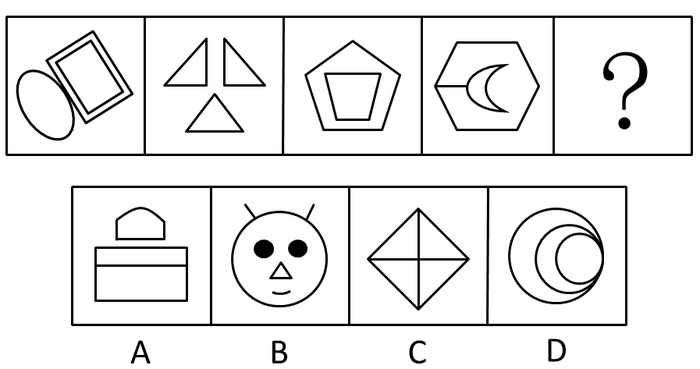
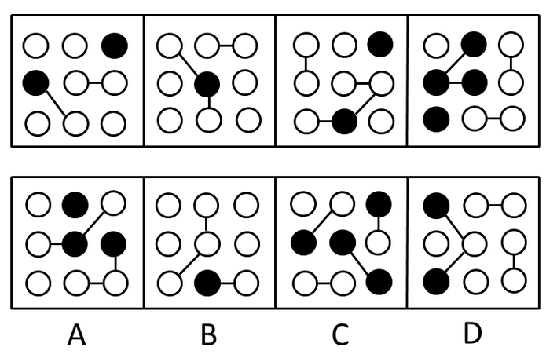
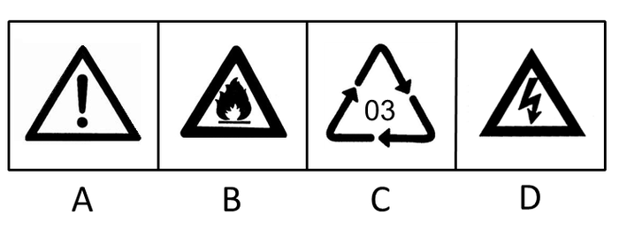
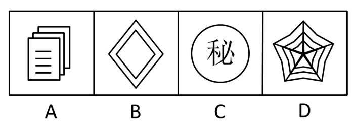
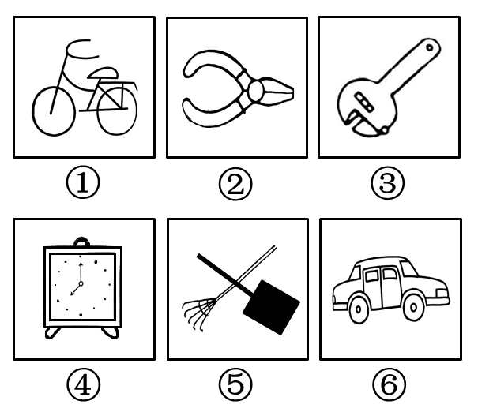
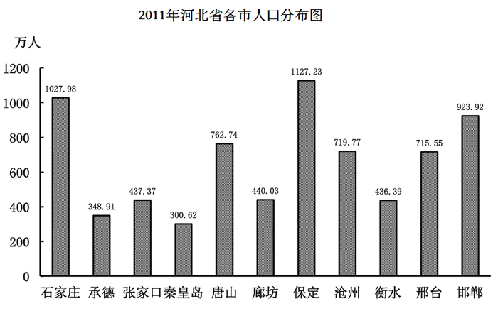
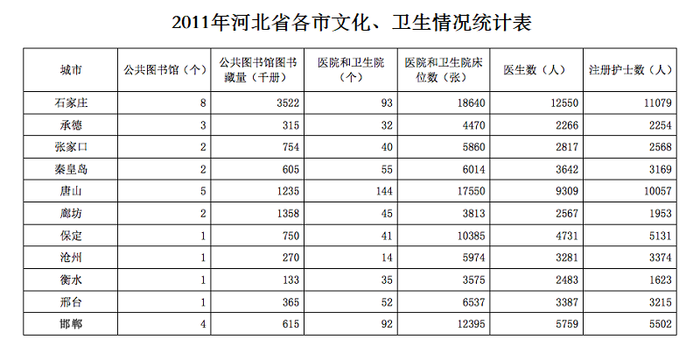
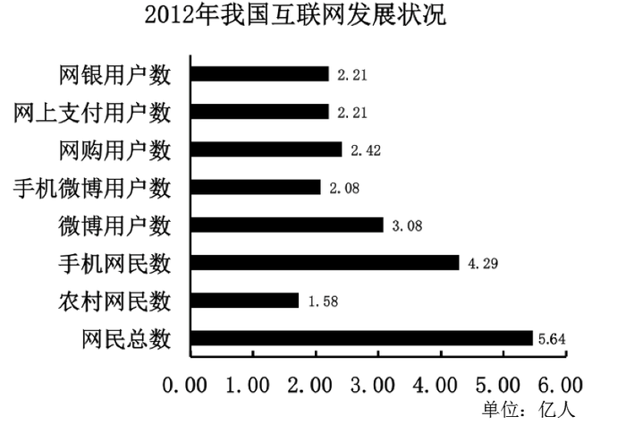
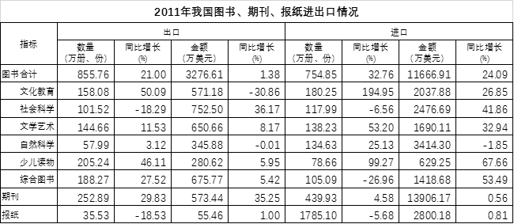

# 2013年河北省公务员录用考试《行测》题

<!-- gwy:overview:start -->
> **河北 · 2013 · 行测 · 统考** ｜ 125 题 · 图片 9 处 · 答案随题折叠

| 题型模块 | 题量 | 题号 |
| --- | ---: | ---: |
| 言语理解与表达 | 35 | 1–35 |
| 数量关系 | 15 | 36–50 |
| 判断推理 | 35 | 51–85 |
| 资料分析 | 15 | 86–100 |
| 常识判断 | 25 | 101–125 |
| **合计** | **125** | |

导航：[题型与作答说明](#题型与作答说明) · [题目](#题目) · [材料 1](#材料-1)
<!-- gwy:overview:end -->

> 候选采集稿。参考答案及解析来自粉笔页面，不代表官方答案或真实高分答卷；来源使用许可与原卷对应关系仍需人工核实。

## 题型与作答说明

言语理解与表达

（35题）

每道题给出一段文字，从四个选项中选出一个最恰当的答案。

数量关系

（15题）

本部分包括数字推理与数学运算两种类型的题目。

判断推理

（35题）

本部分包括图形推理、定义判断、类比推理与逻辑判断四种类型的试题。

资料分析

（15题）

针对下列图、表或文字回答问题。你应该根据资料提供的信息进行分析、比较、计算、处理。

常识判断

（25题）

根据题目要求，在四个选项中选出一个正确答案。

## 题目

### 第 1 题

虽然处于不同的地域，属于不同的民族，拥有不同的风貌，但人们对主食样貌、口感的追求，处理和加工主食的智慧，以及对主食的深厚感情是同样的。从远古时代赖以充饥的自然谷物到如今人们餐桌上丰盛的、让人垂涎欲滴的美食，一个异彩纷呈、变化多端的主食世界呈现在你面前。

这段话的主题是：

A. 主食与地域性

B. 主食与民族性

C. 主食与多样性

D. 主食与时代性

第 1 题 · 答案与解析

**参考答案（粉笔题库参考内容）**

C

**解析**

本题为中心理解题。

文段为并列结构，第一句介绍不同地域、民族对主食的共同追求，第二句介绍主食世界丰富多彩。由“处于不同的地域，属于不同的民族，拥有不同的风貌”以及“异彩纷呈”、“变化多端”等词句可知，文段强调主食的多样性，对应C项。

A、B、D三项均不全面，注意文段为并列结构，所选答案应全面涵盖文段内容。

故正确答案为C。

**考点**：关联词-并列

**来源**：2013年河北省公务员录用考试《行测》题第1题

### 第 2 题

片面强调“知识改变命运”的价值取向，使得理想、信念教育难以入脑入心。大学内外把大学歪曲成名利场，这种认识对高等教育造成了严重的误解和挤压。对此，高校要重建大学精神，整顿学风、校风。更重要的是从小学、中学就要突破应试教育的偏向，培养有正确追求、人格健全的新人。

最符合这段话主旨的一项是：

A. 为了爹娘，为了自己，拼了

B. 目标清华当仁不让，理想北大美梦成真

C. 教育改变命运，草根子弟翻身

D. 得天下英才而育之，为中华崛起而读书

第 2 题 · 答案与解析

**参考答案（粉笔题库参考内容）**

D

**解析**

本题为中心理解题。

文段首先引出价值取向等问题，之后通过“对此”总结前文，指出大学应重建大学精神，最后通过程度词“更”强调中小学要正确培养新人，对应D项。

A项“为了爹娘，为了自己”无中生有，排除；

B项 “理想北大美梦成真”及C项“教育改变命运”均对应文段首句“知识改变命运”的价值取向，非重点，排除。

故正确答案为D。

**考点**：关联词-对策

**来源**：2013年河北省公务员录用考试《行测》题第2题

### 第 3 题

快乐不应该是单一的、短暂的、完全依赖外部条件的，而应该是丰富的、持久的、能够靠自己创造的，否则结果仍是不快乐。“可持续的发展”用在这里正合适。青春终究会消逝，如果只是及时行乐，毫不为今后考虑，倒真会“老大徒伤悲”了。

对上述观点概括比较准确的一项是：

A. 应该创造丰富持久的快乐

B. 自己创造的快乐是可持续的

C. 快乐应该是及时行乐

D. 青春会消逝，快乐恒久远

第 3 题 · 答案与解析

**参考答案（粉笔题库参考内容）**

A

**解析**

本题为中心理解题。

文段第一句为主旨句，后两句是对主旨句的补充和说明。

因此，结合选项应该选择A项，A项准确地概括了主旨句。

文段中“自己创造”与“可持续的发展”是并列的关系，并非互为属性，B项错误；由最后一句可知，C项表述错误，快乐不能只是及时行乐；D项表述过于绝对。

故正确答案为A。

**考点**：关联词-对策、分述句特征-其他

**来源**：2013年河北省公务员录用考试《行测》题第3题

### 第 4 题

每个年轻人都要经历社会化过程。正道直行固然有一种简约之美，但在参差多态的社会里，仅有这一招是远远不够的。灵动如蛇固然是聪明而富有效率的，但如果没有内心的方圆和规矩，纯粹的机会主义者行而不远。因而，社会这位无处不在的严师总是教化人们，要在坚持原则和事急从权之间找到一个平衡点，在无伤大雅和誓不低头之间找准分寸感。

最能体现这段话主旨的是：

A. 歧路纷纷，直道而行

B. 处世之道的选择

C. 过于锋芒毕露不利于年轻人的成长

D. 参差多态方为世界之美

第 4 题 · 答案与解析

**参考答案（粉笔题库参考内容）**

B

**解析**

文段开篇指出每个年轻人都要经历社会化过程，接着分别阐述正道直行和灵动如蛇这两种方式的局限性，最后通过“因而”得出结论，强调年轻人在社会化过程中要在坚持原则和事急从权之间找到平衡点，在无伤大雅和誓不低头之间找准分寸感，即要选择合适的处世之道。故文段重点在尾句，强调年轻人在社会化过程中应如何选择处世之道，对应B项。

A项“直道而行”对应结论前的内容，且只强调了一种方式，非重点且表述片面，排除；

C项“过于锋芒毕露不利于年轻人的成长”文段未提及，无中生有，排除；

D项，文段强调年轻人在社会化过程中应如何选择处世之道，并非论述“世界之美”，偏离文段核心话题，排除。

故正确答案为B。

**考点**：关联词-因果

**来源**：2013年河北省公务员录用考试《行测》题第4题

### 第 5 题

这是中国式的隐忍，中国人像野草一样，即使遭遇地火焚烧的大灾难，他们仍然熬得住，挺得牢，来年春天，又会满山遍野绽放新绿。一个人可以有许多品德，但基本的品德，我认为是“熬”这个字。一个人懂得了“熬”，就说明他有信念，他有坚持，他有原则，咬紧牙关能熬下来，他就是一个个性英雄，虽败犹荣。

这段文字意在强调：

A. 中国人的忍耐和坚强

B. 中国人的信念和原则

C. 中国人能够战胜任何灾难

D. 中国人的英雄气概

第 5 题 · 答案与解析

**参考答案（粉笔题库参考内容）**

A

**解析**

本题考查中心理解。

文中的关键字是“熬”，文中指出，“懂得了‘熬’，就说明他有信念，他有坚持，他有原则”，所以我们只需找到和“熬”字表达同样含义的选项。同时，文段首句指出“这是中国式的隐忍”，结合后文，“这”指代的就是“熬”。所以与隐忍、忍耐、坚持、坚强相关的选项均可，对应A项。

B项“信念和原则”与D项“英雄气概”均表述不够明确，未能体现出“熬”的核心话题，排除；

C项中“战胜任何灾难”过于绝对，文段中体现的是中国人的坚韧和不放弃，面对任何灾难都能坚持下去，而不是“战胜”，排除。

故正确答案为A。

**考点**：分述句特征-引入铺垫

**来源**：2013年河北省公务员录用考试《行测》题第5题

### 第 6 题

王羲之书法所表现出的那种姿韵萧散、超然于物外的雅逸之风，一直是后代书法家极力追摹的理想境界。王羲之的书法从容自得、真率烂漫，没有一点尘埃气的风流神韵，散发着当时的时代趣味，展示了当时士人向外发现了自然、向内发现了自我的自信和超逸，成为引领这一书风的代表。

最能概括王羲之书法风格的是：

A. 傲岸磅礴，潇洒出神

B. 肉不没骨，筋不外透

C. 清华雅淡，晋人尚韵

D. 丰富肥厚中藏道劲之趣

第 6 题 · 答案与解析

**参考答案（粉笔题库参考内容）**

C

**解析**

本题为中心理解题。

文段阐述的主体是王羲之的书法风格。阐述的内容：“雅逸之风、从容自得、真率灿漫、风流神韵、自信、超逸”。

因此，结合选项应该选择C项，C项概括最为全面。

故正确答案为C。

**考点**：关联词-并列

**来源**：2013年河北省公务员录用考试《行测》题第6题

### 第 7 题

本文针对直接法和二步法合成聚乳酸的共性，从单体纯度、催化剂选择到共沸脱水、微波辅助、超临界流体介质，以及到固相聚合、反应挤出、扩链等各个方面，对近年来聚乳酸合成研究的新进展进行了综述，指出各种新方法、新技术的复合应用是提高聚乳酸分子量、降低其成本的关键。

最能概括这段话主题的是：

A. 聚乳酸的共性及合成关键

B. 聚乳酸的共性与降低成本的新技术

C. 聚乳酸超临界流体介质的研究

D. 聚乳酸合成研究中复合应用的新进展

第 7 题 · 答案与解析

**参考答案（粉笔题库参考内容）**

D

**解析**

本题为中心理解题。

前两个分句的主干是对“聚乳酸合成研究的新进展进行了综述”，后一句指出“各种新方法、新技术的复合应用”是关键，即为D项“聚乳酸合成研究中复合应用的新进展”。

故正确答案为D。

**考点**：分述句特征-引入铺垫

**来源**：2013年河北省公务员录用考试《行测》题第7题

### 第 8 题

“世界汽车之都”底特律的日趋没落让人们看到，一座城市的产业结构如果过于单一，抗击外部风险的能力就会很差。对于产业结构单一的城市来说，一旦支柱产业或支柱企业出现衰退，整个城市的经济就容易陷入困境，从而影响城市的持续发展。例如一些资源型城市，依靠自然资源的开采和相关产业得到发展，但随着资源的枯竭，就会陷入衰退。

最能概括这段文字的是（    ）。

A. 底特律的产业结构过于单一

B. 底特律属于资源型城市

C. 底特律没落的警示意义

D. 底特律的没落不是个案

第 8 题 · 答案与解析

**参考答案（粉笔题库参考内容）**

C

**解析**

文段开篇指出底特律的没落说明一个城市如果产业结构过于单一，抗击外部风险能力就差，接着介绍了产业结构单一会影响城市的持续发展，并通过例子进行论证，故文段重点强调底特律没落带来的警示，对应C项。

A项，“产业结构过于单一”非重点，文段重点强调会产业结构单一带来的危害，排除；

B项，“资源型城市”对应文段举例子的内容，非重点，排除；

D项，“不是个案”文段并未提及，无中生有，排除。

故正确答案为C。

**考点**：分述句特征-举例子、分述句特征-其他

**来源**：2013年河北省公务员录用考试《行测》题第8题

### 第 9 题

碳汇造林正逐渐成为北方某市市民履行义务植树责任的形式之一。在经过几十年的营造和平原大造林后，该市适宜大规模造林的地方越来越少，由于路途遥远、交通问题、活动统筹困难等原因，组织大型植树活动也越来越困难，而人人都能参加的碳汇造林从根本上解决了这个问题。相关细则规定，个人购买碳汇达到60元的，折算为植3株树的义务。购买碳汇的资金将由专业人员实施碳汇造林、营林，协助单位和个人履行义务造林和应对气候变化的社会责任。

对这段话的理解正确的是：

A. 该市不再适宜大规模造林，以后将不再组织大型植树活动

B. 关心环境和气候变化的该市市民可以成为“买碳人”

C. 碳汇造林辅助解决了该市的交通问题，有利于市民的身心健康

D. 人人都要参加碳汇造林，这是个人要履行的造林义务

第 9 题 · 答案与解析

**参考答案（粉笔题库参考内容）**

B

**解析**

由提问可知本题为细节判断题。第一句是作者的观点，之后分别对碳汇造林背景和具体措施进行了阐述。B项正确。

A、D两项过于绝对；C项用词“交通问题”错误。

故正确答案为B。

**考点**：细节判断题

**来源**：2013年河北省公务员录用考试《行测》题第9题

### 第 10 题

一份哈佛商学院的报告表明，公司管理和薪资的变化使美国公司管理人员采取一种关注股价和短期业绩的管理方式。当一家公司聚焦短期利润和股价时，管理层可能会创新，但这些创新都与提高效率和降低成本有关。相反，能够带来附加值的创新，特别是具有变革意义的创新，则很可能被认为风险过大、代价过高而得不到投资。公司将持续被节省成本的创新所吸引，即使这种方式会使公司走上全球竞争力不断减弱直至灭亡的道路。

最适合这段文字的标题是：

A. 短期利润与具有变革意义的创新

B. 哈佛商学院与美国公司的管理理念

C. 利润压力使公司管理方式误入歧途

D. 管理层的短视使美国公司缺乏创新动力

第 10 题 · 答案与解析

**参考答案（粉笔题库参考内容）**

D

**解析**

由提问可知本题为标题填入题。文段为议论文文体，整体为分—总结构。文段指出了由于领导者过分重视短期利润，导致企业缺乏具有竞争力的创新。结合选项，D项表述与文段中心意思一致，当选。

A项没有体现出文段的核心意思，只是论证过程中的一部分，文段讨论的是公司管理层的选择以及给公司带来的后果，排除；B项没有抓住文段重点，“哈佛商学院的报告”只是用于引出论题，并非文段讨论主体，排除；C项扩大了文段的主体范围，文段讨论的主体是美国公司而非所有的公司，排除。

故正确答案为D。

**考点**：标题填入题

**来源**：2013年河北省公务员录用考试《行测》题第10题

## 材料 1

在大学里讲美学，我不太会用到“竞争力”。美可能是一朵花，很难去想象如果我凝视这朵花，跟竞争力有什么关系。

        我曾在美索不达米亚发现八千年前的一个雕刻：一个女孩子从地上捡起一朵落花闻。这个季节走过北京，如果地上有一朵落花，很可能一个北京的女孩子，也会把它拣起来闻。这是一个美的动作，它不是今天才发生的，八千年前的艺术品里就有。所以我在大学上美学课不谈竞争力，就谈这朵花。

        那时，我在台湾中部的东海大学。校园很大，整个大度山都是它的校园，校园里到处都是花，每年四月开到满眼缭乱。教室的窗户打开，学生们根本不听我讲课。刚开始我有一点生气，可是我想，要讲美，我所有的语言加起来其实也比不上一朵花。所以我就做了一个决定：“你们既然没办法专心听课，我们就去外面。”他们全体欢呼，坐在花树底下，我问：“为什么你觉得花美？”有说形状美，有说色彩美，有说花有香味······

        把这一切加起来，我们赫然发现：花是一种竞争力。它的美其实是一个计谋，用来招蜂引蝶，背后其实是延续生命的旺盛愿望。植物学家告诉我，花的美是在上亿年的竞争中形成的，不美的都被淘汰了。为什么白色的花香味通常都特别浓郁，因为它没有色彩去招蜂引蝶，只能靠嗅觉。我们经常赞叹花香花美，“香”和“美”这些看起来可有可无的字，背后隐藏着生存的艰难。

        后来我跟学生做一个实验，我们用布把眼睛蒙起来，用嗅觉判断哪是含笑，哪是百合，哪是栀子，哪是玉兰······这个练习告诉我们，具体描述某一株花“香”是没有意义的，每种花的香味都不一样，含笑带一点甜香，茉莉的香气淡远······美是什么？另一种物种没法取代才构成美的条件。我问学植物的朋友：“如果含笑的香味和百合一样会怎样？”他说：“那它会被淘汰了，因为它东施效颦，没有找到自己存在的理由。”所以我常常给美下一个定义：美是回来做自己。

### 第 11 题

对“花是一种竞争力”的理解，不符合短文原意的一项是：

A. 白色的花不参与竞争

B. 花在生长过程中必然经历激烈竞争

C. 花经历了千百年的优胜劣汰

D. 花需要吸引蜂蝶传授花粉

第 11 题 · 答案与解析

**参考答案（粉笔题库参考内容）**

A

**解析**

白色的花并非不参与竞争，只是扬长避短，在香气上获得胜算，A项说法错误。

根据第四段“花的美是在上亿年的竞争中形成的，不美的都被淘汰了”可知，B、C两项说法正确；由“它的美其实是一个计谋，用来招蜂引蝶，其背后其实是延续生命的旺盛愿望”可知，D项说法正确。

本题为选非题，故正确答案为A。

**来源**：2013年河北省公务员录用考试《行测》题第11题

### 第 12 题

关于“美是回来做自己”，最符合短文原意的一项是：

A. 人需要自我观照

B. 美是生物生存的需要

C. 一个美的动作可以跨越千年

D. 凸显个性的需求

第 12 题 · 答案与解析

**参考答案（粉笔题库参考内容）**

D

**解析**

定位原文“东施效颦，没有找到自己存在的理由”，意在强调要有自己的个性，只有D项提到了个性。

故正确答案为D。

**来源**：2013年河北省公务员录用考试《行测》题第12题

### 第 13 题

最符合本文主旨的是：

A. 美是一种看不见的竞争力

B. 美是对象化了的人的本质

C. 美在心灵

D. 美是天人合一

第 13 题 · 答案与解析

**参考答案（粉笔题库参考内容）**

A

**解析**

文段为分—总结构，整个文段都是围绕“美与竞争力的关系”进行论述的。开始描述作者自己的经历，最后得出结论，即美是一种竞争力；最后一段是对于“美是一种竞争力”的具体阐述。

故正确答案为A。

**来源**：2013年河北省公务员录用考试《行测》题第13题

### 第 14 题

具体描述某一株花“香”是没有意义的，对这一说法理解错误的一项是：

A. 每种花的香味都不一样，比较没有意义

B. 每种花的香味都不一样，无法量化

C. 每种花的香味都不一样，人的嗅觉难以具体判断

D. 每种花的香味都不一样，各具特色

第 14 题 · 答案与解析

**参考答案（粉笔题库参考内容）**

C

**解析**

文段中指出具体描述某一株花“香”是没有意义的，强调的是其抽象意义，而不是C项中的具体行为“人的嗅觉难以具体判断”，C项表述理解有误。

本题为选非题，故正确答案为C。

**来源**：2013年河北省公务员录用考试《行测》题第14题

### 第 15 题

下列各项中，哪一项无法从文中看出？

A. 作者十分重视美学教育

B. 作者将美育与德育相结合

C. 作者采用了情境教学的方法

D. 作者将生命体验引入教学

第 15 题 · 答案与解析

**参考答案（粉笔题库参考内容）**

B

**解析**

文段没有讲到美育与德育的结合。因此，结合选项应该选择B项，B项属于无中生有。

由作者带领学生出去欣赏美，引导学生思考美，做实验等可以看出作者对于美学教育是十分重视的，A项可以推出；由“我”带领学生去教室外面，感受、思考美，可以得出作者使用“情景教学”的教学方式，C项可以推出；由文段第四段，花运用形态与花香招蜂引蝶，延续生命，D项可以推出。

本题为选非题，故正确答案为B。

**来源**：2013年河北省公务员录用考试《行测》题第15题

### 第 16 题

商品丰富了，产能过剩了，这本身并不完全是坏事。＿＿＿＿＿＿适度的过剩，才能有企业的竞争。＿＿＿＿＿＿都是短缺的话，企业就没有了发展动力。＿＿＿＿＿＿产能严重过剩是值得警惕的，因为这样会引发企业之间的恶性竞争，甚至会引发系统性风险。

从下列选项中选择最恰当的一组填入横线中：

A. 只有 因此 不过

B. 只有 否则 因此

C. 没有 如果 而且

D. 只有 如果 但

第 16 题 · 答案与解析

**参考答案（粉笔题库参考内容）**

D

**解析**

本题考查虚词的应用。

第一空，与“才”搭配，“只有······才······”为必要条件关系，故A、B、D三项保留。C项“没有”与“才”搭配不当，排除。

第二空，与“就”搭配，“如果······就······”为假设条件关系，D项保留。A项“因此”表因果，B项“否则”引导反面论证，均与“就”搭配不当，排除。

第三空，代入验证，D项“但”表转折，体现了“短缺”与“过剩”的相对立，符合语境，当选。

故正确答案为D。

**来源**：2013年河北省公务员录用考试《行测》题第16题

### 第 17 题

远东地区最大、最先进的啤酒厂里，有一台电机默默运转带动生产，一瓶瓶＿＿＿＿＿的啤酒鱼贯产出。转眼109年已逝，这台老电机虽已停运，但仍＿＿＿＿＿地置于原地，成为青岛啤酒博物馆的“镇馆之宝”，讲述着它与青岛啤酒跨越一个世纪的＿＿＿＿。在博物馆里，有时能看见一位年近花甲的老师傅，将这台电机细细摩挲，＿＿＿＿＿许久。他正是前来探望“老友”的李师傅。

从下列选项中选择最恰当的一组填入横线中：

A. 浓香 黯然 情意 注视

B. 纯香 岸然 缘分 凝视

C. 醇香 安然 情谊 凝望

D. 浓香 安然 情缘 凝视

第 17 题 · 答案与解析

**参考答案（粉笔题库参考内容）**

C

**解析**

本题考查实词的应用。

本题从第二空入手，所填词语修饰“老电机”停运之后置于原地的样子。C、D两项“安然”指安静，安安稳稳地样子，符合文意，均保留。A项“黯然”指情绪低落的样子，与文意感情色彩不符，排除；B项“岸然”指严正或高傲的样子，多形容人，和电机搭配不当，排除。

第三空，D项“情缘”多指男女之间的缘分，不符合语境，而由“前来探望‘老友’”可知，C项“情谊”更为恰当，C项保留，排除D项。

第四空，代入验证，C项“凝望”目不转睛地看，与文意相符，保留。

第一空，代入验证，C项“醇香”指酒味醇厚芳香，可修饰“啤酒”，当选。

故正确答案为C。

**考点**：实词填空、对应关系-前后呼应、词的辨析-感情色彩、词的辨析-搭配对象

**来源**：2013年河北省公务员录用考试《行测》题第17题

### 第 18 题

建筑物寿命过短，浪费社会资源，产生建筑垃圾，构成环境威胁。我们除了要谴责豆腐渣工程以外，非质量原因的建筑“短命”现象\_\_\_\_\_\_了决策者的权力任性，更是戳到了城乡规划短视病的痛处。

填入画横线部分最恰当的一项是：

A. 显现

B. 凸显

C. 凸现

D. 突现

第 18 题 · 答案与解析

**参考答案（粉笔题库参考内容）**

B

**解析**

根据文段和选项可知，本题表达“豆腐渣”工程暴露出了决策者的权利任性。A项“显现”和B项“凸显”侧重显，即显示，C项“凸现”和D项“突现”侧重现，即发现，“显”侧重于由暗到明、由模糊到清晰，“现”侧重于由无到有；而“决策者的权力任性”显然原本就是存在的，所以“显”更为合适，排除C、D两项。对比A、B两项，B项“凸显”侧重凸，凸出，表达凸出显示，程度更重，对应文段“短命”“痛处”“威胁”更加恰当，当选。

故正确答案为B。

**考点**：实词填空、词的辨析-词义侧重

**来源**：2013年河北省公务员录用考试《行测》题第18题

### 第 19 题

①刚才还是白云朵朵，阳光灿烂，＿＿＿＿＿却又是乌云密布，大雨倾盆。

②广西民歌唱的多是情歌酬和，或见景生情，即物起兴，用各种＿＿＿＿＿来比赛机智才能。

③我在山间溪水中沐浴，在溪畔我盖了一间茅舍，溪水＿＿＿＿＿催我入眠。

④不过，历史总有一面会被＿＿＿＿＿，消失于黑暗中。

从下列选项中选择最恰当的一组填入横线中：

A. 一霎间 譬喻 潺潺 抹去

B. 刹间 比喻 汩汩 抹杀

C. 刹时 譬喻 滔滔 抹去

D. 瞬间 比喻 汩汩 抹杀

第 19 题 · 答案与解析

**参考答案（粉笔题库参考内容）**

A

**解析**

本题考查实词的应用。

本题可从第三空入手。“山涧溪水”显然不能与“滔滔”搭配，排除C项。

第四空，“抹杀”语义过重，“抹去”更为合适，排除B、D两项。

第一空，代入验证，A项“一霎间”指一会儿，形容时间极短，与“刚才”对应恰当，体现出天气变化极快，保留。

第二空，代入验证，A项“譬喻”指比喻，置于此处能够体现出民歌中的“机智才能”，当选。

故正确答案为A。

**考点**：实词填空、词的辨析-搭配对象、词的辨析-程度轻重

**来源**：2013年河北省公务员录用考试《行测》题第19题

### 第 20 题

一个国家的发展道路合不合适，只有这个国家的人民才最有发言权。我们主张，各国和各国人民应该共同享受发展成果。世界长期发展不可能建立在一批国家越来越富裕而另一批国家却长期贫穷落后的基础上。只有各国共同发展了，世界才能更好发展，那种\_\_\_\_\_\_、转嫁危机、\_\_\_\_\_\_的做法，既不\_\_\_\_\_\_也难持久。

从下列选项中选择最恰当的一组填入横线中：

A. 嫁祸于人 害人害己 可能

B. 兄弟阋墙 损人利己 团结

C. 以邻为壑 害人害己 安全

D. 以邻为壑 损人利己 道德

第 20 题 · 答案与解析

**参考答案（粉笔题库参考内容）**

D

**解析**

本题考查成语和实词的应用。前两空以顿号为标志与“转嫁危机”构成近义并列，第一空，“兄弟阋墙”比喻内部争斗，无法构成近义并列；“嫁祸于人”意为把灾祸、罪责等转移到别人身上，“以邻为壑”比喻嫁祸于人或把困难、问题推给别人，均可与“转嫁危机”并列，排除B项。第二空，“转嫁危机”之后肯定不会继续“害己”，故排除A、C两项。以第三空验证，“道德”与“损人利己”这种不道德的行为相呼应，符合语境，D项当选。

故正确答案为D。

**考点**：关联关系-并列关系、混搭填空

**来源**：2013年河北省公务员录用考试《行测》题第20题

### 第 21 题

①报道中有关奥姆真理教制造的东京地铁沙林毒气案的细节，真是＿＿＿＿＿＿，令人震惊。

②这个骇客群体专门制造＿＿＿＿＿＿的虚假新闻，许多年轻人因此上当受骗。

③本文所引古事古语几乎都是名人之事、名人之言，甚至圣贤之事、圣贤之言，其正确性是＿＿＿＿＿＿的。

④钓鱼岛自古以来就是中国领土。钓鱼岛的所有权问题＿＿＿＿＿＿，用不着第三国来指手画脚。

从下列选项中选择最恰当的一组填入横线中：

A. 耸人听闻 骇人听闻 不容置喙 不容置疑

B. 骇人听闻 耸人听闻 不容置疑 不容置喙

C. 骇人听闻 耸人听闻 不容置喙 不容置疑

D. 耸人听闻 骇人听闻 不容置疑 不容置喙

第 21 题 · 答案与解析

**参考答案（粉笔题库参考内容）**

B

**解析**

前两空，“耸人听闻”指故意说夸大或惊奇的话，使人听了感到惊异或震惊，通常搭配虚假的现象；“骇人听闻”指使人听了非常吃惊、害怕的话，通常搭配真实的现象。第一空搭配真实的报道，“骇人听闻”符合文意，第二空搭配“虚假新闻”，“耸人听闻”符合文意，排除A、D两项。

后两空，“不容置疑”指真实可信，无可怀疑。“不容置喙”指不允许别人插嘴说话。显然第四空为“不容置喙”，与“指手画脚”对应，排除C项。

故正确答案为B。

**考点**：成语填空、词的辨析-搭配对象、词的辨析-词义侧重

**来源**：2013年河北省公务员录用考试《行测》题第21题

### 第 22 题

在微博上，不同群体表现出的特征各异：“60后”\_\_\_\_\_\_，指点江山，\_\_\_\_\_\_；“70后”\_\_\_\_\_\_，常制造深度话题；“80后”从不\_\_\_\_\_\_，参与度较高；“90后”则基本上是娱乐。

从下列选项中选择最恰当的一组填入横线中：

A. 激扬文字 一泻千里 讷言敏行 深思熟虑

B. 好为人师 胸有成竹 谨言慎行 袖手旁观

C. 深思熟虑 激扬文字 敏锐多思 袖手旁观

D. 激扬文字 胸有成竹 袖手旁观 深思熟虑

第 22 题 · 答案与解析

**参考答案（粉笔题库参考内容）**

C

**解析**

本题可从第四空入手。根据“从不＿＿＿＿＿＿，参与度较高”可知，横线处所填成语与“参与度较高”语义相反，体现不参与之意。B、C项“袖手旁观”比喻置身事外，既不过问，也不协助别人，符合文意，保留。A、D项“深思熟虑”指反复深入细致地考虑，与文意不符，排除。

第二空，“指点江山，激扬文字”为常见固定搭配，用来形容评论时政、抒发抱负，符合文意，C项保留，排除B项。

验证第一空，C项“深思熟虑”指反复深入地考虑，符合60后在微博上的特征，保留。

验证第三空，C项“敏锐多思”与“常制造深度话题”对应，符合文意，当选。

故正确答案为C。

**考点**：关联关系-转折关系、对应关系-前后呼应、成语填空、词的辨析-搭配对象

**来源**：2013年河北省公务员录用考试《行测》题第22题

### 第 23 题

与常规的计算机相比，生物计算机具有密集度高的突出优点。＿＿＿＿＿＿用DNA分子制成生物电子元件，将比硅芯片上的电子元件要小得多，＿＿＿＿＿＿可小到几十亿分之一米。＿＿＿＿＿＿，生物芯片本身具有天然独特的立体化结构，其密度要比平面型硅集成电路高10万倍。

从下列选项中选择最恰当的一组填入横线中：

A. 由于 甚至 所以

B. 如果 甚至 而且

C. 只是 也许 可见

D. 虽然 也许 然而

第 23 题 · 答案与解析

**参考答案（粉笔题库参考内容）**

B

**解析**

本题考查虚词的应用。

第二空，前后显然是递进关系，排除C、D两项。

第三空，最后一句话涉及到的“立体化结构”与前文不存在因果关系，排除A项。

第一空，“如果”表假设，指出了使用的可能性，符合语境，B项当选。

故正确答案为B。

**来源**：2013年河北省公务员录用考试《行测》题第23题

### 第 24 题

①此刻，火星正从5576万公里外的天庭匆匆向地球奔来，同地球“凝目相望”，面对这一＿＿＿＿＿＿的“天象大戏”，明吴不禁拿起望远镜，想看清楚火星这一红色星球的神秘面貌。

②西方哲学家认为，利己是人的本能，对之不应作道德的判断，只可＿＿＿＿＿＿；而同情是人的另一种本能，它以利己为基础，由己出发，＿＿＿＿＿＿，替别人着想，两者不可或缺。

从下列选项中选择最恰当的一组填入横线中：

A. 千载难逢 因人而异 推己及人

B. 千钧一发 因人而异 以己度人

C. 千钧一发 因势利导 以己度人

D. 千载难逢 因势利导 推己及人

第 24 题 · 答案与解析

**参考答案（粉笔题库参考内容）**

D

**解析**

本题考查成语的应用。

第一空，根据文段可知，这种“天象大戏”显然是很少见的，“千载难逢”符合语境，排除B、C两项。

第二空，“利己”是人的本能，是普遍现象，“因人而异”与这种说法矛盾，排除A项。

第三空，验证D项，“推己及人”指设身处地替别人着想，与后文“替别人着想”对应恰当，当选。

故正确答案为D。

**考点**：对应关系-前后呼应、成语填空

**来源**：2013年河北省公务员录用考试《行测》题第24题

### 第 25 题

回首蛇年的央视春晚，＿＿＿＿＿＿的大腕赵本山选择了退出，也不失为明智之举。艺术是有规律的，明星＿＿＿＿＿＿也是有限的，如果硬撑下去，“过度消费”，肯定会掏空自己，＿＿＿＿＿＿，甚至出丑露乖，＿＿＿＿＿＿。

从下列选项中选择最恰当的一组填入横线中：

A. 红极一时 底蕴 捉襟见肘 惹人耻笑

B. 炙手可热 底蕴 江郎才尽 贻笑大方

C. 红极一时 能力 江郎才尽 贻笑大方

D. 炙手可热 能力 捉襟见肘 竹篮打水

第 25 题 · 答案与解析

**参考答案（粉笔题库参考内容）**

B

**解析**

本题可以通过第二空入手。

第一空，A、B、C、D四项均可，保留。

第二空，区分“底蕴”与“能力”，对应后文“肯定会掏空自己”，横线处所填内容应该是可以消耗的。“底蕴”就是强调内涵，内在的储备，比如文化底蕴等，比如在做某事时，将有限的底蕴全部使用，再想去展示其他的便不存在的了，可以对应后文的掏空，表示自己的才华全部展现出来了，没有更多的了。A、B两项保留；“能力”是自己具备的本事，体现不出来可消耗性，对应不到后文，C、D两项排除。

第三空，对应前面的“掏空自己”，体现的是没有了，B项“江郎才尽”比喻人的文思减退，可以对应到“掏空自己”，保留。A项“捉襟见肘”比喻顾此失彼，穷于应付，与“掏空”对应不上，排除A项。

第四空，代入验证，B项“贻笑大方”指被内行人看笑话，表示没有才华后的演出，被同行批评，并且对应出丑露乖，当选。

故正确答案为B。

**考点**：对应关系-前后呼应、混搭填空

**来源**：2013年河北省公务员录用考试《行测》题第25题

### 第 26 题

“正能量”是指一种健康乐观、积极向上的动力和情感。当下，中国人为所有积极的、健康的、催人奋进的、给人力量的、充满希望的人和事，贴上“正能量”标签。

下列关于“正能量”运用不够贴切的一项是：

A. 苍天啊，请赐给我正能量吧，让我对抗这邪恶的势力。

B. 政府建设服务型社会，需要积极创造宏观正能量。

C. 我渴望爱情，因为爱情是我生命里的正能量。

D. 对小事斤斤计较，这也是我们生活中的正能量。

第 26 题 · 答案与解析

**参考答案（粉笔题库参考内容）**

D

**解析**

“正能量”是指一种健康乐观、积极向上的动力和情感，而“斤斤计较”显然是一种不好的习惯，不应为正能量，运用不够贴切。

本题为选非题，故正确答案为D。

**考点**：实词

**来源**：2013年河北省公务员录用考试《行测》题第26题

### 第 27 题

对下列词语意义的解释，正确的一组是：

A. 流刑（流放的刑罚） 流星赶月（形容迅速） 流连（留恋不舍离去）

B. 声望（名声、名气） 声泪俱下（形容极其悲恸） 声气（声音中带气）

C. 临终（人将要死） 临危授命（危难时期被任命） 临深履薄（比喻谨慎戒惧）

D. 虚辞（与实词相对的词类） 虚怀若谷（形容十分谦虚） 虚造（凭空捏造）

第 27 题 · 答案与解析

**参考答案（粉笔题库参考内容）**

A

**解析**

只有A项中全部解释正确。

“声气”指说话时的语气、语调，也指消息、信息，B项中解释错误，排除B项；“临危授命”指在危急关头勇于献出生命，C项中解释错误，排除C项；D项中“虚辞”是指浮夸不实的言语，与实词相对的应为“虚词”，排除D项。

故正确答案为A。

**来源**：2013年河北省公务员录用考试《行测》题第27题

### 第 28 题

下列各句中，没有语病的一句是：

A. 征税须立法在先，各国均依法征税原则写入宪法，中国也不例外。

B. 现代高新技术在图书馆领域的广泛应用，引发了图书馆运行机制的变革，其结果将会出现一个全新图书信息交流系统的技术，从而对图书馆的发展产生重大影响。

C. 超市以带有欺诈性质的“标低卖高”行为，来诱导顾客上当受骗，其本身折射的是企业缺乏最基本的诚信和正确的经营理念，伤害的是顾客的心和信任。

D. 为增强全体员工的文明服务意识，进一步提高职业道德素质，我省某商业银行将采取强有力的措施，在本系统内广泛推行文明服务用语和服务忌语。

第 28 题 · 答案与解析

**参考答案（粉笔题库参考内容）**

C

**解析**

A项，句子成分残缺，缺谓语，应改为“各国均将······写入宪法”，存在语病，排除；

B项，语病1：动宾搭配不当，“出现”与“技术”搭配不当，应删除“的技术”；语病2：句式杂糅，“其结果”和“将会出现”句式冗杂，应改为“其结果是······”或“将会出现······的结果”，存在语病，排除。

C项，表意明确，没有语病，当选；

D项，动宾搭配不当，“推行”与“服务忌语”搭配不当，存在语病，排除。

故正确答案为C。

**来源**：2013年河北省公务员录用考试《行测》题第28题

### 第 29 题

下列各句中，没有语病的一句是：

A. 据刘大使介绍，这位非洲国家前领导人在位时期，他就开始使用“全天候朋友”一词。

B. 尽管作为欧盟成员国的希腊经济总量有限，其债务危机不足以使美国经济受到直接冲击，但是仍然会间接影响美国经济的复苏进程。

C. 灾后重建三年目标任务两年基本完成的原因：一是十八个对口援建省市支援的结果，二是灾区干部群众自力更生所取得的成绩。

D. 从医学角度看，早餐在供应血糖方面起着重要的作用。不吃或少吃早餐，会使血糖不断下降，造成思维减慢、反应迟钝、出现低血糖休克，甚至精神不振。

第 29 题 · 答案与解析

**参考答案（粉笔题库参考内容）**

B

**解析**

A项，成分赘余，句内出现“非洲国家前领导人”与代词“他”双重主语，造成指代不明，存在语病，排除；

B项，表述正确，没有语病，当选；

C项，句式杂糅，应去掉“的原因”，存在语病，排除；

D项，语序不当，症状程度应由轻到重，应调整为“精神不振，甚至出现低血糖休克”，存在语病，排除。

故正确答案为B。

**来源**：2013年河北省公务员录用考试《行测》题第29题

### 第 30 题

下列句子组成语义连贯的语段，排序最恰当的一项是：

①如果你没有过走进别人内心世界的机会，你就永远不会理解历史和个体的复杂性。

②只要你进入过一次别人的内心世界，你再看待其他人的时候，你就会去考量：是不是我把自己的观点强加在了人家身上？

③我们以前老讲“要推己及人，要学会宽恕”，大多数人会认为这是一个态度问题，即要学会去体谅别人。

④实际上，态度固然重要，但更核心的是能力问题。

⑤因为人都以自我为中心来看世界，所以才看不到别人经历的东西。

A. ③①②④⑤

B. ③④⑤②①

C. ③④①⑤②

D. ①②⑤③④

第 30 题 · 答案与解析

**参考答案（粉笔题库参考内容）**

C

**解析**

对比选项，确定首句。①句论述如果没有过走进别人内心世界，就不能理解个体的复杂性，③句说明以前大多数人会认为理解别人是态度问题，均可作为首句，无法排除。

继续观察，④句出现转折关联词“实际上”，说明态度虽然重要，但更核心的是能力，故转折前应说明态度的重要性，③句论述以前大多数人会认为理解别人是态度问题，故③④两句捆绑，而②句说明只要你理解别人的内心世界，就会反思自己的行为是否合理，无法与④句构成转折关系，排除A项。

对比B、C、D三项，区别在于①②⑤的顺序。①句论述如果没有过走进别人内心世界，就不能理解个体的复杂性，⑤句出现关联词“因为”，阐述以自我为中心所以看不到别人经历，⑤句是针对①句的进一步解释，故①⑤捆绑，而②句论述进入别人的内心世界后的转变，应在①⑤之后，因此顺序应为①⑤②，故排除B、D两项。

故正确答案为C。

**考点**：确定捆绑、确定顺序、确定首句-首句特征

**来源**：2013年河北省公务员录用考试《行测》题第30题

### 第 31 题

下列句子中，没有歧义的一项是：

A. 妻子黎方方见到分别刚刚两个月的丈夫时，已经判若两人：以前见面总是那么热情，如今却冷若冰霜。

B. 别看这个人不善言笑，其实这个人很好说话。

C. 请你代我买两张北京到乌鲁木齐的往返飞机票。

D. 全校师生没有一个人否认，素质教育使整个校园发生了巨大变化。

第 31 题 · 答案与解析

**参考答案（粉笔题库参考内容）**

D

**解析**

A项，“已经判若两人”的主语是“妻子”还是“丈夫”指代不明确，排除；

B项，“好”为多音字，“好（hǎo）说话”，表示性格随和、容易商量、好相处，也可理解为“好（hào）说话”，即“健谈、爱说话”，存在歧义，排除；

C项，“两张往返机票”有歧义，可理解为“往返一共两张机票”，也可以理解为“两张北京到乌鲁木齐的机票，加上往返共四张机票”，语义模糊，排除；

D项，“没有一个人否认”，双重否定表示肯定，指全校师生都赞同素质教育使校园发生变化，无歧义，当选。

本题为选非题，故正确答案为D。

**来源**：2013年河北省公务员录用考试《行测》题第31题

### 第 32 题

下列各句中，括号中的成语使用恰当的一句是：

A. 分厂厂长为了这批出口订单，（宵衣旰食），带领工人们日夜奋战，终于赶在规定日期前圆满完成任务，受到总公司的表彰。

B. 泰国的“大象画家”彼得，为它的大象伙伴画的肖像画惟妙惟肖，色彩缤纷，游客们都觉得（不可理喻），惊得目瞪口呆。

C. 年逾花甲的国际机构领导人谈起《论语》来（如数家珍），一个外国人竟有如此深厚的中华文化功底，让在场嘉宾不禁暗暗称道。

D. 作为央视数一数二的花旦主持人，她竟以“工资低”为由毅然抽身，使自己在央视的大好前程（戛然而止）。

第 32 题 · 答案与解析

**参考答案（粉笔题库参考内容）**

C

**解析**

本题考查成语用法。

C项，如数家珍比喻对所讲的事情十分熟悉，符合语境。因此，结合选项应该选择C。

A项，宵衣旰食形容为处理国事而辛勤地工作，语境为分厂厂长，不恰当；B项，不可理喻指没法跟他讲道理，形容蛮横或固执，含贬义，不符合句子语境；D项，戛然而止形容声音突然终止，题干中主语为“前程”，不恰当。

故正确答案为C。

**来源**：2013年河北省公务员录用考试《行测》题第32题

### 第 33 题

下列句子中，歇后语文字使用有错误的一句是：

A. 团里一直把九连当做重点连来建设，你们一个个不要蚂蚁穿豆腐——提不起来，有什么牢骚回头到我办公室去讲。

B. 矿区代表队这次参加乒乓球比赛的成绩惨不忍睹，惹得大伙儿议论纷纷，“这真是孔夫子搬家——全是输”。

C. 何山全这个小伙子就是有股子犟劲儿，平时遇到什么问题都要打破砂锅——问到底，难怪人家在这次技术大比武中拿了个第一！

D. 第三社区为了迎接今冬即将到来的大雪做了充分的准备，说到除雪工具，那是韩信点兵——多多益善。

第 33 题 · 答案与解析

**参考答案（粉笔题库参考内容）**

D

**解析**

D项歇后语不符合语境，前半句指出工具已经准备好了，那么歇后语应当强调的是数量很多，而多多益善是指越多越好，用在尚未准备的阶段更为合适，属于使用不当。

因此，结合选项应该选择D。

A项歇后语书写有误，应为“马尾穿(拴)豆腐——提不起来”，但题干中的写法也经常被提到，不属于使用不当，是强干扰项。

故正确答案为D。

**来源**：2013年河北省公务员录用考试《行测》题第33题

### 第 34 题

下面一段文字，部分分句有语法错误，它们是：

①汉字是世界上历史最悠久的文字之一，是中华民族乃至世界文明最宝贵的文化遗产。

②每一个中国人都应该尊重汉字，正确使用汉字。

③当前社会上汉字存在着诸多不规范现象，

④错字、别字现象较普遍，损坏了汉语的优美和纯洁。

⑤商务印书馆以出版高品质的图书著称于世，

⑥其校编部门在长期校编实践中，依据国家有关汉字规范整理出常见的易混易错汉字表，

⑦具有一定的代表性，读者查考。

A. ①④⑤

B. ②④⑥

C. ④⑤⑦

D. ③④⑦

第 34 题 · 答案与解析

**参考答案（粉笔题库参考内容）**

D

**解析**

③中应为“对汉字的使用存在……现象”；

④搭配不当，“损坏”的对象是实物，不能是“优美和纯洁”这样的抽象事物，可改为“破坏”；

⑦成分残缺，应为“可供读者查考”。

故正确答案为D。

**来源**：2013年河北省公务员录用考试《行测》题第34题

### 第 35 题

对下面一段话所用修辞手法概括正确的是：

这是最好的时代，这是最坏的时代；这是智慧的时代，这是愚蠢的时代；这是信仰的时期，这是怀疑的时期；这是光明的季节，这是黑暗的季节；这是希望之春，这是失望之冬；人们面前有着各样事物，人们面前一无所有。

A. 暗喻、排比、夸张、顶真

B. 暗喻、排比、对比、对仗

C. 顶真、比喻、对比、夸张

D. 顶真、对仗、比喻、对比

第 35 题 · 答案与解析

**参考答案（粉笔题库参考内容）**

B

**解析**

顶真，指上句的结尾与下句的开头使用相同的字或词，用以修饰两个句子的声韵的方法。

文段中没有出现顶真的修辞手法，排除A、C、D三项。

故正确答案为B。

**来源**：2013年河北省公务员录用考试《行测》题第35题

### 第 36 题

1，3，6，9，9，( )。

A. 0

B. 6

C. 9

D. 18

第 36 题 · 答案与解析

**参考答案（粉笔题库参考内容）**

A

**解析**

原数列为递推数列。

相邻两项中，后项与前项之差的3倍等于下一项，具体规律如下：(3－1)×3＝6，(6－3)×3＝9，(9－6)×3＝9，所以未知项为(9－9)×3＝0。

故正确答案为A。

**来源**：2013年河北省公务员录用考试《行测》题第36题

### 第 37 题

1，7/8，11/16，1/2，11/32，（    ）。

A. 29/128

B. 27/64

C. 15/32

D. 7/32

第 37 题 · 答案与解析

**参考答案（粉笔题库参考内容）**

A

**解析**

数列反约分后变形为4/4、7/8、11/16、16/32、22/64、（    ）；

分子列：4、7、11、16、22、（29），为二级等差数列，后项减去前项得到3、4、5、6、（7），为等差数列；

分母列：4、8、16、32、64、（128），为等比数列。

所以未知项为29/128。

故正确答案为A。

**来源**：2013年河北省公务员录用考试《行测》题第37题

### 第 38 题

1，5，9，( )，17，21。

A. 12

B. 13

C. 14

D. 15

第 38 题 · 答案与解析

**参考答案（粉笔题库参考内容）**

B

**解析**

原数列为等差数列，公差为4，所以未知项为9＋4＝17－4＝13。

故正确答案为B。

**来源**：2013年河北省公务员录用考试《行测》题第38题

### 第 39 题

1，10，37，82，145，（    ）。

A. 170

B. 197

C. 224

D. 226

第 39 题 · 答案与解析

**参考答案（粉笔题库参考内容）**

D

**解析**

方法一：原数列为幂次修正数列。

原数列：1 10 37 82 145 ( )；

幂次项：0² 3² 6² 9² 12² 15²，底数成等差数列；

修正项：+1 +1 +1 +1 +1 +1为常数。

所以未知项为15^2+1=226。

方法二：数列无明显特征，考虑作差。后项-前项，得9，27，45，63；再作差，后项-前项，是公差为18的等差数列。那么63＋18=81，原数列所求项=145+81=226。

故正确答案为D。

**来源**：2013年河北省公务员录用考试《行测》题第39题

### 第 40 题

\-1，1，7，25，79，( )。

A. 121

B. 241

C. 243

D. 254

第 40 题 · 答案与解析

**参考答案（粉笔题库参考内容）**

B

**解析**

原数列为三倍递推数列。

数列中相邻两项，前项的3倍加上4等于后项，所以未知项为79×3＋4＝241。

故正确答案为B。

**来源**：2013年河北省公务员录用考试《行测》题第40题

### 第 41 题

1005×10061006 - 1006×10051005 =

A. 0

B. 100

C. 1000

D. 10000

第 41 题 · 答案与解析

**参考答案（粉笔题库参考内容）**

A

**解析**

原式 = 1005 × 1006 × 10001−1006 × 1005 × 10001 = 0。

故正确答案为A。

**来源**：2013年河北省公务员录用考试《行测》题第41题

### 第 42 题

施工队要在一东西长600米的礼堂顶部沿东西方向安装一排吊灯，根据施工要求，必须在距西墙375米处安装一盏，并且各吊灯在东西墙之间均匀排列（墙角不能装灯）。该施工队至少需要安装多少盏吊灯？

A. 6

B. 7

C. 8

D. 9

第 42 题 · 答案与解析

**参考答案（粉笔题库参考内容）**

B

**解析**

本题考查植树问题。根据题意，可将顶部分为两段，一段为375，一段为225，因为吊灯要均匀排列，且求最小值，所以要求375和225的最大公约数，为75米，即最大间隔为75米；由于两端不装灯，则可得600÷75＋1－2＝7盏。

故正确答案为B。

**来源**：2013年河北省公务员录用考试《行测》题第42题

### 第 43 题

一只猎豹锁定了距离自己200米远的一只羚羊，以108千米/小时的速度发起进攻，2秒钟后，羚羊意识到危险，以72千米/小时的速度快速逃命。问猎豹捕捉到羚羊时，羚羊跑了多少路程？

A. 520米

B. 360米

C. 280米

D. 240米

第 43 题 · 答案与解析

**参考答案（粉笔题库参考内容）**

C

**解析**

猎豹的速度为108千米/小时，即30米/秒，当羚羊意识到危险时，二者距离为200－30×2＝140米，而羚羊的速度为72千米/小时，即20米/秒；这是一个运动追及问题，故可得140 ÷ (30-20) = 14秒，即羚羊从开始跑到被追上一共用了14秒，共跑了20×14＝280米。

故正确答案为C。

**考点**：相遇追及

**来源**：2013年河北省公务员录用考试《行测》题第43题

### 第 44 题

一个金鱼缸，现已注满水。有大、中、小三个假山，第一次把小假山沉入水中，第二次把小假山取出，把中假山沉入水中，第三次把中假山取出，把小假山和大假山一起沉入水中。现知道每次从金鱼缸中溢出水量的情况是：第一次是第二次的1/3，第三次是第二次的2倍。问三个假山的体积之比是多少？

A. 1:3:5

B. 1:4:9

C. 3:6:7

D. 6:7:8

第 44 题 · 答案与解析

**参考答案（粉笔题库参考内容）**

B

**解析**

放入小假山，设溢出水的体积为V，则小假山的体积为V；小假山取出，放入中假山，中假山除了将已溢出的体积V填满，还溢出3V体积的水，则中假山的体积是4V；同理，小假山和大假山除了将已溢出的体积4V填满，还溢出了6V，则大假山的体积为4V+6V−V=9V，可得三者之比为1:4:9。

故正确答案为B。

**考点**：几何其他题型、和差倍比问题

**来源**：2013年河北省公务员录用考试《行测》题第44题

### 第 45 题

某医院有一氧气罐匀速漏气，该氧气罐充满后同时供40人吸氧，60分钟后氧气耗尽，再次充满该氧气罐同时供60个人吸氧，则45分钟后氧气耗尽。问如果该氧气罐充满后无人吸氧，氧气耗尽需要多长时间？

A. 1.5小时

B. 2小时

C. 2.5小时

D. 3小时

第 45 题 · 答案与解析

**参考答案（粉笔题库参考内容）**

D

**解析**

这是一个变形的牛吃草问题。

设原有氧气为M，漏气速度为V，则可得(40+V)×60 = (60+V)×45 = M，解得V＝20，M＝3600，如果没人吸氧，则可得耗尽的时间为3600÷20＝180分钟，即3小时。

故正确答案为D。

**来源**：2013年河北省公务员录用考试《行测》题第45题

### 第 46 题

把黑桃、红桃、方片、梅花四种花色的扑克牌按黑桃10张、红桃9张、方片7张、梅花5张的顺序循环排列。问第2015张扑克牌是什么花色？

A. 黑桃

B. 红桃

C. 梅花

D. 方片

第 46 题 · 答案与解析

**参考答案（粉笔题库参考内容）**

C

**解析**

由题意可知，每个大周期为10＋9＋7＋5＝31，2015÷31＝65，没有余数，说明第2015张为大周期中的最后一张牌的花色，即梅花。

故正确答案为C。

**考点**：周期余数问题

**来源**：2013年河北省公务员录用考试《行测》题第46题

### 第 47 题

小伟参加英语考试，共50道题，满分为100分，得60分算及格。试卷评分标准为做对一道加2分，做错一道倒扣2分，结果小伟做完了全部试题但没及格。他发现，如果他少做错两道题就刚好及格了。问小伟做对了几道题？

A. 32

B. 34

C. 36

D. 38

第 47 题 · 答案与解析

**参考答案（粉笔题库参考内容）**

D

**解析**

根据“小伟做完了全部试题”可得小伟做完整套试题共有两种情况：正确和错误。设做对X道题，则做错为50-X。

又根据“少做错两道题就刚好及格”可知：及格时做对的题目数量为X+2，做错的题目数量为50-X-2。

根据及格分为60分可得：2(X+2)-2(50-X-2)=60，解得X=38。

故正确答案为D。

**考点**：和差倍比问题

**来源**：2013年河北省公务员录用考试《行测》题第47题

### 第 48 题

小王收购了一台旧电视机，然后转手卖出，赚取了30%的利润。1个月后，客户要求退货，小王和客户达成协议，以当时交易价格的90%回收了这台电视机，后来小王又以最初的收购价格将其卖出。问小王在这台电视机交易中的利润率为：

A. 13%

B. 17%

C. 20%

D. 27%

第 48 题 · 答案与解析

**参考答案（粉笔题库参考内容）**

A

**解析**

直接赋值，设收购价为100，则利润为30，出售价为130；后以90%出售价回收即117，又以收购价100卖出，亏损17；故小王在这台电视机交易中的利润率为(30－17)÷100＝13%。

故正确答案为A。

**考点**：经济利润问题

**来源**：2013年河北省公务员录用考试《行测》题第48题

### 第 49 题

小明和姐姐用2013年的台历做游戏，他们将12个月每一天的日历一一揭下，背面粘上放在一个盒子里，姐姐让小明一次性帮她抽出一张任意月份的30号或者31号。问小明一次至少应抽出多少张日历，才能保证满足姐姐的要求？

A. 346

B. 347

C. 348

D. 349

第 49 题 · 答案与解析

**参考答案（粉笔题库参考内容）**

C

**解析**

本题为抽屉原理问题，结果应为最不利情形所抽张数加上1。2013年是平年，共365天，31天的月份有7个，30天的月份有4个，则至少需要抽出365－7×2－4＋1＝348张。

故正确答案为C。

**考点**：最不利构造

**来源**：2013年河北省公务员录用考试《行测》题第49题

### 第 50 题

今年为2013年，女儿年龄是母亲年龄的1/4，40年后女儿的年龄是母亲年龄的2/3。问当女儿年龄是母亲年龄的1/2时是公元多少年？

A. 2021

B. 2022

C. 2026

D. 2029

第 50 题 · 答案与解析

**参考答案（粉笔题库参考内容）**

D

**解析**

设女儿今年为m岁，则母亲为4m岁。则可得m+40=(4m+40)×2/3，解得m＝8，4m＝32；设n年后女儿年龄是母亲年龄的1/2，则有8 + n = (32 + n) × 1/2，解得n＝16，而今年为2013年，则可得满足条件的那一年为2013＋16＝2029年。

故正确答案为D。

**考点**：年龄问题

**来源**：2013年河北省公务员录用考试《行测》题第50题

### 第 51 题

请从所给的四个选项中，选择最合适的一个填入问号处，使之符合已呈现的规律性：

A. A

B. B

C. C

D. D

第 51 题 · 答案与解析

**参考答案（粉笔题库参考内容）**

A

**解析**

元素组成凌乱，考数数，具体为线条的数量。

题干每幅图中曲线与直线数量之和均为9，待选图形也应满足此规律，只有A项符合条件。

故正确答案为A。

**考点**：数量规律-复合

**来源**：2013年河北省公务员录用考试《行测》题第51题

### 第 52 题

从所给的四个选项中，选择最合适的一个，使之与前四幅图呈现一定的规律性：

A. A

B. B

C. C

D. D

第 52 题 · 答案与解析

**参考答案（粉笔题库参考内容）**

C

**解析**

元素组成相似，但很快排除元素种类，考数数。

本题具体考查连接在一起的黑白点的个数，题干每幅图中被直线连接的黑白点数量为4、5、6、7，依次递增，所以待选图形中被连接在一起的黑白点个数应为8，只有C项符合此规律。

故正确答案为C。

**考点**：数量规律-素

**来源**：2013年河北省公务员录用考试《行测》题第52题

### 第 53 题

下列哪个图形的特征有别于其他三个图形：

A. A

B. B

C. C

D. D

第 53 题 · 答案与解析

**参考答案（粉笔题库参考内容）**

C

**解析**

元素组成不同，优先考虑属性规律。观察发现，A、B、D三项图形的外框均是封闭图形，而C项的外框是开放图形，因此C项与其他三项不同。

故正确答案为C。

**考点**：属性规律-开闭性

**来源**：2013年河北省公务员录用考试《行测》题第53题

### 第 54 题

下列哪个图形的特征有别于其他三个图形：

A. A

B. B

C. C

D. D

第 54 题 · 答案与解析

**参考答案（粉笔题库参考内容）**

C

**解析**

元素组成不同，优先考虑属性规律。观察发现，A、B、D三项中的图形均为全直线图形，C项图形中有曲有直，因此C项与其他三项不同。

故正确答案为C。

**考点**：属性规律-曲直性

**来源**：2013年河北省公务员录用考试《行测》题第54题

### 第 55 题

把下面六个图形分为具有各自共同性或规律的两类，分类正确的一项是：

A. ②③⑤，①④⑥

B. ①③④，②⑤⑥

C. ②③④，①⑤⑥

D. ①②④，③⑤⑥

第 55 题 · 答案与解析

**参考答案（粉笔题库参考内容）**

A

**解析**

元素组成不同，且属性和数量均无规律，出现生活化图形，考虑实际意义。观察发现，图②③⑤中的工具都是简单手动工具，且均利用了杠杆原理，图①④⑥则都是复杂组装产品，且均具有传动装置。

故正确答案为A。

**来源**：2013年河北省公务员录用考试《行测》题第55题

### 第 56 题

行政强制执行是指公民、法人或其他组织不履行法律规定的义务或行政机关依法做出的行政处理决定中规定的义务，有关国家机关依法强制其履行义务或达到与履行义务相同状态的行为。

下列不属于行政强制执行的是：

A. 某税务机关对长期拖欠税费的商户店铺进行查封，强制其缴纳税金

B. 某市人民法院拍卖一个个体户的私有财产，保证与之相关的法律文书的执行

C. 大众公司如果不履行法定义务，中国质检总局将责令其召回问题车轴

D. 某市交管对违反交通规则闯红灯的王某进行强制记分并处以罚款

第 56 题 · 答案与解析

**参考答案（粉笔题库参考内容）**

D

**解析**

第一步：找到定义关键词。

“公民、法人或其他组织不履行法律规定的义务”、“有关国家机关依法强制其履行义务或达到与履行义务相同状态的行为”。

第二步：逐一分析选项。

A项：长期拖欠税费的商户，符合“公民、法人或其他组织不履行法律规定的义务”，某税务机关强制其缴纳税金，符合“有关国家机关依法强制其履行义务”，符合定义，排除；

B项：某市人民法院拍卖一个个体户的私有财产，符合“有关国家机关依法强制其履行义务”，保证与之相关的法律文书的执行，说明其没有按照相关的法律文书执行，符合“公民、法人或其他组织不履行法律规定的义务”，符合定义，排除；

C项：中国质检总局将责令其召回问题车轴，符合“有关国家机关依法强制其履行义务”，大众公司如果不履行法定义务，符合“公民、法人或其他组织不履行法律规定的义务”，符合定义，排除；

D项：交管局对违反交规的王某进行强制记分并处以罚款是一种处罚行为，不存在义务关系，不属于“依法强制其履行义务或达到与履行义务相同状态的行为”，故不属于行政强制执行，当选。

本题为选非题，故正确答案为D。

**考点**：单定义-其他句式

**来源**：2013年河北省公务员录用考试《行测》题第56题

### 第 57 题

必要条件是指没有条件就没有结果，有条件未必有结果的判断关系。它是与充分条件、充分必要条件相对的一种条件。

下列不属于必要条件关系的一项是：

A. 只有认错，才能改错

B. 天下雨了，地面一定湿

C. 不尊重别人，就不能被别人所尊重

D. 只有马儿吃足草，马儿才能跑的好

第 57 题 · 答案与解析

**参考答案（粉笔题库参考内容）**

B

**解析**

第一步：找到定义关键词。

“没有条件就没有结果”、“有条件未必有结果”。

第二步：逐一分析选项。

A、D两项是“只有······才······”结构，明显的必要条件关系，排除；

B项“天下雨”是条件，“地面一定湿”是结果，必要条件关系要求“没有条件就没有结果”，而B项属于没有条件也可能有结果，因此不属于必要条件关系，当选；

C项符合“没有条件就没有结果”的关系，“尊重别人”是条件，“被别人所尊重”是结果，排除。

本题为选非题，故正确答案为B。

**考点**：单定义-其他句式

**来源**：2013年河北省公务员录用考试《行测》题第57题

### 第 58 题

设施农业是指利用人造设施，在局部范围改善或创造环境气象因素，为植物生长提供良好的环境条件而进行有效生产的农业，是一种高新技术产业，是当今世界最具活力的产业之一。

下列哪一项不属于设施农业：

A. 坝上养羊业由传统养羊向科学养羊转变，变传统放牧散养为围栏圈养

B. 入春以来，我省北部及山区大部分县农民利用塑料薄膜覆盖点种玉米

C. 保定顺平县利用温室大棚种植草莓，使人们在寒冷的冬天，能吃上鲜果

D. 我省环省都有关县市发挥水利基础设施作用，种植蔬菜供应北京市场

第 58 题 · 答案与解析

**参考答案（粉笔题库参考内容）**

A

**解析**

第一步：找到定义关键词。

“利用人造设施”、“在局部范围改善或创造环境气象因素”、“为植物生长提供良好的环境条件”。

第二步：逐一分析选项。

A项养羊业属于畜牧业范畴，并非是为植物生长提供条件，不符合定义；

B项“利用塑料薄膜覆盖”、C项“利用温室大棚”、D项“发挥水利基础设施作用”都符合定义要件，都属于设施农业。

本题为选非题，故正确答案为A。

**考点**：方式目的

**来源**：2013年河北省公务员录用考试《行测》题第58题

### 第 59 题

社会公德是指在人类长期社会实践中逐渐形成的、要求每个社会公民在履行社会义务或涉及社会公众利益的活动中应当遵循的道德准则。在本质上是一个国家、一个民族或者一个群体，在历史长河中，在社会实践活动中积淀下来的道德准则、文化观念和思想传统。

下列不属于社会公德范畴的一项是：

A. 小刘是单位公认的好同志，但就是喜欢穿戴新潮的服饰

B. 小张性格内向、不善言语，是个遵纪守法的小伙子

C. 人人都夸小李是个勤快人，他总是把门前的马路扫得干干净净

D. 虽然小王不是事事顺心，但总能在别人有急事时伸手相助

第 59 题 · 答案与解析

**参考答案（粉笔题库参考内容）**

A

**解析**

第一步：找到定义关键词。

“履行社会义务或涉及社会公众利益的活动”。

第二步：逐一分析选项。

A项不涉及“履行社会义务或涉及社会公众利益的活动”，而且“喜欢穿戴新潮的服饰”也与道德准则无关。

B项遵纪守法、C项勤劳能干、D项助人为乐都是很好的道德品质，属于社会公德范畴。

本题为选非题，故正确答案为A。

**考点**：单定义-其他句式

**来源**：2013年河北省公务员录用考试《行测》题第59题

### 第 60 题

土地整理是指通过采取各种措施，对田、水、路、林、村综合整治，提高耕地质量，增加有效耕地面积，改善农业生态条件和生态环境的行为。

下列不属于土地整理的是：

A. 对村镇道路进行硬化、绿化

B. 平整土地、改良土壤、建设林网

C. 调整农地调整、归并零散地块

D. 归并农村居民点、乡镇工业用地

第 60 题 · 答案与解析

**参考答案（粉笔题库参考内容）**

A

**解析**

第一步：找到定义关键词。

“提高耕地质量，增加有效耕地面积，改善农业生态条件和生态环境”。

第二步：逐一分析选项。

A项“对村镇道路进行硬化、绿化”只是对道路质量的提升，不涉及耕地质量和耕地面积的提升，与农业生态条件和生态环境也没有关系；

B项提高了耕地质量，C项增加了有效耕地面积，D项改善了农业生态条件和生态环境，都属于土地整理。

本题为选非题，故正确答案为A。

**考点**：方式目的

**来源**：2013年河北省公务员录用考试《行测》题第60题

### 第 61 题

商品差价是指同一商品由于流通环节、购销地区、购销季节以及质量不同而形成的价格差额。

下列属于商品差价的是：

A. 冬季的大葱两块钱一斤，夏季的小葱五角钱一斤

B. 在同一个楼盘，毛坯房和精装修房价格相差甚远

C. 两个药厂生产的同一种药每盒价格竟然相差3元

D. 因为甲地产梨，甲地比乙地每斤梨便宜一块钱

第 61 题 · 答案与解析

**参考答案（粉笔题库参考内容）**

D

**解析**

第一步：找到定义关键词。

“同一商品”、“流通环节、购销地区、购销季节以及质量不同”。

第二步：逐一分析选项。

A项中的大葱和小葱、B项中的毛坯房和精装修房都是不同的商品，不符合定义要件；

C项中是生产环节，而非流通环节，不符合定义要件；

D项为同一商品——梨，因购销地区不同，价格出现差额，属于商品差价，符合定义要件。

故正确答案为D。

**考点**：原因结果

**来源**：2013年河北省公务员录用考试《行测》题第61题

### 第 62 题

企业法人是指具有符合国家法律规定的资金数额、企业名称、组织章程、组织机构、住所等法定条件，能够独立承担民事责任，经主管机关核准登记取得法人资格的社会经济组织。

下列属于企业法人的是：

A. 村民刘老根个人独资在村里建起的养鸡厂

B. 王先生和妻子在商场承包的服装销售摊位

C. 双鸭山市濒临破产的国有农用机械制造厂

D. 韩国三星公司派驻中国的业务联络办事处

第 62 题 · 答案与解析

**参考答案（粉笔题库参考内容）**

C

**解析**

第一步：找到定义关键词。

“资金数额、企业名称、组织章程、组织机构、住所等法定条件”、“独立承担民事责任”、“法人资格”。

第二步：逐一分析选项。

A项：个人独资的养鸡厂不具备组织章程和组织机构的法定条件，排除；

B项：夫妻承包的服装销售摊位也不具备企业名称、组织章程、组织机构、住所等法定条件，排除；

C项：濒临破产的制造厂未破产，仍然属于企业法人范畴，当选；

D项：只是公司的一个办事处，不能独立承担民事责任，不具备法人资格，排除。

故正确答案为C。

**考点**：单定义-其他句式

**来源**：2013年河北省公务员录用考试《行测》题第62题

### 第 63 题

绿色公关是指企业以生态与经济可持续发展观念影响公关，选择具有“绿色”特征的媒体开展传播活动，以“绿色”为特色塑造企业形象，赢得公众的信任与支持，给企业带来更多便利和竞争优势的一系列公关活动。

下列属于绿色公关的是：

A. 某快餐店通过植树节宣传减少包装节约资源，营造经营氛围

B. 人民网举办以“发展低碳经济 引领绿色潮流”为主题的论坛

C. 某小区居委会在小区举办垃圾分类现场竞赛，受到住户欢迎

D. 某软件公司推出一款绿色软件，无插件，无需安装即可使用

第 63 题 · 答案与解析

**参考答案（粉笔题库参考内容）**

A

**解析**

第一步：找到定义关键词。

主体为“企业”，依靠“生态与经济可持续发展观念”，以“绿色”为特征。

第二步：逐一分析选项。

A项企业“快餐店”，“减少包装节约资源”包含了“生态与经济可持续发展观念”，“通过植树节宣传”以“绿色”为特征；

定义的主体是企业，排除B、C项；

D项绿色软件与“生态与经济可持续发展观念”无关。

故正确答案为A。

**考点**：方式目的

**来源**：2013年河北省公务员录用考试《行测》题第63题

### 第 64 题

生态系统是指由生物群落与无机环境构成的统一整体。生态系统的范围可大可小，相互交错，最大的生态系统是生物圈。生态系统是开放系列，为了维系自身的稳定，生态系统需要不断输入能量，否则就有崩溃的危险。

下列各项中，构成生态系统的是：

A. 原始次生林中的各种林木，植物和动物

B. 农田中的阳光、土壤、各类植物和动物

C. 草原牧场里的放牧人、旅游团队和游客

D. 池塘中的微生物、水藻、小鱼类和虾类

第 64 题 · 答案与解析

**参考答案（粉笔题库参考内容）**

B

**解析**

第一步：找到定义关键词。

生物群落与无机环境。

第二步：逐一分析选项。

只有B项包含了无机环境。

A、C、D三项都只包含生物群落，而没有无机环境，所以不构成生态系统。

故正确答案为B。

**考点**：单定义-其他句式

**来源**：2013年河北省公务员录用考试《行测》题第64题

### 第 65 题

政务公开是指政府的工作内容公开化，对于政府筹划或正准备进行的各项工作，分类进行公开，并对各项工作内容及进程予以公开，任何公民可以通过特定途径进行查询、监督。

下列不属于政务公开的是：

A. D部门在门户网站建立公共政务服务信息库，进行网上咨询

B. L县对人员考录、年度考核、表彰奖励等事项实行社会公示制

C. X村通过政务公开栏展示企业项目承包情况和村现金收付表

D. K市利用广播、电视等新闻媒体准确及时地发布春耕春播信息

第 65 题 · 答案与解析

**参考答案（粉笔题库参考内容）**

D

**解析**

第一步：找到定义关键词。

“政府的工作内容公开化”、“任何公民可以通过特定途径进行查询、监督”。

第二步：逐一分析选项。

A项“建立公共政务服务信息库”、B项“人员考录、年度考核、表彰奖励”、C项“通过政务公开栏展示”，都是政府筹划或准备进行的工作，都属于政务公开；

D项的春耕春播信息是农户做的事情，与政府无关，不属于政务公开的范围。

本题为选非题，故正确答案为D。

**考点**：拆词

**来源**：2013年河北省公务员录用考试《行测》题第65题

### 第 66 题

太师：太傅：太保

A. 状元：榜眼：探花

B. 司马：司徒：司空

C. 京剧：中医：国画

D. 立德：立功：立言

第 66 题 · 答案与解析

**参考答案（粉笔题库参考内容）**

B

**解析**

第一步：判断题干词语间逻辑关系。

太师、太傅和太保合称“三师”，是我国古代的官职名，三者为并列关系。

第二步：判断选项词语间逻辑关系。

A项：状元、榜眼和探花是科举考试的前三名的称呼，三者为并列关系，但不是官职，与题干逻辑关系不一致，排除；

B项：司马、司徒和司空合称“三公”，是我国古代的官职名，三者为并列关系，与题干逻辑关系一致，当选；

C项：京剧、中医和国画都是中国国粹，三者为并列关系，但不是官职，与题干逻辑关系不一致，排除；

D项：立德、立功和立言合称“三立”，代指为人处世做学问，三者为并列关系，但不是官职，与题干逻辑关系不一致，排除。

故正确答案为B。

**考点**：逻辑关系-并列关系

**来源**：2013年河北省公务员录用考试《行测》题第66题

### 第 67 题

风俗：习惯

A. 男人：大人

B. 吃饭：生活

C. 电力：能源

D. 爱好：特长

第 67 题 · 答案与解析

**参考答案（粉笔题库参考内容）**

C

**解析**

题干：风俗和习惯是种属关系，习惯可以指个人习惯和社会群体习惯，而风俗特指社会群体习惯，因此风俗是习惯的一种。

A项，男人和大人是交叉关系，男人是从性别上进行划分，大人是从年龄上进行划分，大人中有男人，男人中也有大人；

B项，吃饭和生活是组成关系，且有必要条件的关系。吃饭不仅是生活的组成部分，而且吃饭是生活必不可少的部分；

C项，电力和能源是种属关系，能源包括一次能源（太阳能、核能、化学能等）和二次能源（电力、热力），因此电力属于能源的一种；

D项，爱好和特长是交叉关系，爱好是指一个人所喜爱的活动或事物，特长是指一个人擅长从事的活动，但爱好并不一定是特长，特长也并不一定成为爱好，举个简单的例子，生活中经常能看到喜欢去KTV唱歌的人，但很多人并不是歌唱家。

故正确答案为C。

**考点**：逻辑关系-包容关系

**来源**：2013年河北省公务员录用考试《行测》题第67题

### 第 68 题

岩石：宝石

A. 农民：民工

B. 河水：泉水

C. 耕地：山地

D. 果汁：饮料

第 68 题 · 答案与解析

**参考答案（粉笔题库参考内容）**

A

**解析**

题干：岩石和宝石是种属关系，岩石泛指构成地壳的矿物的集合体，即各种石头的总称。宝石特指岩石中美丽而贵重的一类，具有很高的艺术价值、美学价值、经济价值。所以宝石是岩石的一类。

A项，农民是指具有农业户口，从事农业生产的群体。民工是农民工的简称，指在非务农时期进城劳动工作的农民。民工是农民的一类，与题干逻辑关系一致，即为答案；

B项，河水与泉水是并列关系，河水是地表水，泉水是地下水；

C项，耕地和山地是交叉关系，耕地是从土地的用途来进行划分，山地是从地质学角度进行划分，在西南地区的梯田就是在山地上开垦的耕地类型，因此二者是交叉关系；

D项，果汁和饮料是种属关系，果汁是饮料的一种，但在这里要注意顺序，D项与题干中两词间的顺序是相反的。

故正确答案为A。

**考点**：逻辑关系-包容关系

**来源**：2013年河北省公务员录用考试《行测》题第68题

### 第 69 题

旗鼓相当：半斤八两

A. 如出一辙：大同小异

B. 截然不同：天壤之别

C. 势均力敌：平分秋色

D. 独占鳌头：大相径庭

第 69 题 · 答案与解析

**参考答案（粉笔题库参考内容）**

C

**解析**

第一步：判断题干词语间逻辑关系。

“旗鼓相当”比喻双方力量不相上下，“半斤八两”比喻彼此不相上下，二者为近义关系，且都是对双方实力程度的描述。

第二步：判断选项词语间逻辑关系。

A项：“如出一辙”比喻两件事情非常相似，“大同小异”指大体相同略有差异，二者是近义关系，但不涉及实力程度的描述，排除；

B项：“截然不同”形容两件事物毫无共同之处，“天壤之别”比喻差别极大，二者是近义关系，但不涉及实力程度的描述，排除；

C项：“势均力敌”比喻双方力量相等不分高低，“平分秋色”比喻双方各得一半，实力不分上下，二者是近义关系，且都是对双方实力程度的描述，当选；

D项：“独占鳌头”比喻占首位或第一名，“大相径庭”比喻相差很远，大不相同，二者不是近义关系，排除。

故正确答案为C。

**考点**：语义-其他

**来源**：2013年河北省公务员录用考试《行测》题第69题

### 第 70 题

高楼：庭院

A. 骏马：宠物

B. 时装：布衣

C. 都市：乡村

D. 豪宅：斗室

第 70 题 · 答案与解析

**参考答案（粉笔题库参考内容）**

C

**解析**

第一步：判断题干词语间逻辑关系。

高楼和庭院是人类居住环境的不同形态，二者为并列关系。

第二步：判断选项词语间逻辑关系。

A项：骏马和宠物无明显逻辑关系，与题干逻辑关系不一致，排除；

B项：时装侧重的是服装新颖的样式，而布衣侧重的是衣服的材质，有些时装是布衣，有些时装不是布衣，有些布衣是时装，有些布衣不是时装，两者为交叉关系，与题干逻辑关系不一致，排除；

C项：都市和乡村是人类聚集群落的不同形态，与题干逻辑关系一致，保留；

D项：豪宅和斗室是并列关系，与题干逻辑关系一致，保留。

对比C、D两项，C项纵向也形成了对应关系：高楼对应都市，庭院对应乡村，比D项更优，当选。

故正确答案为C。

**考点**：逻辑关系-并列关系

**来源**：2013年河北省公务员录用考试《行测》题第70题

### 第 71 题

权利：义务

A. 职权：责任

B. 分散：集中

C. 顺利：挫折

D. 骄傲：谦虚

第 71 题 · 答案与解析

**参考答案（粉笔题库参考内容）**

A

**解析**

第一步：判断题干词语间逻辑关系。

题干两词为并列关系。权利和义务是相对的，享受权利就要承担义务，二者同时存在。

第二步：判断选项间词语逻辑关系。

A项逻辑关系与题干一致，职权和责任是相对的，拥有职权就要承担责任，二者同时存在；

B、C、D三项都是并列关系，都是相对的，但不同时存在，两种状态同一时间只能出现一种，与题干逻辑关系不完全相同。

故正确答案为A。

**考点**：逻辑关系-并列关系

**来源**：2013年河北省公务员录用考试《行测》题第71题

### 第 72 题

计划经济：市场经济

A. 社会主义：资本主义

B. 民主集中制：首长负责制

C. 宏观调控：自主经营

D. 人民代表大会制：议会制

第 72 题 · 答案与解析

**参考答案（粉笔题库参考内容）**

A

**解析**

第一步：判断题干词语间逻辑关系。

题干计划经济和市场经济为两种不同的经济体制，二者为并列关系，且同时是属于马克思主义政治经济学范畴的概念。

第二步：逐一判断其他选项。

A项：社会主义和资本主义为两种不同社会形态，二者为并列关系，同时也是属于马克思主义政治经济学范畴的概念，与题干逻辑关系一致，当选；

B项：民主集中制和首长负责制是两种不同的领导制度，二者为并列关系，但是二者是属于政治学范畴的概念，而不是属于马克思主义政治经济学范畴的概念，与题干逻辑关系不完全一致，排除；

C项：宏观调控是国家综合运用各种手段对国民经济进行的一种调节与控制，不是一种企业的经营模式，而自主经营是一种企业的经营模式，二者不是并列关系，与题干逻辑关系不完全一致，排除；

D项：人民代表大会制和议会制是两种不同的国家政治制度，二者为并列关系，但是二者是属于政治学范畴的概念，而不是属于马克思主义政治经济学范畴的概念，与题干逻辑关系不完全一致，排除。

故正确答案为A。

**考点**：逻辑关系-并列关系

**来源**：2013年河北省公务员录用考试《行测》题第72题

### 第 73 题

绵羊：畜牧：草原

A. 鱼虾：海产：湖水

B. 书本：书桌：学校

C. 小鸟：鸣叫：树林

D. 白鸭：家禽：河塘

第 73 题 · 答案与解析

**参考答案（粉笔题库参考内容）**

D

**解析**

第一步：判断题干词语间逻辑关系。

题干三个词包含种属关系和对应关系，“绵羊”是“畜牧”的一种，“畜牧”可以在“草原”。

第二步：判断选项词语间逻辑关系。

A项：该项为强干扰项，“鱼虾”是一个大的门类，而“绵羊”只是“羊”的一种，属于较小的类别，二者对应关系不如D项，且“海产”不会在“湖水”，而应在“海洋”，排除；

B项：前两词为并列关系，与题干种属关系不一致，排除；

C项：前两词为对应关系，不是种属关系，排除；

D项：“白鸭”是“家禽”的一种，“家禽”可以在“河塘”，与题干逻辑关系完全一致，当选。

故正确答案为D。

**考点**：逻辑关系-包容关系、逻辑关系-对应关系

**来源**：2013年河北省公务员录用考试《行测》题第73题

### 第 74 题

茶杯：咖啡：植物

A. 书包：文件：组织

B. 农具：禾苗：田野

C. 机关：职员：员工

D. 医院：病人：公民

第 74 题 · 答案与解析

**参考答案（粉笔题库参考内容）**

C

**解析**

第一步：判断题干词语间逻辑关系。

题干三词包含对应关系和种属关系。对咖啡有两种理解，一种是饮品，一种是长咖啡豆的植物。前两个词中，咖啡盛在茶杯中，此处的咖啡理解为一种饮品更好，与茶杯构成一种对应关系。后两个词中，如果按饮品理解，则没有答案可选，故理解为咖啡是一种植物。

第二步：逐一判断其他选项。

A项前两词没有明显的逻辑关系；

B项禾苗与田野不是种属关系；

C项与题干逻辑关系一致，职员在机关工作，职员是员工的一种；

D项病人与公民逻辑关系不明显。

注意类比推理题，当没有和题干关系完全一样选项的时候，我们一定是优中选优，比较选项，找到和题干关系最符合和贴近的。

故正确答案为C。

**考点**：逻辑关系-包容关系、逻辑关系-对应关系

**来源**：2013年河北省公务员录用考试《行测》题第74题

### 第 75 题

狗、猪、鸡：窝、圈、舍

A. 父、母、子：爸、妈、儿

B. 色、声、味：眼、耳、鼻

C. 鱼、虾、蟹：湖、海、河

D. 楼、房、屋：顶、梁、帐

第 75 题 · 答案与解析

**参考答案（粉笔题库参考内容）**

B

**解析**

第一步：判断题干词语间逻辑关系。

题干前后为对应关系，狗生活在狗窝中，猪生活在猪圈中，鸡生活在鸡舍中，一一对应。

第二步：逐一判断其他选项。

A项前后为全同关系；

B项逻辑关系与题干一致，色需要眼来识别，声需要耳来识别，味需要鼻来识别，一一对应；

C、D两项均为对应关系，但互相交叉，不是一一对应。

故正确答案为B。

**考点**：逻辑关系-对应关系

**来源**：2013年河北省公务员录用考试《行测》题第75题

### 第 76 题

去年以来，全国许多主要城市的房地产价格出现不同幅度的增长，有些城市甚至创出近期新高。这是自去年国家出台一系列调控措施后，房地产价格再次出现上涨。这也使社会舆论再次就经济是否过热展开了争论。在此背景下，有人认为，国家去年出台的宏观调控措施未达到预期效果。

以下哪一项最能有力地反驳上述结论：

A. 如果国家不出台一系列宏观调控措施，房地产价格可能上升得更高

B. 国家出台的调控措施对房价的影响需要一个过程，不可能立竿见影

C. 从近期的调研情况来看，今年上半年，房地产的供应数量有所下降

D. 房地产的价格主要受市场供求关系影响，国家不可能出台规定价格

第 76 题 · 答案与解析

**参考答案（粉笔题库参考内容）**

A

**解析**

第一步：找到论点和论据。

论点：国家去年出台的宏观调控措施未达到预期效果。

论据：去年以来，全国许多主要城市的房地产价格出现不同幅度的增长，有些城市甚至创出近期新高。这是自去年国家出台一系列调控措施后，房地产价格再次出现上涨。

第二步：逐一分析选项。

A 项：如果国家不出台一系列宏观调控措施，房地产价格可能上涨更快，说明宏观调控措施是有效果的，削弱了论点，当选；

B 项：调控措施对房价的影响需要一个过程，不可能立竿见影，无法得知调控措施是否达到效果，为不明确项，排除；

C 项：房地产供应量下降跟调控措施是否见效无直接关系，为无关项，排除；

D 项：偷换了概念，国家出台宏观调控措施不等同于国家出台规定价格，无法反驳宏观调控措施是否对遏制房地产价格上涨有作用，为无关项，排除。

故正确答案为A。

**考点**：削弱论点

**来源**：2013年河北省公务员录用考试《行测》题第76题

### 第 77 题

“勤奋加机会和才能”是许多成功人士的成功经验。勤奋是成功的先决条件，但是在利用机会和提高才能之间，是培养才能在先，还是抓住机会在先呢？

以下哪项是问题提出者的假设前提：

A. 才能和机会是互相促进的

B. 勤奋并不是成功的必要条件

C. 机会和才能很难同时获得

D. 机会和才能是因果关系

第 77 题 · 答案与解析

**参考答案（粉笔题库参考内容）**

C

**解析**

第一步：找出论点和论据。

论点：利用机会和提高才能之间，是培养才能在先，还是抓住机会在先。

论据：本题没有论据。

第二步：判断加强方式。

本题没有论据，所以要加强论点。

第三步：逐一判断选项。

A项：才能与机会相互促进，显然说明同样重要，不分先后，与论点矛盾，削弱论点；

B项：只提到了勤奋，与论点无关，属于无关选项；

C项：加强论点，正因为很难同时获得，才需要分出先后；

D项：机会和才能是因果关系，则前后关系确定，不需要再分出先后，削弱论点。

故正确答案为C。

**考点**：必要条件

**来源**：2013年河北省公务员录用考试《行测》题第77题

### 第 78 题

几十年来，人们发明了各种各样的药物来毒杀老鼠。可是人们发现，在一些老鼠经常出入的地方放置老鼠药的方法越来越没有效果，无论是人们将药物添加到对于老鼠来说多么美味的食物之中，老鼠都会对这些送来的“美味”置之不理。根据这一现象，得到的可能解释是：老鼠的嗅觉异常灵敏，它们都能从任何复杂的气味中辨别出对它们有害的物质。

下列哪项最能强有力地表明上文中最后一个解释是错误的：

A. 老鼠很少去那些曾经放置过老鼠药的地方活动

B. 老鼠在进食之前可以从颜色上辨别食物是否有毒

C. 科学家经过一系列试验证明老鼠已经产生了抗药性

D. 在先前放过药物的地方放任何食物老鼠也不会去吃

第 78 题 · 答案与解析

**参考答案（粉笔题库参考内容）**

D

**解析**

本题为削弱题型。

第一步：找出论点和论据。

论点：老鼠的嗅觉异常灵敏，它们能从任何复杂的气味中辨别出对它们有害的物质。

论据：在一些老鼠经常出入的地方放置老鼠药的方法越来越没有效果，无论是人们将药物添加到对于老鼠来说多么美味的食物之中，老鼠都会对这些送来的“美味”置之不理。

第二步：逐一分析选项。

A项与题干不符，题干说的是在老鼠经常出入的地方放置鼠药，排除；

B项反驳了老鼠辨别有害物质是通过颜色而不是通过嗅觉，同样削弱了论点，但削弱的只是老鼠辨别有害物质的方式，不如D项直接否定整个论点，排除；

C项老鼠是否产生抗药性跟老鼠是否因嗅觉灵敏能辨别有害物质无直接关系，属于无关项，排除；

D项指出在先前放过药物的地方放任何食物老鼠都不会去吃，说明老鼠不吃带药物的食物，不是因为嗅觉灵敏能够辨别食物中的有害物质，直接反驳了论点，当选。

故正确答案为D。

**考点**：削弱论点

**来源**：2013年河北省公务员录用考试《行测》题第78题

### 第 79 题

在玉米地中套种的小麦有可能得小麦黄叶病，这种病是由于光照不足造成的，一旦光照充足，比如玉米收割后，症状很快就会消失，且不会影响产量。而小麦锈病是由花斑锈菌引起，如果在病症初起时不及时恰当应对，就会使小麦植株很快枯死。由于小麦锈病和小麦黄叶病初期症状很难区分，所以，在玉米地中套种小麦，必须高度注意小麦锈病的定期筛查和预防。

以下哪项最可能是上述论证的假设前提？

A. 科学家一直没有找到有效鉴别小麦锈病的方法

B. 花斑锈菌对小麦的危害与光照是否充足无关

C. 如果及时恰当处理小麦锈病就不会使小麦减产

D. 小麦黄叶病不会诱发小麦锈病

第 79 题 · 答案与解析

**参考答案（粉笔题库参考内容）**

B

**解析**

第一步：找出论点和论据。

论点：在玉米地中套种小麦，必须高度注意小麦锈病的定期筛查和预防。

论据：小麦锈病由花斑锈菌引起，对小麦危害很大，小麦锈病和小麦黄叶病初期症状很难区分。

本题论点说的是要注意小麦锈病的定期筛查和预防，论据说的是小麦锈病对小麦危害很大，二者话题一致，且问题为“前提假设“，加强可优先考虑必要条件。

第二步：逐一分析选项。

A项：该项指出科学家一直没有找到有效鉴别小麦锈病的方法，说明小麦锈病不容易筛查，与是否需要注意小麦锈病的定期筛查和预防无关，不能加强，排除；

B项：根据题干前两句话可知“小麦黄叶病”无需定期筛查和预防是因为一旦光照充足就不会影响产量，而“小麦锈病”需要定期筛查和预防就要求该病不能具有“小麦黄叶病”这一特性，即“小麦锈病”产生的危害应与阳光是否充足无关，如果“小麦锈病”的危害与阳光不充足有关，那么光照充足后该病很可能会与“小麦黄叶病”一样对产量无影响，也就无需定期筛查和预防“小麦锈病”，即选项不成立论点不成立，因此该项是论点成立的必要条件，当选；

C项：该项指出如果及时恰当处理小麦锈病就不会使小麦减产，说的是发病后的补救措施，与前期的筛查和预防无关，排除；

D项：该项指出小麦黄叶病不会诱发小麦锈病，即使选项不成立，即“小麦黄叶病会诱发小麦锈病”，只能证明“小麦黄叶病”同样需要定期筛查和预防，并不能证明“小麦锈病”不需要定期筛查和预防，那么该项不是论点成立的前提条件，排除。

故正确答案为B。

**考点**：必要条件

**来源**：2013年河北省公务员录用考试《行测》题第79题

### 第 80 题

国际社会的多样性有利于国家的取长补短。无论社会制度是相同还是不同，都可以而且应该相互借鉴。一种文明的优点，不用强迫，别人也会学；反之，再强迫，别人也不愿学，国家之间还应积极寻找利益的汇合点，合作解决人类面临的共同问题，这些合作领域十分广泛，如可持续发展、治理污染、反对毒品和恐怖活动等。

由此可以推出：

A. 社会制度不同的国家存在不少共同的问题

B. 国家之间在文明程度上的差异正日益缩小

C. 国际社会的多样性为恐怖活动提供了便利

D. 一个国家绝不可能去学另一个国家的短处

第 80 题 · 答案与解析

**参考答案（粉笔题库参考内容）**

A

**解析**

本题为日常结论题型。

第一步：抓住题干主要信息。

题干主要强调两方面的信息：一是国际社会的多样性有利于国家之间互相借鉴，取长补短；二是国家之间应积极寻找利益的汇合点，合作解决人类面临的共同问题。

第二步：逐一分析选项。

A项可从“国家之间应积极寻找利益的汇合点，合作解决人类面临的共同问题”推出，表述正确；

B项中的“文明程度”、C项中的“恐怖活动”在题干中都没有提及，无法推出；

D项说法过于绝对，各国情况不同，他国的短处也有可能存在值得学习借鉴的地方。

故正确答案为A。

**考点**：日常结论

**来源**：2013年河北省公务员录用考试《行测》题第80题

### 第 81 题

所有睡莲都是晚上开的，这株莲花是白天开的，所以这株莲花不是睡莲。

上述推理的形式结构与以下哪项最为类似：

A. 所有职业短跑运动员都穿钉鞋，小李不是职业运动员，所以小李不穿钉鞋

B. 所有山羊都长有胡须，这只羊没有长胡须，所以这只羊不是山羊

C. 所有法警都在法院工作，小王在法院工作，所以小王是法警

D. 所有纳税人都有存款，这位姑娘有存款，所以这位姑娘是纳税人

第 81 题 · 答案与解析

**参考答案（粉笔题库参考内容）**

B

**解析**

本题为关联词推导中的推出方式类似题型，需要逐一分析题干和选项的结构。

第一步：翻译题干。

题干：条件①所有睡莲都是晚上开的，条件②这株莲花不是晚上开的，结论是这株莲花不是睡莲。

第二步，逐一翻译选项。

A项：条件①所有职业短跑运动员都穿钉鞋，条件②小李不是职业运动员，结论是小李不穿钉鞋；

B项：条件①所有山羊都长有胡须，条件②这只羊没有长胡须，结论是这只羊不是山羊；

C项：条件①所有法警都在法院工作，条件②小王在法院工作，结论是小王是法警；

D项：条件①所有纳税人都有存款，条件②这位姑娘有存款，结论是这位姑娘是纳税人。

经比较与题干结构一样的是B项。

故正确答案为B。

**考点**：推理形式

**来源**：2013年河北省公务员录用考试《行测》题第81题

### 第 82 题

要使一个团队能跻身世界强队之列，至少必须解决两个关键问题。一是提高队员基本技能，二是讲究科学训练。不切实解决这两点，即使临战时拼搏精神发挥得再好，也不可能取得突破性的成绩。

以下哪一项推理没有表达上述段落的观点：

A. 除非提高队员的基本技能和讲究科学训练，否则不能取得突破性成绩

B. 只要提高了队员的基本技能和讲究了科学训练，就一定能取得突破性成绩

C. 如果取得了突破性成绩，说明一定提高了队员的基本技能并且讲究了科学训练

D. 如果不能提高队员的基本技能，即使讲究了科学训练，也不可能取得突破性成绩

第 82 题 · 答案与解析

**参考答案（粉笔题库参考内容）**

B

**解析**

本题为关联词推导题型。

第一步：翻译题干。

题干的观点等价于“只有提高队员基本技能和讲究科学训练，才能取得突破性的成绩”，可翻译为“取得突破性成绩→提高队员基本技能 且 讲究科学训练”。

第二步：逐一翻译选项并判断正确答案。

A项：-（提高队员基本技能 且 讲究科学训练）→—取得突破性成绩，是题干推导关系的逆否命题，可从题干推出；

B项：提高队员基本技能 且 讲究科学训练→取得突破性成绩，“提高队员基本技能 且 讲究科学训练”肯定题干推导关系的后件，肯后件无法得出绝对表达的结论，B项无法得出；

C项：取得突破性成绩→提高队员基本技能 且 讲究科学训练，与题干推导关系一致；

D项：-提高队员基本技能→—取得突破性成绩；“-提高队员基本技能”否定题干推导关系后件中的一命题支，联言命题中，一个命题支为假，整个命题为假，D项的关系可转化为“-提高队员基本技能→—（提高队员基本技能 且 讲究科学训练）→—取得突破性成绩”，是题干推导关系的逆否命题，可以从题干推出。

A、C、D三项均可以从题干推出，只有B项不能。

本题为选非题，故正确答案为B。

**考点**：常规翻译

**来源**：2013年河北省公务员录用考试《行测》题第82题

### 第 83 题

以保健品名义出现的核酸等“基因食品”对人体健康并无多大帮助。从科学角度看，所谓人体需要补充外源核酸的说法不能成立，人体缺的是营养，而核酸不可能缺，某些广告说人老了或得了病，制造基因的能力会减弱，更是无稽之谈。

由此可以推出：

A. 食用保健品未必能增进身体健康

B. 人体内的核酸会随年龄的增长而减少

C. 所有关于保健品的广告都缺乏科学依据

D. 人之所以病都是营养不良的结果

第 83 题 · 答案与解析

**参考答案（粉笔题库参考内容）**

A

**解析**

本题为日常结论题型。

第一步：抓住题干主要信息。

题干第一句指出以保健品名义出现的核酸等“基因食品”对人体健康并无多大帮助，第二句从科学角度分析人体需要补充外源核酸的说法为何不成立。

第二步：逐一分析选项。

A项可从题干第一句推出，核酸等“基因食品”以保健品名义出现，但实际对人体健康益处不大，可知并非食用保健品就能增进身体健康，A项正确；

B项人体核酸的变化趋势题干没有谈及，无法推出；

C项说法过于绝对，题干只强调某些广告是无稽之谈，不等同于所有保健品广告都缺乏依据；

D项人得病的原因题干没有谈及，无法推出。

故正确答案为A。

**考点**：日常结论

**来源**：2013年河北省公务员录用考试《行测》题第83题

### 第 84 题

小高到超市买水果，售货员问他想买什么水果，小高说：“我不像讨厌荔枝那样讨厌苹果，我不像讨厌梨那样讨厌葡萄，我不像喜欢柑橘那样喜欢苹果，我对葡萄不如对荔枝那样喜欢。”

小高最后会选择的水果是：

A. 荔枝

B. 葡萄

C. 苹果

D. 柑橘

第 84 题 · 答案与解析

**参考答案（粉笔题库参考内容）**

D

**解析**

本题为关联词推导题型。

第一步：翻译题干。

小高对其提到的几种水果的喜欢程度分别是：①荔枝＜苹果，②梨＜葡萄，③苹果＜柑橘，④葡萄＜荔枝，从上述关系可推出小高喜欢“梨＜葡萄＜荔枝＜苹果＜柑橘”。

第二步：逐一分析选项并得出答案。

从第一步的推导关系可得出，小高最喜欢的是柑橘。

故正确答案为D。

**考点**：组合排列-单题-其他

**来源**：2013年河北省公务员录用考试《行测》题第84题

### 第 85 题

科研工作也必须遵循职业道德。如果科研人员为了私利，做出有悖良知、危害社会的科研行为，他们就应受到社会舆论的谴责和法律制裁。但是，还有一些行为，如剽窃他人成果，也应受到谴责和规范。要防止此类事件发生，科研人员的良知非常重要。

可见：

A. 需要用法制来规范科研工作

B. 科研人员应遵循更高的道德标准

C. 对剽窃他人成果的人处以重罚

D. 需要不断提高科研人员的职业道德素质

第 85 题 · 答案与解析

**参考答案（粉笔题库参考内容）**

D

**解析**

本题属于日常结论题型。

第一步：抓住题干主要信息。

题干强调科研工作必须遵循职业道德，科研人员的良知很重要。为私利做出有悖良知、危害社会的科研行为，剽窃他人成果的行为，都应受到谴责和制裁。

第二步：逐一分析选项。

题干主要强调科研工作中职业道德素养和科研人员的良知的重要性，D项可从题干推出，是本题答案。

A项的“法制”、B项的“更高的道德标准”、C项的“处以重罚”题干中都没有直接体现，无法推出。

故正确答案为D。

**考点**：日常结论

**来源**：2013年河北省公务员录用考试《行测》题第85题

## 材料 2

| 城市 | 公共图书馆（个） | 公共图书馆图书藏量（千册） | 医院和卫生院（个） | 医院和卫生院床位数（张） | 医生数（人） | 注册护士数（人） |
| --- | ---: | ---: | ---: | ---: | ---: | ---: |
| 石家庄 | 8 | 3522 | 93 | 18640 | 12550 | 11079 |
| 承德 | 3 | 315 | 32 | 4470 | 2266 | 2254 |
| 张家口 | 2 | 754 | 40 | 5860 | 2817 | 2568 |
| 秦皇岛 | 2 | 605 | 55 | 6014 | 3642 | 3169 |
| 唐山 | 5 | 1235 | 144 | 17550 | 9309 | 10057 |
| 廊坊 | 2 | 1358 | 45 | 3813 | 2567 | 1953 |
| 保定 | 1 | 750 | 41 | 10385 | 4731 | 5131 |
| 沧州 | 1 | 270 | 14 | 5974 | 3281 | 3374 |
| 衡水 | 1 | 133 | 35 | 3575 | 2483 | 1623 |
| 邢台 | 1 | 365 | 52 | 6537 | 3387 | 3215 |
| 邯郸 | 4 | 615 | 92 | 12395 | 5759 | 5502 |

### 第 86 题

2011年，石家庄市平均每人拥有公共图书馆图书多少册：

A. 0.3426

B. 3.426

C. 34.26

D. 342.6

第 86 题 · 答案与解析

**参考答案（粉笔题库参考内容）**

A

**解析**

根据题干“2011年······平均每人······”，结合材料时间为2011年，可判定本题为现期平均数问题。定位统计图可得：2011年石家庄有1027.98万人，定位统计表可得：2011年石家庄公共图书馆图书藏量为3522千册。根据公式：平均每人拥有公共图书馆图书= 公共图书馆图书藏量/总人数，2011年石家庄平均每人拥有公共图书馆图书3522 × 1000 ÷ 10279800 ≈ 3500 ÷ 10000 = 0.35册，与A项最接近。

故正确答案为A。

**考点**：现期平均数、综合资料

**来源**：2013年河北省公务员录用考试《行测》题第86题

### 第 87 题

2011年，河北省各市的公共图书馆、注册护士、医院和卫生院数量均排在前五位的市有几个：

A. 1

B. 2

C. 3

D. 4

第 87 题 · 答案与解析

**参考答案（粉笔题库参考内容）**

C

**解析**

定位统计表可知2011年河北省各市文化、卫生情况。观察发现：2011年河北省公共图书馆数量排在前五位的是：石家庄、唐山、邯郸、承德、张家口、秦皇岛、廊坊（后三者并列第五）；注册护士数量排在前五位的是：石家庄、唐山、邯郸、保定、沧州；医院和卫生院数量排在前五位的是：唐山、石家庄、邯郸、秦皇岛、邢台。均排在前五位的是石家庄、唐山、邯郸三个城市。

故正确答案为C。

**考点**：直接找数、综合资料

**来源**：2013年河北省公务员录用考试《行测》题第87题

### 第 88 题

2011年，公共图书馆平均图书藏量大于50万册的城市有几个：

A. 1

B. 2

C. 9

D. 11

第 88 题 · 答案与解析

**参考答案（粉笔题库参考内容）**

B

**解析**

根据题干“2011年······平均图书藏量······”，结合材料时间为2011年，可判定本题为现期平均数问题。定位统计表可知2011年河北省各市公共图书馆个数和公共图书馆图书藏量。公共图书馆平均图书藏量大于50万册（500千册），即公共图书馆图书藏量/公共图书馆个数 ＞ 500千册，因此只要满足：公共图书馆图书藏量>公共图书馆个数×500千册，即可满足条件。则河北省各市中满足的有：廊坊市（1358千册>2×500千册=1000千册），保定市（750千册>1×500千册=500千册），共2个城市。

故正确答案为B。

**考点**：现期平均数、综合资料

**来源**：2013年河北省公务员录用考试《行测》题第88题

### 第 89 题

2011年，每千人口医院和卫生院床位数最高的市是：

A. 石家庄市

B. 秦皇岛市

C. 张家口市

D. 唐山市

第 89 题 · 答案与解析

**参考答案（粉笔题库参考内容）**

D

**解析**

根据题干“2011年，每千人口······最高的市是”，结合材料时间为2011年，可判定本题为现期平均数问题。定位统计图可知2011年河北省各市人口，定位统计表可知2011年河北省各市医院和卫生院床位数。根据公式：每千人口医院和卫生院床位数= 医院和卫生院床位数/人口数 × 1000，只需比较医院和卫生院床位数/人口数大小即可，逐项列式计算如下：

石家庄市：18640/1027.98≈ 18640/1000 ＜ 20；

秦皇岛市：6014/300.62≈ 6014/300 ≈ 20；

张家口市：5860/437.37≈ 5860/440 ＜ 20；

唐山市：17550/762.74≈ 17550/760 ≈ 23。比较可知，2011年，每千人口医院和卫生院床位数最高的市是唐山市。

故正确答案为D。

**考点**：现期平均数、综合资料

**来源**：2013年河北省公务员录用考试《行测》题第89题

### 第 90 题

2011年，河北省平均每个医院和卫生院医生数量约为：

A. 64人

B. 77人

C. 82人

D. 148人

第 90 题 · 答案与解析

**参考答案（粉笔题库参考内容）**

C

**解析**

根据题干“2011年······平均每个······”，结合材料时间为2011年，可判定本题为现期平均数问题。定位统计表可知2011年河北省各市医院和卫生院个数及医生数。则2011年河北省医生数量=12550+2266+2817+3642+9309+2567+4731+3281+2483+3387+5759≈600+2300+2800+3600+9300+2600+4700+3300+2500+3400+5800=52900个；

医院和卫生院总数=93+32+40+55+144+45+41+14+35+52+92=643个。根据公式：平均数=总数/个数，则2011年河北省

平均每个医院和卫生院拥有的医生数= 52500 ÷ 643=80+人，只有C项满足。

故正确答案为C。

**考点**：现期平均数、综合资料

**来源**：2013年河北省公务员录用考试《行测》题第90题

## 材料 3

        截至2012年底，我国全年新增网民5090万人（其中农村新增1960万人），互联网普及率为42.1%，较2011年底提升3.8个百分点，网民中使用手机上网的用户占比由上年底的69.3%提升至74.5%。微博用户同比增加5873万人，网民中微博用户的比例较上年底提升了16个百分点，达到54.8%。在网民增长速度逐步放缓的背景下，网络购物应用依然呈现迅猛增长的势头，网络购物使用率提升至42.9%。全年网络购物用户增加4807万，用户绝对增长量超出上年1463万，网上支付使用率提升至39.2%，全年用户增长5389万。网上银行使用率提升至39.2%，比上年底提升6.9个百分点，70.6%的网民使用台式电脑上网，相比上年底下降了近三个百分点，使用笔记本电脑上网的网民比例与上年底相比略有降低，为45.9%。

### 第 91 题

2012年我国城镇网民数占网民总数的比重约为：

A. 26.6%

B. 27.7%

C. 72.3%

D. 73.4%

第 91 题 · 答案与解析

**参考答案（粉笔题库参考内容）**

C

**解析**

城镇网民数为全国网民总数减去农村网民数，故可得(5.64-1.58)/5.64 = 4.06/5.64 ≈ 72%，与C项更接近。

故正确答案为C。

**考点**：现期比重、综合资料

**来源**：2013年河北省公务员录用考试《行测》题第91题

### 第 92 题

2011年我国手机网民人数约为：

A. 3.56亿

B. 3.82亿

C. 3.91亿

D. 4.20亿

第 92 题 · 答案与解析

**参考答案（粉笔题库参考内容）**

A

**解析**

2011年我国网民总数为5.64－0.509＝5.131亿，其中手机网民为5.131×69.3%≈5.1×0.7=3.57亿人，与A项最接近。

故正确答案为A。

**考点**：基期比重、综合资料

**来源**：2013年河北省公务员录用考试《行测》题第92题

### 第 93 题

与2010年相比，2011年我国网络购物用户增加了：

A. 1463万人

B. 3344万人

C. 4807万人

D. 5389万人

第 93 题 · 答案与解析

**参考答案（粉笔题库参考内容）**

B

**解析**

2012年网络购物用户增加数为4807万，超过2011年增长量1463万，所以2011年的增长量为4807－1463，根据加减定位法，计算尾数为4。

故正确答案为B。

**考点**：简单加减计算、综合资料

**来源**：2013年河北省公务员录用考试《行测》题第93题

### 第 94 题

2012年我国网民使用台式电脑上网的比例比使用笔记本电脑上网的比例高：

A. 近3个百分点

B. 近3%

C. 24.7%

D. 24.7个百分点

第 94 题 · 答案与解析

**参考答案（粉笔题库参考内容）**

D

**解析**

70.6%的网民使用台式电脑上网，使用笔记本电脑上网的网民为45.9%，所以台式上网的比例比笔记本上网的比例高70.6－45.9＝24.7个百分点。

故正确答案为D。

**考点**：简单加减计算、综合资料

**来源**：2013年河北省公务员录用考试《行测》题第94题

### 第 95 题

关于我国互联网发展状况，以下说法错误的是：

A. 2012年微博用户同比增长率约为23.5%

B. 2012年手机微博用户数为2.08亿

C. 2011年网上支付使用率低于30%

D. 2011年我国网上银行使用率为32.3%

第 95 题 · 答案与解析

**参考答案（粉笔题库参考内容）**

C

**解析**

A项正确，2012年微博用户同比增长率0.5873/(3.08-0.5873) ≈ 0.5875/2.5 = 23.5%；

B项正确，直接找数，2012年手机微博用户数为2.08亿人；

C项错误，定位图形材料可知，2012年网民总数为5.64亿人，网上支付用户数为2.21亿人；定位文字材料可知，2012年新增网民5090万人，网上支付用户增长5389万，则所求= (2.21亿 - 0.5389亿)/(5.64亿 - 0.5090亿)≈1.7/5.1≈33.3%；

D项正确，2012年网上银行使用率提升至39.2%，比上年底提升6.9个百分点，所以2011年网上银行的使用率为39.2%－6.9%＝32.3%。

本题为选非题，故正确答案为C。

**考点**：综合分析、综合资料

**来源**：2013年河北省公务员录用考试《行测》题第95题

## 材料 4

| 指标 | 出口 数量（万册、份） | 出口 同比增长（%） | 出口 金额（万美元） | 出口 同比增长（%） | 进口 数量（万册、份） | 进口 同比增长（%） | 进口 金额（万美元） | 进口 同比增长（%） |
| --- | ---: | ---: | ---: | ---: | ---: | ---: | ---: | ---: |
| 图书合计 | 855.76 | 21.00 | 3276.61 | 1.38 | 754.85 | 32.76 | 11666.91 | 24.09 |
| 文化教育 | 158.08 | 50.09 | 571.18 | −30.86 | 180.25 | 194.95 | 2037.88 | 26.85 |
| 社会科学 | 101.52 | −18.29 | 752.50 | 36.17 | 117.99 | −6.56 | 2476.69 | 41.86 |
| 文学艺术 | 144.66 | 11.53 | 650.66 | 8.17 | 138.23 | 53.20 | 1690.11 | 32.94 |
| 自然科学 | 57.99 | 3.12 | 345.88 | −0.01 | 134.63 | 25.13 | 3414.30 | −1.85 |
| 少儿读物 | 205.24 | 46.11 | 280.62 | 5.95 | 78.66 | 99.27 | 629.25 | 67.66 |
| 综合图书 | 188.27 | 27.52 | 675.77 | 5.42 | 105.09 | −26.96 | 1418.68 | 53.49 |
| 期刊 | 252.89 | 29.83 | 573.44 | 35.25 | 439.93 | 4.58 | 13906.17 | 0.56 |
| 报纸 | 35.53 | −18.53 | 55.46 | 1.00 | 1785.10 | −5.68 | 2800.18 | 0.81 |

### 第 96 题

2010年，少儿读物进口额占图书进口总额的：

A. 4.0%

B. 5.4%

C. 8.2%

D. 8.6%

第 96 题 · 答案与解析

**参考答案（粉笔题库参考内容）**

A

**解析**

2010年少儿读物进口额为629.25/(1+67.66%)，图书进口总额为11666.91/(1+24.09%)，则可得所求比重为：629.25/(1+67.66%) ÷ 11666.91/(1+24.09%)≈630/1.67×1.24/11667＜630/11667≈5.4%，所以比重应该小于5.4%，只有A项符合该范围。

故正确答案为A。

注意：本题易错点在于只算出了630/11667 ≈ 5.4%就错选了B答案，忘记乘以1.24/1.67。

**考点**：基期比重、统计表

**来源**：2013年河北省公务员录用考试《行测》题第96题

### 第 97 题

2011年期刊出口数量比2010年多：

A. 194.8万册

B. 149.5万册

C. 58.1万册

D. 19.3万册

第 97 题 · 答案与解析

**参考答案（粉笔题库参考内容）**

C

**解析**

读取表中数据可得，2011年期刊出口数量比2010年多252.89/(1 + 29.83%) × 29.83% ≈ 260/1.3 × 0.3 = 60万册，与C项最接近。

故正确答案为C。

**考点**：增长量计算、统计表

**来源**：2013年河北省公务员录用考试《行测》题第97题

### 第 98 题

2010年，文化教育、文学艺术、综合图书出口额由高到低排序，正确的是：

A. 综合图书—文化教育—文学艺术

B. 综合图书—文学艺术—文化教育

C. 文化教育—文学艺术—综合图书

D. 文化教育—综合图书—文学艺术

第 98 题 · 答案与解析

**参考答案（粉笔题库参考内容）**

D

**解析**

2010年，三者出口额依次如下：

文化教育：571.18/(1-30.86%)=571.18/0.6914≈800万美元；

文学艺术：650.66/(1+8.17%)=650.66/1.0817≈600万美元；

综合图书：675.77/(1+5.42%)=675.77/1.0542=640+万美元。

显然文化教育最高，且综合图书高于文学艺术。

故正确答案为D。

**考点**：基期比较、统计表

**来源**：2013年河北省公务员录用考试《行测》题第98题

### 第 99 题

2011年，全国图书、期刊、报纸进出口总额约为：

A. 32279万美元

B. 29720万美元

C. 28373万美元

D. 25815万美元

第 99 题 · 答案与解析

**参考答案（粉笔题库参考内容）**

A

**解析**

2011年，全国图书、期刊、报纸进出口总额为3276.61＋11666.91＋573.44＋13906.17＋55.46＋2800.18＞3000＋11000＋500＋13000＋2500＝30000万美元，只有A项符合范围。

故正确答案为A。

**考点**：简单加减计算、统计表

**来源**：2013年河北省公务员录用考试《行测》题第99题

### 第 100 题

关于我国图书、期刊、报纸进出口情况，以下说法正确的是：

A. 2011年，图书各子类的平均出口单价均低于平均进口单价

B. 2011年，与期刊、报纸相比，图书的出口总额和进口总额都是最高的

C. 2010年，少儿读物类图书比文学艺术类图书出口的数量少

D. 2011年，社会科学类图书进口额低于文化教育类图书进口额

第 100 题 · 答案与解析

**参考答案（粉笔题库参考内容）**

A

**解析**

A项：需要比较六组分数大小，计算量较大，可跳过不做；

B项：直接读数，图书的进口总额11666.91＜期刊的进口总额13906.17，该选项错误；

C项：基期量计算，2010年少儿读物类图书出口数量205.24/(1+46.11%) ≈ 140＞ 文学艺术类144.66/(1 + 11.53%) ≈ 130，该选项错误；

D项：直接读数，社会科学类图书进口额2476.69＞文化教育类图书进口额2037.88，该选项错误。

综上，B、C、D三项均错误，排除。

故正确答案为A。

**考点**：统计表、综合分析

**来源**：2013年河北省公务员录用考试《行测》题第100题

### 第 101 题

2012年中共十八大报告首次正式作出一项涉及党内民主机制的重要决定，使推进党内民主有了新渠道，标志着党内民主又迈出了具有划时代意义的一步。

该项重要决定是：

A. 党代表任期制度

B. 党代表提案制度

C. 党代表常任制度

D. 党代表专职制度

第 101 题 · 答案与解析

**参考答案（粉笔题库参考内容）**

B

**解析**

十八大报告提出实行“党代会代表提案制”，这是中共首次正式作出该项涉及党内民主机制的重要决定。

故正确答案为B。

胡锦涛同志在十八大报告中强调，党内民主是党的生命。要坚持民主集中制，健全党内民主制度体系，以党内民主带动人民民主。保障党员主体地位，健全党员民主权利保障制度，开展批评和自我批评，营造党内民主平等的同志关系、民主讨论的政治氛围、民主监督的制度环境，落实党员知情权、参与权、选举权、监督权。完善党的代表大会制度，提高工人、农民代表比例，落实和完善党的代表大会代表任期制，试行乡镇党代会年会制，深化县（市、区）党代会常任制试点，实行党代会代表提案制。

**来源**：2013年河北省公务员录用考试《行测》题第101题

### 第 102 题

在国家财政报表上，为取得预算的平衡出现的“赤字”是指：

A. 国家财政实际支出超过实际收入的部分

B. 国家财政预算中收入超过支出的部分

C. 国家财政实际收入超过实际支出的部分

D. 国家财政预算中支出超过收入的部分

第 102 题 · 答案与解析

**参考答案（粉笔题库参考内容）**

D

**解析**

财政赤字即预算赤字，指一国政府在每一财政年度开始之初，在编制预算时在收支安排上就有的赤字。

故正确答案为D。

**考点**：市场经济

**来源**：2013年河北省公务员录用考试《行测》题第102题

### 第 103 题

下列行为中，违反《中华人民共和国选举法》的是：

A. 选民张某是文盲不能写选票，委托他的妻子代写

B. 某市A区人大换届选举，当地B公司未给本公司的15名外来务工人员发放选民证

C. 某村22岁的村民赵某经医院诊断为重症精神病患者，村里换届选举时，未给赵某发放选民证

D. 某村村委会换届选举，村民刘某发现公布的选民名单遗漏了邻居洪某的名字，遂向选举委员会提出申诉

第 103 题 · 答案与解析

**参考答案（粉笔题库参考内容）**

B

**解析**

B选项错误，根据《选举法》第三条：“中华人民共和国年满十八周岁的公民，不分民族、种族、性别、职业、家庭出身、宗教信仰、教育程度、财产状况和居住期限，都有选举权和被选举权”，可知B项中B公司未发放选民证违反了选举法。

本题为选非题，故正确答案为B。

**待选项辨析**：

A项：第三十六条：“选民如果是文盲或者因残疾不能写选票的，可以委托他信任的人代写”；

C项：第二十六条：“精神病患者不能行使选举权利的，经选举委员会确认，不列入选民名单”；

D项：第二十八条：“对于公布的选民名单有不同意见的，可以向选举委员会提出申诉”。

由上面三条可知A、C、D均符合选举法规定。

**考点**：行政法

**来源**：2013年河北省公务员录用考试《行测》题第103题

### 第 104 题

中国已发现的最早的较为系统、成熟的文字是甲骨文，我国历史上第一部有关甲骨文的著作《铁云藏龟》是由谁编著的？

A. 刘鹗

B. 高鹗

C. 李宝嘉

D. 王懿荣

第 104 题 · 答案与解析

**参考答案（粉笔题库参考内容）**

A

**解析**

《铁云藏龟》是第一部甲骨文著录书，刘鹗辑，1903年（清光绪二十九年）抱残守缺斋石印出版。

故正确答案为A。

**考点**：文化常识

**来源**：2013年河北省公务员录用考试《行测》题第104题

### 第 105 题

下列诗句描写的情景与季节对应错误的一组是：

A. 蒌蒿满地芦芽短，正是河豚欲上时——春季

B. 稻花香里说丰年，听取蛙声一片——夏季

C. 梅子金黄杏子肥，麦花雪白菜花稀——秋季

D. 忽如一夜春风来，千树万树梨花开——冬季

第 105 题 · 答案与解析

**参考答案（粉笔题库参考内容）**

C

**解析**

C项错误，“梅子金黄杏子肥，麦花雪白菜花稀”出自南宋诗人范成大的七言绝句《四时田园杂兴·梅子金黄杏子肥》，这首诗写初夏江南的田园景色，并非秋季。

本题为选非题，故正确答案为C。

**考点**：文学常识

**来源**：2013年河北省公务员录用考试《行测》题第105题

### 第 106 题

2013年1月9日以来，全国中东部地区陷入严重的雾霾和污染中。下列关于雾霾天气的说法错误的是：

A. 雾霾天气不主张早晚开窗通风，应尽量减少户外活动

B. 应通过补充抗氧化剂，对抗因雾霾进入人体内产生的自由基

C. 发生霾时空气相对湿度不大，形成雾时空气相对湿度常达100%或接近100%

D. 发生霾时有效水平能见度小于5千米，出现雾时有效水平能见度小于1千米

第 106 题 · 答案与解析

**参考答案（粉笔题库参考内容）**

D

**解析**

D项错误，出现霾时空气则相对干燥，空气相对湿度通常在80%以下。其形成原因是由于大量极细微的尘粒、烟粒、盐粒等均匀地浮游在空中，使有效水平能见度小于10千米的空气混浊的现象，而并非5千米。

本题为选非题，故正确答案为D。

**考点**：其他

**来源**：2013年河北省公务员录用考试《行测》题第106题

### 第 107 题

杜甫诗云，“晓看红湿处，花重锦官城”，李白诗云，“锦城虽云乐，不如早还家”。诗句中的“锦官城”和“锦城”指的是：

A. 重庆

B. 成都

C. 杭州

D. 苏州

第 107 题 · 答案与解析

**参考答案（粉笔题库参考内容）**

B

**解析**

“晓看红湿处，花重锦官城”出自杜甫的《春夜喜雨》，其中锦官城指成都。“锦城虽云乐，不如早还家”出自李白的《蜀道难》，其中锦城也指成都。

故正确答案为B。

**考点**：文化常识

**来源**：2013年河北省公务员录用考试《行测》题第107题

### 第 108 题

人类面临移植组织、器官短缺的实际困难。转基因动物的问世给人类带来福音。科学家们首选的利用转基因技术为人类提供异种器官移植供体的动物是：

A. 猪

B. 猴

C. 狗

D. 黑猩猩

第 108 题 · 答案与解析

**参考答案（粉笔题库参考内容）**

A

**解析**

科学家们首选的异种器官移植供体动物是猪。其主要原因是：猪的器官大小与人的相似，解剖结构与人类的也相同，生理指标相近；猪的血型抗原与人类的相近；生长周期短、投资少、经济，便于商品化；猪的蛋白质可直接用于治疗人类疾病，多年应用无不良反应，如猪胰岛素等。

故正确答案为A。

**考点**：生物常识

**来源**：2013年河北省公务员录用考试《行测》题第108题

### 第 109 题

“穿花蝴蝶深深见，点水蜻蜓款款飞。”夏天，我们常会看到蜻蜓在水面中飞来飞去，还会不时地轻点水面。

蜻蜓点水的目的是为了：

A. 饮水

B. 解暑

C. 产卵

D. 嬉戏

第 109 题 · 答案与解析

**参考答案（粉笔题库参考内容）**

C

**解析**

蜻蜓点水就是蜻蜓产卵，卵直接产入水中，或产于水草上。

故正确答案为C。

**考点**：生物常识

**来源**：2013年河北省公务员录用考试《行测》题第109题

### 第 110 题

根据《宪法》和有关法律的规定，下列关于我国国家机构的表述错误的是：

A. 中华人民共和国主席、副主席由全国人民代表大会选举

B. 代表在人民代表大会各种会议上的发言和表决，不受法律追究

C. 设区的市的人民代表大会的代表由下一级人民代表大会选举产生

D. 有选举权和被选举权的年满五十周岁的中华人民共和国公民可以被选为中华人民共和国主席

第 110 题 · 答案与解析

**参考答案（粉笔题库参考内容）**

D

**解析**

根据《宪法》第七十九条规定，中华人民共和国主席、副主席由全国人民代表大会选举。有选举权和被选举权的年满四十五周岁的中华人民共和国公民可以被选为中华人民共和国主席、副主席。D项中的“五十周岁”表述不准确。

本题为选非题，故正确答案为D。

**考点**：宪法

**来源**：2013年河北省公务员录用考试《行测》题第110题

### 第 111 题

中国的饮食文化博大精深，从某种意义上说，饮食文化就是一部感性化了的人类文化发展史。

下列关于我国饮食文化的描述错误的是：

A. 麻婆豆腐是川菜中的名品

B. 通常所说的燕窝是一种金丝燕筑的巢

C. 满汉全席汇集了宫廷满席和汉席的精华，是中华美食的缩影

D. 烹饪食物用的“五香”是指丁香、茴香籽、八角、桂皮、胡椒

第 111 题 · 答案与解析

**参考答案（粉笔题库参考内容）**

D

**解析**

D项错误，五香是指烹调食物所用茴香、花椒、大料、桂皮、丁香五种主要香料，花椒和胡椒不是同物。

本题为选非题，故正确答案为D。

**考点**：文化常识

**来源**：2013年河北省公务员录用考试《行测》题第111题

### 第 112 题

秦始皇灭六国后，统一了全国文字。这种文字被称为：

A. 隶书

B. 楷书

C. 小篆

D. 行书

第 112 题 · 答案与解析

**参考答案（粉笔题库参考内容）**

C

**解析**

秦始皇统一天下后，把秦国小篆作为统一天下文字的标准。

故正确答案为C。

**考点**：中国历史

**来源**：2013年河北省公务员录用考试《行测》题第112题

### 第 113 题

为了推进党政机关公文处理工作科学化、制度化、规范化，我国从2012年1日起施行了新修订的《党政机关公文处理工作条例》。根据该条例，我国法定行政机关公文由以前的13种增至15种。

新增的两种公文的文种是：

A. 公报、决议

B. 公报、议案

C. 纪要、决议

D. 纪要、公告

第 113 题 · 答案与解析

**参考答案（粉笔题库参考内容）**

A

**解析**

根据已经废止的《国家行政机关公文处理办法》规定，公文文种分为13类，分别是命令（令）、决定、公告、通告、通知、通报、议案、报告、请示、批复、意见、函、会议纪要；而新颁布的《党政机关公文处理工作条例》将公文种类增加到15类，主要包括决议、决定、命令（令）、公报、公告、通告、意见、通知、通报、报告、请示、批复、议案、函、纪要。通过对比可以发现，新增加的两种公文文种是公报和决议。

故正确答案为A。

**来源**：2013年河北省公务员录用考试《行测》题第113题

### 第 114 题

古筝是中华民族的一种特色乐器，古筝音乐在我国历史上更是源远流长，从古到今，古筝音乐产生了许多具有价值的名曲，以下曲目哪一项不是古筝名曲？

A. 《渔舟唱晚》

B. 《高山流水》

C. 《林冲夜奔》

D. 《百鸟朝凤》

第 114 题 · 答案与解析

**参考答案（粉笔题库参考内容）**

D

**解析**

A、B、C三项正确，都是我国著名的古筝名曲；

D项错误，《百鸟朝凤》是唢呐曲，而不是古筝曲。

本题为选非题，故正确答案为D。

**考点**：文化常识

**来源**：2013年河北省公务员录用考试《行测》题第114题

### 第 115 题

盥洗间里的干手器可以自动开关的原因是：

A. 因为人手可以改变湿度

B. 因为人手可以改变电容量

C. 因为人手可以改变温度

D. 因为人手可以产生磁场

第 115 题 · 答案与解析

**参考答案（粉笔题库参考内容）**

B

**解析**

B选项正确，因为人体是导电的，可以形成电容，电容的变化打破了电流原来的平衡状态，产生了一股新的电流，接通了干手器上的电源。

故正确答案为B。

**考点**：物理常识

**来源**：2013年河北省公务员录用考试《行测》题第115题

### 第 116 题

股票是股份公司发给股东作为已投资入股的证书与索取股息的凭票。

以下关于股票的描述错误的是：

A. 所有股票都能上市流通

B. 购买股票是一项无确定期限的投资

C. 股票有价格、能买卖，可以作抵押品

D. 股票市场前景暗淡，股份不断下跌，称为熊市

第 116 题 · 答案与解析

**参考答案（粉笔题库参考内容）**

A

**解析**

A项错误，并不是所有的股票都能上市流通，有一种股票叫做非流通股，它是指中国证券市场上的上市公司中不能在交易市场上自由买卖股票（包括国家股、国有法人股、内资及外资法人股、发起自然人股等）。

本题为选非题，故正确答案为A。

**考点**：市场经济

**来源**：2013年河北省公务员录用考试《行测》题第116题

### 第 117 题

山脉常常成为气候分界线，下列山脉哪个是暖温带和亚热带的分界线？

A. 天山

B. 秦岭

C. 祁连山

D. 太行山

第 117 题 · 答案与解析

**参考答案（粉笔题库参考内容）**

B

**解析**

秦岭淮河一线，在我国是比较重要的一条线，它不仅是我国暖温带和亚热带的分界线，而且也是年均温零度等温线，我国南北方的分界线，年降水量800毫米等降水量线。

故正确答案为B。

**考点**：自然地理

**来源**：2013年河北省公务员录用考试《行测》题第117题

### 第 118 题

世界自然基金会是世界最大的、经验最丰富的独立性非政府环境保护机构。其使命是遏止地球自然环境的恶化，创造人类与自然和谐相处的美好未来。

世界自然基金会的会徽图案是：

A. 白鳍豚

B. 金丝猴

C. 大熊猫

D. 藏羚羊

第 118 题 · 答案与解析

**参考答案（粉笔题库参考内容）**

C

**解析**

世界自然基金会的徽标是一只醒目简洁的大熊猫。选择大熊猫作为标志的原因是：1961年，大熊猫“熙熙”到英国伦敦动物园借展，造成万人空巷的场面。世界自然基金会认识到一个具有影响力的组织标志可以克服所有语言上的障碍，于是一致赞同将大熊猫动人的形象作为该组织的象征。从此，可爱的大熊猫便成为全球自然保护运动的一个偶像性标志。

故正确答案为C。

**考点**：文化常识

**来源**：2013年河北省公务员录用考试《行测》题第118题

### 第 119 题

中国戏曲主要是由民间歌舞、说唱和滑稽戏三种不同艺术形式综合而成。它起源于原始歌舞，是一种历史悠久的综合舞台艺术样式。

下列关于中国戏曲的表述不正确的是：

A. 变脸是川剧的绝活

B. 有“女子之戏”之称的戏剧是黄梅戏

C. 评剧是在莲花落的基础上发展起来的

D. 京剧四大流派创始人分别是梅兰芳、程砚秋、尚小云、荀慧生

第 119 题 · 答案与解析

**参考答案（粉笔题库参考内容）**

B

**解析**

B项错误，越剧长于抒情，以唱为主，声音优美动听，表演真切动人，唯美典雅，极具江南灵秀之气，多以“才子佳人”题材的戏为主，有“女子之戏”之称。

本题为选非题，故正确答案为B。

**考点**：文化常识

**来源**：2013年河北省公务员录用考试《行测》题第119题

### 第 120 题

2013年是我国卫星的集中发射年，计划进行16次发射。

今年4月在酒泉基地即将发射的是：

A. 天宫1号

B. 天宫2号

C. 神舟9号

D. 神舟10号

第 120 题 · 答案与解析

**参考答案（粉笔题库参考内容）**

D

**解析**

天宫1号，已于2011年9月29日发射；天宫2号，预计将于2014年发射；神舟9号，已于2012年6月16日发射；神舟10号，于2013年4月发射。

故正确答案为D。

（注：2018年数据更新：神舟十号飞船于2013年6月11日17时38分发射，而不是2013年4月。2016年9月15日，天宫二号空间实验室发射任务取得圆满成功，11月17日12时41分，神舟十一号飞船与天宫二号空间实验室成功实施分离。）

**考点**：科技理论与成就

**来源**：2013年河北省公务员录用考试《行测》题第120题

### 第 121 题

因特网已经渗透到人们的日常生活、工作、学习和娱乐中。

下列关于因特网的描述正确的是：

A. 因特网又被我们称为“新媒体”

B. 网络时代又被人们简称为“e时代”

C. 主页是一个网站上容纳信息最多的页

D. 上网的网址应在浏览器的链接栏输入

第 121 题 · 答案与解析

**参考答案（粉笔题库参考内容）**

B

**解析**

A项错误，新媒体是新的技术支撑体系下出现的媒体形态，如数字杂志、数字报纸、数字广播、手机短信、移动电视、网络、桌面视窗、数字电视、数字电影、触摸媒体等，因特网不是新媒体；

C项错误，主页是一个网站的起点站或者说是主目录，容纳的信息不一定很多；

D项错误，上网的网址应在浏览器的地址栏输入，而非链接栏。

故正确答案为B。

**考点**：科技理论与成就

**来源**：2013年河北省公务员录用考试《行测》题第121题

### 第 122 题

《三国演义》、《水浒传》、《西游记》、《红楼梦》被称为我国古代四大名著。

下列对这四部著作中人物的描述错误的是：

A. 《水浒传》中倒拔垂杨柳的人物是鲁智深

B. 《三国演义》中因失了荆州而被斩的是马谡

C. 《西游记》中铁扇公主的儿子是红孩儿

D. 《红楼梦》中“机关算尽太聪明，反误了卿卿性命”指的是王熙凤

第 122 题 · 答案与解析

**参考答案（粉笔题库参考内容）**

B

**解析**

B项错误，《三国演义》中，“大意失荆州”的是关羽，马谡被斩是因失了街亭。

故正确答案为B。

**考点**：文学常识

**来源**：2013年河北省公务员录用考试《行测》题第122题

### 第 123 题

每年春分和秋分前后，太阳穿过赤道，这段时间太阳位于地球赤道上空。由于通讯卫星多定点在赤道上空运行，在这期间，如果太阳、通信卫星和地面卫星接收天线恰巧又在一条直线上，那么太阳强大的电磁辐射会对卫星下行信号造成强烈的干扰。

这种现象称为：

A. 日凌

B. 幻日

C. 彩虹

D. 幻日弧光

第 123 题 · 答案与解析

**参考答案（粉笔题库参考内容）**

A

**解析**

太阳会发出强大的电磁辐射，是一种正常的自然现象。每年春分和秋分前后，太阳穿过赤道，这段时间太阳位于地球赤道上空。由于通讯卫星多定点在赤道上空运行，在这期间，如果太阳、通信卫星和地面卫星接收天线恰巧又在一条直线上，那么太阳强大的电磁辐射会对卫星下行信号造成强烈的干扰，这种现象称为日凌，就是太阳侵犯、干扰之意，这是一种正常的自然现象，故A项正确。

幻日是大气的一种光学现象。在天空出现的半透明薄云里面，有许多飘浮在空中的六角形柱状的冰晶体，偶尔它们会整整齐齐地垂直排列在空中。当太阳光射在这一根根六角形冰柱上，就会发生非常规律的折射现象，也就是我们日常生活中常见的多个太阳，故B项错误。

彩虹是气象中的一种光学现象。当太阳光照射到空气中的水滴，光线被折射及反射，在天空上形成拱形的七彩光谱，雨后常见。形状弯曲，通常为半圆状，色彩艳丽，常有七色彩虹之说，故C项错误。

幻日弧光又叫环天顶弧，是一种由太阳光折射形成的天文奇观，它是由阳光以一定的角度照射在距离地面2万英尺至2.5万英尺（约为6096米至7620米）的云层中的细小的冰晶上折射后形成的，冰晶表面必须呈弯曲状且颗粒比盐粒还细小。当太阳身处天空下方，日光与冰晶扁平面相接触时，光线在每个晶体内发生弯曲，并折射出包括红色、橙色、黄色、绿色、蓝色、靛蓝、蓝紫色等彩虹特有的七色光谱，故D项错误。

故正确答案为A。

**考点**：物理常识

**来源**：2013年河北省公务员录用考试《行测》题第123题

### 第 124 题

下列成语与人物对应错误的一项是：

A. 投笔从戎——班超

B. 横槊赋诗——曹操

C. 程门立雪——匡衡

D. 扑朔迷离——花木兰

第 124 题 · 答案与解析

**参考答案（粉笔题库参考内容）**

C

**解析**

C项错误，程门立雪，出自于杨时求学的故事，他“立雪”等待的是“程门”中的程颐。

故正确答案为C。

**考点**：文化常识

**来源**：2013年河北省公务员录用考试《行测》题第124题

### 第 125 题

晴朗的夜空中，星星一闪一闪的原因是：

A. 对月光的反射

B. 大气的折射作用

C. 星际物质的遮挡作用

D. 星星自身会发出闪烁的光

第 125 题 · 答案与解析

**参考答案（粉笔题库参考内容）**

B

**解析**

星星闪烁是大气折射的现象。恒星虽然体积很大，但距离我们过于遥远，因此是点光源。所以其发出的光受到大气的扰动后，就会有时看到，有时看不到，肉眼看去，就是一闪一闪了。

故正确答案为B。

**考点**：物理常识

**来源**：2013年河北省公务员录用考试《行测》题第125题

