# 2014年河北省公务员录用考试《行测》题

<!-- gwy:overview:start -->
> **河北 · 2014 · 行测 · 统考** ｜ 125 题 · 图片 92 处 · 答案随题折叠

| 题型模块 | 题量 | 题号 |
| --- | ---: | ---: |
| 言语理解与表达 | 35 | 1–35 |
| 数量关系 | 20 | 36–55 |
| 判断推理 | 35 | 56–90 |
| 资料分析 | 15 | 91–105 |
| 常识判断 | 20 | 106–125 |
| **合计** | **125** | |

导航：[题型与作答说明](#题型与作答说明) · [题目](#题目) · [材料 1](#材料-1)
<!-- gwy:overview:end -->

> 候选采集稿。参考答案及解析来自粉笔页面，不代表官方答案或真实高分答卷；来源使用许可与原卷对应关系仍需人工核实。

## 题型与作答说明

言语理解与表达

（35题）

本部分包含表达与理解两方面的内容，请根据题目要求，在四个选项中选出一个最恰当的答案

数量关系

（20题）

在这部分试题中，每道题呈现一段表现数字关系的文字，要求你迅速、准确的计算出答案。

判断推理

（35题）

本部分包含图形推理、定义判断、类比推理和逻辑判断四个部分，根据要求选出符合要求的一项。

资料分析

（15题）

所给出的图、表、文字或综合资料均有若干个问题要你回答，请根据材料提供的信息进行分析、比较、计算和判断处理。

常识判断

（20题）

根据题目要求，在四个选项中选出一个最恰当的答案。

## 题目

### 第 1 题

中国人民正在为实现中华民族伟大复兴的中国梦而奋斗。实现中国梦，是物质文明和精神文明均衡发展、相互促进的结果，没有文明的继承和发展，没有文化的弘扬和繁荣，就没有中国梦的实现；实现中国梦，是物质文明和精神文明比翼双飞的发展过程，随着中国经济社会不断发展，中华文明也必将顺应时代发展焕发出更加蓬勃的生命力。

最适合做这段文字标题的是（     ）。

A. 为实现中国梦而奋斗

B. 伟大复兴的中国梦

C. 中国人民与中国梦

D. 中华民族的梦想

第 1 题 · 答案与解析

**参考答案（粉笔题库参考内容）**

A

**解析**

这是一道标题填入题。文段第一句话就点明重点，即我们在为实现中国梦而奋斗。第二句话用了一个分号连接两个分句，分别对实现中国梦的途径和重要性进行进一步的论述。由此可见整个文段都在谈论实现中国梦，A选项就是对文段观点的体现，最适合作为标题。

故正确答案为A。

### 第 2 题

一些备受雾霾困扰的人们选择逃离，尤其是退休老人，那些环境宜居、生态良好的二三线城市成为他们的主要目的地。与此同时，也有少量年轻人选择移民海外。刚过30岁的大学教师李文就在今年初踏上了赴加拿大的移民之路。但不少市民和专家表示，逃离只是极少数人的选择，不能从根本上解决问题，面对雾霾，人人行动起来，积极参与治理，从自己做起，从身边的事做起才是大道。

这段话的主题是：

A. 雾霾的治理办法

B. 面对雾霾的逃离

C. 人们面对雾霾的不同态度

D. 治理雾霾需要人们积极行动

第 2 题 · 答案与解析

**参考答案（粉笔题库参考内容）**

D

**解析**

文段开篇指出面对雾霾很多人选择逃离的现象，并举例说明，然后通过转折词“但”引出文段重点，提出对策，即雾霾问题需要人们积极参与，对应D项。

A项“治理办法”表述不明确，排除；B项“逃离”对应转折之前，非重点，排除；C项“态度”偏离文段中心，文段强调行动，排除。

故正确答案为D。

### 第 3 题

社会重视老年工作，关注的重点在帮助老年人解决他们做不了的各种事情上，这自然是对的，但同时还需要关注老年人自己还能做什么。发现、发掘老年人自己还能做什么，加以支持，提供条件和方便，进行组织引导，这不仅可以增加老年人对社会、家庭的贡献，减轻他人的负担，更有利于老年人身心愉快，健康长寿。

这段文字意在说明：

A. 组织引导老年人做些力所能及的事可以帮助其树立生活信心

B. 关注老年人更应当组织引导老年人实现老有所为

C. 老年人实现老有所为可以减轻社会家庭负担，利于长寿

D. 老年工作的重点是帮助老年人解决他们做不了的事情

第 3 题 · 答案与解析

**参考答案（粉笔题库参考内容）**

B

**解析**

文段首句提出重视老年工作，接下来由转折词“但”引出文段重点，即提出对策“需要关注老年人还能做什么”，随后详细阐述了对策能达到的效果。B项为文段重点的同义替换，当选。A、C两项侧重于表达效果，当对策同效果一同出现，对策更为重要，排除；D项是文段转折前描述的内容，不是文段重点，排除。

故正确答案为B。

### 第 4 题

维也纳浓厚的音乐气氛和丰富的音乐源泉，不仅孕育诞生了许多伟大的音乐作品，还哺育了不少音乐天才。在音乐史上名垂千古的“交响乐之父”、古典主义音乐的卓越创始人海顿，就是在维也纳谱写了大量的交响乐，从而名扬全球的。和海顿同时代的莫扎特，他的那些流芳百世的作品，基本上也是在维也纳居住的时候谱写的。音乐艺术的一代宗师贝多芬虽然生在德国，却是在维也纳向海顿学习作曲并一举成名的。歌曲之王舒伯特，则完完全全生在维也纳，长在维也纳。

下列说法与这段文字意思不符的一项是：

A. 莫扎特的作品大部分是在维也纳创作的

B. 海顿是“交响乐之父”、古典主义音乐的创始人

C. 贝多芬在维也纳向海顿学习过作曲

D. 生长在维也纳的舒伯特是歌曲之王

第 4 题 · 答案与解析

**参考答案（粉笔题库参考内容）**

A

**解析**

A项，原文只是说莫扎特“那些流芳百世的作品，基本上也是在维也纳居住的时候谱写的”，而并非他大部分的作品，属于概念偷换，不符合；

B项，对应第二句“在音乐史上······‘交响乐之父’、古典主义音乐的卓越创始人海顿”，符合；

C项，对应倒数第二句“贝多芬······是在维也纳向海顿学习作曲”，符合；

D项，对应最后一句，符合。

本题为选非题，故正确答案为A。

### 第 5 题

临近年底，部分二三线城市楼市调控走到一个微妙时点，业内人士认为，目前来看，一些二三线城市在限购政策落实方面“疲态”渐显，或试图放松限购令，或期待限购令自动到期作废。截止到2013年底，多个限购令将到期的城市未就限购令走向表态。

根据上述文字推断，作者接下来最有可能讲述的内容是：

A. 限购令对楼市的影响

B. 对中国楼市现状的分析

C. 二三线城市对限购令的态度

D. 限购令到期后城市楼市走向

第 5 题 · 答案与解析

**参考答案（粉笔题库参考内容）**

C

**解析**

前文中提到二三线城市楼市调控的发展，那么接下来应该讲述二三线城市对限购令的态度，C项为同义表述。

A项为限购令对楼市的影响，而文段侧重于政府的态度，排除A项；文段最后一句“限购令将到期的城市未就限购令走向表态”，那么接下来要讲的必然要围绕“限购令”来表述，排除B项；D项为强干扰项，文段最后一句的主体是“城市”，而D项的主体是“楼市”，可以排除。综合考虑C项最佳。

故正确答案为C。

【文段出处】中国证券报 2011-11-30《限购令走向悬而未决 部分二三线城市疲态渐显》

### 第 6 题

慢慢用餐、吃干净每粒饭的人，身上至少有两项美德。第一是懂得感恩，感恩实在是要从敬重粮食开始。和尚们吃净饭粒要用开水洗一洗碗，喝下去，他们能从粮食中领悟天地馈赠之厚意。第二是享受福气。好东西是生长出来而非生产出来的，慢慢地享受生长出来的东西，是生命与生命的相遇。粮食不仅是碳水化合物，还是天地的能量。

最能概括这段文字的是：

A. 用餐习惯蕴含着深刻的人生哲理

B. 每一个人都要珍惜粮食

C. 珍惜粮食的人值得景仰

D. 敬重粮食就是敬重生命

第 6 题 · 答案与解析

**参考答案（粉笔题库参考内容）**

C

**解析**

第一步，读文段找到主旨句。

文段结构为总分式。文段首句提出论点，即“慢慢用餐、吃干净每粒饭的人，身上至少有两项美德”；第二句介绍其中一项美德是“懂得感恩”，第三句以“和尚吃净饭粒”为例进行解释说明；第四句介绍了另一项美德是“享受福气”，第五句具体阐述享受福气的原因；最后一句话解释说明粮食的作用。因此，整个文段从“慢慢用餐、吃干净每粒饭”这些细小的事件，指出这些珍惜粮食的人身上具有至少两项美德，因此值得人们景仰。

第二步，选择与主旨含义相同的选项。

A项中的“深刻的人生哲理”表述太宽泛，与文段重点不相符，排除；B项，原文没有涉及要每个人都珍惜粮食，排除；D项表述不全面，排除。

故正确答案为C。

### 第 7 题

对于中国的独生子女，“父母的就是我的”这种观念也许很难改变，或许本来就是事实，但问题可能出在“富二代”和“贫二代”这两个词本身，人们按先天不同被贴上了标签，就不容易看清楚一些内在的东西。其实可以靠继承得来的不只是一个光荣的姓氏，更有父辈走过荆棘之路的坚韧和勇气，这一点对于穷人和富人的孩子都是一样的。

这段文字表述的观点是：

A. 对坚韧和勇气的继承比财富更有价值

B. 中国人更关注家庭出身和背景

C. 穷人和富人的孩子其实是平等的

D. “富二代”和“贫二代”有本质的差别

第 7 题 · 答案与解析

**参考答案（粉笔题库参考内容）**

A

**解析**

文段首句指出中国“独生子女”存在的问题；第二句指出存在这种现象的原因在于先天贴上的“富二代”和“穷二代”的标签。接着由“其实”指出这种继承不只包括姓氏，“更”强调的是递进之后的内容，即“父辈走过的荆棘之路的坚韧和勇气”，故整个文段不单单强调了财富的继承，更加强调了继承坚韧和勇气的重要性，对应A项。

B项，“更关注”无中生有，排除；C项，文段只是在强调在继承坚韧和勇气这一点上，穷人和富人的孩子是一样的，选项表述不明确，排除；D项，文段中并未提及“富二代”和“贫二代”的本质，无中生有，排除。

故正确答案为A。

### 第 8 题

一个人不能做物质的奴隶，但他的人格、性情或许可以借着物质偶尔散发出来。简单地讲，这就是教养。“教养”是一个何其古老、于今天何其陌生的词啊！这个词本来才是品位的绝配，不过由于教养困难，奢华容易，我们今天才会把品位许给了奢华，让空洞的、无止境的消费去遮掩教养的匮乏。久而久之，甚至开始有人认为，英国的传统绅士皆以奢华为人生第一目标。

作者通过这段文字最想表达的意思是：

A. 过度追求物质上的奢华反而意味着教养的匮乏

B. 有教养的人才是真正有品位的人

C. 现在国人对品位存在普遍误读

D. 英国传统绅士的品位其实是朴实和低调

第 8 题 · 答案与解析

**参考答案（粉笔题库参考内容）**

A

**解析**

文段前三句话阐述什么是教养。第四句话中出现了表示转折关系的关联词“不过”，转折之后是重点，故文段的中心句是“把品位许给了奢华，让空洞的、无止境的消费去遮掩教养的匮乏”，后文的“甚至开始有人认为······”是对重点句的进一步解释说明。结合选项可知，A项是对中心句的同义替换，当选。

B、D两项在原文中并没有提到，排除；C项对应文段最后一句的内容，不是重点，且文中仅提到“开始有人认为”，“普遍”表述错误，排除。

故正确答案为A。

### 第 9 题

良好的亲子沟通能让家庭气氛更和谐，教养子女也变得更轻松。然而还是有很多父母大叹和孩子难以沟通，或是已经尽力去和孩子沟通，但亲子关系还是不太融洽。其实，孩子和大人的沟通方式有所不同，如果父母只是用心学习与孩子沟通的方式，而没有掌握良好的沟通技巧，仍然不能建立有效的沟通桥梁。

这段话意在强调：

A. 良好的亲子沟通能让家庭气氛更和谐

B. 良好的亲子沟通的关键是沟通技巧

C. 父母和孩子难以沟通是因为沟通方式不同

D. 良好的亲子沟通的关键是沟通桥梁

第 9 题 · 答案与解析

**参考答案（粉笔题库参考内容）**

B

**解析**

第一步，分析文段找到主旨。

文段首句指出良好的亲子沟通带来的有利方面，第二句话用“然而”引导出父母与孩子之间仍存在不太融洽的现象，第三句话由转折副词“其实”引出文段重点，即“孩子和大人的沟通方式有所不同”，最后由“如果······不······”的反面论证，指出父母和孩子进行沟通时，要掌握良好的沟通技巧，故文段意在强调沟通技巧在良好的亲子沟通中的重要性。

第二步，在主旨句的基础上适当延伸得到答案。

A项是围绕文段首句的现象展开的阐述，不是文段所要表达的重点，排除；B项是对主旨的适当延伸，当选；C项表述的重点在于沟通方式，而非文段中强调的“沟通技巧”，主体概念偷换，排除；D项强调的是“沟通桥梁”，原文已明确提出建立沟通桥梁的方式是沟通技巧，重点偏移，排除。

故正确答案为B。

### 第 10 题

近来虽然有降雨，但气温并没有降多少，不少人仍然依赖空调过日子，而干眼症也“趁机上位”，让不少年轻人眼睛干涩刺痛。记者近日从多家医院了解到，近来就诊的干眼症患者比以往增多，主要集中在上班族和青少年。专家介绍，干眼症本是中老年疾病，年轻患者增多与电子产品的大量使用以及用眼过度有关。看电脑或电视屏幕，眨眼次数减少，眼睛得不到滋润就易引发干眼症。长时间使用空调、空气干燥也是诱因之一。

从上述文字可知，下列有关“干眼症”的叙述错误的是：

A. 眨眼次数减少也容易引起干眼症

B. 使用空调是引起干眼症的诱因之一

C. 年轻人不会得干眼症

D. 大量使用电子产品容易引发干眼症

第 10 题 · 答案与解析

**参考答案（粉笔题库参考内容）**

C

**解析**

本题为细节判断题。将各选项带回原文进行一一对应。

A项，对应原文“眨眼次数减少，眼睛得不到滋润就易引发干眼症”，符合文意。

B项，对应原文“长时间使用空调、空气干燥也是诱因之一”，符合文意。

C项，对应原文“干眼症本是中老年疾病，年轻患者增多与电子产品的大量使用以及用眼过度有关”，可知，本属于中老年的疾病，现在年轻人因为使用电子产品也可能会得，所以C项的表述是不符合原文的，当选。

D项，对应原文“年轻患者增多与电子产品的大量使用以及用眼过度有关”，可知电子产品可能会引发干眼病。

本题为选非题，故正确答案为C。

## 材料 1

俗话说：“民以食为天。”近年来，我们的食品安全环境日趋严峻，随着毒奶粉、染色馒头等事件的不断出现，人们不禁要问，食品添加剂安全吗？

       食品添加剂是指经国家批准，因防腐保鲜、提高加工工艺等需要而加入食品中的化学合成物或天然物质。我国《食品添加剂使用卫生标准》将其分为防腐剂、凝固剂、品质改良剂、增味剂、营养强化剂等22类1500多种。当人类的食品进入工业化生产之后，除了极少数的天然野生食品外，几乎没有什么是不含添加成分的。目前，近97%的食品中使用了各类添加剂。

       食品添加剂对食品的防腐保鲜效果十分明显。根据食品安全要求，每克食品的细菌总数不能超过8万个。假如不用防腐剂，即使在0～4℃的低温环境中，肉制品保存到第五天，细菌总数也将超过每克10万个。而防腐剂能遏制肉制品中的肉毒梭状芽孢杆菌的大量繁殖，有效延长肉制品的保质期。现在人们所吃的食品的酸、甜、鲜通常不是食品天然拥有的味道，往往是由添加剂“调”出来的。食品的诱人口感，如面条有弹性，点心酥脆，大多数也是添加剂的功劳。

       腐乳红曲是由大米发酵而来的，能够降低血脂，它既是色素又是功能性添加剂；从甘草里面提取的甜味剂，能改善肝功能；从玉米芯里面提取的木糖醇具有护肝、防龋齿的作用。在面粉里面添加钙粉、维生素等，能使面粉的营养更加全面。

       现代食品工业发展离不开食品添加剂，食品添加剂的使用也直接影响食品安全。例如，摄入过多的膨松剂或防腐剂，轻则会引起流口水、腹泻、心跳加快等症状，重则会对胃、肝、肾造成严重危害。为规范食品添加剂的使用，各国都制定了严格的法律法规。如我国的食品卫生标准就明确规定，山梨酸钾可以作为食品防腐剂，但必须严格控制添加比例，它的许可添加量在0.5%以内。在美国，苯甲酸钠只允许在化妆品中使用，并且浓度必须在0.1%～0.2%范围内。世界卫生组织也规定了一个“ADI”值，即依照人体体重，一种无健康危害的食品添加剂的每日允许摄入量的估计值。例如：糖精钠的ADI值为5毫克/公斤，即糖精钠每日允许摄入量为每千克体重5毫克。

       必须指出的是，一直受到人们谴责的苏丹红、三聚氰胺等都不是食品添加剂，而是非法添加物，这样的非法添加物常见的还有块黄、硼酸、硫氰酸钠、蛋白精、酸性橙等。一般来说，不违规、不超量、不超范围地使用食品添加剂的食品是安全的。

### 第 11 题

下列有关食品添加剂的表述，最符合原文意思的一项是：

A. 食品添加剂是指加入食品中的化学合成物或天然物质

B. 一般来说，在安全范围内使用食品添加剂对健康是有益的

C. 食品添加剂的使用直接影响食品安全，因此应尽量减少使用

D. 食品添加剂已成为现代食品工业生产中不可缺少的物质

第 11 题 · 答案与解析

**参考答案（粉笔题库参考内容）**

D

**解析**

根据第二段当中的“经国家批准，因防腐保鲜、提高加工工艺等需要”可以判断A项表述不符合原文，属于范围扩大，排除；B项文段中没有提及“安全范围内”“对健康是有益的”，属于无中生有，排除；C项文段中没有提及“尽量减少使用”，属于无中生有，排除。

根据第五段当中的第一句话“现代食品工业发展离不开食品添加剂”，得知D项“食品添加剂已成为现代食品工业生产中不可缺少的物质”正确。

故正确答案为D。

### 第 12 题

下列关于食品添加剂功能的表述，不符合原文意思的一项是：

A. 延年益寿的功能

B. 改善食品外观和味道的功能

C. 防病抗病功能

D. 防腐保鲜功能

第 12 题 · 答案与解析

**参考答案（粉笔题库参考内容）**

A

**解析**

根据第三段“防腐保鲜效果十分明显”，“食品的诱人口感”，可以判断B、D两项符合原文意思，排除；根据第四段中的“降低血脂”“改善肝功能”“防龋齿”，C项符合原文意思，排除。

A项原文没有提及。

本题为选非题，故正确答案为A。

### 第 13 题

根据原文内容，下列理解和分析不正确的一项是：

A. 目前，只有约3%的食品中没有使用食品添加剂

B. 苏丹红、三聚氰胺、苯甲酸钠都属于非法添加物

C. 山梨酸钾作为食品防腐剂，过量食用会对胃、肝、肾造成严重危害

D. 腐乳红曲、甘草甜味剂、玉米木糖醇等对健康有益

第 13 题 · 答案与解析

**参考答案（粉笔题库参考内容）**

B

**解析**

A项：根据第二段最后一句有97%添加了食品添加剂可以推知有3%的食品没有食品添加剂，排除；

B项：根据第五段当中的“苯甲酸钠只允许在化妆品中使用”，因此不是非法添加物，可以判断B项不符合原文内容，当选；

C项：根据第五段“摄入过多的膨松剂或防腐剂，轻则会引起流口水、腹泻、心跳加速等症状，重则会对胃、肝、肾造成严重危害”“山梨酸钾可以作为食品防腐剂”可以得知，排除；

D项：对应第四段“腐乳红曲是由大米发酵而来的，能够降低血脂”“从甘草里面提取的甜味剂，能改善肝功能”“从玉米芯里面提取的木糖醇具有护肝、防龋齿的作用”，排除。

本题为选非题，故正确答案为B。

### 第 14 题

根据原文内容，不可推知的一项是：

A. 人们对食品添加剂的安全存在疑问

B. 现在人们所吃的食品已经不是其本来的味道了

C. 食品添加剂已经绑架了现代食品工业

D. 我国的食品卫生标准不如美国的严格

第 14 题 · 答案与解析

**参考答案（粉笔题库参考内容）**

D

**解析**

A项：由文章第一段“人们不禁要问，食品添加剂安全吗”可以得知，排除；

B项：根据第三段“现在人们所吃的食品的酸、甜、鲜通常不是食品天然拥有的味道，往往是由添加剂‘调’出来的”可以得知，排除；

C项：由第二段“近97%的食品中使用了各类添加剂”可以推出，排除；

D项：根据第五段当中的“各国都制定了严格的法律法规”“在美国，苯甲酸钠只允许在化妆品中使用”，可以判断D项属于过度引申，当选。

本题为选非题，故正确答案为D。

### 第 15 题

下列哪项最适合做本文的标题：

A. 食品添加剂的用途

B. 食品添加剂安全吗

C. 食品添加剂的前世今生

D. 食品添加剂与食品工业的关系

第 15 题 · 答案与解析

**参考答案（粉笔题库参考内容）**

B

**解析**

文段阐述的主体是食品添加剂。文段阐述的主要内容包括食品添加剂的内涵、效果、对食品安全的影响等内容。

因此文章的标题应涉及食品添加剂和食品安全，B项最为合适。

故正确答案为B。

### 第 16 题

①谁也不能以任何理由\_\_\_\_\_\_赡养父母的义务。

②要合法经营，不能靠搞歪门邪道来\_\_\_\_\_\_。

③咱们认真\_\_\_\_\_\_一下这件事该怎么办。

依次填入画横线部分最恰当的一项是：

A. 推托 盈利 合计

B. 推托 营利 核计

C. 推脱 盈利 核计

D. 推脱 营利 合计

第 16 题 · 答案与解析

**参考答案（粉笔题库参考内容）**

D

**解析**

本题考查实词中的近义词辨析。

第一空，“推托”是借故拒绝或推辞，即不直接加以拒绝，描述对象是别人请求的事。“推脱”是推卸、推辞、开脱责任，描述对象是与己有关的事，多为责任、错误等。赡养父母是自己的义务，此空应填“推脱”，可排除A、B两项。

第二空，“营利”是谋求私利，谋求利润，“营”在这里是“谋取”的意思。盈利：收支相减之后的利润。本句表达的是不能用歪门邪道谋取利益，故排除C项。

第三空，“合计”在此处有两层意思：①盘算；②商量。核计：核算。

故正确答案为D。

【词汇拓展】“营利”“盈利”“赢利”

“营利”就是“谋利”，以赚钱为目的，未必赚到钱；“赢利”指的是赚到了钱，可能亏本，也可能盈余；“盈利”指扣除成本，还赚到了钱。通过对这三个词的辨析，可得出“营利”与“盈利”和“赢利”有显著区别。而后两个词虽然意义稍有差别，但在现代汉语使用中是基本趋同的，可视为异形词，并应以“盈利”为推荐词形。

### 第 17 题

①今年全国“两会”实行矿泉水“实名制”，不再提供沏茶服务。这＿＿＿＿不是一种创新？

②只要我们还拥有生命，就得对生命负责，让生命＿＿＿＿出光彩。

③我们经历了灾难的创痛，更在灾难中铸就了不屈的精神，＿＿＿＿了无尽的力量。

A. 难道 散发 凝结

B. 何尝 散发 凝聚

C. 何尝 焕发 凝聚

D. 何曾 焕发 凝结

第 17 题 · 答案与解析

**参考答案（粉笔题库参考内容）**

C

**解析**

本题考查实词中的近义词辨析。

第一空，“难道”，莫非，表示加强反问的语气，是副词；“何尝”，用在否定形式前表示肯定，用反问的语气表示未曾或并非；“何曾”，用反问的语气表示未曾；第一句想强调实行矿泉水“实名制”是一种创新，故应选“何尝”，排除A、D两项。

第二空，“散发”：①分散发出；②释放出某种东西；③披散着头发，指解冠隐居。“焕发”：①光彩四射；②振作。“焕发”的基本意思是散发出年轻的健康所特有的红润；充满或显示出热情洋溢、精神愉快。该词一般是指精神面貌。此句形容的是生命，故选“焕发”最为恰当，C项保留。

第三空，代入验证，C项“凝聚”指聚集、积聚、汇聚，与“力量”搭配恰当，当选。

故正确答案为C。

### 第 18 题

①澳大利亚国防部长3月25日发表声明称，在马航失联客机的搜寻工作中，澳方没有＿＿＿＿任何真相。

②调查表明，当前有许多中小学生＿＿＿＿了互相攀比、讲究吃穿、不爱劳动、懒惰自私、贪占便宜、花钱大手大脚的不良习气。

③如果只注意脚上和身上穿得暖和而不戴帽子，人体就会像一个没盖瓶塞的暖瓶一样，大量的热量就会从头上＿＿＿＿。

依次填入画横线部分最恰当的一项是：

A. 暗藏 污染 散失

B. 暗藏 沾染 消失

C. 隐藏 沾染 散失

D. 隐藏 污染 消失

第 18 题 · 答案与解析

**参考答案（粉笔题库参考内容）**

C

**解析**

第一空，考查词语感情色彩。“暗藏”：隐蔽地藏起来，不让发现，动词，用于贬义。“隐藏”：躲藏起来使不被发现，可用于人，也可用于事物，中性词。澳方只是在发表声明，陈述事实，用“暗藏”语义过重，排除A、B两项。

第二空，考查固定搭配。“沾染不良习气”为常见固定搭配，故确定答案为C项。

第三空，考查词语感情色彩。“散失”：流散遗失，消散失去。“消失”：事物逐渐减少至不复存在，强调最终失去。本句是说不戴帽子，身上的热量就会散发出去，用“消失”语义过重。

故正确答案为C。

### 第 19 题

①比起秋天的枫林来，夏天的枫林没有那么撩人的红韵，但那生机盎然的绿，＿＿＿＿着的却是一股青春的朝气。

②推进黄河三角洲高效生态经济发展，有利于实现开发建设与生态保护的有机统一，有利于＿＿＿＿经济结构，创造高效生态经济发展新模式。

③我们相隔的不是几小时的车程，而是一个整块大陆，就像歌里所唱的，用我的晚安陪你吃早餐，但是＿＿＿＿＿＿也隔不断彼此的思念。

依次填入画横线部分最恰当的一项是：

A. 萌动 调整 地久天长

B. 涌动 调整 山长水远

C. 萌动 调节 山长水远

D. 涌动 调节 地久天长

第 19 题 · 答案与解析

**参考答案（粉笔题库参考内容）**

B

**解析**

第一空，萌动：最初指草木发芽，一般用于事情刚起头。涌动：一般用来形容心情，比喻人或事物像水一样冒出流动。在形容心情方面，“萌动”重开始，程度轻；“涌动”重状态，程度重。盛夏时节枫林的勃勃生机用“涌动”形容更形象恰当，排除A、C两项。

第二空，调节：①从数量上或程度上调整，使适合要求。②整治，调理。③使曲调合于音律。④指阴晴风雨调匀而适度。调整：①调弄整治。②重新调配或安排，适合于新的情况。二者程度不同。调节是程度的深入，调整是轻微的变化。故应选“调整”，排除D项。

第三空，代入验证，山长水远：山水阻隔，道路遥远。比喻道路遥远艰险。强调的是距离上的远。文中“相隔的不是几小时的车程，而是一个整块大陆”指的是距离，故山长水远符合语境，B项当选。

故正确答案为B。

### 第 20 题

说到底，世上风景闲流水，端的还是要人慢下来。中国这如许的城市中，最是江城得了个中＿＿＿＿，且将它＿＿＿＿＿＿地挥洒出来。这＿＿＿＿江城街头巷尾，湖畔公园里数不胜数的茶馆、茶铺，一个人在清晨里不慌不忙地起来，＿＿＿＿到茶馆里，一坐就是一天，那叫一个悠闲！

依次填入画横线部分最恰当的一项是：

A. 滋味 淋漓尽致 便是 踱

B. 趣味 痛痛快快 当是 遛

C. 意味 兴致勃勃 自是 逛

D. 韵味 尽情尽兴 恰是 晃

第 20 题 · 答案与解析

**参考答案（粉笔题库参考内容）**

A

**解析**

第一空，考查固定搭配。滋味：比喻某种感受；趣味：兴趣；意味：情调、情趣；韵味：指含蓄的意味，情趣的风味。在这里“个中滋味”是固定搭配。故选A项。

第二空，代入验证，考查成语含义。淋漓尽致：形容文章或说话表达得非常充分、透彻，也形容非常痛快，此处形容江城尽显趣味，故用“淋漓尽致”恰当。

第三空，代入验证，“便是”有承上之意，符合语境。

第四空，代入验证，此处的动词应显示出一种悠闲的状态，因而“踱”恰当。

故正确答案为A。

### 第 21 题

①迄今所有的探索和研究表明，我们赖以＿＿＿＿繁衍的地球，才是人类最好的天堂和最舒适的伊甸园，我们必须珍惜、爱护她。

②“低碳生活”是个新概念，提出的却是世界可持续发展的老问题，它＿＿＿＿了人类因气候变化而对未来产生的担忧。

③中国传统节日＿＿＿＿着丰富的文化内涵，是弘扬中华民族精神的重要文化载体，传承传统节日文化有利于增强民族凝聚力。

④一个省的文化系统＿＿＿＿能肩负起继承当地文化传统的使命，那么这个省的文化底蕴＿＿＿＿得到保持，而不至于中断和流失。

A. 栖息 反应 蕴藏 假如/就会

B. 生存 反应 包含 只要/就能

C. 生息 反映 蕴含 如果/就会

D. 存在 反映 蕴含 只有/才能

第 21 题 · 答案与解析

**参考答案（粉笔题库参考内容）**

C

**解析**

本题考查混搭填空。

第一空，结合句意分析可知空格处与繁衍是同义并列词，可排除D项存在；另外，此句主语是“我们”，即人类，A项栖息无法搭配，故排除。

第二空，考查近义词辨析。反映：①比喻把客观事物的实质表现出来。②把情况、意见等告诉上级或有关部门。③指有机体接受和回答客观事物影响的活动过程。反应：①有机体受到体内或体外的刺激而引起的相应的活动。②化学反应。③打针或服药所引起的呕吐、发烧、头痛、腹痛等症状。④原子核受到外力作用而发生变化。⑤事情所引起的意见、态度或行动。一般情况下，反映作为动词使用，反应则多作为名词使用。文段的意思是通过新概念和可持续发展的问题反映对未来担忧这一实质。故可以排除B项。

第三空，代入验证，蕴含是动词，指一个词包含了的内容。本句想表达中国传统文化所体现出的文化内涵，故用“蕴含”恰当。

第四空，代入验证，考查关联词。“如果······那么······”关联词的固定搭配，表示充分条件，符合语境，C项当选。

故正确答案为C。

### 第 22 题

有位作家说，要想使自己生活的扁舟轻驶，务必要让它＿＿＿＿的仅限于必不可少之物，不然轻则＿＿＿＿无以进，重则可能＿＿＿＿自己的生活之舟。道理很明白，什么都舍不得撒手，往往＿＿＿＿什么都不得不＿＿＿＿。

依次填入画横线部分最恰当的一项是：

A. 装载 徜徉 压塌 致使 割爱

B. 承载 徜徉 压垮 导致 割爱

C. 装载 徘徊 压垮 致使 舍弃

D. 承载 徘徊 压沉 导致 舍弃

第 22 题 · 答案与解析

**参考答案（粉笔题库参考内容）**

D

**解析**

第一空，“装载”指用运输的工具装（人或物），是主体自己发生动作；“承载”指托着物体，承受它的重量，不是主体自己发生的动作；根据题中的“让”，选择“承载”。或根据“装载”侧重于“体积”，“承载”侧重于“重量”，题干出现“轻则······，重则······”，判断出该题侧重强调“重量”，故选择“承载”。排除A、C两项。

第二空，“徜徉”指闲游，安闲自在地步行；“徘徊”指在一个地方来回地走。根据文意，“徘徊”更恰当。故答案选D。

第三空，结合语义，“生活之舟”确定“压沉”。

第四空，“导致”指引起、造成（常用于不好的结果）；“致使”比较强调一种因果关系或者说是必然结果。根据文段“不得不”的提示，此空应选“导致”。

第五空，考查近义词辨析。“割爱”指舍弃所爱，不是出自本意放弃心爱的东西；“舍弃”指放弃、不要。与文中“什么都”相照应的是“舍弃”，包括了爱与不爱之物。

故正确答案为D。

### 第 23 题

拖延是一种对待生活的消极态度，＿＿＿＿你总是寄希望于明天，＿＿＿＿你终究会被拖入一事无成的困境。＿＿＿＿再美丽的花朵，＿＿＿＿终将有枯萎的那一天，＿＿＿＿不要等到一切都枯萎了再采取行动。

A. 因为 所以 即使 都 所以

B. 如果 那么 即使 也 所以

C. 只要 那么 哪怕 都 因此

D. 只要 那么 即使 都 因此

第 23 题 · 答案与解析

**参考答案（粉笔题库参考内容）**

B

**解析**

本题考查虚词中的关联词搭配。

前两空考查的是一种假设关系，是本题的破题点。假设一种情况来对“拖延是一种对待生活的消极态度”进行说明。“因为······所以······”表因果关系；“只要······那么······”表必要或充足条件。排除A、C、D三项，确定答案为B项。

第三、四空，验证B项，“即使······也······”表示让步，即承认某种事实，暂让一步。置于文段意为最美的花也会凋谢，符合文意。

最后一空，验证B项，“所以”表结论，对前文总结，得出“不要等到一切都枯萎了再采取行动”的结论，符合文意，当选。

故正确答案为B。

### 第 24 题

①战士们在充满硝烟的战场上奋勇杀敌，＿＿＿＿＿＿，赢得了最终的胜利。

②一辈子的＿＿＿＿＿＿，终于让作为旅行家的他明白了自己这一生的意义和价值。

③她本以为自己的谎言编得＿＿＿＿＿＿，却还是被细心周密的探长找出了致命的破绽。

依次填入画横线部分最恰当的一项是：

A. 锐不可当 含辛茹苦 天花乱坠

B. 无坚不摧 含辛茹苦 天衣无缝

C. 锐不可当 风尘苦旅 天衣无缝

D. 无坚不摧 风尘苦旅 天花乱坠

第 24 题 · 答案与解析

**参考答案（粉笔题库参考内容）**

C

**解析**

第一空，锐不可当：锐指锐气，当是抵挡。形容勇往直前的气势，不可抵挡，或指锋利无比。作谓语、宾语、定语、状语，含褒义。无坚不摧：形容力量非常强大，没有什么坚固的东西不能摧毁。作谓语、定语，含褒义。空格处应填的词与“奋勇杀敌”是并列的，均体现勇往直前，故选“锐不可当”。

第二空，含辛茹苦：辛是辛苦，茹是吃的意思。形容备受艰难，忍受痛苦，也作“茹苦含辛”，比喻忍受千辛万苦。作谓语、定语、状语。风尘苦旅：形容旅途奔波，忙碌劳累，辛苦。此空应与“旅行家”相照应，故选“风尘苦旅”。

第三空，天花乱坠：形容说话有声有色，极其动听（多指夸张而不符合实际）。天衣无缝：比喻事物周密完善，找不出什么毛病。“却”表转折，空格处应与“破绽”相对，故选“天衣无缝”。

故正确答案为C。

### 第 25 题

①《四库全书》与《四库全书总目》＿＿＿＿＿＿，构成一个巨大的研究空间，潜藏着重大的学术价值。

②这个老头大冷的天还在早晨打着赤膊跑步，让人＿＿＿＿＿＿。

③一个时期以来，歌剧《图兰朵》的上演，成了许多人＿＿＿＿＿＿的话题。

A. 珠联璧合 匪夷所思 津津乐道

B. 交相辉映 不可思议 津津乐道

C. 交相辉映 匪夷所思 口口相传

D. 珠联璧合 不可思议 口口相传

第 25 题 · 答案与解析

**参考答案（粉笔题库参考内容）**

A

**解析**

本题考查实词中的成语辨析。

第一空，珠联璧合：比喻杰出的人才或美好的事物结合在一起；作谓语、宾语，含褒义。交相辉映：各种光亮、色彩等互相映照，常用于形容美好的景象；作谓语、定语；根据句中空格后“构成了巨大的研究空间”可知，前文应强调二者结合在一起，方可共同构成研究空间，并且“构成巨大的研究空间”也并非美好的景象，故排除B、C两项。

第二空，不可思议：原有神秘奥妙的意思，现多指无法想象，难以理解，用于修饰人或物。匪夷所思：指言谈行动离奇古怪，不是一般人根据常情所能想象的。二者的差别并不明显，均可放在此处形容冷天赤膊跑步的老人。

第三空，津津乐道：作谓语、定语；形容对有兴趣的事说得很开心。津津：兴趣浓厚的样子；乐：开心；道：说；形容对这件事十分地感兴趣。口口相传：作谓语；意为不著文字，仅以口头传布或传授。此处从语句成分上看，是做“话题”的定语，且文段中并无文字与口头的对比，只强调大家对《图兰朵》的上映很感兴趣，故应选津津乐道。

故正确答案为A。

### 第 26 题

下列词语中画横线的字，注音错误的一组是：

A. 执<u>拗</u>（niù）  发<u>轫</u>（rèn）  <u>蹊</u>（qī）跷  <u>悄</u>（qiǎo）然落泪

B. 拘<u>泥</u>（nì）  不<u>啻</u>（chì）  思<u>忖（</u>cǔn）  <u>翘</u>（qiáo）首以待

C. 青<u>荇</u>（xìng）  商<u>榷</u>（què）  <u>创</u>（chuàng）伤  长歌<u>当</u>（dāng）哭

D. <u>犄</u>（jĪ）角  长<u>蒿</u>（hāo）  <u>喋</u>（dié）血  一叶<u>扁</u>（piān）舟

第 26 题 · 答案与解析

**参考答案（粉笔题库参考内容）**

C

**解析**

A、B、D选项注音均正确；

C选项错误，创伤【chuāng】，长歌当【dàng】哭。

本题为选非题，故正确答案为C。

### 第 27 题

下列划线词词义相同的一项是：

A. 人<u>老</u>心不老  <u>老</u>机器  <u>老</u>朋友  <u>老</u>地方

B. <u>反</u>戈一击  易如<u>反</u>掌  <u>反</u>客为主  <u>反</u>守为攻

C. <u>见</u>教  <u>见</u>解  固执己<u>见</u>  <u>见</u>义勇为

D. 诊<u>断</u>准确  <u>断</u>案如神  妄下<u>断</u>语  <u>断</u>章取义

第 27 题 · 答案与解析

**参考答案（粉笔题库参考内容）**

B

**解析**

A项：①人老心不老，老：年纪大。②老机器，老：陈旧的。③老朋友，老：时间长。④老地方，老：原来的。

B项：“反”均指：反转，调转。

C项：①见教，见：表示被动，相当于“被”。被教的意思，谦称。②见解，见：作名词，表示看法。③固执己见，见：作名词，表示看法。④见义勇为，见：作动词，看见，看到。

D项：①诊断准确，断：判定。②断案如神，断：判断。③妄下断语，断：臆断。④断章取义，断：截断。

故正确答案为B。

### 第 28 题

下列各句中，下划线俗语使用恰当的一项是：

A. 国外一些公司不明说裁员，而是给出几种让员工很难接受的“选择”，使员工只得主动请辞，有人说这是<u>明修栈道，暗度陈仓</u>。

B. 报纸和读者之间难以直接交流，电视则不同，<u>当面锣对面鼓</u>，可以与观众进行直接对话。

C. 发展教育，扩大招生，也要看本地区的具体条件，<u>看菜吃饭，量体裁衣</u>，切不可只为了什么“率”而盲目进行。

D. 我国不少理工科院校把大学语文排斥在必修课之外，而近年来，外国留学生报考HSK（中国汉语水平考试）的人数大幅度上升，真可谓“<u>外来的和尚好念经</u>”。

第 28 题 · 答案与解析

**参考答案（粉笔题库参考内容）**

C

**解析**

A项：明修栈道、暗度陈仓：指用明显的行动迷惑对方，使敌人不备的策略，也比喻暗中进行活动。本句是说一些公司用隐性的手段逼员工辞职，并不是迷惑员工，排除。

B项：当面锣对面鼓：比喻面对面地商量、对证或争论。电视是不能面对面地商量、对证或争论，排除。

C项：看菜吃饭、量体裁衣：比喻依据现有的条件或东西采取相应的行动和对策，根据具体情况办事，当选。

D项：外来的和尚好念经：表意为外地来的和尚比本地和尚念经念得好。现多指做事或处世不相信身边熟悉的人，而盲目地信奉外人的话。贬义，该俗语色彩性不强，有讽刺意味。本句想表达外国留学生更重视汉语，与该词义不符，排除。

故正确答案为C。

### 第 29 题

下列修辞手法判断正确的一项是：

1.几块白云在雪峰间投下云影，就像白缎上绣了几朵银灰的暗花。那融化的雪水从峭壁断崖上飞泻下来，像千百条闪耀的银练。

2.漓江的水真静啊，静得让你感觉不到它在流动；漓江的水真清啊，清得可以看见江底的沙石；漓江的水真绿啊，绿得仿佛那是一块无瑕的翡翠。

3.杜甫川唱来柳林铺笑，红旗飘飘把手招。

4.皮鞋油广告：“XX牌皮鞋油，为足下添光。”

A. 比喻 排比 拟人 双关

B. 夸张 排比 比喻 对偶

C. 比拟 比喻 夸张 对比

D. 比喻 夸张 拟人 对比

第 29 题 · 答案与解析

**参考答案（粉笔题库参考内容）**

A

**解析**

第1句是比喻，把雪峰比喻成“白缎”，把云影比成“暗花”，把雪水比成“银练”。

第2句是排比，以“漓江的……得……”的句式构成排比。

第3句是拟人，“唱”“笑”“把手招”，均是拟人化表达。

第4句是双关，一、足下：①指脚；②下称上或同辈相称的敬词。二、添光：①指鞋光亮；②给人添光加彩，有面子。

故正确答案为A。

### 第 30 题

下列各句中没有语病的一项是：

A. 我看过他写的一些东西和画。

B. 这秋蝉的嘶叫，在北平可和蟋蟀耗子一样，简直像是家家户户都养在家里的家虫。

C. 在经历了几千年的封建统治后，人们又开始重视被禁锢的古典文化，并成为人文主义者的武器，用来反对神权。

D. 国外有种说法，“人的一生中有两件事逃不过去，即纳税和死亡”。可见纳税是与生活密切相关的。

第 30 题 · 答案与解析

**参考答案（粉笔题库参考内容）**

D

**解析**

A项，搭配不当。“写画”谓语和宾语搭配不当，排除；

B项，主宾搭配不当。主语是“嘶叫”，宾语却是“家虫”，应改为“秋蝉······简直像是家家户户都养在家里的家虫”，排除；

C项，主语残缺。“并成为人文主义者的武器”缺少主语，排除；

D项，语句通顺，没有语病，当选。

故正确答案为D。

### 第 31 题

下列各句中，有语病的一句是：

A. 我国正在实施公民旅游素质提升工程，在又一个“黄金周”到来之际，每位游客尤其是出境游客应该意识到自己是祖国的“形象大使”。

B. 启功先生曾看过她的作品，称赞其“深得神韵，独有所长”。

C. 房地产虽然可以在一定程度上、一定时间内推动经济增长，但无法支撑中国经济的可持续发展。

D. 克什米尔地区的流血冲突，已造成了数以万计的人死亡，使得这一拥有绝美风光的游览胜地成了满目疮痍的悲惨世界。

第 31 题 · 答案与解析

**参考答案（粉笔题库参考内容）**

B

**解析**

B项，指代不明的错误，“其”指代不明。①指“她”，②指“她的作品”。

故正确答案为B。

### 第 32 题

下列句子中有歧义的一句是：

A. 我想，我虽是医学外行，但二哥只是胸闷，干嘛要做这么多的检查呢？

B. 这本书凡我读了会动情的地方，哥哥读了也要流泪。我们的心灵是相通的。

C. 他走了一个小时。

D. 我下楼在门口买了几个大红橘子，塞在手提包里。

第 32 题 · 答案与解析

**参考答案（粉笔题库参考内容）**

C

**解析**

C项有两种理解。①连续走了一小时，指的是状态；②已经离开一小时，指的是结果，故该项存在歧义，当选；

A、B、D三项，均表意明确，没有歧义，排除。

故正确答案为C。

### 第 33 题

下列句子中，没有错别字的一句是：

A. 我读过弗莱的著作，很喜欢他那高屋建瓴的气势和包罗万象的体系，更欣赏他努力摆脱主观印象式品评的文学批评方法

B. 险峰出于钝石，明火炽于暗木，珍珠产于贱蚌，美玉啄于丑璞——多少事物在转折中得以升华

C. 几年前，学界几乎没有人不对他的学说大加挞伐，可现在当他被尊奉为大师之后，移尊就教的人简直要踏破他家的门槛

D. 儒学是儒家的学说，由孔子所创立。莘尽火传，经过漫长的岁月，儒学得以延续和发展

第 33 题 · 答案与解析

**参考答案（粉笔题库参考内容）**

A

**解析**

B项“啄”→“琢”；C项“移樽就教”中“尊”→“樽”；D项“莘”→“薪”。

本题为选非题，故正确答案为A。

词汇拓展：

高屋建瓴：比喻居高临下，势不可挡 。现指对事物把握全面，了解透彻。

移樽就教：樽：古代盛酒器；就：凑近。端着酒杯离座到对方面前共饮，以便请教。比喻主动去向人请教。

薪尽火传：薪：柴。柴虽烧尽，火种仍留传。（前一根柴刚烧完，后一根柴已经烧着，火永远不熄）比喻师父传业于弟子，一代代地传下去。

### 第 34 题

下列各句中，括号内的成语使用恰当的一句是：

A. 由于构思精巧，章法严密，这幅巨型国画表现的人物与场景虽然众多，却具有内在联系，画面上各部分(水乳交融)。

B. 近几年，黄河、岷江的部分河段多次出现枯水现象，面对这种(江河日下)的情况，人们开始冷静地思考环保问题。

C. 近两三年来，某市大型商场新增营业面积相当于过去十年所增营业面积的三倍，但前往购物的消费者却寥寥无几，出现了(僧多粥少)的局面。

D. 限制消费范围，并不能制止公共权力的滥用，因为它没有切断用公共资金为自己办事的渠道，所以只是扬汤止沸，不是(釜底抽薪)。

第 34 题 · 答案与解析

**参考答案（粉笔题库参考内容）**

D

**解析**

A项：“水乳交融”比喻感情很融洽或结合十分紧密，常用于形容两者之间的关系，故“各部分水乳交融”说法错误，故排除。

B项：江河日下：江河水一天天向下游流去。比喻景象转衰，一天不如一天。指事业精力等每况愈下，使用对象有误。且“江河日下”侧重于形象地表明处境，与“情况”意思重复，故排除。

C项：僧多粥少：和尚很多，吃的粥很少。比喻人多东西少，不够分配。含贬义，指人浮于事。而原句的意思是指商场面积大，消费者少。与原文意思相悖，故排除。

D项：釜底抽薪：釜：古代的一种锅；薪：柴。把柴火从锅底抽掉。比喻从根本上解决问题(也指暗中进行破坏)。与句意相符。

故正确答案为D。

### 第 35 题

下列句子组成语意连贯的语段，排序最恰当的一项是：

①“常形”是指现实生活中客观物象的正常自然形态。

②艺术美学所研究的，是正常的自然形态在艺术变形中的变化及美学意义。

③“变形”是指客观物象反映在艺术中的形态的改变。

④所谓“变形”是相对“常形”而言。

⑤例如两头蛇、三脚鸡等，这种“变形”虽然怪异，但不是艺术美学研究的对象。

⑥在现实生活中，由于种种原因，物象的形态有时会出现变异。

A. ④①③⑥②⑤

B. ⑥⑤②④①③

C. ④③①⑥⑤②

D. ④③①②⑥⑤

第 35 题 · 答案与解析

**参考答案（粉笔题库参考内容）**

C

**解析**

对比首句，④引出了“变形”和“常形”，⑥指出现实生活中会出现“变异”，根据首句不好直接判断。观察其他语句发现，②和⑤句出现共同信息“艺术美学研究”，故②⑤捆绑，排除D项，⑤是对⑥“物象变异”的举例论证，因此，⑤应位于⑥后面，⑥⑤捆绑，排除A项。对比BC两项，⑥⑤②的位置不同，根据文段逻辑，应该是先引出变形的话题，然后再举例论述，最后落脚点到艺术美学，故⑥⑤②应该在④③①的后面，排除B项。

所谓“变形”，是相对“常形”而言。“常形”是指现实生活中客现物象的正常自然形态；“变形”是指客观物象反映到艺术中的形态的改变。在现实生活中，由于种种原因，物象的形态有时会出现变异，例如两头蛇、三脚鸡等，这种“变形”虽然怪异，但不是艺术美学研究的对象。艺术美学所研究的，是正常的自然形态在艺术表现中所发生的变化及其美学意义。

——节选自《怪异：明清启蒙美学之特征》

故本题正确的排序应该是④①③⑥⑤②。在比较答案的排序时，将①③中对于“常形”与“变形”的解释互换位置不影响文段结构。

故正确答案为C。

### 第 36 题

9，35，79， 141， 221，（    ）

A. 357

B. 319

C. 303

D. 251

第 36 题 · 答案与解析

**参考答案（粉笔题库参考内容）**

B

**解析**

数列起伏较大，且存在特性数字，考虑幂次数列。观察可以发现，题干数列分别为：、、、、，故下一项所求应为：。

故正确答案为B。

### 第 37 题

15,  26,  35,  50,  63，（）

A. 74

B. 78

C. 82

D. 90

第 37 题 · 答案与解析

**参考答案（粉笔题库参考内容）**

C

**解析**

数列逐步递增，且存在敏感数字，考虑幂次数列。观察可以发现，题干数列分别为：、、、、，故下一项所求应为：9²+1=82。

故正确答案为C。

### 第 38 题

2，6，15，30，45，（）

A. 63

B. 57

C. 51

D. 45

第 38 题 · 答案与解析

**参考答案（粉笔题库参考内容）**

D

**解析**

数列三项之间无递推关系，但相邻两项之间存在整除关系，考虑两项之间的倍数关系。相邻两项作商后得：3、2.5、2、1.5、(  )，为公差为-0.5的等差数列，则下一项应为1，故题干所求应为：45×1=45。

故正确答案为D。

### 第 39 题

109， 254， 345， 454， 680， （）

A. 555

B. 786

C. 804

D. 823

第 39 题 · 答案与解析

**参考答案（粉笔题库参考内容）**

A

**解析**

数列数字较大，无幂次与倍数特征，考虑特性数列。观察可以发现，题干数列每一项数位数字之和分别为：10、11、12、13、14、(  )，故下一项应为数位数字之和为15的数字，观察计算选项，只有A项符合。

故正确答案为A。

### 第 40 题

44， 52， 68， 76，92，（）

A. 104

B. 116

C. 124

D. 128

第 40 题 · 答案与解析

**参考答案（粉笔题库参考内容）**

B

**解析**

数列递增且变化幅度平缓，考虑作差。

后一项减去前一项得：8,16,8,16,呈周期变化，因此推测下一项为8，故括号中所求数=92+8=100，但是并没有答案与之对应，因此考虑其他规律。每项均包含4因子，考虑因数分解。题干数列可分解成：、 、 、 、 。列式左边项均为4，右边项为连续质数列，下一项为29，故题干所求项应为： 。

故正确答案为B。

### 第 41 题

A. 8

B. 6

C. 4

D. 2

第 41 题 · 答案与解析

**参考答案（粉笔题库参考内容）**

A

**解析**

题干列式可转换为：，尾数分别为3、9、7、1……，四项一循环，，则第2013项应为3；的尾数分别为4、6……两项一循环，2014÷2可以整除，则第2014项为6。则原式尾数计算可以转换为，尾数为8。

故正确答案为A。

### 第 42 题

从2000到6000的自然数中，不含数字5的自然数有多少个：

A. 2188个

B. 2187个

C. 1814个

D. 1813个

第 42 题 · 答案与解析

**参考答案（粉笔题库参考内容）**

A

**解析**

在之间的自然数中，不含数字5的自然数，千位为6时只有6000，千位为5时全不满足要求，则只需计算出之间满足条件的自然数的数量即可。千位数可以为2、3、4三种选择，百位、十位、个位可以为0、1、2、3、4、6、7、8、9九种选择，分步相乘，则满足条件的自然数有3×9×9×9=2187个，加上1个千位数为6的6000，满足条件的自然数共计2187+1=2188个。

故正确答案为A。

### 第 43 题

小伟从家到学校去上学，先上坡后下坡。到学校后，小伟发现没带物理课本，他立即回家拿书（假设在学校耽误时间忽略不计），往返共用36分钟，假设小伟上坡速度为80米/分钟，下坡速度为100米/分钟，小伟家到学校有多远：

A. 2400米

B. 1720米

C. 1600米

D. 1200米

第 43 题 · 答案与解析

**参考答案（粉笔题库参考内容）**

C

**解析**

根据等距离平均公式，可以得出小伟往返学校的平均速度为：，共用时36分钟，则往返的路程为，故单程为3200÷2=1600米。

故正确答案为C。

### 第 44 题

如图，ABCD为矩形，AB=4，BC=3，边CD在直线L上，将矩形ABCD沿直线L作无滑动翻转，当点A第一次翻转到点位置时，点A经过的路线长为：

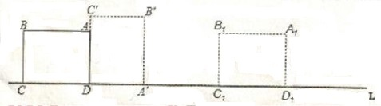

A. 7π

B. 6π

C. 3π

D. 

第 44 题 · 答案与解析

**参考答案（粉笔题库参考内容）**

B

**解析**

点A第一次翻转到点的位置时，共翻转了四次。第一次翻转，以点D为圆心，以AD为半径翻转，点A共转动了（以AD为半径的圆周长）；

第二次翻转，以点A为圆心，以AB为半径翻转，这时点A并未移动；

第三次翻转，以点B为圆心，以BC为半径翻转，则点A移动了（以AB为半径的圆周长）；

第四次翻转，以点C为圆心，以CD为半径翻转，则点A移动了（以AC为半径的圆周长），此时点A第一次翻转到点的位置，故点A一共移动了。

故正确答案为B。

### 第 45 题

甲地有177吨货物要一起运到乙地，大卡车的载重量是5吨，小卡车的载重量是2吨，大小卡车从甲地到乙地的耗油量分别是10升和5升，则使用大小卡车将货物从甲地运到乙地最少要耗油多少升？

A. 442.5升

B. 356升

C. 355升

D. 354升

第 45 题 · 答案与解析

**参考答案（粉笔题库参考内容）**

C

**解析**

根据题意，设在使用大卡车x辆、小卡车y辆，且均能充分使用的情况下，总耗油量N最少。则可列方程组为：5x+2y=177①；10x+5y=N②。联立方程得：354+y=N。

要使总耗油量N最小，则y=0。当y=0时，5x=177，在此情况下大卡车并不能充分使用，应排除；其次y=1。则5x=175，解得x=35，满足预测要求，故总耗油量N最少=354+1=355升。

故正确答案为C。

### 第 46 题

一架天平，只有5克和30克的砝码各一个，要将300克的食盐平均分成三份，最少需要用天平称几次：

A. 6次

B. 5次

C. 4次

D. 3次

第 46 题 · 答案与解析

**参考答案（粉笔题库参考内容）**

D

**解析**

第一步，在天平左侧放入5克和30克砝码，然后将食盐放入右侧使天平平衡，此时右侧有食盐35克；

第二步，天平左侧放35克食盐和30克砝码，将食盐放入右侧使天平平衡，此时右侧有食盐65克，将35克食盐与65克食盐合并，得到100克食盐；

第三步，利用得到的100克食盐当作砝码再称出100克，此时可将300克食盐分成3等份。

故正确答案为D。

### 第 47 题

浓度为15%的盐水若干克，加入一些水后浓度变为10%，再加入同样多的水后，浓度为多少：

A. 9%

B. 7.5%

C. 6%

D. 4.5%

第 47 题 · 答案与解析

**参考答案（粉笔题库参考内容）**

B

**解析**

溶质=溶液浓度，盐=盐水浓度。题目给出了一个量，即浓度分别为15%、10%，给不变量赋值，给溶质赋值15和10的公倍数30，30=20015%，30=30010%，“再加同样多的水”加100最后问浓度，浓度=\=7.5%。

故正确答案为B。

### 第 48 题

宏远公司组织员工到外地集训，先乘汽车，每个人都有座位，需要每辆有60个座位的汽车4辆，而后乘船，需要定员为100人的船3条，到达培训基地后分组学习，分的组数与每组的人数恰好相等。这个单位外出集训的有多少人：

A. 240人

B. 225人

C. 201人

D. 196人

第 48 题 · 答案与解析

**参考答案（粉笔题库参考内容）**

B

**解析**

根据条件，到达基地分组学习，分的组数与每组的人数相等，则可知此次培训的人数一定是平方数，依此排除A、C两项；

乘船时，需要定员为100人的船3条，则可知此次来学习的人数应在201～300之间（当人数小于201时，仅需2条船就可以了），依此排除D项。

故正确答案为B。

### 第 49 题

甲、乙两人沿相同的路线由A地匀速前进到B地，A、B两地之间的路程为20千米，他们前进的路程为S（千米），乙出发后的时间为t（单位：时），甲、乙前进的路程与时间的函数图像如图所示。下列说法错误的是：

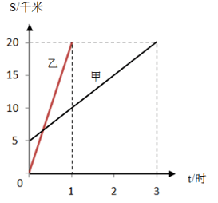

A. 甲的速度是5千米/小时

B. 乙的速度是20千米/小时

C. 甲比乙晚到B地2小时

D. 甲比乙晚出发1小时

第 49 题 · 答案与解析

**参考答案（粉笔题库参考内容）**

D

**解析**

运用代入排除法。

A项：甲从0时到3时，所走距离为20－5＝15千米，因此速度为15÷3＝5千米/小时，该选项是正确的；

B项：乙从0时到1时，所走距离为20千米，因此速度为20千米/小时，该选项是正确的；

C项：乙出发后1小时到达B地，甲在乙出发后3小时到达B地，因此甲晚到2小时，该选项是正确的；

D项：乙出发时，甲已走路程为5千米，以5千米/小时的速度，甲比乙早出发1小时，该选项是错误的。

本题为选非题，故正确答案为D。

### 第 50 题

已知三角形三边长分别为3、15、X。若X为正整数，则这样三角形有多少个：

A. 3个

B. 4个

C. 5个

D. 无数个

第 50 题 · 答案与解析

**参考答案（粉笔题库参考内容）**

C

**解析**

根据三角形三边关系：两边之和大于第三边，可以得出：15-3＜x＜15+3，化简得：12＜x＜18，x为整数，则只有13、14、15、16、17满足条件，共计可组成5种不同的三角形。

故正确答案为C。

### 第 51 题

某班有60人，参加物理竞赛的有30人，参加数学竞赛的有32人，两科都没有参加的有20人。同时参加物理、数学两科竞赛的有多少人：

A. 28人

B. 26人

C. 24人

D. 22人

第 51 题 · 答案与解析

**参考答案（粉笔题库参考内容）**

D

**解析**

二集合标准型容斥原理公式：满足Ⅰ的个数+满足Ⅱ的个数-两者都满足的个数=总数-两者都不满足的个数。则依据题干条件，可列式为：30+32-x=60-20，解得x=22。

故正确答案为D。

### 第 52 题

科技馆为某机器人编制一段程序，如果机器人在平地上按照图中所示的步骤行走，那么该机器人所走的总路程为多少米：

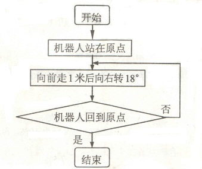

A. 20米

B. 15米

C. 12米

D. 10米

第 52 题 · 答案与解析

**参考答案（粉笔题库参考内容）**

A

**解析**

依据题意，机器人若想重新回到原点，需要旋转一周即360度才可重新回到原点。每次右转18度，需一共右转360÷18=20次，每次走1米，则机器人一共走了20米。

故正确答案为A。

### 第 53 题

有一个水池，池底不断有泉水涌出，且每小时涌出的水量相同。现要把水池里的水抽干，若用5台抽水机40小时可以抽完，若用10台抽水机15小时可以抽完。现在用14台抽水机，多少小时可以把水抽完：

A. 10小时

B. 9小时

C. 8小时

D. 7小时

第 53 题 · 答案与解析

**参考答案（粉笔题库参考内容）**

A

**解析**

典型牛吃草问题，直接套用牛吃草问题公式。可列式为：，解得y=120，x=2；则当使用14台抽水机时，120=（14-2）t，解得t=10小时。

故正确答案为A。

### 第 54 题

两超市分别用3000元购进草莓。甲超市将草莓按大小分类包装销售，其中大草莓400千克，以高于进价1倍的价格销售，剩下的小草莓以高于进价10%的价格销售，乙超市按甲超市大、小两种草莓售价的平均值定价直接销售。两超市将草莓全部售完，其中甲超市获利2100元（不计其它成本），则乙超市获利多少元：

A. 1950元

B. 1800元

C. 1650元

D. 1500元

第 54 题 · 答案与解析

**参考答案（粉笔题库参考内容）**

C

**解析**

设草莓进价为10a元/千克，则在甲超市中，大草莓售价为20a元/千克，小草莓售价为11a元/千克；在乙超市中，草莓的售价即为元/千克。如此，乙超市的利润率应为，则乙超市获利为55%×3000=1650元。

故正确答案为C。

### 第 55 题

一个工人锯一根22米长的木料，因木料两头损坏，他先将木料两头各锯下1米，然后锯了4次，锯成同样长的短木条，每根短木条长多少米：

A. 5.25

B. 5

C. 4.2

D. 4

第 55 题 · 答案与解析

**参考答案（粉笔题库参考内容）**

D

**解析**

木料本来长22米，两头各锯下1米后，还剩20米。在20米的长木料中，锯了4次，即分成5份，每份长度相等，则每根短木条的长度为20÷5＝4米。

故正确答案为D。

### 第 56 题

请从所给的四个选项中，选择最合适的填入问号处，使之符合已呈现的规律性：

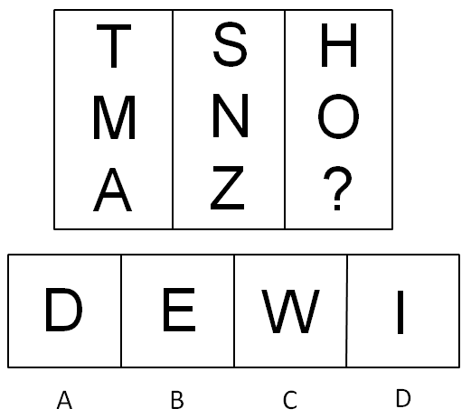

A. A

B. B

C. C

D. D

第 56 题 · 答案与解析

**参考答案（粉笔题库参考内容）**

D

**解析**

元素组成凌乱，考虑图形属性。属性包括三类考点，分别是对称、曲直和封闭。本题考点为图形的对称性。第一列3个字母均为轴对称图形，中间一列3个字母均为中心对称图形，第三列所给的2个字母均为既是轴对称又是中心对称图形。选项中只有D项既是轴对称又是中心对称图形，A、B、C三项均只是轴对称图形。

故正确答案为D。

### 第 57 题

请从所给的四个选项中，选择最合适的填入问号处，使之符合已呈现的规律性：

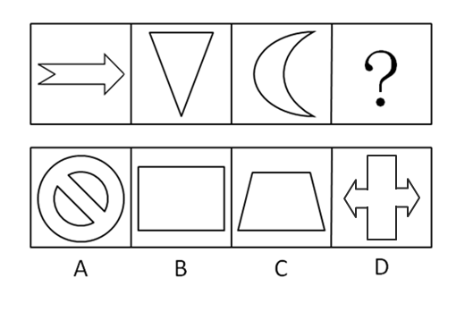

A. A

B. B

C. C

D. D

第 57 题 · 答案与解析

**参考答案（粉笔题库参考内容）**

C

**解析**

元素组成凌乱，考虑图形属性。图形属性包括三类，分别是对称性、曲直性和开闭性。本题考点为图形的对称性。前三个图形的对称轴的条数均只有1条，而且对称轴的方向呈现横轴、纵轴的交替变化，所以第四个图形应该选择一个对称轴只有一条且是纵轴的图形。选项中，只有C项符合条件，A、B、D三项均有2条对称轴，都不符合。

故正确答案为C。

### 第 58 题

所给的四个选项中，选择最合适的填入问号处，使之符合已呈现的规律性：

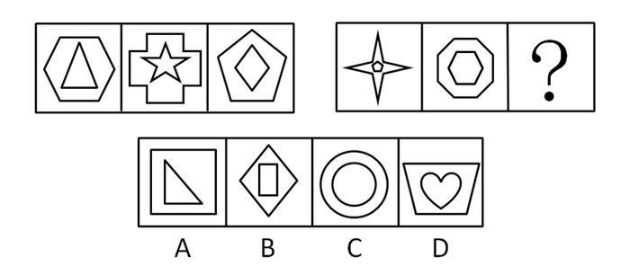

A. A

B. B

C. C

D. D

第 58 题 · 答案与解析

**参考答案（粉笔题库参考内容）**

A

**解析**

元素组成凌乱，考虑属性和数量规律。属性无规律，题干出现较多多边形，考虑数直线，整体数直线，第一组为9、22、9，第二组为13、14，无规律。继续观察发现，题干和选项每幅图形都分为明显的内外两部分，考虑分开数。前一组3个图形的内、外图形的直线数分别为：（3，6）、（10，12）、（4，5），外边图形的直线数与内部图形的直线数相减依次为3，2，1。后一组已给两个图形的内、外图形的直线数分别为：（5，8）、（6，8），外边图形的直线数与内部图形的直线数相减为3，2。应该选择一个外边图形的直线数与内部图形的直线数相差为1的图形。选项中只有A项符合，内、外图形的直线数分别为：（3，4）。

故正确答案为A。

### 第 59 题

请从所给的四个选项中，选择最合适的一个填入问号处，使之符合已呈现的规律性：

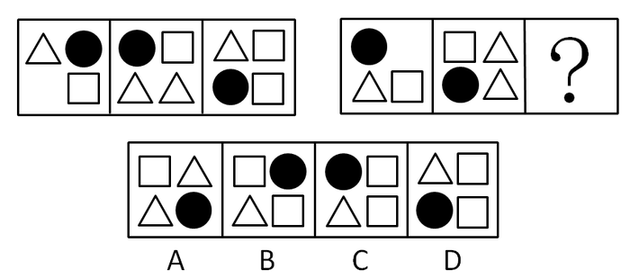

A. A

B. B

C. C

D. D

第 59 题 · 答案与解析

**参考答案（粉笔题库参考内容）**

B

**解析**

元素考点包括元素叠加和元素周遍两个考点。本题考点为元素叠加中的黑白叠加。第一组图形中，白三角形+黑圆形=白三角形；黑圆形+白正方形=白正方形；空+白三角形=黑圆形；白正方形+白三角形=白正方形。根据前一组图形的规律可知只有B项符合。

故正确答案为B。

### 第 60 题

所给的四个选项中，选择最合适的填入问号处，使之符合已呈现的规律性：

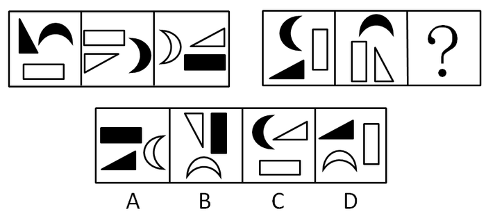

A. A

B. B

C. C

D. D

第 60 题 · 答案与解析

**参考答案（粉笔题库参考内容）**

B

**解析**

本题考点为元素遍历中的所有元素遍历。在已知的第一组图形中，有黑三角形，黑月牙，白矩形，白三角形，白月牙和黑矩形，分别出现1，2，2，2，1，1；根据前一组图形的规律，后一组图形现有黑三角形，黑月牙，白矩形，白三角形，白月牙和黑矩形，分别出现1，2，2，1，0，0，因为所有元素周遍的次数必须相同，所以需补充一个白三角形，一个白月牙和一个黑矩形。

故正确答案为B。

### 第 61 题

场依存性是指人对物体的知觉倾向于把外部参照作为信息加工的依据，难以摆脱环境因素的影响。他们的态度和自我知觉更易受周围的人，特别是权威人士的影响和干扰，善于察言观色，注意并记忆言语信息中的社会内容。根据上述定义，下列属于场依存性的是（    ）。

A. 具备独立自主的学习能力

B. 对于他人的评价有自己的看法

C. 做事情由内在动机支配

D. 做事情由外在动机支配

第 61 题 · 答案与解析

**参考答案（粉笔题库参考内容）**

D

**解析**

第一步：判断题干中的关键词。

关键词：把外部参照作为依据；难以摆脱环境因素的影响；受周围人的影响。

第二步：逐一分析选项。

A项，独立自主学习说明没有受到外界影响，不符合定义。

B项，对他人的评价有自己的看法说明没有受到外界影响，不符合定义。

C项，做事情由内在动机支配说明没有受到外界影响，不符合定义。

D项，做事情是由外在动机支配说明受到外界影响，符合定义。

故正确答案为D。

### 第 62 题

流水作业是指工人按照作业流程，顺序作用于劳动对象，完成生产工艺过程中某阶段一定量的工作，使生产连续而又不中断地进行。

以下不属于流水作业的是：

A. 某高速公路工程指挥部将10个标段分别承包给10个施工单位同时施工

B. 某施工队完成一个施工对象之后，再去完成另一个施工对象

C. 某施工队在10层工作一周，完成任务后，第三天转移到11层干同样的工作

D. 某施工单位对所有的施工对象同时开始施工，然后同时结束

第 62 题 · 答案与解析

**参考答案（粉笔题库参考内容）**

D

**解析**

第一步：关键词查找。

流水作业的定义条件包括：“顺序作用于劳动对象”“某阶段一定量的工作”。

第二步：逐一分析选项。

A项10个单位承担10个标段作业，符合定义；

B项和C项均是完成一个施工对象之后继续另一个施工对象，符合定义；

D项对所有对象同时开工同时结束，不是顺序作用，也不是一定量的工作，不符合定义。

本题为选非题，故正确答案为D。

### 第 63 题

继续教育是指针对专业技术人员进行的以更新、补充、拓展专业知识和培养、提高业务能力为目的的非学历教育。

根据上述定义，下列各项属于继续教育的是：

A. 教育主管部门每年暑期培训社会主义市场经济理论课教师

B. 许多专科起点的教师通过函授教育或自学考试取得了本科文凭

C. 某大学要求已获得讲师职称的教师攻读高一级学位

D. 劳动局给下岗职工进行多种形式的职业培训

第 63 题 · 答案与解析

**参考答案（粉笔题库参考内容）**

A

**解析**

第一步：查找关键词。

“继续教育”的定义条件包括：“专业技术人员”“非学历教育”。

第二步：逐一分析选项。

A项社会主义市场经济理论课教师，既属于“专业技术人员”，也属于“非学历教育”，当选；

B项取得了本科文凭，不符合关键词“非学历教育”，排除；

C项攻读高一级学位，不符合关键词“非学历教育”，排除；

D项对下岗职工的职业培训，不符合“专业技术人员”条件，排除。

故正确答案为A。

### 第 64 题

登门槛效应又称得寸进尺效应，是指一个人一旦接受了他人的一个微不足道的要求，为了避免认知上的不协调，或想给他人以前后一致的印象，就有可能接受更大的要求。这种现象犹如登门槛时要一级台阶一级台阶地登，才能更容易更顺利地登上高处。

根据上述定义，下列各项不属于登门槛效应的是：

A. 一项调查显示，某城市居民愿意为贫困地区失学儿童捐款的比例是30%，而如果先请人们在帮助贫困地区失学儿童倡议书上签名，再请他们捐款，愿意捐款的人数增加了25%

B. 对学习有困难的学生，李老师总是先提出一些比过去稍有进步的小要求，当学生达到这个要求后，再通过鼓励逐步向其提出更高的要求，使学生更容易接受并力求达到目标

C. 某企业成功研制了一种去除烟渍的洁白牙膏，由于其去除烟渍效果较好而获得了市场好评，该企业趁热打铁，又推出几款不同口感的洁白牙膏，尽管只是将前一种产品稍加改良而成，但仍然成为畅销产品

D. 有个小和尚跟师傅学武艺，可师傅却什么也不教他，只是给他一群小猪让他放养。庙前有一条小河，每天早上小和尚要抱着一头头小猪跳过河，傍晚再抱回来。小猪一天天长大，小和尚的臂力也在不断地增长，不知不觉中练就了卓越的臂力和轻功

第 64 题 · 答案与解析

**参考答案（粉笔题库参考内容）**

C

**解析**

第一步：查找关键词。

“登门槛效应”的定义条件包括：“登门槛时要一级台阶一级台阶地登”“更容易更顺利地登上高处”。

第二步：逐一分析选项。

A项中通过先请市民在倡议书上签名然后捐款，捐款人数增加，符合定义，排除；

B项中老师先提出小要求，接着提出更高的要求，符合定义，排除；

C项中企业生产出一种牙膏卖得很好加以改良之后仍是畅销，不符合“登上高处”的定义条件，当选；

D项中小猪的体重一天天增加，小和尚的臂力也随之不断增长，符合定义，排除。

本题为选非题，故正确答案为C。

### 第 65 题

谣言传播指不正确事实的非正式渠道传播，是对事实的蓄意渲染、夸大、歪曲，或根本是无中生有。

根据上述定义，下列各项属于谣言传播的是：

A. 某电视台接到群众来信反映当地野蛮拆迁，遂派两名记者到现场采访后制作成新闻在该电视台播放

B. 重庆市彭水县教委秦某，突发诗兴，以该县几个轰动的社会事件为背景填写了一首《沁园春▪彭水》的词，并用手机短信发给几位朋友

C. 某案件当事人因不满当地法院的判决，将案情在某网站公开

D. 在百度贴吧上，一网民发表了“据说这次地震是人为的，和美国有关系”的帖子

第 65 题 · 答案与解析

**参考答案（粉笔题库参考内容）**

D

**解析**

第一步：查找关键词。

“谣言传播”的定义条件包括：“不正确事实”“非正式渠道传播”“蓄意渲染、夸大、歪曲，或根本是无中生有”。

第二步：逐一分析选项。

A项某电视台两名记者进行采访后制作成新闻，不符合定义的关键词“非正式渠道传播”，排除；

B项秦某以该县几个轰动的社会事件为背景填了一首《沁园春·彭水》的词发给朋友不符合“不正确事实”，排除；

C项案件当事人只是将案情公开，并没有涉及不正确的事实，不符合定义的关键词“不正确事实”，排除；

D项地震是人为，和美国有关，显然是不正确的事实，符合定义，当选。

故正确答案为D。

### 第 66 题

生态入侵是指人们有意识或者无意识地把某些生物带入适宜其栖息和繁衍的地区，使得该生物种群不断扩大，分布区不断稳定地扩展，从而危害当地的生产和生活，改变当地生态环境的过程。

根据上述定义，下列各项属于生态入侵的是：

A. 产于南美洲的凤眼莲作为观赏植物被引进我国，致使云南滇池由于凤眼莲的疯狂蔓延而鱼虾绝迹

B. 科学家将引进的野生大豆与当地品种杂交，培养出抗大豆萎黄病的优良品种

C. 某实验室因大意将试验用的致病性菌株散播，造成周围居民染病

D. 某地因发生大面积放射性核泄露而使某种植物繁殖能力超强，逐渐取代了该地域内的其他植物

第 66 题 · 答案与解析

**参考答案（粉笔题库参考内容）**

A

**解析**

第一步：查找关键词。

“生态入侵”的定义条件包括：“人们”“生物种群不断扩大”“危害当地的生产和生活，改变当地生态环境的过程”。

第二步：逐一分析选项。

A项：南美凤眼莲大量引入我国，蔓延导致滇池的鱼虾灭绝，破坏了生态环境，符合定义，当选；

B项：大豆杂交之后，培育出优良品种，不符合定义关键词，排除；

C项：因大意将致病性菌株散播导致居民染病，并没有涉及改变当地生态环境，不符合定义关键词，排除；

D项：并不是人们将某些生物带入适宜其栖息和繁衍的地区，不符合定义关键词，排除。

故正确答案为A。

### 第 67 题

恐惧症是对某种物体或某种环境的一种非理性的、不适应的恐惧感。一旦面对这种物体或环境时，尽管当时并无危险，恐惧症患者仍产生一种极端的恐惧感。

根据上述定义，下列各项属于恐惧症的是：

A. 看了恐怖片《午夜杀手》后，小李脑海里总是浮现电影中的恐怖场景，接连好几天睡不好觉

B. 21岁的小马小时候因与弟弟发生争执，父亲拿起一根削尖的竹片砸向她，虽然没有砸中，但至今想起那尖尖的竹片仍很害怕，看见甚至想到尖锐物品时都会很紧张，冒冷汗、全身发抖

C. 小孙刚拿到驾照，开车送小明回家，走到半路小明就要下车，因为他担心小孙的驾驶技术，自上车后就一直承受着害怕出车祸的精神压力

D. 陈女士吃过晚饭后在小区散步，突然从草丛中窜出一只猫，吓得她尖叫着跑回家

第 67 题 · 答案与解析

**参考答案（粉笔题库参考内容）**

B

**解析**

第一步：关键词查找。

恐惧症的定义条件包括：“非理性、不适应”“面对物体或环境时，无危险的情况下也会产生恐惧感”。

第二步：逐一分析选项。

A项小李只是脑海里会有这种场景浮现，而不是面对这些物体或环境，不符合定义，排除；

B项面对竹片时，小马就会很害怕，看见甚至想到尖锐物品时都会很紧张，冒冷汗、全身发抖，符合定义，当选；

C项小明的担心不属于非理性的担心，不符合定义，排除；

D项陈女士并不是不适应的恐惧感，不符合定义，排除。

故正确答案为B。

### 第 68 题

敌意性归因偏差是指在情景不明的情况下，有攻击性的人往往预测别人对自己有敌意，总是把他人的行为解释为故意的、敌意的。

根据上述定义，下列各项属于敌意性归因偏差的是：

A. 丁经理一直不同意高经理提出的年底奖金分配方案，高经理多次与之沟通收效甚微，李经理认为丁经理过于维护自己部门的利益

B. 张主任看到小刘在民主评议中得票很低，就认为他群众基础差，打消了提升他的念头

C. 孔老师的学生小强一向表现平平，却在英语竞赛上获得了全校第一名，孔老师觉得小强在竞赛中存在作弊行为

D. 小赵在竞选社区主任中惨败，当老李劝他参加社区书记选举时，他觉得老李是故意来挖苦他的

第 68 题 · 答案与解析

**参考答案（粉笔题库参考内容）**

D

**解析**

第一步：查找关键词。

“敌意性归因偏差”的定义条件包括：“故意的”“敌意的”。

第二步：逐一分析选项。

A项李经理认为丁经理过于维护自己部门的利益没有体现出“故意的”“敌意的”，不符合定义，排除；

B项张主任只是打消了提升小刘的念头，没有体现出“敌意的”“故意的”，不符合定义，排除；

C项小强平时表现平平，英语竞赛突然拿了第一，孔老师认为小强的行为是作弊并不属于敌意，排除；

D项当小赵落选后认为老李对他的劝解是故意挖苦，符合关键词，当选。

故正确答案为D。

### 第 69 题

考试信度指考试的客观性，反映考生真实水平的程度。
根据上述定义，下列各项对考试信度影响最小的是：

A. 李老师押中了两道中考数学大题，同学们的数学成绩普遍偏高

B. 90%的女生没有答对“2013年世界足球先生是谁”的题目

C. 考试前一周，政治经济学老师给自己的学生指定考试范围

D. 同一篇作文，王老师给了50分，李老师却只给了40分

第 69 题 · 答案与解析

**参考答案（粉笔题库参考内容）**

B

**解析**

第一步：关键词查找。

考试信度的定义条件包括：“客观”、“反映考生真实水平”。

第二步：逐一分析选项。

A项：李老师押中大题，不能客观地反映考生真实的水平，排除；

B项：“2013年世界足球先生是谁”的题目属于一道时政题，90%的女生没有答对是对考生真实水平的客观总结，符合定义，当选；

C项：老师在考试前指定范围会影响到考试的客观性，反映不出考生真实水平的程度，排除；

D项：王老师和李老师为同一篇作文打分分差很大，这就不能反映考生真实水平的程度，排除。

故正确答案为B。

### 第 70 题

手表定律是指一个人有一只表时，可以知道现在是几点钟，而当他同时拥有两只表时却无法确定。两只表并不能告诉一个人更准确的时间，反而会使看表的人失去对准确时间的信心。
根据上述定义，下列不属于手表定律的是：

A. 企业倡导员工培养多种文体爱好

B. 企业同时采取多种不同的管理方法

C. 企业文化建设中倡导多元价值观

D. 一个下属同时接受两个上司的指挥和授权

第 70 题 · 答案与解析

**参考答案（粉笔题库参考内容）**

A

**解析**

第一步：找出定义关键词。

当出现多重标准时人们就无法抉择。

第二步：逐一分析选项。

A项：多种文体爱好不属于不同标准，人们可以同时进行，所以该选项中的事例与定义不符，当选；

B项：不同管理方法会使员工无所适从，符合定义，排除；

C项：多元价值观是不同的标准，会使人们思想产生混乱，符合定义，排除；

D项：同时接受两个上司的指挥，标准不同，符合定义，排除。

本题为选非题，故正确答案为A。

### 第 71 题

庆丰包子：简朴

A. 太阳：黑暗

B. 藏羚羊：保护动物

C. 鸽子：和平

D. 黄连：中药

第 71 题 · 答案与解析

**参考答案（粉笔题库参考内容）**

C

**解析**

第一步：判断题干词语间逻辑关系。

本题考查的是象征义，“庆丰包子”象征“简朴”，二者是象征义的关系。

第二步：判断选项词语间逻辑关系。

A项中“太阳”象征“光明”，选项中为“黑暗”，与题干关系不符，排除；

B项中“藏羚羊”属于“保护动物”，两者属于种属关系，排除；

C项中“鸽子”象征“和平”，二者为象征关系，与题干一致，当选；

D项中“黄连”属于“中药”，两者属于种属关系，排除。

故正确答案为C。

### 第 72 题

审判：旁听

A. 抢险救灾：善后处理

B. 演出：观众

C. 宏观调控：财政政策

D. 开会：学习

第 72 题 · 答案与解析

**参考答案（粉笔题库参考内容）**

D

**解析**

第一步：判断题干词语间逻辑关系。

本题考查对应关系，审判时可能有人旁听，两者属于可能关系，且词性上，两者都是动词。

第二步：判断选项词语间逻辑关系。

A项，抢险救灾和善后处理词性一致，都是动词，但两者是顺承关系，排除；

B项，演出和观众词性不同，演出是动词，观众是名词，排除；

C项，宏观调控和财政政策是种属关系，宏观调控既可以是名词，也可以是动词，财政政策是名词，排除；

D项，开会时可能有人学习，也是可能关系，且词性上，两者都是动词，当选。

故正确答案为D。

### 第 73 题

莫等闲，白了少年头，空悲切：岳飞

A. 离离原上草，一岁一枯荣：李白

B. 举头望明月，低头思故乡：杜牧

C. 问君能有几多愁，恰似一江春水向东流：李煜

D. 同是天涯沦落人，相逢何必曾相识：杜甫

第 73 题 · 答案与解析

**参考答案（粉笔题库参考内容）**

C

**解析**

第一步：判断题干语句间逻辑关系。

本题考查的是对应关系，“莫等闲，白了少年头，空悲切”的作者是岳飞。

第二步：判断选项语句间逻辑关系。

A项中“离离原上草，一岁一枯荣”的作者是白居易；

B项中“举头望明月，低头思故乡”的作者是李白；

C项中“问君能有几多愁，恰似一江春水向东流”的作者是李煜，符合题干词语间逻辑关系；

D项中“同是天涯沦落人，相逢何必曾相识”的作者是白居易。

故正确答案为C。

### 第 74 题

大学校长：教授

A. 编剧：诗人

B. 白洋淀：衡水湖

C. 市长：市政府

D. 刑警：消防队员

第 74 题 · 答案与解析

**参考答案（粉笔题库参考内容）**

A

**解析**

第一步：判断题干词语间逻辑关系。

题目考查的是词语间的交叉关系，即有的“大学校长”是“教授”，有的“教授”是“大学校长”，二者为交叉关系。

第二步：判断选项词语间逻辑关系。

A项中有的“编剧”是“诗人”，有的“诗人”是“编剧”，二者为交叉关系，符合题干对应关系，当选；

B项中“白洋淀”和“衡水湖”是并列关系，都是湖名，排除；

C项中“市长”和“市政府”是对应关系，排除；

D项中“刑警”和“消防队员”是并列关系，排除。

故正确答案为A。

### 第 75 题

鱼：潜水艇

A. 飞机：鸟

B. 鲨鱼：泳衣

C. 虾：汽车

D. 蝙蝠：雷达

第 75 题 · 答案与解析

**参考答案（粉笔题库参考内容）**

D

**解析**

第一步：判断题干词语间逻辑关系。

题目考查对应关系，鱼和潜水艇在仿生学中相对应，潜水艇是模仿鱼在水中沉浮的原理制造出的，二者是仿生学对应关系。

第二步：判断选项词语间逻辑关系。

A项：飞机和鸟在仿生学中相对应，飞机是模仿鸟的翅膀在空气中能受到浮力作用而制造出的，但顺序反了，与题干逻辑关系不一致，排除；

B项：鲨鱼与泳衣在仿生学中无对应，与题干逻辑关系不一致，排除；

C项：虾和汽车在仿生学中无对应，与题干逻辑关系不一致，排除；

D项：雷达是模仿蝙蝠在夜间安全飞行的原理制造出的，二者在仿生学中相对应，与题干逻辑关系一致，当选。

故正确答案为D。

### 第 76 题

轮船：运输

A. 跑步机：长寿

B. 蛋糕：生日

C. 导航仪：路线

D. 医生：治病

第 76 题 · 答案与解析

**参考答案（粉笔题库参考内容）**

D

**解析**

第一步：判断题干词语间逻辑关系。

“轮船”可以“运输”，二者为功能的对应关系。

第二步：判断选项词语间逻辑关系。

A项：跑步机可以锻炼身体，而不是长寿，与题干逻辑关系不一致，排除；

B项：蛋糕可以庆祝生日，而不是生日，与题干逻辑关系不一致，排除；

C项：导航仪可以指引路线，而不是路线，与题干逻辑关系不一致，排除；

D项：医生可以治病，二者为功能的对应关系，与题干逻辑关系一致，当选。

故正确答案为D。

### 第 77 题

氧气：燃烧

A. 吃饭：健康

B. 打雷：下雨

C. 水涨：船高

D. 团员：党员

第 77 题 · 答案与解析

**参考答案（粉笔题库参考内容）**

A

**解析**

第一步：判断题干词语间逻辑关系。

在一般情况下，氧气是燃烧的必要条件，没有氧气就不能燃烧。

第二步：判断选项词语间逻辑关系。

A项：在一般情况下，吃饭是健康的必要条件，不吃饭就不能获得健康。与题干逻辑关系一致，当选；

B项：下雨和打雷是两种不同的天气现象，二者是并列关系，不是条件关系，与题干逻辑关系不一致，排除；

C项：水涨不是船高的必要条件（例如：卸掉船上的货物也可以导致船面升高），水涨和船高之间构成因果关系，与题干逻辑关系不一致，排除；

D项：团员加入共产党以后仍保留团籍，年满二十八周岁，没有在团内担任职务，不再保留团籍。有的团员是党员，有的团员不是党员，有的党员是团员，有的党员不是团员。二者是交叉关系。与题干逻辑关系不一致，排除。

故正确答案为A。

### 第 78 题

小学：中学：大学

A. 下单：转账：交易

B. 招聘：录用：培训

C. 购房：首付：中介

D. 买票：登机：安检

第 78 题 · 答案与解析

**参考答案（粉笔题库参考内容）**

B

**解析**

第一步：判断题干词语间逻辑关系。

题目考查词语的并列关系，“小学”“中学”“大学”三者是并列关系，属于事物发展的三个阶段，阶段上呈递进关系。

第二步：判断选项词语间逻辑关系。

A项，“下单”“转账”与“交易”并不是一件事情的三个阶段，不存在阶段上的递进关系，与题干逻辑关系不一致，排除；

B项，“招聘”“录用”“培训”三者是并列关系，且是事物发展上的三个阶段，同时阶段上也呈递进关系，与题干对应关系一致，当选；

C项，“购房”“首付”“中介”三者不存在阶段上的递进关系，与题干逻辑关系不一致，排除；

D项，“登机”和“安检”位置错乱，先“安检”后“登机”，与题干逻辑关系不一致，排除。

故正确答案为B。

### 第 79 题

微机：电脑桌：办公室

A. 仪器：小白鼠：实验室

B. 门：窗：家具

C. 芹菜：炒锅：食堂

D. 牛：马：大草原

第 79 题 · 答案与解析

**参考答案（粉笔题库参考内容）**

C

**解析**

第一步：判断题干词语间逻辑关系。

题目考查对应关系和包含关系，“微机”在“电脑桌”上，“电脑桌”在“办公室”里。

第二步：判断选项词语间逻辑关系。

A项中“仪器”里有“小白鼠”，但两者位置与题干相反，排除；

B项中“门”和“窗”是并列关系，排除；

C项中“芹菜”在“炒锅”里，“炒锅”在“食堂”里，对应关系和包含关系与题干一致，当选；

D项中“牛”和“马”是并列关系，排除。

故正确答案为C。

### 第 80 题

科学：社会科学：自然科学：生命科学

A. 第二产业：建筑业：工业：钢铁业

B. 医院：医生：护士：女护士

C. 汽车：货车：工程车：轿车

D. 社区：房屋：居民：张明

第 80 题 · 答案与解析

**参考答案（粉笔题库参考内容）**

A

**解析**

第一步：判断题干词语间逻辑关系。

题目考查反对关系。科学分为社会科学和自然科学，社会科学和自然科学两者属于反对关系，且生命科学属于自然科学。

第二步：判断选项词语间逻辑关系。

A项，第二产业分为建筑业和工业，建筑业和工业两者也属于反对关系，且钢铁业属于工业，与题干逻辑关系一致，当选；

B项：医院是地点，医院不能分为医生和护士，与题干逻辑关系不一致，排除；

C项：轿车不属于工程车，与题干逻辑关系不一致，排除；

D项，居民和张明是包含关系，与题干逻辑关系不一致，排除。

故正确答案为A。

### 第 81 题

经过训练的金雕能在草原上长途追击野狼，某研究小组为研究金雕的飞行方向和判断狼群的活动范围，将无线电传导器放置在一只金雕身上进行追踪。野狼为了觅食，其活动范围通常很广，因此，金雕追击野狼的飞行范围通常也很大。然而，两周以来，无线电传导器不断传回的信号显示，金雕仅在放飞地4公里范围内飞行。

以下哪项如果为真，最能解释金雕的行为：

A. 无线电传导器的安放削弱了金雕的飞行能力

B. 金雕放飞地2公里范围内有一水草丰美的牧场，羊群是野狼袭击的目标

C. 由于受训金雕的捕杀，放飞地广阔草原的野狼几乎绝迹

D. 金雕放飞地周边山峦叠嶂异常险峻，无法飞到更远的地方

第 81 题 · 答案与解析

**参考答案（粉笔题库参考内容）**

B

**解析**

第一步：找出题干矛盾。

野狼为了觅食，其活动范围通常很广，因此，金雕追击野狼的飞行范围通常也很大。然而，两周以来，无线电传导器不断传回的信号显示，金雕仅在放飞地4公里范围内飞行。

第二步：逐一分析选项。

A项：该项指出无线电传导器的安放削弱了金雕的飞行能力，但不明确削弱的力度如何，不能解释为何仅在放飞地4公里范围内飞行，无法解释题干矛盾，排除；

B项：该项指出金雕放飞地2公里范围内有一水草丰美的牧场，羊群是野狼袭击的目标，金雕放飞地2公里范围内有羊群，野狼要袭击该羊群，野狼应该在稍大于两公里范围内活动，金雕追击野狼，也应该在稍大于两公里范围内活动，可以解释为什么金雕仅在放飞地4公里范围内飞行，可以解释题干矛盾，当选；

C项：该项指出由于受训金雕的捕杀，放飞地广阔草原的野狼几乎绝迹，但并不明确现存的野狼活动范围，金雕追击野狼，即不明确金雕的活动范围，无法解释题干矛盾，排除；

D项：该项指出金雕放飞地周边山峦叠嶂异常险峻，无法达到更远的地方，但不明确从放飞地到周边山峦的具体公里数，即不明确金雕的活动范围，无法解释题干矛盾，排除。

故正确答案为B。

### 第 82 题

美国研究人员分析了南极半岛和邻近的斯科舍海地区的数据后发现，20世纪70年代以来，当地气温上升了5~6摄氏度，并且来自其他海域的哺乳动物增多导致南极哺乳动物捕食竞争加剧。因此，在上述地区作为哺乳动物主要食物来源的磷虾的密度降低了80%。而同一时期，生活在该地区以磷虾为主要食物的阿德利企鹅和帽带企鹅的数量也急剧减少。

根据以上论述，可推出以下哪项结论：

A. 气温上升导致磷虾密度下降

B. 如果磷虾的密度继续减少，阿德利企鹅和帽带企鹅都会灭绝

C. 造成南极海洋哺乳动物捕食竞争加剧的原因是气温上升

D. 帽带企鹅生存的威胁来自气候变暖和哺乳动物的捕食竞争加剧

第 82 题 · 答案与解析

**参考答案（粉笔题库参考内容）**

D

**解析**

第一步：抓住题干的主要信息。

由于南极半岛气温上升，并且来自其他海域哺乳动物增多导致捕食压力加剧，因此磷虾的密度降低80%；与此同时，以磷虾为食的帽带企鹅与阿德利企鹅数量也下降了。这说明气温上升和哺乳动物捕食竞争加剧对帽带企鹅与阿德利企鹅的生存造成了影响。

第二步：分析各选项。

A项中磷虾数量下降的原因是气候上升还是哺乳动物的捕食竞争加剧我们不清楚，属于无理由猜测，因此错误；

B项中说企鹅会灭绝，表达过于绝对，错误；

C项与A项一样属于无理由猜测，错误；

D项中气温上升和哺乳动物捕食竞争加剧对帽带企鹅的生存造成了影响，结合主题一致原则，正确。

故正确答案为D。

### 第 83 题

房屋装修可能引发白血病。经某医院血液科一年多来的初步统计，来医院看白血病的孩子都表现出一个共同的特点，他们大多在发病前半年内，家里进行了房屋的豪华装修，使用的材料包括美化墙面的油漆、铺地面用的大理石等豪华建材，这样的白血病患儿占就诊白血病患儿总数的90%。

以下哪项如果为真，最能加强上述结论：

A. 白血病病人中孩子占的比例较高

B. 来医院看白血病的孩子家庭经济状况富裕

C. 除了装修对环境的污染，病毒也是引起白血病的主要因素

D. 来医院看白血病的孩子的年龄、父母的工作、体重、身高基本相同

第 83 题 · 答案与解析

**参考答案（粉笔题库参考内容）**

A

**解析**

第一步：找出论点和论据。

论点：房屋装修可能引发白血病。

论据：来医院看白血病的孩子都表现出一个共同的特点，他们大多在发病前半年内，家里进行了房屋的豪华装修，使用的材料包括美化墙面的油漆、铺地面用的大理石等豪华建材，这样的白血病患儿占就诊白血病患儿总数的90%。

本题论据讨论的是由装修引发白血病的孩子占所有患白血病孩子的90%，即装修可能是引发孩子产生白血病的主要原因，而论点讨论的是装修可能是引发白血病的原因，需要在患白血病的孩子和患白血病的人之间建立联系。

第二步：逐一分析选项。

A项：论据讨论的是装修可能是引发孩子产生白血病的主要原因，该项说患病孩子占白血病患者的比例高，即说明白血病孩子的情况对该病的研究有代表性，即在患白血病的孩子和患白血病的人之间建立了联系，说明装修可能是引发白血病的重要原因，属于搭桥项，可以加强，当选；

B项：患白血病的孩子家庭经济状况与装修是否会导致白血病无关，属于无关项，排除；

C项：提出了引发白血病的其他原因，无法加强，排除；

D项：说明患病孩子家庭的情况基本相同，加入了一些新的相同因素，反而说明不一定是由于装修导致患病，不能加强，排除。

注：本题D选项与对比实验中常见的起点一致可以加强类型的选项不一样，对比实验中是想通过所有因素一样，只有一个条件不一样来证明那个不一样的因素是原因。而本题是想通过共同点来证明一样的因素是原因，所以得说明其他条件都不一样，只有装修这个条件是一样的才是加强，因此D项不是加强项。

故正确答案为A。

### 第 84 题

陈老师在手上用钢笔写了甲、乙、丙、丁四位同学中一人的名字，然后他紧握手，让甲、乙、丙、丁四人猜猜他写了谁的名字。甲说：“是丙的名字。”乙说：“不是我的名字。”丙说：“不是我的名字。”丁说：“是甲。”陈老师说：“你们四人中只有一人猜对了。”

陈老师写了哪位同学的名字？

A. 甲同学

B. 乙同学

C. 丙同学

D. 丁同学

第 84 题 · 答案与解析

**参考答案（粉笔题库参考内容）**

B

**解析**

第一步：寻找突破口。

甲：丙；

乙：-乙；

丙：-丙；

丁：甲。

观察可知甲与丙两人的说法矛盾，因此真话一定在甲或丙之中。

第二步：看其余。

四句话中只有一句是真的，所以乙和丁说的都是假话，即“-乙”“甲”为假，则“乙”“-甲”为真，因此老师写的是乙同学的名字。

故正确答案为B。

### 第 85 题

海拔越高，大气压强越小，因为兰州的海拔高于天津，因此兰州的大气压强比天津小。

以下哪项中的推理与题干最为类似：

A. 在激烈竞争的市场上，产品质量越好并且广告投入越多，产品销量就越大，甲公司投入的广告费比乙公司多，因此，甲公司产品销售量比乙公司大

B. 一个人的年龄越大，他就变得越成熟，老张的年龄比他的儿子大，因此，老张比他的儿子成熟

C. 一个树的年头越长，它的年轮越多，老张院子中槐树的年头比老李家的槐树年头长，因此，老张家的槐树比老李家的年轮多

D. 一种语言的词汇量越大，越难学，英语比意大利语难学，因此，英语的词汇量比意大利语大

第 85 题 · 答案与解析

**参考答案（粉笔题库参考内容）**

C

**解析**

第一步：翻译题干。

条件①：海拔越高，大气压强越小；条件②：兰州的海拔高于天津。结论是兰州的大气压强比天津小，且兰州和天津是并列关系。

第二步：逐一分析选项。

A项：条件①：产品质量越好并且广告投入越多，产品销量就越大；条件②：甲公司投入的广告费比乙公司多，但甲公司只是广告投入比乙公司多，推不出销售量比乙公司大，排除；

B项：老张和他的儿子不是并列关系，排除；

C项：条件①：一棵树的年头越长，它的年轮越多；条件②：老张家的槐树年头比老李家的槐树年头长。结论是老张家的槐树年头比老李家的长，且老张家的槐树和老李家的槐树属于并列关系，与题干推理类似，当选；

D项：条件①：一种语言的词汇量越大，越难学；条件②：英语比意大利语难学，不能由难学推出词汇量大，犯了肯后的错误，排除。

故正确答案为C。

### 第 86 题

我国科研人员经过临床和对动物的多次试验，发现中药山茱萸具有抗移植免疫排斥反应和治疗自身免疫性疾病的作用，是新的高效低毒免疫抑制剂。某医学杂志首次发表了关于这一成果的论文，多少有些遗憾的是，从杂志社收到该论文到公开发表间隔了6周，如果这一论文能尽早发表的话，这6周内许多这类患者均可以避免患病。

以下哪一项最能削弱上述论述：

A. 口服山茱萸可能会引起消化系统的不适

B. 上述医学杂志在发表此论文前，未送有关专家审查

C. 只有口服山茱萸超过2个月，才能起到免疫抑制作用

D. 山茱萸具有抗移植免疫排斥反应和治疗自身免疫性疾病的作用有待进一步证实

第 86 题 · 答案与解析

**参考答案（粉笔题库参考内容）**

C

**解析**

第一步：找出论点和论据。

论点：论文能尽早地发表的话，这6周内许多这类患者将可以避免患病。

论据：某医学杂志社发表了关于这一成果的论文，多少有些遗憾的是，从杂志社到该论文公开发表间隔了6周。

第二步：逐一判断选项的作用。

A项，口服山茱萸会引起消化系统的不适，为无关选项，排除；

B项，论文未送专家审查，与论点无关，为无关选项，排除；

C项，通过否定前提的方法进行削弱，说明服用山茱萸到一定时期以后才能起到作用，当选；

D项，山茱萸的作用有待进一步证实，为无关选项，排除。

故正确答案为C。

### 第 87 题

拥挤的居住条件导致的市民健康状况明显下降成为A城面临的重大问题。因为A城和B城两个城市的面积和人口相当，所以A城所面临的上述问题必定会在B城出现。

以下哪项最能反驳上述结论：

A. 未能准确区分人口数量和人口密度这两个概念

B. 未能准确区分一个城市的面积和人口这两个概念

C. 拥挤的居住条件是导致市民健康状况下降的唯一原因

D. 忽略了相同的人口密度可以有不同的居住条件

第 87 题 · 答案与解析

**参考答案（粉笔题库参考内容）**

D

**解析**

第一步：找出论点和论据。

论点：A城所面临的上述问题必定会在B城出现。

论据：拥挤的居住条件导致市民健康状况明显下降，A城和B城两个城市的面积和人口相当。

本题论点说的是A城所面临的拥挤的居住条件导致市民健康状况下降的问题必定会在B城出现，而论据说的是拥挤的居住条件导致市民健康状况下降，而A城和B城两个城市的面积和人口相当，论点和论据讨论的话题不一致，削弱优先考虑拆桥。

第二步：逐一分析选项。

A项，该项强调是否能准确区分“人口数量”“人口密度”这两个概念，但题干是在强调居住条件和市民健康之间的关系，话题不一致，无法削弱，排除；

B项，该项强调是否能准确区分“面积”和“人口”这两个概念，但题干是在强调居住条件和市民健康之间的关系，话题不一致，无法削弱，排除；

C项，该项强调拥挤的居住条件是导致市民健康状况下降的唯一原因，因此B城同A城一样拥挤，应该同A城一样面临这样的问题，为加强项，无法削弱，排除；

D项，该项强调相同的人口密度和拥挤的居住条件之间没有必然联系，即相同的人口密度可能会有不同的居住条件，切断了论点和论据之间的联系，为拆桥项，可以削弱，当选。

故正确答案为D。

### 第 88 题

客人们走进会议室，发现一个奇怪的现象：墙上贴着“禁止吸烟”的标语，而桌上却摆着烟灰缸。

以下各项最符合主人心理的是：

A. 主人是支持禁烟的，摆上烟灰缸只是为了考验客人们

B. 主人的思想是混乱的，做出了自相矛盾的事情

C. 主人既不反对禁烟，也不赞成禁烟

D. 主人实际上是允许客人们吸烟的

第 88 题 · 答案与解析

**参考答案（粉笔题库参考内容）**

C

**解析**

第一步：抓住题干主要信息。

根据一个人的行为要求选择这个人的心理。这个主人既贴着“禁止吸烟”的标志，又在桌子上放着烟灰缸，可以说这个人的两种行为所要表达的意思是完全相反的，一个是禁止人们吸烟，一个是允许人们吸烟。两种行为发生在同一个人身上，体现出这个人本身在心理上没有更倾向于哪一个。

第二步：注意翻译选项并判断选项的正误。

A项，体现出主人倾向于禁止吸烟，错误；

B项，主人的思想混乱，不能说主人做出两种相反的行为就说主人的思想混乱，错误；

C项，体现出了没有更倾向于哪一个，正确；

D项，体现出主人倾向于允许吸烟，错误。

故正确答案为C。

### 第 89 题

西方的法治，尽管并不排斥道德，但无疑在宣扬法律至上的同时有意无意地忽略了道德，西方社会普遍存在的情感危机与道德沦丧就是明证；传统的德治却是主张德主刑辅，法是德的附庸，贬抑了法的作用，也与时代的发展不相适应。所以，对二者都要加以扬弃和改造，抽取各自的合理内核，进行结构重组，建立全新的德法并治的二元体制。

以下哪项最可能是上述论述的假设前提：

A. 道德与法律都是协调人们之间关系的

B. 法律在协调人际关系中的作用已越来越小

C. 道德与法律在协调对象、内容和手段方面有所不同

D. 必须坚持以德治国与依法治国相结合才能使社会稳定

第 89 题 · 答案与解析

**参考答案（粉笔题库参考内容）**

C

**解析**

第一步：找出论点和论据。

论点：对二者都要加以扬弃和改造，抽取各自的合理内核，进行结构重组，建立全新的德法并治的二元体制。

论据：无明显论据。

第三步：逐一判断选项的作用。

A项，强调道德与法律的协调作用，与题干中是否需要将两者扬弃和改造无关，错误；

B项，提到法律的作用越来越小，但是题干中并没有明确法律的作用有何变化，错误；

C项，强调法治和德治在协调对象等方面有所不同，正因为有所不同，才需要将两者结合来应用，即正是因为C项这一前提才产生了题干的论点，正确；

D项，强调法治和德治结合会带来社会稳定，与题干中是否需要将两者扬弃和改造无关，错误。

故正确答案为C。

### 第 90 题

W市的家庭在夏天特别容易发生纠纷，针对这种现象，某空调企业为了促销其产品，做了这样一则广告：“H牌空调能使您家庭更加和睦。”

下列属于上述广告假设的是：

①气温与家庭纠纷之间的关系纯属巧合

②温度与家庭纠纷之间存在某种确定的关系

③人们都希望自己的家庭不要发生纠纷

A. ②

B. ②③

C. ①③

D. ①②③

第 90 题 · 答案与解析

**参考答案（粉笔题库参考内容）**

B

**解析**

第一步：找出论点和论据。

论点：H牌空调能使您家庭更加和睦。

论据：W市的家庭在夏天特别容易发生纠纷。

第二步：判断加强方式。

论点是在宣传H牌空调使家庭和睦，论据则在强调夏天纠纷的问题，论点和论据都在说温度和纠纷之间的关系，话题一致，且提问方式为前提假设，加强优先考虑必要条件。

第三步：逐一判断选项。

①的说法虽然提到了气温与家庭纠纷之间的关系，但强调的是“纯属巧合”，是在表达两者之间没有必然联系，属于削弱选项，①错误；

②的说法证实了温度和家庭纠纷之间的必然关系，如果温度和家庭纠纷之间不存在关系，那么H牌空调就不能使家庭更加和睦，是论点成立的前提条件，②正确；

③的说法证明了人们希望家庭和睦，如果人们不希望家庭和睦，那么即使空调可以让家庭和睦，人们也不会因此购买，无法达到目的，所以是论点成立的前提条件，③正确。

故正确答案为B。

## 材料 2

一、根据下面提供的信息完成91—95题。

       2013年，我国国内生产总值568845亿元，比去年实际增长7.7%，其中，第一产业增加值56957亿元，第二产业增加值249684亿元，第三产业增加值262204亿元，第一产业增加值占国内生产总值的比重为10.0%，第二产业增加值比重为43.9%，第三产业增加值比重为46.1%，第三产业增加值占比首次超过第二产业。

  2009—2013年我国国内生产总值情况

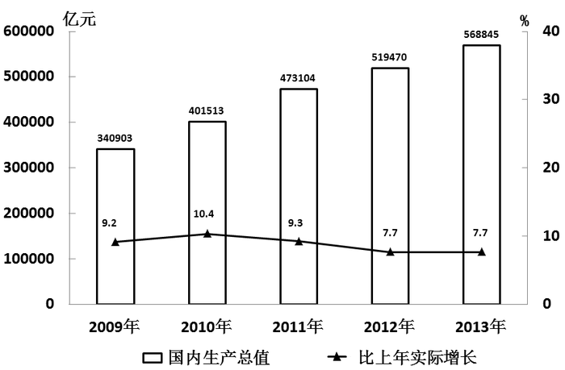

### 第 91 题

2010—2013年，我国国内生产总值同比增加最多的年份是：

A. 2010年

B. 2011年

C. 2012年

D. 2013年

第 91 题 · 答案与解析

**参考答案（粉笔题库参考内容）**

B

**解析**

根据题干“······同比增加最多······”，可判定本题为增长量比较问题。定位柱状图可求增长量：

2010年增加：401513-340903=60610亿元；

2011年增加：473104-401513=71591亿元；

2012年增加：519470-473104=46366亿元；

2013年增加：568845-519470=49375亿元。

所以2011年增加得最多。

故正确答案为B。

### 第 92 题

2009—2013年，我国国内生产总值实际增长率最高的年份是：

A. 2009年

B. 2010年

C. 2011年

D. 2012年

第 92 题 · 答案与解析

**参考答案（粉笔题库参考内容）**

B

**解析**

定位柱状图可知2010年我国国内生产总值的实际增长率10.4%最高。

故正确答案为B。

### 第 93 题

2013年，我国第三产业增加值占国内生产总值的比重比第二产业：

A. 高2.2个百分点

B. 高2.2%

C. 多12520亿元

D. 高3.2个百分点

第 93 题 · 答案与解析

**参考答案（粉笔题库参考内容）**

A

**解析**

定位文字材料第一段可知第三产业增加值的比重为46.1%，第二产业增加值的比重为43.9%，两者相减为2.2%，比重比较大小一般用百分点表示，所以，第三产业的增加值比重比第二产业高2.2个百分点。

故正确答案为A。

### 第 94 题

2010—2013年，我国国内生产总值名义增长率最低的年份是：

A. 2010年

B. 2011年

C. 2012年

D. 2013年

第 94 题 · 答案与解析

**参考答案（粉笔题库参考内容）**

D

**解析**

根据题干“······增长率最低······”，可判定本题为增长率比较问题。名义增长率就是我国目前经常提及的今年的GDP增速，实际的经济增长率要剔除掉由于通货膨胀等因素而得到的实际的经济增长。故直接定位柱状图即可，各年的增长率分别为：

2010年 ；

2011年 ；

2012年 ；

2013年 。

则2013年的增长速度最低。

故正确答案为D。

### 第 95 题

关于我国GDP情况，以下说法正确的是：

A. 2012年，第一产业增加值占国内生产总值的比重约为10%

B. 从2011年起，国内生产总值实际增长速度已经连续三年低于8%

C. 2010年，第二产业增加值占国内生产总值的比重高于第三产业

D. 2013年，第二产业增加值占国内生产总值的比重最大

第 95 题 · 答案与解析

**参考答案（粉笔题库参考内容）**

C

**解析**

A项：定位文字材料第一段可知2013年第一产业增加值占国内生产总值的比重是10%，但无法求出2012年数据。错误；

B项：定位柱状图可知2011年实际增长速度为9.3%，高于8%，错误；

C项：定位文字材料第一段“第三产业增加值占比首次超过第二产业”，可得出2013年第三产业增加值超过第二产业，则2010年未超过，且2013年第三产业增加值的比重最大，C项正确，D项错误。

故正确答案为C。

## 材料 3

根据下面提供的信息完成96～100题。

 2011年河北省农产品出口情况

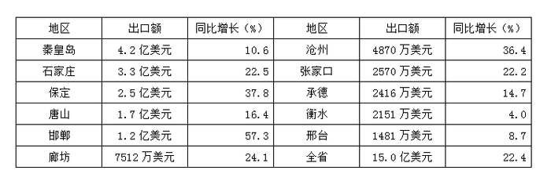

　　2011年，河北省农产品进出口总额41.1亿美元，同比增长21.2%，其中，进口同比增长20.6%。

　　2011年12月，河北省农产品出口、进口额均创历史新高，当月进出口4.5亿美元，同比增长30.7%，环比增长35.0%。其中，出口1.6亿美元，同比增长8.2%，环比增长8.8%；进口2.9亿美元，同比增长46.6%，环比增长54.5%。

　　2011年，河北省农产品月度出口除2月受春节假期影响外均超过1亿美元，月度同比实现全面增长，环比2月下降较多，5、6、8月有小幅下降，其余各月环比均持续快速增长，12月更是创历史新高；同时，进口规模不断扩大，其中，有6个月超过2亿美元，12月创历史新高，直逼3亿美元。

　　2011年，河北省农产品主要出口贸易伙伴均实现全面增长，日本是河北省第一大出口贸易伙伴，受日本大地震影响，上半年河北省农产品对日本出口连续快速下滑，8月以后得到恢复，全年对日本出口3.4亿美元，同比微增0.3%；对欧盟和东盟出口增长较为迅速，全年分别对欧盟和东盟出口2.7亿美元和2.4亿美元，分别增长35.6%和25.6%；对韩国出口1.6亿美元，增长18.9%。上述四者合计占出口总额的67.3%。此外，对美国出口9104万美元，增长9.1%；对香港出口6756万美元，增长72.9%；对台湾出口5650万美元，增长26.3%。

### 第 96 题

2010年，河北省农产品进出口贸易逆差约为：

A. 9.4亿美元

B. 11.1亿美元

C. 12.3亿美元

D. 15.6亿美元

第 96 题 · 答案与解析

**参考答案（粉笔题库参考内容）**

A

**解析**

根据题干“2010年······进出口贸易逆差”，结合材料时间为2011年，可判定本题为基期和差问题。定位文字材料第一段可知：2011年，河北省农产品进出口总额为41.1亿美元，增长率是21.2%；定位表格可知：2011年河北省出口额为15亿美元，增长率是22.4%。则2010年进出口贸易逆差为亿美元，与A项最接近。

故正确答案为A。

### 第 97 题

2011年，石家庄农产品出口额占全省的比重为：

A. 8.0%

B. 12.6%

C. 22.0%

D. 22.5%

第 97 题 · 答案与解析

**参考答案（粉笔题库参考内容）**

C

**解析**

根据题干“2011年，······占······的比重”，结合材料时间为2011年，可判定本题为现期比重计算问题。定位表格可知：2011年石家庄农产品出口额为3.3亿美元，全省出口总额为15亿美元，根据比重计算公式可得。

故正确答案为C。

### 第 98 题

2011年11月，河北省农产品进出口额占全年的比重为：

A. 8.1%

B. 8.4%

C. 9.2%

D. 9.5%

第 98 题 · 答案与解析

**参考答案（粉笔题库参考内容）**

A

**解析**

根据题干“2011年11月，······占······的比重”，结合材料时间2011年12月，可判定本题为基期比重计算问题。定位文字材料第二段可知：2011年12月，进出口额为4.5亿美元，环比增长35%，故2011年11月农产品进出口额为，占全年的比重为，与A项最接近。

故正确答案为A。

### 第 99 题

关于河北省农产品进出口额情况，以下说法错误的是：

A. 2011年，河北省农产品月度出口有11个月保持在1亿美元以上

B. 2011年12月，河北省农产品进口、出口、进出口总额均创月度历史最高

C. 2011年，河北省农产品单月进口额均低于3亿美元

D. 2011年，河北省农产品6月的出口额比5月高

第 99 题 · 答案与解析

**参考答案（粉笔题库参考内容）**

D

**解析**

A项：定位文字材料第三段可知：2011年，河北省农产品月度出口除2月受春节假期影响外均超过1亿美元，正确；

B项：定位文字材料第二段可知：2011年12月，河北省农产品出口、进口额均创历史新高，可知进出口总额创历史新高，正确；

C项：定位文字材料第三段可知：2011年进口规模不断扩大，其中，有6个月超过2亿美元，12月创历史新高，直逼3亿美元。12月小于3亿美元，则各月均小于3亿美元，正确；

D项：定位文字材料第三段可知：2011年······环比2月下降较多，5、6、8月有小幅下降。6月份环比下降，即6月份＜5月份，错误。

本题为选非题，故正确答案为D。

### 第 100 题

关于河北省农产品进出口贸易伙伴情况，以下说法错误的是：

A. 2010年，河北省对欧盟的农产品出口贸易额高于对东盟的农产品出口贸易额

B. 2011年，河北省农产品出口对所有贸易伙伴均实现了全面增长

C. 虽然受到日本大地震的影响，2011年河北省农产品对日本的出口贸易额还是保持了正增长

D. 2011年，河北省农产品对日本、欧盟、东盟和韩国的出口贸易额占全年出口总额的以上

第 100 题 · 答案与解析

**参考答案（粉笔题库参考内容）**

B

**解析**

A项：定位材料第四段可知：（2011年）河北省对欧盟和东盟出口增长较为迅速，全年分别对欧盟和东盟出口2.7亿美元和2.4亿美元，分别增长35.6%和25.6%。由此可计算2010年河北省对欧盟的农产品出口贸易额为：，河北省对东盟的农产品出口贸易额为：，河北省对欧盟的农产品出口贸易额高于对东盟的农产品出口贸易额，正确；

B项：定位文字材料第四段可知：“2011年，河北省农产品主要出口贸易伙伴均实现全面增长”，而B选项表述为“所有贸易伙伴”，扩大范围，典型的概念偷换，错误；

C项：定位文字材料第四段可知：“全年对日本出口3.4亿美元，同比微增0.3%”，正确；

D项：定位文字材料第四段可知：上述四者（日本，欧盟，东盟，韩国）合计占出口总额的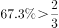，正确。

本题为选非题，故正确答案为B。

## 材料 4

根据下面提供的信息完成101—105题。

       2013年，我国农村居民人均纯收入达到8896元，扣除价格因素实际增长9.3%，高出GDP实际增速1.6个百分点。农村居民人均纯收入实际增速高于城镇居民人均可支配收入实际增速2.3个百分点。其中工资性收入4025元，占人均纯收入的45.2%，比上年名义增长16.8%，家庭经营纯收入3793元，占人均纯收入的42.6%，名义增长7.4%，转移性收入784元，占人均纯收入的8.9%，名义增长14.2%；财产性收入294元，占人均纯收入的3.3%，名义增长17.7%。

       2013年，农村居民人均消费支出6626元，同比增长9%，增幅比城镇居民人均现金消费支出增速快3.6个百分点。全年农民工总量26849万人，比上年增加633万人，其中，本地农民工10284万人，增长3.6%；外出农民工16610万人，增长1.7%。外出农民工月均收入水平2609元，增长13.9%。

       2013年，城镇居民人均可支配收入26955元，比上年名义增长9.7%。在城镇居民人均总收入中，工资性收入名义增长9.2%，经营净收入名义增长9.8%，财产性收入名义增长14.6%，转移性收入名义增长10.1%。

 2009—2013年我国居民收入情况

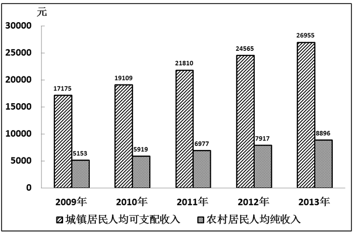

### 第 101 题

2012年，我国农村居民家庭经营纯收入约为：

A. 3446元

B. 3532元

C. 3793元

D. 4025元

第 101 题 · 答案与解析

**参考答案（粉笔题库参考内容）**

B

**解析**

根据题干“2012年······”，结合材料时间2013年，可判定本题为基期计算问题。定位材料第一段可知：2013年农村居民家庭经营纯收入为3793元，名义增长率为7.4%。根据基期量计算公式：可知：。

故正确答案为B。

### 第 102 题

2013年，我国农村居民人均纯收入名义增长率约为

A. 7.8%

B. 9.3%

C. 10.9%

D. 12.4%

第 102 题 · 答案与解析

**参考答案（粉笔题库参考内容）**

D

**解析**

根据题干“······增长率为······”，可判断本题为增长率计算问题。名义增长率即不考虑其他因素的增长率，定位柱状图可知：2013年的我国农村居民人均纯收入为8896元，2012年我国农村居民人均纯收入为7917元，根据可得2013年的名义增长率为，与D项最为接近。

故正确答案为D。

### 第 103 题

2010—2013年，我国城镇居民人均可支配收入名义增长率最高的年份是：

A. 2010年

B. 2011年

C. 2012年

D. 2013年

第 103 题 · 答案与解析

**参考答案（粉笔题库参考内容）**

B

**解析**

根据题干“······增长率最高······”，可判定本题为增长率比较问题。定位柱状图，根据增长率计算公式：可知：

2010年：；

2011年：；

2012年：；

2013年：。

故2011年增长的最多。

故正确答案为B。

### 第 104 题

关于我国人民生活情况，以下说法错误的是：

A. 2013年，我国城镇居民人均可支配收入实际增速约为7.0%

B. 2012年，全国农民工总量为26216万人

C. 2009—2013年，我国城乡居民收入比最高的年份是2010年

D. 2013年，我国农村居民人均纯收入中，工资性收入占比最高

第 104 题 · 答案与解析

**参考答案（粉笔题库参考内容）**

C

**解析**

A项：定位材料第一段可知，农村居民人均纯收入实际增长9.3%，高于城镇居民人均可支配收入实际增速2.3个百分点，故城镇居民人均可支配收入实际增速为7.0%，正确；

B项：定位材料第二段可知，全年农民工总量为26849万，比上年增加633万，则2012年农民工总量=26849-633=26216万人，正确；

C项：定位柱状图：通过计算可知2009年是我国城乡居民收入比最高的年份（也可以根据常识，随着时间的推移，城乡差距越来越小，故2009年城乡居民收入比最高），错误；

D项：定位材料第一段可知，农村居民人均纯收入中，工资性收入为4025元，比其它收入都高，正确。

本题为选非题，故正确答案为C。

### 第 105 题

关于我国城镇居民人均可支配收入，以下说法正确的是：

A. 2013年，在我国城镇居民人均总收入中，转移性收入名义增长最快

B. 2013年，我国城镇居民人均可支配收入比2010年增长了50%以上

C. 2013年，我国城镇居民财产性收入名义增长10.1%

D. 2013年，我国城镇居民人均现金消费支出同比增长5.4%

第 105 题 · 答案与解析

**参考答案（粉笔题库参考内容）**

D

**解析**

A项：定位材料第三段可知：名义增长最快的是财产性收入14.6%，错误；

B项：定位柱状图可知：2010年城镇居民人均可支配收入是19109元，2013年的为26955元。，故增长率应小于50%，错误；

C项：定位材料第三段可知：财产性收入名义增长14.6%，非10.1%，错误。

D项：定位材料第二段可知：2013年，农村居民人均消费支出同比增长9%，增幅比城镇居民人均现金消费支出增速快3.6个百分点。故我国城镇居民人均现金消费支出同比增长9%-3.6%=5.4%。正确。

故正确答案为D。

### 第 106 题

第二批党的群众路线教育实践活动以“为民务实清廉”为主题，以“照镜子、正衣冠、洗洗澡、治治病”为总要求，以补精神之钙、除“四风”之害、立为民之制为重点，突出作风建设。“四风”是指：

A. 形式主义、官僚主义、享乐主义、奢靡之风

B. 主观主义、宗派主义、官僚主义、享乐主义

C. 主观主义、形式主义、官僚主义、享乐主义

D. 形式主义、官僚主义、宗派主义、奢靡之风

第 106 题 · 答案与解析

**参考答案（粉笔题库参考内容）**

A

**解析**

“四风”指形式主义、官僚主义、享乐主义和奢靡之风。由习近平2013年6月18日在北京召开的中国共产党的群众路线教育实践活动工作会议上提出。“四风”问题是违背中国共产党的性质和宗旨的，是当前群众深恶痛绝、反映最强烈的问题，也是损害党群干群关系的重要根源。

故正确答案为A。

### 第 107 题

2013年12月14日，“嫦娥三号”探测器在月球实现软着陆，使我国成为世界上第几个独立自主实施月球软着陆的国家：

A. 二

B. 三

C. 四

D. 五

第 107 题 · 答案与解析

**参考答案（粉笔题库参考内容）**

B

**解析**

嫦娥三号是中国国家航天局嫦娥工程第二阶段的登月探测器，包括着陆器和月球车。它携带中国的第一艘月球车，并实现中国首次月面软着陆。2013年12月14日，嫦娥三号在月球表面预选区域成功着陆，标志我国已经成为继苏联、美国后世界上第三个实现地外天体软着陆的国家。

故正确答案为B。

### 第 108 题

2014年1月10日上午，中共中央、国务院在北京隆重举行国家科学技术奖励大会。中共中央总书记、国家主席、中央军委主席习近平向获得2013年度国家最高科学技术奖的科学家颁发奖励证书。荣获2013年度国家最高科学技术奖的是：

A. 师昌绪、王振义

B. 吴良镛、谢家麟

C. 郑哲敏、王小谟

D. 张存浩、程开甲

第 108 题 · 答案与解析

**参考答案（粉笔题库参考内容）**

D

**解析**

荣获2013年度国家最高科学技术奖的是张存浩、程开甲。程开甲院士是我国著名物理学家，是我国核试验科学技术的创建者和领路人。程开甲院士毕生在国防科学领域辛勤耕耘，自力更生，发愤图强，严谨求实，崇尚科学，无私奉献，勇于登攀，为我国核武器事业和国防高新技术发展做出了卓越贡献。张存浩院士是我国著名物理化学家，我国高能化学激光的奠基人、分子反应动力学的奠基人之一。张存浩院士一贯注重科技人才的培养，几十年来，他积极创造和提供有利条件，促进团队中一批中青年骨干成长为具有国际影响的科学家。在任国家自然科学基金委员会主任期间，积极推动制定资助青年科学家成长的政策和制度，营造有利于创新的科研环境，为优秀青年科学家的快速成长提供了良好发展空间。

故正确答案为D。

### 第 109 题

小张打篮球不慎扭伤脚踝，脚踝肿胀但并未划破。如果小张脚踝扭伤在24小时以内，以下哪种处理方法最合理：

A. 立即冷敷

B. 立即热敷

C. 立即用75%酒精消毒

D. 立即用碘酒擦洗

第 109 题 · 答案与解析

**参考答案（粉笔题库参考内容）**

A

**解析**

冷敷可使毛细血管收缩，减轻局部充血，可使神经末梢的敏感性降低而减轻疼痛，降温退热，可减少局部血流，防止炎症和化脓扩散；可将体内的热传导发散，增加散热，降低体温。热敷可促进炎症的消退，在炎症的早期，热敷可促进炎症的吸收和消散；后期可使炎症局限，有助于坏死组织的消除和组织修复。热敷能使肌肉、肌腱和韧带等组织松弛，解除因肌肉痉挛、强直而引起的疼痛，如腰肌劳损、扭伤等。还可减轻深部组织充血，使局部血管扩张。受伤后肿胀未划破，正确做法应该是在伤后24小时之内先予冷敷。受伤24小时以后，那些断裂损伤的毛细血管基本发生凝血而不再继续出血，这时再改用热敷。

故正确答案为A。

### 第 110 题

我国古代有许多伟大的思想家，其中提出“民为贵，社稷次之，君为轻”的是：

A. 董仲舒

B. 老子

C. 孟子

D. 庄子

第 110 题 · 答案与解析

**参考答案（粉笔题库参考内容）**

C

**解析**

“民为贵，社稷次之，君为轻”出自孟子的《尽心章句下》。“民贵君轻”成为后世广泛流传的名言，一直为人们所引用，C项当选。

故正确答案为C。

### 第 111 题

雷雨过后空气会变得格外新鲜的原因是：

A. 空气中的成分没有任何变化，只是人的一种感觉

B. 空气中的灰尘被雨水冲走了

C. 空气中的部分氧气变成了臭氧

D. 雨水冲走了地面上的污物

第 111 题 · 答案与解析

**参考答案（粉笔题库参考内容）**

C

**解析**

雷雨过后，闪电的瞬间高温将空气中的氧气经化学变化转变为了臭氧，而臭氧具有净化空气，杀死细菌的作用，人们感到空气特别清新是因为臭氧分子增多的原因，所以空气变得新鲜了。

故正确答案为C。

### 第 112 题

下列有关我国南、北方人民生活方面的比较，错误的是：

A. 南方居民多以大米为主食，北方居民多以面食为主

B. 南方房屋的层高比北方矮，屋顶坡度也比北方小

C. 北方过去农村住房多用土坯垒墙，南方旧式民居多用砖瓦、竹木

D. “南船北马”是我国传统交通工具的显著特色

第 112 题 · 答案与解析

**参考答案（粉笔题库参考内容）**

B

**解析**

A项正确，受自然地理条件的限制，由于气候、光照、降水、土壤等原因，北方不适宜种水稻，适宜种植小麦；而南方雨热同期、光照充足，利于水稻的生长，所以，北方多种小麦，食面食；南方则种植水稻，食大米，排除；

B项错误，因为南方多雨水，而北方多风沙，南方大多屋顶较陡是为了方便雨水流下而不积存在屋顶，而北方大多屋顶较平是为了能让风顺利地吹过而更好地保护房子，当选；

C项正确，北方过去农村住房多就地取土，用土坯垒墙，南方旧式民居的建筑材料多用砖瓦、竹木，排除；

D项正确，“南船北马”也是我国传统交通地理的体现，排除。

本题为选非题，故正确答案为B。

### 第 113 题

根据我国《行政许可法》，下列说法不正确的是：

A. 国务院可以通过决定的形式设定行政许可

B. 省级政府规章可以设定行政许可

C. 省级发改委可以设定临时性的行政许可

D. 地方性法规可以设定行政许可

第 113 题 · 答案与解析

**参考答案（粉笔题库参考内容）**

C

**解析**

《中华人民共和国行政许可法 》第十四条规定：本法第十二条所列事项，法律可以设定行政许可。尚未制定法律的，行政法规可以设定行政许可。必要时，国务院可以采用发布决定的方式设定行政许可。实施后，除临时性行政许可事项外，国务院应当及时提请全国人民代表大会及其常务委员会制定法律，或者自行制定行政法规。第十六条规定：行政法规可以在法律设定的行政许可事项范围内，对实施该行政许可作出具体规定。地方性法规可以在法律、行政法规设定的行政许可事项范围内，对实施该行政许可作出具体规定。规章可以在上位法设定的行政许可事项范围内，对实施该行政许可作出具体规定。法规、规章对实施上位法设定的行政许可作出的具体规定，不得增设行政许可；对行政许可条件作出的具体规定，不得增设违反上位法的其他条件。省级发改委为省级政府职能部门无权创设行政许可。

本题为选非题，故正确答案为C。

### 第 114 题

作为世界上人口最多的国家，我国必须立足自身解决粮食安全问题，要牢牢把饭碗端在自己手里。要保障我国粮食安全，下列哪项行为最有效：

A. 提高农民种粮收益

B. 全面推行“光盘行动”

C. 改造中低产田

D. 培训农民科学种田

第 114 题 · 答案与解析

**参考答案（粉笔题库参考内容）**

D

**解析**

邓小平在1982年10月14日发表的《前十年为后十年做好准备》一文中，指出“我们整个经济发展的战略，能源、交通是重点，农业也是重点。农业的发展一靠政策，二靠科学。科学技术的发展和作用是无穷无尽的。”中国面临的粮食安全问题要通过农业的科学技术现代化来解决，A、B、C三项措施并不能从根本上解决问题。

故正确答案为D。

### 第 115 题

小辉想除去卫生间瓷砖上的铁锈痕迹。在用清水洗涤之前，她从家中选择了一种最合适的物质对铁锈进行处理，这种物质是：

A. 食盐水

B. 汽油

C. 米酒

D. 白醋

第 115 题 · 答案与解析

**参考答案（粉笔题库参考内容）**

D

**解析**

三氧化二铁是铁锈的主要成分。铁锈的主要成因是铁金属在杂质碳的存在下，与环境中的水分和氧气反应，铁金属便会生锈。其难溶于水，不与水反应。溶于酸，与酸反应。不与碱性物质反应。所以可以选择白醋溶解。

故正确答案为D。

### 第 116 题

社会主义核心价值观的基本内容概括为24个字：富强、民主、文明、和谐；自由、平等、公正、法治；爱国、敬业、诚信、友善。其中，对公民个人层面的价值准则的要求是：

A. 富强、民主、文明、和谐

B. 自由、平等、公正、法治

C. 爱国、敬业、诚信、友善

D. 公正、法治、爱国、敬业

第 116 题 · 答案与解析

**参考答案（粉笔题库参考内容）**

C

**解析**

培育和践行社会主义核心价值观，是推进中国特色社会主义伟大事业、实现中华民族伟大复兴中国梦的战略任务。党的十八大提出，倡导富强、民主、文明、和谐，倡导自由、平等、公正、法治，倡导爱国、敬业、诚信、友善，积极培育和践行社会主义核心价值观。这与中国特色社会主义发展要求相契合，与中华民族优秀传统文化和人类文明优秀成果相承接，是我们党凝聚全党全社会价值共识作出的重要论断。富强、民主、文明、和谐是国家层面的价值目标，自由、平等、公正、法治是社会层面的价值取向，爱国、敬业、诚信、友善是公民个人层面的价值准则，这24个字是社会主义核心价值观的基本内容，为培育和践行社会主义核心价值观提供了基本的遵循方向。

故正确答案为C。

### 第 117 题

2013年4月，吴某在微博上散布H7N9禽流感在宁波某地暴发的谣言。当地警方依法对其作出拘留五日的处罚。吴某的行为属于：

A. 违纪行为

B. 行政违法行为

C. 民事违法行为

D. 犯罪行为

第 117 题 · 答案与解析

**参考答案（粉笔题库参考内容）**

B

**解析**

《中华人民共和国治安管理处罚法》第二十五条规定：有下列行为之一的，处5日以上10日以下拘留，可以并处500元以下罚款；情节较轻的，处5日以下拘留或者500元以下罚款：

（一）散布谣言，谎报险情、疫情、警情或者以其他方法故意扰乱公共秩序的；

（二）投放虚假的爆炸性、毒害性、放射性、腐蚀性物质或者传染病病原体等危险物质扰乱公共秩序的。

吴某的行为属于行政违法行为。

故正确答案为B。

### 第 118 题

我国东西南北四个方向与邻国都有分界线，最西部的分界线是：

A. 西藏喜马拉雅山脉

B. 新疆天山山脉

C. 新疆祁连山脉

D. 新疆帕米尔高原

第 118 题 · 答案与解析

**参考答案（粉笔题库参考内容）**

D

**解析**

我国领土的四端为：最北端——在黑龙江省漠河以北的黑龙江主航道中心线上；最南端——在南海南沙群岛中的曾母暗沙；最东端——在黑龙江与乌苏里江主航道中心线的相交处；最西端——在新疆帕米尔高原。

故正确答案为D。

### 第 119 题

“暖风熏得游人醉，直把杭州作汴州。”诗句中的“汴州”指的是：

A. 开封

B. 安阳

C. 洛阳

D. 许昌

第 119 题 · 答案与解析

**参考答案（粉笔题库参考内容）**

A

**解析**

汴州：古地名。今开封市，古称梁、汴，又称汴梁，简称汴，河南省辖市，中国七大古都之一，国务院首批命名的历史文化名城。在漫长的历史长河中，开封素以物华天宝、人杰地灵而著称，其政治、经济、文化的发展，不但对中原地区甚至是对全国都曾产生巨大的影响。

故正确答案为A。

### 第 120 题

在京剧艺术中，性格比较天真活泼、爽朗泼辣，举止也比较轻盈伶俐的青年妇女角色称为：

A. 花旦

B. 青衣

C. 正旦

D. 武旦

第 120 题 · 答案与解析

**参考答案（粉笔题库参考内容）**

A

**解析**

花旦是中国传统戏曲角色行当。为青年或中年女性的形象，性格活泼或泼辣放荡，常常带点喜剧色彩。正旦俗称“青衣”，因所扮演的角色常穿青色褶子而得名。主要扮演庄重的青年、中年妇女，表演以唱功为主，动作幅度较小，行动比较稳重。念韵白，唱功繁重。武旦是旦行的一种。大多扮演勇武的女性，如武将和江湖人物中的各类女侠，表演上重武打和绝技的运用。武旦的特点有二：一是跷功，二是打出手。

故正确答案为A。

### 第 121 题

“今年花胜去年红。可惜明年花更好，知与谁同？”该诗句的作者是：

A. 李清照

B. 欧阳修

C. 李商隐

D. 苏轼

第 121 题 · 答案与解析

**参考答案（粉笔题库参考内容）**

B

**解析**

题干诗句出自欧阳修的《浪淘沙》，全文如下：把酒祝东风，且共从容，垂杨紫陌洛城东。总是当时携手处，游遍芳丛。 聚散苦匆匆，此恨无穷。今年花胜去年红。可惜明年花更好，知与谁同？大意为：端起一杯满怀深情的酒，问候你久违的春天，并且希望你不要步履匆匆，留下来与我和美相伴吧。繁华的洛城之东，路旁已是垂柳依依，春意盎然。还记得吗？去年此时，也是在这里，你我携手相伴，在芳草花丛中尽情地赏春游芳。人间聚散总是苦于太匆匆，让人无穷地怨恨。今年的花儿比去年的还鲜艳美丽。也许明年的花儿会格外美好，更加艳丽动人，可惜的是，面对美景，不知道谁是与我一同赏花的人。

故正确答案为B。

### 第 122 题

毛泽东全面论述社会主义基本矛盾问题的著作是：

A. 《实践论》

B. 《矛盾论》

C. 《论十大关系》

D. 《关于正确处理人民内部矛盾的问题》

第 122 题 · 答案与解析

**参考答案（粉笔题库参考内容）**

D

**解析**

《关于正确处理人民内部矛盾的问题》是毛泽东论述中国社会主义革命和社会主义建设的重要著作。由1957年2月27日毛泽东在最高国务会议第十一次（扩大）会议上讲话修改和补充而成，同年6月19日在《人民日报》上发表。全文阐述了12个问题，贯穿全文的基本思想是：把正确区分和处理人民内部矛盾，作为社会主义国家政治生活的主要内容。《实践论》以实践观点为基础，以认识和实践的辩证统一为中心，系统地论述了能动的革命的反映论。《矛盾论》是以对立统一规律为核心，阐述矛盾普遍性和特殊性的相互关系，强调矛盾的特殊性，从方法论上批判了“左”“右倾”的错误思想，从理论与实践的结合上全面说明和发挥了唯物辩证法的实质和核心，对立统一规律。《论十大关系》总结了我国社会主义建设的经验，提出了调动一切积极因素为社会主义建设事业服务的基本方针，对适合中国情况的社会主义建设道路进行了初步的探索。

故正确答案为D。

### 第 123 题

亚洲和非洲之间的分界线是：

A. 亚马逊河

B. 苏伊士运河

C. 白令海峡

D. 霍尔木兹海峡

第 123 题 · 答案与解析

**参考答案（粉笔题库参考内容）**

B

**解析**

苏伊士运河1869年修筑通航，是一条海平面的水道，在埃及贯通苏伊士地峡，连接地中海与红海，提供从欧洲至印度洋和西太平洋附近土地的最近的航线。它是世界使用最频繁的航线之一，也是亚洲与非洲的交界线。亚马逊河，位于南美洲北部，是世界上流量最大、流域最大、支流最多的河流，长度位居世界第二。白令海峡是亚洲和北美洲的分界线。霍尔木兹海峡是连接波斯湾和印度洋的海峡，也是唯一进入波斯湾的水道。

故正确答案为B。

### 第 124 题

我国有许多成语与历史人物或历史事件有关，与“鸡鸣狗盗”有关的人物是：

A. 平原君

B. 信陵君

C. 孟尝君

D. 春申君

第 124 题 · 答案与解析

**参考答案（粉笔题库参考内容）**

C

**解析**

鸡鸣狗盗，学雄鸡啼叫，装狗进行盗窃。成语故事源自孟尝君的一个门客“学鸡啼叫，骗开城门”。后多用作贬义，比喻那些既无真才实学，也无堂皇风度，只不过略有低下本领的人。

故正确答案为C。

### 第 125 题

下列不属于我国三大石窟的是：

A. 龙门石窟

B. 麦积山石窟

C. 云冈石窟

D. 敦煌莫高窟

第 125 题 · 答案与解析

**参考答案（粉笔题库参考内容）**

B

**解析**

我国三大石窟分别是：莫高窟，位于甘肃省敦煌市；云冈石窟，位于山西省大同市；龙门石窟，位于河南省洛阳市。敦煌莫高石窟主要以壁画和泥塑为主，云冈和龙门石窟以石刻为主。三大石窟均已被列为世界文化遗产。莫高窟、云冈石窟、龙门石窟和麦积山石窟并称为我国的四大石窟。

本题为选非题，故正确答案为B。

