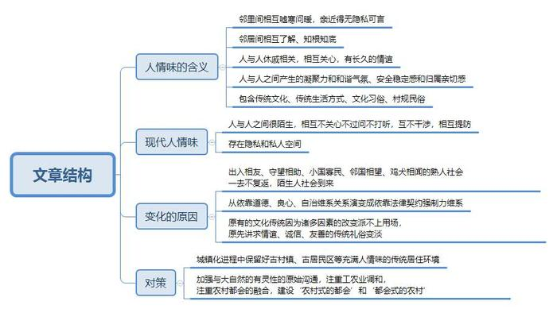

# 2015年919政法干警23省联考《申论》题（河北卷）

<!-- gwy:overview:start -->
> **河北 · 2015 · 申论 · 统考** ｜ 4 题 · 图片 1 处 · 答案随题折叠

导航：[题目](#题目) · [材料 1](#材料-1)
<!-- gwy:overview:end -->

> 候选采集稿。参考答案及解析来自粉笔页面，不代表官方答案或真实高分答卷；来源使用许可与原卷对应关系仍需人工核实。

## 给定材料

### 材料 1

A县这座曾经一顿饭功夫就可以横穿的小县城，现在环线有了、广场大了、楼多了、街宽了、灯亮了，到处显露着向大城市看齐的雄心。短短几年间，A县城区面积不足10平方公里扩至近20平方公里，人口由不足10万增至20万。变化如此之大，以至于不少人从外面回来，迷失在楼群车流之中，找不到回家的路。一位种了几十年水稻的新市民说，进城不只是换个地方，更是换个活法。村头闲聊变成广场漫步，坐便取代蹲坑，大超市冲击小卖部，城镇化的时代洪流一改农村长期封闭、单调的生活状态，带来了新的生活方式。对于这种变化，乡亲们也有各种“吐槽”，规划落后、交通拥堵、环境脏乱、学校人满为患、公厕难找、停车不便……从中我们体会到“城市病”正在向一些中小城市和新兴城镇蔓延。

如果说种种“城市病”反映城市功能不全、百姓生活不便，那么城市发展的误区则挤压着人的发展空间。城市建设铺摊子、摊大饼等做法还较有市场，不少基层干部面对大片“有奠基无下文”的项目用地也是忧心忡忡。相比城市资源的空置，群众权益的“悬空”更让人忧心。

专家指出，我们的城市化必须从“速度型 ”转向“质量型”，由“物质的城镇化”转向“人的城镇化”。而人的城镇化中的“人”，既泛指全中国13亿人口，又重点指的是8亿具有农民身份的国民。尤其是长期在城镇从事非农业的2.6亿农民工群体。谈及城镇化只论及农民的城镇化，实际上是不全面的。因为人的城镇化要求逐步实现城乡一体化，这种一体化本质上是“城里人”和“乡下人”互化的过程，“乡下人”到城市从事非农产品工作加快了城市的繁荣，“城里人”也理应带着资金技术到“乡下”经营农业活动，给农业农村输血补钙。只不过“城里人”是自建国以来凭借城市户籍享受了“剪刀差”等带来的比“乡下人”更多更久的公共产品等社会福利的既得利益群体。例如，“乡下人”曾向“城里人”免费提供了几十年的“商品粮”、“商品棉”、“统筹提留款”等农副产品和资金供给。为了支持城市发展，农民和农村几乎被“掏空”或“半掏空”，由此产生农民、农村生存与发展的严重贫血缺钙现象。所以，城镇化与8亿农民的利益格局调整关系最直接最密切，农民市民化是实现人的城镇化中最艰巨的关键任务。

### 材料 2

1988年，德国巴伐利亚州以及德国赛德尔基金会把我国某市南张楼村确定为“中德土地整理与农村发展合作试验区”。德国人的经验来源是，第二次世界大战后，德国政府通过改善农村设施，使农村经济和城市经济得以平衡发展，明显减弱农村人口向大城市的涌入，将农民成功地留在土地上的“巴伐利亚经验”。这一经验50年来成为德国农村发展的普遍模式。

从地理位置看，南张楼村距离市区20多公里，当时有1021户4000多人。德国人看中的就是南张楼村的“天然劣势”：不靠城、不靠海、没有大型企业、不靠近交通要道、没有矿产资源、人多地少，属于中等偏下的农村。

如今的南张楼村的村貌很清晰，共四个功能区。村南边是已有50多家企业的工业区，村东是大田区，村北是文化教育区，村子中心地带则是生活区。

村内全部柏油化的街巷把这个大村分割得井井有条，村民住房多为简朴、舒适的平房，每户的大门上都有统一的门牌号，路两边都有路灯，并设置了垃圾箱。村里大部分农民所住的房子，结构和功能基本都与城里的一样，如卧室与客厅分设、有室内卫生间、配备淋浴设施等。村子北边建有小学、博物馆、文化中心和医院。一座清新典雅的红色三层楼房就是小学的教学楼，看上去并不起眼，但在这里，孩子们可以接受被德国人称为"双元制"教育的素质教育。德国人特别重视孩子的动手能力，学校设有微机室、木工室、图画室、玩具室。文化中心建有一个装备了现代音响设备的大礼堂，礼堂内有1200个座位，满足一户一个的需要，每年3月在这里召开村民代表大会时，大家按号入座。村里的娱乐活动也在这里进行。 文化中心前绿草如茵的广场、造型别致的雕塑，还有现代化的体育设施，让这里看上去与城市的文化活动场所没有什么区别。村里还投资了120万元修建医院，村民的小病小痛不出村就可以得到及时救治。

村南边是占地150多亩的民营经济园区，织布厂、石油机械厂、面粉加工厂等50多家村办企业都集中在这里。其产品销往欧洲、美国等地。去年全村的工业总产值为2亿元，纳税500多万元，占所在乡镇财政收入的90%。

这里的工厂每年放两次假：秋假和麦假，各二十天，除此之外没有公休日。每天的工作时间是上午7时30分到11时30分，下午12时30分到4时，余下点时间，留给农民工们去照看自家的田地。“白天进厂，下班种田，农闲进厂，农忙进田”，已经成了南张楼人主要的生活节奏，平均每个家庭都有一个劳动力在村里的工厂上班。

超市、美容美发店、移动营业厅、酒店、婚庆楼等鳞次栉比，凡是村民们需要的商品与服务，基本上不用出村就可以享受到。村里设有通往附近县城的多条公交路线，即便出村也很方便。

近年来，随着知名度的提高，南张楼村还诞生了一项新产业----旅游。依托“德国村”这一品牌，南张楼村积极打造“省级旅游特色村”建设民俗博物馆，修建中华袁氏博览园。现在，每年都有100多批人到村里参观旅游。

二三产业的发展，几乎消化了村里全部的剩余劳动力。除了上大学后留在外地发展和210个村民仍在国外创业，其他人都在村里工作生活，全村4300口人几乎没有一个人去城里打工，从这一点看，应当说实现了项目的初衷。

日前，南张楼村启动了社区化建设，成为周边7个村的经济、文化和居住中心。投资2000万元、正在筹建的老年公寓，将成为全镇老年人住养、医疗、康复的幸福乐园。

要问南张楼人的生活与城里人还有什么不一样的地方，村民的回答很实在：“现在唯一与城里不一样的地方就是还没有实现集中供暖。”

村长也提到了“两点遗憾”：一是“没有听德国人的话修建停车场”，二是“没有听德国人的话将房子建成青砖小瓦的四合院式”。20世纪90年代初，德国人在全村规划了4个停车场。可当时村民一辆车也没有，谁也不认为修建停车场有什么用处。所以，在建设时毫不犹豫地把停车场取消了，尽管德国人一再劝说“将停车场预留地暂时建成绿地也可以”，但那时村民连“绿地”这个名词都还没听说过呢！现在，村里有各种车辆1000多辆，“车满为患”的现代人让人不禁想到了德国人的先见之明。房子为什么没有按照德方的意见建成青砖小瓦的四合院式呢？20世纪60年代以前村里的房子就是青砖小瓦式的，70年代后才开始用红砖红瓦。所以，80年代末德国人提出用青砖小瓦建房时，村里人首先想到的是“倒退”二字。村长说，“假如当初听德国人的话，将村民的住房全部建成青砖小瓦的四合院，现在恐怕光靠旅游，收入就不是一个小数目。”

### 材料 3

老李是老上海人，他认为以前的上海最有人情味的地方，恰恰是那邻里间相互嘘寒问暖、亲近得几无隐私可言的里弄（里弄，大致相当于北方的大院儿、胡同）。在这种环境中长大的城里人，和一个村里长大的乡下人并没有什么两样；没有隐私，没有秘密，谁有多少斤两，大家心里都有数。因此，即便日后远走高飞，各奔东西，重逢之日，对方如果要打听自己的情况，多半也不好意思拒绝。因为面对一个知根知底的人，你根本就没有资格也没有勇气说出“隐私”这两个字。何况对方的打听，本身就透着一份关切，而且是那种曾经休戚相关的人才有的关切。面对这份情谊，你岂止不忍拒绝，没准自己就有倾诉的欲望。结果你不但会和盘托出，而且还会以同样的关切去询问对方。

深圳人却不会这样。对于他们来说，这个城市是陌生的，这个城市里的人也是陌生的。公司里，单位上，同事之间，谁也没有关心他人的义务，也没有过问他人的权力。相反，由于竞争是那样的激烈甚至残酷，没准反倒有些提防。在这种情况下，泄露自己的隐私无疑是不智之举，打听别人的生活则难免居心不良的嫌疑，还是互不干涉或心照不宣为好。至少是，许多人在决心闯深圳时，也都决心向过去告别，把历史埋在心底。这种想法是“人同此心”的。你既然不希望别人了解你的过去，那就最好也不要向别人打听现在，而一个人一旦坚守着某种纯属个人的秘密，也就意味着他有了一个私人空间，这个空间是有可能逐渐扩大的，直至说出“我的生活与你无关”。

深圳的前途在于创新。出入相友，守望相助，小国寡民，邻国相望，鸡犬之声相闻，这样的熟人社会已经一去不复返了。深圳人应该直面移民社会、陌生社会自身的问题。人类法制史证明，移民社会最容易认同法制。恩格斯的《家庭、私有制和国家的起源》早已告诉我们，从法律的起源来看法律是人类道德沦丧、无法自治之后产生的。陌生人社会的不信任恰巧成为法律产生的心理基础，既然大家彼此缺乏交往、信任的历史传统，讲良心道德不一定得到好报，那就干脆把理说在明处，制定一套法律规则，不靠良心而靠强制力来维系。法律是不易自发产生信用的陌生人发明的强制性信用工具，是恶而不是善推动了法的产生。深圳必须迈过法制这道坎，才能真正步入一契约为基础的现代市民社会。

### 材料 4

老张曾经居住的四合院已经于上个世纪80年代拆掉了，上面盖起了商贸大厦，老北京们搬到东西环外，住进了楼房。偶然翻开北京地图，老张想起曾经在四合院里生活的一幕幕，他无限感慨：“原来，咱也在‘文化遗产’里生活过！”

四合院是华北民宅中的一种组合建筑形式，既不同于上海的石库门、山西的乔家大院，也不同于白墙黛瓦的徽派建筑，更不同于福州三坊七巷的闽派民居。四合院是华北古老、传统的文化象征。北京四合院或独家独户，或数户、十几户合居，形成一个符合人性心理、保持传统文化、邻里关系融洽的居住环境。谁家做饺子了，都要给街坊邻里端上一碗，北京人的客气、有礼、大度、热情就是这么来的！尤其是谁家有个红白喜事，街坊四邻纷纷解囊出手相帮的景象最让人感动。数代人的居住实践表明，住在四合院，人与人之间能产生一种凝聚力与和谐气氛，同时有一种安全稳定感和归属亲切感。这与现代公寓住宅永远紧闭大门的冷漠形成了鲜明对照。

四合院也不是样样都好，老张说他生活的上世纪七八十年代，整个胡同只有两三个厕所，还都是旱厕；还有用水，整个院子就一个水龙头，赶上用水高峰，往往要排队；四合院里没有暖气，到了冬天家家要生一个蜂窝煤炉，不仅呛人，还容易煤气中毒。如今若回到了原先的四合院去居住，还真的有些不习惯了。

以前，街坊四邻就是一个生活圈子，大都是熟人，熟人之间的约束力很强，讲得更多的是通过道德实现自律和他律，通过关系互帮互助，也更讲求公共治理的一些理念，有事大家一起协商解决。而现在，原有的文化传统因为诸多因素的改变派不上用场，原先讲求情谊、诚信、友善和互帮互助的传统礼俗会逐渐变淡，文化传统中的那些优秀元素也就慢慢成为一部分人的集体记忆了。

### 材料 5

巴黎历史上就是法国和欧洲的中心。20世纪后半期，欧洲城市间的竞争日趋激烈，城市发展规划调整成为保持巴黎国际城市地位的有效措施之一。从内部空间发展来看，1958年在市区外规划建设了副中心拉德方斯，使巴黎城市的历史轴线向西延伸。巴黎拒绝在市中心建高楼大厦，“顽固”地保留着千百年来古都的文化传承，并通过巧妙的规划、设计，通过一条东西向的中轴线，将古城与新兴卫星城联系起来。

拉德方斯位于巴黎城市轴线西端紧邻巴黎城的近郊区，经过30多年的开发建设，拉德方斯已入驻公司1500余家，可容纳15万人就业，成为以商务办公为主，兼有会展、政府办公、商业、娱乐、居住功能的欧洲最大的商务办公区之一。同时，在紧邻巴黎城外形成了一个风貌与城区截然不同的现代化的副中心，其标志性建筑拉德方斯大拱门的建成，使得巴黎的历史轴线得到了延续和升华。

1965年，巴黎在区域规划中首次提出建设新城，向外围地区疏散中心区过于集中的人口，并对自发形成的郊区进行重整，新城作为郊区的“中心”，为周边居住区提供必要的公共服务和商业娱乐设施。目前，在巴黎城的外围地区，沿塞纳河、马恩河、卢瓦兹河河谷方向的城市扩展形成了五座新城。新城的人口规模为10万人。这些新城中心距离城市中心巴黎圣母院较近，平均距离为25公里左右；都有良好的公共换乘系统，通过轨道交通与市区相联，快捷方便，但新城内部结构较为松散，内部交通主要依赖私人小轿车；新城集聚了众多的商务、服务业、研发和轻工业等产业活动，成为巴黎大区新的增长中心。例如，为保证职住平衡，增强新城吸引力，就近满足郊区居民工作需求和生活需求，新城功能较为综合，包括娱乐功能，如马恩拉瓦莱建有欧洲迪斯尼乐园，为其直接提供了1万多个就业岗位；每座新城都有自己的大学和众多职业技术学院；新规划的社区都以低层、低密度为特点，在规划建设中注重与自然环境协调，巧妙地利用了天然水系或人工湖泊，外围有绿带环绕，并与原有的城市化区域隔离开；巴黎的轴向空间发展战略既保持了中心区的繁荣，较完整地保持了老城区的历史风貌，又为经济发展提供了组织有序的增长空间。

### 材料 6

余光中的散文《乡愁》不知波动了多少人的心弦。因为“乡愁”是许多人都会经历的一种美好情愫，只有在乡愁中对历史、对过去才有一种更深更沉的思索，也只有在乡愁中才有那份脑际依稀的记忆、那份心灵执着的传承。

记得住乡愁的最好物证就是那些在城镇化进程中即将消失的古老村镇，这些村镇历史悠久，虽破败不堪，重修乏力，却能激起无数人的乡愁。它记录的是上辈人曾付出的努力和曾有过的辉煌，它的沧桑反而是在陈述着人类发展的历程，见证时代的缩影。鉴古通今，回头看才能更好地向前走，正如诗人诺瓦利斯说的：“哲学就是一种怀着乡愁寻找家园的冲动”，所以保持好古村镇还有更深层次的精神价值所在。

在城镇化的大拆大建中，越来越多的城镇，抛弃了厚重的文化底蕴，变成“千城一面”的新城。在当今的城镇化建设中，自然生态、文物、古居民区被一步步“蚕食”，而它们又具有稀缺性、脆弱性和不可再生性，一旦被毁坏就无法还原。故乡没有了老树、老房子、乡愁去哪找寻？

### 材料 7

失地农民从乡下人变成了城里人，乡镇变成了街道，生活也更加便利了。但是生活方式城市化了，原汁原味富有个性的传统文化却变淡甚至消失了。现在住进了楼房，用上了自来水，周围也修建了城镇广场、图书馆、文化馆，但有时就是觉得心里空落落的。觉得生活的滋味没有以前浓厚了，千姿百态的传统生活方式、文化习俗、村规民约等文化样态，只能在村庄里得以完整而富有个性的保留。传统的农事耕作、放牧与土地、牲畜、气象有千丝万缕的联系。节气、天象在人们的生产生活中都是重要的因素，围绕着这些产生了独具特色的文化。例如，什么节气种什么庄稼、怎么饲养牲畜，看太阳月亮星辰云彩的变化就能辨识出的时间、预报出天气的变化等。这些都是在生产生活中形成的最为宝贵的传统文化。不管现代技术多么先进，这些与大自然的有灵性的原始沟通，在人类社会的发展中是必不可少的，它是人类精神之源。我国宋代大儒程明道说过：“观鸡雏可以知仁。”日本学者河西太一郎在他的《农民问题研究》中这样描绘：“再把这样几百年以后的人类群众生活想象一下……农工业的调和，农村和都会的融合，乃是那个社会的底色。在那社会所存在的，可以说是‘农村式的都会’或是‘都会式的农村’……那样的时代的文化才能算是真正意义的人类的文化。”

## 题目

### 第 1 题

（一）请以给定材料2中德国在我国南张楼村合作实验区项目近三十年的经验教训为依据,写一份推广建议。(20分)

关联材料：材料 2

作答要求：观点明确,表述准确,条理清楚,简明扼要,不超过400字。

第 1 题 · 答案与解析

**参考答案（粉笔题库参考内容）**

关于推广中德土地整理与农村发展合作试验区经验的建议

南张楼村自与德国合作发展中德土地整理与农村发展合作试验区以来，实现了农村经济和城市经济平衡发展，控制了人口向城市盲目涌入，取得了良好效果。为推广南张楼村的成功经验，提出如下建议：

一、科学规划布局。将村镇明确划分为工业、农业、文化教育和生活等功能区，保持村貌明朗。

二、完善生活设施。加大财政投入，改善农村的道路、路灯、垃圾箱、停车场等基础设施；提供集中供暖，提高住房舒适度；推动社区化建设，修建医院、老年公寓、超市、酒店等民生项目，开设公交路线，方便村民生活。

三、加强文化教育。修建学校和博物馆，开展素质教育，培养动手能力；建设大礼堂、广场等文化活动场所，完善音响、体育等配套设施。

四、推动产业发展。建设民营经济园区，发展村办企业，科学制定假期，兼顾农民务工务农；积极发展旅游，依托品牌，打造旅游特色村，保留传统特色，建设民族博物馆。

**解析状态：unknown（来源未提供）**

### 第 2 题

（二）根据“给定材料5”,概括巴黎城市建设的成功做法。 (20分)

关联材料：材料 5

作答要求：理解准确，语言流畅，条理清楚，概括全面，不超过300字。

第 2 题 · 答案与解析

**参考答案（粉笔题库参考内容）**

巴黎的轴向空间发展战略既保持了中心区的繁荣和老城区的历史风貌，又为经济发展提供了有效增长空间。一、坚持保留文化传承。坚持城市中心不建高楼，巧妙规划设计，用东西中轴线连接古城和新兴卫星城；二、近郊建设现代化的副中心。建设以商务办公为主，兼有会展、政府办公、商业、娱乐、居住功能的大型商务办公区，延伸历史轴线；三、郊区建设新城。重整郊区，建设新城以疏散中心区人口，新城提供必需公共服务和商业娱乐设施；新城距离城市中心较近，公共换乘系统良好；产业活动聚集，成为新增长中心，功能综合，提供就业岗位；教育设施完善，有大学和职业技术学院；社区规划低层、低密度，注重与自然环境协调。

**解析状态：unknown（来源未提供）**

### 第 3 题

（三）根据给定资料，阐述你对资料1中 “谈及城镇化只论及农民的城镇化，实际上是不全面的。”这句话的理解。（20分）

关联材料：材料 1

作答要求：理解准确，表达顺畅，条理清楚，简明扼要。不超过300字。

第 3 题 · 答案与解析

**参考答案（粉笔题库参考内容）**

城镇化不能只谈及8亿具有农民身份的国民，应全面关注全中国13亿人口。因为：1.城镇化要求实现城乡一体化，本质是“城里人”和“乡下人”的互化，“乡下人”到城市从事非农产品工作加快了城市繁荣，“城里人”也理应带着资金技术到“乡下”经营农业活动，给农业农村注入动力活力。2.如果只论及农民的城镇化虽然会改变农村长期封闭、单调的生活状态，带来新的生活方式。但会出现城市病，导致城市功能不全、百姓生活不便，挤压人的发展空间，资源空置，群众权益受损，传统文化丢失等问题。

所以，城镇化要从“速度型 ”向“质量型”转变，由“物质的城镇化”转向“人的城镇化”。

**解析状态：unknown（来源未提供）**

### 第 4 题

给定资料中提到，老上海人认为里弄是“以前的上海最有人情味的地方”。请结合给定资料及个人思考，以“人情味－－从传统到现代”为话题，自拟题目，写一篇议论文。字数1000字左右。（40分）

关联材料：材料 1、材料 2、材料 3、材料 4、材料 5、材料 6、材料 7

作答要求：（1）中心明确，观点鲜明；（2）论述充分，结构完整；（3）语言流畅，书写工整。

第 4 题 · 答案与解析

**参考答案（粉笔题库参考内容）**

参考范文一

**人情味**

**——从传统走向现代**

无论你生活在何处，总有一种味道让人魂牵梦萦、念念不忘，这种味道就是人情味。有人情味的生活让人与人之间产生一种凝聚力与和谐气氛，同时有一种安全稳定感和归属亲切感。但现代社会人情味儿日渐淡薄，令人惋惜。人情味，从传统社会走来，更要走向现代社会，温暖现代市民。

**人情味是人与人之间相互关爱的情感，是淡淡的乡愁，是传统文化中一切富有人文美的优良品格。**人情味儿是一种美好的情愫与感受；是邻里之间嘘寒问暖，亲密无间；是大家彼此了解，知根知底；是一种休戚相关的关切关心，人与人之间有着长久的浓浓的情谊。人情味依托北京四合院、上海里弄等传统民居。在那里谁家有个红白喜事街坊四邻会出手相帮；谁家做了饺子都要给街坊邻里端上一碗……不仅如此，某种程度上说，人情味还代表着传统的生活方式、文化习俗、村规民俗，折射出中华传统文化。

**人情味从传统社会到现代社会发生极大改变，人情味越来越淡。**现代社会人情味式微并非偶然，其有着深层次的社会原因。传统社会是熟人社会，熟人之间的约束力很强，通过道德实现自律和他律，通过关系互相帮助。但是随着经济的发展、社会的变迁，越来越多的人离开了亲人、朋友，离开了熟人社会，来到了陌生的城市、遇见陌生人、过着和以往不同的陌生生活。从出入相友，守望相助，邻国相望的四合院、里弄住进了独门独户的公寓，出入相友鸡犬相闻的熟人社会被陌生人社会取代，人与人之间的关系从依靠道德、良心、自治维系演变成依靠法律、契约、强制力来维系，原有的文化传统因为很多客观环境等因素的改变派不上用场，原先讲求情谊、诚信、友善的传统礼俗也日渐淡薄，最终导致现代社会的人情味变淡甚至消失，人与人之间变得很陌生，见面不再嘘寒问暖，取而代之的是入户随即紧闭房门，钢筋水泥不仅空间上隔断了人与人，也拉远了人心的距离，彼此不关心不过问，甚至相互提防。

**留住人情味就是留住乡愁，留住传统，留住人类精神之源。**诗人诺瓦利斯说的：“哲学就是一种怀着乡愁寻找家园的冲动”。不管现代技术多么先进，人与人之间的相互关爱和牵挂，与大自然的沟通，在人类社会的发展中是必不可少的，它是人类精神之源。留住乡愁，留住传统，留住人类精神之源，需要在城镇化建设中注意保留好古村镇、里弄等传统居住环境，也需要在城市化的进程中让城市和乡村的文化融合，实现人的城市化。

**保护有人情味的居住地，建设有人情味的居住环境，方能让人情味走向现代社会。**那些具有人情味的居住地，如历史悠久的古居民区、古村镇、村庄。这些古建筑记录着人类发展的历程，见证着时代的缩影，更承载曾经生活在此的每个人的乡愁。我们不仅要保护它们，更好好保护，加大力度保护。原汁原味富有个性的传统文化，与大自然的有灵性的原始沟通，是人类发展的精神之源，不论什么时候我们都要传承和保护。我们要建设工农业调和，农村和都会的融合的未来社会，那样的时代的文化才能算是真正意义的人类的文化。

你我的漂泊，是这个时代变迁的印记。一次次挥手间，我们忘不了送行的相亲邻里，一层层山水间，我们泪眼回忆故人句句叮嘱。让我们难以忘怀的是人情味，让我们魂牵梦绕的是人情味。人情味，从传统走来，也要走向现代！

参考范文二

**人情味需传统与现代相融合**

无论你生活在何处，总有一种味道让人魂牵梦萦、念念不忘，这种味道就是人情味。传统的人情味可以给你一种归属感、亲切感，现代的人情味可以给你一种安全感、稳定感，我们需要传统与现代结合的人情味。

**人情味离不开传统熟人社会道德约束的“柔”。传**统社会是熟人社会,熟人之间的约束力很强,通过道德实现自律和他律,通过关系互相帮助。传统社会的人情味体现在邻里之间的相互嘘寒问暖，无隐私可言中；体现在谁家有个红白喜事,街坊四邻出手相帮中；体现在谁家做了饺子,都要给街坊邻里端上一碗……这种人情味拉近了人与人之间的距离，增强了人与人之间的凝聚力，营造了一种温馨和谐的氛围。因此很多人认为上海最有人情味的在里弄，北京最有人情味的在四合院。

**人情味离不开现代契约社会法制约束的“刚”。**随着经济的发展、社会的变迁，越来越多的人离开了亲人、朋友，离开了熟人社会，来到了陌生的城市、遇见陌生人、过着和以往不同的陌生生活，建立了新型的契约社会关系。“出入相友，守望相助，小国寡民，邻国相望，鸡犬之声相闻”这样的熟人社会已经一去不复返了。试图以人情为纽带来维持和睦往往是不够的，尤其是人情味过浓，就有可能变味，形成人情网、关系网，所谓任人唯亲，其实就是人情味变味的结果。现在,原有的文化传统因为很多因素的改变派不上用场,这就需要把理说在明处，制定一套法律规则。法制是对所有公民的人情味，所以移民社会最容易认同法制。

**人情味需传统与现代相融合。**传统的人情味和现代的人情味各有特色，缺一不可。如果缺少了传统的人情味，我们的社会就变得冰冷，人们也缺少了归属感、认同感和幸福感。如果缺少了现代法律的保护，人与人之间一旦发生纠纷，基本的信任都没有，何谈人情，人情味又从哪而来？例如，一些农民工刚从农村来到城市准备打工，就被骗得身无分文。对骗子来说，靠传统的道德实现自律失去了效果。这时，依靠法律维护农民工权利就是最大的人情味。因此，人情味需传统与现代相融合。一要加强法制建设。通过法律来确定是与非的标准，划清人与人之间的界限，成为人情味的“保护神”。二要加强法律宣传。通过宣传，让法治理念深入人心，把法律作为人与人交流的标准，成为人情味的“度量衡”。三要搭建交流平台。发挥社区在促进人与人之间交往的积极作用，通过举办各种活动，让陌生的人变得熟悉，相互提防变为出手相帮，让传统人情味的那种热乎劲，回到我们身旁。这种热乎劲可以进一步温暖人心，成为人情味的“加固器”。

传统的人情味与现代的人情味相融合，既发挥了传统道德“柔”的优势，又发挥现代法律“刚”的特点，如此刚柔相济，方能相得益彰。

**解析状态：unknown（来源未提供）**

