# 2015年河北省选调生招录考试 《行政职业能力测试》试卷（精选）

<!-- gwy:overview:start -->
> **河北 · 2015 · 行测 · 选调** ｜ 113 题 · 图片 73 处 · 答案随题折叠

| 题型模块 | 题量 | 题号 |
| --- | ---: | ---: |
| 常识判断 | 20 | 1–20 |
| 言语理解与表达 | 35 | 21–55 |
| 数量关系 | 20 | 56–75 |
| 判断推理 | 23 | 76–98 |
| 资料分析 | 15 | 99–113 |
| **合计** | **113** | |

导航：[题型与作答说明](#题型与作答说明) · [题目](#题目) · [材料 1](#材料-1)
<!-- gwy:overview:end -->

> 候选采集稿。参考答案及解析来自粉笔页面，不代表官方答案或真实高分答卷；来源使用许可与原卷对应关系仍需人工核实。

## 题型与作答说明

常识判断

（20题）

根据题目要求，在四个选项中选出一个最恰当的答案。

言语理解与表达

（35题）

本部分包括表达与理解两方面的内容。请根据题目要求，在四个选项中选出一个最恰当的答案。

数量关系

（20题）

在这部分试题中，每道题呈现一段表述数字关系的文字，要求你迅速、准确地计算出答案。

判断推理

（23题）

本部分包括定义判断、类比推理与逻辑判断三种类型的试题，在四个选项中选出一个最恰当的答案。

资料分析

（15题）

所给出的图、表、文字或综合性资料均有若干个问题要你回答。你应根据资料提供的信息进行分析、比较、计算和判断处理。

## 题目

### 第 1 题

2014年11月，APEC会议在北京召开，这次会议的主题是：

A. 活力亚太，全球引擎

B. 共建面向未来的亚太伙伴关系

C. 发展的挑战

D. 紧密联系的区域经济

第 1 题 · 答案与解析

**参考答案（粉笔题库参考内容）**

B

**解析**

A项：2013年APEC会议主题是“活力亚太，全球引擎”，此次会议在印度尼西亚巴厘岛举行，排除；

B项：2014年APEC峰会继2001年在上海举办后重回中国，于11月10日-11日在北京召开，包含领导人非正式会议、部长级会议、高官会等系列会议。此次峰会的主题是：共建面向未来的亚太伙伴关系。其中领导人峰会在北京怀柔雁栖湖举行，中国国家主席习近平主持峰会。此次峰会是时任中国国家主席胡锦涛于2012年在俄罗斯举行的第二十次峰会上宣布中方主办2014年的APEC领导人非正式会议，当选；

C项：历次的APEC会议均没有这一主题，排除；

D项：2011年APEC会议在美国夏威夷州首府檀香山召开，檀香山主题是“紧密联系的区域经济”，排除。

故正确答案为B。

### 第 2 题

要把权力关进制度的笼子，这就需要：

A. 政府行使立法权

B. 人民直接行使国家权力

C. 完善权力监督体系

D. 社会实现绝对公平

第 2 题 · 答案与解析

**参考答案（粉笔题库参考内容）**

C

**解析**

A项：在我国，人民代表大会行使立法权，政府行使管理权，排除；

B项：我国《宪法》第二条第二款规定“人民行使国家权力的机关是全国人民代表大会和地方各级人民代表大会。”由此可见，我国人民不是“直接”行使国家权力，而是通过各级人民代表大会这一国家权力机关来行使权力的，排除；

C项：2013年1月22日，习近平总书记在中纪委全会上强调，要加强对权力运行的制约和监督，把权力关进制度的笼子里，形成不敢腐的惩戒机制、不能腐的防范机制、不易腐的保障机制，当选；

D项：社会公平具有以下特点：（1）公平总是受到一定社会条件制约的，任何社会都会存在一些不公平的现象。（2）公平总是相对的，无论我们如何努力，都不可能达到绝对公平。（3）尽管如此，但公平一直是人类孜孜以求的目标，公平与否的判断，受到个人价值观念、思维方式的制约，我们要客观地对待生活中的“不公平”现象，要为创造一个更加公平的社会作出不懈努力，排除。

故正确答案为C。

### 第 3 题

某中学附近有家黑网吧，老板经常以打折的方式引诱未成年的中学生逃学进入网吧玩游戏。网吧老板的行为违反了：

A. 《中华人民共和国宪法》中有关公民受教育权的规定

B. 《中华人民共和国义务教育法》中有关适龄儿童入学的规定

C. 《中华人民共和国未成年人保护法》中有关学校保护的规定

D. 《中华人民共和国未成年人保护法》中有关社会保护的规定

第 3 题 · 答案与解析

**参考答案（粉笔题库参考内容）**

D

**解析**

A项：受教育权是一项基本人权，受教育权是中国公民所享有的并由国家保障实现的接受教育的权利，是宪法赋予的一项基本权利，也是公民享受其他文化教育的前提和基础。本题目并未涉及受教育权，排除；

B项：2006年6月由中华人民共和国全国人民代表大会常务委员会修订通过的《中华人民共和国义务教育法》第十一条第一款规定：“凡年满六周岁的儿童，其父母或者其他法定监护人应当送其入学接受并完成义务教育；条件不具备的地区的儿童，可以推迟到七周岁。”义务教育是国家统一实施的所有适龄儿童、少年必须接受的教育，是国家必须予以保障的公益性事业。本题目并未涉及适龄儿童的入学，排除；

C项：学校保护是指有关的学校、幼儿园及其他教育机构依照我国《未成年人保护法》及其他有关法律、法规，对未成年学生和幼儿园儿童实施的专门保护。学校保护是未成年人保护的重要方面。本题目问的是网吧老板而不是学校违反了什么法律，排除；

D项：社会保护是指各社会团体、企事业组织和其他组织及公民，对未成年人实施的保护。其主要内容是：保护未成年人的安全与健康、保护未成年人的荣誉权、保护未成年人的智力成果权、保护有特殊天赋和突出成就的未成年人、公共场所优惠开放等。我国《未成年人保护法》关于社会保护中第三十六条第一、二款规定：“中小学校园周边不得设置营业性歌舞娱乐场所、互联网上网服务营业场所等不适宜未成年人活动的场所。营业性歌舞娱乐场所、互联网上网服务营业场所等不适宜未成年人活动的场所，不得允许未成年人进入，经营者应当在显著位置设置未成年人禁入标志；对难以判明是否已成年的，应当要求其出示身份证件。”当选。

故正确答案为D。

### 第 4 题

下列不符合我国古典建筑特点的是：

A. 不论是墙还是塔都是越往上越细，顶上有锋利的、直刺苍穹的小尖顶

B. 以木材、砖瓦为主要建筑材料，以木构架为主要的结构方式

C. 中轴对称、方正严整的群体组合与布局

D. 特别注意与周围自然环境的协调

第 4 题 · 答案与解析

**参考答案（粉笔题库参考内容）**

A

**解析**

我国的古典建筑屋顶瓦面是弯曲的，当屋顶是四面坡度时，屋顶的四角也就是翘起的。“不论是墙还是塔都是越往上越细，顶上有锋利的、直刺苍穹的小尖顶”是哥特式教堂建筑的特点。

本题为选非题，故正确答案为A。

### 第 5 题

我国农历采用天干地支纪年法，天干是：甲、乙、丙、丁、戊、己、庚、辛、壬、癸。地支是：子、丑、寅、卯、辰、巳、午、未、申、酉、戌、亥。以天干地支纪年，2015年是乙未年，2020年是：

A. 丙申年

B. 甲子年

C. 庚子年

D. 壬申年

第 5 题 · 答案与解析

**参考答案（粉笔题库参考内容）**

C

**解析**

天干地支纪年法的算法如下：

每个天干、地支有一个编号，从头以4开始按照顺序排下去，天干10后接1，地支12后接1。以公元年的尾数在天干中找出相对应的天干，然后将公元纪年除以12，用余数在地支中找出所对应的地支。这样，公元纪年就换算成了干支纪年。如果某一年的尾数为0或者用该年除以12的余数为0，则取天干中的第10位“庚”和地支中的第12位“申”。

如题目可知，2020年的尾数0对应的天干为“庚”。2020除以12余数为4，4对应的地支为“子”。那么，2020年则为农历庚子年。本题目只要判断出天干，就可以快速得出正确答案。

故正确答案为C。

### 第 6 题

结核病是由结核分枝杆菌引起的慢性传染病，可侵及许多脏器，以肺部结核感染最为常见。下列有关预防结核病的说法，错误的是：

A. 打喷嚏时要用手帕捂住嘴，避免面对其他人

B. 勤洗手，多通风，不随地吐痰

C. 到人员密集场所，应该一直戴口罩

D. 多锻炼，提高免疫力

第 6 题 · 答案与解析

**参考答案（粉笔题库参考内容）**

C

**解析**

预防结核病，应尽量避免到人员密集场所。

本题为选非题，故正确答案为C。

### 第 7 题

下列城市中，2014年空气质量最好的是：

A. 石家庄

B. 衡水

C. 邯郸

D. 秦皇岛

第 7 题 · 答案与解析

**参考答案（粉笔题库参考内容）**

D

**解析**

A、B、C三项城市均为内陆城市，D项的秦皇岛市位于河北省东北部，南临渤海、北依燕山，气候类型属于暖温带半湿润大陆性季风气候，受海洋影响较大。所以秦皇岛空气质量最好，尤其是北戴河被誉为中国北方空气、环境最好的国家海岸之一。

故正确答案为D。

### 第 8 题

我国人口分布有一条明显的地理分界线，该线东南部人口多，西北部人口少，这条分界线是：

A. 漠河—腾冲连线

B. 黑河—腾冲连线

C. 秦岭—淮河连线

D. 天山—阴山连线

第 8 题 · 答案与解析

**参考答案（粉笔题库参考内容）**

B

**解析**

由东北至西南，从黑龙江黑河到云南腾冲作一直线，就是我国的人口地理分界线，由地理学家胡焕庸于20世纪30年代提出，故又称“胡焕庸线”。以此线为界，东南半壁占国土面积的42.9％，人口占94.4％，西北半壁占57.1％，而人口仅占5.6％。

故正确答案为B。

### 第 9 题

老王在微信朋友圈发了一条信息“庆祝弄璋之喜”，朋友们纷纷点赞恭贺。老王所说的喜事是：

A. 喜得公子

B. 喜得美玉

C. 新婚之喜

D. 喜得千金

第 9 题 · 答案与解析

**参考答案（粉笔题库参考内容）**

A

**解析**

A项正确，汉族民间把生男孩子称为“弄璋之喜”，表示他将来是做官的。

B项错误，没有这种表述。

C项错误，新婚之喜在古代一般称为“花烛之喜”。

D项错误，“喜得千金”指生女孩，在古代一般称为“弄瓦之喜”。

故正确答案为A。

### 第 10 题

李强买房首付不够，向好友刘雷借了三万元，由于关系非常好，双方没有约定还款期限和利息。依照法律规定：

A. 刘雷无权要求李强支付利息，但可以要求李强立即还款

B. 刘雷无权要求李强支付利息，但可以要求李强适时还款

C. 刘雷有权要求李强按银行同期存款利率支付利息

D. 刘雷有权要求李强按银行同期贷款利率支付利息

第 10 题 · 答案与解析

**参考答案（粉笔题库参考内容）**

B

**解析**

1999年3月15日第九届全国人民代表大会第二次会议通过的《中华人民共和国合同法》规定：借款人应当按照约定的期限返还借款。对借款期限没有约定或者约定不明确，协议不能确定的，借款人可以随时返还；贷款人可以催告借款人在合理期限内返还。借款人未按照约定的期限返还借款的，应当按照约定或者国家有关规定支付逾期利息。

借款合同采用书面形式，但自然人之间借款另有约定的除外。自然人之间的借款合同，自贷款人提供借款时生效。自然人之间的借款合同对支付利息没有约定或者约定不明确的，视为不支付利息。自然人之间的借款合同约定支付利息的，借款的利率不得违反国家有关限制借款利率的规定。

公民之间的无息借款，有约定偿还期限而借款人不按期偿还，或者未约定偿还期限但经出借人催告后，借款人仍不偿还的，出借人要求借款人偿付逾期利息，应当予以准许。

故正确答案为B。

### 第 11 题

甲市新华区人民政府决定将其管理的国有电缆厂出售，该厂的承包人张某以侵犯其经营自主权为由提出行政复议。张某可以提请行政复议的机关是：

A. 甲市人民政府

B. 甲市新华区国资委

C. 甲市新华区人民政府

D. 甲市国资委

第 11 题 · 答案与解析

**参考答案（粉笔题库参考内容）**

A

**解析**

本题考查法律常识。

根据《行政复议法》第二十四条规定：“县级以上地方各级人民政府管辖下列行政复议案件：（一）对本级人民政府工作部门作出的行政行为不服的；（二）对下一级人民政府作出的行政行为不服的；（三）对本级人民政府依法设立的派出机关作出的行政行为不服的；（四）对本级人民政府或者其工作部门管理的法律、法规、规章授权的组织作出的行政行为不服的。”甲市新华区人民政府的上一级行政机关是甲市人民政府，因此，应当向甲市人民政府申请复议。

故正确答案为A。

### 第 12 题

2015年3月24日，以亚历山大•茹科夫为主席的国际奥委会评估团开始对北京、（ ）联合申办2022年冬奥会进行实地考察和风险评估。

A. 承德

B. 沈阳

C. 哈尔滨

D. 张家口

第 12 题 · 答案与解析

**参考答案（粉笔题库参考内容）**

D

**解析**

第24届冬季奥林匹克运动会，简称“北京冬奥会”，将在2022年2月4日~20日在中华人民共和国北京市和张家口市联合举行，北京为主办城市，张家口为协办城市。

故正确答案为D。

### 第 13 题

财政政策是政府宏观调控的重要手段。下列有关财政政策的论述，不正确的是：

A. 政府偏好对财政政策有重要影响

B. 税收、国债、公共支出等是主要的财政政策工具

C. 紧缩性财政政策通常用来增加和刺激社会总需求

D. 提供更多就业机会是财政政策的目标之一

第 13 题 · 答案与解析

**参考答案（粉笔题库参考内容）**

C

**解析**

本题考查经济常识。

A项正确，财政政策是指国家根据一定时期政治、经济、社会发展的任务而规定的财政工作的指导原则。财政政策由国家制定，代表统治阶级的意志和利益，是国家干预经济的主要政策之一，因此，政府偏好对财政政策有重要影响。

B项正确，财政政策工具也称财政政策手段，是指国家为实现一定财政政策目标而采取的各种财政手段和措施，它主要包括财政收入（主要是税收）、财政支出、国债和政府投资。

C项错误，紧缩性财政政策是宏观财政政策的类型之一，是指通过增加财政收入或减少财政支出以抑制社会总需求增长的政策。扩张性财政政策是国家通过财政分配活动刺激和增加社会总需求的一种政策行为。选项所述应是扩张性财政政策。

D项正确，财政政策的目的一般包括经济稳定、经济发展、公平分配和平衡预算四大目标。财政政策的经济稳定目标又分解为物价稳定、充分就业和国际收支平衡三个子目标；经济发展目标包括经济增长目标、资源合理配置目标和社会生活质量的提高三个子目标。

本题为选非题，故正确答案为C。

### 第 14 题

苏州历史悠久，风景秀美。下列诗句与苏州有关的是：

A. 商女不知亡国恨，隔江犹唱后庭花

B. 孤帆远影碧空尽，唯见长江天际流

C. 欲把西湖比西子，淡妆浓抹总相宜

D. 姑苏城外寒山寺，夜半钟声到客船

第 14 题 · 答案与解析

**参考答案（粉笔题库参考内容）**

D

**解析**

A项：诗句出自唐代文学家杜牧的《泊秦淮》，描绘的是六朝古都金陵（今南京）的奢靡生活，排除；

B项：诗句出自李白的《黄鹤楼送孟浩然之广陵》，黄鹤楼在湖北武汉市，排除；

C项：诗句出自苏轼的《饮湖上初晴后雨》，描绘的是浙江杭州西湖的美景，排除；

D项：诗句出自张继的《枫桥夜泊》，姑苏就是今天的苏州，当选。

故正确答案为D。

### 第 15 题

下列依次与蒙古族、回族、傣族关系最密切的是：

A. 酥油茶、馓子、青稞酒

B. 马头琴、冬不拉、葫芦丝

C. 那达慕大会、开斋节、泼水节

D. 努尔哈赤、阿凡提、刘三姐

第 15 题 · 答案与解析

**参考答案（粉笔题库参考内容）**

C

**解析**

A项：酥油茶和青稞酒是藏族的特色饮食，馓子在我国的南北方都有分布，少数民族中以维吾尔族、东乡族和纳西族以及宁夏回族的馓子最为有名，排除；

B项：马头琴是蒙古族的特色乐器，冬不拉是哈萨克族的乐器，葫芦丝是云南少数民族乐器，主要流传于傣、彝、阿昌、德昂等民族中，排除；

C项：那达慕大会是蒙古族历史悠久的传统节日，在每年七、八月牲畜肥壮的季节举行，是人们为了庆祝丰收而举行的文体娱乐大会。开斋节是伊斯兰三大宗教节日之一（另两个为古尔邦节与圣纪）。泼水节是傣族以及泰语民族和东南亚地区的传统节日，是傣族的新年，相当于公历的四月中旬，一般持续3至7天，当选；

D项：努尔哈赤是清王朝的奠基者，是女真（今满族）的历史人物。阿凡提是伊斯兰世界传说人物。刘三姐是民间传说的壮族人物，排除。

故正确答案为C。

### 第 16 题

下列做法中符合用电安全的是：

A. 为使用方便，应将销售到农村地区的空调三脚插头改为两脚插头

B. 发生触电事故后，应先切断电源再救治

C. 为安全起见，保险丝应尽可能粗

D. 当电器发生起火事故时，应迅速泼水灭火

第 16 题 · 答案与解析

**参考答案（粉笔题库参考内容）**

B

**解析**

A项：三脚插头的三根电线是L（火线）、N（零线）和E（接地线)。接地线是与电器的金属外壳连通的，万一外壳因绝缘体损坏等原因而带电，泄漏电就流到保护接地线里，从而引发断路器（空气开关）跳闸或熔断器断路或漏电保护器动作等保护动作，从而保护我们不被触电，所以三脚插头更安全。将三脚插头改为两脚插头，错误；

B项：当发生人身触电事故时，应立即断开电源，使触电人员与带电部分脱离，并立即进行急救。在切断电源之前禁止其他人员直接接触触电人员，正确；

C项：粗保险丝通过的电流大，在电流过大时不易及时熔断，起不到保护电路作用，错误；

D项：家用电器或电线发生火灾时，应先断开电源再灭火，切断电源后方可用常规的方法灭火，没有灭火器时可用水浇灭。电器设备着火后，不能直接用水冲浇，因为水有导电性，进入带电设备后易引触电，会降低设备绝缘性能，甚至引起设备爆炸，危及人身安全，错误。

故正确答案为B。

### 第 17 题

下面关于WIFI的说法，正确的是：

A. WIFI是一种可以将笔记本电脑、手机、PAD等终端以无线方式连接的技术

B. 严格意义上来讲，WIFI就是我们常说的WLAN

C. WIFI就是中国移动提供的无线网络服务

D. 所有的智能手机都具有WIFI功能

第 17 题 · 答案与解析

**参考答案（粉笔题库参考内容）**

A

**解析**

A项：WIFI是一种可以将个人电脑、手机等终端设备以无线方式互相连接的技术。常见的连接方式是通过一个无线路由器来实现。无线路由器是通过无线电波也就是电磁波向四周传递信息，光是电磁波的一种，在同种介质中电磁波的传播速度相同，所以电磁波的传播速度等于光速，正确；

B项：WIFI的英文全称为wireless fidelity，在无线局域网的范畴是指“无线相容性认证”，实质上是一种商业认证，同时也是一种无线联网的技术；WLAN是Wireless Local Area Network的缩写，指应用无线通信技术将计算机设备互联起来，构成可以互相通信和实现资源共享的网络体系。从定义上看，WIFI是以WLAN技术为基础的，错误；

C项：WIFI网络工作在2.4G或5G的频段（接近直线传播），作用距离不远，有利于频率复用。中国移动和联通提供的3G和WAP也属于无线上网，是无线网络服务的一种，错误；

D项：2011年以后，由于WIFI先天的优点，很多手机厂商开始在国行手机中加入WIFI，但“所有的智能手机都具有WIFI功能”的判断显然过于绝对，错误。

故正确答案为A。

### 第 18 题

在日常生活中，佩戴饰品有一定的学问和讲究，下列不符合饰品佩戴礼仪的是：

A. 同时佩戴多种饰品，一般不应超过3种

B. 佩戴饰品应与性别、年龄、职业等匹配

C. 戒指戴在中指上，一般表示已婚

D. 佩戴两种以上饰品，一般要求同质

第 18 题 · 答案与解析

**参考答案（粉笔题库参考内容）**

C

**解析**

A、B、D三项均正确，是佩戴饰品的基本礼仪。

C项错误：戒指戴在中指上表示已有意中人，正处在恋爱之中；戴在无名指上表示已订婚或结婚；戴在小手指上则暗示自己是一位独身者；戴在食指上，表示无偶或求婚。

本题为选非题，故正确答案为C。

### 第 19 题

小说《平凡的世界》中描述道：“田福堂太痛苦了！当年搞合作化时，他曾怀着多么热烈的感情把左邻右舍拢合在一起，做梦也没想到二十多年后的今天，大家都散伙了。”

小说中描述的“拢合在一起”和“都散伙了”分别指：

A. 土地改革和农业合作化运动

B. 农业合作化运动和人民公社化运动

C. 土地改革和家庭联产承包责任制

D. 农业合作化运动和家庭联产承包责任制

第 19 题 · 答案与解析

**参考答案（粉笔题库参考内容）**

D

**解析**

《平凡的世界》是以中国20世纪70年代中期到80年代中期十年间为背景创作的小说。1953年，国家对农业进行社会主义改造，把分散的个体农民组织起来，引导他们参加农业生产合作社，农村集体生产，生产资料归集体所有，走集体化和共同富裕的社会主义道路；1978年十一届三中全会后，党对农村进行改革，主要形式就是分田包产到户，实行家庭联产承包责任制，家庭经营，自负盈亏。故D项符合题意，A、B、C三项均错误。

故正确答案为D。

### 第 20 题

农村学生营养午餐改善计划实施以来，学生的身体素质得到提高。某学校为学生提供的一份午餐包括馒头、素炒黄瓜、苹果。这份午餐搭配中缺少的营养元素是：

A. 油脂

B. 蛋白质

C. 维生素

D. 糖类

第 20 题 · 答案与解析

**参考答案（粉笔题库参考内容）**

B

**解析**

馒头是以面粉经发酵制成，主要营养成分是碳水化合物（糖类），是人们补充能量的基础食物。素炒黄瓜中含有一定量的油脂和维生素。苹果被称为“全方位的健康水果”，含有丰富的碳水化合物、维生素和微量元素。

本题为选非题，故正确答案为B。

### 第 21 题

目前，研究人员尚不能确定，是先有抑郁症，还是先有沉溺网络，但有一点是肯定的，即两者之间是一种恶性循环。抑郁症可以使青少年更加沉溺于网络，有抑郁症状的青少年基本没有生活目标，网络游戏中获得的虚拟奖励对他们来讲很有吸引力，虽然网络世界热闹非凡，但沉溺其中的青少年内心却异常孤独。

这段文字表达的中心意思是：

A. 研究人员对抑郁症和沉溺网络的关系还没有搞清楚

B. 沉溺网络对青少年心理健康产生了严重不良影响

C. 网络游戏中的虚拟奖励对青少年吸引力很大

D. 抑郁症和沉溺网络之间存在着一种恶性循环的关系

第 21 题 · 答案与解析

**参考答案（粉笔题库参考内容）**

D

**解析**

文段首句通过转折关系指出抑郁症和沉溺网络是一种恶性循环，后文对恶性循环进行解释，即抑郁症使青少年更加沉溺网络，沉溺网络的青少年内心异常孤独。同义替换即为D项。

A项“关系还没有搞清楚”与文意相悖，排除；

B项，仅仅谈到了沉溺网络对心理健康的单向影响，文段强调的是二者互相影响形成的恶性循环，排除。

C项，对应解释说明内容，非重点，排除。

故正确答案为D。

### 第 22 题

其实对于人生、道德、审美以及社会的解释，并无绝对正确的标准答案。每个时代、每个民族，都有提出问题的冲动以及解决问题的能力。满足这种历史需求的，便是所谓的“恰当学术”。你可以嘲笑胡适浅薄，称其提倡的实验主义颇为浅陋，甚至不如学衡派所推销的白璧德的新人文主义精细，但没用，后者就是不如前者适合那个时代中国人的趣味。

这段文字阐述的中心是：

A. 时代与学术的关系

B. 人文社会科学中的很多问题没有标准答案

C. 人生、道德、审美与社会的关系

D. 胡适的学术契合了时代和社会的需求

第 22 题 · 答案与解析

**参考答案（粉笔题库参考内容）**

A

**解析**

文段属于很明显的总—分结构，首先作者谈到对于一些问题没有标准解释，但是每个时代都有满足其需求的恰当学术，提出观点。后文通过举例来论述“恰当学术”，指出学术与时代密切关系，用胡适的例子进一步论证与时代结合的学术才是“恰当学术”，同义替换即为A项，当选。

B、C两项为引出“恰当学术”的次要信息，D项为解释说明部分的举例内容，均不是文段的重点，排除。

故正确答案为A。

### 第 23 题

一条“河北有条中国式66号公路，美到灼伤双眼”的帖子，引起人们的强烈关注和热烈转发，更引发京城自驾游一族周末前往这条草原天路的激情。据了解，这条草原天路全长132.7公里，2011年建成，是连接崇礼滑雪温泉大区和张北草原风情大区的一条重要道路，沿线山高坡陡、沟壑纵深、景观奇峻，展开了一幅百里坝头风景画卷。

这段文字主要描述的是：

A. 66号公路的美

B. 网络帖子的力量

C. 草原天路的基本情况

D. 自驾游青睐草原天路

第 23 题 · 答案与解析

**参考答案（粉笔题库参考内容）**

D

**解析**

文段为总—分结构，递进词“更”之后是重点，讲述人们自驾游草原天路的激情。“据了解”之后是围绕草原天路的论述，是对于去草原天路自驾游原因的进一步诠释，不属于重点内容，所以文段中心为递进后草原天路激发自驾游热情的内容，同义替换为D项。

A项为递进前内容，排除。

B项与文段中“草原”“自驾游”无关，论述范围过大，排除。

C项为后文分述部分介绍草原天路适宜自驾游部分内容，非重点，排除。

故正确答案为D。

【文段出处】

《河北“中国式66号公路”一夜爆红 点燃京城自驾游一族激情》

### 第 24 题

当今世界正发生复杂深刻的变化，国际金融危机深层次影响继续显现，世界经济缓慢复苏、发展分化，国际投资贸易格局和多边投资贸易规则酝酿深刻调整，各国面临的发展问题依然严峻，共建“一带一路”顺应世界多极化、经济全球化、文化多样化、社会信息化的潮流，秉持开放的区域合作精神，致力于维护全球自由贸易体系和开放型世界经济。

这段文字主要介绍的是：

A. 共建“一带一路”的时代背景

B. 共建“一带一路”的历史意义

C. 共建“一带一路”的总体方法

D. 共建“一带一路”的整体思路

第 24 题 · 答案与解析

**参考答案（粉笔题库参考内容）**

A

**解析**

文段开篇指出当今世界发生深刻变化，并进行具体说明，然后指出“一带一路”顺应潮流，可知文段论述的是“一带一路”产生的时代背景，对应A项。

B项“历史意义”仅对应文段“致力于”之后的内容，非重点，排除；

C项“总体方法”和D项“整体思路”无中生有，文段没有提及，排除。

故正确答案为A。

【文段出处】

《推动共建丝绸之路经济带和21世纪海上丝绸之路的愿景与行动》

### 第 25 题

大多数人以为我们喝的水是安全的。一般说来是这样的，但是现在有一些人却喝着处理得很差的水，这种水已经被细菌、含病毒的化学物质、金属物质以及其他很多方面致污染物质所破坏。医学研究也从未从人类的长远发展考虑，采取有效措施，使人们不再接触或饮用被污染了的水。

根据这段文字，我们不可以得知的是：

A. 从整体上看，我们的饮用水大多是安全的

B. 医学研究忽视了如何处理被污染了的水

C. 很多物质可以污染饮用水

D. 饮用水安全还没有得到完全的保障

第 25 题 · 答案与解析

**参考答案（粉笔题库参考内容）**

B

**解析**

根据“大多数人以为我们喝的水是安全的。一般说来是这样的，······。”可知A项正确，排除；根据“这种水已经被细菌、含病毒的化学物质、金属物质以及其他很多方面致污染物质所破坏。”可知C项正确，排除；根据“现在有一些人喝着处理得很差的水……”可知D项正确，排除；B项，医学研究没有采取有效措施，“使人们不再接触或饮用被污染了的水”，而非选项中“处理被污染了的水”，当选。

本题为选非题，故正确答案为B。

### 第 26 题

让人，并不是懦弱，而是一种涵养，一种胆识。“让人非我弱，弱者不让人。”蔺相如不想和廉颇争地位，路上遇到廉老将军就一而再、再而三地避让。这种豁达大度，不正体现了蔺相如以国家利益为重的崇高品德吗？因他的这种美德，才有后来廉颇老将军的“负荆请罪”，从而留下了一段千古佳话。

以下最能证明这段文字观点的是：

A. 桃李不言，下自成蹊

B. 失之东隅，收之桑榆

C. 宰相肚里能撑船

D. 是可忍，孰不可忍

第 26 题 · 答案与解析

**参考答案（粉笔题库参考内容）**

C

**解析**

文段首先提出让人是涵养和胆识的表现，而非懦弱，然后通过蔺相如的例子进一步解释说明前文观点，强调的是要让人，要有豁达大度的精神。C项“宰相肚里能撑船”一般形容一个人宽宏大量、大人有大量的意思, 是倡导为人处世要豁达大度、待人处事要宽厚仁慈，与题干相符合，当选。

A项比喻人只要真诚、忠实，就能感动别人，排除。

B项比喻开始在这一方面失败了，最后在另一方面取得胜利，排除。

D项的意思是绝不能容忍。此三项均与文段意思不符，排除，排除。

故正确答案为C。

【文段出处】

《让人，乃众妙之门》

### 第 27 题

在社会与生活步伐加快的今天，人们难得闲暇去仔细翻阅报刊来捕捉当下集体意识的火花、把握社会想象的脉搏。互联网上的搜索引擎为难以脱身的人们提供了方便，它已成为人们获取信息的重要手段。网民只需手指一点，即可了解社会当天所发生的事情和最受关注的热点。然而网络搜索以及与此相关的讨论，会因网络信息的不断更新而很快成为“历史”。探讨如何把这些作为社会发展轨迹的“暂时性”保留下来，以便现在和将来把它作为了解社会的独特窗口，将是一种富有创意的工作。

这段文字中画线的“它”指代的是：

A. 网络信息不断更新

B. 当代网络上流行的各种搜索引擎

C. 网民用搜索引擎代替翻阅报刊获取资讯的行为

D. 保留下来的网络搜索以及与此相关的讨论

第 27 题 · 答案与解析

**参考答案（粉笔题库参考内容）**

B

**解析**

首先定位代词的位置，“它”出现在第二句，指代前面出现的互联网上的搜索引擎，即答案B项“当代网络上流行的各种搜索引擎”，其他选项均与该指代词无关。

故正确答案为B。

### 第 28 题

咖啡是一种通用饮料，它在世界各地以各种不同方式供人饮用，比如，有些英国人在咖啡中泡进芥末。桔子、柠檬、丁香也是欧洲人饮用咖啡的常用配料。亚洲人喜欢将咖啡煮沸后加些糖。在澳大利亚，女招待会问你“要黑的，还是要白的？”黑的，是纯粹的黑咖啡；白的，是一半咖啡一半热牛奶。

最适合作这段文字标题的是：

A. 咖啡的不同饮用方法

B. 东西方喜欢的咖啡不同

C. 咖啡是一种通用饮料

D. 咖啡在世界各地

第 28 题 · 答案与解析

**参考答案（粉笔题库参考内容）**

A

**解析**

文段是总—分结构，第一句话是中心句，即“咖啡是一种通用饮料，它在世界各地以各种不同方式供人饮用”，近义替换可知是在说咖啡不同的饮用方法，后文以“比如”引出英国人、亚洲人、澳大利亚人饮用咖啡的不同习惯，对观点做出解释。故A项正确。

B 项表述不明确，并非喜欢的咖啡不同，而是更侧重于饮用咖啡的方式不一样，排除。

C 项为首句，用以引出观点的次要内容，排除。

D 项仅对应中心句前半部分，非重点，且未指出咖啡的饮用方法不同，表述不明确，排除。

故正确答案为A。

### 第 29 题

当今时代，随着娱乐业的发展和电子产品的出现，多样化的娱乐生活和碎片化的手机浏览侵占了人的大部分空闲时间，“静下心来阅读一本书”则被排到时间表的最末端。阅读与碎片化信息浏览的区别无须赘述，阅读让人沉静、沉淀。而阅读正是浮躁时代所稀缺的品质，也是一个理性民族所需要的品质。

这段文字意在强调：

A. 碎片化信息阅读是浮躁时代的产物

B. 阅读和碎片化浏览有根本区别

C. 当今时代需要推动国民阅读

D. “静下心来阅读一本书”在当今时代已非常难得

第 29 题 · 答案与解析

**参考答案（粉笔题库参考内容）**

C

**解析**

文段首先提出问题，即娱乐业的发展侵占了人们的大部分时间，无人能静下心来阅读。然后通过碎片化信息浏览和阅读的比较，突出了阅读的重要性，即（认为）它是时代和民族所需要的重要品质，可知作者想要告诉我们，当今时代需要推动国民阅读，C项正确。

A、B、D三项是现象描述不是对策，故为次要信息，且碎片化浏览为作比较存在，非重点，均排除。

故正确答案为C。

### 第 30 题

教育并不是越早越好，而是越合适越好。可是很多家长固执地相信，抢跑是在为孩子争分夺秒。自然界万物都按照生长规律自然生长，适当施加外力可以促其生长，倘若施用外力不当，就很容易出现倒退甚至枯萎现象。教育孩子也是一样的道理。

作者通过这段文字最想表达的意思是：

A. 家长不要对孩子进行早期教育

B. 要依据孩子现有的身心发展水平和知识水平对其进行教育

C. 让孩子不受约束地自然成长是最好的教育

D. 很多家长有一种错误的教育理念

第 30 题 · 答案与解析

**参考答案（粉笔题库参考内容）**

B

**解析**

文段首句提出观点：教育不是越早越好，而是越合适越好。其后是解释说明，通过自然界万物的生长与孩子的教育作对比，论证了首句教育应当和孩子成长相适应的观点。B项正确。

A项与文意不符合，作者是想告诉我们早期教育要合适，不是不要进行，排除。

C项让孩子不受约束成长，是曲解文意，和文段意思不符合，排除。

D项是错误的教育理念，不够明确，且不是作者论述重点，作者论述重点是正确的教育理念，排除。

故正确答案为B。

## 材料 1

现在有90%的人过于关注食品安全问题，对于营养的理解，大多数人还停留在“营养问题没多大危害，顶多胖点瘦点”的水平上，事实上因为营养问题导致身体健康严重恶化甚至失去生命的大有人在。

        随着工业化、城镇化、老龄化进程加快，我国慢性病患者、死亡呈现持续快速增长趋势。2012年7月卫生部发布的报告称，我国慢性病确诊患者已超过2.6亿人，因慢性病死亡占居民总死亡比重升至85%，慢性疾病已成为我国居民健康的第一杀手，而慢性疾病的主要原因在于生活方式错误，食物营养不均衡。

        心脑血管疾病、糖尿病、痛风等目前高发的慢性疾病，甚至乳腺癌、前列腺癌、肠癌等常见癌症，很多都与营养问题密切相关。很遗憾的是，现在很多人对绿叶蔬菜，各种杂粮薯类等天然食物的安全性过于担心，同时又被各种低营养价值的零食甜点、油炸食品等所诱惑，造成膳食中营养素和保健成分摄入不足，能量和脂肪摄入量过剩，这是很多日常健康问题的主要成因。如果不改变膳食结构，仅仅依赖一两种保健品，很难达到改善健康状况，预防癌症和慢性病的效果。

        营养均衡的膳食，同时也会是提高自身安全性的饮食。一方面，减少高度加工食品的摄入量，多吃杂粮、薯类、蔬菜等，合理控制鱼肉蛋奶的数量，能减少积蓄性环境污染物的摄入量，并减低很多毒物的吸收率和致癌作用。另一方面，合理的营养能够保障人体的解毒功能，提高人体在污染环境中的应对能力。

        营养不均衡的人，在污染条件下更容易受害。以镉大米事件为例，我国大部分消费者，尤其是南方人，每天的饭桌上都少不了米饭。但为了减低镉超标大米对健康的影响，主食应尽可能多样化，减少对大米（特别是一来源大米）的依赖，不要餐餐吃米饭。杂粮、豆薯等来自不同产地，即便富集污染，特性也不同。混吃可减少同种污染物长期蓄积的危险，还能改善营养均衡。

        膳食内容越丰富多样，受一种污染物蓄积毒害的风险就越小；各种营养越均衡，身体对毒物的抵抗能力就越强。例如，人体一旦缺钙，镉、铅等二价有害金属的毒性作用就会增强。粗粮、豆类、蔬菜、水果中的各种膳食纤维，都有利于排除重金属。

        作为一个普通人，虽然食品安全的大环境很难把握在个人手中，但营养均衡完全可以由自己决定。改善营养均衡，既能预防衰老和疾病，又能减少污染危害，是我们在不安全世界中找到生存之道的关键所在。

        由于我国缺乏相应的营养师制度，普通民众在日常生活中得不到可靠的营养指导。遇到营养问题时，他们不知道该向谁去咨询，只能在网上或报刊上搜索一些相关的只言片语作参考，然而这些信息未必能够符合每个人的具体情况，经常会造成误解甚至误导。在各种未经验证的信息互相矛盾时，他们更是无所适从。对于这种状况，本该由政府承担的社会建设方面的责任，现如今却由“民间科普人士”自发地对民众做营养知识宣传，而这还远远不能满足民众对营养知识的个体化需求。

### 第 31 题

下列最适合作本文标题的一项是：

A. 慢性疾病是我国居民健康的第一杀手

B. 别让营养不均衡害了你

C. 不必过于担心食品安全问题

D. 我国需要建立营养师制度

第 31 题 · 答案与解析

**参考答案（粉笔题库参考内容）**

B

**解析**

文章分别论述了营养不均衡的危害以及营养均衡的好处，在最后倡导大家要坚持营养均衡的饮食习惯，并通过对当前问题的揭示呼吁政府建立营养师制度，全篇围绕营养均衡的话题展开，文章的标题应与内容一致，故B项正确，当选。

A项是对问题的阐述，不够全面，排除。

C项与文段意义相悖，排除。

D项仅为对策的一个方面，排除。

故正确答案为B。

### 第 32 题

关于实现营养均衡的方法，最符合原文意思的一项是：

A. 保健品的食用要多样化

B. 尽量吃自己栽种的绿叶蔬菜

C. 不要相信网络、报刊上的营养知识

D. 食用不同产地的主食

第 32 题 · 答案与解析

**参考答案（粉笔题库参考内容）**

D

**解析**

根据文章第五段最后一句“杂粮、豆薯等来自不同产地……还能改善营养均衡”可知，食用不同产地的主食可以是营养均衡的方法之一，所以本题选择D项。A项出现在原文第三段的最后一句，作者提到保健品意在强调不能单靠保健品而应改变膳食结构。B项在原文中没有出现。C项出现在原文最后一段，“不要相信报纸”相较于原文“未必能够符合每个人的具体情况，经常会造成误解”，说法过于绝对。所以A、B、C三项可以排除。

故正确答案为D。

### 第 33 题

下列关于导致我国普通民众出现营养问题的一点表述，不符合原文意思的一项是：

A. 对营养问题导致后果的严重性认识不足

B. 不懂得导致慢性疾病的主要原因是食物营养不均衡

C. 食品安全问题日益严重，蓄积性环境污染物的摄入量大

D. 缺乏相应的营养师制度，常常被网络或报刊上的只言片语所误导

第 33 题 · 答案与解析

**参考答案（粉笔题库参考内容）**

C

**解析**

从文章第一段可知，A项正确；根据文章第二段“慢性疾病的主要原因在于生活方式错误，食物营养不均衡”可知，B项正确；通过最后一段内容可知，D项正确。原文第四段指出，营养均衡可以避免食品安全问题对人体造成的危害，并在一定程度上减少蓄积性污染物的摄入，并未说明后两者是人们出现营养问题的原因，C项错误。

本题为选非题，故正确答案为C。

### 第 34 题

下列不符合原文意思的一项是：

A. 过于担心食品安全问题是出现营养问题的原因之一

B. 不安全食品对营养不均衡的人危害更大

C. 丰富的膳食结构是解决食品安全问题的关键

D. 营养越均衡，身体的解毒能力就越强

第 34 题 · 答案与解析

**参考答案（粉笔题库参考内容）**

C

**解析**

A项出现在文章第一段。由文章第五段首句“营养不均衡的人，在污染条件下更容易受害”可知，B项的表述正确，排除。通过第四段最后一句“合理的营养能够保障人体的解毒功能······”及第六段第一句“各种营养越均衡，身体对毒物的抵抗能力就越强”可知，D项表述正确，排除。C项“丰富的膳食结构”能降低食品安全问题对人们的危害，但无法解决食品安全问题，当选。

本题为选非题，故正确答案为C。

### 第 35 题

下列最符合本文主旨的一项是：

A. 营养问题会导致身体的健康严重恶化甚至危及生命

B. 食品安全问题带来严重后果

C. 政府在宣传营养知识方面责无旁贷

D. 民众要通过多种渠道，提升营养知识水平

第 35 题 · 答案与解析

**参考答案（粉笔题库参考内容）**

A

**解析**

文章主要围绕人们的营养问题对人体的危害展开论述，所以本文的核心观点为A项，当选。食品安全问题为本文的大背景，并非论述重点，排除B项。文章最后一段确实提到了政府在营养问题中的责任，但并非点明问题，而是要求政府给予民众营养指导，仍是在围绕营养问题展开论述，政府职责并非全文重点，排除C项。D项为文章最后一段内容的发散，过于片面，排除。

故正确答案为A。

### 第 36 题

杰克逊从一个美国黑人蓝领家庭中具有歌唱天赋的儿童，成长为\_\_\_\_\_\_\_的超级巨星。在上世纪80、90年代，他在世界流行乐坛的地位\_\_\_\_\_\_\_\_。

A. 家喻户晓 高高在上

B. 享誉全球 无人能及

C. 世界知名 鹤立鸡群

D. 闻名中外 独当一面

第 36 题 · 答案与解析

**参考答案（粉笔题库参考内容）**

B

**解析**

本题可从第二空入手，横线处搭配“地位”，且因为杰克逊是“超级巨星”，故其在乐坛的地位应是极高的。

A项“高高在上”原指地位高，现在形容领导者脱离实际，脱离群众，不符合文意且含有贬义，排除。

B项“无人能及”指没人比得上，可体现出杰克逊在音乐领域遥遥领先，地位极高，符合文意，保留。

C项“鹤立鸡群”比喻一个人的仪表或才能在周围的一群人里显得很突出，其主语是人，而不是“地位”，排除。

D项“独当一面”指单独负责一个方面的工作，不能形容流行乐坛的地位，排除。

第一空，将B项“享誉全球”代入，“享誉全球”指在全世界都拥有很好的名气，与文段内容契合，当选。

故正确答案为B。

【文段来源】《杰克逊——影响堪比奥巴马的黑人》

### 第 37 题

中央电视台关于“你幸福吗”的调查让“幸福”这一话题引起了广大民众的普遍\_\_\_\_\_\_\_。人们对于幸福的渴求，对于幸福的定义已经越来越贴近\_\_\_\_\_\_\_的生活。幸福不是一个\_\_\_\_\_\_的目标，而是在生活中处处存在。

依次填入画横线部分最恰当的一项是：

A. 关心 细微 高远

B. 关注 细微 高远

C. 关心 细致 遥远

D. 关注 细致 遥远

第 37 题 · 答案与解析

**参考答案（粉笔题库参考内容）**

B

**解析**

第一空考查词语的搭配。填入词语应与前文语境中的动词“引起”搭配。“引起”与“关心”搭配不当，排除 A、C两项。“引起关注”搭配恰当。

第二空考查词语的辨析。“细致”指办事精细周密或事物细密精致，此处语境中并无“ 精致”或“周密”之意，排除D项。“ 细微”可与后文语境中的“在生活中处处存在”对应。

第三空，代入验证，“高远”和“目标”搭配恰当。

故正确答案为B。

### 第 38 题

①足球进校园，让孩子们能在绿茵场上尽情奔跑，同时，也要尊重一部分孩子不喜欢足球的\_\_\_\_\_\_\_\_。

②老同学找他办事，他很为难地说：“我就这么点\_\_\_\_\_\_，解决不了那么大的问题，你还是想想别的办法吧。”

③中国保监会近日召开会议，强调通过开展治理理赔难等三项措施，切实保护好保险消费者合法\_\_\_\_\_\_。

A. 权力 权益 权利

B. 权力 权利 权益

C. 权利 权益 权力

D. 权利 权力 权益

第 38 题 · 答案与解析

**参考答案（粉笔题库参考内容）**

D

**解析**

第一空，根据“足球进校园，让孩子们能在绿茵场上尽情奔跑”“也要尊重一部分孩子不喜欢足球的”可知，有孩子喜欢足球也有孩子不喜欢足球，横线处应体现“是否喜欢足球”是每个孩子可自由决定的事情，C、D项“权利”指法律赋予人实现其利益的一种力量，强调公民或组织依法享有的资格和自由，符合文意，保留。A、B项“权力”指的是权位、势力，包括职责范围内的指挥或支配力量，文段未提及权位、势力，排除。

第二空，根据“解决不了那么大的问题”可知，横线处应体现某个职位所具有的力量，D项“权力”指权位、势力，包括职责范围内的指挥或支配力量，符合文意，保留。C项“权益”指应该享受的不容侵犯的权利，与文意不符，排除。

第三空，代入验证，搭配“消费者”，D项“权益”指应该享受的不容侵犯的权利，搭配恰当，当选。

故正确答案为D。

### 第 39 题

①导游\_\_\_\_\_\_地告诉我们，遇到野象没什么，最多回头跑50米，野象就不会再追了。

②你为什么不对我说真话？你为什么老是\_\_\_\_\_\_，应付我？

③他们看我们，也许就像我们看蚂蚁一般，即使我们中间的那些伟大人物，在他们看来也\_\_\_\_\_\_\_。

A. 漫不经心 删繁就简 不自量力

B. 轻描淡写 删繁就简 不过尔尔

C. 轻描淡写 闪烁其词 不过尔尔

D. 漫不经心 闪烁其词 不自量力

第 39 题 · 答案与解析

**参考答案（粉笔题库参考内容）**

C

**解析**

第一空，“漫不经心”比喻人做事随随便便，不放在心上。“轻描淡写”原指绘画时用浅淡的颜色轻轻描绘，现多形容说话或写文章把重要的问题轻轻带过不多解释。这里并没有表现出导游随便不放在心上的意思，只是没有重点去描述而已，故“轻描淡写”更合适，排除A、D 两项。

第二空可根据词语感情色彩判断。“闪烁其词”指的是言语遮遮掩掩、吞吞吐吐，多指不肯透露真相或有意回避要害问题，含有贬义，与后面的“应付我”批判指责的感情色彩相符。而“删繁就简”指删除繁杂部分，使其趋于简明，多含褒义，排除B项。

第三空，验证C项，“不过尔尔”指不过这样罢了，有轻视人的意思。置于此处指连大人物也看不上，符合文意，当选。

故正确答案为C。

### 第 40 题

不要\_\_\_\_\_，也不要说自己没有才能，是你自己\_\_\_\_\_了你的天赋。正确地\_\_\_\_\_自己，选择一条适合自己的路，坚持不懈地往下走，它\_\_\_\_\_\_会有荆棘，但同样会开出鲜花。

A. 怨天尤人 荒废 审视 必然

B. 怨天尤人 浪费 看待 即便

C. 怨声载道 荒废 审查 必然

D. 怨声载道 浪费 审视 虽然

第 40 题 · 答案与解析

**参考答案（粉笔题库参考内容）**

A

**解析**

第一空，整体感知语段，首先由“也不要说自己没有才能”可以得出前句是在埋怨其他。“怨天尤人”就是指遇到挫折，只抱怨上天，责怪别人，用在这里正合适，而“怨声载道”指怨恨的声音充满道路，形容人民群众普遍强烈不满，不符合语境，排除C、D 两项。

第二空，“荒废”是书面用语，意思是荒芜不用。“浪费”指的是在生产和生活中对人力、物力和财力等资源不合理使用的一种行为和现象。这里指有天赋而不用，故用“荒废”较好。第三空，“审视”指仔细地看，反复分析，“看待”指对待，根据后文“选择一条适合自己的路”，显然“审视”更符合语义。将“必然”代入第四空，语句通顺，符合文意。

故正确答案为A。

### 第 41 题

对一个领导而言，要想使事业获得成功，必须学会\_\_\_\_\_\_，就是要敏锐、全面地观察和分析，正确估计发展方向和力度，这样才会在具体的管理行为中\_\_\_\_\_\_，选择恰当的时机与人员来完成任务。

A. 因势利导 如鱼得水

B. 统筹兼顾 轻车熟路

C. 举重若轻 得心应手

D. 审时度势 有的放矢

第 41 题 · 答案与解析

**参考答案（粉笔题库参考内容）**

D

**解析**

本题属于成语辨析。

第一空是后对前的提示，正确答案与提示性信息“敏锐、全面地观察和分析，正确估计发展方向和力度”表达意思相同，“因势利导”强调引导，“举重若轻”强调的是能力强，均与提示性信息不符，因此排除A、C 两项。

再看第二空，“轻车熟路”比喻事情又熟悉又容易，“有的放矢”比喻说话做事有明确的目的性和针对性。此处仍是后对前的提示，提示性信息为“选择恰当的时机与人员”，强调的是“针对性”，故“有的放矢”更合适。

故正确答案为D。

### 第 42 题

成语是汉语的精髓，是中华文明的瑰宝。它具有\_\_\_\_\_\_的特性，常常在一段话甚至一篇文章中起着\_\_\_\_\_\_的作用，这就使得汉语表述简洁而又传神。

A. 画龙点睛 言简意赅

B. 深入浅出 正本清源

C. 言简意赅 画龙点睛

D. 正本清源 深入浅出

第 42 题 · 答案与解析

**参考答案（粉笔题库参考内容）**

C

**解析**

文段尾句强调“这就使得汉语表述简洁而又传神”，可见前文语境应体现出“简洁而又传神”的并列关系。“言简意赅”形容言语简练而意思完整，对应“简洁”。“画龙点睛”比喻说话或写作时在关键地方简明地点明要旨，使内容生动传神，对应“传神”。

故正确答案为C。

### 第 43 题

\_\_\_\_\_\_说早期环境污染是由于人类认识水平的历史局限，\_\_\_\_\_\_近十多年来随着人类活动范围的扩大和全球经济一体化进程的加快，国际污染日益严重，就是人类唯利是图的贪婪所致了。这不是哪个国家能独自解决的，\_\_\_\_\_\_国家间共同协调行动，\_\_\_\_\_\_实现人类和自然的重新和谐。

A. 如果 可是 只要 就

B. 如果 那么 只有 才能

C. 尽管 然而 只要 就

D. 尽管 那么 只有 才能

第 43 题 · 答案与解析

**参考答案（粉笔题库参考内容）**

B

**解析**

第一空、第二空，由早期和近十多年环境污染的原因不同可知，该空表示假设，保留A、B两项。

第三空、第四空，由“这不是哪个国家能独自解决的”可知，“国家间共同协调行动”是必要条件，故表达必要条件关系，只有B项符合。

故正确答案为B。

### 第 44 题

心灵的快乐是自足的。如果你的心灵足够丰富，即使身处最\_\_\_\_\_\_的环境，你仍能自得其乐。如果你的心灵足够高贵，即使遭遇最悲惨的灾难，你仍能\_\_\_\_\_\_。这是一笔任何外力都夺不走的财富，是孟子所说的“人之安宅”，你可以借之\_\_\_\_\_\_。

A. 单调 自强不息 安身立命

B. 单调 坚强不屈 怡然自得

C. 无聊 自强不息 怡然自得

D. 无聊 坚强不屈 安身立命

第 44 题 · 答案与解析

**参考答案（粉笔题库参考内容）**

A

**解析**

第一空，要与前文“如果你的心灵足够丰富”对应，且与“环境”搭配，可见此处填入的词语应与“丰富”为反义词。“单调”更符合语境，“无聊”表示没意思，通常搭配人或节目，与“环境”搭配不当，排除C、D两项。

第三空，填入的词应与前面提到的“人之安宅”对应，“安身立命”可与其对应，“怡然自得”不能与其对应，排除 B 项。

以第二空做验证，横线处表示“遭遇最悲惨的灾难”时应保持积极的态度和做法，“自强不息”符合要求。

故正确答案为A。

【文段来源】《心灵的快乐是自足的》

### 第 45 题

①《国家通用语言文字法》\_\_\_\_\_\_了，我们要认真学习、宣传和贯彻、实施它。

②国家鼓励各民族互相学习语言文字，国家\_\_\_\_\_\_普通话，\_\_\_\_\_\_规范汉字。

③这是共同的道理，古今中外，\_\_\_\_\_\_。

A. 颁布 推广 推行 未能免俗

B. 公布 推行 推广 概莫能外

C. 颁布 推广 推行 概莫能外

D. 公布 推行 推广 未能免俗

第 45 题 · 答案与解析

**参考答案（粉笔题库参考内容）**

C

**解析**

第一句，“颁布”是指政府机关或人民团体将其研拟的法令规章、行政措施和所属成员的权利义务有关的诸事宜，依法公布周知。“公布”指公开宣布等。故第一空选“颁布”，排除B、D两项。第二句，“推广”指扩大事物使用的范围；“推行”指普遍实行。第二句也是固定搭配，“推广”普通话，“推行”规范汉字。第三句，“概莫能外”指的是一般不能超出这个范围，一般不能例外。“未能免俗”指没能摆脱社会惯例，仍按习俗行事。由文段中的“古今中外”可知，此处填入“概莫能外”更合适。

故正确答案为C。

### 第 46 题

下列各组词语中，没有错别字的一组是：

A. 莫名其妙 不加思索 捶胸顿足 再接再厉

B. 流光溢彩 契若金兰 大相径庭 言不由中

C. 另辟蹊径 偃旗息鼓 即往不咎 扬汤止沸

D. 拭目以待 锐不可当 粗制滥造 鞠躬尽瘁

第 46 题 · 答案与解析

**参考答案（粉笔题库参考内容）**

D

**解析**

A项，“不加思索”存在错别字，应修改为“不假思索”，排除；

B项，“言不由中”存在错别字，应修改为“言不由衷”，排除；

C项，“即往不咎”存在错别字，应修改为“既往不咎”，排除；

D项，不存在错别字，当选。

本题为选非题，故正确答案为D。

### 第 47 题

下列词语中加横线的字的注音全部正确的一组是：

A. 顺**遂**（suì） 优**渥**（wò） 掳**掠**（lüè） 惟妙惟**肖**（xiào）

B. **捕**获（pǔ） 解**剖**（pōu） **檄**文（xí） **锱**铢必较（zī）

C. 菜**畦**（qí） **监**生（jiān） 尺**牍**（dú） **潜**移默化（qián）

D. 宫**阙**（què） **散**漫（sǎn） 诘**难**（nán） 光阴荏**苒**（rǎn）

第 47 题 · 答案与解析

**参考答案（粉笔题库参考内容）**

A

**解析**

B项应为捕获（bǔ）；C项监生（jiàn）；D项诘难（nàn）。

故正确答案为A。

### 第 48 题

下列句子中的标点符号，使用不正确的一项是：

A. 唐代的刘知几在《史通•叙事》中提出：“夫国史之美者，以叙事为工；而叙事之工者，以简要为主。”

B. 我国南海蕴藏着丰富的海洋动力资源，如潮汐能、波能、温差能、密度差能等……

C. 京剧雍容华美，昆曲典雅精致，越剧宛转悠扬，秦腔朴实无华，梆子戏高亢悲凉：中国的戏曲艺术博大精深，异彩纷呈。

D. 我国的四大发明——火药、印刷术、指南针、造纸术对世界历史的发展有巨大贡献。

第 48 题 · 答案与解析

**参考答案（粉笔题库参考内容）**

B

**解析**

A项‌，书名号标注典籍篇目，冒号引出引文，分号分隔并列分句，句末句号在引号内，符合规范，标点使用正确，排除；

‌B项‌，“等”和省略号“······”重复，二者只能保留其一，标点使用错误，当选；

‌C项‌，前面用逗号并列多个戏曲特点，冒号总起引出后文对戏曲艺术的总结，标点使用正确，排除；

‌D项‌，破折号用于解释说明四大发明的具体内容，标点使用正确，排除；

本题为选非题，故正确答案为B。

### 第 49 题

下列各句中，加横线成语使用恰当的一项是：

A. 来西湖旅游的人们，面对湖光山色，无不为大自然巧夺天工的造化所折服。

B. 这篇文章叠床架屋，议论层层推进，雄辩有力，异常深刻地阐发了这个道理，看了之后让人不得不信服。

C. 他把那些捕风捉影的传闻说得煞有介事，有的人还真相信了。

D. 公务员，望文生义，就应该是公众的勤务员。

第 49 题 · 答案与解析

**参考答案（粉笔题库参考内容）**

C

**解析**

A项“巧夺天工”指人工的精巧胜过天然，形容技艺精巧、绝妙。只能用来形容人工制作的工艺品、建筑，不能形容自然景物，与句中“大自然”搭配不当，排除；

B项“叠床架屋”比喻重复、累赘，也比喻办事重复，自找麻烦，含贬义，而选项句子是夸赞文章论证深刻有力，褒贬误用，排除；

C项“煞有介事”指装模作样，好像真有那么一回事似的。用来形容讲述捕风捉影的传闻的状态，使用恰当，当选；

D项“望文生义”指不懂某一词句的正确意义，只从字面上去附会，做出错误的解释，而选项句子并非错误解读，使用不当，排除。

故正确答案为C。

### 第 50 题

下列句子没有歧义、表述准确的一项是：

A. 如果你能抽出宝贵时间，亲自参加我们的婚礼，那是我们求之不得的。

B. 老人80岁的时候，还记得哥哥参加学生运动时对自己的评价：一个温情主义者。

C. 我看见他很高兴，和他聊起了很快就要举行的国庆晚会的筹备情况。

D. 入秋以来，北京和河北的部分地区接连下了两场雨。

第 50 题 · 答案与解析

**参考答案（粉笔题库参考内容）**

A

**解析**

B项中“自己”指代不明，排除；C项中“我”高兴还是“他”高兴，表义不明，排除；D项中“北京和河北的部分地区”是指“北京全部，河北的部分地区”还是“北京的部分地区和河北的部分地区”，表义不明，排除。

故正确答案为A。

### 第 51 题

下列句子中有语病的一项是：

A. 原始思维具有拟人化倾向，以具体意向间的类比关系为基础，目的在于揭示某种诉诸我们感官的经验状态。

B. 在新形势下，我们应该树立新的文化发展观，推进文化体制创新，挖掘特色文化内涵，着力开发富有时代精神和地方特色的文化产品。

C. 素质可以理解为人在先天条件的基础上，在家庭、社会的影响下，经过后天的教育所形成的稳定的心理品格。

D. 在经济全球化与文化多元化的时代趋势下，人文社会科学的地位正日益凸现和扩大，每一个有责任感的学者，必将以独立的思考，来回应社会、时代提出的问题。

第 51 题 · 答案与解析

**参考答案（粉笔题库参考内容）**

D

**解析**

D项用词不当，“地位”应该用“提高”而不是“扩大”。

故正确答案为D。

### 第 52 题

下列每组前后两句中划线的词语含义，用法都相同的一项是：

A. 现在他思想很（进步）；他要求（进步）是好事。

B. 最近超市的买卖（火）起来了；他上了春晚，一下子就（火）了。

C. 你的（辛苦）我是看在眼里的；这回真（辛苦）了您。

D. 月色便（朦胧）；在这水汽里遥望远山一片（朦胧）。

第 52 题 · 答案与解析

**参考答案（粉笔题库参考内容）**

B

**解析**

A 项前半句的“进步”为形容词做谓语，后半句为名词做宾语；B 项“火”均为动词做谓语；C 项前半句的“辛苦”为名词，后半句为动词；D 项前半句的“朦胧”为动词，后半句为名词。

故正确答案为B。

### 第 53 题

①如果你没有过走进别人内心世界的机会，你就永远不会理解历史和个体的复杂性。

②只要你进入过一次别人的内心世界，你再看待其他人的时候，你就会去考量：是不是我把自己的观点强加在了人家身上？

③我们以前老讲“要推己及人，要学会宽恕”，大多数人会认为这是一个态度问题，即要学会去体谅别人。

④实际上，态度固然重要，更核心的是能力问题。

⑤因为人都以自我为中心来看世界，所以才看不到别人经历的东西。

A. ②①③④⑤

B. ③④①⑤②

C. ①③④⑤②

D. ①②⑤④③

第 53 题 · 答案与解析

**参考答案（粉笔题库参考内容）**

B

**解析**

观察①②句，①阐述没有走进内心，②阐述只要走进内心会发生的情况，可知①应该在②之前，可排除A项。③为援引观点，更适合作首句，③提到态度，④在态度基础上进行转折，所以③在④前，且两句应相连，排除D项。⑤句为原因阐述，④⑤两句并不存在因果关系，排除C项。

故正确答案为B。

### 第 54 题

下列词语颠倒后意思有所改变的一项是：

A. 兵来将挡，水来土掩 水来土掩，兵来将挡

B. 眼观六路，耳听八方 耳听八方，眼观六路

C. 旧的不去，新的不来 新的不来，旧的不去

D. 满招损，谦受益 谦受益，满招损

第 54 题 · 答案与解析

**参考答案（粉笔题库参考内容）**

C

**解析**

C项第一句的意思是先去了旧的，再来新的；第二句的意思是先来新的，再去旧的。其他选项均为并列关系，前后颠倒之后并不改变语意。

故正确答案为C。

### 第 55 题

对下面文段中有关修辞方法的分析，错误的一项是：

人为什么要读书呢？书，可以唤醒沉睡的心灵，可以引领迷惘的灵魂。一本好书，就是一面引领方向的旗帜，一盏指路的明灯。读历史，我坚定了不断前行的信念；读哲学，我鼓起了直面人生的勇气；读文学，我充满了对精神家园的憧憬······读书，就像用麦管吮吸甘露，让人欣喜，让人着迷。还有什么比读书更能产生令人陶醉的内心体验呢？

A. 文段开头运用反问，强调了书对人的思想的启迪和引领作用，有助于读者的思考。

B. 文段中运用“读······，我······”的排比句式，语势强烈，意在突出读书带给“我”力量，让“我”有更高的要求。

C. 文段中“读书，就像用麦管吮吸甘露”运用比喻，生动地写出了阅读给人带来的惬意感受。

D. 文段中把书比喻成旗帜和明灯，形象地道出了书对提升人的精神境界、引领人前进的作用。

第 55 题 · 答案与解析

**参考答案（粉笔题库参考内容）**

A

**解析**

A项，文段开头部分“人为什么要读书呢？书，可以唤醒沉睡的心灵，可以引领迷惘的灵魂。”应为设问而非反问，设问是有问有答，而反问是用疑问句表达确定的信息，不用回答，分析错误，当选。

B、C、D三项，关于修辞手法的分析均正确，排除。

本题为选非题，故正确答案为A。

### 第 56 题

13、56、99、1312、1715、2118、2521、2924、3327、（ ）

A. 3727

B. 3730

C. 3733

D. 3736

第 56 题 · 答案与解析

**参考答案（粉笔题库参考内容）**

B

**解析**

题干各项数位变化明显，且不存在幂次特征，考虑数位之间的机械划分。观察发现，每一项根据数位可平均分为两部分，前半部分为：1、5、9、13、17、21、25、29、33、（37），为公差是4的等差数列，下一项应为33＋4＝37；后半部分为：3、6、9、12、15、18、21、24、27、（30），为公差是3的等差数列，下一项应为27＋3＝30。故题干所求项为3730。

故正确答案为B。

### 第 57 题

2、5、10、18、31、52、86、141、（    ）

A. 175

B. 196

C. 230

D. 285

第 57 题 · 答案与解析

**参考答案（粉笔题库参考内容）**

C

**解析**

方法一：数列起伏较小，优先考虑作差。原数列作差后得：3、5、8、13、21、34、55、（89），连续两项相加等于下一项，即＝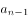＋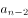，下一项应＝34＋55＝89，故题干所求项＝89＋141＝230。

方法二：数列呈现递增趋势，考虑递推数列。前项两两相加的和再加上3等于后项，因此，（    ）＝86＋141＋3＝230。

故正确答案为C。

### 第 58 题

2、7、9、16、20、29、35、46、（    ）

A. 48

B. 50

C. 52

D. 54

第 58 题 · 答案与解析

**参考答案（粉笔题库参考内容）**

D

**解析**

方法一：数列起伏较小，优先考虑作差。原数列作差后得：5、2、7、4、9、6、11、（    ），再次作差后得：-3、5、-3、5、-3、5、（-3），为-3和5的周期数列，则题干所求＝11-3＋46＝54。

方法二：相邻两项作和得到9、16、25、36、49、64、81、（100），是自然数列的平方数列，则题干所求＝100–46＝54。

故正确答案为D。

### 第 59 题

\-2、-5、8、9、-14、-13、20、17、-26、（    ）

A. \-21

B. 21

C. \-29

D. 29

第 59 题 · 答案与解析

**参考答案（粉笔题库参考内容）**

A

**解析**

数列每隔两项出现正、负变化，考虑两两分组。分组后作差无规律，考虑作和，则原数列转化为：-7、17、-27、37、（-47），数字部分为公差是10的等差数列，正负号依次交替，则下一项应为-47-（-26）＝-21。

故正确答案为A。

### 第 60 题

八进制整数数列4、5、6、7、10、11、12、13······的第13项是：

A. 17

B. 18

C. 20

D. 21

第 60 题 · 答案与解析

**参考答案（粉笔题库参考内容）**

C

**解析**

通过题干给出的示例可以得出，八进制的计数特点是逢八进一，原数列按顺序列出为4、5、6、7、10、11、12、13、14、15、16、17、20······第13项为20。

故正确答案为C。

### 第 61 题

×600×0.25＋3×7＋23.25÷的值是：

A. 117

B. 163.5

C. 256.5

D. 303

第 61 题 · 答案与解析

**参考答案（粉笔题库参考内容）**

D

**解析**

小数转分数后，原式＝×600×＋3×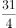＋×3＝（7×120＋3×31＋93×3）＝210＋（93＋31）×＝303。

故正确答案为D。

### 第 62 题

甲、乙、丙、丁每人隔不同的天数去健身房健身，甲2天去一次，乙3天去一次，丙4天去一次，丁5天去一次，上周星期日四人在健身房同日健身，下一次四人同日去健身房健身是星期几？

A. 星期四

B. 星期五

C. 星期六

D. 星期日

第 62 题 · 答案与解析

**参考答案（粉笔题库参考内容）**

A

**解析**

只有每个人分别经历一个完整的周期后，才会同一天去健身，若要四人同去，则所经历的天数应为甲、乙、丙、丁四人周期数的最小公倍数，即60天。上周星期日，经历60天之后，每周7天，60÷7＝8······4，完整周可不予考虑，即4天之后，可达到四人同日健身的目的，4天后星期四。

故正确答案为A。

### 第 63 题

某市出租车运营方案调整如下：起步价由过去的5元2公里调整为8元3公里，运价由每公里1.2元上调至每公里1.6元。调整前后行程超过10公里则超出部分均需加收半价返程费。现在王先生打车由甲地去乙地，两地相距12公里，王先生所付出租车费比调整前多付多少元？（不计候车计费）

A. 4.6

B. 5.8

C. 6.6

D. 7.2

第 63 题 · 答案与解析

**参考答案（粉笔题库参考内容）**

B

**解析**

依据条件可知，方案调整前，起步价为5元2公里，超过2公里小于10公里部分为1.2元/公里，超过10公里后1.2＋1.2×0.5＝1.8元/公里。方案调整后，起步价为3公里8元，超过3公里小于10公里部分1.6元/公里，超过10公里后1.6＋1.6×0.5＝2.4元/公里。

因此，调整前，12公里的花费＝5＋8×1.2＋2×1.8＝18.2元；

调整后，12公里的花费＝8＋7×1.6＋2×2.4＝24元；

则王先生所付的车费会比以前多付：24-18.2＝5.8元。

故正确答案为B。

### 第 64 题

在长581米的道路两侧植树，假设该路段仅两端有路口，要求在道路路口15米范围内最多植1棵树，并且相邻两棵树间的距离为4米，问最多能植多少棵树？

A. 137

B. 139

C. 278

D. 280

第 64 题 · 答案与解析

**参考答案（粉笔题库参考内容）**

D

**解析**

因两侧路口15米范围内最多只能植树一棵，故可先搁置路口15米内的范围，优先考虑剩余路段所能种植的棵数。剩余路段长度为581-30＝551米，根据植树问题公式，551÷4＝137······3，故551米的路段可以种植137＋1＝138棵树。其次考虑路口两端15米内的范围，每端可种植一棵，故道路每侧一共可植树138＋2＝140棵，两侧共能植树140×2＝280棵。

故正确答案为D。

### 第 65 题

某公司年终获利颇丰，公司董事会讨论决定拿出30万元重奖贡献突出的三位职工，原计划按职务的高低以4：3：2的比例为甲、乙、丙分配奖金，后公司董事会采纳了职工建议，按实际对公司的贡献大小以5：4：3的比例为甲、乙、丙分配奖金。前后两个方案中奖金减少的职工是哪个？

A. 职工甲

B. 职工乙

C. 职工丙

D. 三人均无变化

第 65 题 · 答案与解析

**参考答案（粉笔题库参考内容）**

A

**解析**

在两个分配方案中，奖金总额不变，第一次分成了9份，第二次分成了12份，故可设总额为9与12的最小公倍数36份。则原计划甲、乙、丙领到的奖金数应为16：12：8，而实际上领到的奖金数分别为15：12：9，故甲的奖金数减少了。

故正确答案为A。

### 第 66 题

一项工程由甲、乙、丙三个工程队共同完成需要22天，甲队工作效率是乙队的倍，乙队3天的工作量是丙队2天工作量的，三队同时开工，2天后，丙队被调往另一工地。那么甲、乙再干多少天才能完成该工程？

A. 20

B. 28

C. 38

D. 42

第 66 题 · 答案与解析

**参考答案（粉笔题库参考内容）**

C

**解析**

根据三者之间效率的比例关系：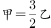，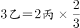，根据等式对效率赋值，可赋值甲、乙、丙的工作效率分别为6、4、9，则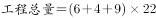。三队共同开工两天后，，故还需甲、乙两队共同施工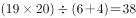天。

故正确答案为C。

### 第 67 题

旅游团安排住宿，如果4个房间每间住4人，其余房间每间住5人，空余2个床位；若有4个房间每间住5人，其余房间每间住4人，正好住满。该旅游团有多少人？

A. 28

B. 42

C. 44

D. 48

第 67 题 · 答案与解析

**参考答案（粉笔题库参考内容）**

C

**解析**

方法一：设该旅游团总人数为x。如果4个房间每间住4人，其余房间每间住5人，则空余2个床位，可说明x-16＋2可以被5整除。

A项：28-16＋2＝14，不可以被5整除，排除；

B项：42-16＋2＝28，不可以被5整除，排除；

C项：44-16＋2＝30，可以被5整除，满足条件；

D项：48-16＋2＝34，不可以被5整除，排除。

方法二：根据题干条件，设其余有x间房，则可得方程：4×4＋5x-2＝4×5＋4x，解得x＝6。因此，共有4×5＋4×6＝44人。

故正确答案为C。

### 第 68 题

某高校两校区相距2760米，甲、乙两同学从各自校区同时出发到对方校区，甲的速度为每分钟70米，乙的速度为每分钟110米，在路上两人第一次相遇后继续行进，到达对方校区后马上返回。那么两人从出发到第二次相遇需要多少分钟？

A. 32

B. 46

C. 61

D. 64

第 68 题 · 答案与解析

**参考答案（粉笔题库参考内容）**

B

**解析**

根据多次相遇问题公式，第n次相遇所走的路程和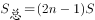可得，两人从出发到第二次相遇所走的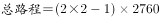。则所需用的。

故正确答案为B。

### 第 69 题

袋中有24个球，除颜色黑白差别之外完全相同，从中摸出一球，若摸出白球的概率比黑球的概率大，则袋中有几个白球？

A. 8

B. 10

C. 12

D. 14

第 69 题 · 答案与解析

**参考答案（粉笔题库参考内容）**

D

**解析**

假设白球有x个，黑球有24－x个，根据题意，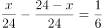，解得x=14，故袋中有14个白球。

故正确答案为D。

### 第 70 题

有软件设计专业学生90人，市场营销专业学生80人，财务管理专业学生20人及人力资源管理专业学生16人参加求职招聘会，问至少有多少人找到工作就一定保证有30名找到工作的人专业相同？

A. 59

B. 75

C. 79

D. 95

第 70 题 · 答案与解析

**参考答案（粉笔题库参考内容）**

D

**解析**

要保证有30名找到工作的学生专业相同，考虑最不利情况，当软件设计类有29名、市场营销类有29名、财务管理类有20名、人力资源类有16名学生找到工作，依旧不能满足题干要求，故应从剩下的软件设计类或市场营销类学生中任选一个，即可保证有30名找到工作的学生专业相同，故至少需要29＋29＋20＋16＋1＝95人。

故正确答案为D。

### 第 71 题

钢筋原材料长7.2米，生产某构件用长2.8米的钢筋2根，长2.1米的钢筋3根，在生产若干该构件时恰好将2.8米和2.1米的钢筋同时用完，在保证浪费率最小的条件下使用钢筋原材料至少多少根？

A. 2

B. 7

C. 8

D. 9

第 71 题 · 答案与解析

**参考答案（粉笔题库参考内容）**

B

**解析**

方法一：每个构件需2.8米钢筋2根，2.1米钢筋3根，在生产若干构件后，2.8米与2.1米的钢筋同时用完，因此所用两种钢筋数量之比应为2：3。

每根7.2米的钢筋原材料截成2.8米、2.1米的钢筋，可分为三种方案：

①截成两根2.8米的钢筋，每根原材料浪费1.6米；

②截成三根2.1米的钢筋，每根原材料浪费0.9米；

③截成一根2.8米、两根2.1米的钢筋，每根原材料浪费0.2米。

若保证浪费率最小，应尽可能采用第三种方案，此种方案截出2.8米与2.1米钢筋的数量之比为1：2＝2：4。则2.8米的钢筋数量不足，应采取第一种方案进行补足。假设第一种方案用原材料x根，第三种方案用原材料y根，则（2x＋y）：2y＝2：3，解得y＝6x。要求x＋y值最小，则x＝1，y＝6，至少应使用7根原材料。

方法二：钢筋原材料为7.2米，最节省原料的做法是截成2.8＋2.1＋2.1＝7。而生产所用2.8米和2.1米的比为2∶3，则每两根钢筋生产构件后多余一根2.1米的钢筋，6根生产后则多余3段2.1米的钢筋，此时再增加一根7.2米的钢筋截成2段2.8米即可达到题目条件。

故正确答案为B。

### 第 72 题

小强的爸爸比小强的妈妈大3岁，全家三口的年龄总和74岁，9年前这家人的年龄总和49岁，那么小强的妈妈今年多少岁？

A. 32

B. 33

C. 34

D. 35

第 72 题 · 答案与解析

**参考答案（粉笔题库参考内容）**

A

**解析**

9年前三口人年龄总和为49岁，则9年后应为49＋9×3＝76岁，但比实际总和少两岁，则可说明9年前小强并未出生。9年前，爸爸与妈妈的年龄和为49岁，年龄差相差3岁，则可得妈妈的年龄为23岁，9年后32岁。

故正确答案为A。

### 第 73 题

某单位实行无纸化办公，本月比上个月少买了5包A4纸和6包B5纸，共节省了197元。已知每包A4纸的价格比B5纸的贵2元，并且本月用于购买A4纸和B5纸的费用相同（大于0元），那么该单位本月用于购买纸张的费用至少多少元？

A. 646

B. 520

C. 323

D. 197

第 73 题 · 答案与解析

**参考答案（粉笔题库参考内容）**

A

**解析**

设每包A4纸的价格为a元，每包B5纸的价格为b元，则根据题干等量关系可得：5a＋6b＝197，a-b＝2，解得a＝19，b＝17。因本月用于购买A4纸和B5纸的费用相同，且要求尽可能少，则其购买数量应为二者价格的最简比，即17：19，故本月用于购买纸张的总费用=2×19×17=646元。

故正确答案为A。

### 第 74 题

五个互不相同的自然数两两相加，只得到8个不同的结果，分别是：15.20.23.25.28.33.38和41，那么这个数中最大数与最小数的差是多少？

A. 17

B. 18

C. 19

D. 20

第 74 题 · 答案与解析

**参考答案（粉笔题库参考内容）**

B

**解析**

设五个不同的数分别为A＜B＜C＜D＜E，则根据加和关系可得：

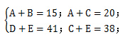

由此推出：(C+E)-(A+C)=38-20=18，

即E-A＝18。

故正确答案为B。

### 第 75 题

如图，将正方形边长三等分后可得9个边长相等的小正方形，把中间的小正方形去掉，对剩下的8个小正方形，均按上面方法操作。问：对一个边长为2的正方形如此操作三次后所剩白色区域的面积是多少？

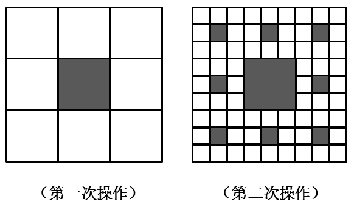

A. 

B. 2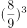

C. 4

D. 8

第 75 题 · 答案与解析

**参考答案（粉笔题库参考内容）**

C

**解析**

根据题意可知，第一次剪掉的面积为原面积的4，则剩余面积应为原面积的4。依此操作三次后所剩面积应为原面积的4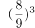。

故正确答案为C。

### 第 76 题

白色农业是指以蛋白质工程、细胞工程、酶工程为基础，用基因工程等高科技手段开发微生物资源的工程农业。它是通过优化配置微生物资源，利用微生物惊人的繁殖生产能力，在工厂化条件下生产人类及动植物所需营养品和保健品的新型农业。

根据以上定义，下列不属于白色农业的是：

A. 使用各种农业废料制成蛋白饲料

B. 利用转基因技术培育水稻新品种

C. 农业生产中应用细菌、真菌制成杀虫剂、杀菌剂、除草剂

D. 应用科学技术措施，形成宜林则林、宜牧则牧、宜渔则渔的高效农业群

第 76 题 · 答案与解析

**参考答案（粉笔题库参考内容）**

D

**解析**

第一步：查找关键词。

定义关键词：1.以蛋白质工程、细胞工程、酶工程为基础；2.利用基因工程等高科技手段；3.利用微生物资源。

第二步：逐一分析选项。

A项：使用农业废料制成蛋白饲料属于利用蛋白质工程进行生产，与定义关键词1相符，满足定义要件，排除；

B项：利用转基因技术培育新品种，与定义关键词2相符，满足定义要件，排除；

C项：应用细菌、真菌属于利用微生物进行生产，与定义关键词3相符，满足定义要件，排除；

D项：未涉及到定义中基因工程、蛋白质工程、细胞工程等高科技手段，仅从因地制宜的角度进行科学规划，不属于题干定义范围，当选。

本题为选非题，故正确答案为D。

### 第 77 题

社会融入是指那些处于相对弱势地位的个体或群体能动地与特定社区中的个体与群体进行反思性、持续性互动的社会行动过程。

根据以上定义，下列不属于社会融入的是：

A. 余秀华克服脑瘫带来的身体不便，无视村里人的歧视，最终在诗歌创作方面取得成功

B. 小王出狱后饱受歧视，最终以善良、坚忍改变了大家的看法，获得人们的尊重

C. 小刘从银行辞职后，开了一家投资公司，利用自己积累的资源，公司发展迅速

D. 徐先生为圆大学梦，在65岁时不顾他人看法，备战高考，最终考入某大学

第 77 题 · 答案与解析

**参考答案（粉笔题库参考内容）**

C

**解析**

第一步：查找关键词。

定义关键词为1.主体：相对弱势的个体或群体；2.行为：与特定社区的个体或群体进行反思性、持续性互动的社会活动。

第二步：逐一分析选项。

A项：余秀华“脑瘫”满足定义关键词1，无视村里人的歧视学习诗歌，满足定义关键词2，符合社会融入的概念,排除；

B项：“出狱”的小王满足定义关键词1，以善良、坚忍改变了大家的看法，获得人们的尊重满足定义关键词2，符合社会融入的概念，排除；

C项：银行辞职的小刘并不属于相对弱势或特定社区的个人，故不符合社会融入的概念，当选；

D项：“65岁”的徐先生满足定义关键词1，不顾他人看法，备战高考满足定义关键词2，符合社会融入的概念，排除。

本题为选非题，故正确答案为C。

### 第 78 题

习俗冲击是指生活在某一种习俗中的人初次接触到另一种习俗时所产生的不适感和压力感。

根据以上定义，下列属于习俗冲击的是：

A. 湘西女孩小莉考上湖南大学，入学后感觉生活与学习一团糟

B. 江南女子小苏第一次去北方某省公婆家过年，对当地下跪磕头的拜年方式难以适应

C. 周教授去英国做访问学者，很为自己的“哑巴英语”带来的沟通障碍感到焦虑

D. 小高参加“变形记”到一城市富裕家庭短暂生活，被“新家”的奢华震惊了

第 78 题 · 答案与解析

**参考答案（粉笔题库参考内容）**

B

**解析**

第一步：查找关键词。

定义关键词：1.初次接触到另一种习俗；2.产生不适感和压力感。

第二步：逐一分析选项。

A项：入学后生活与学习一团糟并非因习俗不同而产生，不满足定义关键词1,排除；

B项：第一次去北方过年，属于初次接触，下跪磕头拜年属于习俗，难以适应体现了不适感，满足定义各项要件，当选；

C项：“哑巴英语”带来焦虑，是语言原因导致，并非习俗原因，排除；

D项：被富裕家庭的奢华震惊，不属于一种习俗，排除。

故正确答案为B。

### 第 79 题

斯诺克：自由球

A. 网球：持球

B. 羽毛球：越位

C. 乒乓球：一米线

D. 篮球：罚篮

第 79 题 · 答案与解析

**参考答案（粉笔题库参考内容）**

D

**解析**

第一步：判断题干词语间逻辑关系。

自由球是指斯诺克比赛中当一方选手犯规时而产生的击球规则，二者为专项运动与专项术语的对应关系。

第二步：判断选项词语间逻辑关系。

A项：网球与持球并非专项运动与专项术语的对应关系，网球运动中没有持球的说法，排除；

B项：越位是足球运动中的专项术语，并非羽毛球，对应不同，排除；

C项：一米线并非指某项运动的专项术语，而是维持秩序、疏导人流的一种工具，与乒乓球并不对应，排除；

D项：罚篮是篮球运动中当一方选手犯规时所产生的专项规则，与题干关系完全对应，当选。

故正确答案为D。

### 第 80 题

教育：方法

A. 重力：向下

B. 公文：格式

C. 回声：悠长

D. 太阳：光明

第 80 题 · 答案与解析

**参考答案（粉笔题库参考内容）**

B

**解析**

第一步：判断题干词语间逻辑关系。教育与方法之间为偏正结构，教育的方法。可造句示例：用教育的方法解决问题。

第二步：判断选项词语间逻辑关系。

A项：重力与向下非偏正结构，而是主谓结构，重力是向下的，排除；

B项：公文的格式，二词之间为偏正结构。可造句示例：用公文的格式来写这篇文章，当选；

C项：回声是悠长的，二者为主谓结构，排除；

D项：太阳是光明的，二者为主谓结构，或者是属性的对应关系，与题干关系不符，排除。

故正确答案为B。

### 第 81 题

烧：泥：陶瓷

A. 砸：玉：手镯

B. 水：鱼：鸬鹚

C. 淬：铁：剑

D. 土：树：树化石

第 81 题 · 答案与解析

**参考答案（粉笔题库参考内容）**

C

**解析**

第一步：判断题干词语间逻辑关系。

泥可烧制成陶瓷，三者构成对应关系，其中烧为方法，泥为原材料，陶瓷为产物。

第二步：判断选项词语间逻辑关系。

A项：手镯并非由玉“砸”制而成，而是雕琢而成的，排除；

B项：题干第一项为动词，是产物的制作方法，而水为名词，词性并不对应，排除；

C项：淬铁成剑，即将铁淬炼后可铸成剑，其中淬为方法，铁为原材料，剑为产物，与题干逻辑关系完全对应，当选；

D项：同B项错误相同，土为名词，词性不相对应，排除。

故正确答案为C。

### 第 82 题

白洋淀：渔船：橹

A. 图书馆：书籍：扉页

B. 公司：总经理：管理

C. 衡水湖：水：芦苇

D. 治安：警察：警服

第 82 题 · 答案与解析

**参考答案（粉笔题库参考内容）**

A

**解析**

第一步：判断题干词语间逻辑关系。

白洋淀里会有渔船，二者为地点与物体的对应关系；渔船中会有橹，二者为组成关系。

第二步：判断选项词语间逻辑关系。

A项：图书馆里有书籍，二者为地点与物体的对应关系。书籍中会有扉页，二者为组成关系，与题干逻辑关系相同，当选；

B项：总经理与管理之间为人物与功能的对应关系，非组成关系，排除；

C项：水与芦苇之间非组成关系，而是生长习性的对应关系，芦苇生长离不开水，排除；

D项：治安与警察为功能与人物的对应关系，非地点与物体的对应关系，排除。

故正确答案为A。

### 第 83 题

实干兴邦：空谈误国

A. 任人唯亲：任人唯贤

B. 趋炎附势：铁骨铮铮

C. 破旧立新：墨守成规

D. 滴水不漏：破绽百出

第 83 题 · 答案与解析

**参考答案（粉笔题库参考内容）**

D

**解析**

第一步：判断题干词语间逻辑关系。

“实干兴邦”与“空谈误国”为反义关系，前者为褒义词，后者为贬义词，且二者语法结构相同。

第二步：判断选项词语间逻辑关系。

A项：“任人唯亲”是指用人不问人的德才，只选跟自己关系亲密的人。“任人唯贤”是指用人只选有德有才的人。二者是反义关系，但前者是贬义词，后者是褒义词，与题干逻辑关系不一致，排除；

B项：“趋炎附势”是指奉承和依附有权有势的人。“铁骨铮铮”是指有骨气，有钢铁般的意志，刚正坚贞。二者为反义关系，但前者为贬义词，后者为褒义词，与题干逻辑关系不一致，排除；

C项：“破旧立新”与“墨守成规”为反义关系，且前者为褒义词，后者为贬义词，但“破旧立新”为并列结构，“墨守成规”并不是并列结构，二者结构不相同，与题干逻辑关系不一致，排除；

D项：“滴水不漏”和“破绽百出”是反义关系，前者为褒义词，后者为贬义词，且二者语法结构相同，与题干逻辑关系一致，当选。

故正确答案为D。

### 第 84 题

亚马逊：京东：当当

A. 键盘：鼠标：扫描仪

B. 湖泊：鲤鱼：鱼缸

C. 书包：课本：学生

D. 信号灯：红灯：绿灯

第 84 题 · 答案与解析

**参考答案（粉笔题库参考内容）**

A

**解析**

第一步：判断题干词语间逻辑关系。

亚马逊、京东、当当三者为并列关系，同属于电商企业。

第二步：判断选项词语间逻辑关系。

A项：键盘、鼠标、扫描仪三者为并列关系，都是电脑配件的一种，与题干关系相同，当选；

B项：鲤鱼可以生长在湖泊里，也可以生活在鱼缸中，为对应关系，与题干关系不相同，排除；

C项：书包是装课本的，学生背着书包，为对应关系，与题干关系不相同，排除；

D项：信号灯包含红灯和绿灯，为组成关系，与题干关系不相同，排除。

故正确答案为A。

### 第 85 题

量杯：毫升

A. 汽车：公里

B. 加油机：升

C. 轮船：集装箱

D. 宾馆：住宿

第 85 题 · 答案与解析

**参考答案（粉笔题库参考内容）**

B

**解析**

第一步：判断题干词语间逻辑关系。

量杯的作用是测量液体的体积，一般刻度为毫升，故量杯与毫升之间为工具与计量单位的对应关系。

第二步：判断选项词语间逻辑关系。

A项：汽车并没有具体的计量单位，排除；

B项：加油机可以为汽车加油，它的计量单位一般为升，与题干逻辑关系一致，当选；

C、D两项：集装箱与住宿均非计量单位，与题干逻辑关系不一致，排除。

故正确答案为B。

### 第 86 题

打车软件：滴滴打车

A. 资本市场：利率

B. 房地产：中介

C. 资产：负债

D. 上市公司：证券公司

第 86 题 · 答案与解析

**参考答案（粉笔题库参考内容）**

C

**解析**

第一步：判断题干词语间逻辑关系。

滴滴打车是一款打车软件，二者为包容关系。

第二步：判断选项词语间逻辑关系。

A项：资本市场是指期限在1年以上的各种资金借贷和证券交易的场所，与利率不是包容关系，与题干逻辑关系不一致，排除；

B项：房地产与中介不是包容关系，与题干逻辑关系不一致，排除；

C项：资产＝负债＋所有者权益，负债属于资产，二者为包容关系，与题干逻辑关系一致，当选；

D项：上市公司和证券公司是按照不同范畴划分的公司类别，二者为交叉关系，与题干逻辑关系不一致，排除。

故正确答案为C。

### 第 87 题

富强对于（ ）相当于（ ）对于社会

A. 国家 和谐

B. 自由 法治

C. 文明 诚信

D. 民主 友善

第 87 题 · 答案与解析

**参考答案（粉笔题库参考内容）**

A

**解析**

题干为间隔对应型类比推理，采取代入排除的方法最为直观。

A项：富强对于国家与和谐对于社会，二组词语之间均为偏正关系，富强的国家，和谐的社会，当选。代入B、C、D 三项后，可以观察得出前两项为并列关系，但后两项均非并列关系，排除。

故正确答案为A。

### 第 88 题

（ ）对于铁矿石相当于板凳对于（ ）

A. 铲车 桌子

B. 矿山 森林

C. 矿工 木匠

D. 铁粉 木料

第 88 题 · 答案与解析

**参考答案（粉笔题库参考内容）**

D

**解析**

题干为间隔对应型类比推理，采取代入排除的方法最为直观。

A项：板凳与桌子之间为并列关系，但是铲车与铁矿石之间非同类物体，非并列关系，排除；

B项：矿山中含有铁矿石，二者为包容关系，而板凳与森林非包容关系，排除；

C项：矿工采集铁矿石，木匠制作板凳，均为对应关系，但矿工在前项，木匠在后项，矿工与木匠不能够在相同位置对应，排除；

D项：铁粉是由铁矿石提炼而成，板凳是由木料制作而成，二者逻辑关系完全对应，当选。

故正确答案为D。

### 第 89 题

一则关于西瓜含有膨大剂可能影响身体健康的报道，对消费者产生的影响极小，几乎没有消费者打算改变他们购买西瓜的习惯。尽管如此，在该报道一个月后的七月份，某大型连锁超市的西瓜销量还是大大地下降了。

以下哪项如果为真，最能解释上述现象？

A. 该类报道经常出现，到了七月份消费者已对该类报道漠不关心了

B. 七月中旬后该大型连锁超市为表示对消费者负责，主动停止销售西瓜

C. 食品专家认为，西瓜中仅含有少量的膨大剂，对身体健康不会造成危害

D. 七月份上市的水果种类繁多，消费者购买其他水果以替代西瓜

第 89 题 · 答案与解析

**参考答案（粉笔题库参考内容）**

B

**解析**

此题属于现象解释类题目，需要解释的现象为消费者对西瓜的负面报道不为所动，但是某大型连锁超市的西瓜销量还是大大地下降了。

A项：消费者对此类报道漠不关心，说明依然有购买西瓜的习惯，不能解释超市销量大幅下降的现象，排除；

B项：七月中旬之后该连锁超市主动停售西瓜，说明在七月中旬之后超市便不再销售西瓜，只是在该月上旬销售了一些西瓜，可以解释超市销量大幅下降的现象，保留；

C项：只是说明含有膨大剂的西瓜对身体不会造成危害，并不能解释超市西瓜销量下降的原因，排除；

D项：消费者购买了其他水果替代西瓜，可以解释超市西瓜销量下降的现象，保留。

对比B、D两项，B项停止销售西瓜一定能够引起超市的西瓜销量下降，属于必然性原因；而消费者购买其他水果导致西瓜销量下降只能是可能性原因，故B项解释的力度更强。

故正确答案为B。

### 第 90 题

英格兰有大片天然气蕴藏丰富的湿地。环保主义者一直反对在湿地区域开采天然气，他们认为开采天然气会破坏英格兰湿地的生态平衡，其直接严重后果是会污染水源。然而，这一担心是站不住脚的。根据近50年的相关统计，从未有过因开采天然气而污染水源的报道。

下面哪项如果是真，最能加强上述论证？

A. 英格兰的湿地开采天然气已有100多年的历史，从未因此造成水源污染

B. 英格兰有足够的能力治理因开采天然气而导致的任何污染

C. 在英格兰，开采天然气的湿地和未开采天然气的湿地没有任何实质性的不同

D. 在英格兰，开采天然气的湿地和未开采前没有实质的不同

第 90 题 · 答案与解析

**参考答案（粉笔题库参考内容）**

D

**解析**

第一步：找出论点和论据。

论点：在湿地区域开采天然气不会污染水源。

论据：根据近50年的相关统计，从未有过因开采天然气而污染水源的报道。

第二步：逐一判断选项。

A项：仅从时间上说明目前没有造成水源污染，但并不能说明以后不会，不能加强论证，排除；

B项：能够治理污染与是否会造成污染无关，偷换概念，排除；

C、D两项：均通过对比的方式，说明开采天然气的湿地并无差别，但C项对比的对象为其他湿地，而D项对比的对象为“未开采前的自己”，其他湿地的情况未知，与自己比较加强的力度更强，故D项当选。

故正确答案为D。

### 第 91 题

安徽黄山是我国茶叶的主要产地之一，名茶种类很多。在黄山旅游时，导游总会在几个茶园停车，劝大家去里面参观，而且说买不买没关系，只要进去看看就可以。为此，一些游客常有怨念，但这种现象持续存在，甚至愈演愈烈。

以下哪项最不可能是造成这种现象的原因？

A. 游客在茶园购物，导游会得到提成

B. 虽然有的游客不愿意，但许多游客是愿意的，他们开心购物就是最好的证明

C. 到黄山旅游的游客在经济上很宽裕，他们只想省时间，进茶园可以批量采购

D. 有些游客外出旅游的任务之一就是购物，如果空手而归，会感觉玩得不高兴

第 91 题 · 答案与解析

**参考答案（粉笔题库参考内容）**

C

**解析**

此题属于原因解释类题目，主要解释的现象为“茶园购物的现象愈演愈烈”。

A项：从导游的角度解释，为什么有些游客常有怨念，却依旧劝大家在茶园购物，可以解释，排除；

B项：从游客的角度解释为什么这种现象持续存在，因为很多的游客还是很喜欢茶园购物的，可以解释，排除；

C项：仅解释了游客到茶园购物的原因（可以批量采购），但并未解释针对“茶园购物”游客到底喜不喜欢，也并未解释茶园购物持续存在的原因，偷换概念，不能解释，当选；

D项：与B项相同，从游客的角度解释为什么这种现象持续存在，可以解释，排除。

本题为选非题，故正确答案为C。

### 第 92 题

在相同的收入水平上，农村居民家庭比城市或城郊居民家庭有更大的购买力，因为城市或城郊居民家庭中用在食品或居住的一部分收入可以被农村居民家庭用在其他的消费上。

根据以上的论述，最能推出以下哪项结论？

A. 农村居民家庭在食品和居住上的支出比城市或城郊居民家庭的支出少

B. 城郊居民家庭的购买力更高于城市居民家庭

C. 一般来说，农村居民家庭比城市居民家庭的人口数量要多

D. 三种类型的居民家庭在食品上的支出都超过了在居住上的支出

第 92 题 · 答案与解析

**参考答案（粉笔题库参考内容）**

A

**解析**

A项：因收入水平相同，而农村家庭比城市或城郊家庭有更大的购买力，购买力=收入-食住支出，故可推知农村家庭在食住上的支出比城市或城郊居民家庭的支出少，当选；

B项：城郊家庭与城市家庭购买力的对比，由题干无从得出，排除；

C项：家庭人口数量，题干中没有提及，排除；

D项：食品支出与居住支出的比较，题干中没有提及，由题干无从得出，排除。

故正确答案为A。

### 第 93 题

政府应该禁止白酒企业在其营业收入中扣除广告费用。这样的话，白酒企业将会缴纳更多的税金，他们只好提高白酒价格，而价格的提高又可以抑制白酒的消费，降低因过量饮酒而导致的各种疾病的发病率。

以下哪项最可能是上述论述的假设前提？

A. 白酒企业不可能通过降低其他方面的成本以抵消多缴的税金

B. 如果白酒企业需要支付高额的税金，则他们就不再继续做广告

C. 如果白酒企业不做广告，则白酒的销量会受到很大影响

D. 白酒企业由此增加的税金可以通过提高价格转嫁给消费者

第 93 题 · 答案与解析

**参考答案（粉笔题库参考内容）**

A

**解析**

题干论点为：政府应该禁止白酒企业在其营业收入中扣除广告费用。论据为：若不扣除广告费用，白酒企业将会缴纳更多的税金，他们只好提高白酒价格，而价格的提高又可以抑制白酒的消费，降低因过量饮酒而导致的各种疾病的发病率。

论证的逻辑关系即为：缴纳过多的税金→提高价格→抑制白酒消费。要使论证成立，就要指出缴纳过多的税金后，白酒企业一定会提高价格，而不能通过其他降低成本等方式来维持利润平衡。A项补充了论断中的漏洞，说明白酒企业不能降低其他方面的成本，只能通过提高价格来维持利润平衡，当选；

B、C两项：题干论述的主体在于“税金”和“价格”，与是否做广告无关，排除；

D项为题干的同义复述，并不能作为假设的前提进行再次补充，排除。

故正确答案为A。

### 第 94 题

如果电用完了，电动自行车就无法继续前行。我的电动自行车不能继续前行，因此，电一定用完了。

以下哪项推理与题干的最为类似？

A. 如果姚明上场，中国队就一定能赢。中国队输了，所以，姚明肯定没上场

B. 所有的条件我都可以接受，除非它明显不公平。这个条件我不能接受，因此，它明显不公平。

C. 如果晓莉努力学习，考试成绩就会很好。晓莉考试成绩不好，所以，晓莉没有努力学习

D. 如果小美去过香港，她一定会购买高档化妆品。小美购买了高档化妆品，所以，小美去过香港

第 94 题 · 答案与解析

**参考答案（粉笔题库参考内容）**

D

**解析**

题干的逻辑关系可表示为：如果A，那么B。因为B，所以A。

各选项逻辑关系分别为：

A项：如果A，那么B。因为非B，所以非A。与题干逻辑关系不同，排除；

B项可翻译为：如果条件公平，我都可以接受。这个条件我不能接受，因此它不公平。其逻辑关系为：如果A，那么B，因为非B，因此非A。与题干逻辑关系不同，排除；

C项：如果A，那么B。因为非B，所以非A。与题干逻辑关系不同，排除；

D项：如果A，那么B。因为B，所以A。与题干逻辑关系类似。

故正确答案为D。

### 第 95 题

在某茶馆，一桌人边喝茶边谈生意。其中，一个人是保定人，两个人是北方人，一个人是深圳人，两个人只做木材生意，四个人只做电子产品生意。

如果以上介绍涉及到该桌所有的人，那么，这桌人最少和最多可能是几个人？

A. 最少可能是6个人，最多可能是10个人

B. 最少可能是6个人，最多可能是9个人

C. 最少可能是4个人，最多可能是9个人

D. 无法确定

第 95 题 · 答案与解析

**参考答案（粉笔题库参考内容）**

B

**解析**

当要让该桌涉及人数最多时，应让所有集合尽可能相斥，但保定人一定属于北方人，必须相容，其他均可相斥，故最多可有两个北方人、一个深圳人、两个木材生意人、四个电子产品生意人，共计9人；当该桌涉及人数最少时，应让所有集合尽可能相容，两个北方人（含保定人）、一个深圳人均可包含在四个电子产品生意人里，即两个北方人（含保定人）、一个深圳人都是电子产品生意人，木材生意人与电子产品生意人必须相斥，则最少可有四个电子产品生意人和两个木材生意人，共计6人。

故正确答案为B。

### 第 96 题

中国可利用地热的能源储量超过了国内所有化石类燃料加起来的能源储量，在某些地区把地热转变成电能的技术已经成为现实，中国下个世纪可能出现的能源短缺问题将由此而彻底解决。

以下哪项如果为真，最能削弱作者的上述观点？

A. 在下个世纪的某些时候，地热被耗尽的现实将迫使中国更加依赖进口能源

B. 任何生产电能的方法在生产电能的过程中都要消耗掉一部分能源

C. 由地热转变而来的电能长距离运输到人口密集的经济发达地区是不切实际的

D. 一些科学家坚信，能源短缺问题可以通过提高能源利用效率和鼓励能源节约来解决

第 96 题 · 答案与解析

**参考答案（粉笔题库参考内容）**

C

**解析**

第一步：找出论点和论据。

论点：中国下个世纪可能出现的能源短缺问题将彻底解决。

论据：中国可利用地热的能源储量超过了国内所有化石类燃料加起来的能源储量，在某些地区把地热转变成电能的技术已经成为现实。要削弱作者观点就要指出，中国的能源短缺问题并不能彻底解决。

第二步：逐一判断选项。

A项：作者观点在于能不能解决能源短缺问题，与是否依赖进口无关，为无关选项，排除；

B项：电能在生产过程中会消耗一部分能源，但是能不能解决能源短缺问题并未提及，属于无关项，排除；

C项：地热转变而来的电能运输到人口密集的发达地区不切实际，说明地热转化电能的可行性出现问题，并不能彻底解决发达地区的能源短缺问题，削弱论证，当选；

D项：能源短缺可以解决，但未提及地热，为无关选项，排除。

故正确答案为C。

### 第 97 题

所有切实关心员工福利的总经理，都被证明是管理艺术高超的总经理；而切实关心职工福利的总经理，都首先把注意力放在解决中青年员工的住房上。因此，那些不首先把注意力放在解决中青年员工的住房上的总经理，都不是管理艺术高超的总经理。

为使上述论证成立，以下哪项必须为真？

A. 所有管理艺术高超的总经理，都是关心员工福利的总经理

B. 中青年员工的住房问题，是员工的福利中最为突出的问题

C. 中青年员工的比例已经超过90%

D. 所有首先把注意力放在解决中青年员工的住房上的总经理，都是管理艺术高超的总经理

第 97 题 · 答案与解析

**参考答案（粉笔题库参考内容）**

A

**解析**

论点：“不······不······”后推前翻译：管理艺术高超→把注意力放在解决中青年员工住房上。

论据：“所有······都······”前推后翻译：

论据（1）关心员工福利→管理艺术高超；

论据（2）关心员工福利→把注意力放在解决员工住房上。

论据（1）箭头前后均不与论点一致，无法搭桥。

论据（2）与论点箭头后一致，搭桥方向为论点推论据，即管理艺术高超→关心员工福利，与A项翻译一致。

故正确答案为A。

### 第 98 题

厨房的桌子上有四个杯子，每个杯子上都写着一句话：第一个杯子上写着“所有的杯子中都是蜂蜜水”，第二个杯子上写着是“本杯是淡盐水”，第三个杯子上写着是“本杯不是白糖水”，第四个杯子上写着是“有些杯子中没有蜂蜜水”。

如果这四个杯子上写的话只有一句是真的，那么以下哪项必定为真？

A. 第一个杯子中的是蜂蜜水

B. 第二个杯子中的是淡盐水

C. 第三个杯子中是白糖水

D. 第四个杯子中不是蜂蜜水

第 98 题 · 答案与解析

**参考答案（粉笔题库参考内容）**

C

**解析**

第一步：找出题干矛盾命题。

①所有的杯子中都是蜂蜜水；

②第二杯是淡盐水；

③第三杯不是白糖水；

④有些杯子中没有蜂蜜水。

分析题干条件可知，①和④为矛盾关系，必有一真一假。

第二步：根据题干条件推理。

根据题干条件可知，只有一句话是真的，说明②③一定是假话。根据②是假的可知：“第二杯不是淡盐水”；根据③是假的可知：“第三杯是白糖水”，对应C项。

故正确答案为C。

## 材料 2

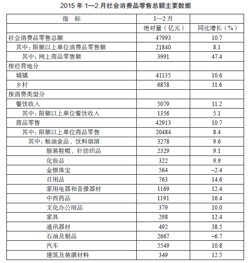

### 第 99 题

2014年1-2月，社会消费品零售总额是：

A. 42858.3亿元

B. 43207.5亿元

C. 43237.9亿元

D. 43354.1亿元

第 99 题 · 答案与解析

**参考答案（粉笔题库参考内容）**

D

**解析**

由题干“2014年1-2月，社会消费品零售额是多少亿元”，材料时间给的是2015年1-2月，判定本题为基期计算问题。定位表格可知，2015年1-2月，社会消费品零售总额绝对量为47993亿元，同比增长10.7%，根据基期公式可得：基期，则2014年1-2月，社会消费品零售总额为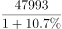，因选项差别小，所以需精确计算，用直除法可得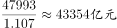。与D项最接近。

故正确答案为D。

### 第 100 题

2015年1-2月份石油及制品的销售额同比减少的绝对量是：

A. \-178.7亿元

B. 191.5亿元

C. 291.2亿元

D. 332.9亿元

第 100 题 · 答案与解析

**参考答案（粉笔题库参考内容）**

B

**解析**

由题干“同比减少的绝对量”，判定本题为增长量计算问题。定位表格可知，2015年1-2月，石油及制品的销售额为2667亿元，同比增长-6.7%。代入增长量计算公式：增长量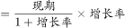，则2015年1-2月，石油及制品的销售额同比增长量为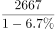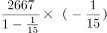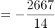亿元，故同比减少约191亿元，与B项最接近。

故正确答案为B。

### 第 101 题

2014年1-2月份网上商品零售额占社会消费品零售额的比重是：

A. 6.25%

B. 8.11%

C. 8.32%

D. 10.70%

第 101 题 · 答案与解析

**参考答案（粉笔题库参考内容）**

A

**解析**

由题干“2014年1-2月······占······的比重是”，材料时间为“2015年1-2月”，判定此题为基期比重问题。定位表格可知，2015年1-2月，网上商品零售额为3991亿元，同比增长47.4%；社会消费品零售额为47993亿元，同比增长10.7%，根据基期比重公式可得：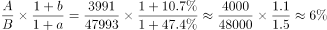，与A项最接近。

故正确答案为A。

### 第 102 题

下列四类商品中，2015年1~2月份商品零售额同比增长最快的是：

A. 文化办公用品

B. 家具

C. 日用品

D. 汽车

第 102 题 · 答案与解析

**参考答案（粉笔题库参考内容）**

C

**解析**

“同比增长最快”，即同比增速最快，直接从表中查找，2015年1~2月份文化办公用品零售额同比增长10.0%，家具零售额同比增长12.4%，日用品零售额同比增长14.6%，汽车零售额同比增长10.8%，所以增长最快的是日用品零售额。

故正确答案为C。

### 第 103 题

根据上述资料，下列说法正确的是：

A. 农民的总体消费能力相对较高

B. 中西药品零售额的增长速度高于化妆品

C. 限额以上单位餐饮收入是餐饮收入的主体

D. 社会消费品零售总额按消费类型分限额以上单位餐饮收入和限额以上单位商品零售

第 103 题 · 答案与解析

**参考答案（粉笔题库参考内容）**

B

**解析**

A项：定位表格可知，城镇消费品零售总额为41135亿元，农村消费品零售总额为6858亿元，城市总体消费能力高于农村，错误；

B项：定位表格可知，中西药品零售额的增长速度为16.4%，化妆品零售额的增长速度为9.9%，前者高于后者，正确；

C项：定位表格可知，限额以上单位餐饮收入是1356亿元，整体餐饮收入为5079亿元，前者占后者的比重为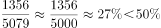，不是主体，错误；

D项：定位表格可知，社会消费品零售总额按消费类型分是餐饮收入和商品零售，错误。

故正确答案为B。

## 材料 3

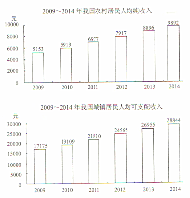

### 第 104 题

2011~2014年，城乡居民收入差距最少的年份差额是：

A. 10023

B. 12022

C. 14833

D. 16648

第 104 题 · 答案与解析

**参考答案（粉笔题库参考内容）**

C

**解析**

定位统计图可得2011年~2014年，城乡居民收入差距依次为：2011年：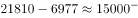；2012年：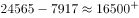；2013年：；2014年：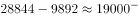。差距最小的年份是2011年，为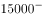，C项最为接近。

故正确答案为C。

### 第 105 题

城镇居民人均可支配收入增长最少的年份是：

A. 2011年

B. 2012年

C. 2013年

D. 2014年

第 105 题 · 答案与解析

**参考答案（粉笔题库参考内容）**

D

**解析**

定位第二幅图，可得2010年-2014年城镇居民人均可支配收入。根据增长量=现期量－基期量可得：2011年增长量＝21810-19109＝2701元；2012年增长量＝24565-21810＝2755元；2013年增长量＝26955-24565＝2390元；2014年增长量＝28844-26955＝1889元。所以2014年的增长量是最少的。

故正确答案为D。

### 第 106 题

农村居民人均纯收入增长最多的年份增长了：

A. 1934元

B. 1058元

C. 1889元

D. 996元

第 106 题 · 答案与解析

**参考答案（粉笔题库参考内容）**

B

**解析**

定位第一幅图，可得2009年-2014年农村居民人均纯收入。根据增长量=现期－基期可得：农村居民人均纯收入2010年增长量=5919-5153=766元；2011年增长量=6977-5919=1058元；2012年增长量=7917-6977=940元；2013年增长量=8896-7917=979元；2014年增长量=9892-8896=996元。所以增长最多的是2011年，即1058元。

故正确答案为B。

### 第 107 题

2013年城镇居民人均可支配收入比同年农村居民人均纯收入高：

A. 92%

B. 192%

C. 203%

D. 292%

第 107 题 · 答案与解析

**参考答案（粉笔题库参考内容）**

C

**解析**

根据题干“2013年···比···高百分之几”，判定本题为一般增长率计算问题。定位第二幅图可得“2013年城镇居民人均可支配收入为26955元”；定位第一幅图可得“2013年农村居民人均纯收入为8896元”。根据增长率公式可得：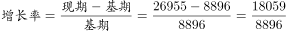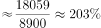

故正确答案为C。

### 第 108 题

根据以上材料可以得出的结论是：

A. 2009-2014年城乡居民收入差距逐年降低

B. 2009-2014年农村居民人均纯收入呈现上升态势

C. 与2012年相比，2013年城乡居民收入之比扩大

D. 2015年城乡居民收入差距将进一步缩小

第 108 题 · 答案与解析

**参考答案（粉笔题库参考内容）**

B

**解析**

A项：定位统计图可知：2009年城乡居民收入差距为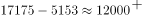，2010年城乡居民收入差距为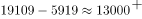，2009年差距小于2010年，并非逐年降低，错误；

B项：定位统计图可知：2009-2014年农村居民人均纯收入呈现上升态势，正确；

C项：定位统计图可知：2013年城乡居民收入之比为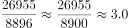，2012年城乡居民收入之比为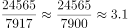，则与2012年相比，2013年城乡居民收入之比减小，错误；

D项：从统计图中不能得知2015年的信息，故不能判断差距是否缩小，错误。

故正确答案为B。

## 材料 4

据有关部门统计，2014年全国旅客运输总量为220.7亿人次，同比增长3.9%，其中，铁路运输总量为23.6亿人次，同比增长11.9%；公路运输总量为190.5亿人次，同比增长2.8%；水运运输总量为2.6亿人次，同比增长12.3%；民航运输总量为3.9亿人次，同比增长10.6%；全国旅客运输周转量为29994.2亿人公里，同比增长8.8%；其中，铁路运输周转量为11604.8亿人公里，同比增长9.5%；公路运输周转量为11981.7亿人公里，同比增长6.5%；水运运输周转量为74.4亿人公里，同比增长8.9%；民航运输周转量为6333.3亿人公里，同比增长12.0%。

        2014年河北省旅客运输总量为6.1亿人次，同比下降1.5%，其中，铁路运输总量为1.0亿人次，同比增长9.2%；公路运输总量为5.1亿人次，同比下降3.4%；民航运输总量为642.8万人次，同比增长11.7%；河北旅客运输周转量为1276.7亿人公里，同比增长9.7%；其中，铁路运输周转量为985.9亿人公里，同比增长13.7%；公路运输周转量为290.5亿人公里，同比下降2.0%。

### 第 109 题

2013年河北省旅客运输总量占全国的旅客运输总量为（）？

A. 1.67%

B. 2.62%

C. 2.76%

D. 2.92%

第 109 题 · 答案与解析

**参考答案（粉笔题库参考内容）**

D

**解析**

由题干“2013年···占···百分之几”，材料中数据的时间为2014年，判定此题为基期比重问题。定位材料第一段“2014年全国旅客运输总量为220.7亿人次，同比增长3.9%”， 定位材料第二段“2014年河北省旅客运输总量为6.1亿人次，同比下降1.5%”。根据基期比重公式可得：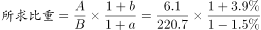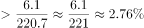，只有D项符合。

故正确答案为D。

### 第 110 题

2014年河北省铁路旅客运输周转量占河北省旅客运输周转量（ ）？

A. 38.69%

B. 42.69%

C. 45.56%

D. 77.22%

第 110 题 · 答案与解析

**参考答案（粉笔题库参考内容）**

D

**解析**

由题干“2014年···占···百分之几”，材料中数据时间也为2014年，判定本题为现期比重问题。定位材料第二段“河北省······2014年铁路运输周转量为985.9亿人公里”，“2014年河北旅客运输周转量为1276.7亿人公里”。根据比重公式可得：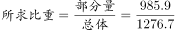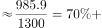，只有D项满足。

故正确答案为D。

### 第 111 题

2014年全国旅客运输总量增长最少的是（    ）。

A. 公路

B. 民航

C. 水运

D. 铁路

第 111 题 · 答案与解析

**参考答案（粉笔题库参考内容）**

C

**解析**

由题目问“增长最少的是”，判定本题为增长量比较问题。定位材料第一段“铁路运输总量为23.6亿人次，同比增长11.9%；公路运输总量为190.5亿人次，同比增长2.8%；水运运输总量为2.6亿人次，同比增长12.3%；民航运输总量为3.9亿人次，同比增长10.6%”。根据增长量计算公式可得，。

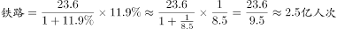 ；

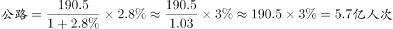；

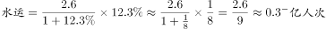 ；

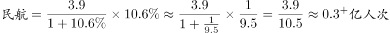。

所以水运旅客运输增长量最小。

故正确答案为C。

### 第 112 题

2013年全国公路运输总量是（    ）亿人次？

A. 184.31

B. 185.16

C. 185.31

D. 186.15

第 112 题 · 答案与解析

**参考答案（粉笔题库参考内容）**

C

**解析**

由题干“2013年全国公路运输总量是······亿人次”，材料数据时间为2014年，判定本题为基期计算问题。定位材料第一段“2014年公路运输总量为190.5亿人次，同比增长2.8%”，根据基期计算公式可得：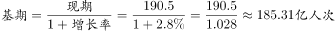，与C项最接近。此题选项数值差距极小，应进行精确计算。

故正确答案为C。

### 第 113 题

下面说法错误的是（    ）。

A. 2014年，全国与河北省的民航运输量与其他运输方式相比都是最少的

B. 2014年，河北省公路运输完成旅客运输量同比下降

C. 2014年，河北省旅客周转量占全国4.3%

D. 2014年，全国各种运输方式同比均增长

第 113 题 · 答案与解析

**参考答案（粉笔题库参考内容）**

A

**解析**

A项：定位材料第一段“全国水运运输总量为2.6亿人次······民航运输总量为3.9亿人次”可知，全国民航运输总量大于水运，并非最少，错误；

B项：定位材料第二段“河北省公路运输总量为5.1亿人次，同比下降3.4%”，可知2014年河北省公路运输完成旅客运输量同比下降，正确；

C项：定位材料第二段“2014年河北旅客运输周转量为1276.7亿人公里”，定位材料第一段“2014年全国旅客运输周转量为29994.2亿人公里”，则2014年河北省旅客周转量占全国比重为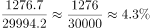，正确；

D项：定位材料第一段，2014年全国各种运输方式同比均增长，正确。

本题为选非题，故正确答案为A。

