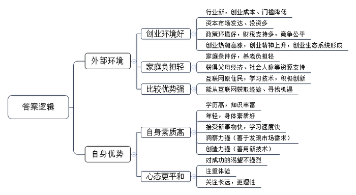
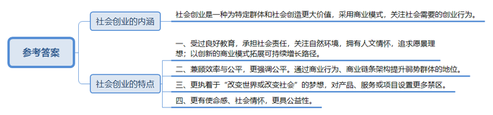
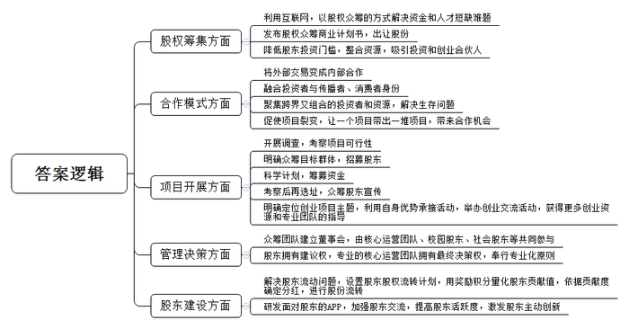
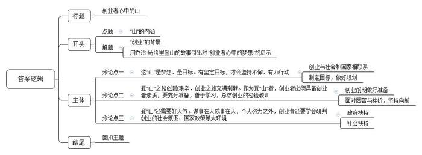

# 2016年公务员多省联考《申论》题（河北卷）

<!-- gwy:overview:start -->
> **河北 · 2016 · 申论 · 统考** ｜ 4 题 · 图片 4 处 · 答案随题折叠

导航：[题目](#题目)
<!-- gwy:overview:end -->

> 候选采集稿。参考答案及解析来自粉笔页面，不代表官方答案或真实高分答卷；来源使用许可与原卷对应关系仍需人工核实。

## 给定材料

### 材料 material-6eae1f2636ce3967

在北京西北部一栋办公楼冷飕飕的地下室里，一群想要成为企业家的人正聚集在计算机屏幕前，注视着他们最新的项目雏形。而在几公里之外，在一个暖意融融、装修更为豪华的地下演讲厅里，30多名经理和创业者也在讨论有关新产品和新公司的创意。这两群人都验证着中国社会对创业热潮日益增长的兴趣。英语在线教学服务“英语流利说”创始人王某表示：“初创是令人迷恋的新事物。”“中国的创业精神呈现一种上升趋势。顶级风投公司正在寻找年轻的创业者——整套生态系统逐步形成。”

据不完全统计，从2013年5月至今中央层面已经出台至少22份相关文件促进创业创新。各地方政府也纷纷出台政策，简政放权，从财税、金融、保障服务、政策激励等方面支持创新型企业特别是创新型小微企业发展，使各种创新资源向企业集聚，让更多金融产品和服务对接创新需求，用创新的翅膀使中国企业飞向新高度。2015年10月19日，在全国大众创业万众创新活动周启动仪式上，李克强总理被现场热烈气氛所感染而登台发表即席演讲，称“要为创新创业者站台”。李克强总理指出，大企业员工和草根创业者通过创新创业都可以成为更多财富的创造者和拥有者。这既是收入分配结构调整的重要内容，也促进了社会公平正义。双创为所有人提供了公平竞争的机会，让有能力的人通过自身奋斗获得上升通道。

### 材料 material-ad9c012d7820c829

在众多的创业者中还有这样一些与众不同的人，人们把他们的创业形式称之为社会创业。

年轻女孩小丁，为了解决残疾人和行动迟缓的老年人穿脱衣裤不便的问题，研发生产出了可拆卸的特制衣裤，并在这些特制衣裤上增加了加热、中药、磁极、按摩等辅助功能，患者试用后，好评如潮，目前产品已经投入市场。小丁还为此申请了专利，注册了有限责任公司。

行为心理学认为，人对任何付出都是希望能有所回报的。一直以来，我国公益项目对捐赠人的奖励多是精神奖励，捐赠人的心理难以得到很好的满足，影响公益事业的发展。小韩和小张创立了“路人甲”公众小额捐赠平台。他们希望把鼓励捐赠行为实体化、物质化，能用商业的手段，解决这个社会问题。“路人甲”的“惠捐模式”在中国是首创，即用户在捐赠10元后，即可兑换一张答谢券，凭着这张答谢券可享受众多合作商家的超值优惠和在线服务。这样一来，受助者有尊严，捐赠人有答谢，商家得客户，捐赠人、商业机构和公益项目（或受助人）三者之间形成一个非常好的公益的价值闭环，互惠共赢，同时也挖掘了优质捐款用户背后的巨大价值。

人们把小丁、小韩、小张这样的创业者称为社会创业家。第二届芝华士“赢之有道”社会创业家大赛的评委们用自己独特的视角与丰富的经验表达了对这些人的理解。

著名经济学家A：我所理解的社会创业家是新一代企业家，他们通常受过良好教育，承担社会责任，关注自然环境，拥有人文情怀，追求愿景理想，他们以创新的商业模式拓展可持续增长的路径，在为企业和社会创造财富的同时，也回应社会挑战，贡献社会进步。作为评委，我关注参赛者的激情与智慧、理想与务实的平衡。

资深财经评论员B：社会资源的发展有两个终极的目标，第一个是效率，第二个是公平。普通的创业者，一般的商业的诉求是解决效率问题，并且通过提高效率来获得商业上利润的诉求。但是人类社会追求的另外一个目标就是公平。有的时候效率和公平之间是有矛盾的，社会创业家就是兼顾效率和公平的这样一批创业者，他们和一般创业者最大的区别就是他们更多强调的是公平。对于整个社会资源分配当中的一些处于弱势的群体，通过商业的行为、商业的链条架构来提升他们的地位，我觉得这是社会创业家与一般创业者最大的不同。

技术创业投资基金合伙人C：首先，我不认为哪个企业家是和社会脱离关系的。他们不论是提供产品还是提供服务，哪种方式都或多或少对社会产生了影响或创造了价值。如果有的创业家所做的事情是完全公益的，那么我佩服他。但是在毫不盈利的前提下，我并不建议这样做。

风险投资人D：社会创业家创业的第一动机更多是想实现“改变世界或改变社会”的目的，跟“发明者”和“追梦者”类似，不是以传统利润模式导向而是出于更高一层的梦想和驱动创业，这些创业者会比一般创业者对自己的产品、服务或项目设的禁区更多，但也比一般创业者对自己的梦想有着更超乎一般的执着和理念。用自己的优势结合梦想找到一个更有颠覆性的产品和思路是很重要的。

甘客科技创始人E：社会创业者就是创业者中的NGO（非政府组织）。创业是源于为特定群体、社会创造更大的价值。因此，他们的责任感、使命感更强，更有社会情怀，而非简单地追求个人财富的积累。这是创业的新型价值体系，更具有社会公益意义。

### 材料 material-fc06bb9afff3df0c

深圳的创业者乔峤想要做一款智能耳机，他发现，60%的人都会在跑步过程中听歌，并用手机APP记录运动数据。如果有产品能同时解决跑步人群运动数据记录和听歌的需求，又能通过音乐来实现运动激励，会有很好的市场前景。乔峤对记者说，他想针对每个人的身体特征，设计和提供有效的音乐服务产品，做到每一个硬件设备都是针对个人定制的。

可是，光有好点子还不行，初始创业的乔峤，面临既缺资金，又缺人才的尴尬，他尝试着用股权众筹的方式来实现自己的创业梦想。在众筹网上，他发布了自己的股权众筹商业计划书，以出让公司10%股份的方式，融资187万元，最低投资额1万元。最终，吸引了16名投资者参与。乔峤告诉记者，这些投资者为他引入了互联网、音乐、体育领域的强大资源，其中，几个最志同道合的投资人干脆直接加入了创业团队。

## 题目

### 第 1 题

**根据给定资料**1**、**2**，概括当代社会中“90后”群体开展创业的外部环境和自身优势。（20分）**

关联材料：材料 material-6eae1f2636ce3967

作答要求：

要求：（1）内容全面、概括准确、语言简洁；（2）不超过300字。

第 1 题 · 答案与解析

**参考答案（粉笔题库参考内容）**

外部环境：

1.创业环境好。行业新，创业成本、门槛降低；资本市场发达、投资多；政策环境好，财税支持多，竞争公平；创业热潮高涨，创业精神上升，创业生态系统形成。

2.家庭负担轻。家庭条件好，养老负担轻；获得父母经济、社会人脉等资源支持。

3.比较优势强。互联网原住民，学习技术，积极创新；能从互联网获取经验、寻找机遇。

自身优势：

1\. 自身素质高。学历高，知识丰富；年轻，身体素质好；接受新事物快，学习速度快；洞察力强（善于发现市场需求），创造力强（善用新技术）。

2.心态更平和。对成功的渴望不强烈，注重体验，关注长远，更理性。

**解析**

**参考答案说明：**本参考答案宏观上从“外部环境”和“自身优势”两方面对“90后”创业的优势进行了分析。微观上，“外部环境”分为“创业环境好”“家庭负担轻”“比较优势强”这三个不同的方面进行了分条撰写；“自身优势”分为“自身素质高”和“心态更平和”这两个不同的方面进行了分条撰写。各条答案要点之间在内容上相互并列，没有交叉。

**考点**：考点多要素组合类

**来源**：来源2016年公务员多省联考《申论》题（河北卷）

粉笔申论页面对本题只提供「解析视频」入口，该入口是会员推广位，页面无视频地址与文字解析。

### 第 2 题

**根据给定材料**6**，指出“社会创业”的主要内涵及特点。（20分）**

关联材料：材料 material-ad9c012d7820c829

作答要求：

要求：

（1）理解全面、条理清楚、表达准确；

（2）不超过200字。

第 2 题 · 答案与解析

**参考答案（粉笔题库参考内容）**

社会创业是一种为特定群体和社会创造更大价值，采用商业模式，关注社会需要的创业行为。

社会创业的特点：一、受过良好教育，承担社会责任，关注自然环境，拥有人文情怀，追求愿景理想；以创新的商业模式拓展可持续增长路径。二、兼顾效率与公平，更强调公平。通过商业行为、商业链条架构提升弱势群体的地位。三、更执着于“改变世界或改变社会”的梦想，对产品、服务或项目设置更多禁区。四、更有使命感、社会情怀，更具公益性。

**解析**

**参考答案说明**：本参考答案宏观上分成“内涵”与“特点”两个要素。在“内涵”内部，用“一种……创业行为”的句式解释了“社会创业”。在“特点”内部，又从“良好教育”“兼顾效率与公平”“执着梦想”“有使命感”等不同的方面进行了分条撰写。各条要点之间在内容上相互并列，没有交叉。

**考点**：考点多要素组合类

**来源**：来源2016年公务员多省联考《申论》题（河北卷）

粉笔申论页面对本题只提供「解析视频」入口，该入口是会员推广位，页面无视频地址与文字解析。

### 第 3 题

**根据给定材料**3**\-**5**，就如何提高众筹项目的成功率，向有意创业者提出建议。（20分）**

关联材料：材料 material-fc06bb9afff3df0c

作答要求：

要求：

（1）观点明确、建议可行；语言简洁，有逻辑性；

（2）不超过500字。

第 3 题 · 答案与解析

**参考答案（粉笔题库参考内容）**

1.股权筹集方面：利用互联网，以股权众筹的方式解决资金和人才短缺难题；发布股权众筹商业计划书，出让股份；降低股东投资门槛，整合资源，吸引投资和创业合伙人。

2.合作模式方面：将外部交易变成内部合作；融合投资者与传播者、消费者身份；聚集跨界又组合的投资者和资源，解决生存问题；促使项目裂变，让一个项目带出一堆项目，带来合作机会。

3.项目开展方面：开展调查，考察项目可行性；明确众筹目标群体，招募股东；科学计划，筹募资金；考察后再选址，众筹股东宣传。明确定位创业项目主题，利用自身优势承接活动，举办创业交流活动，获得更多创业资源和专业团队的指导。

4.管理决策方面：众筹团队建立董事会，由核心运营团队、校园股东、社会股东等共同参与；股东拥有建议权，专业的核心运营团队拥有最终决策权，奉行专业化原则。

5.股东建设方面：解决股东流动问题，设置股东股权流转计划，用奖励积分量化股东贡献值，依据贡献度确定分红，进行股份流转；研发面对股东的APP，加强股东交流，提高股东活跃度，激发股东主动创新。

**解析**

**参考答案说明：**本参考答案从“股权筹集”“合作模式”“项目开展”“管理决策”“股东建设”五个方面进行了分条撰写。各条要点之间在内容上相互并列，没有交叉。

**考点**：考点提出对策类

**来源**：来源2016年公务员多省联考《申论》题（河北卷）

粉笔申论页面对本题只提供「解析视频」入口，该入口是会员推广位，页面无视频地址与文字解析。

### 第 4 题

**英国探险家乔治·马洛里曾参加了人类前三次攀登珠峰的尝试。当随队记者问及“你为什么要攀登珠峰”时他说：“因为山在那里”。请理解这句话的深意，从给定资料出发，联系实际，以“创业者心中的山”为题，写一篇文章。（40分）**

关联材料：材料 material-6eae1f2636ce3967

作答要求：

要求：

(1)中心明确，思想深刻；内容充实，论证有力；参考给定资料，但不拘泥于给定资料；结构完整，思路清晰，语言顺畅。

(2)不少于800字。

第 4 题 · 答案与解析

**参考答案（粉笔题库参考内容）**

创业者心中的山

像王石先生一样登顶喜马拉雅山也许是众多创业者的梦想。**对于创业者来说，****“山”意寓着高远的目标、梦想、对自身价值的体认、对社会使命和责任的自觉。**今天，在“大众创业，万众创新”的政策激励下，群众创业热情高涨，创业潜能喷涌而出。又赶上智能科技、互联网技术带来的计算革命、传播革命，使创业产品的广告效率、获客效率都指数级跃升，创业成本大幅下降，创业门槛降低，创业更加大众化。但创业成功仍然还是小概率事件，成功者少，失败者众。乔治·马洛里三次登山的故事，或许给了一些启示：但行好事，莫问前程。**坚持梦想、咬定目标，及时总结经验教训，越挫越勇，不达目标不罢休。**因为，山在那里。

**这****“山”是梦想、是目标。有坚定目标，才会坚持不懈、有力行动。**一方面，每一位创业者都应当为梦想驱动，应当把创业和社会群众、国家民族的利益融为一体，做“社会创业家”。创业当然首先为挣钱、营收和利润，要活下去，但也必须考虑践行社会使命、社会责任，为公共利益行事。创业者要能够在商业效率与社会公平之间架起桥梁，通过有效经营，为顾客提供优质产品，优良服务，行为商之德。另一方面，创业者要为自己制定清晰的目标，做好详细的规划，做到步步为营，稳扎稳打。联想集团，正是在柳传志循序渐进的市场扩展策略下，由一个区域间小有名气的产品，逐步扩张到全国、全世界，成为首屈一指的计算机品牌厂商的。

**登****“山”之路凶险艰辛，创业之旅充满荆棘。作为登“山”者，创业者必须具备创业者素质，要充分准备，善于学习，总结创业的经验教训。**创业不可盲目，不能冒进。马洛里首次登山之所以失败，正是因为前期对珠穆朗玛峰的地形一无所知。因此，创业前期的准备必须做好、做足，这包括项目知识、专业技术、融资渠道、人才资源等。只有万事俱备才可如鱼得水。即便如此，创业之路也很少一帆风顺的。倘若遇到困苦与挫折，我们应该迎难而上还是裹足不前？坚持到底还是草草放弃？只有坚持能终将证明，谁是创业的主人，谁是匆匆过客。坚持到最后的创业者才有机会成为一名优秀的企业家。

**登****“山”还需要好天气。谋事在人成事在天，个人努力之外，创业者还要学会研判创业的社会氛围、国家政策等大环境。**创业的起步、发展与成功，每一个环节都脱离不了政府大力扶持。李克强总理说“要为创新创业者站台”，“双创”要为所有人提供公平竞争机会，让有能力的人通过自身奋斗获得上升通道。总理的态度，以及中央层面、各地方政府出台政策，简政放权，从财税、金融、保障服务、政策激励等方面支持，给创业者们吃下了定心丸。社会各界创办的众多创客空间、创业工厂、企业孵化园等，更是为个体创业者们提供了技术支持、资金支持，直接指导、帮扶他们创业成功。可以说，只要有创意，又能埋头苦干，坚韧不拔的创业者都有机会成功。

习近平总书记说，有梦想，有机会，有奋斗，一切美好的东西都能够创造出来。海阔凭鱼跃，天高任鸟飞。创业之山巍峨、雄浑、壮丽，只有想要追梦、善于追梦、敢于追梦的勇者，才能在经历挫折、成功、悲伤、喜悦之后，体会到“会当凌绝顶，一览众山小”的激昂与兴奋。创业之路就在脚下，让我们无畏风险，砥砺前行！

**解析**

**文章分析**

创业者心中的山

【**标题的优点**：严格按照题目的要求，以“创业者心中的山”为标题。】

像王石先生一样登顶喜马拉雅山也许是众多创业者的梦想。（1）**对于创业者来说，****“山”意寓着高远的目标、梦想、对自身价值的体认、对社会使命和责任的自觉****。**今天，（2）在“大众创业，万众创新”的政策激励下，群众创业热情高涨，创业潜能喷涌而出。又赶上智能科技、互联网技术带来的计算革命、传播革命，使创业产品的广告效率、获客效率都指数级跃升，创业成本大幅下降，创业门槛降低，创业更加大众化。但创业成功仍然还是小概率事件，成功者少，失败者众。乔治·马洛里三次登山的故事，或许给了一些启示：但行好事，莫问前程。（3）**坚持梦想、咬定目标****，****及时总结经验教训****，****越挫越勇****，****不达目标不罢休****。**因为，山在那里。

【**开头的优点：**★内容方面。范文的开头是紧扣题目给定的“创业者的梦想”这一主题展开的。首先，开头第一句话点出主题，做到了主题明确。其次，对“创业者的梦想”进行了分析阐述，指出了（1）“山”的内涵。（2）“创业”的背景。（3）用乔治·马洛里登山的故事引出对“创业者心中的梦想”的启示。★文字表达方面 ：长短句配合使用，使语言表达有节奏感。】

**这****“山”是梦想、是目标。有坚定目标，才会坚持不懈、有力行动。**一方面，（1）每一位创业者都应当为梦想驱动，应当把创业和社会群众、国家民族的利益融为一体，做“社会创业家”。创业当然首先为挣钱、营收和利润，要活下去，但也必须考虑践行社会使命、社会责任，为公共利益行事。创业者要能够在商业效率与社会公平之间架起桥梁，通过有效经营，为顾客提供优质产品，优良服务，行为商之德。（2）另一方面，创业者要为自己制定清晰的目标，做好详细的规划，做到步步为营，稳扎稳打。联想集团，正是在柳传志循序渐进的市场扩展策略下，由一个区域间小有名气的产品，逐步扩张到全国、全世界，成为首屈一指的计算机品牌厂商的。

【**论述段****1****的优点：**★观点句：范文的观点句是紧扣“创业者的梦想”这一文章主题提出的。形式上，它在段首处直接写出，位置突出，容易发现。内容上，关键词突出，内容要点明确，可以明显看出它是从“梦想、目标”入手，指出了“有坚定目标，才会坚持不懈、有力行动”。★论述内容：（1）论述了“每一个创业者都应该‘做社会企业家，把创业与社会和国家联系在一起’”，（2）介绍了“创业者要制定目标，做好规划”。注意：以上两个方面的内容都是紧扣“有坚定目标，才会坚持不懈、有力行动”这个观点句进行分析论述的，论述的针对性强，内容层次丰富。最后，在论述方法和论据的选取上做到了讲道理、举例子相结合，做到了丰富多样。】

**登****“山”之路凶险艰辛，创业之旅充满荆棘。作为登“山”者，创业者必须具备创业者素质，要充分准备，善于学习，总结创业的经验教训。**创业不可盲目，不能冒进。（1）马洛里首次登山之所以失败，正是因为前期对珠穆朗玛峰的地形一无所知。因此，创业前期的准备必须做好、做足，这包括项目知识、专业技术、融资渠道、人才资源等。只有万事俱备才可如鱼得水。即便如此，（2）创业之路也很少一帆风顺的。倘若遇到困苦与挫折，我们应该迎难而上还是裹足不前？坚持到底还是草草放弃？只有坚持能终将证明，谁是创业的主人，谁是匆匆过客。坚持到最后的创业者才有机会成为一名优秀的企业家。

【**论述段****2****的优点：**★观点句：范文的观点句是紧扣“创业者的梦想”这一文章主题提出的。形式上，它在段首处直接写出，位置突出，容易发现。内容上，关键词突出，内容要点明确，可以明显看出它是从“困难”入手 ，指出了“创业者必须具备创业者素质，要充分准备，善于学习，总结创业的经验教训”。★论述内容：（1）以马洛里为例，指出了创业前期准备的重要性；（2）面对“困苦与挫折”的正确做法。以上2个方面的内容都是紧扣“作为登‘山’者，创业者必须具备创业者素质，要充分准备，善于学习，总结创业的经验教训”这个观点句进行分析论述的，论述的针对性强，内容层次丰富。最后，在论述方法和论据的选取上做到了讲道理、举例子相结合，做到了丰富多样。】

**登****“山”还需要好天气。谋事在人成事在天，个人努力之外，创业者还要学会研判创业的社会氛围、国家政策等大环境。**（1）创业的起步、发展与成功，每一个环节都脱离不了政府大力扶持。李克强总理说“要为创新创业者站台”，“双创”要为所有人提供公平竞争机会，让有能力的人通过自身奋斗获得上升通道。总理的态度，以及中央层面、各地方政府出台政策，简政放权，从财税、金融、保障服务、政策激励等方面支持，给创业者们吃下了定心丸。（2）社会各界创办的众多创客空间、创业工厂、企业孵化园等，更是为个体创业者们提供了技术支持、资金支持，直接指导、帮扶他们创业成功。可以说，只要有创意，又能埋头苦干，坚韧不拔的创业者都有机会成功。

【**论述段****3****的优点：**★观点句：范文的观点句是紧扣“创业者的梦想”这一文章主题提出的。形式上，它在段首处直接写出，位置突出，容易发现。内容上，关键词突出，内容要点明确，可以明显看出它是从“社会氛围、环境”入手，指出了“社会、政府支持”的重要性。★论述内容：（1）介绍了“政府扶持”的对策；（2）介绍了“社会支持”的对策。以上2个方面的内容都是紧扣“创业者还要学会研判创业的社会氛围、国家政策等大环境”这个观点句进行分析论述的，论述的针对性强，内容层次丰富。最后，在论述方法和论据的选取上做到了讲道理、打比方相结合，做到了丰富多样。】

【**论述段之间的关系：**★内容的内在逻辑：范文的论述段之间是依照“由微观到宏观”的逻辑展开的。论述段1先写了“有坚定目标，才会坚持不懈、有力行动”，论述段2再写了“创业者必须具备创业者素质，要充分准备，善于学习，总结创业的经验教训”，论述段3接着写了“创业者还要学会研判创业的社会氛围、国家政策等大环境”。★段与段的外在衔接：文章开头的段尾句“因为，山在那里”与论述段1的段首句“这‘山’是梦想、是目标”相呼应，段2的段首处的过渡句“登‘山’之路凶险艰辛，创业之旅充满荆棘。”，起到了承接论述段1、引出了论述段2的作用。论述段3的段首处的过渡句“登‘山’还需要好天气”，起到了承接论述段2、引出论述段3的作用。】

习近平总书记说，有梦想，有机会，有奋斗，一切美好的东西都能够创造出来。海阔凭鱼跃，天高任鸟飞。创业之山巍峨、雄浑、壮丽，只有想要追梦、善于追梦、敢于追梦的勇者，才能在经历挫折、成功、悲伤、喜悦之后，体会到“会当凌绝顶，一览众山小”的激昂与兴奋。创业之路就在脚下，让我们无畏风险，砥砺前行！

【**结尾的优点：**范文的结尾回扣了“创业者的梦想”这一主题。（1）再次点明了“创业者的梦想”这一主题；（2）进行了呼吁、号召。】

**考点**：考点文章写作题

**来源**：来源2016年公务员多省联考《申论》题（河北卷）

粉笔申论页面对本题只提供「解析视频」入口，该入口是会员推广位，页面无视频地址与文字解析。

