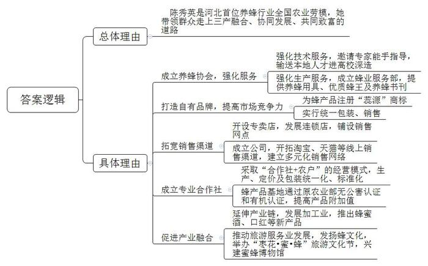
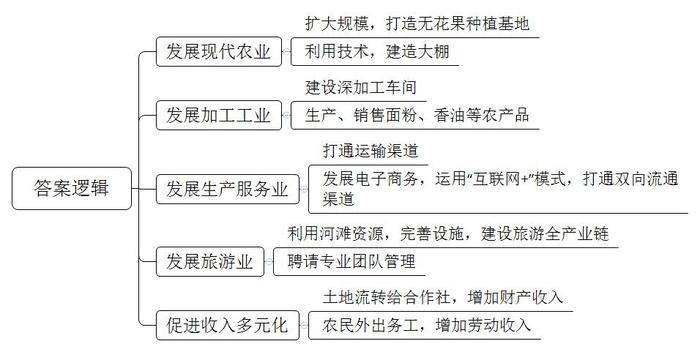
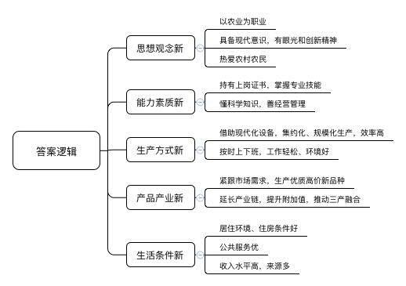
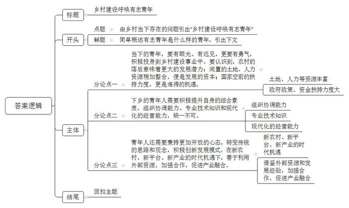

# 2019年河北省公考《申论》题（乡镇卷）

> 候选采集稿。参考答案及解析来自粉笔页面，不代表官方答案或真实高分答卷；来源使用许可与原卷对应关系仍需人工核实。

## 给定材料

### 材料 material-f92bed5c8b40cabf

2018年7月4日长城网：近日，陈秀英荣获国家人力资源和社会保障部、农业部（现农业农村部）共同授予的“全国农业劳动模范”称号。这是新中国成立以来第三批全国农业劳动模范，也是河北省首位养蜂行业的全国农业劳模。

地处太行深处的赞皇县，大枣种植面积达45万亩，当地人守着大自然赋予的丰富蜜源养蜂、售蜜。然而，前些年，蜂农分散在大山深处，养蜂技术和养殖观念都很落后，蜂王产量少，蜜蜂抗病力和采集力都低。辛苦一年，赔本是常有的事。

“养蜂对于山区农民来说是非常好的产业，但一家一户的散养，信息沟通不畅，技术不易更新，产业形不成规模，大家都赚不到钱。”陈秀英决定成立协会，把养蜂户团结起来，大家抱团共同发展，来成就富农大产业。

在她的努力下，1995年1月，河北省赞皇县养蜂协会成立，陈秀英被推举为会长。协会成立后，陈秀英多次邀请国内养蜂专家和能手到县里进行技术指导，还先后送16名学生到浙江农大深造。协会办起了蜂业服务部，为蜂农提供养蜂用具；购买优质种用蜂王，繁育出蜂王免费送给蜂农以改良品种；订购20多种养蜂书刊，供蜂农学习……在协会的带动下，蜂农的养蜂水平大幅提高，养蜂收入日益增加。

协会成立初期，陈秀英从蜂农手中收购蜂产品，送到大厂家代卖，但几年的产品外送代卖经历，让陈秀英意识到，必须打造自有品牌。1997年，赞皇县养蜂协会为蜂产品注册了“蕊源”商标，实行统一包装、统一销售，提高了产品的市场竞争力。

有了好的蜂产品，还要拓宽销售渠道。起初，陈秀英在石家庄市人口密集区租了一个店面，直销“蕊源”蜂蜜。为推销蜂蜜，她常常蹬着三轮车走市场、穿小区，讲解蜂蜜好处。功夫不负有心人，凭借质量过硬的产品和诚实守信，“蕊源”牌蜂产品得到了市场认可，逐渐有了稳定的消费群体。专卖店也由起初不足10平米的简陋店面，发展到全市10多家连锁店，并在周边县市开设了销售网点。

为适应市场发展，陈秀英于2004年成立了赞皇县蕊源蜂业有限公司，并在淘宝、天猫上开起了网店。如今，“蕊源”蜂产品已经形成了实体直销店、超市品牌专柜、网点销售等多元化销售网络，年销售量达千吨，年销售额1000多万元。

为让更多的群众致富，2004年4月，陈秀英又发起成立了赞皇县天源蜂业农民专业合作社，采取“合作社+农户”的经营模式，统一标准化生产、统一价格、统一包装，使合作社成为河北省首家通过原农业部无公害认证和有机认证的蜂产品基地。

在合作社的带动下，赞皇县的养蜂产业快速发展。目前，全县11个乡镇，96个村的1290个养蜂户，共养蜜蜂3万箱，蜂农年收入在3万元以上，部分达到5万至8万元，成为该县又一富农产业。

陈秀英常说，养蜂是一项健康的产业，是一份甜蜜的事业。为把养蜂业发展壮大，把蜂文化发扬光大，赞皇县养蜂协会和赞皇县天源蜂业农民专业合作社走上了一条三产融合、协同发展、助推山区群众共同致富的道路。自2012年起，赞皇县养蜂协会连续5年举办了“枣花·蜜·蜂”旅游文化节，让越来越多的人了解这项甜蜜事业。

为延伸产业链条、增加蜂农收入，陈秀英和她的团队不断攻关，在提升蜂蜜、蜂王浆、蜂花粉、蜂胶、蜂蜡等蜂产品质量的同时，创新推出蜂蜜酒、蜂蜜口红、蜂蜡手工皂等产品，拓宽了消费市场，赢得了顾客的喜爱。

为发扬蜂文化，2016年，陈秀英投资500多万元，在蕊源蜂业厂区内建成了集蜂文化、蜂疗、科普、旅游为一体的蜜蜂博物馆。

博物馆分设蜜蜂文化展示区、蜜源植物及蜜蜂养殖科研区、蜂产品加工观光区等六大功能区，不仅能以生动直观的形式介绍我国源远流长的养蜂发展历史、现代养蜂科学技术等，还设有体验区，让人们体验采集花粉、制作蜂王浆的乐趣，品尝原汁原味的蜂王浆和蜂蜜。陈秀英介绍，蜜蜂博物馆建成一年多来，已接待游客近10万人次。

对于未来，天源蜂业农民专业合作社理事长陈秀英还有一个更大的梦想——建设一个集蜜蜂文化、体验和休闲于一体的蜜蜂谷，更好地带动当地山区群众共同致富。

### 材料 material-8ecbdf267ac84d82

2018年2月14日，农历腊月二十九，正定县塔元庄村的广场、路旁挂着喜庆的大红灯笼，路上的年轻人有说有笑；村子外，推土机、运输车来回穿梭，一派热火朝天的繁忙景象——伴着浓浓的年味，塔元庄村的“乡村振兴进行曲”正在精彩上演……

塔元庄村南，滹沱河北岸的河滩地里，一座座造型别致、欧式风格的小木屋映入眼帘。

在一栋小木屋旁，正在忙碌的十九大代表、塔元庄村党支部书记尹计平一谈到村里的乡村振兴规划，嗓音一下子提高了许多：“我们琢磨着要把荒废的河滩地利用起来，变废为宝。”

“河滩地种庄稼、种蔬菜不行，发展特色旅游是个出路！”尹计平说。2017年底，经过摸底调研、前期筹建，塔元庄“木屋小镇”应运而生。目前，50栋欧式风格的木屋别墅全部完工，工人们正在忙着摆放家具、家电，打扫卫生。

“木屋小镇是我们村今年重点打造的旅游民宿项目，与周边的水上嘉年华大型游乐场、美食街、农业生态园、慧聪电子商务产业园等构成吃、住、行、游、购、娱于一体的旅游全产业链。”尹计平介绍，目前村里已经聘请了专业的运营团队对木屋小镇进行运营管理。

最让尹计平得意的还是这些新项目都能实现当年投用，当年收益，“我们村的集体收入每年能增加近500万元。”

“在滹沱河的南岸，我们还准备建设占地500亩的无花果种植基地和深加工车间，以及占地100多亩的研学基地，最终建成共享小镇。”目前这个计划正在落实之中。

室外天气寒冷，村西农业示范园的大棚里却是暖意洋洋。园区外几辆大卡车满载着塔元庄产的面粉、香油等准备运往全国各地。不远处的塔元庄电子商务产业园里，各地的名优特色产品正在展销。

为了让更多“养在深闺”的特色农产品畅销、远销，真正实现农业产业化、规模化，塔元庄村以发展农村电子商务为实施乡村振兴战略的着力点，引进河北首家商务产业园——慧聪电子商务产业园，建成了16个专业电商平台。由此，塔元庄村搭上了电商快车。

“我们的目标是运用‘互联网+农业’模式，打通‘农产品进城，工业品下乡’双向流通渠道。”慧聪网河北公司副总裁王庚告诉记者，2017年，依靠便捷的网络销售渠道，“除了将塔元庄的小米、香油、牛蒡酒等农产品销售到京、津、冀、鲁、晋、豫等多个省市，更是实现了将正定的板材、小家具卖到了俄罗斯，将当地种植的蘑菇卖到了日本、韩国。”

2013年7月11日，习近平总书记到塔元庄村视察时，曾到过村民李彩芳家。总书记说要让老百姓过上好日子。时至今日，李彩芳对总书记来家时的情景记忆犹新。如今老百姓这光景真是一年比一年好，可想说给总书记听听哩。“俺家三亩地加入村里合作社，由集体统一管理经营，家里人腾出时间在外打工，比以前种地强多了。”李彩芳提到的合作社，就是塔元庄村的果蔬专业合作社，村民们自愿入股，将土地租给合作社。村里的760亩好地已全部流转到合作社。村民收入增加了，日子越过越舒心。

如今，村支书尹计平又有了新目标：率先建成高质量的小康村，真正做到产业兴旺，生态宜居，乡风文明，治理有效，生活富裕。到2020年，村集体收入将达到3000万元，村民年人均收入达到3万元。

“到时候，我们一定邀请总书记再来我们村，看看塔元庄村的巨大变化，看看塔元庄人的幸福生活。”这是尹计平的心愿，也是全体村民的心愿。

### 材料 material-f17f03a4287e343d

黄瓜、西红柿挂满架秧，各种花卉争奇斗艳。尽管已是深秋，但记者在河北枣强县八里庄村4000平方米的智能温室里看到，这里依然绿意盎然。“整个温室全部采用智能化管理，水肥一体化，自动调温控湿，全都是我一个人管理。”在这里打工的董秀爽说话爽朗利落。

董秀爽高兴地邀请记者到她家里看看。一路上，董秀爽讲起了村里和她家这几年的变化。“矮土房、污水坑，一到晚上就拉灯……”过去种地靠天收，根本赚不到钱。到2013年，村里还是贫困村，村民人均收入不足2000元。2014年，县里实施新型社区和现代农业园区同步建设，八里庄村是第一批先行者。

从小在农村长大的河北贵和集团张全贵董事长，决心要改变村里的面貌。2014年，该集团流转了村里全部耕地，建设了农业产业园区。土地流转后，村民腾出了手，青壮劳力多数去了工厂，妇女和年纪大的到农业园区打工。

50多岁的董秀爽来到园区当了一名农业工人，“俺在这里光打工一年就收入2万多元，丈夫是园区里的仓储工。两个人的工资和土地流转的收入每年有10多万元。”这让她高兴不已。如今和她一样在园区打工的村民就有60多人。

沿着宽敞的街道走进八里庄新村社区，只见排排别墅整齐划一，街道清洁，绿树成荫。跟随董秀爽来到她家的别墅，两栋各223平方米的三层别墅并排着，青砖灰瓦白底，门楣两边两个硕大的红色中国结，衬托着喜庆气氛。“这是俺老公公，他们几个上年纪的负责新村社区的卫生”，董秀爽向记者介绍着正在路边收拾垃圾箱的一位老人，“如今咱村里也有专职的保洁啦”。

“这是俺的上岗培训证，这是我丈夫的技工证”，董秀爽向记者展示着一大摞红红绿绿的证件，“还有俺们土地入股的分红证”。她和丈夫在产业园区打工，孩子在县农业技术推广中心学农机操作，一家人各忙各的，生活很充实。

“祖祖辈辈都生活在这里，自己从小在这里长大，虽说以前的日子苦，可对这里的一草一木都有感情。现在农村变啦，俺们农民也不是以前那个活法啦。你们下次来的时候，变化会更大，乡亲们的日子会越来越好。”董秀爽脸上洋溢着笑容说。

## 题目

### 第 1 题

**省有关部门公开征集“最美河北人”提名，假如推荐陈秀英，请根据资料**4**，列述推荐理由。（20分）**

关联材料：材料 material-f92bed5c8b40cabf

作答要求：

要求：

（1）提炼准确，举例恰当，条理清晰；

（2）不超过400字。

### 第 2 题

**根据资料**1**，概括塔元庄村实现产业兴旺的举措。（20分）**

关联材料：材料 material-8ecbdf267ac84d82

作答要求：

要求：

（1）概括全面，表达准确，条理清晰；

（2）不超过200字。

### 第 3 题

**根据资料**2**、**3**、**5**，谈谈“新型职业农民”的“新”体现在哪些方面。（20分）**

关联材料：材料 material-f17f03a4287e343d

作答要求：

要求：

（1）理解全面，分析透彻，条理清晰；

（2）不超过200字。

### 第 4 题

**资料**5**中有“尤其需要勇担当、有作为的青年人顶上来”一句话。请结合给定资料理解这句话，据此确定立意，自拟题目，联系实际，写一篇议论文章。（40分）**

关联材料：材料 material-8ecbdf267ac84d82

作答要求：

要求：

（1）联系实际不拘泥于“给定资料”；

（2）观点明确，论证有力，层次清楚，语言流畅；

（3）不少于1000字。

## 答案与解析

第 1 题

**参考答案（粉笔题库参考内容）**

陈秀英是河北首位养蜂行业全国农业劳模，她带领群众走上三产融合、协同发展、共同致富的道路。具体来说：

一、成立养蜂协会，强化服务。强化技术服务，邀请专家能手指导，输送本地人才进高校深造；强化生产服务，成立蜂业服务部，提供养蜂用具、优质蜂王及养蜂书刊。

二、打造自有品牌，提高市场竞争力。为蜂产品注册“蕊源”商标；实行统一包装、销售。

三、拓宽销售渠道。开设专卖店，发展连锁店，铺设销售网点；成立公司，开拓淘宝、天猫等线上销售渠道，建立多元化销售网络。

四、成立专业合作社。采取“合作社+农户”的经营模式，生产、定价及包装统一化、标准化；蜂产品基地通过原农业部无公害认证和有机认证，提高产品附加值。

五、促进产业融合。延伸产业链，发展加工业，推出蜂蜜酒、口红等新产品；推动旅游服务业发展，发扬蜂文化，举办“枣花•蜜•蜂”旅游文化节，兴建蜜蜂博物馆。

**解析**

**参考答案说明**：本参考答案先介绍了总体理由，再从“成立养蜂协会，强化服务”“打造自有品牌，提高市场竞争力”“拓宽销售渠道”“成立专业合作社”“促进产业融合”五个方面进行分条撰写。各条答案要点之间在内容上相互并列，没有交叉。

**考点**：考点原因类

**来源**：来源2019年河北省公考《申论》题（乡镇卷）

粉笔申论页面对本题只提供「解析视频」入口，该入口是会员推广位，页面无视频地址与文字解析。

第 2 题

**参考答案（粉笔题库参考内容）**

1.发展现代农业。扩大规模，打造无花果种植基地；利用技术，建造大棚。

2.发展加工工业。建设深加工车间；生产、销售面粉、香油等农产品。

3.发展生产服务业。打通运输渠道；发展电子商务，运用“互联网+”模式，打通双向流通渠道。

4.发展旅游业。利用河滩资源，完善设施，建设旅游全产业链；聘请专业团队管理。

5.促进收入多元化。土地流转给合作社，增加财产收入；农民外出务工，增加劳动收入。

**解析**

**参考答案说明：**本参考答案从“发展现代农业”“发展加工工业”“发展生产服务业”“发展旅游业”“促进收入多元化”这五个方面对塔元庄村实现产业兴旺的举措进行了分条撰写，各条答案要点之间在内容上是没有交叉的。

**考点**：考点概括措施类

**来源**：来源2019年河北省公考《申论》题（乡镇卷）

粉笔申论页面对本题只提供「解析视频」入口，该入口是会员推广位，页面无视频地址与文字解析。

第 3 题

**参考答案（粉笔题库参考内容）**

1.思想观念新。以农业为职业；具备现代意识，有眼光和创新精神；热爱农村农民。

2.能力素质新。持有上岗证书，掌握专业技能；懂科学知识，善经营管理。

3.生产方式新。借助现代化设备，集约化、规模化生产，效率高；按时上下班，工作轻松、环境好。

4.产品产业新。紧跟市场需求，生产优质高价新品种；延长产业链，提升附加值，推动三产融合。

5.生活条件新。居住环境、住房条件好；公共服务优；收入水平高，来源多。

**解析**

**参考答案说明**：本参考答案从“思想观念新”“能力素质新”“生产方式新”“产品产业新”“生活条件新”五个方面进行分条撰写，各条要点在内容上是并列且无交叉的。

**考点**：考点特点类

**来源**：来源2019年河北省公考《申论》题（乡镇卷）

粉笔申论页面对本题只提供「解析视频」入口，该入口是会员推广位，页面无视频地址与文字解析。

第 4 题

**参考答案（粉笔题库参考内容）**

**乡村建设呼唤有志青年**

一直以来，乡村的发展始终都是政府工作的重中之重。当前，乡村建设虽取得了一定成效，但人才的缺失却成为发展的最大障碍。一方面，人才外流、农村空心化的问题依然存在，干部队伍也不稳定；另一方面，农民普遍存在等靠要思想，不敢创新、懒于探索，乡村振兴后续乏力。**作为社会发展的生力军、主力军，青年人要对乡村怀有热爱之情，积极参与乡村建设；更要有勇有谋，以自身的知识、能力助推乡村振兴，实现自我价值。**

**当下的青年，要有眼光、有远见，更要有勇气，积极投身到乡村建设事业中。要认识到，农村的落后意味着更大的发展潜力：闲置的土地、人力资源稍加整合，便是发展的资本；国家空前的扶持力度，更是难得的机遇。**与资源日渐紧张的城市相比，农村还是一片有待挖掘的宝藏，广袤肥沃的土地、廉价的劳动力、优美的风景、巨大的消费市场，加之政策的大力扶持，都表明乡村未来可期。实际上，随着乡村振兴战略的实施、精准扶贫的节节胜利和一系列支农政策资金的贯彻落实，农村面貌有了极大的提升。放远眼光，以满腔热血参与到乡村建设的大舞台，是青年实现自我理想与历史使命的明智选择。

但是，青年也要清醒地认识到，乡村的发展、事业的成功，不是仅靠一腔热血就能实现的，需要以知识、能力为基础，更需要发挥主观能动性，融入创意。

**下乡的青年人需要积极提升自身的综合素质，组织协调能力、专业技术知识和现代化的经营能力，缺一不可。**俗话说，“独木不成林”，想成就一番事业，做大做强，靠个人的力量是很难实现的。青年需要通过成立农民专业合作社、产业协会等方式将广大农民团结起来，并且整合各项资源，借助集体的力量，达到“众人拾柴火焰高”的效果。然而，农民群体普遍缺乏知识和先进的技能，想要带领农民提升生产效率，提高产品品质，青年人自身就需要有真才实学，了解农业专业知识，掌握现代化生产方式等实用技能。此外，青年还需要提升经营能力，因为“酒香也怕巷子深”。如果不懂得打造品牌、借助线上线下等多种渠道进行销售，那么再优质的产品终究也卖不出好的价格。

**青年人还需要秉持更加开放的心态，转变传统的思路和观念，积极创新发展模式。在新农村、新平台、新产业的时代机遇下，善于利用外部资源，加强合作，促进产业融合。**当下，农村生产已不再是面朝黄土背朝天地种植作物，而是发展现代农业，探索发展二三产业，追求产业间的融合。青年人不能再仅盯着农业谋出路，不能仅靠农民的力量，而是要借鉴外部资源和发展经验。青年要以开放的心态，积极引进资金、先进的管理和技术，发展现代农业，延伸产业链，推动加工业、旅游业等的发展，实现三产融合。

乡村天地广阔，大有可为。想要让这些有志青年在乡村留得安心、舒心，政府还需要优化引才、留才环境，通过改善农村的基础设施、支持返乡下乡青年创业创新等举措，充分调动广大青年干事创业的热情，让更多的青春之花在乡村绽放！

**解析**

**文章分析**

**乡村建设呼唤有志青年**

【**标题的优点：**首先，范文的标题“乡村建设呼唤有志青年”突出了“青年人顶上来”这一主题。其次，形式上，文字简洁明快。】

一直以来，乡村的发展始终都是政府工作的重中之重。（1）当前，乡村建设虽取得了一定成效，但人才的缺失却成为发展的最大障碍。一方面，人才外流、农村空心化的问题依然存在，干部队伍也不稳定；另一方面，农民普遍存在等靠要思想，不敢创新、懒于探索，乡村振兴后续乏力。（2）**作为社会发展的生力军、主力军****，青年人要****对乡村怀有热爱之情****，****积极参与乡村建设****；****更要有勇有谋****，****以自身的知识****、****能力助推乡村振兴****，****实现自我价值****。**

【**开头的优点：**★内容方面。范文的开头是紧扣题目给定的“青年人顶上来”这一主题展开的。首先，开头即点出主题，做到了主题明确。其次，对“青年人顶上来”这一主题进行了分析阐述，指出了（1）“乡村发展存在的问题”。（2）“什么样的青年是有志青年”。★文字表达方面：使用了“一方面……另一方面”“要……更要”等关联词，使语言表达更有逻辑性。】

**当下的青年，要有眼光、有远见，更要有勇气，积极投身到乡村建设事业中。要认识到，农村的落后意味着更大的发展潜力：闲置的土地、人力资源稍加整合，便是发展的资本；国家空前的扶持力度，更是难得的机遇。**（1）与资源日渐紧张的城市相比，农村还是一片有待挖掘的宝藏，广袤肥沃的土地、廉价的劳动力、优美的风景、巨大的消费市场，（2）加之政策的大力扶持，都表明乡村未来可期。实际上，随着乡村振兴战略的实施、精准扶贫的节节胜利和一系列支农政策资金的贯彻落实，农村面貌有了极大的提升。放远眼光，以满腔热血参与到乡村建设的大舞台，是青年实现自我理想与历史使命的明智选择。

【**论述段****1****的优点：**★观点句：范文的观点句是紧扣“青年人顶上来”这一文章主题提出的。形式上，它在段首处直接写出，位置突出，容易发现。内容上，内容要点明确，可以明显看出它是从“眼光远见”入手，指出了“青年人顶上来”。★论述内容：（1）介绍了“农村资源丰富，前景广阔”；（2）介绍了“政府政策、资金扶持力度大”。注意：以上两个方面的内容都是紧扣“青年要有眼光、有远见，更要有勇气，积极投身到乡村建设事业中”这个观点句进行分析论述的，论述的针对性强，内容层次丰富。论述方法以道理论证为主，论述清晰透彻。】

但是，青年也要清醒地认识到，乡村的发展、事业的成功，不是仅靠一腔热血就能实现的，需要以知识、能力为基础，更需要发挥主观能动性，融入创意。

【**过渡段优点：**本段主要阐述青年要以知识、能力为基础，发挥主观能动性，其中“需要以知识、能力为基础，更需要发挥主观能动性，融入创意”可承接下文。】

**下乡的青年人需要积极提升自身的综合素质，组织协调能力、专业技术知识和现代化的经营能力，缺一不可。**（1）俗话说，“独木不成林”，想成就一番事业，做大做强，靠个人的力量是很难实现的。青年需要通过成立农民专业合作社、产业协会等方式将广大农民团结起来，并且整合各项资源，借助集体的力量，达到“众人拾柴火焰高”的效果。（2）然而，农民群体普遍缺乏知识和先进的技能，想要带领农民提升生产效率，提高产品品质，青年人自身就需要有真才实学，了解农业专业知识，掌握现代化生产方式等实用技能。（3）此外，青年还需要提升经营能力，因为“酒香也怕巷子深”。如果不懂得打造品牌、借助线上线下等多种渠道进行销售，那么再优质的产品终究也卖不出好的价格。

【**论述段****2****的优点：**★观点句：范文的观点句是紧扣“青年人顶上来”这一文章主题提出的。形式上，它在段首处直接写出，位置突出，容易发现。内容上，内容要点明确，可以明显看出它是从“素质”入手，指出了“青年人顶上来”。★论述内容：（1）介绍了“组织协调能力”；（2）介绍了“专业技术知识”；（3）介绍了“现代化的经营能力”。注意：以上三个方面的内容都是紧扣“下乡的青年人需要积极提升自身的综合素质，组织协调能力、专业技术知识和现代化的经营能力，缺一不可”这个观点句进行分析论述的，论述的针对性强，内容层次丰富。论述方法以道理论证为主，论述清晰透彻。】

**青年人还需要秉持更加开放的心态，转变传统的思路和观念，积极创新发展模式。在新农村、新平台、新产业的时代机遇下，善于利用外部资源，加强合作，促进产业融合。**（1）当下，农村生产已不再是面朝黄土背朝天地种植作物，而是发展现代农业，探索发展二三产业，追求产业间的融合。（2）青年人不能再仅盯着农业谋出路，不能仅靠农民的力量，而是要借鉴外部资源和发展经验。青年要以开放的心态，积极引进资金、先进的管理和技术，发展现代农业，延伸产业链，推动加工业、旅游业等的发展，实现三产融合。

【**论述段****3****的优点：**★观点句：范文的观点句是紧扣“青年人顶上来”这一文章主题提出的。形式上，它在段首处直接写出，位置突出，容易发现。内容上，内容要点明确，可以明显看出它是从“创新观念、模式”入手，指出了“青年人顶上来”。★论述内容：（1）介绍了“新农村、新平台、新产业的时代机遇”；（2）介绍了“借鉴外部资源和发展经验，加强合作，促进产业融合”。注意：以上两个方面的内容都是紧扣“青年人还需要秉持更加开放的心态，转变传统的思路和观念，积极创新发展模式。在新农村、新平台、新产业的时代机遇下，善于利用外部资源，加强合作，促进产业融合”这个观点句进行分析论述的，论述的针对性强，内容层次丰富。论述方法以道理论证为主，论述清晰透彻。】

乡村天地广阔，大有可为。想要让这些有志青年在乡村留得安心、舒心，政府还需要优化引才、留才环境，通过改善农村的基础设施、支持返乡下乡青年创业创新等举措，充分调动广大青年干事创业的热情，让更多的青春之花在乡村绽放！

【**结尾的优点：**范文的结尾回扣了“青年人顶上来”这一主题。总结了“青年人顶上来”的对策，并发出了呼吁和号召。】

**考点**：考点文章写作题

**来源**：来源2019年河北省公考《申论》题（乡镇卷）

粉笔申论页面对本题只提供「解析视频」入口，该入口是会员推广位，页面无视频地址与文字解析。

