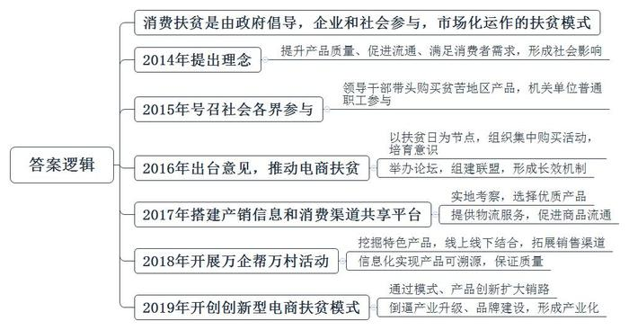
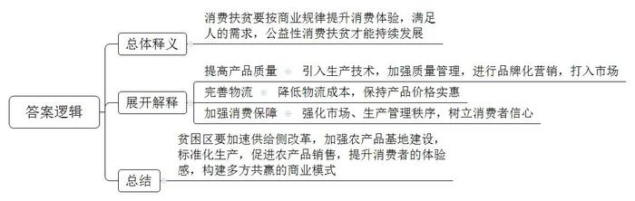
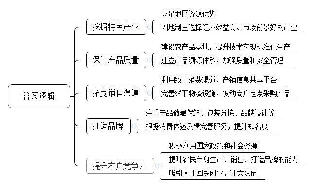
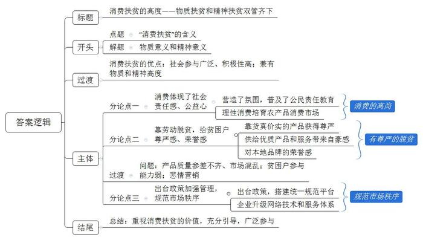

# 2019年河北省公考《申论》题（县级卷）

<!-- gwy:overview:start -->
> **河北 · 2019 · 申论 · 县级卷** ｜ 4 题 · 图片 4 处 · 答案随题折叠

导航：[题目](#题目) · [材料 1](#材料-1)
<!-- gwy:overview:end -->

> 候选采集稿。参考答案及解析来自粉笔页面，不代表官方答案或真实高分答卷；来源使用许可与原卷对应关系仍需人工核实。

## 给定材料

### 材料 1

2019年01月14日，国务院办公厅发布《关于深入开展消费扶贫助力打赢脱贫攻坚战的指导意见》，将消费扶贫纳入扶贫攻坚政策体系。《意见》指出：“大力实施消费扶贫，有利于动员社会各界扩大贫困地区产品和服务消费，调动贫困人口依靠自身努力实现脱贫致富的积极性，促进贫困人口稳定脱贫和贫困地区产业持续发展。”

“好政策！及时雨！”吉林省延边朝鲜族自治州汪清县副县长王胜民喜不自胜。“对贫困县真是个好机会，一是可以跟大机关、大企业精准对接，尽快提升县里农产品的知名度，二是可以通过定点采购直接帮助贫困户增收，三是可以促进物流体系建设，将农产品物流成本降下来。一举多得！”

国家级贫困县汪清县，1995年被命名为木耳之乡，当地是延边贡米的主产区之一，更盛产人参等中药材，延边黄牛肉口感媲美日本和牛。然而，这些特产“养在深闺人未识”，2015年底汪清县贫困发生率还高达23.2%，经过几年对口扶贫，2018年下降到3.29%。

“农产品销售体现不了优质优价。我们一斤优质木耳的成本要20多元，收购价不到30元，可在电商平台上能卖到80元至90元。”王胜民分析，当地优质木耳被贱卖，一是市场没有培育和推广好，也缺乏龙头企业带动，导致知名度不够高；二是地处偏远，物流成本高。

没有品牌，几乎是贫困地区都在头痛的事。贫困地区不乏高品质、无公害的特色农产品，可是去哪卖、卖给谁，大家没主意，有时只能心疼地让好东西烂在地里。与此同时，消费者想买绿色、天然的特色农产品，也面临价格虚高、以次充好等消费陷阱。

让王胜民头疼的还有大量“李鬼”扰乱市场。“我们的木耳品质好，一些外地商人来我们这收购黑木耳，却与其他木耳掺着卖，损害了消费者利益，也影响了我们增收，搞乱了市场。”

尽管临近春节，王胜民还在忙活黑木耳质量标准化建设，希望尽快打造一个县里的品牌。“农民合作社只能种植木耳，加工销售还需要有龙头企业。现在乡村空心化依然厉害，还得琢磨让能人回乡创业。”王胜民说。

《人民日报》记者在《意见》发布后进行了采访。国家某部委巡视员Z认为，消费扶贫既是公益行为，也是经济行为，却绝不是强买强卖。“这一系列措施坚持自愿原则，不压任务、不下指标，旨在引导社会各方力量发挥主动性，积极参与到消费扶贫中，壮大参与消费扶贫的‘朋友圈’。”在某大学农业与农村学院教授Y看来，《意见》的一大亮点就是坚持市场运作，他说：“消费扶贫不是单纯的慈善，政府要做的不仅是搭桥，更要维护良好的市场环境。”“消费扶贫不是搞一锤子买卖，关键是借机增强贫困人口和贫困地区产业适应市场的能力，从而建立稳定脱贫的长效机制。”

### 材料 2

据国家十三五规划专家咨询委员会委员汪向东回顾，国务院扶贫办2014年就提出了消费扶贫的理念，此后几年这个理念在扶贫体系内外迅速形成广泛的社会影响。

某大学公共政策研究院教授M在谈到消费扶贫时说：从生产者角度来讲，一些企业介入以后，可以把当地的产品通过品牌化的营销和相关的质量管理，以及相关生产技术的注入，使产品质量进一步提升，为其打入市场做了好的准备。从流通环节角度来讲，可以把贫困地区的产品通过比较便宜的物流形式，送到最终消费点，它的质量是有保证的，价格也是比较稳定的，而且是大家可以买得起的。从消费角度来讲，在市场秩序、生产管理秩序方面有比较好的支持，城里的消费者会越来越放心。从这个意义上来讲，贫困地区的老百姓能够得利，城市的消费者能够得利，组织市场流通的方面也能够得利，各个方面都能够得利，市场秩序就成长起来了。

共青团某省委农村青年工作部干部W特别强调，在消费扶贫过程中，虽然消费者愿意购买贫困地区的农产品，甚至也愿意接受贫困地区农产品在包装、外观上的一些不完美，但并不等于就可以不做上网销售的品控，因为消费者本质上还是在采购正常商品。所以，消费扶贫的兴起，需要贫困地区加速推进供给侧改革，加强源头的农产品基地建设，做好标准化生产，重视产品的贮藏保鲜、包装分拣、品牌设计等环节，提升消费者的体验感，让消费者买得情愿，吃得满意，最终是以商道来行人道。

## 题目

### 第 1 题

**根据给定资料，概述我国“消费扶贫”的基本历程。（20分）**

关联材料：材料 1

作答要求：

要求：

（1）内容全面、概括准确、条理清晰；

（2）不超过300字。

第 1 题 · 答案与解析

**参考答案（粉笔题库参考内容）**

消费扶贫是由政府倡导，企业和社会参与，市场化运作的扶贫模式。

一、2014年提出理念。提升产品质量、促进流通、满足消费者需求，形成社会影响。

二、2015年号召社会各界参与。领导干部带头购买贫苦地区产品，机关单位普通职工参与。

三、2016年出台意见，推动电商扶贫。以扶贫日为节点，组织集中购买活动，培育意识；举办论坛，组建联盟，形成长效机制。

四、2017年搭建产销信息和消费渠道共享平台。实地考察，选择优质产品；提供物流服务，促进商品流通。

五、2018年开展万企帮万村活动。挖掘特色产品，线上线下结合，拓展销售渠道；信息化实现产品可溯源，保证质量。

六、2019年开创创新型电商扶贫模式。通过模式、产品创新扩大销路；倒逼产业升级、品牌建设，形成产业化。

**解析**

**参考答案说明：**答案从2014年、2015年、2016年等不同的年份进行了分条撰写。各条要点之间在内容上是顺承关系。并且撰写每条要点时，都突出了时间节点并前置，满足了题目要求中规定的“历程”这一要素。

**考点**：其他类

**来源**：2019年河北省公考《申论》题（县级卷）

粉笔申论页面对本题只提供「解析视频」入口，该入口是会员推广位，页面无视频地址与文字解析。

### 第 2 题

**资料**3**学者论述中有“以商道来行人道”一语，请根据给定资料谈谈你对此的理解。（20分）**

关联材料：材料 2

作答要求：

要求：

（1）分析到位、层次分明、表达准确；

（2）不超过200字。

第 2 题 · 答案与解析

**参考答案（粉笔题库参考内容）**

这句话指按商业规律提升消费体验，满足人的需求，公益性消费扶贫才能持续发展。具体表现为：1.提高产品质量。引入生产技术，加强质量管理，进行品牌化营销，打入市场。2.完善物流。降低物流成本，保持产品价格实惠。3.加强消费保障。强化市场、生产管理秩序，树立消费者信心。因此，贫困区要加速供给侧改革，加强农产品基地建设，标准化生产，促进农产品销售，提升消费者的体验感，构建多方共赢的商业模式。

**解析**

**参考答案说明：**思路方面，本参考答案按照词句解释题“总体释义+展开解释+总结”的一般答题思路展开。内容方面，本参考答案先对“以商道来行人道”的含义进行了解释，接着从“提高产品质量”“完善物流”“加强消费保障”三个方面进行了展开解释，最后进行了总结。

**考点**：词句解释类

**来源**：2019年河北省公考《申论》题（县级卷）

粉笔申论页面对本题只提供「解析视频」入口，该入口是会员推广位，页面无视频地址与文字解析。

### 第 3 题

**资料**4**记者评述中称“做好消费扶贫，根本之道还在于练好内功”。假如你是上级派驻某贫困村的第一书记，也想让本村通过“消费扶贫”来脱贫，根据给定资料，你认为应该从哪些方面练好内功？（20分）**

关联材料：材料 1

作答要求：

要求：

（1）内容全面、条理清晰、表达准确；

（2）不超过250字。

第 3 题 · 答案与解析

**参考答案（粉笔题库参考内容）**

1.挖掘特色产业。立足地区资源优势，因地制宜选择经济效益高、市场前景好的产业。

2.保证产品质量。建设农产品基地，提升技术实现标准化生产；建立产品溯源体系，加强质量和安全管理。

3.拓宽销售渠道。利用线上消费渠道、产销信息共享平台；完善线下物流设施，发动商户定点采购产品。

4.打造品牌。注重产品储藏保鲜、包装分拣、品牌设计等；根据消费体验反馈完善服务，提升知名度。

5.提升农户竞争力。积极利用国家政策和社会资源；提升农民自身生产、销售、打造品牌的能力；吸引人才回乡创业，壮大队伍。

**解析**

**参考答案说明：**答案从“挖掘特色产业”“保证产品质量”“拓宽销售渠道”“打造品牌”“提升农户竞争力”等不同方面对对策进行了分条撰写。各条要点之间在内容上是并列关系，没有交叉。

**考点**：提出对策类

**来源**：2019年河北省公考《申论》题（县级卷）

粉笔申论页面对本题只提供「解析视频」入口，该入口是会员推广位，页面无视频地址与文字解析。

### 第 4 题

**资料**5**写道：“在消费扶贫过程中，消费成了高尚的消费，脱贫成了有尊严的脱贫，物质满足之外，也有精神的享受，消费扶贫因此而有了高度。”请结合给定资料理解这段话，据此确定立意，自拟题目，联系实际，写一篇议论文章。（40分）**

关联材料：材料 1

作答要求：

要求：

（1）切合题意，观点鲜明，论证充分，层次分明，表达有力；

（2）联系实际不拘泥于给定资料；

（3）不少于1000字。

第 4 题 · 答案与解析

**参考答案（粉笔题库参考内容）**

**消费扶贫的高度**

**——物质扶贫和精神扶贫双管齐下**

消费扶贫，顾名思义，就是打通线上线下渠道，鼓励城里的消费者去购买和消费贫困地区的特色农产品、工艺品等，从而带动当地群众脱贫致富。这种扶贫方式，和传统给钱、给物的慈善式扶贫方式不同。**它借助了市场化的物质力量，同时激发了消费者的社会责任、公益精神，以及贫困户的自立自强精神**，**具有物质和精神双重高度。**

消费扶贫具有社会参与广泛、积极主动性高等优点。它使物质消费行为具有履行社会公德，做社会公益的高尚感；它给贫困地区群众带去通过劳动脱贫致富的动力和尊严。

**一方面，消费体现了社会责任感、公益心等高尚精神**。**市场化、自愿的理性消费还带有培育优质农产品消费市场的使命感**。消费扶贫，把城市对原生态、绿色农产品的市场需求和扶贫工作进行了有机衔接。通过倡导消费者购买贫困地区名优土特产行动，营造了扶贫氛围，普及了公民责任教育。与此同时，消费扶贫还主张理性消费，遵循市场化运作和自愿原则。消费者通过市场机制筛选优质产品，注重产品质量、安全性、消费体验等，有权拒绝和打击假冒伪劣产品。这显然有利于培育健康的农产品消费市场。

**另一方面，靠劳动脱贫，给贫困户尊严感、荣誉感**。**一是靠货真价实的产品获得尊严，二是供给优质产品和服务带来自豪感，三是对本地品牌的荣誉感**。贫困户靠自身劳动创造产品致富，不仅带来收入增长，还会产生对自身能力和价值的信心。比如，远近闻名的江西上饶鸡腿，云南宣威火腿等优质产品都给当地群众创造了持续收入和精神归宿。此外，如果我们还能构建起本地生产、加工、物流、电商等产业链，打造出地方特色品牌，实现良性循环和长远、持续发展，无疑还会带来集体荣誉感。

当然，作为新兴扶贫形式，消费扶贫过程中会出现一些问题。比如，产品质量参差不齐、市场混乱，贫困户参与能力弱，一些人打着扶贫的名义搞悲情营销损害消费者利益和感情等。

**对此，须要政府出台政策加强管理，规范市场秩序。要形成政府主导，企业、电商平台、消费者广泛参与的共治格局**。政府通过举办网购节活动等营造氛围，广泛发动企业和消费者参与；还应该出台政策，搭建统一规范平台。比如，成立生产者联盟、消费扶贫联盟等做好供需对接，规范市场秩序。又比如，鼓励各类企业和电商平台成立扶贫产品专区，打开渠道，简化交易流程，确保产品质量和价格稳定。支持企业和电商平台升级网络技术和服务体系。对接贫困户，做好质量监管和溯源；通过产品创新实现产品溢价和销量增长；完善技术检测体系杜绝虚假悲情营销等。

如此，消费扶贫的重要价值会日益凸显。它是一种综合了市场力量，可以激发社会广泛参与，兼有物质扶贫和精神扶贫双重高度的扶贫举措。对此，我们要足够重视，充分引导各地政府、企业、电商平台、消费者和生产者等广泛参与，统一协调，力求做大做好做强。

**解析**

**文章分析**

**消费扶贫的高度**

**——物质扶贫和精神扶贫双管齐下**

【**标题的优点：**范文的主标题突出了“消费扶贫”这一主题，副标题作为主标题的补充，使文章写作角度更清晰。】

（1）消费扶贫，顾名思义，就是打通线上线下渠道，鼓励城里的消费者去购买和消费贫困地区的特色农产品、工艺品等，从而带动当地群众脱贫致富。（2）这种扶贫方式，和传统给钱、给物的慈善式扶贫方式不同。**它借助了市场化的物质力量****，****同时激发了消费者的社会责任****、****公益精神****，****以及贫困户的自立自强精神**，**具有物质和精神双重高度****。**

【**开头的优点：**★内容方面：范文的开头是紧扣“消费扶贫”这一主题展开的。首先，开头即点出主题，做到了主题明确。其次，对“消费扶贫”这一主题进行了分析阐述，指出了（1）“消费扶贫的含义”。（2）“物质意义和精神意义”。注意以上两个方面的阐述在逻辑上有先后顺序：先写“含义”，再写“意义”。★文字表达方面：使用了“同时”“以及”等关联词，使语言表达更有逻辑性。】

消费扶贫具有社会参与广泛、积极主动性高等优点。它使物质消费行为具有履行社会公德，做社会公益的高尚感；它给贫困地区群众带去通过劳动脱贫致富的动力和尊严。

【**过渡段的优点：**范文过渡段分析了“消费扶贫”的特点、意义等方面的内容，此外，还要注意过渡段末尾的“它使物质消费行为具有履行社会公德，做社会公益的高尚感；它给贫困地区群众带去通过劳动脱贫致富的动力和尊严”是用来引起下文的过渡句。】

**一方面，消费体现了社会责任感、公益心等高尚精神**。**市场化、自愿的理性消费还带有培育优质农产品消费市场的使命感**。（1）消费扶贫，把城市对原生态、绿色农产品的市场需求和扶贫工作进行了有机衔接。通过倡导消费者购买贫困地区名优土特产行动，营造了扶贫氛围，普及了公民责任教育。（2）与此同时，消费扶贫还主张理性消费，遵循市场化运作和自愿原则。消费者通过市场机制筛选优质产品，注重产品质量、安全性、消费体验等，有权拒绝和打击假冒伪劣产品。这显然有利于培育健康的农产品消费市场。

【**论述段****1****的优点：**★观点句：范文的观点句是紧扣“消费扶贫”这一文章主题提出的。形式上，它在段首处直接写出，位置突出，容易发现。内容上，要点明确，可以明显看出它是从“消费的高尚精神”入手，指出了“为什么消费扶贫”。★论述内容：（1）介绍了“营造了氛围，普及了公民责任教育”；（2）介绍了“理性消费培育农产品消费市场”。注意：以上两个方面的内容都是紧扣“消费体现了社会责任感、公益心等高尚精神。市场化、自愿的理性消费还带有培育优质农产品消费市场的使命感”这个观点句进行分析论述的，论述的针对性强，内容层次丰富。论述方法以道理论证为主，论述清晰透彻。】

**另一方面，靠劳动脱贫，给贫困户尊严感、荣誉感**。**一是靠货真价实的产品获得尊严，二是供给优质产品和服务带来自豪感，三是对本地品牌的荣誉感**。（1）贫困户靠自身劳动创造产品致富，不仅带来收入增长，还会产生对自身能力和价值的信心。比如，远近闻名的江西上饶鸡腿，云南宣威火腿等优质产品都给当地群众创造了持续收入和精神归宿。（2）此外，如果我们还能构建起本地生产、加工、物流、电商等产业链，打造出地方特色品牌，实现良性循环和长远、持续发展，（3）无疑还会带来集体荣誉感。

【**论述段****2****的优点：**★观点句：范文的观点句是紧扣“消费扶贫”这一文章主题提出的。形式上，它在段首处直接写出，位置突出，容易发现。内容上，要点明确，可以明显看出它是从“有尊严的脱贫”入手，指出了“为什么消费扶贫”。★论述内容：（1）介绍了“靠自身劳动创造优质的产品获得尊严”；（2）介绍了“靠构建产业链，打造品牌带来荣誉感”。注意：以上两个方面的内容都是紧扣“靠劳动脱贫，给贫困户尊严感、荣誉感。一是靠货真价实的产品获得尊严，二是供给优质产品和服务带来自豪感，三是对本地品牌的荣誉感”这个观点句进行分析论述的，论述的针对性强，内容层次丰富。在论述方法和论据的选取上做到了讲道理和举例子相结合，做到了丰富多样。】

当然，作为新兴扶贫形式，消费扶贫过程中会出现一些问题。比如，产品质量参差不齐、市场混乱，贫困户参与能力弱，一些人打着扶贫的名义搞悲情营销损害消费者利益和感情等。

【**过渡段的优点：**范文过渡段分析了“消费扶贫”过程中的问题，此外，还要注意过渡段末尾的一系列问题是用来引起下文的过渡句。】

**对此，须要政府出台政策加强管理，规范市场秩序。要形成政府主导，企业、电商平台、消费者广泛参与的共治格局**。（1）政府通过举办网购节活动等营造氛围，广泛发动企业和消费者参与；还应该出台政策，搭建统一规范平台。比如，成立生产者联盟、消费扶贫联盟等做好供需对接，规范市场秩序。又比如，鼓励各类企业和电商平台成立扶贫产品专区，打开渠道，简化交易流程，确保产品质量和价格稳定。（2）支持企业和电商平台升级网络技术和服务体系。对接贫困户，做好质量监管和溯源；通过产品创新实现产品溢价和销量增长；完善技术检测体系杜绝虚假悲情营销等。

【**论述段****3****的优点：**★观点句：范文的观点句是紧扣“消费扶贫”这一文章主题提出的。形式上，它在段首处直接写出，位置突出，容易发现。内容上，内容要点明确，可以明显看出它是从“规范市场秩序”入手，指出了“如何消费扶贫”。★论述内容：（1）介绍了“出台政策，搭建统一规范平台”；（2）介绍了“企业升级网络技术和服务体系”。注意：以上两个方面的内容都是紧扣“政府出台政策加强管理，规范市场秩序。要形成政府主导，企业、电商平台、消费者广泛参与的共治格局”这个观点句进行分析论述的，论述的针对性强，内容层次丰富。在论述方法和论据的选取上做到了讲道理和举例子相结合，做到了丰富多样。】

【**论述段之间的关系：**★内容的内在逻辑：范文的论述段之间是并列关系。论述段1先写了“消费的高尚”，论述段2再写了“有尊严的脱贫”，论述段3最后写了“规范市场秩序”。★段与段的外在衔接：论述段2的段首处的过渡句“另一方面……”，起到了承接论述段1、引出了论述段2的作用。】

（1）如此，消费扶贫的重要价值会日益凸显。它是一种综合了市场力量，可以激发社会广泛参与，兼有物质扶贫和精神扶贫双重高度的扶贫举措。（2）对此，我们要足够重视，充分引导各地政府、企业、电商平台、消费者和生产者等广泛参与，统一协调，力求做大做好做强。

【**结尾的优点：**范文的结尾回扣了“消费扶贫”这一主题。（1）阐述了“消费扶贫”的重要价值；（2）发出了呼吁和号召。】

**考点**：文章写作题

**来源**：2019年河北省公考《申论》题（县级卷）

粉笔申论页面对本题只提供「解析视频」入口，该入口是会员推广位，页面无视频地址与文字解析。

