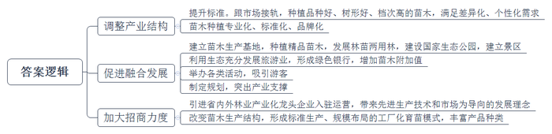
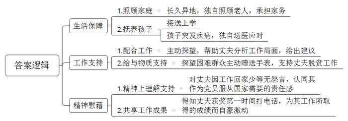
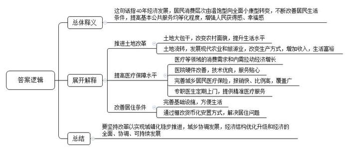

# 2019年河北省普通选调生考试《申论》题

<!-- gwy:overview:start -->
> **河北 · 2019 · 申论 · 选调生** ｜ 4 题 · 图片 4 处 · 答案随题折叠

导航：[题目](#题目) · [材料 1](#材料-1)
<!-- gwy:overview:end -->

> 候选采集稿。参考答案及解析来自粉笔页面，不代表官方答案或真实高分答卷；来源使用许可与原卷对应关系仍需人工核实。

## 给定材料

### 材料 1

材料1

蜿蜒盘旋的山路，生机盎然的苗木，时值初冬的F县罗坝村苗木种植基地，漫山的红枫、桂花和玉兰让人心旷神怡。

有着20年苗木种植经验的老周，从自家5亩责任田起家。如今已是邻里皆知的苗木种植大户，在他的示范带领下，周边村民纷纷斥资种树，投身到荒山种树的大潮中，全镇上万亩荒废的山丘地重新披上绿衣裳，老周说：“当初是为了谋生养家，但种着种着，山绿了，环境好了，生态效益和社会效益接踵而至。”

F县地貌以丘陵为主，传统作物的种植模式很难有起色，收成好的年景只能是解决温饱。穷则思变，改革开放以来F县开始了规模绿化苗木种植，经过多年的发展壮大，全县苗木产业规模已逾33万亩。

老周说，从全国来看，F县是数得上的老苗木产区，不仅品种多，而且规格全，还有一整套苗木培育、种植、销售的队伍。仅他所在的罗坝村，苗木产业最兴盛的那些年，苗木经纪人就多达200人，当时的客户群不仅覆盖全国各地，有的苗木还走出国门，卖到意大利和韩国。在这之前，老周怎么也想不到，看上去并不起眼的苗木，市场就有这么好：“大伙儿站在山包边就把买卖给做了。”

到2013年，全国各地苗木种植纷纷兴起，市场供大于求的情况逐渐凸显，此外，随着城市化建设要求越来越高，市场需求已经不再是过去简单的绿化和美化，彩化和艺化苗木正成为主流，伴随而来的则是苗木行情整体下滑，价格下跌导致苗农收入也跟着大幅度减少，老周深有体会：“像从前那样的传统方式，很难再有市场。”

在F县苗木种植的几十年发展道路中，不少苗农走过弯路、吃过亏。其中最具代表性的难题是，市场需要什么？苗农一窝蜂种植同一个品种，最后导致产品过剩。苗卖不出去不说，大量土地还被占用。最终只能忍痛当柴砍掉。

F县苗木产业的转型升级迫在眉睫。“相比较过去小而全，品种多的状况，苗木种植的专业化、标准化和品牌化才是当下的发展方向。”县林业局李局长说。

“没有市场卖不出去的苗子，只有不符合市场需求的苗子。”李局长的话一针见血。在他看来，换个思维理解市场下滑，就是苗木产业结构的一个调整期，也是提升标准的过渡期。虽然行情不比从前，但标准化种植的苗木市场仍然存在，树冠统一的苗木还是供不应求。“要跟市场接上轨，不仅品种要好，树形要好，档次也要提高，只有符合市场需求的苗木才有出路。”

要转型，怎么转？难题摆在了作为传统苗木大县的F县面前。

“用过去的生态成果来发展旅游产业，形成‘绿色银行’。进一步增加苗木附加值。”在县委金书记看来，这不失为一条打破僵局的路子。2015年，F县以规划引领乡村振兴，突出产业支撑，走出了一条“一产三产融合”的发展路径。

产业兴才能乡村兴，经济强才能人气旺。“十八大以来党中央提出新发展理念。产业兴旺是农业农村发展的物质基础，是促进农民脱贫增收，生活富裕的保障，也是汇聚人财物支撑乡村振兴的原动力。”金书记的一席话，道出了苗木产业转型的必要性。

登上位于F县官亭林海的观景台，放眼望去，五彩斑斓的苗木尽收眼底，这里是国家生态公园，也是国家4A级旅游景区。6万多亩的苗木基地辐射周边5个村，目前拥有各类精品苗木100余种。全县7个乡镇，通过这几年发展林苗两用林，不仅营造了良好的生态环境，同时也提高了土地资源利用率和产出率。

“环境美了，生态好了，游客来了，人气越来越旺。”看到官亭林海的变化，县外宣办王主任感慨道。这两年，举办的观花节、采摘节、旅游节，一天就来好几千人。通过一产带动搞活三产，让当地百姓实实在在受惠。

从民间自发种植到引进企业入驻运营，如今的F县通过加大林业招商力度，引进了省内外30多家林业产业化龙头企业。

先进的生产技术和市场为导向的发展理念，潜移默化地影响并改进了F县原有的苗木生产结构，标准生产、规模布局的工厂化育苗新模式正在逐渐形成。产品涵盖观赏绿化苗、经果林苗、用材苗、花卉、盆景和草坪地被等六大类400多个品种，年销售苗木7亿多株，交易额40多亿元。

如今，苗农们尝到了转型发展的甜头，市场份额没少，赚到的钱更多。最为关键的是，通过产业结构及时调整，激发了苗农的种植热情，促进了苗木产业的发展。去年，老周所在的罗坝村人均收入高达26400元。

### 材料 2

材料2

2015年，39岁的李民被派驻到大山深处的林沟村担任第一书记。今年春节，李民仍然驻在村里。“村里的事太多了，回不去。”怀着内疚的心情，李民给妻子和8岁的孩子虎子写了一封家信，以下就是这封信。

亲爱的老婆、孩子：

刚起个头，我竟然不知道从何说起。脑子里一闪而过的是4年前我出发到林沟村任第一书记，你们站在门口送我的场景。当时我对你们说：“离得也不远，就两百来公里路，我会经常回家的。”

尽管我这么说，但我记得你眼中闪烁的泪花。我们都清楚地知道，两百多公里的距离，我不可能经常回家。大多数时间，你将独自面对常年身体不好的老人，孩子上学接送和干不完的家务，况且还要工作。你说，我们都是党员，当国家需要时，只能上。这句话给我多少底气！

到村之后才发现，林沟是典型的贫困村。从镇上到村里还得近一个钟头的山路，且是那种勉强能通过一辆三轮车的土路。第二年春天，你们来看我，沟里漫山遍野的山花正长得疯狂，小虎子开心地追着蝴蝶跑。可他不知道，这是我要经常走过的路，碰上下雨天还时常塌方。走在泥泞的路上，你帮我分析如何打开工作局面，建议我从修路做起。我来之后的头等大事，就是把这条路给弄好。在镇里的帮助支持下，这条路终于得到拓宽硬化。村民们从镇上回村的时间缩短到20分钟。现在，我喜欢徒步进村。踩在结实又平整的马路上，觉得很有成就感。

我还想到，你们下次来，我们一家人会一块沿着这条路回村，你的脸上也将充满着自豪。

你们一定能理解我这种心情，对吧？记得有很多次，我很晚才给你们打电话，那是因为村里那段时间太忙了，白天要弄我的“林沟乡村之声”，把林沟的新鲜事、老百姓爱听的戏曲、县里的新闻和国家大事做成广播节目，在村头的大喇叭上播放。晚上，我还要入户走访，了解村民最近牛养得怎么样、水龙头有没有冻住、家中病人身体有没有好转。不久前，当你从电视上看到：林沟村通过发展养殖产业，贫困户人均收入达3800元，实现了整村摘帽脱贫。我荣获2018年S省脱贫攻坚贡献奖的新闻后，高兴地第一时间给我电话，我仿佛看到了在电话那头比我还激动的你。

你们还记得村里的五保户周大爷吗？我带着你们去看过他。他75岁的年纪，家里就他一个人，身体也一直不好。有一次我们去他家，他问我几点了，盯着我的表一直看。抬头一看，才发现他家连个挂钟都没有。出门前，你把我的表摘下来送给他了。我记得周大爷一边摆手连声说不要，一边又露出羡慕的表情，这对我触动特别大。除了同情，还有深深的自责，我所在的村子，竟然还有人连看时间都是奢望。

从那以后，我更加努力工作。你们肯定能看得出来，因为我回家次数更少了。无数个夜晚，我给你们打电话，你低着声音对我说：“虎子已经睡了，明天再说吧。”

上个月，虎子半夜高烧40摄氏度，严重到手脚抽搐。你一个人六神无主，慌乱中给我打电话，却没打通。无奈之下，你打120把孩子紧急送到医院。直到第二天，我才知道这件事，隔着电话，我都能感受到你的无助。

你知道，我本来是一个很爱说笑的人，但自从来了林沟，我变得像这个大山里的人一样内敛。借这个机会，我想给你们补上一句心里话，这是我一直欠你们的：“老婆、虎子，我非常对不起你们！”

4年了，我的车去的时候是4.8万公里数，现在是20多万公里数。我习惯了蹲在村头吃一碗简单的粉条和土豆烩菜，也习惯了坐在冬暖夏凉的窑洞里，和大家用当地话拉一拉家常。你觉得我“还沾(行)吗？”

虎子期末考试的成绩不错，我挺高兴的。他一直吵着让我带他去长隆野生动物园玩，可我一直没有时间。等过完年，我就能回去了。那时，一定要在开学前带他出去转转，兑现一个父亲的承诺。

我想告诉你们：我爱你们，谢谢你们的理解与支持！

### 材料 3

材料3

丰收时节，沉甸甸的稻谷被阳光涂上一层金黄，喜悦写在安徽省凤阳县小岗村人脸上。40年前，在这个小村庄，18个鲜红的手印催生了家庭联产承包责任制，开启了那场波澜壮阔的伟大变革。40年来，小岗村走过了从摁下红手印“大包干”到土地确权颁证领上“红本本”，再到“农村资源变资产，资金变股金，农民变股东”的改革。改革不仅让小岗村的面貌有了天翻地覆的巨变，也让村民的日子越过越红火。

围绕土地做文章，大力发展现代农业和旅游业，不断增加农民获得感，始终是小岗村改革创新的出发点和落脚点。土地确权领证和土地三权分管后，小岗村村民老严把自家土地以入股的方式流转给一家企业。自己留在家里开起了农家乐，全家年收入大幅增长。“村里的一系列改革，真正改到我们心里去了。不管怎么改，老百姓的利益不受损失，改革促进了增产增收，得实惠的还是我们老百姓。”老严说。

一滴水可以反映出太阳的光辉，一户人的命运变化映照着整个国家的沧桑巨变。以改革为动力，我国城镇化建设稳步推进，城乡发展协调性不断增强，经济结构逐步优化升级，经济发展的全面性、协调性和可持续性不断增强。当前，养老、教育、医疗健康等领域的消费需求爆发式增长，内需对我国经济增长的贡献不断提升，成为拉动经济发展的决定性力量。

老洪曾是D县花溪镇的一名乡医，从医46年的他见证了我国医疗保障事业的进步轨迹，也感受着居民养老、医疗需求的增长态势。如今，他珍藏多年的看病“老三样”，体温表、听诊器、血压计，已被彩超、CT机、X光机所代替。随着年纪增长，老洪自己也成了医院的常客。

2018年9月，老洪因冠心病发作，今年第三次住进D县人民医院，尽管经常往医院跑，老洪却很沉得住气，医改带来的花钱少、报销快、技术好、服务贴心，让他从内心深处对去医院看病没那么恐惧。“以前老百姓最怕生病，住上一次院，一年全白干。”日益完善的城乡居民基本医疗保险和大病医疗保险，让老百姓得到了真真正正的实惠。一月后，老洪病情稳定办理出院，家庭医生小杜开着私家车来接老人，“咱一个老农民有了自己的专职医生”是老洪逢人便炫耀的事。杜医生每周都会主动上门为老洪测量血压、指导用药，为老洪建立健康档案，对慢性病进行长期监测，结合实际提供细致精准的医疗服务。

今年春节，N县下沙村村民老何一家热闹的过了乔迁新居后的第一个团圆节，“以前，全家7口人住在老房里，基础设施不齐全，生活非常不方便，亲戚朋友来了都很尴尬，现在家里宽敞了，亲戚朋友过节你来我往，热闹得很呢。”老何说，其实老何家里早就想换大房子，但苦于经济压力无法实现，现在政府棚改政策好，通过棚改货币化安置方式，老何告别了生活数十年的老房子，住进了新小区，圆了他的新居梦。在N县，像老何这样因棚户区改造工程获益的群众共有1177户。

40年来，随着我国居民消费层次由温饱型向全面小康型转变，居民生活条件不断改善，基本公共服务均等化程度不断提高，人民获得感、幸福感明显增强。40年来经济的发展，在点滴的民生改善中，找到了生动而深刻的注脚。从医疗到住房，再到生活中的方方面面。幸福花开的故事生动地写进了人民心间。

### 材料 4

材料4

2018年4月22日，在首届“数字中国”建设成果展览会上，青岛市民刘女士领取到了国家人社部签出的首张电子社保卡。在接下来的短短几个月里，电子社保卡迅速普及，丽水、福州、新余、九江、广州、南宁、海口等多地群众陆续申领到电子社保卡。

成都市民王女士得知这一消息后，马上掏出手机进行申领。“把社保卡‘放进’手机，只需几十秒，简单的很！比如，从支付宝里点击‘城市服务’，选择所在城市，通过‘刷脸’认证就行了。以后办理相关社保业务，忘带社保卡，用手机扫码也能办。”据了解，为让群众“少跑腿，好办事”，电子社保卡申领渠道丰富多元，不仅包含各地人社部门官方APP、各地政务服务APP、还有社保卡发卡银行APP、支付宝、微信、平安一账通、云闪付等社会渠道APP，持卡人可自愿选择申领渠道。

工作人员介绍，电子社保卡有两种表现形式，一是手机端显示电子社保卡二维码，用于信息系统识别人员身份、缴费结算、办理业务，二是手机端显示的与实体卡一致的电子社保卡信息，用于人工核对并办理业务。

目前，全国统一的电子社保卡已经在26个省份、230个城市发放。随着一个又一个的城市被“点亮”，“电子社保卡地图”上星光熠熠，“一部智能机走天下”的梦想照进了更多人的日常生活之中。

“党的十八大明确提出了加快建立覆盖城乡居民的社会保障体系，十八大以来，社会保障工作的各个方面都在加紧推进。着眼群众需求、回应社会关切、不断简化优化办事流程、提升公共服务信息化水平，是移动互联网‘助力’人社服务的缩影。”工作人员说，“我们积极拥抱移动互联网、大数据和云计算，充分满足群众诉求，建立了全国社保卡服务平台，迎来了电子社保卡，开启了‘人社移动服务’新时代。”

电子社保卡以实体社保卡为基础，与实体社保卡“一一对应”，是社保卡线上应用的有效凭证。部分先行地区通过多项民生服务精准发力，让这张“无形卡”发挥出“大能量”。

南宁市将电子社保卡融入“智慧城市”建设，持卡人仅需提供电子社保卡二维码即可出入公园、图书馆、博物馆等市民公共场所，实现“一码通城”。宁夏自治区、西宁市、潮州市等地区结合电子社保卡开展医保移动支付相关业务，持卡人在药店出示电子社保卡二维码，便可就医购药，用卡体验大幅提升。青岛市推出“电子时间银行”这一创新应用，为志愿者提供长期可靠的记录管理和通存通兑功能，践行了社保“记录一生、保障一生、服务一生”的承诺。此外，还有更多城市通过电子社保卡开通了就医服务功能，就医时出示手机端电子社保卡，看病后不用排队就可直接线上缴费支付。

电子社保卡全面推进应用的同时，各地人社部门不断加强基础支撑平台建设，“互联网+人社”服务矩阵建设，社保卡金融功能应用，对外协同服务平台建设等，电子社保卡应用将在实体社保卡应用基础上，进一步发挥其身份认证、缴费结算、业务办理的重要作用。

展望未来，查询社保权益记录、办理待遇资格认证、就医购药支付结算、办理参保缴费等功能也会相继上线，电子社保卡还将逐步嵌入到各地政务服务、智慧城市、金融服务等应用场景。

今年年初，福州市民曾女士因为流行性感冒来到药店，从走进药店，到付款完毕，只用不到10分钟，“以前忘带社保卡又急着买药就多花不少钱，现在，动动指尖，省时省心。”她告诉记者，领取电子社保卡以来，自己买药都是靠“扫码”，每次结算都很顺利，“在我的推荐下，电子社保卡已成为身边亲戚同事们的‘标配’。”

有关工作人员表示，电子社保卡以实体社保卡安全体系为基础，结合电子认证、人工智能等互联网安全技术手段，构建了网络与持卡人之间的有效连接，从而确保“实人、实名、实卡”，用电子社保卡在手机端查询信息、办理业务时，借助在线认证、密码验证、人脸识别、风险控制等多种认证方式，能够确保“是我办事”“是我查询”，不用担心被冒用、盗刷和信息泄露。

2018年底，全国社保卡持卡人数超过12亿人，覆盖全国88%的人口。下一步，随着电子社保卡的推广普及，社保卡线上线下相融合的应用服务体系将全面建立，置身社保卡多元化服务生态圈中，持卡群众将获得更为广泛、细致、贴心的服务，尽享信息时代的“速度与温情”。

## 题目

### 第 1 题

**给****定资料**1**提到了****F****县在****2013年发展****苗木****产业时遇****到****的困难，请谈****谈****F****县是****如何****破解这一难题的****？****（****30分）**

关联材料：材料 1

作答要求：

要求：准确、全面、有条理，字数不超过400字。

第 1 题 · 答案与解析

**参考答案（粉笔题库参考内容）**

一、调整产业结构。1.提升标准。跟市场接轨，种植品种好、树形好、档次高的苗木，满足差异化、个性化需求；2.苗木种植专业化、标准化、品牌化。

二、促进融合发展。1.建立苗木生产基地，种植精品苗木，发展林苗两用林，建设国家生态公园，建立景区；2.利用生态充分发展旅游业，形成绿色银行，增加苗木附加值；3.举办各类活动，吸引游客；4.制定规划，突出产业支撑。

三、加大招商力度。1.引进省内外林业产业化龙头企业入驻运营，带来先进生产技术和市场为导向的发展理念；2.改变苗木生产结构，形成标准生产、规模布局的工厂化育苗模式，丰富产品种类。

**解析**

**参考答案说明**：答案从“调整产业结构”“促进融合发展”“加大招商力度”等不同方面将对策进行了分条撰写。各条要点之间在内容上是并列关系。

### 第 2 题

**给定资料**2**讲述了李民在驻村工作期间得到了家人的理解和支持，请归纳这种理解和支持体现在哪些方面？（20分）**

关联材料：材料 2

作答要求：

要求：内容全面，简明准确，条理清晰，不超过200字。

第 2 题 · 答案与解析

**参考答案（粉笔题库参考内容）**

生活保障：1.照顾家庭。长久异地，独自照顾老人，承担家务。2.抚养孩子。接送上学；孩子突发疾病，独自送医应对。

工作支持：1.配合工作。主动探望，帮助丈夫分析工作局面，给出建议。2.给与物质支持。探望困难群众主动赠送手表，支持丈夫脱贫工作。

精神慰藉：1.精神上理解支持。对丈夫因工作回家少等无怨言，认同其作为党员服从国家需要的责任感。2.共享工作成果。得知丈夫获奖第一时间打电话，为其工作所取得的成绩而自豪激动。

**解析**

**参考答案说明**：本参考答案从“生活保障”“工作支持”“精神慰藉”三个方面介绍了李民家人对他工作的理解和支持。各条答案要点之间在内容上相互并列，没有交叉。

### 第 3 题

**给定资料**3**中提到“40年来经济的发展，在点滴的民生改善中，找到了生动而深刻的注脚”，请根据给定资料**3**谈谈你对这句话的理解。（20分）**

关联材料：材料 3

作答要求：

要求：紧扣资料、分析透彻、条理清晰，不超过300字。

第 3 题 · 答案与解析

**参考答案（粉笔题库参考内容）**

这句话指40年经济发展，居民消费层次由温饱型向全面小康型转变，不断改善居民生活条件，提高基本公共服务均等化程度，增强人民获得感、幸福感。

推进土地改革。土地大包干，改变农村面貌，提升生活水平；土地流转，发展现代农业和旅游业，改变生产方式，增加收入，生活富裕。

提高医疗保障水平。医疗等领域的消费需求和内需拉动经济增长；医院硬件改善，技术优良，服务贴心；完善城乡居民医疗保险，报销快、比例高，覆盖广；专职医生定期上门，提供精准医疗服务。

改善居住条件。完善基础设施，方便生活；通过棚改货币化安置方式，解决居住问题。

要坚持改革以实现城镇化稳步推进，城乡协调发展，经济结构优化升级和经济的全面、协调、可持续发展。

**解析**

**参考答案说明：**（1）思路方面，本参考答案按照词句解释题“总体释义+展开解释+总结”的一般答题思路展开。（2）内容方面，本参考答案先解释了画线句的总体含义；接着“展开解释”部分从“推进土地改革”“提高医疗保障水平”“改善居住条件”三个方面展开，最后进行了总结。。

### 第 4 题

**假设你是某市人社部门的工作人员，需要进社区向群众推广电子社保卡。请结合给定资料**4**，****草拟一份介绍电子社保卡的宣传稿。（****30分）**

关联材料：材料 4

作答要求：

要求：

（1）紧扣资料，内容完整；

（2）条理清晰，语言准确；

（3）字数在500～600字。

第 4 题 · 答案与解析

**参考答案（粉笔题库参考内容）**

办理电子社保卡，助推生活智能化

各位居民朋友：

电子社保卡由人社部签发，与实体社保卡对应，是社保卡线上应用的有效凭证，具体形式有手机端显示电子社保卡二维码和社保卡信息。它着眼群众需求，回应社会关切，是简化流程，提升公共服务水平的体现，主要优点有：

一、全国统一，使用范围广泛。已在26个省份、230个城市发放，让“一部智能机走天下”成为现实。

二、功能丰富。融入智慧城市，实现“一码通城”；开展医保移动支付，扫码就医购药，省时省心；利用“电子时间银行”应用提供记录管理和通存通兑功能；未来还会有更多功能和应用场景，通过平台建设，进一步发挥其身份认证、缴费结算、业务办理作用。

三、申领方式便捷化、多元化。用手机即可申领，刷脸认证；可通过官方APP和支付宝等社会渠道APP自愿申领。

四、信息保障安全化。将实体卡安全体系和互联网安全技术手段结合，采用多种认证方式，不用担心被冒用、盗刷和信息泄露。

随着电子社保卡的推广普及，线上线下相融合的应用服务体系将全面建立，持卡群众将获得更为广泛、细致、贴心的服务，办理即可尽享信息时代的“速度与温情”。

XX市人社局

XXXX年XX月XX日

**解析**

**参考答案说明**：（1）格式方面，本参考答案写到了“标题”“称谓”“正文”“落款”四个部分。（2）正文部分，一方面从内容来看，围绕着“电子社保卡”这一主题，本参考答案的开头写到了电子社保卡相关背景、带来的意义等；主体部分从“全国统一，使用范围广泛”“功能丰富”“申领方式便捷化、多元化”“信息保障安全化”等几个方面给出了电子社保卡的优点；结尾进行呼吁号召。另一方面，形式上，本参考答案做到了分段、分条撰写，整体上条理较为清晰。

