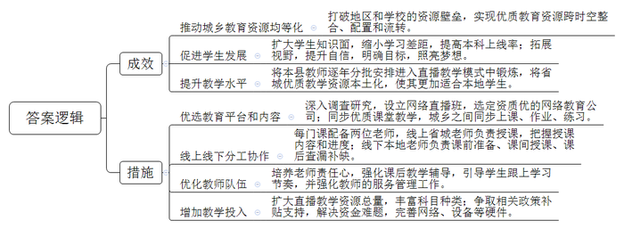
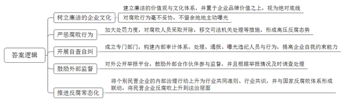
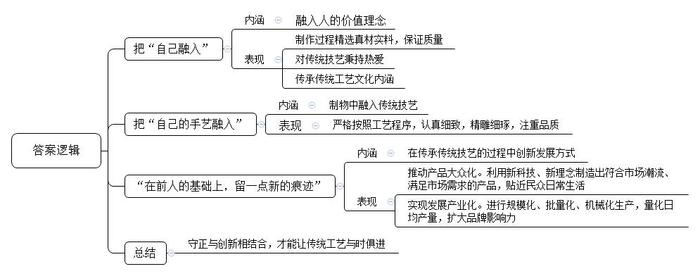

# 2020年0822公务员多省联考《申论》题（河北县级卷）

> 候选采集稿。参考答案及解析来自粉笔页面，不代表官方答案或真实高分答卷；来源使用许可与原卷对应关系仍需人工核实。

## 给定材料

### 材料 material-c47ed708f9fd187a

L县是国家级贫困县，过去师资力量和办学条件整体比较落后。L县一中是该县的重点中学，高考成绩却不是很理想。“其实我们的孩子都很想学，也很勤奋，但总体成绩就是不如大城市的孩子。”L县一中吴校长说，“每当在电视、网络上看到大城市优越的教学条件，孩子们都梦想着能接受和大城市同龄人一样的教育，进行公平的竞争。”

随着国家对教育公平的重视和教育信息化大潮的推动，同时得益于近几年脱贫攻坚进程的加快，L县一中的软硬件条件如今都得到了较大提升。L县教育局经过反复调查研究，决定在L县一中设立网络直播班，选定一家资质较好的网络教育公司，同步直播省城重点中学七中老师的课堂教学，学生跟着省城七中的同学同步上课、同步作业、同步练习。在网络直播课程中，每门课都有线上线下两位老师，线上的是省城七中的老师，负责课堂授课，授课内容和进度也都以省城七中为准。线下的是L县一中的老师，他们除了课前准备、课间讲授，还需要在课后和没有跟上的同学一起查漏补缺。

罗同学是L县一中的高三学生，他对自己刚接触网络直播课程时的情形记忆犹新。“刚开始接触直播教学，那边的教学特点就是密度大，知识面覆盖广。有些不适应，感觉差距还是比较大。”罗同学说，“这种教学模式就像是6门学科有了12名指导老师，他们那边问什么我们就回答什么，一开始觉得有点儿怪，慢慢发现你答的跟那边也差不多，你会发现已经跟上那个课堂了，当时还是有点兴奋，自信心也上来了。”

网络直播班班主任杨老师认为，新的教学模式除了带来成绩上的提高，更多的是给了学生参照和动力。“他们会觉得在追梦的路上自己和省城七中的同学享有了均等的机会，剩下的就看自己的奋斗了。”

从三年前最初引入一个班试点，逐渐发展到现在15个网络直播班700多名学生上课，越来越多的学生参与到了网络直播教学中。对网络直播班的教学效果，L县教育局王局长介绍说，“今年高考成绩发布后，网络直播班本科上线率达到了93%，一本上线率达到了59%。虽然这个功劳并不能只归功于网络直播课程，但毫无疑问，网络直播课程在很大程度上带来了积极改变。”

对网络直播课程的效果，何同学有另外的感受。她也是L县一中网络直播班的学生，去年毕业考入了一所名牌大学。回忆在网络直播班学习的经历，她说，“要说高考增加多少分，可能不是特别明显。但是从省城七中师生身上我学到了很多东西，也打开了我的视野，让我有了清晰的目标，考一个什么样的大学，想去什么样的地方。这好像是一道光，它照亮了我的梦想，让梦想变得明亮清晰。”

网络直播授课的模式是互联网+教育的产物，在一定程度上打破了地区和学校之间的资源壁垒，实现了优质教育资源跨时空整合、配置和流转。吴校长认为这对教师来说也是锻炼和学习的机会，“我们的教师逐年分批地进入这种教学模式里锻炼，并且把省城七中的资源本土化，让它更适合我们自己的学生。在这个过程中，我们教师的教学水平也得到了提升。”但吴校长还认为，“技术和模式都有一定的局限性，关键还在于教师。L县一中网络直播课程为什么效果好，是因为对课堂教学没跟上的学生，本地教师课后会再进行教学辅导。这些教师非常累，他们上直播班的工作量，是上普通班工作量的三倍，很多教师还要连续加班带晚自习。这对教师的责任心是一个考验，也对教师队伍的管理服务工作提出了挑战。”

对于网络直播教学模式能否大规模推广，惠及更多学生，王局长坦言，“目前还存在很多困难。网络直播教学的资源总量还是很有限，主要集中在语文、数学和英语课上，还有很多课程没有实现资源共享。即便如此，一个网络直播班的费用平均一年也要七万元左右。如果覆盖到乡村，还要铺设网络、增添设备，支出就更大了。不过，只要能切切实实帮助到孩子们，我们还是要想办法去做。”

### 材料 material-70a9d51a925f3530

7月17日凌晨，S公司总裁张总发布一条朋友圈，写道：“公司里有些部门有了权力，不是为客户服务，而是变成寻租的工具，这完全违背公司的基本价值观和文化，要用最锋利的刀子将这些腐烂的肉切掉。”就在同一天另一家民营企业的三名高管因涉嫌非国家工作人员受贿罪，被警方刑事拘留。该公司还披露过一组反腐数据：2018年，公司内部共调查经济类刑事案件2起，移送公安机关查处8人。

提到企业反腐，人们往往会想到国企，而忽略了民企。有人以为，民企都是私人的钱财，因此不存在腐败问题，这是一种误解。虽然民企属于私人所有，但从没脱离社会，必然与企业外部的社会组织和个人发生各种各样的关系，因此企业的行为并不完全是私人性质的活动。特别是在规模较大的民营企业中，所有权往往与经营管理权处于分离状态，一些经营管理人员受个人私欲及社会不良风气影响，在工程建设、物资采购、业务外包等环节挪用资金、贪污钱款、收受贿赂等现象时有发生，既损害了企业利益，也败坏了社会风气。客观地说，中国的民营企业尚处于发展的初级阶段，内部的管理制度和监督机制还不够完善，经营管理人员的法治观念和自我约束能力在整体上也不如国家公务员，因此在面对诱惑时需要更强的辨析是非的能力。事实上，如果对民营企业腐败问题听之任之，必将蔓延到其他领域，形成对社会环境的污染。

令人欣慰的是，越是处于行业领先、高速发展、且富有雄心的民营企业，越是在内部风险治理上毫不妥协、高调且干脆。这些企业不留余地地主动公开腐败行为，建立与廉洁相匹配的价值观与文化体系，将其置于企业品牌价值之上，视为绝对底线。某著名的民营上市公司在2018年一口气开除了45个企业腐败的人员，其中16个被移送司法机关，该公司内部通告：“今天以公开信的方式晒一晒我们内部光鲜亮丽外表下丑陋的一面。”考虑到“家丑不可外扬”的传统，企业融资、品牌管理等现实利益，一家公司能够对内公开说出这样的话需要多大的勇气？另一家互联网公司也不含糊，在收到举报后迅速行动，55人被查。不得不说，这种公开处理本身意味着底气，也是一种态度。2018年6月，某贸易公司成立了审计部，内部干脆称之为“廉政公署”，开展自查自纠。这个“廉政公署”近一年来已多次处理、通报、曝光违纪人员。该公司甚至对外公开了举报平台，鼓励外部合作伙伴参与监督。

有关专家认为，民企反腐败正逐渐从个别民营企业的内部治理行动上升为行业共同准则，乃至所有民营企业的一种共识，这种共识有可能带来行业治理的转折，并推动整个社会风气转变。企业人即社会人，人们历来倾向认为，投资、财务和管理相对自由的民企，处事更为“灵活”，至于这种“灵活”是否同样反映出企业内部权力寻租的可能性，人们很少予以深刻的反省，更谈不上应对和解决。然而，民营企业提供了80%的就业岗位，内部廉洁制度的建立和完善，天然就是社会治理的一部分，这与政府提倡的构建亲清的政商关系相辅相成。在高压反腐态势下，民企的反腐不能只是“一阵风”，而应成为常态，要与国家反腐败体系形成联动，设立民营经济领域反腐败法律法规，将民营企业反腐败上升到法治层面。中国民营企业自我反腐准则的形成，其中的意义不言而喻。说到底，视廉洁为生命的公司，才更有资格谈未来。

### 材料 material-9423ef871e522e1a

总面积不过八平方米的店铺，摆满货品之后，两人在店内走动都有些困难，但这家小店在当地却是小有名气的老字号。69岁的店主老林是资深木雕艺人，更被称为“最后的手工酸枝筷子传人”。手工木筷取材自缅甸坤甸木、老挝大红酸枝、泰国乌梅木、印度小叶紫檀和海南黄花梨这五种木材。其中，缅甸坤甸木筷最实惠，乌梅木筷和酸枝木筷最受欢迎，而海南黄花梨木筷因为材料稀缺，必须提前预订，属于收藏品级别。

老林家的店铺是他爷爷在1889年创立的，解放后曾一度关门歇业，到1991年又重新开业。近年来各行各业飞速发展，市场化程度越来越高，但老林对这门家族生意和手艺有着自己的坚持，多年来一直拒绝大批量生产，执着地手工制作每一双筷子。这些年来，不断有人想和他合作，希望形成规模生产，都被他一口回绝了。“钱多了就会想要更多，永远没有止境。”在老林看来，手工制筷工序复杂，没有捷径可走，每道工序都要求严格，稍有不慎，筷子就会走样。一双好筷，真正检验它的只有漫长的时间。做手艺，做生意，必须沉下心来，慢工出细活，而只要工艺精湛，总会有人来购买。正因如此，林家小店始终有一批熟客，“别人要做大做强，那是他们的事，我偏要做小做精，走个性化、精品化的路线。”

林家生产筷子的小作坊现在共有10多个工人，当中不少是跟随了老林20多年的老师傅。每一双筷子都经手工打磨，日均产量也难有标准数字，一天下来，大约能制成40多捆筷子。老林说：“本地早就没有人做手工筷子了，放眼全国，也没几个人坚持手工制作一双小小的筷子，基本都是机械化生产。”

去年开始，家族生意已由老林唯一的女儿小林接手。面对自家的木筷生意，小林有自己的想法。她认为：“人在制物的过程中，总是要把自己和自己的手艺融到里头去，在前人的基础上，留一点新的痕迹，这样这门手艺才能历久弥新。”但像自家这样的老字号要走出困境需要考虑的不仅仅是手艺传承的问题，更重要的是如何生存和发展。

在小林看来，受原材料、制造技艺、生产工时等各种主客观条件的限制，传统手工艺制品已经与奢侈品无异。老手艺在传承的过程中一成不变，走精品化的路线，就会脱离生活，远离人们生活的需要。老字号的道路也只会越走越窄，结果可想而知。自家老字号一方面要严格、严谨地按照传统的技艺进行生产，注重细节、品质，注重老手艺所蕴含的文化内涵的传承；另一方面也要注重新科技、新理念的运用，制造出更多符合当下潮流、迎合市场需要的产品，让“林家筷子”走进人们日常的生活。小林说：“扩大规模，批量生产，让更多的人了解、使用我们的‘林家筷子’，才是最终出路。也只有生意发展了、壮大了，我们才能有更好的条件制作出更多的精品。我要做的就是把自家生意做大做强，走大众化、产业化的路线。”

两代人经营理念的对接，或许还需要一些时日，不过，父女俩坚守传统手艺的初心一致。时代变迁自有节奏，但守正与创新本就是“林家筷子”这样的老字号突围的题中应有之义。

## 题目

### 第 1 题

**根据给定资料**1**，总结L县网络直播教学的成效，并提出在全县推广的主要措施。****（****25分****）**

关联材料：材料 material-c47ed708f9fd187a

作答要求：

要求：

（1）内容全面，切实可行，条理清晰；

（2）不超过400字。

### 第 2 题

**根据给定资料**2**，概括民营企业反腐的举措。****（****20分****）**

关联材料：材料 material-70a9d51a925f3530

作答要求：

要求：

（1）内容全面，概括准确，条理清晰；

（2）不超过300字。

### 第 3 题

**给定资料**3**中划线句子写道：“人在制物的过程中，总是要把自己和自己的手艺融到里****头去，在前人的基础上，留一点新的痕迹，这样这门手艺才能历久弥新****”，根据给定资料**3**，****谈谈你对这句话的理解。（****15分****）**

关联材料：材料 material-9423ef871e522e1a

作答要求：

要求：

（1）理解全面，分析透彻，条理清晰；

（2）不超过300字。

### 第 4 题

**给定资料**5**中写道：“一个经济体的底气，既要看眼前静态的****‘****形****’****，更要看长远发展的****‘势’”，根据你对这句话的理解，自选角度，自拟题目，联系实际，写一篇议论文章。（****40****分）**

关联材料：材料 material-c47ed708f9fd187a

作答要求：

要求：

（1）观点鲜明，论证充分，思路清晰，表达有力；

（2）参考给定资料，但不拘泥于给定资料；

（3）不少于1000字。

## 答案与解析

第 1 题

**参考答案（粉笔题库参考内容）**

参考答案一：

成效：

1.推动城乡教育资源均等化。打破地区和学校的资源壁垒，实现优质教育资源跨时空整合、配置和流转。

2.促进学生发展。扩大学生知识面，缩小学习差距，提高本科上线率；拓展视野，提升自信，明确目标，照亮梦想。

3.提升教学水平。将本县教师逐年分批安排进入直播教学模式中锻炼，将省城优质教学资源本土化，使其更加适合本地学生。

措施：

1.优选教育平台和内容。深入调查研究，设立网络直播班，选定资质优的网络教育公司；同步优质课堂教学，城乡之间同步上课、作业、练习。

2.线上线下分工协作。每门课配备两位老师，线上省城老师负责授课，把握授课内容和进度；线下本地老师负责课前准备、课间授课、课后查漏补缺。

3.优化教师队伍。培养老师责任心，强化课后教学辅导，引导学生跟上学习节奏，并强化教师的服务管理工作。

4.增加教学投入。扩大直播教学资源总量，丰富科目种类；争取相关政策补贴支持，解决资金难题，完善网络、设备等硬件。

**解析**

**参考答案说明：**本参考答案首先将答案按照“成效”“措施”分为两个部分，其次在“成效”方面，从“推动城乡教育资源均等化”“促进学生发展”“提升教学水平”三个方面进行了分条撰写；在“措施”方面，又从“优选教育平台和内容”“线上线下分工协作”“优化教师队伍”“增加教学投入”等四个方面进行了分条撰写。各条要点之间在内容上相互并列，没有交叉。

参考答案二：

成效：

1.推动城乡教育资源均等化。打破地区和学校的资源壁垒，实现优质教育资源跨时空整合、配置和流转。

2.促进学生发展。扩大学生知识面，缩小学习差距，提高本科上线率；拓展视野，提升自信，明确目标，照亮梦想。

3.提升教学水平。将本县教师逐年分批安排进入直播教学模式中锻炼，将省城优质教学资源本土化，使其更加适合本地学生。

措施：

1.增加教学资源投入。与重点中学合作，直播优质课堂内容；拓宽合作渠道，丰富课程科目类别；争取相关政策补贴支持，解决资金难题，完善网络、设备等硬件。

2.确定教学模式。配备线上线下两位老师，线上老师负责授课，把握授课内容和进度；线下老师负责课后工作，帮助学生查缺补漏；线上线下同步上课、作业、练习；做好预热工作，帮助学生快速适应。

3.加强教师队伍保障。充实教师队伍，保障教师加班福利，增强教师责任心，对教师队伍管理服务。

4.引导学生自律。强化教育引导；利用技术手段加强防控，避免学生沉迷网络游戏。

**考点**：考点多要素组合类

**来源**：来源2020年0822公务员多省联考《申论》题（河北县级卷）

粉笔申论页面对本题只提供「解析视频」入口，该入口是会员推广位，页面无视频地址与文字解析。

第 2 题

**参考答案（粉笔题库参考内容）**

1.树立廉洁的企业文化。建立廉洁的价值观与文化体系，并置于企业品牌价值之上，视为绝对底线；对腐败行为毫不妥协，不留余地地主动曝光。

2.严惩腐败行为。加大处罚力度，对腐败人员采取开除，移交司法机关处理等措施，形成高压反腐态势。

3.开展自查自纠。成立专门部门，构建内部审计体系，处理、通报、曝光违纪人员与行为，提高企业自我约束能力。

4.鼓励外部监督。对外公开举报平台，鼓励外部合作伙伴参与监督，并且根据举报情况及时调查处理。

总之，应推进反腐常态化。将个别民营企业的内部治理行动上升为行业共同准则、行业共识，并与国家反腐败体系形成联动，将民营企业反腐败上升到法治层面。

**解析**

**参考答案说明：**本参考答案先是从“树立廉洁的企业文化”“严惩腐败行为”“开展自查自纠”“鼓励外部监督”这四个方面展开，后从“推进反腐常态化”方面给出建议；其次对每个经验进行概括时，将总结性的信息前置，要点更为清晰，明确。

**考点**：考点概括措施类

**来源**：来源2020年0822公务员多省联考《申论》题（河北县级卷）

粉笔申论页面对本题只提供「解析视频」入口，该入口是会员推广位，页面无视频地址与文字解析。

第 3 题

**参考答案（粉笔题库参考内容）**

一、把“自己融入”指融入人的价值理念。制作过程精选真材实料，保证质量；对传统技艺秉持热爱；传承传统工艺文化内涵。

二、把“自己的手艺融入”指制物中融入传统技艺。严格按照工艺程序，认真细致，精雕细琢，注重品质。

三、“在前人的基础上，留一点新的痕迹”指的是在传承传统技艺的过程中创新发展方式。1.推动产品大众化。利用新科技、新理念制造出符合市场潮流、满足市场需求的产品，贴近民众日常生活。2.实现发展产业化。进行规模化、批量化、机械化生产，量化日均产量，扩大品牌影响力。

四、因此，守正与创新相结合，才能让传统工艺与时俱进。

**解析**

**参考答案说明：**（1）思路方面，本参考答案按照词句解释题“总体释义+展开解释+总结”的一般答题思路展开。（2）内容方面，本参考答案先分别解释了“把自己融入”“把自己的手艺融入”“在前人的基础上，留一点新的痕迹”的内涵，接着分别分析了其具体表现，最后在“总结”部分给出了对策。（3）词句表达方面，本参考答案加上了“因此”等连接词来承接上下文。

**考点**：考点词句解释类

**来源**：来源2020年0822公务员多省联考《申论》题（河北县级卷）

粉笔申论页面对本题只提供「解析视频」入口，该入口是会员推广位，页面无视频地址与文字解析。

第 4 题

**参考答案（粉笔题库参考内容）**

**“经济”自信，用创新兼顾眼前与长远**

在这片充满希望的田野上，大有可为的热土上，发展始终是每个时代的关键词，而经济则是衡量发展水平的重要指标，是一切发展的基础与保障。大数据、物联网、云计算，人脸识别、在线支付……，我们曾经期待的，渴望的，都照进了现实。经济结构的优化转型，综合国力的增强提升……这些都在向全世界昭示着我国经济“乘长风，破万里浪”的汹涌气势。但国际发展时局瞬息万变，我国经济发展也面临新的挑战与困境。想突破重重阻碍，赢得经济发展的主动权，树立经济自信，要善于着眼当下的时局，看到眼前静态的“形”，更要心系长远的未来，勇于开拓创新，蓄势谋势、求变应变，抓住长远发展的“势”。

40多年的风云变幻，一代又一代人的使命背后，依靠的是我们“拔地而起”的优势，不仅包含雄厚的经济、科研、人才等多方面的积累，亦包括走在前端的、发达的移动互联网，特别是党和政府提供的宽松的、优良的政治环境。但是，一代人的安于现状、固步自封，就会让我们在时代变迁中，固化思维、困住手脚，难以实现持续发展。

因此，**经济发展要心系长远未来，充分利用中国人民创新的文化基因，达成文化共识，树立文化自信，这是让经济体有底气、有信心的基础**。一直以来，我国都有着创新的历史和文化基因：在古代，四大发明对世界文明发展进程产生了重要影响；在今天，高速铁路、扫码支付、共享单车和网络购物改变了人们的生活方式，提高人们的生活质量，被外国友人评选为中国的“新四大发明”……这些都是中国人民积极创新的生动体现。中华优秀文化积淀着中华民族最深沉的精神追求，也为中华儿女不断创新提供丰厚滋养。新时期，更应发扬创新传统，将中华优秀文化创造性转化，以文化创新增强经济自信。

**经济发展在长远未来中还要注重技术进步和产业变革，不断更新创新内容，在变革中催生新产业、新业态、新模式，这是让经济体有底气、有信心的保障**。“风物长宜放眼量”，创新是百年大计。近年来，在全球范围内出现了一系列有重大影响、颠覆性的新兴技术，这些技术互相交叉、融合、渗透，以人工智能为代表的新技术革命正在孕育中，这也是经济发展的引擎。在促进经济发展的同时，改变人们的思维，拓宽人们的视野，不断催生新的发展模式，让发展生生不息，让经济持续突破。

**经济发展在长远未来中亦需要树立结果导向，紧跟用户、市场需求，催生企业对生产、商业的创新，实现产品智能化升级，这是让经济体有底气、有信心的方向**。“顾客就是上帝”，满足用户需求是市场得以永续发展的关键要素；关注用户需求，重视用户体验，掌握用户在使用产品时的心理感受，是产品更新换代、推陈出新的必经阶段。用户需求关乎市场需求，或爱不释手，或厌恶至极，或欣喜若狂，或怒不可遏；用户需求就是商机，或稍纵即逝，或旷日持久，或昙花一现，或绵延不绝。因此，有目的、目标地去发展经济，是赢得胜利的保障，是拓展用户、扩大市场的指向标。

“正入万山圈子里，一山放过一山拦。”回望过去，无论中国经济经历多少坎坷风雨，都能一路披荆斩棘、自信满满。只要我们善于积势蓄势谋势，把握眼前的“形”，更勇于识变求变应变，积极开拓创新，看到长远发展的“势”，就会在危机中孕育新机，于变局中广开新局。

**解析**

**文章分析**

**“经济”自信，用创新兼顾眼前与长远**

【**标题的优点**：范文的标题突出了“经济底气（自信）”这一主题，并点明了“创新”这一角度，标题准确、简练。】

在这片充满希望的田野上，大有可为的热土上，（1）发展始终是每个时代的关键词，而经济则是衡量发展水平的重要指标，是一切发展的基础与保障。（2）大数据、物联网、云计算，人脸识别、在线支付……，我们曾经期待的，渴望的，都照进了现实。经济结构的优化转型，综合国力的增强提升……这些都在向全世界昭示着我国经济“乘长风，破万里浪”的汹涌气势。（3）但国际发展时局瞬息万变，我国经济发展也面临新的挑战与困境。想突破重重阻碍，赢得经济发展的主动权，树立经济自信，要善于着眼当下的时局，看到眼前静态的“形”，更要心系长远的未来，勇于开拓创新，蓄势谋势、求变应变，抓住长远发展的“势”。

【**开头的优点**：★内容方面。范文的开头是紧扣题目给定的“经济底气（自信）”这一主题展开的。首先，开头第一句话点出了“经济发展”这一话题，做到了主题明确。其次，对“经济底气（自信）”这一主题进行了分析阐述，指出了：（1）时代背景，（2）经济发展取得的成绩，（3）经济发展面临的问题。注意，以上三个方面的论述是有内在逻辑顺序的：先写“背景”，再写“成绩”，最后写“问题”。★文字表达方面。使用了“但”“要……更要……”等关联词，使语言表达有逻辑性。】

40多年的风云变幻，一代又一代人的使命背后，依靠的是我们“拔地而起”的优势，不仅包含雄厚的经济、科研、人才等多方面的积累，亦包括走在前端的、发达的移动互联网，特别是党和政府提供的宽松的、优良的政治环境。但是，一代人的安于现状、固步自封，就会让我们在时代变迁中，固化思维、困住手脚，难以实现持续发展。

【**过渡段的优点：**范文的过渡段分析了“经济发展取得的成绩”，这也是经济发展眼前静态的“形”。此外，还要注意过渡段末尾的“一代人的安于现状、固步自封，就会让我们在时代变迁中，固化思维、困住手脚，难以实现持续发展”是用来引起下文的过渡句。】

因此，**经济发展要心系长远未来，充分利用中国人民创新的文化基因，达成文化共识，树立文化自信，这是让经济体有底气、有信心的基础**。一直以来，（1）我国都有着创新的历史和文化基因：在古代，四大发明对世界文明发展进程产生了重要影响；在今天，高速铁路、扫码支付、共享单车和网络购物改变了人们的生活方式，提高人们的生活质量，被外国友人评选为中国的“新四大发明”……这些都是中国人民积极创新的生动体现。（2）中华优秀文化积淀着中华民族最深沉的精神追求，也为中华儿女不断创新提供丰厚滋养。新时期，（3）更应发扬创新传统，将中华优秀文化创造性转化，以文化创新增强经济自信。

【**论述段****1的优点**：★观点句：范文的观点句是紧扣“经济底气（自信）”这一文章主题提出的。形式上，它在段首处直接写出，位置突出，容易被发现；内容上，关键词突出，内容要点明确，可以明显看出它是从“利用中国人民创新的文化基因”的角度入手，指出了如何从长远角度保持经济自信。★论述内容：本段主要围绕“经济底气（自信）”这一主题进行分析阐述，指出了：（1）创新的文化基因的体现，（2）中华优秀文化的重要性，（3）发挥创新传统。注意：以上三个方面的内容都是紧扣观点句“经济发展要心系长远未来，充分利用中国人民创新的文化基因，达成文化共识，树立文化自信，这是让经济体有底气、有信心的基础”进行分析论述的，针对性强、内容层次丰富。最后，在论证方法和论据选取方面，讲道理和举例子相结合，做到了丰富多样。】

**经济发展在长远未来中还要注重技术进步和产业变革，不断更新创新内容，在变革中催生新产业、新业态、新模式，这是让经济体有底气、有信心的保障**。“风物长宜放眼量”，创新是百年大计。近年来，（1）在全球范围内出现了一系列有重大影响、颠覆性的新兴技术，这些技术互相交叉、融合、渗透，以人工智能为代表的新技术革命正在孕育中，这也是经济发展的引擎。（2）在促进经济发展的同时，改变人们的思维，拓宽人们的视野，不断催生新的发展模式，让发展生生不息，让经济持续突破。

【**论述段****2****的优点**：★观点句：范文的观点句是紧扣“经济底气（自信）”这一文章主题提出的。形式上，它在段首处直接写出，位置突出，容易被发现；内容上，关键词突出，内容要点明确，可以明显看出它是从“注重技术进步和产业变革”的角度入手，指出了如何从长远角度保持经济自信。★论述内容：本段主要围绕“经济底气（自信）”这一主题进行分析阐述，指出了：（1）全球技术创新的现状，（2）技术创新的重要性。注意：以上两个方面的内容都是紧扣观点句“经济发展在长远未来中还要注重技术进步和产业变革，不断更新创新内容，在变革中催生新产业、新业态、新模式，这是让经济体有底气、有信心的保障”进行分析论述的，针对性强、内容层次丰富。最后，在论证方法和论据选取方面，以讲道理为主，论述准确、贴切。】

**经济发展在长远未来中亦需要树立结果导向，紧跟用户、市场需求，催生企业对生产、商业的创新，实现产品智能化升级，这是让经济体有底气、有信心的方向**。“顾客就是上帝”，（1）满足用户需求是市场得以永续发展的关键要素；关注用户需求，重视用户体验，掌握用户在使用产品时的心理感受，是产品更新换代、推陈出新的必经阶段。用户需求关乎市场需求，或爱不释手，或厌恶至极，或欣喜若狂，或怒不可遏；用户需求就是商机，或稍纵即逝，或旷日持久，或昙花一现，或绵延不绝。因此，（2）有目的、目标地去发展经济，是赢得胜利的保障，是拓展用户、扩大市场的指向标。

【**论述段****3****的优点**：★观点句：范文的观点句是紧扣“经济底气（自信）”这一文章主题提出的。形式上，它在段首处直接写出，位置突出，容易被发现；内容上，关键词突出，内容要点明确，可以明显看出它是从“紧跟用户、市场需求，实现产品智能化升级”的角度入手，指出了如何从长远角度保持经济自信。★论述内容：本段主要围绕“经济底气（自信）”这一主题进行分析阐述，指出了：（1）满足用户需求的重要性，（2）如何满足用户需求。注意：以上两个方面的内容都是紧扣观点句“经济发展在长远未来中亦需要树立结果导向，紧跟用户、市场需求，催生企业对生产、商业的创新，实现产品智能化升级，这是让经济体有底气、有信心的方向”进行分析论述的，针对性强、内容层次丰富。最后，在论证方法和论据选取方面，以讲道理为主，论述准确、贴切。】

“正入万山圈子里，一山放过一山拦。”回望过去，无论中国经济经历多少坎坷风雨，都能一路披荆斩棘、自信满满。只要我们善于积势蓄势谋势，把握眼前的“形”，更勇于识变求变应变，积极开拓创新，看到长远发展的“势”，就会在危机中孕育新机，于变局中广开新局。

【**结尾的优点**：（1）再次提到了“经济底气（自信）”；（2）展望未来。】

**考点**：考点文章写作题

**来源**：来源2020年0822公务员多省联考《申论》题（河北县级卷）

粉笔申论页面对本题只提供「解析视频」入口，该入口是会员推广位，页面无视频地址与文字解析。

