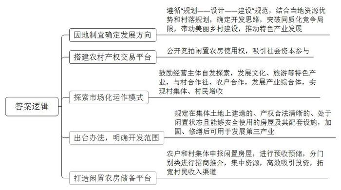
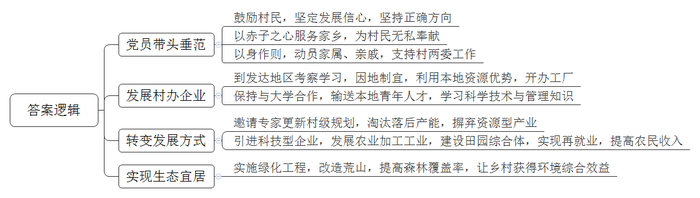
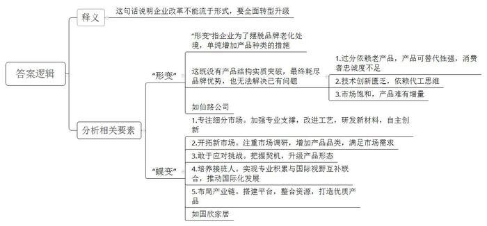
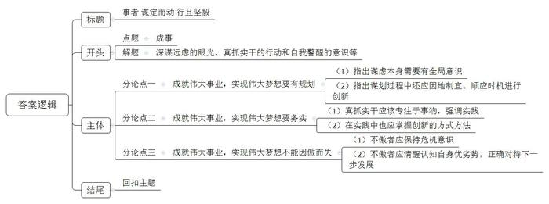

# 2021年公务员多省联考《申论》题（河北县级卷）

<!-- gwy:overview:start -->
> **河北 · 2021 · 申论 · 县级卷** ｜ 4 题 · 图片 4 处 · 答案随题折叠

导航：[题目](#题目)
<!-- gwy:overview:end -->

> 候选采集稿。参考答案及解析来自粉笔页面，不代表官方答案或真实高分答卷；来源使用许可与原卷对应关系仍需人工核实。

## 给定材料

### 材料 material-42dc7ae4c1875d68

近年来，随着城镇化进程加快，一些农村出现不少闲置房屋。2018年以来，Z市不少地方着力探索盘活利用农村闲置房屋发展产业的有效途径和措施，取得良好成效。2021年3月20日，与Z市同省且农房闲置情况基本一致的D市组织调研组到Z市进行调研。

位于东湖镇新泉村的新泉中学，多年前已不再办学，老教学楼被列入闲置农房，有人提议拆掉建住宅，但村两委最终统一意见：拆掉“太可惜”，还是应该盘活利用，壮大村集体经济。东湖镇产茶历史悠久，周边茶农集中，老房子联手茶产业，能发挥盘活利用的效益。确定发展方向为主营茶产业、发展茶文化后，村里通过镇里的农村产权交易平台公开竞拍老教学楼使用权。

主楼木楼板开始腐烂，副楼已几乎成了危房——这是泉江茶业有限公司郑董事长与老教学楼初次相遇时的情景。“到这荒村陋屋来干什么？”有人不解。但透过蛛网积尘，郑董事长脑中闪出一个念头：竞拍租下来，改造成专题博物馆，让更多的人到这里感受当地工夫茶的历史文化积淀。2017年11月，越红博物馆正式开放，曾经凋敝的老屋重焕生机。博物馆入口处的接待台，是用老房子的木楼梯板搭就；二楼的品茶室，稍加打量就能认出原先教室的格局模样；楼梯拐角墙上，完整保留着当年捐资兴学的石刻铭文。同时，作为青少年茶文化教育基地，博物馆还常举办特色研学活动。“去年接待游客3万多人次。”郑董事长说。经镇村牵线搭桥，博物馆与村里的专业合作社、农户定点合作，与200多户茶农结对，帮助他们实施绿色无公害茶叶种植管理。“每斤40至60元的收购价，比以前高出一截。”茶农老周说。从闲置教学楼到茶文化综合体的华丽转身，折射出闲置农房盘活后“包袱变财富”的改革之效。

三年前，像越红博物馆这样的自发探索，开始在Z市乡间不断涌现。2019年8月，Z市出台有关办法，明确规定农村范围内在集体土地上建造的、产权合法清晰的、处于闲置状态且能够安全使用的房屋及其配套设施，实施加固、修缮后可用于发展旅游、休闲等第三产业。

一座占地500多平方米、长期闲置的私塾老建筑，曾是唐仁村唐书记的一块心病。多年无人问津，只好用于村民堆货，成了村容村貌整治中的一处“死角”。改变发生在2019年9月，乡贤老孙通过镇里的农村产权交易平台中标，将这座老建筑改造成融生产销售、非遗传承和文化体验于一体的越庄酒坊。“父亲做了一辈子酒，能在这里把传统古法酿造的流程展示出来，特别有意义。”老孙说。“过去做仓库堆货，年租金不过4千多元，如今涨到6万多元，仅越庄酒坊一个项目，就带动村集体经济实现增收。”唐书记感慨，这座老建筑之所以能成功盘活，关键是跟镇里的酿酒特色产业发展与美丽乡村建设挂上了钩，“盘活利用要找对路子，因地制宜，才能真正激发活力、持续产生效益。”

截至2020年底，Z市有盘活意愿、尚待开发利用的闲置农房近50万平方米，是扎堆搞农家乐、民宿经营，还是避免“一窝蜂”开发、突破同质化竞争的局限，直接关系到盘活行动的质量和实效。陈副市长说：“怎么找准方向、善加利用，至关重要。闲置农房利用改造要遵循‘规划——设计——建设’规范，与村落布点规划、村庄建设规划、土地利用规划相匹配。”唐仁村里的唐仁老街历史悠久，沿街百余间传统民宅，不少处于闲置状态。这段时间，唐书记和村干部正忙着与外地客商对接，将闲置农房盘活同古村落的新规划有机结合起来，“期待盘活出更多越庄酒坊这样有特色的‘点’，串联带动起美丽乡村建设、特色产业发展的‘面’。”

岭北镇孚家村老虞同儿子住在外地，老宅空置多年。去年上半年，一位村干部建议他把闲置房存进“银行”。这个特殊的“银行”就是镇里的闲置农房储备平台，农户和村集体可供利用的闲置农房，都可登记申报。“正式盘活前，房子归自己管，等盘活利用了再按租赁合同得收益。”村干部介绍。老虞和儿子商量后，将老宅存进“银行”。没多久，一位外县企业家通过平台相中了老虞等5户村民的闲置房，准备承租修缮，用于民宿经营。8月，老虞与承租人签订了租赁合同，拿到了头一年的租金。这是岭北镇率先试点运行闲置农房储备平台的一个例子，通过平台，镇里对可利用的闲置农房预收预储，分门别类进行招商推介。前不久，北周村废旧织布厂通过平台统一对外推介，由社会资本、乡贤和村集体共同入股出资，将老厂房改造成土特产展销中心。中心运行以来，农产品销售额已达100多万元。“通过储备平台的形式运作，资源更集中，吸引投资主体更有效率。”吴镇长说。

### 材料 material-cd40b7ae4cba2712

永济村在解放前是“光山秃岭乱石沟，十人见了十人愁；旱涝风雹年年有，庄稼十年九不收”。全村有大大小小239条干涸贫瘠的沟壑，332座光秃秃的山头，森林覆盖率不到2%。50年代初，22岁的张一雁成为了永济村的党支部书记。为了改变生存环境，张一雁带着村民上山种树。由于经验不足，树的成活率极低，村民们泄了气。张一雁鼓励大家说：“我们改不了天，但我们可以换地！不管前方的路有多苦多难，只要方向正确，我们的日子一定会一天比一天红火。”

时光荏苒，转眼就到了2015年。这一年，从省里某部门退休的副厅级干部阎永强经过村干部换届选举成为了永济村新一任村支书。阎永强带回来的不仅是身份，还有服务家乡的赤子之心。他把自己的户口、党组织关系全部转回村里，“又成了一个真正的永济人”。“为了村里的发展，我不会领取任何报酬工资，只希望能像老书记一样，让家乡百姓的日子一天比一天好。”

阎永强向记者介绍起了永济村的致富史。1980年冬，张一雁率几名村干部到南方考察。所到之处，乡镇企业给农民带来的巨大变化令张一雁一行眼热心跳。经过慎重考虑，村委决定利用本地丰富的铁矿资源建一座钢铁厂，这也是省里当年的第一家村办企业。剪彩那天，当第一炉火红的铁水滚滚流出的时候，许多党员激动得哭了。后来，永济村又先后创办了铝合金厂、石料厂等企业。张一雁说：“办企业不同于当年我们上山栽树，不是光有憨劲就行。企业需要的是懂技术、会管理的人才。”这以后，永济村与许多大学联系，送青年农民到那里学企业管理、财务、农作物栽培等科学技术。

阎永强说，老书记最爱说的一句话是：“有了好头头，群众不发愁。”这好头头就是党支部，就是共产党员的先锋带头作用。在村办企业多年发展的背后，高耗能重污染的弊端日渐显现。2015年，村两委邀请了省农业大学农村发展研究所的专家，完成了新的村级规划。根据新规划，要淘汰一批落后产能，当时许多村民都担心“下岗”，不太情愿。全体党员以身作则，并动员家属、亲戚支持村两委的决定。2016年，村两委引来了展望农业科技有限公司，在铝合金厂的旧址上，建起一条年产500吨食用保健油的冷榨加工生产线，同时建设了一个集餐饮、住宿、观光于一体的田园综合体。广大村民不仅实现了“再就业”，收入还比过去翻了一番。

“小时候村周围到处是荒山秃岭，现在满眼郁郁葱葱。”2020年春，在永济村外不远处的一座山坡上，阎永强正带队搞绿化工程。“50年前为吃饱饭我跟着父亲拿着镰刀、背着松籽在永济的大山上种树，如今的永济村森林覆盖率超过87%，曾经的一座座荒山变成了一条条‘绿龙’，成了村民的‘绿色银行’。”阎永强说，“看到村里环境一天天变美，老百姓日子一天天富裕，我耳边常常回响起老书记那句话：‘只要方向正确，我们的日子一定会一天比一天红火’。”

### 材料 material-69d561cce360cf97

仙路控股有限公司是H县的一家食品企业，曾有过很长一段的高光时刻：1992年创办后，业绩一路高歌，旗下仙路鲜汁成为当时整个饮品行业中为数不多的百亿单品，缔造了“中国零食龙头企业”的神话。如今，仙路公司却面临着“中年危机”。记者调查发现，仙路近年来的增长基本来自于几款多年前的老产品。仙路鲜汁这个单品几乎撑起了仙路的大半个江山，但鲜汁属于可替代产品，消费者对此类产品容易喜新厌旧。一位消费品行业专家告诉记者，仙路的第一代产品主要来自外国技术转移，借助中国经济快速发展和繁荣的东风，大胆生产扩张才获得后来的成绩。遗憾的是，一直以来，它主要依靠代工思维做品牌。如今，旗下主要品类经过多年发展，市场已经接近饱和，产品很难再有增量，业绩下滑是在所难免的。

为了摆脱品牌老化的尴尬处境，仙路开启了疯狂的“中年变形记”。2017年，仙路一度推出了50多个新产品，几乎每月都有新产品上线，覆盖了咖啡、果汁、能量饮料等大类。但分析所谓的新品，不难发现只是在原来的产品结构上换汤不换药。对于仙路来说，面对庞大的市场，如果不快速找到第二增长曲线，则很容易在品牌优势耗尽后，走入无可挽回的滑落之路。

同样位于H县的国欣家居用品有限公司，是一家老牌的制造企业，产品是家居行业极其细分的市场——化纤丝，董事长陆建国与总经理陆欣是一对父女。

“以前的牙刷，化纤丝都是圆柱形的，触感和舒适度都不好，我们将圆柱改成圆锥，变得更加柔软，且便于口腔清洁和牙龈保护。”陆建国说。从柱体到锥体并非靠磨，而是需要一系列复杂的工艺来打造，看似很小的行业，却需要很强的专业支撑。90年代初，国内市场对此类化纤丝的需求量非常大，但全部依赖进口，且价格昂贵。

1993年，陆建国毅然选择下海，创办了国欣家居，立足新材料方向，做国产化替代。经过不断学习、实践，陆建国终于让生产出来的牙刷丝更加柔软舒适，并先后拿下了许多知名公司的订单。

牙刷丝领域站稳脚跟后，国欣家居将目光瞄向了刷丝原理相通的油漆刷丝市场。做市场调研时，陆建国发现，质量好的油漆刷用的都是猪鬃、羊毛等天然材料，原材料比较匮乏。“当时的油漆刷使用场景相对单一，实际上油漆是水性还是油性、刷的是墙面还是地板，对油漆刷是有不同要求的。”陆建国说。沿着这一思路，国欣家居将产品从牙刷丝扩展到油漆刷丝，并拿下了油漆行业的数家大客户。

“公司每次产品的更新，都是有契机的。”陆建国告诉记者，2007年一家合作伙伴因企业战略变化，欲让国欣接管整个制刷项目。这对于迅速扩充公司实力无疑是良机，但是从只生产其中的丝，到生产整个刷具，这样的转型能否成功？经过反复的考量，国欣家居决定接受这个挑战。

陆建国告诉记者，国欣家居如今能够在市场如鱼得水，与女儿陆欣的接班助力有很大关联。“让女儿接班，并非我的本意，毕竟她会有更好的选择。”陆欣曾在一家世界500强企业工作，可是偶然间看到的一幕，让她改变了主意，“有一天下班已经很晚了，看到父亲戴着老花镜，还在跟客户打电话，说着并不流畅的英语，两鬓已经斑白，真的觉得我有责任回来帮助他。”国外的学习和工作经历，让陆欣跟着父亲一起打市场时显得游刃有余。父亲专业积累过硬，女儿胜在国际视野，两人互补联合，拿下了不少国际大单。

对于国欣家居的未来发展，陆欣也有自己的考量：“之前提到中国制造，大家的第一反应就是价格便宜，实际上不是我们做不出好产品，而是好产品需要供应链上下游的共同发力。”通过在化纤行业的精耕细作，陆欣看到了匠心的价值，她希望自己将来能够搭建一个平台，把好的资源整合起来，共同打造优质的产品。从产品部件、到生产成品，再到布局产业链。国欣家居在父女二代接力中也在发生着“蝶变”。

对仙路控股有限公司和国欣家居实地调研后，河北经贸大学W教授说道，对于企业的发展而言，仅有“形变”是远远不够的，“蝶变”才能永葆生机。

## 题目

### 第 1 题

**假如你是****D****市调研组的成员，请根据给定资料**1**，就****D****市如何盘活利用农村闲置房屋发展产业提出对策建议。****(20****分****)**

关联材料：材料 material-42dc7ae4c1875d68

作答要求：

要求：

（1）紧扣材料，内容全面，条理清晰，列出要点即可；

（2）不超过400字。

第 1 题 · 答案与解析

**参考答案（粉笔题库参考内容）**

1.因地制宜确定发展方向。遵循“规划——设计——建设”规范，结合当地资源优势和村落规划，确定开发思路，突破同质化竞争局限，带动美丽乡村建设，推动特色产业发展。

2.搭建农村产权交易平台。公开竞拍闲置农房使用权，吸引社会资本参与。

3.探索市场化运作模式。鼓励经营主体自发探索，发展文化、旅游等特色产业，与村合作社、农户合作，发展产业综合体，实现村集体、村民增收。

4.出台办法，明确开发范围。规定在集体土地上建造的、产权合法清晰的、处于闲置状态且能够安全使用的房屋及其配套设施，加固、修缮后可用于发展第三产业。

5.打造闲置农房储备平台。农户和村集体申报闲置房屋，进行预收预储，分门别类进行招商推介，集中资源，高效吸引投资，拓宽村民收入渠道。

**解析**

**参考答案说明**：本参考答案从“因地制宜确定发展方向”“搭建农村产权交易平台”“探索市场化运作模式”“出台办法，明确开发范围”“打造闲置农房储备平台”五个方面进行了分类、分条撰写，各条要点在内容上是并列且无交叉的。

**考点**：考点提出对策类

**来源**：来源2021年公务员多省联考《申论》题（河北县级卷）

粉笔申论页面对本题只提供「解析视频」入口，该入口是会员推广位，页面无视频地址与文字解析。

### 第 2 题

**给定资料**2**介绍了永济村的致富史，请概括其经验做法。****(20****分****)**

关联材料：材料 material-cd40b7ae4cba2712

作答要求：

要求：

（1）内容全面，概括准确，条理清晰；

（2）不超过300字。

第 2 题 · 答案与解析

**参考答案（粉笔题库参考内容）**

1.党员带头垂范。鼓励村民，坚定发展信心，坚持正确方向；以赤子之心服务家乡，为村民无私奉献；以身作则，动员家属、亲戚，支持村两委工作。

2.发展村办企业。到发达地区考察学习，因地制宜，利用本地资源优势，开办工厂；保持与大学合作，输送本地青年人才，学习科学技术与管理知识。

3.转变发展方式。邀请专家更新村级规划，淘汰落后产能，摒弃资源型产业；引进科技型企业，发展农业加工工业，建设田园综合体，实现再就业，提高农民收入。

4.实现生态宜居。实施绿化工程，改造荒山，提高森林覆盖率，让乡村获得环境综合效益。

**解析**

**参考答案说明：**本参考答案从“党员带头垂范”“发展村办企业”“转变发展方式”“实现生态宜居”等四个方面进行了分条撰写。各条要点之间在内容上相互并列，没有交叉。

**考点**：考点经验启示类

**来源**：来源2021年公务员多省联考《申论》题（河北县级卷）

粉笔申论页面对本题只提供「解析视频」入口，该入口是会员推广位，页面无视频地址与文字解析。

### 第 3 题

**给定资料**3**中提到：“对于企业的发展而言，仅有‘形变’是远远不够的，‘蝶变’才能永葆生机。”请根据给定资料**3**，谈谈你对这句话的理解。****(20****分****)**

关联材料：材料 material-69d561cce360cf97

作答要求：

要求：

（1）理解全面，分析透彻，层次清晰；

（2）不超过300字。

第 3 题 · 答案与解析

**参考答案（粉笔题库参考内容）**

这句话说明企业改革不能流于形式，要全面转型升级。

一、“形变”指企业为了摆脱品牌老化处境，单纯增加产品种类的措施。这既没有产品结构实质突破，最终耗尽品牌优势，也无法解决已有问题：1.过分依赖老产品，产品可替代性强，消费者忠诚度不足；2.技术创新匮乏，依赖代工思维；3.市场饱和，产品难有增量。如仙路公司。

二、“蝶变”具体指：1.专注细分市场。加强专业支撑，改进工艺，研发新材料，自主创新。2.开拓新市场。注重市场调研，增加产品品类，满足市场需求。3.敢于应对挑战。把握契机，升级产品形态。4.培养接班人。实现专业积累与国际视野互补联合，推动国际化发展。5.布局产业链。搭建平台，整合资源，打造优质产品。如国欣家居。

**解析**

**参考答案说明：**思路方面，本参考答案按照词句解释题“释义+分析相关要素+总结评价”的一般答题思路展开。内容方面，本参考答案首先解释了题干给定句子的含义；接着分别从“形变”和“蝶变”两个方面进行展开。“形变”部分：先阐释了“形变”的具体含义，并从“过分依赖老产品，产品可替代性强”“技术创新匮乏”“市场饱和”三个层面介绍了“形变”无法解决的具体问题。“蝶变”部分：从“专注细分市场”“开拓新市场”“敢于应对挑战”“培养接班人”“布局产业链”这五个方面介绍了企业实现“蝶变”的措施，并进行了分条撰写。各条要点之间在内容上相互并列，没有交叉。

**考点**：考点词句解释类

**来源**：来源2021年公务员多省联考《申论》题（河北县级卷）

粉笔申论页面对本题只提供「解析视频」入口，该入口是会员推广位，页面无视频地址与文字解析。

### 第 4 题

**给定资料**5**中提到：“是故事者生于虑，成于务，失于傲。不虑则不生，不务则不成，不傲则不失。”请结合你对给定资料的思考和对这句话的感悟，自选角度，自拟题目，写一篇议论文章。****（40****分****）**

关联材料：材料 material-42dc7ae4c1875d68

作答要求：

要求：

（1）观点明确，思路清晰，论证充分，表达有力；

（2）联系实际，不拘泥于给定资料；

（3）不少于1000字。

第 4 题 · 答案与解析

**参考答案（粉笔题库参考内容）**

**事者** **谋定而动 行且坚毅**

《管子•乘马》言：“是故事者生于虑，成于务，失于傲。不虑则不生，不务则不成，不傲则不失。”在庆祝改革开放40周年大会上，习近平总书记引用了这句古语，强调伟大的梦想与事业都是拼出来、干出来的，告诫我们无论是政府建设、企业突围、个人发展，**想成就一番事业都要用深谋远虑的眼光、真抓实干的行动和自我警醒的意识来干事创业，推动站起来、富起来、强起来的伟大飞跃**。

**成就伟大事业，实现伟大梦想要有规划****，要全面性、系统性地规划，还要在规划中结合实际，兼具创新性和突破性。**谋定而动方能笃行致远，为了实现国家富强，我们深惟重虑，从对外开放到一带一路、从攻坚脱贫到乡村振兴、从服务型政府到数字化政府建设，在不同时期制定了不同的发展战略，不断突破自我，挑战自我，为国家建设提供指导性的政策规划。国家如此，企业亦如此。企业发展建设也要以市场为基、创新为源、技术为本，如华为在发展中，从生产用户交换机到发展智能移动通信设施，从安卓系统到鸿蒙系统，实现了自我的华丽转身。新时代的发展，需要我们不忘初心，砥砺前行，多一点从长计议、高瞻远瞩。

**成就伟大事业，实现伟大梦想要务实****，需躬行实践、深耕细作，还需在过程中善于变通、与时俱进。**“制心一处，无事不办”。从卖油翁到庖丁解牛、再到百步穿杨，众多能工巧匠通过执著实践，实现游刃有余、技进乎道的精妙技艺。如果说秉承匠心的探索能展现格物致知的深刻哲学，那当下随着开放的发展，我们还要顺应需求，主动求变。改革开放初期，邓小平同志创新提出经济特区建设，使得南方小渔村深圳，成为改革开放的试验场；国际餐饮巨头肯德基在发展初期因错估市场情况无奈撤出香港市场，而后耗时5年，打造符合中国人口味特点的系列产品，最终实现发展蝶变。

面对新形势下的挑战，做成一件事的关键不仅在于谋划决策的战略眼光、真抓实干的精气神，还要时刻警惕“傲”这一顽疾，始终保持谦虚谨慎、戒骄戒躁的作风，强化谦逊的血脉传承。

**成就伟大事业，实现伟大梦想不能因傲而失****，****在功成名遂的时候，既不可满足已有成绩，固步自封，骄傲自满，失去忧患意识，亦不可丧失自我认识，盲目自信，莽撞冒进。**风靡一时的手机巨头诺基亚正是由于躺在过去的功劳簿上，安于现状、坐享其成，最终才会黯然退出手机市场。正所谓“生于忧患，死于安乐”，只有永葆危机意识，不断进行自我革新、挑战未来，才能取得最终的胜利。但是，在突破发展的道路上，也不能头脑发热、急于求成，照抄照搬他人经验，走上另一个极端。而是要明晰自我角色，利用自身优势，结合客观规律，稳扎稳打，积小胜为大胜，积跬步致千里。

“正入万山圈子里，一山放过一山拦。”追求成功的道路上布满荆棘坎坷，不仅要事前放宽视野、精心谋划，事中秉持匠心、抓住机遇，还需要时时小心在意、戒骄戒躁，方能成就伟大事业！

**解析**

**文章分析**

**事者** **谋定而动 行且坚毅**

【**标题****的****优点：**标题中含有“事者”，即指代“成事”这一主题词，文章主题突出、清晰。】

《管子•乘马》言：“是故事者生于虑，成于务，失于傲。不虑则不生，不务则不成，不傲则不失。”在庆祝改革开放40周年大会上，习近平总书记引用了这句古语，（1）强调伟大的梦想与事业都是拼出来、干出来的，告诫我们无论是政府建设、企业突围、个人发展，想成就一番事业都要用深谋远虑的眼光、真抓实干的行动和自我警醒的意识来干事创业，（2）推动站起来、富起来、强起来的伟大飞跃。

【**开头的优点：**★内容方面：范文的开头是紧扣“成事”这一主题展开的。首先，开头在段首处点出主题，做到了主题明确。其次，对“成事”这一主题进行了分析阐述，指出了（1）“如何成事”的对策；（2）“成事”的意义。★文字表达方面：使用了名言警句，增强了文章的说服力。】

**成就伟大事业，实现伟大梦想要有规划****，要全面性、系统性地规划，还要在规划中结合实际，兼具创新性和突破性。**（1）谋定而动方能笃行致远，为了实现国家富强，我们深惟重虑，从对外开放到一带一路、从攻坚脱贫到乡村振兴、从服务型政府到数字化政府建设，在不同时期制定了不同的发展战略，不断突破自我，挑战自我，为国家建设提供指导性的政策规划。国家如此，企业亦如此。（2）企业发展建设也要以市场为基、创新为源、技术为本，如华为在发展中，从生产用户交换机到发展智能移动通信设施，从安卓系统到鸿蒙系统，实现了自我的华丽转身。新时代的发展，需要我们不忘初心，砥砺前行，多一点从长计议、高瞻远瞩。

【**论述段****1的优点：**★观点句：范文的观点句是紧扣“成事”这一文章主题提出的。形式上，它在段首处直接写出，位置突出，容易发现。内容上，关键词突出，内容要点明确，可以明显看出它侧重于“成就伟大事业，实现伟大梦想要有规划”入手。★论述内容：（1）指出谋虑本身需要有全局意识；（2）指出谋划过程中还应因地制宜、顺应时机进行创新。注意：以上两个方面层次清晰，论述的针对性强。在论述方法上主要采用了讲道理、举例子相结合的方式。】

**成就伟大事业，实现伟大梦想要务实****，需躬行实践、深耕细作，还需在过程中善于变通、与时俱进。**“制心一处，无事不办”。（1）从卖油翁到庖丁解牛、再到百步穿杨，众多能工巧匠通过执著实践，实现游刃有余、技进乎道的精妙技艺。（2）如果说秉承匠心的探索能展现格物致知的深刻哲学，那当下随着开放的发展，我们还要顺应需求，主动求变。改革开放初期，邓小平同志创新提出经济特区建设，使得南方小渔村深圳，成为改革开放的试验场；国际餐饮巨头肯德基在发展初期因错估市场情况无奈撤出香港市场，而后耗时5年，打造符合中国人口味特点的系列产品，最终实现发展蝶变。

【**论述段****2****的优点：**★观点句：范文的观点句是紧扣“成事”这一文章主题提出的。形式上，它在段首处直接写出，位置突出，容易发现。内容上，关键词突出，内容要点明确，可以明显看出它从“躬行实践、深耕细作”入手，指出了“成就伟大事业，实现伟大梦想要务实”。★论述内容：（1）真抓实干应该专注于事物，强调实践；（2）在实践中也应掌握创新的方式方法。注意：以上两个方面“先坚守匠心、再进行方式创新”都是紧扣观点句进行分析论述展开，论述的针对性强，内容层次丰富。】

面对新形势下的挑战，做成一件事的关键不仅在于谋划决策的战略眼光、真抓实干的精气神，还要时刻警惕“傲”这一顽疾，始终保持谦虚谨慎、戒骄戒躁的作风，强化谦逊的血脉传承。

【**过渡段的优点：**★过渡段旨在指出能够成事不仅应当有谋略的眼光、真抓实干的实践，还不能有“傲”，进而引出下文我们应该如何不傲，清晰点明“不傲”就是谦虚谨慎、戒骄戒躁。★文字表达方面。使用了“而”“并”等连接词，使语言表达有逻辑性。】

**成就伟大事业，实现伟大梦想不能因傲而失****，****在功成名遂的时候，既不可满足已有成绩，固步自封，骄傲自满，失去忧患意识，亦不可丧失自我认识，盲目自信，莽撞冒进。**风靡一时的手机巨头诺基亚正是由于躺在过去的功劳簿上，安于现状、坐享其成，最终才会黯然退出手机市场。正所谓“生于忧患，死于安乐”，（1）只有永葆危机意识，不断进行自我革新、挑战未来，才能取得最终的胜利。但是，（2）在突破发展的道路上，也不能头脑发热、急于求成，照抄照搬他人经验，走上另一个极端。而是要明晰自我角色，利用自身优势，结合客观规律，稳扎稳打，积小胜为大胜，积跬步致千里。

【**论述段****3的优点：**★观点句：范文的观点句是紧扣“成事”这一文章主题提出的。形式上，它在段首处直接写出，位置突出，容易发现。内容上，关键词突出，内容要点明确，可以明显看出它是从“成就伟大事业，实现伟大梦想不能因傲而失”入手。★论述内容：（1）不能满足于当前的成绩；（2）应清醒认知自身优劣势，正确对待下一步发展。注意：以上几个方面的内容都是紧扣观点句进行分析论述的，论述的针对性强，内容层次丰富。在论述方法上采用了讲道理、举例子相结合，做到了丰富多样。】

【**论述段之间的关系：**★内容的内在逻辑：按时间顺序展开，论述段1从谋略论证成事的前提，论述段2从实干层面论证成事的过程，论述段3从戒骄戒躁层面论证成事后的进一步延续。三个论述段相互并列，逻辑清晰。】

“正入万山圈子里，一山放过一山拦。”追求成功的道路上布满荆棘坎坷，不仅要事前放宽视野、精心谋划，事中秉持匠心、抓住机遇，还需要时时小心在意、戒骄戒躁，方能成就伟大事业！

【**结尾的优点**：范文的结尾回扣了“成事”这个主题词，语言精悍富有文采，不拖沓。】

**考点**：考点文章写作题

**来源**：来源2021年公务员多省联考《申论》题（河北县级卷）

粉笔申论页面对本题只提供「解析视频」入口，该入口是会员推广位，页面无视频地址与文字解析。

