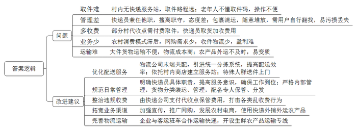
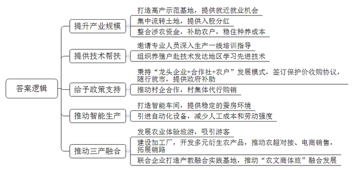
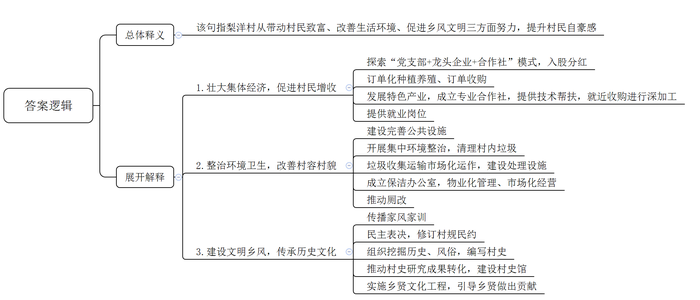
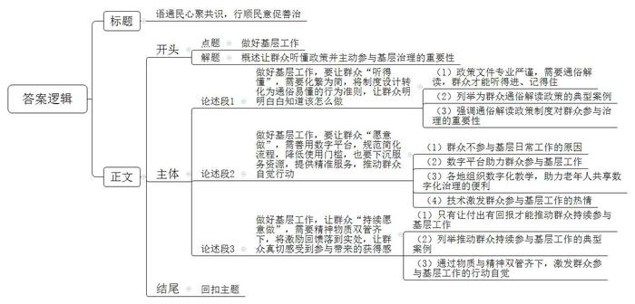

# 2022年公务员多省联考《申论》题（河北B、普通选调卷）

<!-- gwy:overview:start -->
> **河北 · 2022 · 申论 · B类** ｜ 4 题 · 图片 4 处 · 答案随题折叠

导航：[题目](#题目) · [材料 1](#材料-1)
<!-- gwy:overview:end -->

> 候选采集稿。参考答案及解析来自粉笔页面，不代表官方答案或真实高分答卷；来源使用许可与原卷对应关系仍需人工核实。

## 给定材料

### 材料 1

农村寄递物流是农产品出村进城、消费品下乡进村的重要渠道之一。近年来，Z县农村寄递物流体系建设取得了长足进步，但与群众的期待尚存在“最后一公里”不顺畅的问题。日前，Z县融媒体中心在线上开展了关于Z县农村寄递物流体系建设意见征集活动，以下是网友们的留言：

网友1：我常年在外面打工，有时会网购一些生活用品给家里的老人和小孩，但村里没有收发快递的服务站，需要自己到乡镇取，路途遥远，十分麻烦。此外，老人也不懂“取件码”，取快递存在很多困难，请邻居帮忙取件也不是长久之计。

网友2：快递可以到镇里，但我们村到镇里还很远，遇到农忙时节，根本没时间去取。而且快递代收员还兼做其他事情，经常不在，有时态度也不好，过去一趟要提前预约，有时还要在那里等很久。这样一来，包裹长时间存放在那里，很容易损坏或丢失。

网友3：快递虽然可以到村，但经常把我们的包裹和农药、化肥等一同装车，包裹被压坏、摔坏、污染、丢失的事时有发生。寄来的东西也是随意堆放，还要我们自己去找，翻来找去，还容易把别人的东西弄坏了。

网友4：这两年，村里虽然有了快递代收点，但普遍需要付费。有一次，我收到短信说快递已经送到镇上，便赶到快递站取，没想到工作人员却告诉我必须到村代收点付费收取。他们就是为了赚这笔钱，这不是强制收费吗？

网友5：我所在的乡镇快递站连公司规定发件率的20%都无法完成，加上派件收费较低，送件入村很不划算，送货到村民家中，基本是“送一单赔一单”，所以只要是寄往农村的快递，都是通知收件人自取。其实，这里农村出产葡萄、蔬菜等优质农产品，但多数农民还不善于使用快递外销外运农产品。如果村民能够用快递物流运输农产品，对于村民和快递企业将是双赢。

网友6：我们镇里的农村道路比较窄，大货车进出困难，经常有大件货物，只能依靠面包车多次往返运输，成本增加不少。村里曾经与客运班车开展合作运输农产品，由于班车班次、空间有限，农产品往往不能及时发出，新鲜农产品面临变质的风险，如果能够与快递企业合作，这些难题应该可以得到解决。

网友7：多个快递公司末端共同配送是当前“快递进村”的一种方式，可以在快递到达县级网点后，共同发放到村级站点，节约人力物力，也提升了派送效率。但是整合快递资源却不是一件易事，市场上大多数末端共配公司，没有使用同一套分拣系统，在操作上也不尽相同，统一起来难度较大。

网友8：留守村民文化程度往往不高，消费模式相对滞后，电商购物需求少，而且物流主要是送货单向物流，缺乏收件物流，农村物流量较小，快递公司很难盈利，甚至亏本经营。建议应该广泛宣传和推动“快递进村”，只有货件货源多起来，快递业务才能活跃起来。

网友9：我们村的电商服务站就设在村里的一个小卖部，村民们把自己的农产品定点送往服务站，由服务站统一收取发往乡镇的集散中心。小卖部对村里的情况很了解，同时人流为小卖部带来人气，也降低了小卖部的服务成本。

网友10：村里的板栗、核桃、鸡蛋、蘑菇等农特产品要往外发，不到乡镇网点，根本办不成。如果请快递员来“取货”，每一单都要加收费用，有的干脆嫌远，或嫌路难走，根本不愿意进村来。一些售价低廉的农产品，其本身价格可能还不如物流费高。

网友11：我是乡镇快递网点的，我们也想为大家服务，可是有些村子只住着几十户人家，甚至是“单家独户”，一个星期才十多单快递，进村的道路又不像城里那么好走，如果快递到站就跑一趟，成本实在太高。因为跑一趟，有时就一件东西；不跑呢，有些食品类的东西又不能放太久。所以，在客户允许的情况下，我们往往会托人把快递有偿捎带过去。

### 材料 2

采摘、装篓、运送……新民镇年过六旬的老朱干起活儿来认真且麻利，丝毫不比年轻人逊色。“每天工作7、8个小时，大概能采到500多斤桑叶，每斤按照0.3元计算，收入一百多块不成问题。”老朱高兴地说道，“累吗？当然累，但想着干一天就有一百多块的收入，累也高兴。”对于一辈子没离开过土地的老人而言，能在家门口就获得赚钱的机会，着实是一件令人高兴的事。靠着勤劳，老朱夫妇每年在蚕桑基地务工两个月收入可达万余元，除此之外，老朱还将家里的6亩地入股当地龙头企业，每年可实现分红约4000元。

截至目前，通过旧产区“改造”、现产区“挖潜”、潜产区“扩容”等方式，新民镇蚕桑种植面积已达8800亩，每年养蚕1.1万张，产鲜茧56万斤。“其实，刚开始，我们推广种植、养殖也不顺利，村民们认为种桑养蚕就是图个乐呵，靠这个怎么能增收。后来，我们在几个村创建了桑蚕高产示范基地，带领农户们增收致富，并出台政策，整合各类涉农资金，对种植户、养殖户进行补助，稳住种养成本。大家看到这个真有钱赚，才慢慢铺开，达到现有的规模。”新民镇连镇长说。

“你不要以为这只是简单种树，桑树种植也是需要技术的。如果镇里没有开展培训，邀请专家和技术人员到田间地头来指导我们，这片桑树林早就不行了。”老朱说。为了促进桑蚕共育养殖，新民镇还组织小蚕共育户、养殖大户到蚕桑产业技术发达的地区进行培训，学习先进技术。同时，加大政策支持力度，秉持“龙头企业+合作社+农户”发展模式，引导龙头企业与政府签订保护价收购协议，在保护价协议基础上随行就市，并实行政府补助的政策机制，提高农户养殖积极性；扶持推动村集体与龙头企业结成合作伙伴，由村集体代行购销行为，实现企业、村集体、养殖户“三赢”。

2019年，新民镇引进了全球首条智能养蚕生产线，成为传统蚕桑产业“破茧成蝶”的关键节点。“智能养蚕生产线仅需单人操作，较传统养蚕效率提高30倍。”提起智能养蚕车间，60多岁的智能蚕房负责人老李很是自豪。据了解，智能养蚕车间能够恒温恒湿控制蚕房环境，不仅突破了传统养蚕季节限制，最大程度延长了养蚕时间，同时也提高了蚕宝宝的存活率和出丝率。另一方面，机械化设备能够实现自动添桑、除沙、消毒、上簇、采茧等功能，极大减少了人工成本，减轻了劳动强度。

“周末专程带小孩来体验桑葚采摘的乐趣，同时也亲近亲近大自然！”每年5月份，伴随着桑葚开始成熟，众多游客纷至沓来，上岭村蚕桑基地也迎来了最热闹的日子。“基地果桑品种丰富，包含无籽大十、大白珍珠、红果2号等30多个种类，口感独特、营养丰富。”老李介绍说。

依托优越的自然资源，上岭村种植果桑150亩，吸引了大批游客前来采摘、游玩。自2017年以来，村里已成功举办5届桑果采摘节，累计接待游客8万多人次，实现旅游增收260余万元。在上岭村党群服务中心，慕名而来的游客采摘完桑果，正在选购村里开发出来的桑叶面产品。除了桑叶面，由蚕桑产业开发出来的桑葚酒、桑葚膏、桑叶茶、蚕丝被等产品琳琅满目，让人眼花缭乱。上岭村党支部张书记介绍道：“我们的产品很多，质量也好，很受欢迎，客商经常会上门来买，镇里也帮我们与商超对接直销，还引入电商帮助营销、拓展销路，产业链条比较完善。”

“在农旅融合的基础上，我们还致力于延伸打造蚕桑全产业发展链条，统筹谋划桑果酒厂、蚕桑烘焙站、桑菌厂、桑葚加工厂和蚕纱综合加工厂建设，打造‘线上有丝路、线下有销路’的产业体系。目前，我们已经与省里的企业签订了协议，将打造产教融合蚕桑特色实践基地，推动蚕桑产业与劳动教育、研学实践与乡村旅游融合，提高农产品附加值，促进乡村全面振兴。”连镇长补充说，该项目将围绕“学、讲、看、做”开设劳动大课堂，开展采摘、养蚕、参观蚕丝被和桑果酒制作工艺、品尝桑蚕宴等，推动“农文商体旅”融合发展，实现农业“接二连三”。《乡村振兴典型案例汇编》介绍说：新民镇蚕桑产业发展成效显著，得益于村民们政策听得懂，收入拿得到，前景看得见，干劲十足。

### 材料 3

对于家乡的旧貌，土生土长的洋下镇梨洋村村民老钟仍记忆犹新，“我们村虽然有得天独厚的优美山水，但过去，村里污水横流，垃圾满地，‘室内现代化、室外脏乱差’，说的就是我们这里，经常被隔壁村的人看不起。”时隔两年，再次走进梨洋村，村里荒废的角落建起了休闲广场，健身器材、文化走廊、公共洗手间样样俱全，泥泞的乡间小路变成了宽阔的水泥路，农户房前院里，整齐地种着各种蔬菜和绿植，村容村貌焕然一新。“我们村开展环境卫生整治后，村庄道路宽了，出行更方便了，我家房前屋后也变得越来越整洁。乡亲们吃完饭，就在休闲广场上散步聊天，生活质量比以前大大提高了。”村民老吴自豪地说。

2021年以来，梨洋村已经开展了10余次集中环境整治，组织党员干部、村民、返乡大学生对村里的垃圾、牛羊粪、废弃建筑材料等进行了全面清扫。村委会胡主任介绍：“我们还通过招标方式实现生活垃圾收集运输市场化运作，建立了小型微动力污水处理系统，生活垃圾处理站的两台焚烧炉每天能‘吃掉’6吨生活垃圾，有效解决了大家的生活垃圾和污水处理难题。”

村里还成立了保洁办公室，将人居环境整治转向物业化管理、市场化经营。在保洁办公室的推动下，村里陆续对村民家里的旱厕进行了水冲厕所改造。村民老张家的卫生间已经改造完成，新安装的马桶上贴着一张用户联系卡，上面标有维修、监督和村级联系人的电话。

为壮大村集体经济，村里积极探索“党支部+龙头企业+合作社”的模式，以入股的方式增加村集体收入，带动村民增收。胡主任介绍道，梨洋村在镇里的农产品开发公司投入股金80万元，村集体经济收入按占股比例分红，每年保底收益为5万元。同时，公司还通过订单种植养殖、订单收购带动240户农户增收致富。今年，村里将重点发展肉鸭养殖项目，推动村民收入水平再上新台阶。

今年开春以来，村民老吕忙得不亦乐乎，每天不仅要饲养好自己养的5000多只鸭子，还要忙着收捡鸭蛋，然后送到附近的合作社加工。而就在几年前，他还只是一个养鸭规模不大的农户。“过去养殖规模很小，现在一年收入有10万元左右，这得益于产业发展的带动。”老吕高兴地说。为了更好地带动群众增收，村里还引导村民成立了专业的养殖合作社，不仅免费为像老吕这样的养殖户提供更多的养殖技术，还就近收购他们的产品进行深加工。在壮大集体经济的同时，也为村民提供了更多的就业岗位。

“村子近年来变化很大，房子漂亮，住着舒服，每天都有专门的人打扫卫生，村容村貌改进非常明显，更重要的是邻里关系和睦，家家户户门口都挂有家风家训。”村民老王说，村里建设的“家风家训一条街”对教育后代帮助很大，村里的孩子现在都能把家风家训背出来了。

今年年初，在村委会的指导下，梨洋村召开了村民代表大会，大家一致举手通过了新修订的村规民约。此外，村里还组织大学生返乡开展社会实践，通过实地走访老前辈、查阅文史资料，挖掘梨洋村的历史文化，探究过去的风俗习惯，编写了一本图文并茂的《梨洋村史》。下一步，村里还要推进村史研究成果转化，建设村史馆，并进一步实施乡贤文化工程，引导乡贤为本村的发展建言献策、出资助力。镇政府对这些举措给予了肯定，多次组织镇村干部前来“取经”。胡主任高兴地跟大家说道：“<u>要让村民们挺直‘腰杆子’，就得摘掉‘穷帽子’，改变‘老样子’，留住‘好根子’。</u>”

### 材料 4

“积攒多少啦？”一段时间以来，积分成了港头镇村民们茶余饭后的热门话题。谁的积分越高，谁就在村里更有面子。

港头镇是县里乡村治理积分制唯一试点镇。该镇镇域面积60平方公里，有13个行政村，农村区域占2/3，户籍人口约3.5万人，还有大量外来人员在此居住。“我们镇有那么多村、那么多人口，实施积分制试点工作存在不少现实难点问题，我们认真研究了一遍，发现必须结合本地实际，制定一套制度。”港头镇黄镇长说。

为此，港头镇对乡村治理哪些工作需要纳入积分项目、每类积分项目对应多少得分、积分之后的激励机制如何确定等进行了充分的调研论证，将15个部门、42项涉及乡村治理的事项进行了分类、整合，并结合实际工作中与村民自主性关系大，但操作推进有难度的事项，确定评分内容，成体系地整理出14类事项，包括垃圾分类、出租屋安全等管理难点。

“正面清单12类事项，激励为主，主要是告知村民‘应该怎么做’，负面清单2类事项，则是为村民划定不能违反的‘红线’。”黄镇长说，“一开始，有村民向我们反映，积分事项太复杂，不够公开透明，对如何获取积分一头雾水，而且统计起来太繁琐。但是只要把它讲明白，简单化，容易操作，那就好办多了。比如，不占用公共道路乱停乱放、家禽规范养殖、不随意破坏绿化环境等，村民一听就明白了，觉得自己可以做到，才会付诸行动去尝试。”

黄镇长曾担任街道办主任，在社区工作中取得了显著的成绩，有着丰富的基层工作经验，黄镇长说：“无论是社区工作，还是乡村工作，都是直接面对老百姓，<u>要做好基层工作，就得让老百姓‘听得懂’‘愿意做’</u>。”

为确保积分制统筹实施、有序推进，港头镇进一步完善镇、村两级乡村治理工作领导小组和联席会议制度，组建各村、组积分制工作推进专班，形成镇、村、组三级联动的保障机制。经过一段时间的数据积累和模型分析，港头镇建立起了数字智慧化积分平台，村民们可以通过手机进行操作。通过平台，让乡村治理更加智慧、村民自治更有热情。

积分平台如何推动村民的自我管理？走进港头镇城运信息中心，电脑大屏上积分数据一目了然，待办事项有明确的标识，已经办结的也有醒目的表单数据。“在后台，我们不仅可以比较各村积分制推进情况、对积分数据进行汇总分析，而且还可以直观地了解各村推行积分制后乡村治理的效果，以及村民对不同事项的参与程度。通过网上承诺、参与实践、获得积分的规范流程，调动村民的主观能动性，推动村规民约不断转化为村民的自觉行动。”黄镇长介绍说。

根据系统设计，村民可以通过“公约制”“承诺制”“审核制”三种方式进行积分申报审核。公约制方式，村民点击同意村规民约等知晓类事项，即可获得积分。承诺制方式，村民点击同意并承诺遵守，且在约定时间内未违背承诺，即可获得相应积分。比如，承诺不私拉乱接电线、及时准确登销租户信息、无群租情况等。而审核制方式，由村民个人或村委会上传遵守规范、获奖评优等证明材料，经审核通过后可获得相应积分。比如，上传疫苗接种证明、获得优秀志愿者表彰等。

自积分制平台上线以来，手机上的小程序成了家庭亲情的联结纽带，村民们表现出了极大的热情。“老年人参与乡村治理积分制的热情很高，但是，他们对手机程序的使用还不太了解。平台刚推出，不少老人打电话让子女回来教他们怎么操作，‘以老促小’‘以小带老’，不仅帮助更多老年人体验互联网技术的便利，也让年轻一代主动参与到自我管理中来。”黄镇长说。此外，工作专班还逐户登门讲解积分项目和使用方法，并有针对性地开展专门辅导，使老年人等重点人群上手更快。同时，村民们在城运中心窗口就能得到积分制使用指导，不方便的村民还能得到上门讲解服务。

积分量提高的同时，各村生态宜居、乡风文明、治理有效的新气象逐渐显现：美丽庭院建设全镇263个队组全覆盖；一次性通过农村环境综合管理县级年度考核；红白喜事文明承诺书签约率97%；主动参与犬类疫苗接种率提高80%；1888户出租屋主动报备、租房信息登销及时准确……

“光想着让村民们配合做事情，没有激励促进也是不行的。我们在推广过程中发现，积分能够兑换奖励这点，让村民们很开心。”黄镇长继续介绍道。在奖励兑换环节，既有精神奖励，也有物质奖励。比如，组织“积分达人”等评选活动；按照一定比例换算为物质奖励，以户为单位用积分可以兑换食用油、调味品、牙膏等生活用品。

## 题目

### 第 1 题

**根据给定资料1，梳理当前Z县农村寄递物流体系存在的问题，并提出相应的改进建议。（20分）**

关联材料：材料 1

作答要求：

要求：问题梳理全面、准确、有条理；建议具体明确、切实可行；不超过400字。

第 1 题 · 答案与解析

**参考答案（粉笔题库参考内容）**

一、问题：1.取件难。村内无快递服务站，取件路程远；老年人不懂取件码，操作不便。2.管理差。快递员兼任他职，擅离职守，态度差；包裹混运，随意堆放，需用户自行翻找，易污损丢失。3.多收费。部分村代收点需付费取件，快递员取货加收费用。4.业务少。农村消费模式滞后，网购需求少，收件物流少，盈利难。5.运输难。大件货物运输不便，物流成本高；农产品外运不及时，易变质。

二、改进建议：1.优化配送服务。物流公司末端共配，引进统一分拣系统，提高配送效率；依托村内商店建立服务站；特殊人群送件上门。2.规范日常管理。明确快递员具体职责，提高服务意识，确保工作到位；严格内部管理，货物分类装运、管理，配备专人保管、分发。3.整治违规收费。由快递公司支付代收点保管费用，打击各类乱收费行为。4.拓宽业务渠道。加强宣传，推广网购，发展农村电商，使用快递外销外运农产品。5.完善物流运输。企业与客运班车合作运输快递，开设生鲜农产品运输专线。

**解析**

**参考答案说明：**本参考答案分别围绕“取件”“管理”“收费”“业务”“运输”这五个方面的问题及“优化配送服务”“规范日常管理”“整治违规收费”“拓宽业务渠道”“完善物流运输”这五个方面的改进建议展开，进行了分条撰写；各条具体要点之间在内容上相互并列，没有交叉。

**考点**：提出对策类

**来源**：2022年公务员多省联考《申论》题（河北B、普通选调卷）

### 第 2 题

**根据给定资料2，概括新民镇在推进蚕桑产业发展工作中的具体做法。（20分）**

关联材料：材料 2

作答要求：

要求：全面、准确、有条理；不超过300字。

第 2 题 · 答案与解析

**参考答案（粉笔题库参考内容）**

1.提升产业规模。打造高产示范基地，提供就近就业机会；集中流转土地，提供入股分红；整合涉农资金，补助农户，稳住种养成本。

2.提供技术帮扶。邀请专业人员深入生产一线培训指导；组织养殖户赴技术发达地区学习先进技术。

3.给予政策支持。秉持“龙头企业+合作社+农户”发展模式，签订保护价收购协议，随行就市，提供政府补助；推动村企合作，村集体代行购销。

4.推动智能生产。打造智能车间，提供稳定的蚕房环境；引进自动化设备，减少人工成本和劳动强度。

5.推动三产融合。发展农业体验旅游，吸引游客；建设加工厂，开发多元衍生农产品，推动农超对接、电商销售，拓展销路；联合企业打造产教融合实践基地，推动“农文商体旅”融合发展。

**解析**

**参考答案说明：**本参考答案从“提升产业规模”“提供技术帮扶”“给予政策支持”“推动智能生产”“推动三产融合”五个方面展开。各条答案要点之间在内容上相互并列，没有交叉。

**考点**：概括措施类

**来源**：2022年公务员多省联考《申论》题（河北B、普通选调卷）

### 第 3 题

**给定资料3提到：“要让村民们挺直‘腰杆子’，就得摘掉‘穷帽子’，改变‘老样子’，留住‘好根子’。”请依据给定资料3，谈谈你对这句话的理解。（20分）**

关联材料：材料 3

作答要求：

要求：理解准确，分析透彻，层次清晰；不超过300字。

第 3 题 · 答案与解析

**参考答案（粉笔题库参考内容）**

该句指梨洋村从带动村民致富、改善生活环境、促进乡风文明三方面努力，提升村民自豪感。

1.壮大集体经济，促进村民增收。探索“党支部+龙头企业+合作社”模式，入股分红；订单化种植养殖、订单收购；发展特色产业，成立专业合作社，提供技术帮扶，就近收购进行深加工；提供就业岗位。

2.整治环境卫生，改善村容村貌。建设完善公共设施；开展集中环境整治，清理村内垃圾；垃圾收集运输市场化运作，建设处理设施；成立保洁办公室，物业化管理、市场化经营；推动厕改。

3.建设文明乡风，传承历史文化。传播家风家训；民主表决，修订村规民约；组织挖掘历史、风俗，编写村史；推动村史研究成果转化，建设村史馆；实施乡贤文化工程，引导乡贤做出贡献。

**解析**

**参考答案说明：**（1）思路方面，本参考答案按照词句解释题“总体释义+展开解释+总结”的思路展开。（2）内容方面，本答案首先对句子的含义作出了解释；接着“展开解释”部分从“壮大集体经济，促进村民增收”“整治环境卫生，改善村容村貌”“建设文明乡风，传承历史文化”这三个方面进行分析。词句表达方面，参考答案加上了“该句指”等连接词来承接上下文。

**考点**：词句解释类

**来源**：2022年公务员多省联考《申论》题（河北B、普通选调卷）

### 第 4 题

**给定资料4中提到：“要做好基层工作，就得让老百姓‘听得懂’‘愿意做’。”请根据对这句话的理解和对给定资料的思考，联系实际，自选角度，自拟题目，写一篇议论文章。（40分）**

关联材料：材料 1、材料 2、材料 3、材料 4

作答要求：

要求：观点明确，论证充分，思路清晰，语言流畅；联系实际不拘泥于给定资料；不少于1000字。

第 4 题 · 答案与解析

**参考答案（粉笔题库参考内容）**

**语通民心聚共识，行顺民意促善治**

基层是国家治理的“神经末梢”，群众既是治理的对象，更是治理的主体。只有让政策从“天书”变为“家常话”，让参与从“要我做”变为“我要做”，让激励从“空头支票”变为“真金白银”，才能真正激活基层治理的一池春水，让善治的种子在群众心中生根发芽。

**做好基层工作，要让群众“听得懂”，需要化繁为简，将制度设计转化为通俗易懂的行为准则，让群众明明白白知道该怎么做。**政策文件往往专业严谨，若照本宣科，群众难免“一头雾水”。唯有将“官话”变“土话”，把“大道理”讲成“小故事”，才能让群众听得进、记得住。四川马蹄镇摒弃“文件宣读”的老套路，用本地案例讲防火、用身边故事说道理，群众直呼“听得懂、用得上”；青岛胶南街道的年轻干部蹲在菜摊旁，用地道方言手把手教大姨用手机办事，让“纸上政策”变成了“指尖便利”。事实表明，当制度从“纸上”走到“地上”，群众才清楚“红线”在哪里、“标兵”怎么做，参与治理才能方向明确、步履坚实。

**做好基层工作，要让群众“愿意做”，需善用数字平台，规范简化流程，降低使用门槛，也要下沉服务资源，提供精准服务，推动群众自觉行动。**对于基层日常工作，群众不是不愿参与，而是怕流程繁琐、不得其法。数字平台让“指尖议事”成为可能，更让老年人等重点群体不被时代“落下”。湖北襄阳的“五彩兴襄”整合高频事项，动动手指就能反映诉求；安徽“监督一点通”平台让村务运行公开透明，群众监督成为日常习惯。面对老年人“数字鸿沟”，各地组织专班上门教学，真正把服务送到了群众家门口，让“银发一族”也能共享数字化治理的便利。技术成为温暖的桥梁而非冰冷的门槛，当参与变得简单可及，群众的热情自然被点燃。

**做好基层工作，让群众“持续愿意做”，需要精神物质双管齐下，将激励回馈落到实处，让群众真切感受到参与带来的获得感。**一时热情易，长久坚持难。唯有让付出有回报、奉献有荣誉，才能形成“参与—受益—再参与”的良性循环。辽宁“积分超市”里，村民用劳动换积分兑生活用品，东西虽小但成就感满满；陕西旬邑将积分与政治激励挂钩，优秀群众被发展为党员、当选村干部，让“有为者有位”。物质奖励解决眼前，精神荣誉照亮长远，两者结合才能让群众从“为了奖励干”变为“为了荣誉干”，最终内化为“为了家园干”的行动自觉，让善治成为人人参与的生动实践。

“积力之所举，则无不胜也；众智之所为，则无不成也。”基层治理从来不是政府的“独角戏”，而是干群的“大合唱”。唯有如此，善治的种子才能在群众心中生根发芽，开出共建共治共享的繁花。

**解析**

**文章分析**

**语通民心聚共识，行顺民意促善治**

【**标题的优点：**标题中含有主题词，使文章主题更突出、清晰。其次，在形式上采用了对称式标题，使主题更清晰、操作更简单。】

（1）<u>基层是国家治理的</u>“<u>神经末梢</u>”，<u>群众既是治理的对象</u>，<u>更是治理的主体</u>。（2）<u>只有让政策从</u>“<u>天书</u>”<u>变为</u>“<u>家常话</u>”，<u>让参与从</u>“<u>要我做</u>”<u>变为</u>“<u>我要做</u>”，<u>让激励</u>从“空头支票”<u>变为</u>“<u>真金白银</u>”，才能<u>真正激活基层治理的一池春水</u>，让<u>善治的种子在群众心中生根发芽</u>。

【**开头的优点：**★内容方面。范文的开头是紧扣“做好基层工作”这一主题展开的。首先，开头点出主题，做到了主题明确。其次，对“做好基层工作”这一主题进行了分析阐述：（1）指出了群众在基层治理中的重要作用；（2）强调让群众听懂政策，主动参与基层治理的重要性。★文字表达方面。使用了“只有……才……”“让……变为……”等连接词，使语言表达更有气势。】

**做好基层工作，要让群众“听得懂”，需要化繁为简，将制度设计转化为通俗易懂的行为准则，让群众明明白白知道该怎么做。**（1）<u>政策文件往往专业严谨</u>，<u>若照本宣科</u>，<u>群众难免</u>“<u>一头雾水</u>”。唯有<u>将</u>“<u>官话</u>”<u>变</u>“<u>土话</u>”，把“大道理”讲成“小故事”，<u>才能让群众听得进</u>、<u>记得住</u>。（2）<u>四川马蹄镇摒弃</u>“<u>文件宣读</u>”<u>的老套路</u>，用本地案例讲防火、用身边故事说道理，群众直呼“听得懂、用得上”；<u>青岛胶南街道</u>的年轻干部蹲在菜摊旁，<u>用地道方言手把手教大姨用手机办事</u>，让“纸上政策”变成了“指尖便利”。（3）事实表明，<u>当制度从</u>“<u>纸上</u>”<u>走到</u>“<u>地上</u>”，<u>群众才清楚</u>“<u>红线</u>”<u>在哪里</u>、“<u>标兵</u>”<u>怎么做</u>，<u>参与治理才能方向明确</u>、<u>步履坚实</u>。

【**论述段1的优点：**★观点句：范文的观点句是紧扣“做好基层工作”这一文章主题提出的。形式上，它在段首处直接写出，位置突出，容易发现。内容上，关键词突出，内容要点明确，可以明显看出是从“让群众‘听得懂’”的角度展开论述。★论述内容：（1）先介绍政策文件专业严谨，需要通俗解读，群众才能听得进、记得住；（2）接着列举为群众通俗解读政策的典型案例；（3）再次强调通俗解读政策制度对群众参与治理的重要性。注意：以上三个方面的内容都是紧扣“做好基层工作，要让群众‘听得懂’，需要化繁为简，将制度设计转化为通俗易懂的行为准则，让群众明明白白知道该怎么做”这个观点句进行分析论述的，论述的针对性强，内容层次丰富。在论述方法上主要采用了讲道理、举例子相结合的方式，论述清晰充分。】

**做好基层工作，要让群众“愿意做”，需善用数字平台，规范简化流程，降低使用门槛，也要下沉服务资源，提供精准服务，推动群众自觉行动。**（1）对于基层日常工作，<u>群众不是不愿参与</u>，<u>而是怕流程繁琐</u>、<u>不得其法</u>。（2）<u>数字平台让</u>“<u>指尖议事</u>”<u>成为可能</u>，更<u>让老年人等重点群体不被时代</u>“<u>落下</u>”。湖北襄阳的“五彩兴襄”整合高频事项，动动手指就能反映诉求；安徽“监督一点通”平台让村务运行公开透明，群众监督成为日常习惯。（3）面对老年人“数字鸿沟”，<u>各地组织专班上门教学</u>，<u>真正把服务送到了群众家门口</u>，<u>让</u>“<u>银发一族</u>”<u>也能共享数字化治理的便利</u>。（4）<u>技术成为温暖的桥梁而非冰冷的门槛</u>，<u>当参与变得简单可及</u>，<u>群众的热情自然被点燃</u>。

【**论述段2的优点：**★观点句：范文的观点句是紧扣“做好基层工作”这一文章主题提出的。形式上，它在段首处直接写出，位置突出，容易发现。内容上，关键词突出，内容要点明确，可以明显看出是从“让群众‘愿意做’”的角度展开论述。★论述内容：（1）先介绍了群众不参与基层日常工作的原因；（2）接着指出数字平台助力群众参与基层工作；（3）再介绍各地组织数字化教学，助力老年人共享数字化治理的便利；（4）最后指出技术激发群众参与基层工作的热情。注意：以上四个方面的内容都是紧扣“做好基层工作，要让群众‘愿意做’，需善用数字平台，规范简化流程，降低使用门槛，也要下沉服务资源，提供精准服务，推动群众自觉行动”这个观点句进行分析论述的，论述的针对性强，内容层次丰富。在论述方法上主要采用了讲道理、举例子相结合的方式，论述清晰透彻。】

**做好基层工作，让群众“持续愿意做”，需要精神物质双管齐下，将激励回馈落到实处，让群众真切感受到参与带来的获得感。**（1）一时热情易，长久坚持难。<u>唯有让付出有回报</u>、<u>奉献有荣誉</u>，<u>才能形成</u>“<u>参与—受益—再参与</u>”<u>的良性循环</u>。（2）<u>辽宁</u>“<u>积分超市</u>”里，村民用劳动换积分兑生活用品，东西虽小但成就感满满；<u>陕西旬邑将积分与政治激励挂钩</u>，优秀群众被发展为党员、当选村干部，让“有为者有位”。（3）<u>物质奖励解决眼前</u>，<u>精神荣誉照亮长远</u>，<u>两者结合才能让群众从</u>“为了奖励干”变为“为了荣誉干”，最终<u>内化为</u>“为了家园干”<u>的行动自觉</u>，<u>让善治成为人人参与的生动实践</u>。

【**论述段3的优点：**★观点句：范文的观点句是紧扣“做好基层工作”这一文章主题提出的。形式上，它在段首处直接写出，位置突出，容易发现。内容上，关键词突出，内容要点明确，可以明显看出是从“让群众‘持续愿意做’”的角度展开论述。★论述内容：（1）先点明只有让付出有回报才能推动群众持续参与基层工作；（2）接着列举推动群众持续参与基层工作的典型案例；（3）强调通过物质与精神双管齐下，激发群众参与基层工作的行动自觉。注意：以上三个方面的内容都是紧扣“做好基层工作，让群众‘持续愿意做’，需要精神物质双管齐下，将激励回馈落到实处，让群众真切感受到参与带来的获得感”这个观点句进行分析论述的，论述的针对性强，内容层次丰富。在论述方法上主要采用了举例子和讲道理的方式，论述清晰有力。】

【**论述段之间的关系：**三个论述段分别从“让群众‘听得懂’”“让群众‘愿意做’”“让群众‘持续愿意做’”的角度，对文章主题“做好基层工作”展开了论述，彼此之间呈现出并列的逻辑。】

“积力之所举，则无不胜也；众智之所为，则无不成也。”基层治理从来不是政府的“独角戏”，而是干群的“大合唱”。唯有如此，善治的种子才能在群众心中生根发芽，开出共建共治共享的繁花。

【**结尾的优点：**范文的结尾回扣了“做好基层工作”这个主题，并且进行了总结升华。】

**考点**：文章写作题

**来源**：2022年公务员多省联考《申论》题（河北B、普通选调卷）

