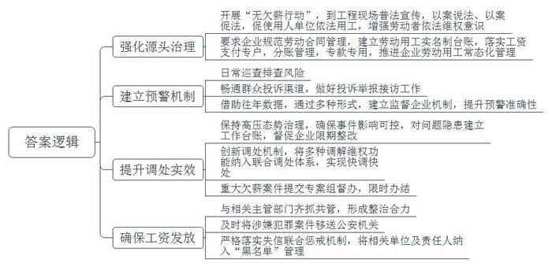
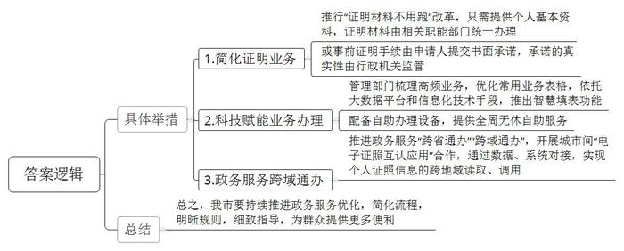
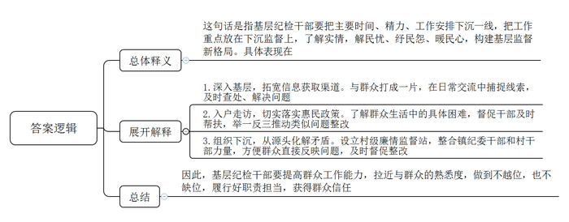
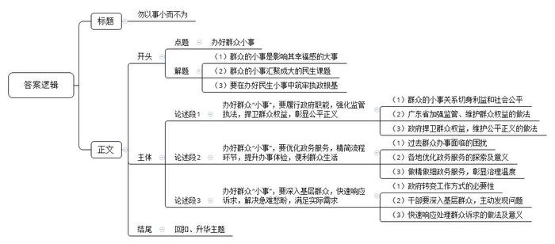

# 2022年公务员多省联考《申论》题（河北C卷）

<!-- gwy:overview:start -->
> **河北 · 2022 · 申论 · C类** ｜ 4 题 · 图片 4 处 · 答案随题折叠

导航：[题目](#题目) · [材料 1](#材料-1)
<!-- gwy:overview:end -->

> 候选采集稿。参考答案及解析来自粉笔页面，不代表官方答案或真实高分答卷；来源使用许可与原卷对应关系仍需人工核实。

## 给定材料

### 材料 1

这天，在东白区某地产项目一间不到10平方米的办公室内，挤满了激动的人群。大家你一言我一语，声量逐渐增大，正为工人出勤数字的准确与否不断争执。区劳动监察执法大队大队长徐迅站在人群之中，认真听着当事双方的说辞，同时也不断安抚工人的情绪。

这是一起因工作计时而引发的劳资纠纷。徐迅依法耐心地开展调解，最终促成双方和解。“工人群体被欠薪，尤其是建筑相关行业因为欠薪发生维权往往容易出现过激行为和群体性事件。建筑行业是重中之重，每年无论案件数或案件所涉金额占比基本都是85%以上。如能有效遏制建筑行业欠薪情况，就能减少大部分的讨薪维权。”徐迅说。

为了尽可能减少欠薪事件发生，避免“小事变大”，执法大队积极开展“无欠薪行动”，经常到工程现场进行普法宣传，通过以案说法、以案促法的方式促使用人单位依法用工，增强劳动者依法维权意识。“首先要求企业依法用工，规范劳动合同管理。尤其对建筑行业，要求在建项目建立劳动用工实名制台账，详细记录用工信息及工人进退场信息；同时，要求全面落实工人工资支付专户，将工资款项与工程款相分离，实行分账管理，做到专款专用。”执法大队副队长常华说。通过强化源头治理，近几年来东白区各类企业特别是建筑工程项目劳动用工管理已趋于常态化，有效减少了各种劳资纠纷发生，一定程度上避免了“包工头拿钱走人”的现象发生。

“大队把工作做在前面，建立一套健全的劳资纠纷预防预警机制，防患未然。”常华补充道，“我们在日常巡查排查风险之外，还积极畅通群众投诉渠道，认真做好来人、来电、来信等投诉举报的接访工作。除此以外，还要借助往年数据，通过实地巡查、书面审查及非法用工信息举报等形式，建立企业不良信息报告、欠薪报告监控等，提升预警准确性。”

“欠薪案件查处往往比较困难，如果缺少证据材料，容易陷入各说各话的拉扯局面。”执法大队工作人员小马说。有时为了核对工人出勤证据，他们需要反复甄别施工单位打卡记录及工人出勤手账的数据误差及真伪。

常华介绍，执法主要通过日常巡查、专项检查、书面审查、案件专查四个方面，由浅入深进行。从常规处置到专案清查，执法大队始终以高压姿态治理企业拖欠工资案件，将事件影响保持在可控范围内。“对排查发现的欠薪问题和隐患，我们会建立工作台账，做到底数清、情况明，督促企业限期整改，做到问题不解决绝不销账。”为进一步提升劳动争议调处实效，执法大队还创新调处机制，将人民调解、工会维权、劳动监察、劳动仲裁等调解维权功能纳入到劳动争议联合调处体系中，进一步推动劳资矛盾纠纷快调快处。徐迅说：“我们加大欠薪案件查处工作力度，确保欠薪案件快立快处，对涉及人数较多、金额较大、造成一定社会影响的重大欠薪案件，将提交由区政府牵头成立的专案组挂牌督办，并在规定时间内办结。”

总有一些用工者故意推脱逃避支付，甚至拒不支付拖欠的工人工资。被拖欠的工资发放到位才是解决问题的标志。2021年1月初，东水湾工程项目建设单位因法定代表人涉嫌犯罪，所有资金账户被查封，200多名工人担心领不到工资，多次上访讨薪。执法大队对建设单位下达了《劳动保障监察限期改正指令书》，责令尽快支付所拖欠的工资。但建设单位逾期仍不支付，执法大队随即将该案移送公安机关。第二天该建设单位急忙派人处置了欠薪事件，2月3日，工人拿回了被拖欠的工资。这是东白区首例工程建设领域追究施工单位拒不支付劳动报酬相关人员刑事责任的案件，也是执法大队积极联动横向部门惩治老赖、维护劳动者合法权益的典型案例。徐迅说，针对恶意欠薪行为，我们一方面与住建、交通等主管部门齐抓共管，形成整治的强大合力；另一方面，及时将涉嫌犯罪的案件移送公安机关。同时，严格落实欠薪失信联合惩戒机制，将相关单位及责任人纳入“黑名单”管理。

2021年，执法大队受理案件近百宗，为2500多名劳动者追薪逾三千万元，没有发生政府投资工程项目欠薪案件、因欠薪引发的群体性事件或造成严重后果的极端事例，没有发生因欠薪导致生活困难的工人需要救助的情况，严厉打击了各类侵犯劳动者合法权益的行为。群众给执法大队送来了各式各样的锦旗30多面，每一面都讲述着劳动监察执法人员践行初心使命、为劳动者解忧的感人故事。徐迅说：“办公室地方小，我们只挂了‘执法为民、排解薪忧’这一面，朴素的词语，却道出了我们的职责所在、使命所在。”

### 材料 2

L市交通职业技术学院驾校报名处的大厅里，陆续有人前来报考网约车驾驶员从业资格。“两年前，我来申请过一次。当时的工作人员要求去相关部门开具无犯罪记录、无交通肇事记录等证明材料，流程十分繁琐，有些材料一时难以办理，无奈之下只好放弃。”回忆以往的经历，来办证的小顾说，听说最近网约车驾驶员资格认证做了改革，个人不需要再提交各类证明，他就想着再试试。

进了报名大厅，小顾在工作人员的引导下，拍了照片，提交了个人基本资料，就办好了报名手续，全程不到3分钟。驾校教务科杨科长介绍：“从前，网约车驾驶员资格认定需要提供好几项证明材料，涉及公安、交管等多个单位，需要报名人自行去开具。现在L市实行‘证明材料不用跑’改革，群众报名网约车驾驶员资格，只要提供个人基本资料，驾校帮助提交到市交通局，其中涉及的无犯罪记录、无交通肇事记录等证明材料，由市交通局联系市公安局等单位，统一为学员开具办理。有些事前的证明手续，可以由申请人提交书面承诺，承诺的真实性由行政机关通过信息共享、事中检查、事后核查等方式监管。”

近年来，L市还在“放管服”改革中借用现代科技手段，不断创新便民举措，让群众办事不再难、不再烦。这天，大学刚毕业来到L市工作的小王要为自己办理落户手续。他拿出手机，登录“L市政务通”，点击选择“户籍业务自助预约填表”，填上自己的姓名、身份证号等基本信息后，其他各项信息就自动生成了。填表完成后，系统立刻跳转到预约办理环节，前后只花了2分钟左右。“过去办理户籍相关业务，群众需要在派出所户籍窗口手工填写申请人姓名、出生日期、户籍地等10多项信息，至少耗时15分钟。”市户籍部门相关负责人说，“如遇到填写错误的情况，就得重新填表，耗时又费力；遇到有不会填写的项目，窗口还需安排专门人力现场指导，有些群众因此产生不满情绪。”为方便群众办理业务，户籍管理部门精心梳理了夫妻投靠落户、技能人才落户、出生申报等14项高频户籍业务，优化群众填写的常用业务表格，依托大数据平台和信息化技术手段，创新推出“智慧填表”新功能。

科技赋能带来的办事便利不仅仅在事前，也体现在办理过程中。“网上办”“掌上办”与“自助办”相结合，群众享受的方便越来越多。周末，市民陈先生来到市车辆管理所准备办理驾驶证换证业务。来到车管所大厅后，先进入自助体检机，几分钟后便完成了体检。而后，他使用自助照相机完成了证件照拍摄。最后，他带着材料来到业务窗口处，经检查无误后，这次换证业务便完成了。“现在车管所大厅里的自助机器非常方便，照相、体检都可通过机器自助办理，以前可能需要半天甚至好几天才能办完的业务，如今半个小时左右就完成了！”陈先生说，“而且休息日也可以来自助办理相关业务，不用专门请假，省时又省心！”

推进政务服务“跨省通办”“跨域通办”，既是法治政府建设、推进“放管服”改革的重要内容，也是促进要素自由流动、便利群众生活的重要支撑。近年来，L市在改革中不断创新优化服务，满足“移动人群”办事需求，让政务服务便捷度和满意度不断提升。黄先生是邻省M市人，在L市开了一家公司，最近因业务拓展需要变更公司营业执照经营范围。“以前，非L市的电子身份证信息在邻省的工商登记系统中可能无法被识别，只能拿着身份证去现场办理。”黄先生说。这次显然不同，他打开“L市政务通”，亮出电子身份证，经扫码识别，有关信息便上传至L市政务平台，完成了变更登记。黄先生享受到这样的便利，得益于去年L市与M市两个地方的“电子证照互认应用”合作协议，通过数据、系统的对接，初步实现了个人证照信息两地的读取、调用。“其实不仅仅是跨域事项的办理和电子证照的互认。作为普通公民，我深刻地体会到去政府部门办事时，流程越来越简便，规则越来越清晰，指导越来越细致，政府通过优化政务服务，让群众办事越来越便利，法治获得感越来越强烈。”黄先生说。

### 材料 3

两块小白板，挂在J省天德县桃田镇纪委书记陈美丽的办公室，上面写着：一线处置信访问题，压实责任链条，落实重大决策部署，解决群众烦心事揪心事……陈美丽用“挂图作战”的方法，提醒自己最近的工作重点。“任务百千条，走出去是第一条。”在路上，成了她去年到任来的工作新常态。

桃田镇杨庚村，村部旁的小卖部是村民们闲聊的热闹处。陈美丽走过去，不少村民一眼就认出了她，“小陈书记，过来喝茶。”坐下闲聊，有人问：“听说村支书要改选，如果有人家里违规占用耕地，还能不能参选？”陈美丽追问，对方却欲言又止。只言片语，没头没尾，陈美丽却暗自记下，多方走访，这条线索果然不虚。镇纪委随后立案查处，一位候选人因此被取消参选资格。“要是只坐在办公室，这样的线索哪会送上门？”陈美丽说。

村民老刘的妻子和女儿智力有缺陷，一家人的生活重担都压在老刘肩上。陈美丽入户几次，记在心上。在她的安排下，村干部先领着母女二人去医院进行鉴定，随后又帮忙依规办理了低保和残疾补助。“惠民政策执行中会不会还有疏漏？”陈美丽举一反三，督促相关部门摸底，又推动整改了几起类似的情况。半年多下来，这位年轻的纪委书记感慨：<u>“只有用脚底板走下去，才能真正了解社情民意。”</u>

一线监督点多面广，基层纪委干部如何顾得过来？全镇14个村，4个社区，征地拆迁量大，矛盾也多，信访量一度居高不下，从源头化解矛盾，还得靠一线。天德县试点设立村级廉情监督站——既有镇纪委干部坐镇，又整合村干部力量，实现一线“联合作战”。挂牌头一天，村民老林就走进廉情监督站，村纪检委员赵榕向他介绍：“以前反映问题，大家得往镇上跑，如今在村里反映情况，就能直达镇纪委。”观望一阵后，老林下决心反映了一个情况：某村民小组的财务管理不规范，用私人账户管公家钱，让人心里不踏实。摸准情况后，陈美丽马上督促整改，前后不到20天，给出了让群众满意的答复。

从县纪委机关转任乡镇纪委书记，陈美丽是基层“新兵”。走村入户，起初她心里也没底，“人生地不熟，敲开门坐下，只能‘硬着头皮’聊天。”进得去、坐得下、聊得开，练的是群众工作能力。走的次数多了，陈美丽跟群众熟络起来，话题也多了起来。半年多下来，主动来找她的乡亲越来越多，电话、微信，陈美丽忙个不停。群众最看重实效，家里的水压为何上不来，老人如何联系接种疫苗……家长里短中发现的问题，看似不大，却容不得怠慢。“纪委干部不越位，也不缺位，督促干部履职担当，才能换来群众的真信任。”陈美丽说。监督下沉，护航的是干事创业正能量。杨庚村党支部书记老蔡道出如今的新变化：“镇纪委的同志把监督工作做在前面，群众心里有数，干部心里有底。去年一整年，全村就1个信访件，还是因为有村民没弄明白政策，稍微一解释，心里就敞亮了。”

走村入户的时间久了，陈美丽也变了。下乡的路，她比刚来的时候更熟悉了，也走得更快了。乡亲们笑言：“小陈书记，你可比刚来时晒黑了。”陈美丽愿意听这样掏心窝子的话，“这是群众对我的肯定和赞许。”

不仅是陈美丽，2021年以来，J省3000多名乡镇纪检监察干部走出办公室，把主要时间、精力、工作安排下沉一线，把工作重点放在下沉监督上，了解实情，解民忧、纾民怨、暖民心，基层监督新格局正在呈现新活力。

### 材料 4

今年3月突发疫情以来，A市构筑了由热线电话服务、手机APP、微信公众号、小程序、微信群等组成的A市平安网，并临时设置了网络总调度工作室，在抗疫中发挥了巨大作用。这其中，“12345”政务服务热线、“民生在线”求助热线、全市24个镇街396个村（社区）服务热线等各类热线电话日夜不停，各微信公众号和小程序也充分发挥了作用。这些“指尖上的热线”交叉组合，做到即收、即转、即办，满足战“疫”期间市民的需求。

这天晚上，因为疫情交通管制，王先生的应急药“卡”在路上，面临变质风险，急得团团转的王先生拨通了“12345”求助。接到求助后，“12345”开通了紧急绿色通道，晚上9点多，快递工作人员在大量滞留物件中找到了王先生的快递，迅速从中转场发出。为保障快递能快速通行，“12345”工作人员连夜在线调度市邮政管理局，建立了“急药星夜专递”临时微信群，协调相关镇疫情指挥部提供快递通行保障。深夜，药物终于成功送到王先生手中。疫情发生以来，“12345”为老人、幼儿、孕妇等特殊群体开通绿色通道，将特殊群体就医用药等紧急诉求纳入快速响应事项，发挥联动调度职能，畅通应急救济渠道。

A市平安网广泛发布专属二维码、专属语音键和抗疫小短片，引导群众有困难及时找到救济渠道。作为关注民生、倾听民意的平台，A市平安网担当起了疫情咨询“总客服”，通过壮大队伍、更新知识库等措施，让答复更高效专业，让市民心里更有底。A市平安网的话务员、工单员、疑难协调员、信息员，很多是热心的志愿者，在平凡的岗位上默默战斗，他们通过大数据分析市民关心的热点难点，按防疫动态、重点区域、检测接种等专题梳理，让市民可快速查询。仅仅一个月，A市平安网解答次数已达30万次。

一天，在“民生在线”热线电话上，常平镇的李女士焦急地说，她已怀孕数月，因为疫情封控滞留在一家展览馆里，目前身体感觉不适……“请放心，我们现在帮您处理。”“马上到，请留在原地等我们。”常平镇公共服务办立即安排社工赶到现场，不到半小时就协助李女士到医院就诊。疫情当下，部分群体在生活上出现了困难。针对这些特殊情况，A市平安网联系民政部门积极作为、迅速施策，组织各镇街社工、志愿服务力量动态摸排，随时关注困难群体基本情况，收集困难群众生活诉求，通过A市平安网予以跟进，帮扶陷入困境的人员1186人。一个个通过热线连接的暖心帮扶故事在A市上演：家住谢港镇的谢老伯早年丧子，前些年老伴去世了，在疫情影响下生活一时没了着落，接到他的求助后，A市平安网迅速对接有关企业为他安排了一份社区保安的工作；患有视力一级残疾的小华因疫情原因导致生活困顿，镇村社工接到热线网转来的求助后，立即核实情况，又通过A市平安网为他申请了临时生活救助金，解决了燃眉之急。“在困难面前，我们互相帮助，拧成一股绳，凸显热线力量，搭建全心全意解决百姓诉求的‘暖心桥’。”一位一线调度人员说。

突如其来的疫情，打乱了人们的正常生活规律，尤其对于隔离区居民以及学生、家长等群体来说，疫情是身心的双重考验。针对心理咨询服务，市心理公益服务专线以及市政务服务数据管理局、公安局、教育局、妇联等部门加强联动，“12345”心理咨询专席、“知音相伴”心理关爱等线上服务小程序陆续上线，为市民提供即时的情绪辅导、心理咨询、心理危机预警及危机干预等服务。

“我已经在大松镇被隔离多日，无法工作，没有任何收入，心里很慌很难受。”这天“12345”心理咨询专席收到市民王女士的一通求助电话。原来，王女士自大松镇实施封控管理后，失去了收入来源，出现了失眠、焦虑、身体不适等状况，导致情绪激动。电话这头，心理咨询师郑欣通过及时的情绪疏导、心理干预，帮助王女士情绪慢慢稳定。长舒一口气，郑欣将王女士的求助通过热线调度转派至大松镇。很快，镇妇联社工联系到了王女士，通过面对面交谈，帮助她卸下心理负担，并为王女士申请了抗疫纾困“能量包”和基本生活物资。此外，疫情防控居家隔离期间，线上听课的青少年及其家庭心理健康问题也显著增加，对这部分有亲子关系、情绪调适、人际关系困惑的青少年及其家长，“知音相伴”服务小程序也专门提供“一对一”线上心理支援服务。

<u>一些事情看似小事，但具体到某一个人、某一个家庭来说就不是小事，甚至可能是影响获得感和幸福感的大事。在某种程度上说，做好了群众的小事，也就做好了民生这件大事。</u>

## 题目

### 第 1 题

**根据给定资料**1**，概括东白区劳动监察执法大队“执法为民、排解薪忧”的做法。（20分）**

关联材料：材料 1

作答要求：

要求：

（1）概括准确，内容全面，条理清晰；

（2）不超过400字。

第 1 题 · 答案与解析

**参考答案（粉笔题库参考内容）**

1.强化源头治理。开展“无欠薪行动”，到工程现场普法宣传，以案说法、以案促法，促使用人单位依法用工，增强劳动者依法维权意识；要求企业规范劳动合同管理，建立劳动用工实名制台账，落实工资支付专户，分账管理，专款专用，推进企业劳动用工常态化管理。

2.建立预警机制。日常巡查排查风险；畅通群众投诉渠道，做好投诉举报接访工作；借助往年数据，通过多种形式，建立监督企业机制，提升预警准确性。

3.提升调处实效。保持高压态势治理，确保事件影响可控，对问题隐患建立工作台账，督促企业限期整改；创新调处机制，将多种调解维权功能纳入联合调处体系，实现快调快处；重大欠薪案件提交专案组督办，限时办结。

4.确保工资发放。与相关主管部门齐抓共管，形成整治合力；及时将涉嫌犯罪案件移送公安机关；严格落实失信联合惩戒机制，将相关单位及责任人纳入“黑名单”管理。

**解析**

**参考答案说明**：本参考答案从“强化源头治理”“建立预警机制”“提升调处实效”和“确保工资发放”这四个方面展开，各条答案要点之间在内容上相互并列，没有交叉。

**考点**：概括措施类

**来源**：2022年公务员多省联考《申论》题（河北C卷）

### 第 2 题

**假如你是****S市调研组成员，请根据给定资料**2**，提出****S市****提高政务服务水平的建议，供调研组领导参阅。（****20分）**

关联材料：材料 2

作答要求：

要求：

（1）紧扣资料，具体明确，切实可行；

（2）不超过300字。

第 2 题 · 答案与解析

**参考答案（粉笔题库参考内容）**

1.简化证明业务。推行“证明材料不用跑”改革，只需提供个人基本资料，证明材料由相关职能部门统一办理；或事前证明手续由申请人提交书面承诺，承诺的真实性由行政机关监管。

2.科技赋能业务办理。管理部门梳理高频业务，优化常用业务表格，依托大数据平台和信息化技术手段，推出智慧填表功能；配备自助办理设备，提供全周无休自助服务。

3.政务服务跨域通办。推进政务服务“跨省通办”“跨域通办”，开展城市间“电子证照互认应用”合作，通过数据、系统对接，实现个人证照信息的跨地域读取、调用。

总之，我市要持续推进政务服务优化，简化流程，明晰规则，细致指导，为群众提供更多便利。

**解析**

**参考答案说明：**本参考答案先从“简化证明业务”“科技赋能业务办理”“政务服务跨域通办”三个方面对L市优化政务服务的具体举措进行了具体展开，接着进行了总结，整体呈现“分-总”结构，各条答案要点之间在内容上各自独立，没有交叉。

**考点**：概括措施类

**来源**：2022年公务员多省联考《申论》题（河北C卷）

### 第 3 题

**给定资料**3**中提到：“只有用脚底板走下去，才能真正了解社情民意。”根据给定资料**3**，谈谈你对这句话的理解。（20分）**

关联材料：材料 3

作答要求：

要求：

（1）联系语境，理解准确，分析透彻，简明扼要；

（2）不超过300字。

第 3 题 · 答案与解析

**参考答案（粉笔题库参考内容）**

这句话是指基层纪检干部要把主要时间、精力、工作安排下沉一线，把工作重点放在下沉监督上，了解实情，解民忧、纾民怨、暖民心，构建基层监督新格局。具体表现在：

1.深入基层，拓宽信息获取渠道。与群众打成一片，在日常交流中捕捉线索，及时查处、解决问题。

2.入户走访，切实落实惠民政策。了解群众生活中的具体困难，督促干部及时帮扶，举一反三推动类似问题整改。

3.组织下沉，从源头化解矛盾。设立村级廉情监督站，整合镇纪委干部和村干部力量，方便群众直接反映问题，及时督促整改。

因此，基层纪检干部要提高群众工作能力，拉近与群众的熟悉度，做到不越位，也不缺位，履行好职责担当，获得群众信任。

**解析**

**参考答案说明****：**（1）思路方面，本参考答案按照词句解释题“总体释义+展开解释+总结”的一般答题思路展开。（2）内容方面，本参考答案首先对整句话进行了总体释义，接着分别从“深入基层，拓宽信息获取渠道”“入户走访，切实落实惠民政策”“组织下沉，从源头化解矛盾”三个方面进行了展开解释，最后是总结部分。（3）词句表达方面，本参考答案加上了“具体表现在”“因此”等连接词，使上下文衔接更顺畅。

**考点**：词句解释类

**来源**：2022年公务员多省联考《申论》题（河北C卷）

### 第 4 题

**给定资料**4**中提到：“一些事情看似小事，但具体到某一个人、某一个家庭来说就不是小事，甚至可能是影响获得感和幸福感的大事。在某种程度上说，做好了群众的小事，也就做好了民生这件大事。”请结合给定资料深入思考这段话，以“勿以事小而不为”为题，联系实际，自选角度，写一篇议论文章。（40分）**

关联材料：材料 1、材料 2、材料 3、材料 4

作答要求：

要求：

（1）观点明确，论证充分，思路清晰，语言流畅；

（2）联系实际，不拘泥于给定资料；

（3）不少于800字。

第 4 题 · 答案与解析

**参考答案（粉笔题库参考内容）**

**勿以事小而不为**

在群众眼中，一笔工资的发放、一纸证明的办理、一次投诉的回应，这些看似微不足道的“小事”，恰恰是影响其幸福感最直接的“大事”。正是这千千万万个细微的诉求，汇聚成宏大的民生课题。因此，“勿以事小而不为”，我们要强化执法守住公平，优化服务提升体验，深入基层回应关切，在办好每件民生小事中筑牢执政根基。

**办好群众****“小事”，要履行政府职能，强化监管执法，捍卫群众权益，彰显公平正义。**民生无小事，枝叶总关情。群众的工资支付、消费纠纷调解、安全生产监管等“小事”，看似琐碎平常，却直接关系到个体的切身利益与社会的公平正义。广东省加快建设农民工工资支付监控预警平台，推动全省互联互通，实现全流程监控、全链条监管，有力维护劳动者权益，让劳动更有尊严、生活更有保障。因此，政府必须前移治理关口，加强日常巡查和风险排查，完善跨部门协同机制，对侵害群众利益行为保持“零容忍”，切实做到守土有责、守土尽责，最终实现公平正义。

**办好群众****“小事”，要优化政务服务，精简流程环节，提升办事体验，便利群众生活。**过去，群众办事常常“一次办不成、多头来回跑”，面临环节多、时限长、材料繁等现实困扰。对此，各地积极探索：从“证明材料不用跑”，到“智慧填表”，再到24小时自助服务……这些从线下到线上、从人工到智能的服务转变，将传统“群众跑腿”升级为“数据跑路”，看似是服务流程的“小改进”，却解决了日常生活中的“大烦恼”，群众满意度大大提升。由此可见，只有将政务服务做精做细，才能在细微之处彰显治理温度，让便民利民落到实处。

**办好群众****“小事”，要深入基层群众，快速响应诉求，解决急难愁盼，满足实际需求。**群众问题往往来得突然、次数频繁、涉及面广，这要求政府部门亟需转变工作方式，变被动应对为主动服务。一方面，推动干部“迈开腿”“沉下身”，走进社区村落、深入田间地头，在与群众面对面交流中察实情、听真音，主动发现问题。另一方面，建立健全“接诉即办”机制，搭建线上线下诉求平台，实现群众意见即时收集、快速转办、限时反馈，确保问题得到及时处置。这些积极解决的“小事”，恰是纾解民忧、温暖民心的关键所在，于点滴间增进着民生福祉。

利民之事，丝发必兴。唯有以“事小必为”的担当做好每一件民生小事，方能汇聚成人民群众实实在在的获得感、幸福感、安全感，书写好民生工作的时代答卷。

**文章分析**

**勿以事小而不为**

【**标题的优点：**严格按照题目的要求，以“勿以事小而不为”为标题。】

（1）在群众眼中，一笔<u><u>工资的发放</u></u>、一纸<u><u>证明的办理</u></u>、一次<u><u>投诉的回应</u></u>，这些看似微不足道的“小事”，恰恰是<u><u>影响其幸福感</u></u>最直接的“大事”。（2）正是这千千万万个<u><u>细微的诉求</u></u>，汇聚成宏大的<u><u>民生课题</u></u>。（3）因此，“勿以事小而不为”，我们要<u><u>强化执法守住公平</u></u>，<u><u>优化服务提升体验</u></u>，<u><u>深入基层回应关切</u></u>，在办好每件民生小事中筑牢执政根基。

【**开头的优点：**★内容方面。范文的开头是紧扣“办好群众小事”这一主题展开的。首先，开头点出主题，做到了主题明确。其次，对“办好群众小事”这一主题进行了分析阐述，指出了：（1）群众的小事是影响其幸福感的大事；（2）群众的小事汇聚成大的民生课题；（3）引出核心观点，要在办好民生小事中筑牢执政根基。★文字表达方面：使用了排比的修辞手法，使文字表达更加生动、有力。】

**办好群众****“小事”，要履行政府职能，强化监管执法，捍卫群众权益，彰显公平正义。**（1）民生无小事，枝叶总关情。群众的<u><u>工资支付</u></u>、<u><u>消费纠纷调解</u></u>、<u><u>安全生产监管</u></u>等“小事”，看似琐碎平常，却直接关系到<u><u>个体的切身利益</u></u>与<u><u>社会的公平正义</u></u>。（2）广东省加快建<u><u>设农民工工资支付监控预警平台</u></u>，推动<u><u>全省互联互通</u></u>，实现<u><u>全流程监控</u></u>、<u><u>全链条监管</u></u>，有力<u><u>维护劳动者权益</u></u>，让<u><u>劳动更有尊严</u></u>、<u><u>生活更有保障</u></u>。（3）因此，政府必须<u><u>前移治理关口</u></u>，加强<u><u>日常巡查和风险排查</u></u>，完善<u><u>跨部门协同机制</u></u>，对<u><u>侵害群众利益行为</u></u>保持“零容忍”，切实做到守土有责、守土尽责，最终<u><u>实现公平正义</u></u>。

【**论述段****1的优点：**★观点句：范文的观点句是紧扣“办好群众小事”这一文章主题提出的。形式上，它在段首处直接写出，位置突出，容易发现。内容上，关键词突出，内容要点明确，可以明显看出是从“强化监管执法，捍卫群众权益”这个角度展开论述的。★论述内容：（1）群众的小事关系切身利益和社会公平；（2）广东省加强监管、维护群众权益的做法；（3）政府捍卫群众权益，维护公平正义的做法。注意：以上三个方面的内容都是紧扣“办好群众‘小事’，要履行政府职能，强化监管执法，捍卫群众权益，彰显公平正义”这个观点句进行分析论述的，论述的针对性强，内容层次丰富。在论述方法上采用了讲道理与举例子相结合的方式，论述充实透彻。】

**办好群众****“小事”，要优化政务服务，精简流程环节，提升办事体验，便利群众生活。**（1）过去，群众办事常常“一次办不成、多头来回跑”，面临<u><u>环节多</u></u>、<u><u>时限长</u></u>、<u><u>材料繁</u></u>等现实困扰。（2）对此，各地积极探索：从“<u><u>证明材料</u></u>不用跑”，到“<u><u>智慧填表</u></u>”，再到24小时<u><u>自助服务</u></u>……这些从<u><u>线下到线上</u></u>、从<u><u>人工到智能</u></u>的<u><u>服务转变</u></u>，将传统“群众跑腿”升级为“数据跑路”，看似是<u><u>服务流程</u></u>的“小改进”，却解决了日常生活中的“大烦恼”，<u><u>群众满意度</u></u>大大提升。（3）由此可见，只有<u><u>将政务服务做精做细</u></u>，才能在细微之处彰显<u><u>治理温度</u></u>，让便民利民落到实处。

【**论述段****2的优点：**★观点句：范文的观点句是紧扣“办好群众小事”这一文章主题提出的。形式上，它在段首处直接写出，位置突出，容易发现。内容上，关键词突出，内容要点明确，可以明显看出是从“优化政务服务，提升办事体验”这个角度展开论述的。★论述内容：（1）过去群众办事面临的困扰；（2）各地优化政务服务的探索及意义；（3）做精做细政务服务，彰显治理温度。注意：以上三个方面的内容都是紧扣“办好群众‘小事’，要优化政务服务，精简流程环节，提升办事体验，便利群众生活”这个观点句进行分析论述的，论述的针对性强，内容层次丰富。在论述方法上采用了讲道理与举例子相结合的方式，论述充实到位。】

**办好群众****“小事”，要深入基层群众，快速响应诉求，解决急难愁盼，满足实际需求。**（1）<u><u>群众问题</u></u>往往来得突然、次数频繁、涉及面广，这要求<u><u>政府部门亟需转变工作方式</u></u>，<u><u>变被动应对为主动服务</u></u>。（2）一方面，推动<u><u>干部</u></u>“迈开腿”“沉下身”，<u><u>走进社区村落</u></u>、<u><u>深入田间地头</u></u>，在<u><u>与群众面对面交流</u></u>中察实情、听真音，主动<u><u>发现问题</u></u>。（3）另一方面，<u><u><u>建立健全</u></u></u><u><u><u>“接诉即办”机制</u></u></u>，搭建<u><u>线上线下诉求平台</u></u>，实现<u><u>群众意见即时收集</u></u>、<u><u>快速转办</u></u>、<u><u>限时反馈</u></u>，确保<u><u>问题得到及时处置</u></u>。这些积极解决的“小事”，恰是<u><u>纾解民忧</u></u>、<u><u>温暖民心</u></u>的关键所在，于点滴间增进着民生福祉。

【**论述段****3的优点：**★观点句：范文的观点句是紧扣“办好群众小事”这一文章主题提出的。形式上，它在段首处直接写出，位置突出，容易发现。内容上，关键词突出，内容要点明确，可以明显看出是从“深入基层群众，快速响应诉求”这个角度展开论述的。★论述内容：（1）政府转变工作方式的必要性；（2）干部要深入基层群众，主动发现问题；（3）快速响应处理群众诉求的做法及意义。注意：以上三个方面的内容都是紧扣“办好群众‘小事’，要深入基层群众，快速响应诉求，解决急难愁盼，满足实际需求”这个观点句进行分析论述的，论述的针对性强，内容层次丰富。在论述方法上主要采用了讲道理的方式，论述清晰深刻。】

【**论述段之间的关系：**★内容的内在逻辑：范文的论述段之间是依照“并列”的逻辑展开的。论述段1先写了“办好群众‘小事’，要履行政府职能，强化监管执法，捍卫群众权益，彰显公平正义”，论述段2再写了“办好群众‘小事’，要优化政务服务，精简流程环节，提升办事体验，便利群众生活”，论述段3接着写了“办好群众‘小事’，要深入基层群众，快速响应诉求，解决急难愁盼，满足实际需求”。文章整体论述思路清晰。】

利民之事，丝发必兴。唯有以“事小必为”的担当做好每一件民生小事，方能汇聚成人民群众实实在在的获得感、幸福感、安全感，书写好民生工作的时代答卷。

【**结尾的优点：**范文的结尾回扣了“办好群众小事”这个主题，并且进行了总结提升。】

**解析状态：unknown（来源未提供）**

**考点**：文章写作题

**来源**：2022年公务员多省联考《申论》题（河北C卷）

