# 2022年河北省公务员录用考试《行测》题（网友回忆版）

<!-- gwy:overview:start -->
> **河北 · 2022 · 行测 · 统考** ｜ 130 题 · 图片 154 处 · 答案随题折叠

| 题型模块 | 题量 | 题号 |
| --- | ---: | ---: |
| 常识判断 | 20 | 1–20 |
| 言语理解与表达 | 40 | 21–60 |
| 数量关系 | 15 | 61–75 |
| 判断推理 | 35 | 76–110 |
| 资料分析 | 20 | 111–130 |
| **合计** | **130** | |

导航：[题型与作答说明](#题型与作答说明) · [题目](#题目) · [材料 1](#材料-1)
<!-- gwy:overview:end -->

> 候选采集稿。参考答案及解析来自粉笔页面，不代表官方答案或真实高分答卷；来源使用许可与原卷对应关系仍需人工核实。

## 题型与作答说明

常识判断

（20题）

根据题目要求，在四个选项中选出一个最恰当的答案。

言语理解与表达

（40题）

本部分包括表达与理解两方面的内容。请根据题目要求，在四个选项中选出一个最恰当的答案。

数量关系

（15题）

在这部分试题中，每道题呈现一段表述数字关系的文字，要求你迅速、准确地计算出答案。

判断推理

（35题）

本部分包括图形推理、定义判断、类比推理与逻辑判断四种类型的试题，在四个选项中选出一个最恰当的答案。

资料分析

（20题）

所给出的图、表、文字或综合性资料均有若干个问题要你回答。你应根据资料提供的信息进行分析、比较、计算和判断处理。

## 题目

### 第 1 题

中国共产党十九届六中全会决定，党的二十大将于2022年下半年在北京召开。下列有关党的二十大的说法正确的有几项：

①党的二十大，是我们党进入全面建设社会主义现代化国家、向第二个百年奋斗目标进军新征程的重要时刻召开的一次十分重要的代表大会

②代表产生程序的5个主要环节是：推荐提名、组织考察、确定代表候选人初步人选、确定代表候选人预备人选、会议选举

③党的二十大代表的选举要严格资格条件，坚持把政治标准放在首位

④党的二十大代表名额共2300名，与十九大时相同

A. 1项

B. 2项

C. 3项

D. 4项

第 1 题 · 答案与解析

**参考答案（粉笔题库参考内容）**

D

**解析**

本题考查政治常识。

①正确，中国共产党第十九届中央委员会第六次全体会议公报指出：“全会决定，中国共产党第二十次全国代表大会于2022年下半年在北京召开。全会认为，党的二十大是我们党进入全面建设社会主义现代化国家、向第二个百年奋斗目标进军新征程的重要时刻召开的一次十分重要的代表大会，是党和国家政治生活中的一件大事。”

②正确，二十大代表的产生，要坚持和加强党的全面领导，充分发扬党内民主，采取自下而上、上下结合、反复酝酿、逐级遴选的办法进行。代表产生程序有5个主要环节，即推荐提名、组织考察、确定代表候选人初步人选、确定代表候选人预备人选、会议选举。

③正确，党中央提出，二十大代表应是共产党员中的优秀分子。要严把人选政治关，坚持把政治标准放在首位，突出考察人选的理想信念、政治品格和道德修养，着重了解人选政治判断力、政治领悟力、政治执行力，增强“四个意识”、坚定“四个自信”、做到“两个维护”等方面的表现情况，对政治上不合格的一票否决。

④正确，中央组织部负责人就做好二十大代表选举工作接受采访时表示，党中央明确，二十大代表名额共2300名，与十九大时相同。二十大代表名额的分配，主要根据党组织数量和党员人数确定，同时考虑前几次党的全国代表大会代表名额等因素。按照这一分配办法，各选举单位的代表名额，与十九大时基本相同。

故①②③④说法正确。

故正确答案为D。

**考点**：重要会议讲话、其他建设

**来源**：2022年浙江省公务员录用考试《行测》题（C类）（网友回忆版）第21题

### 第 2 题

2022年3月，习近平总书记在看望参加政协会议的社会福利和社会保障界委员时强调，要在推动社会保障事业高质量发展上持续用力，织密社会保障安全网，为人民生活安康托底。下列做法有助于推动社会保障事业高质量发展的有几项：

①加大对因疫因灾遇困群众的临时救助力度

②保障流浪乞讨人员人身安全和基本生活，关心关爱精神障碍人员

③健全灵活就业人员社保制度，扩大失业、工伤、生育保险的覆盖面

④健全社会保障基金监管体系，严厉打击欺诈骗保、套保和挪用贪占各类社会保障资金的违法行为

A. 1项

B. 2项

C. 3项

D. 4项

第 2 题 · 答案与解析

**参考答案（粉笔题库参考内容）**

D

**解析**

本题考查政治常识。

①②正确，习近平总书记强调：“要加大对因疫因灾遇困群众的临时救助力度，做好残疾人康复、教育、就业等工作，保障流浪乞讨人员人身安全和基本生活，关心关爱精神障碍人员，坚决杜绝欺凌虐待妇女儿童、老年人、残疾人等违法行为。”

③④正确，习近平总书记强调：“我国已建成世界上规模最大的社会保障体系。要健全灵活就业人员社保制度，扩大失业、工伤、生育保险的覆盖面，实现制度安排更加公平，覆盖范围更加广泛，为人民生活安康托底。要健全社会保障基金监管体系，严厉打击欺诈骗保、套保和挪用贪占各类社会保障资金的违法行为，守护好人民群众的每一分‘养老钱’、‘保命钱’。”

综上所述，有助于推动社会保障事业高质量发展的有①②③④，有4项。

故正确答案为D。

**考点**：重要会议讲话、社会建设

**来源**：2022年浙江省公务员录用考试《行测》题（C类）（网友回忆版）第23题

### 第 3 题

习近平总书记以统揽全局的战略思维和宽广的世界眼光深刻把握国家安全问题，提出了总体国家安全观。下列相关表述正确的有几项：

①总体国家安全观是我党历史上第一个被确立为国家安全工作指导思想的重大战略思想

②《中华人民共和国国家安全法》规定，每年5月15日为全民国家安全教育日

③总体国家安全观主要聚焦于如何解决好大国发展进程中面临的共性安全问题

④国家安全机关举报受理电话为12339

A. 1项

B. 2项

C. 3项

D. 4项

第 3 题 · 答案与解析

**参考答案（粉笔题库参考内容）**

B

**解析**

本题考查政治常识。

①正确，《总体国家安全观学习纲要》中明确提出：“总体国家安全观是我们党历史上第一个被确立为国家安全工作指导思想的重大战略思想，是中国共产党和中国人民捍卫国家主权、安全、发展利益百年奋斗实践经验和集体智慧的结晶，是马克思主义国家安全理论中国化的最新成果，是习近平新时代中国特色社会主义思想的重要组成部分，是新时代国家安全工作的根本遵循和行动指南。”

②错误，《中华人民共和国国家安全法》第一章“总则”第十四条规定：“每年4月15日为全民国家安全教育日。”

③错误，总体国家安全观从坚持和发展中国特色社会主义的战略高度，系统回答了中国特色社会主义进入新时代，如何既解决好大国发展进程中面临的共性安全问题，同时又处理好中华民族伟大复兴关键阶段面临的特殊安全问题这个重大时代课题，是一个系统完整的科学理论体系，内涵丰富、博大精深，涉及治党治国治军等各个方面，标志着我们党对国家安全基本规律的认识达到了新高度。故不仅是关注“大国发展进程中面临的共性安全问题”，同时也要关注“中华民族伟大复兴关键阶段面临的特殊安全问题”。

④正确，12339是国家安全机关受理公民和组织举报电话，这条热线是由国家安全部设立的，为了方便公民和组织向国家安全机关举报间谍行为或线索。

综上，①④正确，②③错误。

故正确答案为B。

**考点**：其他建设

**来源**：2022年浙江省公务员录用考试《行测》题（C类）（网友回忆版）第22题

### 第 4 题

习近平总书记强调，必须深化对新的时代条件下我国各类资本及其作用的认识，规范和引导资本健康发展，发挥其作为重要生产要素的积极作用。下列对资本的认识不准确的是（ ）。

A. 在社会主义市场经济体制下，资本是带动各类生产要素集聚配置的重要纽带

B. 资本具有逐利本性，如不加以规范和约束，就会给经济社会发展带来不可估量的危害

C. 要加强资本领域反腐败，保持反腐败高压态势，坚决打击以权力为依托的资本逐利行为

D. 要正确处理资本和利益分配问题，既注重维护按劳分配的主体地位，更注重保障资本参与社会分配获得增殖和发展

第 4 题 · 答案与解析

**参考答案（粉笔题库参考内容）**

D

**解析**

本题考查政治常识。

2022年4月29日，中共中央总书记习近平就依法规范和引导我国资本健康发展进行第三十八次集体学习时发表重要讲话。

A、B两项正确，习近平总书记在讲话中指出：“要历史地、发展地、辩证地认识和把握我国社会存在的各类资本及其作用。在社会主义市场经济体制下，资本是带动各类生产要素集聚配置的重要纽带，是促进社会生产力发展的重要力量，要发挥资本促进社会生产力发展的积极作用。同时，必须认识到，资本具有逐利本性，如不加以规范和约束，就会给经济社会发展带来不可估量的危害。”

C项正确，习近平总书记在讲话中指出：“要加强资本领域反腐败，保持反腐败高压态势，坚决打击以权力为依托的资本逐利行为，着力查处资本无序扩张、平台垄断等背后的腐败行为。”

D项错误，习近平总书记在讲话中指出：“要正确处理资本和利益分配问题。我国社会主义的国家性质决定了我们必须坚持按劳分配为主体、多种分配方式并存，在社会分配中体现人民至上。要注重经济发展的普惠性和初次分配的公平性，既注重保障资本参与社会分配获得增殖和发展，更注重维护按劳分配的主体地位，坚持发展为了人民、发展依靠人民、发展成果由人民共享，坚定不移走全体人民共同富裕的道路。”

本题为选非题，故正确答案为D。

**考点**：经济建设、重要会议讲话

**来源**：2022年浙江省公务员录用考试《行测》题（A类）（网友回忆版）第8题

### 第 5 题

《中共中央 国务院关于加快建设全国统一大市场的意见》于2022年4月发布，提出从全局和战略高度加快建设全国统一大市场。下列做法符合建设全国统一大市场要求的是：

A. 统一产权交易信息发布机制，实现全国产权交易市场联通

B. 以集中管理代替市场机制，统一市场价格、商品供给和配给渠道

C. 严格落实“负面清单准入”管理模式，要求各地主管部门根据实际情况及时发布具有市场准入性质的负面清单

D. 指导各地区综合比较优势、资源环境承载能力、产业基础、防灾避险能力等因素，搞好“小而全”的自我小循环

第 5 题 · 答案与解析

**参考答案（粉笔题库参考内容）**

A

**解析**

本题考查政治常识。

A项正确，《中共中央 国务院关于加快建设全国统一大市场的意见》在“（九）完善市场信息交互渠道”部分指出：“统一产权交易信息发布机制，实现全国产权交易市场联通。优化行业公告公示等重要信息发布渠道，推动各领域市场公共信息互通共享。优化市场主体信息公示，便利市场主体信息互联互通。推进同类型及同目的信息认证平台统一接口建设，完善接口标准，促进市场信息流动和高效使用。依法公开市场主体、投资项目、产量、产能等信息，引导供需动态平衡。”

B项错误，《中共中央 国务院关于加快建设全国统一大市场的意见》在“（二）工作原则”部分指出：“有效市场，有为政府。坚持市场化、法治化原则，充分发挥市场在资源配置中的决定性作用，更好发挥政府作用，强化竞争政策基础地位，加快转变政府职能，用足用好超大规模市场优势，让需求更好地引领优化供给，让供给更好地服务扩大需求，以统一大市场集聚资源、推动增长、激励创新、优化分工、促进竞争。”故不能用集中管理代替市场机制。

C项错误，《中共中央 国务院关于加快建设全国统一大市场的意见》在“（五）实行统一的市场准入制度”部分指出：“严格落实‘全国一张清单’管理模式，严禁各地区各部门自行发布具有市场准入性质的负面清单，维护市场准入负面清单制度的统一性、严肃性、权威性。”

D项错误，《中共中央 国务院关于加快建设全国统一大市场的意见》在“（二十四）破除地方保护和区域壁垒”部分指出：“指导各地区综合比较优势、资源环境承载能力、产业基础、防灾避险能力等因素，找准自身功能定位，力戒贪大求洋、低层次重复建设和过度同质竞争，不搞‘小而全’的自我小循环，更不能以‘内循环’的名义搞地区封锁。”

故正确答案为A。

**考点**：经济建设、重要文件

**来源**：2022年浙江省公务员录用考试《行测》题（A类）（网友回忆版）第5题

### 第 6 题

2022年，按照以习近平同志为核心的党中央的部署要求，为稳定宏观经济大盘，稳定上亿市场主体，各部门多措并举优化和落实助企纾困政策，为经济平稳运行提供有力支撑。下列属于“稳主体”对策的是：

①实施大规模留抵退税政策

②对特困行业实行阶段性缓缴养老保险费

③中国人民银行宣布下调金融机构存款准备金率

④设立3岁以下婴幼儿照护个人所得税专项附加扣除

⑤央行、银保监会发布个人首套房商贷利率下限调整

A. 2项

B. 3项

C. 4项

D. 5项

第 6 题 · 答案与解析

**参考答案（粉笔题库参考内容）**

C

**解析**

本题考查经济常识。

市场主体是经济的力量载体，保市场主体就是保社会生产力。

①正确，2022年3月21日，国务院总理李克强主持召开国务院常务会议，确定实施大规模增值税留抵退税的政策安排，为稳定宏观经济大盘提供强力支撑。

②正确，2022年4月6日，国务院总理李克强主持召开国务院常务会议，决定对特困行业实行阶段性缓缴养老保险费政策，加大失业保险支持稳岗和培训力度；部署适时运用货币政策工具，更加有效支持实体经济发展。

③正确，为支持实体经济发展，促进综合融资成本稳中有降，中国人民银行决定于2022年4月25日下调金融机构存款准备金率0.25个百分点（不含已执行5%存款准备金率的金融机构），为加大对小微企业和“三农”的支持力度，对没有跨省经营的城商行和存款准备金率高于5%的农商行，在下调存款准备金率0.25个百分点的基础上，再额外多降0.25个百分点。

④错误，为贯彻落实《中共中央 国务院关于优化生育政策促进人口长期均衡发展的决定》，依据《中华人民共和国个人所得税法》有关规定，国务院决定，设立3岁以下婴幼儿照护个人所得税专项附加扣除。自2022年1月1日起，纳税人照护3岁以下婴幼儿子女的相关支出，在计算缴纳个人所得税前，按照每个婴幼儿每月1000元的标准定额扣除。该项扣除政策有利于减轻人民群众抚养子女负担，体现了国家对人民群众生育养育的鼓励和照顾。属于“保民生”的措施。

⑤正确，2022年5月15日，央行、银保监会联合发布《关于调整差别化住房信贷政策有关问题的通知》，对于贷款购买普通自住房的居民家庭，首套住房商业性个人住房贷款利率下限调整为不低于相应期限贷款市场报价利率（LPR）减20个基点，二套住房商业性个人住房贷款利率政策下限按现行规定执行。此举对稳定市场预期将起到积极作用，有利于进一步满足刚性和改善性住房需求，促进房地产市场平稳健康发展。

综上所述，属于“稳主体”对策的是①②③⑤，共4项。

故正确答案为C。

**考点**：市场经济

**来源**：2022年浙江省公务员录用考试《行测》题（C类）（网友回忆版）第24题

### 第 7 题

2022年5月10日，习近平总书记在庆祝中国共产主义青年团成立100周年大会上发表重要讲话，激励广大青年团员在实现中华民族伟大复兴中国梦的新征程上奋勇前进。下列有关中国共产主义青年团表述不正确的是：

A. 团的地方组织和基层组织同时受同级党委和团的上级组织领导

B. 中国共产主义青年团受中国共产党的委托领导中国少年先锋队的工作

C. 团旗上环绕黄色五角星周围的黄色圆圈，象征中国青年一代紧密团结在中国共产党周围

D. 团员在加入共产党后或年满二十八周岁、没有在团内担任职务的情况下，不再保留团籍

第 7 题 · 答案与解析

**参考答案（粉笔题库参考内容）**

D

**解析**

本题考查政治常识。

A项正确，《中国共产主义青年团章程》总则规定：“中国共产主义青年团中央委员会受中国共产党中央委员会领导，团的地方组织和基层组织受同级党的委员会领导，同时受团的上级组织领导。”

B项正确，《中国共产主义青年团章程》总则规定：“中国共产主义青年团受中国共产党的委托领导中国少年先锋队的工作。中国共产主义青年团是中华全国青年联合会的核心团体会员，发挥主导作用。中国共产主义青年团在中国共产党的领导下，指导中华全国学生联合会开展工作。”

C项正确，《中国共产主义青年团章程》第八章“团旗、团徽、团歌”中的第三十七条规定：“中国共产主义青年团团旗旗面为红色，象征革命胜利；左上角缀黄色五角星，周围环绕黄色圆圈，象征中国青年一代紧密团结在中国共产党周围。”

D项错误，《中国共产主义青年团章程》第一章“团员”中的第一条第三款规定：“团员加入共产党以后仍保留团籍，年满二十八周岁，没有在团内担任职务，不再保留团籍。”

本题为选非题，故正确答案为D。

**考点**：重要事件、其他建设

**来源**：2022年浙江省公务员录用考试《行测》题（A类）（网友回忆版）第4题

### 第 8 题

根据十三届全国人大五次会议审议通过的《政府工作报告》，下列属于2022年我国经济发展主要预期目标的是：

①居民消费价格涨幅3%左右

②实现高水平科技自立自强

③国内生产总值增长6.5%左右

④粮食产量保持在1.3万亿斤以上

⑤坚持政府过紧日子，更好节用裕民

⑥居民收入增长与经济增长基本同步

A. ①③④

B. ①④⑥

C. ②③④

D. ②⑤⑥

第 8 题 · 答案与解析

**参考答案（粉笔题库参考内容）**

B

**解析**

本题考查政治常识。

①④⑥正确，③错误，2022年《政府工作报告》中“二、2022年经济社会发展总体要求和政策取向”指出：“今年发展主要预期目标是：国内生产总值增长5.5%左右；城镇新增就业1100万人以上，城镇调查失业率全年控制在5.5%以内；居民消费价格涨幅3%左右；居民收入增长与经济增长基本同步；进出口保稳提质，国际收支基本平衡；粮食产量保持在1.3万亿斤以上；生态环境质量持续改善，主要污染物排放量继续下降；能耗强度目标在‘十四五’规划期内统筹考核，并留有适当弹性，新增可再生能源和原料用能不纳入能源消费总量控制。”

②错误，2021年习近平在中国科学院第二十次院士大会、中国工程院第十五次院士大会和中国科学技术协会第十次全国代表大会上指出：“实践证明，我国自主创新事业是大有可为的！我国广大科技工作者是大有作为的！我国广大科技工作者要以与时俱进的精神、革故鼎新的勇气、坚忍不拔的定力，面向世界科技前沿、面向经济主战场、面向国家重大需求、面向人民生命健康，把握大势、抢占先机，直面问题、迎难而上，肩负起时代赋予的重任，努力实现高水平科技自立自强！”

⑤错误，2022年《政府工作报告》中“三、2022年政府工作任务”部分的“（一）着力稳定宏观经济大盘，保持经济运行在合理区间”指出：“要坚持政府过紧日子，更好节用裕民。大力优化支出结构，保障重点支出，严控一般性支出。盘活财政存量资金和闲置资产。”

综上所述，属于2022年我国经济发展主要预期目标的是①④⑥。

故正确答案为B。

**考点**：经济建设、重要文件

**来源**：2022年浙江省公务员录用考试《行测》题（C类）（网友回忆版）第25题

### 第 9 题

2022年，中央一号文件《中共中央 国务院关于做好2022年全面推进乡村振兴重点工作的意见》明确提出“三农”工作的首要任务是“全力抓好粮食生产和重要农产品供给”。下列选项错误的是：

A. 大力推进北方设施蔬菜、北菜南运基地建设，提高蔬菜应急保供能力

B. 坚持中国人的饭碗任何时候都要牢牢端在自己手中，饭碗主要装中国粮

C. 全面落实粮食安全党政同责，严格粮食安全责任制考核，确保粮食播种面积稳定

D. 坚持和加强党对“三农”工作的全面领导，牢牢守住保障国家粮食安全和不发生规模性返贫两条底线

第 9 题 · 答案与解析

**参考答案（粉笔题库参考内容）**

A

**解析**

本题考查政治常识。

A项错误，《中共中央 国务院关于做好2022年全面推进乡村振兴重点工作的意见》在“一、全力抓好粮食生产和重要农产品供给”部分指出：“（三）保障‘菜篮子’产品供给。加大力度落实‘菜篮子’市长负责制。稳定生猪生产长效性支持政策，稳定基础产能，防止生产大起大落。加快扩大牛羊肉和奶业生产，推进草原畜牧业转型升级试点示范。稳定水产养殖面积，提升渔业发展质量。稳定大中城市常年菜地保有量，大力推进北方设施蔬菜、南菜北运基地建设，提高蔬菜应急保供能力。”由此可知，应是“南菜北运基地建设”，而非“北菜南运基地建设”。

B、C两项正确，《中共中央 国务院关于做好2022年全面推进乡村振兴重点工作的意见》在”一、全力抓好粮食生产和重要农产品供给”部分指出：“（一）稳定全年粮食播种面积和产量。坚持中国人的饭碗任何时候都要牢牢端在自己手中，饭碗主要装中国粮，全面落实粮食安全党政同责，严格粮食安全责任制考核，确保粮食播种面积稳定、产量保持在1.3万亿斤以上。”

D项正确，《中共中央 国务院关于做好2022年全面推进乡村振兴重点工作的意见》在开头第二段指出：“做好2022年‘三农’工作，要以习近平新时代中国特色社会主义思想为指导，全面贯彻党的十九大和十九届历次全会精神······坚持和加强党对‘三农’工作的全面领导，牢牢守住保障国家粮食安全和不发生规模性返贫两条底线，突出年度性任务、针对性举措、实效性导向，充分发挥农村基层党组织领导作用，扎实有序做好乡村发展、乡村建设、乡村治理重点工作，推动乡村振兴取得新进展、农业农村现代化迈出新步伐。”

本题为选非题，故正确答案为A。

**考点**：重要文件、社会建设

**来源**：2022年浙江省公务员录用考试《行测》题（C类）（网友回忆版）第26题

### 第 10 题

新时代需要继承发扬以国家民族命运为己任的爱国主义精神，更需要继承发扬以爱国主义为底色的科学家精神。在中华民族伟大复兴的征程上，一代又一代的科学家不畏艰难，勇攀高峰，无私奉献，为国家和人民做出了彪炳史册的重大贡献。下列科学家与其成就对应关系正确的是：

①“两弹一星”元勋——于敏

②北斗三号卫星首席总设计师——谢军

③中国核潜艇第一任总设计师——赵忠尧

④新中国飞机空气动力设计奠基人——顾诵芬

⑤中国脊髓灰质炎疫苗研发生产拓荒者——汤飞凡

A. ①③④

B. ②③⑤

C. ①②④

D. ②④⑤

第 10 题 · 答案与解析

**参考答案（粉笔题库参考内容）**

C

**解析**

本题考查政治常识。

①项正确，于敏，核物理学家，中国“氢弹之父”，生于河北省宁河县（今天津市宁河区）。他在我国氢弹原理突破中解决了一系列基础问题，提出了从原理到构形基本完整的设想，起了关键作用。此后长期领导核武器理论研究、设计，解决了大量理论问题。对我国核武器进一步发展到国际先进水平做出了重要贡献。1982年于敏获国家自然科学奖一等奖。1985年、1987年和1989年三次获国家科技进步奖特等奖。1994年获求是基金杰出科学家奖。1999年被国家授予“两弹一星”功勋奖章。2019年9月17日，国家主席习近平签署主席令，授予于敏“共和国勋章”。

②项正确，谢军，山西临汾人，中共党员，研究员，历任航天科技集团五院504所副所长、所长，北斗二号导航卫星总设计师。现任北斗三号工程副总设计师、北斗三号导航卫星首席总设计师，北斗卫星导航系统工程副总设计师。2020年12月，被国资委党委授予第五届“央企楷模”称号。2021年2月17日，谢军被评为“感动中国2020年度人物”。

③项错误，彭士禄是中国核潜艇第一任总设计师，中国工程院首批及资深院士，被誉为“中国核潜艇之父”。赵忠尧，主要从事核物理研究，特别是硬g射线与物质相互作用等方面的研究，主持建成中国第一、二台质子静电加速器，为在国内建立核物理实验基地做出了重要贡献。

④项正确，顾诵芬，江苏苏州人，飞机设计专家，中国自行设计、制造的高空高速歼击机的主要技术负责人之一，是新中国飞机空气动力设计奠基人。2021年11月3日上午，2020年度国家科学技术奖励大会在北京人民大会堂隆重召开。中国航空工业集团有限公司顾诵芬院士获国家最高科学技术奖。

⑤项错误，顾方舟，我国著名病毒学家、脊髓灰质炎疫苗研发生产拓荒者，被称为“中国脊髓灰质炎疫苗之父”。汤飞凡，著名微生物学家、病毒学家，沙眼衣原体的发现人之一，长期从事微生物学、病毒学和免疫学的研究。

综上所述，科学家与其成就对应关系正确的是①②④。

故正确答案为C。

**考点**：重要事件、其他建设

**来源**：2022年浙江省公务员录用考试《行测》题（C类）（网友回忆版）第27题

### 第 11 题

某市为保护当地的湿地自然景观，制定颁布了《X市湿地保护办法》，禁止私自采掘、捕捞、打猎等行为。张某闲来无事，前往湿地景区游玩，看到两只受伤野鸭便顺手捡起，准备带回家去。在回家路上，张某携带的野鸭被正在巡逻的警察发现，警察依据《X市湿地保护办法》对其处以1000元罚款。张某不服，欲提起行政诉讼，下列说法错误的是：

A. 张某可以就罚款决定提起诉讼

B. 张某认为《X市湿地保护办法》违背上位法规定，可以只就其合法性提起诉讼

C. 张某可以提供行政行为违法的证据，提供的证据不成立的，不免除公安机关的举证责任

D. 公安机关对作出的行政行为负有举证责任，应当提供作出该行政行为的证据和所依据的规范性文件

第 11 题 · 答案与解析

**参考答案（粉笔题库参考内容）**

B

**解析**

本题考查法律常识。

A项正确，根据《中华人民共和国行政诉讼法》第十二条第一款第一项规定：“人民法院受理公民、法人或者其他组织提起的下列诉讼：（一）对行政拘留、暂扣或者吊销许可证和执照、责令停产停业、没收违法所得、没收非法财物、罚款、警告等行政处罚不服的；”

B项错误，根据《中华人民共和国行政诉讼法》第十三条第二项规定：“人民法院不受理公民、法人或者其他组织对下列事项提起的诉讼：（二）行政法规、规章或者行政机关制定、发布的具有普遍约束力的决定、命令；”题中，《X市湿地保护办法》属于规章或行政机关制定、发布的具有普遍约束力的决定、命令，不得对其提起行政诉讼。

C项正确，根据《中华人民共和国行政诉讼法》第三十七条规定：“原告可以提供证明行政行为违法的证据。原告提供的证据不成立的，不免除被告的举证责任。”

D项正确，根据《中华人民共和国行政诉讼法》第三十四条第一款规定：“被告对作出的行政行为负有举证责任，应当提供作出该行政行为的证据和所依据的规范性文件。”

本题为选非题，故正确答案为B。

**考点**：行政法

**来源**：2022年浙江省公务员录用考试《行测》题（C类）（网友回忆版）第28题

### 第 12 题

中国共产党的入党誓词，镌刻着我党百年来的初心与使命，下列说法正确的是（ ）。

A. 党的十二大通过了新的《中国共产党章程》，将入党誓词明确写入党章

B. 中国共产党一大第二次会议认真讨论了入党誓词的内容

C. 中国共产党入党誓词内容从未发生过变化

D. 预备党员应在转正时进行入党宣誓仪式

第 12 题 · 答案与解析

**参考答案（粉笔题库参考内容）**

A

**解析**

本题考查政治常识。

A项正确，1982年9月6日，党的十二大通过了新的《中国共产党章程》，该党章中正式载入入党誓词。这是中国共产党历史上第一次把入党誓词写进党章。其中明确规定：“预备党员必须面向党旗进行入党宣誓。誓词如下：我志愿加入中国共产党，拥护党的纲领，遵守党的章程，履行党员义务，执行党的决定，严守党的纪律，保守党的秘密，对党忠诚，积极工作，为共产主义奋斗终身，随时准备为党和人民牺牲一切，永不叛党。”

B项错误，1921年7月24日，中共一大举行了第二次会议，李达代表上海发起组报告了自成立以来所进行的工作，各地代表报告本地区党团组织的状况和工作进程，并交流了经验体会，其中有相当篇幅的内容涉及新闻宣传。没有涉及讨论入党誓词的内容。

C项错误，在中国共产党百年奋斗历程中，入党誓词几经变迁，存在过多种版本，现在使用的为1982年的版本。该版本入党誓词精炼概括，总共12句80字的入党誓词一直沿用至今。

D项错误，入党宣誓仪式一般由基层党委或党支部（党总支）组织，应在上级党组织批准接收预备党员后及时举行，不能拖，更不能等到预备党员转正时才举行。

故正确答案为A。

**考点**：党章党纪

**来源**：2022年内蒙古公务员录用考试《行测》题（网友回忆版）第11题

### 第 13 题

某品牌果汁饮料的配料表为：水、橙浓缩汁、木糖醇、山梨酸、维生素C、羧甲基纤维素钠、黄原胶、姜黄、食用香精。下列关于该饮料中配料所对应的作用类型错误的是：

A. 姜黄——色素

B. 山梨酸——酸度调节剂

C. 维生素C——抗氧化剂

D. 木糖醇——甜味剂

第 13 题 · 答案与解析

**参考答案（粉笔题库参考内容）**

B

**解析**

本题考查科技常识。

A项正确，姜黄素是一种天然化合物，具有良好的抗炎和抗癌特性。姜黄素是从姜科、天南星科中的一些植物的根茎中提取的一种二酮类化合物，其中，姜黄中约含姜黄素3%～6%，是植物界很稀少的具有二酮结构的色素。

B项错误，山梨酸，又称为清凉茶酸、2,4-己二烯酸、2-丙烯基丙烯酸，是一种食品添加剂。山梨酸和山梨酸钾是国际上应用最广的防腐剂，具有较高的抗菌性能，抑制霉菌的生长繁殖，通过抑制微生物体内的脱氢酶系统，达到抑制微生物的生长和起防腐作用。酸度调节剂亦称pH调节剂，是用以维持或改变食品酸碱度的物质。规定允许使用的酸度调节剂有柠檬酸、柠檬酸钾、乳酸、酒石酸等。

C项正确，抗氧化剂是指能防止或延缓食品氧化，提高食品的稳定性和延长贮存期的食品添加剂。维生素C具有很强的还原性，是高效抗氧化剂。

D项正确，甜味剂是指能赋予软饮料甜味的食品添加剂。木糖醇是一种有机化合物，是从白桦树、橡树、玉米芯、甘蔗渣等植物原料中提取出来的一种天然甜味剂。

本题为选非题，故正确答案为B。

**考点**：物理常识

**来源**：2022年浙江省公务员录用考试《行测》题（C类）（网友回忆版）第34题

### 第 14 题

关于安全生产管理工作，下列说法正确的是：

A. 机关、团体、企业、事业等单位应当对建筑消防设施每季度至少进行一次全面检测

B. 未造成人员伤亡的一般事故，县级人民政府可以委托事故发生单位组织事故调查组进行调查

C. 交通运输主管部门负责危险化学品的公共安全管理，核发剧毒化学品购买许可证、剧毒化学品道路运输通行证

D. 安全生产监督管理部门和负有安全生产监督管理职责的有关部门逐级上报事故情况，每级上报的时间不得超过1小时

第 14 题 · 答案与解析

**参考答案（粉笔题库参考内容）**

B

**解析**

本题考查法律常识。

A项错误，根据《中华人民共和国消防法》第十六条第一款第三项规定：“机关、团体、企业、事业等单位应当履行下列消防安全职责：（三）对建筑消防设施每年至少进行一次全面检测，确保完好有效，检测记录应当完整准确，存档备查。”题中，每季度至少进行一次全面检测说法错误。

B项正确，根据《生产安全事故报告和调查处理条例》第十九条规定：“特别重大事故由国务院或者国务院授权有关部门组织事故调查组进行调查。重大事故、较大事故、一般事故分别由事故发生地省级人民政府、设区的市级人民政府、县级人民政府负责调查。省级人民政府、设区的市级人民政府、县级人民政府可以直接组织事故调查组进行调查，也可以授权或者委托有关部门组织事故调查组进行调查。未造成人员伤亡的一般事故，县级人民政府也可以委托事故发生单位组织事故调查组进行调查。”

C项错误，根据《危险化学品安全管理条例》第六条第二项规定：“对危险化学品的生产、储存、使用、经营、运输实施安全监督管理的有关部门（以下统称负有危险化学品安全监督管理职责的部门），依照下列规定履行职责：（二）公安机关负责危险化学品的公共安全管理，核发剧毒化学品购买许可证、剧毒化学品道路运输通行证，并负责危险化学品运输车辆的道路交通安全管理。”

D项错误，根据《生产安全事故报告和调查处理条例》第十一条规定：“安全生产监督管理部门和负有安全生产监督管理职责的有关部门逐级上报事故情况，每级上报的时间不得超过2小时。”

故正确答案为B。

**考点**：其他法律法规

**来源**：2022年浙江省公务员录用考试《行测》题（A类）（网友回忆版）第17题

### 第 15 题

关于下列诗句均描述了一种生物学现象，对其解释错误的是：

A. “儿童急走追黄蝶，飞入菜花无处寻”体现动物的拟态

B. “春色满园关不住，一枝红杏出墙来”体现植物的向光性

C. “落红不是无情物，化作春泥更护花”体现微生物的分解作用

D. “人间四月芳菲尽，山寺桃花始盛开”体现植物开花受温度影响

第 15 题 · 答案与解析

**参考答案（粉笔题库参考内容）**

A

**解析**

本题考查科技常识。

A项错误，“儿童急走追黄蝶，飞入菜花无处寻”意为小孩子奔跑着追赶黄蝴蝶，可是蝴蝶飞入菜花丛中就再也找不到了。动物的保护色是指动物把体表的颜色改变为与周围环境相似，这种颜色叫保护色。黄蝶飞入菜花丛中就再也找不到了体现的是动物的保护色。拟态是一种生物模拟另一种生物或模拟环境中的其他物体从而获得好处的现象，一般拟态是属于静止的，而保护色与运动状态无关。

B项正确，“春色满园关不住，一枝红杏出墙来”意为满园子的春色是关不住的，开得正旺的红杏有一枝枝条伸到墙外来了。植物的向光性是指植物生长器官受单方向光照射而引起生长弯曲的现象，对高等植物而言，向光性主要指植物地上部分茎叶的正向光性。正向光性运动与生长素分布有关，光线能使生长素在背光一侧比向光一侧分布多，因此，背光侧比向光侧生长得快，使植物的茎显示出向光性。“红杏出墙”是因为红杏树枝条的向光性生长发生弯曲。

C项正确，“落红不是无情物，化作春泥更护花”意为从枝头上掉下来的落花不是无情之物，会化作春天的泥土，培育春天的花朵生长。落花之所以会转化为春泥是微生物的分解作用，泥土中的微生物通过分解作用可以将落花中的有机物分解为简单的无机物，为土地提供养分，使自然界的物质得到循环利用。

D项正确，“人间四月芳菲尽，山寺桃花始盛开”意为人间四月里百花凋零已尽，可是山寺之中，桃花却刚刚盛开。说明海拔高度升高温度下降，温度会影响植物的生长发育进程。

本题为选非题，故正确答案为A。

**考点**：生物常识

**来源**：2022年湖北省公务员录用考试《行测》题（网友回忆版）第10题

### 第 16 题

下列诗句与其描述的乐器对应错误的一项是：

A. 昆山玉碎凤凰叫，芙蓉泣露香兰笑——箜篌

B. 幽音变调忽飘洒，长风吹林雨堕瓦——笛子

C. 弦凝指咽声停处，别有深情一万重——古筝

D. 间关莺语花底滑，幽咽泉流冰下难——琵琶

第 16 题 · 答案与解析

**参考答案（粉笔题库参考内容）**

B

**解析**

本题考查人文常识。

A项正确，诗句出自唐代李贺的《李凭箜篌引》，意思是乐声清脆动听得就像昆仑山美玉击碎，凤凰鸣叫；时而使芙蓉在露水中饮泣，时而使香兰开怀欢笑。描写的乐器是箜篌。

B项错误，诗句出自唐代李颀的《听董大弹胡笳声兼寄语弄房给事》，意思是幽咽琴声忽转轻松潇洒，像大风吹林如大雨落瓦。“胡笳声”，也就是《胡笳弄》，是按胡笳声调翻为琴曲。描写的乐器为古琴。

C项正确，诗句出自唐代白居易的《夜筝》，意思是忽然，弦声凝绝、柔指轻顿，那片刻的宁静又诉说出千万重的深情。描写的乐器是古筝。

D项正确，诗句出自唐代白居易的《琵琶行》，意思是一会儿像黄鹂在花下啼鸣婉转流利，一会儿又像泉水在冰下流动滞涩不畅。好像冰泉冷涩琵琶声开始凝结，凝结而不通畅声音渐渐地中断。描写的乐器是琵琶。

本题为选非题，故正确答案为B。

**考点**：文学常识

**来源**：2022年浙江省公务员录用考试《行测》题（C类）（网友回忆版）第30题

### 第 17 题

陈某在某商业银行网点购买了一份10年期的分红型保险。下列做法不符合规定的是（ ）。

A. 陈某所购买的保险犹豫期为15天

B. 该银行销售保险产品的服务属于银行代理保险业务

C. 在该银行网点销售保险给陈某的人是保险公司派驻的

D. 分红型保险是一款非预定收益型投资保险产品，红利分配是不确定的

第 17 题 · 答案与解析

**参考答案（粉笔题库参考内容）**

C

**解析**

本题考查经济常识。

A项正确，“犹豫期”是指投保人在收到保险合同后10天（银行保险渠道为15天）内，如不同意保险合同内容，可将合同退还保险人并申请撤销。在此期间，保险人同意投保人的申请，撤销合同并退还已收全部保费。陈某是在商业银行购买的保险，故犹豫期为15天。

B项正确，商业银行代理保险业务是指商业银行接受保险公司委托，在保险公司授权的范围内，代理保险公司销售保险产品及提供相关服务，并依法向保险公司收取佣金的经营活动。商业银行网点销售分红型保险产品的服务属于银行代理保险业务。

C项错误，《中国银监会关于进一步加强商业银行代理保险业务合规销售与风险管理的通知》第十二条明确规定：商业银行不得允许保险公司人员派驻银行网点。

D项正确，分红保险指在获得人寿保险的同时，保险公司将实际经营生产的盈余，按一定比例向保险单持有人进行红利分配的人寿保险品种。分红保险分的是该类分红保险当年的可分配盈余。由于保险公司的经营状况的不同，每年的可分配盈余也会有所不同。

本题为选非题，故正确答案为C。

**考点**：宏观经济与调控政策

**来源**：2022年内蒙古公务员录用考试《行测》题（网友回忆版）第13题

### 第 18 题

根据《中华人民共和国监察官法》，下列关于监察官回避制度的说法错误的是：

A. 张某担任某设区的市监察委员会副主任，应当实行地域回避

B. 王某和李某都是监察官，二人系夫妻关系，不能被派驻到同一高校

C. 赵某一和赵某二系亲兄弟，可以同时担任某县监察委员会不同部门的监察官

D. 黄某担任某设区的市监察委员会副主任，其子不得担任该市下辖的县监察委员会委员

第 18 题 · 答案与解析

**参考答案（粉笔题库参考内容）**

A

**解析**

本题考查法律常识。

A项错误，根据《中华人民共和国监察官法》第二十三条规定：“监察官担任县级、设区的市级监察委员会主任的，应当按照有关规定实行地域回避。”故副主任无需实行地域回避。

B、C、D三项正确，根据《中华人民共和国监察官法》第二十四条规定：“监察官之间有夫妻关系、直系血亲关系、三代以内旁系血亲以及近姻亲关系的，不得同时担任下列职务：（一）同一监察委员会的主任、副主任、委员，上述人员和其他监察官；（二）监察委员会机关同一部门的监察官；（三）同一派驻机构、派出机构或者其他监察机构的监察官；（四）上下相邻两级监察委员会的主任、副主任、委员。”B项中，王某和李某系夫妻关系，根据上述第（三）项规定不得派驻到同一高校，说法正确。C项中，赵某一和赵某二系亲兄弟，根据上述第（二）项规定，不得担任同一部门的监察官，但可以担任不同部门的监察官，说法正确。D项中，根据上述第（四）项规定，黄某之子不得担任其任职的监察委员会的下一级监察委员会的委员，说法正确。

本题为选非题，故正确答案为A。

**考点**：其他法律法规

**来源**：2022年内蒙古公务员录用考试《行测》题（网友回忆版）第15题

### 第 19 题

下列关于伟大科学工程的说法，正确的是：

A. 阿波罗计划：1961年在美国启动，尤里·加加林乘坐阿波罗1号宇宙飞船第一个登上月球表面

B. 中国863计划：1986年在中国启动，深海载人潜水器被列为该计划的研究专项之一

C. 人类基因组计划：1990年在法国启动，聚焦测定人染色体DNA序列，以破译遗传信息为目的

D. 人类脑计划：1997年在英国启动，以心理科学和信息科学研究为核心

第 19 题 · 答案与解析

**参考答案（粉笔题库参考内容）**

B

**解析**

本题考查科技常识。

A项错误，阿波罗计划为20世纪60-70年代美国实施的载人登月工程，“阿波罗”登月飞行从1961年启动。1969年7月16-24日，阿姆斯特朗作为“阿波罗”11号飞船指令长，完成人类首次登月飞行。

B项正确，中国863计划是中国发展高技术及其产业的计划，全称国家高技术研究发展计划。因1986年3月王大珩、王淦昌、杨嘉墀、陈芳允四位科学家提出这个建议而得名，于1986年启动实施。2002年中国科技部将深海载人潜水器研制列为国家高技术研究发展计划（863计划）重大专项，启动“蛟龙号”载人深潜器的自行设计、自主集成研制工作。

C项错误，人类基因组计划由美国科学家于1985年率先提出，1990年正式启动，于2000年完成了人类基因组“工作框架图”。其核心任务是要绘制出人类基因组的遗传图谱、物理图谱、转录图谱和序列图谱，最终测定出人类基因组DNA的全部核苷酸序列。

D项错误，人类脑计划包括神经科学和信息科学这当今自然科学两大热点的相互结合研究，其核心内容是神经信息学。1997年人类脑计划在美国正式启动，美国20多家著名的大学和研究所参加了这个研究计划。

故正确答案为B。

**考点**：科技理论与成就

**来源**：2022年浙江省公务员录用考试《行测》题（C类）（网友回忆版）第35题

### 第 20 题

高脂血症的临床表现主要是脂质在皮肤内沉积引起的黄色瘤和脂质在血管内皮沉积所引起的动脉粥样硬化，然而，多数患者并无明显症状和异常体征。下列关于这种疾病的说法正确的是：

A. 患者日常饮食中的油脂摄入应当以动物油为主

B. 只有肥胖者才会得高脂血症

C. 血液中的部分脂质过高

D. 容易引起白血病

第 20 题 · 答案与解析

**参考答案（粉笔题库参考内容）**

C

**解析**

本题考查科技常识。

A项错误，高脂血症的患者日常饮食中的油脂摄入应当以植物油为主，并且每人每日的用量以25-30g为宜。因为动物性脂肪，或者是肉类、蛋类、乳制品等食物中的饱和脂肪酸和胆固醇的含量比较丰富，摄入过多，容易使胆固醇超标，出现高胆固醇血症，会加重病情。

B项错误，肥胖的人的血脂代谢异常的可能性大，出现高脂血症的几率大，但是并不是只有肥胖的人才会得高脂血症，就算是体型消瘦的人也会得高脂血症。高脂血症是一种脂质代谢紊乱引起的疾病，高脂血症也是引起动脉硬化、血管内粥样斑块形成的最主要的原因。

C项正确，高脂血症是由各种原因导致的血浆中的胆固醇、甘油三酯以及低密度脂蛋白水平升高和高密度脂蛋白过低的一种的全身质代谢异常的一种病。

D项错误，白血病与高脂血症一般没有关系，属于两种不同的疾病。高脂血症是指血脂水平过高。白血病是血液当中出现不正常的白细胞大量增生的情况。

故正确答案为C。

**考点**：生物常识

**来源**：2022年湖北省公务员录用考试《行测》题（网友回忆版）第19题

### 第 21 题

修炼挨批评这项基本功，要有虚心接受的气度。接受批评，就要拿出虚心以待、胸怀若谷的姿态，砥砺            、从善如流的自觉。

填入划横线部分最恰当的一项是：

A. 见贤思齐

B. 洗心革面

C. 兼听则明

D. 闻过则喜

第 21 题 · 答案与解析

**参考答案（粉笔题库参考内容）**

D

**解析**

根据顿号可知，横线处所填成语与“从善如流”构成并列关系，表示听取正确的意见、接受善意的规劝之意，D项“闻过则喜”意为听到批评意见就喜悦，比喻乐于接受他人规劝，符合文意，当选。

A项“见贤思齐”意思是见到德才兼备的人就要向他（她）看齐，文段没有体现出要向德才兼备的人看齐之意，排除；B项“洗心革面”意为除去邪思杂念，改变旧日面目，比喻彻底悔悟，改过自新，文段并无改过自新之意，排除；C项“兼听则明”指多方听取意见才能辨明是非得失，侧重意见，文段强调批评，与文意不符，排除。

故正确答案为D。

【文段出处】人民日报《人民日报:每一位同志都要修炼好挨批评的基本功》

**考点**：成语填空、关联关系-并列关系

**来源**：2022年浙江省公务员录用考试《行测》题（C类）（网友回忆版）第36题

### 第 22 题

在斗争中诞生、在斗争中发展、在斗争中壮大，一百年来，不怕牺牲、英勇斗争的伟大精神贯穿于革命、建设、改革各个时期，        成我们党历经百年风雨而风华正茂、饱经磨难而            的精神基因。

依次填入划横线部分最恰当的一项是：

A. 锤炼 永不言败

B. 锻造 百折不挠

C. 磨炼 九死不悔

D. 熔铸 生生不息

第 22 题 · 答案与解析

**参考答案（粉笔题库参考内容）**

D

**解析**

第一空，搭配“精神基因”，且根据文意可知，横线处表达伟大精神要转变成内在的精神基因之意，B项“锻造”指一种金属加工方法，含有打造之意，D项“熔铸”指熔化并铸造，均符合文意，且与“精神基因”搭配恰当，保留。A项“锤炼”指锻炼，磨炼，常搭配“意志”“语言”等，C项“磨炼”指在艰难困苦的环境中锻炼，常搭配“本领”“才干”等，均与“精神基因”搭配不当，排除。

第二空，搭配“精神基因”，根据文意可知，横线处表达历经磨难而精神基因一直存在之意，D项“生生不息”指事物不断地产生、发展，符合文意，当选。B项“百折不挠”指无论受多少挫折都不退缩，形容意志坚强，与文意无关，排除。

故正确答案为D。

【文段出处】南方日报《不怕牺牲 英勇斗争——三论伟大建党精神》

**考点**：词的辨析-词义侧重、词的辨析-搭配对象、混搭填空、关联关系-并列关系

**来源**：2022年湖北省公务员录用考试《行测》题（网友回忆版）第30题

### 第 23 题

无畏艰险、迎难而上，百折不挠、坚持到底，是中华民族生生不息、发展        的基因密码。陆军部队高度重视战斗精神        ，通过大项任务磨砺、军事斗争淬炼、日常作风培塑，锤炼“一不怕苦、二不怕死”的血性胆气，激励引导官兵敢于克服任何困难，勇于战胜一切敌人。

依次填入划横线部分最恰当的一项是：

A. 强大 教育

B. 宏大 教导

C. 伟大 培育

D. 壮大 培育

第 23 题 · 答案与解析

**参考答案（粉笔题库参考内容）**

D

**解析**

第一空，搭配“发展”，D项“壮大”指的是变得更加强大，“发展壮大”为惯用搭配，保留。A项“强大”指的是力量雄厚，常见搭配为“强大力量、强大动力”等，B项“宏大”指的是气势宏伟、巨大，常见搭配为“宏大场面、宏大目标”等，C项“伟大”指的是十分崇高卓越，常见搭配为“伟大精神、伟大梦想”等，均与“发展”搭配不当，排除。

第二空，代入验证，根据后文“通过大项任务磨砺、军事斗争淬炼、日常作风培塑······”可知，陆军部队正是通过这一系列举措在培养部队的战斗精神，D项“培育”指的是培养使其发育成长，符合文意，当选。

故正确答案为D。

【文段出处】求是网《【求是之声】传承发扬“硬骨头精神”的英雄连队》

**考点**：词的辨析-搭配对象、实词填空

**来源**：2022年内蒙古公务员录用考试《行测》题（网友回忆版）第24题

### 第 24 题

脱贫攻坚精神是不断创造伟大奇迹的有力武器。贫穷是人类文明社会的顽疾，但贫穷不是不可改变的        ；贫穷不是社会主义，社会主义必须努力摆脱贫穷。脱贫攻坚伟大胜利成果来之不易，在脱贫攻坚这场与贫穷作斗争的硬仗中，党带领广大人民群众逢山开路、遇水搭桥、开拓创新，使贫困群众的生活状况、精神风貌发生了历史性变化，这场规模浩大的伟大斗争实现了            、载入史册的胜利。

依次填入划横线部分最恰当的一项是：

A. 命运 叹为观止

B. 归宿 登峰造极

C. 使命 绝无仅有

D. 宿命 史无前例

第 24 题 · 答案与解析

**参考答案（粉笔题库参考内容）**

D

**解析**

第一空，搭配“不可改变”，且形容“贫穷”，根据“贫穷是人类文明社会的顽疾”“贫穷不是社会主义，社会主义必须努力摆脱贫穷”可知，横线处要表达出贫穷是可以摆脱的事情，A项“命运”比喻事物发展变化的趋向及结局，D项“宿命”指生来注定的命运，均与“不可改变”搭配恰当，且符合文意，保留。B项“归宿”指人或事物最终的着落，文段中的贫穷属于目前存在的事情，与文意不符，排除；C项“使命”指派人办事的命令，多比喻重大的责任，贫穷并非是命令或责任，与文意不符，且“使命”多用于偏积极的语境，而“贫穷”偏消极，排除。

第二空，根据“使贫困群众的生活状况、精神风貌发生了历史性变化”“载入史册的胜利”可知，横线处要体现出这场斗争的宏大和前所未有，D项“史无前例”指历史上从来没有过的事例，符合文意，当选。A项“叹为观止”指赞美所见的事情好到了极点，常见用法为“令人叹为观止”“让人叹为观止”，置于此处用法错误，排除。

故正确答案为D。

【文段出处】光明日报《赓续伟大的脱贫攻坚精神》

**考点**：词的辨析-搭配对象、对应关系-前后呼应、混搭填空

**来源**：2022年湖北省公务员录用考试《行测》题（网友回忆版）第28题

### 第 25 题

由我国自营勘探开发的首个1500米超深水大气田“深海一号”在海南岛东南陵水海域正式投产，标志着中国海洋石油勘探开发能力全面进入“超深水时代”，对保障国家能源安全、        能源结构转型升级和提升我国深海资源开发能力具有重要意义，建设海洋强国迈出了        的一步。

依次填入划横线部分最恰当的一项是：

A. 促使 坚决

B. 推动 坚实

C. 鼓动 坚定

D. 提高 坚韧

第 25 题 · 答案与解析

**参考答案（粉笔题库参考内容）**

B

**解析**

第一空，搭配“能源结构转型升级”，A项“促使”指推动某物或某事使达到一定目的，B项“推动”指使事物前进或发展，均与“能源结构转型升级”搭配恰当，保留。C项“鼓动”指以言语或行为使他人有所行动，多用于贬义语境，与文段感情色彩不符，排除；D项“提高”指使位置、程度、水平等方面比原来高，与“能源结构转型升级”搭配不当，排除。

第二空，搭配“一步”，B项“坚实”指牢固结实，符合文意，且与“一步”搭配恰当，当选。A项“坚决”指意志坚定，毫不犹豫，多形容态度、主张等，与“一步”搭配不当，排除。

故正确答案为B。

【文段出处】光明网《“深海一号”，探寻超深海能源宝藏》

**考点**：词的辨析-搭配对象、实词填空

**来源**：2022年浙江省公务员录用考试《行测》题（C类）（网友回忆版）第44题

### 第 26 题

大力弘扬北京冬奥精神，要胸怀大局，牢记“国之大者”，勇于承担使命责任；要自信开放，增强做中国人的志气、骨气和底气，热情        世界；要迎难而上，保持知重负重、直面挑战的昂扬斗志，坚韧不拔，百折不挠；要追求卓越，执着专注、一丝不苟，在自我突破和奋斗中创造精彩人生；要共创未来，        世界大势，顺应时代潮流，在推动文明交流互鉴、构建人类命运共同体中积极贡献力量。

依次填入划横线部分最恰当的一项是：

A. 展望 迎合

B. 融入 紧跟

C. 拥抱 把握

D. 面向 预测

第 26 题 · 答案与解析

**参考答案（粉笔题库参考内容）**

C

**解析**

第一空，根据“要胸怀大局”“要自信开放”可知，横线处需体现要积极加入世界，B项“融入”指混入，C项“拥抱”指搂抱，均符合文意，保留。A项“展望”指向远处看，D项“面向”指面对，均只能表达“看向”世界，与文意不符，排除。

第二空，搭配“世界大势”，即世界的发展趋势，且根据“要共创未来”“在推动文明交流互鉴、构建人类命运共同体中积极贡献力量”可知，横线处应表达“世界大势”需要我们参与其中，积极行动。C项“把握”指抓住，与“世界大势”搭配恰当，且能体现“积极参与”之意，当选。B项“紧跟”指跟从、跟在后边，与文意不符，排除。

故正确答案为C。

【文段出处】光明日报《发扬光大北京冬奥精神》

**考点**：词的辨析-搭配对象、实词填空、对应关系-前后呼应

**来源**：2022年内蒙古公务员录用考试《行测》题（网友回忆版）第27题

### 第 27 题

中国的全面小康，犹如一幅前后相续的长卷，有            的创业征程，有气壮山河的建设浪潮，有波澜壮阔的改革探索，也有拥抱世界的        襟怀。在这条路上，我们用几十年时间，走完了发达国家几百年走过的发展历程；我们用一百年的奋斗，实现了中华民族伟大复兴中国梦的关键一步。

依次填入划横线部分最恰当的一项是：

A. 餐风宿露 开明

B. 筚路蓝缕 开放

C. 栉风沐雨 开朗

D. 艰苦卓绝 开拓

第 27 题 · 答案与解析

**参考答案（粉笔题库参考内容）**

B

**解析**

第一空，搭配“创业征程”，且根据文意可知，横线处形容创业的艰难。B项“筚路蓝缕”形容创业的艰辛，C项“栉风沐雨”形容不避风雨，奔波劳碌，D项“艰苦卓绝”形容十分艰苦，极不平凡，均与“创业征程”搭配恰当，且均可体现创业的艰难，符合文意，保留。A项“餐风宿露”形容旅途劳累或野外生活艰苦，与“创业征程”搭配不当，排除。

第二空，搭配“襟怀”，且根据“拥抱世界”可知，横线处应体现“对外发展”之意。B项“开放”指解除封锁、禁令、限制等，允许进入或利用，与“襟怀”搭配恰当，且符合文意，当选。C项“开朗”指开阔明朗或人性格豁达，乐观，D项“开拓”指开发、拓展，均与“襟怀”搭配不当，排除。

故正确答案为B。

【文段出处】人民日报《继往开来的世纪伟业——写在全面建成小康社会的历史时刻》

**考点**：词的辨析-搭配对象、对应关系-前后呼应、混搭填空

**来源**：2022年湖北省公务员录用考试《行测》题（网友回忆版）第27题

### 第 28 题

党的十八大以来，习近平总书记始终            、以上率下，带头严格执行中央八项规定，以行动作无声的号令、以身教作执行的榜样，为全党改进作风提供了强大动力。从八项规定到八项规定实施细则，研究同样的内容并进一步深化细化，释放出            将作风建设进行到底的鲜明信号。

依次填入划横线部分最恰当的一项是：

A. 高瞻远瞩 一如既往

B. 以身作则 一以贯之

C. 克己奉公 久久为功

D. 身先士卒 驰而不息

第 28 题 · 答案与解析

**参考答案（粉笔题库参考内容）**

B

**解析**

第一空，根据顿号可知，横线处与“以上率下”构成同义并列，语义相近，“以上率下”意为以自己为表率，作榜样给下属看。B项“以身作则”意为用自己的行动做出榜样，D项“身先士卒”指领导带头，走在群众前面，置于此处均可体现以自己为表率之意，保留。A项“高瞻远瞩”比喻目光远大，C项“克己奉公”意为克制自己的私心，一心为公，均与文意不符，排除。

第二空，根据横线前“从八项规定到八项规定实施细则，研究同样的内容······”可知，横线处应体现出以同样的事物贯穿始终之意，B项“一以贯之”意为用一种思想或理论贯穿于各类事物之中，置于此处可体现出将作风建设贯穿始终之意，符合文意，当选。D项“驰而不息”意为奔驰向前不停息，与文意不符，排除。

故正确答案为B。

【文段出处】《为了海晏河清、朗朗乾坤》

**考点**：对应关系-前后呼应、成语填空、关联关系-并列关系

**来源**：2022年湖北省公务员录用考试《行测》题（网友回忆版）第32题

### 第 29 题

奋斗者永远是年轻的。青春与否，无关乎年龄，而在于心境。用奋斗        时代，用拼搏定义未来，这不仅是年轻人该有的追求，更是每个与时代同行者应有的姿态。奋斗不息，青春不朽。让我们以梦为马，不负韶华，在奋勇搏击中放飞青春梦想，在            中激扬青春力量。

依次填入划横线部分最恰当的一项是：

A. 礼赞 砥砺前行

B. 拥抱 继往开来

C. 顺应 一往无前

D. 讴歌 风雨兼程

第 29 题 · 答案与解析

**参考答案（粉笔题库参考内容）**

A

**解析**

第一空，搭配“奋斗”“时代”，且文段感情色彩偏积极。A项“礼赞”指怀着敬意地赞扬，B项“拥抱”指为表示亲近和爱意而互相搂抱，均搭配恰当且符合文段感情色彩，保留。C项“顺应”指顺从，适应，为中性词，与文段感情色彩不符，排除；D项“讴歌”指用歌唱、言辞等赞美，与“奋斗”搭配不当，排除。

第二空，横线处成语与“奋勇搏击”构成并列，强调面对困难努力拼搏，勇敢向前。A项“砥砺前行”指经历磨炼，克服困难，往前进步，符合文意，当选。B项“继往开来”指继承前人的事业，开辟未来的道路，文段并未提及继承前人的事业，与文意不符，排除。

故正确答案为A。

【文段出处】人民网《在奋勇搏击中放飞青春梦想》

**考点**：词的辨析-搭配对象、词的辨析-感情色彩、混搭填空、关联关系-并列关系

**来源**：2022年湖北省公务员录用考试《行测》题（网友回忆版）第31题

### 第 30 题

古今会通亦应伴以中西互镜，构建有中国特色        全球价值的知识体系，强调自明、自觉、自信，以现实问题为会通处。从自我审视看，互镜        着养成基于自明的文化自觉和自信。文化自觉并非        、狂妄的自尊，首先要通过对话、互通获得自知之明。

依次填入划横线部分最恰当的一项是：

A. 兼备 意味 武断

B. 兼容 包含 臆断

C. 兼有 象征 专横

D. 兼顾 表达 决断

第 30 题 · 答案与解析

**参考答案（粉笔题库参考内容）**

A

**解析**

第一空，横线处所填词语搭配“全球价值”，且综合文意及选项分析可知，构建的知识体系同时具有中国特色和全球价值，A项“兼备”指同时具备， B项“兼容”指同时容纳几个方面，C项“兼有”指同时具有，D项“兼顾”指几个方面同时照顾到，均符合文意，且搭配得当，保留。

第二空，根据“古今会通亦应伴以中西互镜······强调自明、自觉、自信”可知，通过互镜可以反映出文化自觉和自信，A项“意味”指含有某种意义，B项“包含”指里边含有， D项“表达”指表示（思想、感情），均符合文意，保留。C项“象征”指用具体事物表现某些抽象意义，根据文意可知，“互镜”并非是具体事物，排除。

第三空，横线处通过顿号与“狂妄”构成近义并列， “狂妄”指极端的自高自大，故横线处也应体现自我、自大之意，且感情色彩消极，A项“武断”含有妄以权势裁断曲直之意，感情色彩偏消极，与“狂妄”构成近义并列对应，符合文意，当选。B项“臆断”指凭臆测来断定，无法构成近义并列，与文意不符，排除；D项“决断”指拿主意，做决定，为中性词，感情色彩不符，排除。

故正确答案为A。

【文段出处】胡百精《重返基源问题：中国传播思想史的知识建构》

**考点**：词的辨析-搭配对象、词的辨析-感情色彩、实词填空、关联关系-并列关系

**来源**：2022年浙江省公务员录用考试《行测》题（C类）（网友回忆版）第42题

### 第 31 题

低碳转型是牵涉供应端和消费端全链条的        工程，不仅需要各行各业攻坚克难的决心，也需要我们每个人            的行动。夏天把空调温度调高一些，尽量购买节能型用品，积极参与义务植树活动，每个人都为地球的“凉热”出一份力。只有让低碳成为新风尚、新潮流，才能与技术革新形成合力。

依次填入划横线部分最恰当的一项是：

A. 核心 事必躬亲

B. 系统 脚踏实地

C. 特殊 持之以恒

D. 浩大 厚积薄发

第 31 题 · 答案与解析

**参考答案（粉笔题库参考内容）**

B

**解析**

第一空，根据“牵涉供应端和消费端全链条”以及“不仅需要······也需要······”可知，低碳转型是一个涉及方方面面的工程，故横线处应体现涉及范围广的含义，B项“系统”指有条理的、成体系的，D项“浩大”指规模巨大，均符合文意，保留。A项“核心”指中心，主要部分，C项“特殊”指与别的事物不同，文段强调的是涉及范围广，均与文意不符，排除。

第二空，根据“夏天把空调温度调高一些，尽量购买节能型用品，积极参与义务植树活动，每个人都为地球的‘凉热’出一份力”可知，低碳行动需要我们每个人都付出切实的行动，B项“脚踏实地”比喻做事踏实认真，符合文意，当选。D项“厚积薄发”形容只有准备充分才能办好事情，文段强调每个人切实去做而非事先准备，与文意不符，排除。

故正确答案为B。

【文段出处】光明网《科技创新助力碳中和》

**考点**：对应关系-前后呼应、混搭填空

**来源**：2022年浙江省公务员录用考试《行测》题（C类）（网友回忆版）第46题

### 第 32 题

宋代的“琼林宴”，是专为新科进士们举办的宴会，它从唐代“闻喜宴”        而来。与“闻喜宴”不同的是，“琼林宴”的        更高，是皇帝亲自参与的“国宴”，因赐宴在著名的“琼林苑”而得名。明清时期，多将“琼林宴”称为“恩荣宴”，其仪式内容基本不变，“琼林宴”的形式得以        下来。

依次填入划横线部分最恰当的一项是：

A. 转变 标准 流行

B. 发展 格局 延续

C. 演变 规格 传承

D. 演化 条件 稳定

第 32 题 · 答案与解析

**参考答案（粉笔题库参考内容）**

C

**解析**

第一空，根据前文可知，横线处应体现宋代的“琼林宴”是从唐代“闻喜宴”的基础上发展变化而来，B项“发展”指事物从小到大、从简单到复杂、从低级到高级的变化，C项“演变”指逐渐地发展变化，均符合文意，保留。A项“转变”指由一种情况变成另一种情况，侧重“与之前形成强烈反差”，与文意不符，排除；D项“演化”指演变（多用于自然界的变化），如“生物演化”，与文段语境不符，排除。

第二空，根据后文可知，“琼林宴”是皇帝亲自参与的“国宴”，故横线处需体现出级别更高，C项“规格”泛指规定的要求或条件，符合文意，保留。B项“格局”指结构、格式和规模，与文意不符，排除。

第三空，代入验证。横线处意在表达明清时期将宋代“琼林宴”的形式继承下来，C项“传承”指传递和继承，符合文意，当选。

故正确答案为C。

【文段出处】《古代学子们如何庆祝自己的毕业季？》

**考点**：词的辨析-搭配对象、实词填空、对应关系-前后呼应

**来源**：2022年浙江省公务员录用考试《行测》题（C类）（网友回忆版）第37题

### 第 33 题

站在新的历史起点上，展望建设现代化国际瓷都的未来，拥有2000年冶陶史、1000年官窑史、600年御窑史及新中国成立以来70年陶瓷生产史的景德镇，必将继续传承陶瓷文化，深度挖掘千年瓷都人文        ，创新陶瓷产业，构建新时代陶瓷产品和话语体系，扩大陶瓷贸易和文化交流，更好满足世界对中国陶瓷的新需要和对中华人文理想的新期待，进一步展示中华古老陶瓷文化魅力，        当代中国人文城市的创新发展。

依次填入划横线部分最恰当的一项是：

A. 潜力 促进

B. 底蕴 阐释

C. 资源 刺激

D. 涵养 解读

第 33 题 · 答案与解析

**参考答案（粉笔题库参考内容）**

B

**解析**

第一空，搭配“深度挖掘”，且根据“拥有2000年冶陶史、1000年官窑史、600年御窑史及新中国成立以来70年陶瓷生产史的景德镇”可知，景德镇拥有悠久的历史，丰厚的人文资源，A项“潜力”指潜在的尚未发挥出来的力量，B项“底蕴”指内涵，内在的储备，C项“资源”指物质资料等的来源，均符合文意，保留。D项“涵养”意为修养，通常表达为“具有······涵养”等，与“深度挖掘”搭配不当，排除。

第二空，根据“站在新的历史起点上，展望建设现代化国际瓷都的未来”以及“扩大陶瓷贸易和文化交流，更好满足世界对中国陶瓷的新需要和对中华人文理想的新期待，进一步展示中华古老陶瓷文化魅力”可知，整个文段重在论述，景德镇作为千年瓷都，在新的历史阶段，应更多向国际社会展示陶瓷文化的魅力，横线处所填词语与前文的“展示”构成对应，表达景德镇通过创新陶瓷产业，向世界展示中国人文城市的创新发展之意，B项“阐释”意为阐述并解释，符合文意，当选。A项“促进”指推动发展和进步，C项“刺激”指作用于事物使之产生反应，均与文意不符，排除。

故正确答案为B。

【文段出处】《千年瓷话：景德镇的历史变迁》

**考点**：实词填空、对应关系-前后呼应

**来源**：2022年浙江省公务员录用考试《行测》题（C类）（网友回忆版）第38题

### 第 34 题

在这片土地上，红色文化        而博大，除了红色史迹，这里还诞生了许多红色文化名人，陈独秀、陈延年、陈乔年父子，“两弹元勋”邓稼先等，他们的革命、奋斗、拼搏精神不仅推动着时代        ，也深深地影响着这片土地上的人们。也正因此，这片土地上才会产出敢于“大包干”的小岗村人、孕育出“舍小家、为大家”的王家坝精神。这些共同        成红色文化的精髓，成为不断奋进的精神动力。

依次填入划横线部分最恰当的一项是：

A. 沉重 行程 凝集

B. 厚重 进程 凝结

C. 稳重 过程 凝聚

D. 庄重 历程 凝固

第 34 题 · 答案与解析

**参考答案（粉笔题库参考内容）**

B

**解析**

第一空，搭配“红色文化”，且根据“除了红色史迹，这里还诞生了许多红色文化名人”可知，这片土地上的红色文化资源是十分丰富的，横线处所填词语应体现丰富之意。B项“厚重”指丰富，有分量，搭配得当，且符合文意，保留。A项“沉重”指沉静庄重或心思重重的，心情极度忧虑、不安或责任大，多搭配“心思、责任、性情”等，与“红色文化”搭配不当，且感情色彩偏消极，与文段感情色彩不一致，排除；C项“稳重”指安稳沉着，多用以形容人的性格、行事风格等，与“红色文化”搭配不当，排除；D项“庄重”指风度、仪表、举止或谈吐不随便，沉着稳重，未能体现丰富之意，且与“红色文化”搭配不当，排除。

第二空，代入验证，B项“进程”指事物发展变化或进行的过程，能体现革命、奋斗、拼搏精神推动时代前进之意，且与“推动”“时代”均搭配恰当，保留。

第三空，代入验证，B项“凝结”指凝聚、集结，与“精髓”搭配恰当，当选。

故正确答案为B。

【文段出处】人民网《安徽：奋进在红色热土上（红色地标巡礼·安徽篇）》

**考点**：词的辨析-搭配对象、实词填空、对应关系-前后呼应

**来源**：2022年浙江省公务员录用考试《行测》题（C类）（网友回忆版）第40题

### 第 35 题

中国空间站名为“天宫”，是一个长期在近地轨道运行的空间实验室。这个极具中国        的名字，不仅蕴含了希望航天员在太空工作生活得更为        的愿望，更        着中国人遨游太空的浪漫情怀和不懈探索的精神。

依次填入划横线部分最恰当的一项是：

A. 韵味 舒适 寄寓

B. 意蕴 舒服 涵盖

C. 特色 惬意 象征

D. 智慧 适意 承载

第 35 题 · 答案与解析

**参考答案（粉笔题库参考内容）**

A

**解析**

第一空，根据文意可知，横线处所填词语意在表达“天宫”这一名字极具中国传统文化特点。A项“韵味”指情趣、趣味，B项“意蕴”指内在的意义、含义，C项“特色”指事物所表现的独特的色彩、风格，均符合文意，保留。D项“智慧”指聪明才智，文中并非表达这个命名体现了聪明才智，与文意不符，排除。

第二空，根据“蕴含了希望航天员在太空工作生活得更为······的愿望”可知，横线处所填词语意在表达希望航天员生活得较为满意。A项“舒适”指舒服安适，B项“舒服”指身心感到轻松愉快，C项“惬意”形容心情感到愉快畅快，愉悦、舒畅，均符合文意，保留。

第三空，搭配“情怀”和“精神”，且由文意可知，“天宫”这一名字体现着“浪漫情怀和不懈探索的精神”。A项“寄寓”指寄托，即把理想、希望、感情放在（某人身上或某种事物上），符合文意，当选。B项“涵盖”指包容，覆盖，无法准确表达出“天宫”这一名字与“情怀”“精神”之间的关系，与文意不符，排除；C项“象征”指用具体事物表现某些抽象意义，如“玫瑰花象征着爱情”，不能将“名字”这一抽象概念作为主语进行搭配，排除。

故正确答案为A。

【文段出处】安化县人民政府网《天宫空间站——太空闪耀中国智慧》

**考点**：词的辨析-搭配对象、实词填空、对应关系-前后呼应

**来源**：2022年浙江省公务员录用考试《行测》题（C类）（网友回忆版）第48题

### 第 36 题

有统计表明，由听力障碍者组成的家庭中，约90%育有听力正常子女。他们因出生于听障家庭，常常处在听障、健听两个世界的边缘地带。他们可能既无法真正        听障者世界，也不被听人世界完全        。他们面临普通人无法想象的挫折和压力，比如语言        迟缓、人际沟通障碍等，社会应给予他们更多的关注。

依次填入划横线部分最恰当的一项是：

A. 融入 接纳 习得

B. 汇入 接受 发展

C. 进入 纳入 获取

D. 深入 接收 运用

第 36 题 · 答案与解析

**参考答案（粉笔题库参考内容）**

A

**解析**

第一空，搭配“听障者世界”，横线前“他们”指代听力障碍者家庭中的听力正常子女，根据前文“常常处在听障、健听两个世界的边缘地带”可知，他们对于这两个世界都无法融合进来，A项“融入”、C项“进入”、D项“深入”均搭配恰当且符合文意，保留。B项“汇入”侧重空间上的汇合进入，与“听障者世界”搭配不当，排除。

第二空，搭配“听人世界”，且根据前后的并列关系可知，此处表示不被听人世界所接受，A项“接纳”、C项“纳入”均搭配恰当且符合文意，保留。D项“接收”指收受，文段强调的是接受的态度而非接收的具体行为，与文意不符，排除。

第三空，搭配“语言”，A项“习得”指学习得到，置于此处搭配恰当且符合文意，当选。C项“获取”表示获得、取得，一般不与“语言”搭配，排除。

故正确答案为A。

【文段出处】光明日报《倪兰：听障家庭中的健听子女》

**考点**：词的辨析-搭配对象、实词填空、对应关系-前后呼应

**来源**：2022年湖北省公务员录用考试《行测》题（网友回忆版）第35题

### 第 37 题

衡量民众对美好生活需要的满足状况，获得感无疑是一个重要的社会心态        。而获得感的        ，需要个体的持续努力，也需要政府和社会的赋能。共同富裕、教育减负、生育友好等国家战略和政策，都是有效的赋能方式，既可以直接        社会成员的负担，也有助于培养更加朝气蓬勃的社会生态，进而从体制机制上保障获得感的可持续性。

依次填入划横线部分最恰当的一项是：

A. 标志 获取 减少

B. 标准 增强 释放

C. 指标 提升 减轻

D. 准绳 巩固 降低

第 37 题 · 答案与解析

**参考答案（粉笔题库参考内容）**

C

**解析**

第一空，根据文意可知，横线处所填词语可以起到“衡量民众对美好生活需要的满足状况”的作用，B项“标准”指衡量事物的准则，C项“指标”指衡量目标的参数或预期中打算达到的指数、规格、标准，D项“准绳”比喻言论、行动等依据的原则和标准，三者均符合文意，保留。A项“标志”指表明特征的记号或事物，无法起到衡量的作用，排除。

第二空，搭配“获得感”，根据“个体的持续努力”“保障获得感的可持续性”可知，横线处所填词语应体现获得感越来越多之意。B项“增强”指在原有的基础上更进一步，C项“提升”指提高，二者均符合文意且搭配恰当，保留。D项“巩固”指使牢固，强调原有基础的保持，不能体现变多之意，排除。

第三空，搭配“负担”，C项“减轻”指减少重量或程度，与“负担”搭配恰当，当选。B项“释放”指把所含的能量或物质放出来，常搭配“能量”“压力”“潜能”等，与“负担”搭配不当，排除。

故正确答案为C。

【文段出处】光明网《以青春之奋斗创造青年之获得》

**考点**：词的辨析-搭配对象、实词填空、对应关系-前后呼应

**来源**：2022年浙江省公务员录用考试《行测》题（C类）（网友回忆版）第47题

### 第 38 题

文化自信是更基础、更广泛、更深厚的自信，是一个国家、一个民族发展中最基本、最深沉、最持久的力量。人类社会与文明的每一次        ，无不伴随着文化的历史性进步。纵览历史长河，无论是传统还是现代社会治理结构和治理体系中，文化发展无不         、推动着社会的发展和完善。

依次填入划横线部分最恰当的一项是：

A. 跨越 滋补

B. 跃进 滋养

C. 变迁 滋润

D. 突破 滋生

第 38 题 · 答案与解析

**参考答案（粉笔题库参考内容）**

B

**解析**

第一空，横线处搭配“人类社会与文明”，根据“无不伴随着文化的历史性进步”可知，横线处要体现人类社会与文明的进步之意。A项“跨越”指超过时期或地区之间的界限，B项“跃进”指跳着向前进，比喻极快地前进，D项“突破”指冲破或超过某个界限，均可体现出进步之意，符合文意，保留。C项“变迁”指事物缓慢逐渐变化转移，侧重强调变化而并不一定就是进步，与文意不符，排除。

第二空，根据横线后顿号可知，横线处与“推动”构成近义并列，共同体现出“文化发展”对“社会的发展和完善”发挥的积极作用。B项“滋养”指供给养分，置于此处表示文化为社会的发展和完善提供养分，符合文意，当选。A项“滋补”指供给身体需要的养分，补养，常与“身体”搭配，与后文“社会的发展和完善”搭配不当，排除；D项“滋生”指繁殖，引起，产生，多用于消极语境，如滋生细菌、滋生腐败等，文段并非消极语境，排除。

故正确答案为B。

【文段出处】中国教育报《涵育向上而行的文化》

**考点**：词的辨析-搭配对象、词的辨析-感情色彩、实词填空、对应关系-前后呼应

**来源**：2022年湖北省公务员录用考试《行测》题（网友回忆版）第24题

### 第 39 题

中华传统节日的文化内涵蕴藏在人与自然、人与他人、人与自身的相处之道中，体现了中华民族的核心价值观念，而        其中的则是对“和”的追求。

填入划横线部分最恰当的一项是：

A. 分列

B. 统贯

C. 包含

D. 纵横

第 39 题 · 答案与解析

**参考答案（粉笔题库参考内容）**

B

**解析**

根据“中华传统节日的文化内涵蕴藏在人与自然、人与他人、人与自身的相处之道中”可知，横线处应体现出对“和”的追求贯穿始终之意，B项“统贯”指系统、条贯，可以体现“贯穿始终”之意，当选。

A项“分列”指按照一项准则分级或分类，与文意无关，排除；

C项“包含”指里边含有，无法体现“贯穿始终”之意，排除；

D项“纵横”指竖横交错或奔驰无阻，文段未体现“交错”之意，排除。

故正确答案为B。

【文段出处】书籍《中国文艺评论》2021年第5期——《中华传统节日的文化内涵：基于人与自然、他者和自身关系视角的考察》

**考点**：实词填空、对应关系-前后呼应

**来源**：2022年浙江省公务员录用考试《行测》题（C类）（网友回忆版）第45题

### 第 40 题

这款奥运比赛服，将国旗色与故宫传统色相结合，在色彩的渐变中，“飞龙”腾空而起，        在祥云瑞气之中，        吉祥如意的祝福与祈愿。

依次填入划横线部分最恰当的一项是：

A. 掩护 包涵

B. 掩映 饱含

C. 掩藏 包容

D. 掩盖 包含

第 40 题 · 答案与解析

**参考答案（粉笔题库参考内容）**

B

**解析**

第一空，横线处所填词语用以形容“飞龙”腾空而起，穿行于祥云瑞气之中的场景，B项“掩映”指彼此遮掩而互相衬托，时隐时现，符合文意，保留；A项“掩护”指用人体或其他掩护体挡住，C项“掩藏”指隐藏、藏匿，D项“掩盖”指隐藏，隐瞒，均与文意无关，排除。

第二空，代入验证，横线处词语与“祝福与祈愿”搭配，B项“饱含”指满含，充满，置于此处搭配得当，符合文意，当选。

故正确答案为B。

【文段出处】人民资讯《比音勒芬携五星战袍Ⅱ 助力奥运健将在国际舞台上展现中国自信！》

**考点**：词的辨析-搭配对象、实词填空

**来源**：2022年湖北省公务员录用考试《行测》题（网友回忆版）第25题

### 第 41 题

进入数字经济时代，数据成为一种重要生产要素，是国家核心战略资源和社会重要财富。2021年世界互联网大会乌镇峰会发布的《中国互联网发展报告2021》显示，2020年中国数字经济规模达到39.2万亿元，占GDP比重达38.6%，保持9.7%的高位增长速度，成为稳定经济增长的关键动力。在数字经济时代，安全是前提，更是基座。确保数据安全成为进一步激发数字经济活力、保障数字经济健康发展的基础手段。

接下来最不可能讲的是：

A. 保障数据安全的重要性

B. 多措并举保障数据安全

C. 通过立法保障数据安全

D. 全链条、全生命周期、全场景保护数据安全

第 41 题 · 答案与解析

**参考答案（粉笔题库参考内容）**

A

**解析**

文段开篇指出在数字经济时代数据的重要性，接下来列举相关数据加以论证，紧接着指出在数字经济时代安全很重要，最后尾句强调确保数据安全的重要性，故接下来应该围绕文段最后论述的核心话题“确保数据安全”展开论述，即具体如何确保数据安全。A项“重要性”在文段尾句已经提到，接下来不会重复讲述，当选。

B项“多措并举”、C项“立法”、D项“全链条、全生命周期、全场景保护”均是对策表述，接下来有可能讲述，排除。

本题为选非题，故正确答案为A。

【文段出处】《数据安全怎么保障》

**考点**：接语选择题

**来源**：2022年湖北省公务员录用考试《行测》题（网友回忆版）第39题

### 第 42 题

目前，牙科医生治疗受损牙齿使用的修复物由人造材料制成，而固定修复物所用的商业用胶，在性能和化学组成方面与天然牙组织——牙质有很大不同。因此，修复物与真牙结合得不太好，有时甚至会脱落。天然羟基磷灰石存在于牙齿、蛋壳等组织中，在其基础上制作的新黏合剂可模拟牙质的特性和结构。为检验新黏合剂的效果，科研人员将修复物放在真牙上，部分修复物用新黏合剂固定，另一部分以商业牙科用胶固定。结果显示，新型黏合剂由于与天然牙组织高度相似，可以更牢固地黏合人造修复材料。

下列说法与上述语段意思不符的是：

A. 类似牙齿的天然材料可治疗牙齿受损部分

B. 蛋壳中提取的羟基磷灰石可制成牙科黏合剂

C. 新型黏合剂与天然牙组织的特性和结构相似

D. 商业牙科用胶在固定牙科修复物时的黏性比不上新型黏合剂

第 42 题 · 答案与解析

**参考答案（粉笔题库参考内容）**

A

**解析**

A项，根据文段首句“牙科医生治疗受损牙齿使用的修复物由人造材料制成，而固定修复物所用的商业用胶······”以及“天然羟基磷灰石存在于牙齿、蛋壳等组织中，在其基础上制作的新黏合剂可模拟牙质的特性和结构”可知，用来治疗牙齿受损的是修复物，为人造材料制成，只有固定修复物的胶可以是天然物质合成，因此“类似牙齿的天然材料”应指的是起到黏合、固定作用的新黏合剂，并不能起到“治疗”作用，偷换概念，当选；

B项，根据文段中“天然羟基磷灰石存在于牙齿、蛋壳等组织······模拟牙质的特性和结构”可知，表述正确，排除；

C项，根据文段中“天然羟基磷灰石······制作的新黏合剂可模拟牙质的特性和结构”可知，新型黏合剂与天然牙组织有类似的特性和结构，表述正确，排除；

D项，根据文段中“为检验新黏合剂的效果······结果显示，新型黏合剂由于与天然牙组织高度相似，可以更牢固地黏合人造修复材料”可知，新型黏合剂的黏合效果更好，表述正确，排除。

本题为选非题，故正确答案为A。

【文段出处】光明网《蛋壳提取物 可制备牙科黏合剂》

**考点**：细节判断题

**来源**：2022年浙江省公务员录用考试《行测》题（C类）（网友回忆版）第57题

### 第 43 题

实现技术要素高效配置是高标准市场体系建设的战略使命。技术要素市场化改革为建设高标准市场体系带来内生动力。发展完善技术要素市场，对现有市场体系提出了更高要求，例如需要更加健全的产权保护制度，更加公平的市场竞争环境，更为成熟的劳动力、资本要素市场以及更加包容的市场监管。此外，由于市场管理与创新管理的部门分割，技术要素市场化改革必然要求高标准市场体系建设要着力解决深层次的体制机制障碍、更加有效地统筹市场体系与创新体系的关系、协调科技与经济社会发展的关系。

这段文字的中心观点在于说明：

A. 科技与经济社会发展的关系

B. 技术要素与高标准市场体系的关系

C. 高标准市场体系与创新体系的关系

D. 技术要素对市场体系提出了更高要求

第 43 题 · 答案与解析

**参考答案（粉笔题库参考内容）**

B

**解析**

文段首先指出实现技术要素是高标准市场体系建设的战略使命，接着介绍技术要素市场化对高标准市场体系的作用及要求，并举例说明，然后通过“此外”引导并列，指出技术要素市场化改革对高标准市场体系的要求，故文段的主题词是“技术要素”与“高标准市场体系”，强调的重点是技术要素与高标准市场体系的关系，对应B项。

A项，“科技与经济社会发展的关系”对应尾句的一部分，表述片面，且无主题词“技术要素”与“高标准市场体系”，排除；

C项，文段并未提及“高标准市场体系与创新体系的关系”，无中生有，且无主题词“技术要素”，排除；

D项，对应“此外”前的内容，表述片面，且文段主题词是“高标准市场体系”而非“市场体系”，主题词范围扩大，排除。

故正确答案为B。

【文段出处】《技术要素市场如何培育》

**考点**：主题词

**来源**：2022年浙江省公务员录用考试《行测》题（C类）（网友回忆版）第50题

### 第 44 题

铝是一种很容易发生化学反应的物质，即使只放置在空气中，也会与氧发生反应，在表面形成氧化铝层。这种与氧发生反应、被其他物质夺走电子的化学反应称为“氧化”；与此相反，从其他物质夺取电子的化学反应则称为“还原”。普通金属与氧发生反应后会生锈（氧化物等的化合物）而被腐蚀，但是，如果像铝那样整个表面很快就覆盖上一层膜的话，膜下面的铝就不能再与氧发生反应。也就是说，多亏了铝具有容易发生化学反应（易氧化）这一性质，所以才能防止下层的铝继续氧化（生锈）。

从这段文字可以推出：

A. 铝容易氧化，但膜不容易生锈

B. 铝虽容易氧化，但也容易还原

C. 铝既容易生锈，也不容易生锈

D. 铝不仅容易氧化，还容易生锈

第 44 题 · 答案与解析

**参考答案（粉笔题库参考内容）**

C

**解析**

A项，根据“如果像铝那样整个表面很快就覆盖上一层膜的话，膜下面的铝就不能再与氧发生反应”可知，是“膜下面的铝”不容易生锈，而不是“膜”不容易生锈，偷换概念，排除；

B项，根据“从其他物质夺取电子的化学反应则称为‘还原’”可知，文段仅提及还原反应，但是并未提及铝的还原，无中生有，排除；

C项，根据“铝是一种很容易发生化学反应的物质······”“如果像铝那样整个表面很快就覆盖上一层膜的话，膜下面的铝就不能再与氧发生反应”以及文意可知，铝容易发生氧化反应，即“生锈”，但又因为铝氧化后表面覆盖一层膜，使得膜下的铝不容易生锈，因此“铝既容易生锈，也不容易生锈”，表述正确，当选；

D项，根据“如果像铝那样整个表面很快就覆盖上一层膜的话，膜下面的铝就不能再与氧发生反应······所以才能防止下层的铝继续氧化（生锈）”可知，膜下面的铝具有不易生锈的特点，表述错误，排除。

故正确答案为C。

**考点**：细节判断题

**来源**：2022年湖北省公务员录用考试《行测》题（网友回忆版）第37题

### 第 45 题

叙事医学是一种具有叙事能力的医学实践，而叙事能力是指能够吸收、解释并被疾病的故事所感动的能力。这种能力有助于临床医生在医疗活动中提升对患者的共情能力、职业精神、亲和力和自我行为的反思。叙事医学要求医生在临床决策过程中倾听病人的叙事，关注家属等社会关系人的叙事。这样，医生才可以获取更多有助于临床决策的信息，才能作出正确的疾病诊断，提出最适合病人的决策建议，最后和患方共同作出首先保障病人利益，又能平衡各方权益的诊疗选择。

这段文字意在说明：

A. 叙事医学有助于医患共同决策

B. 叙事医学可化解当下医疗分歧

C. 叙事医学可避免技术至上误区

D. 叙事医学有利于当前医学实践

第 45 题 · 答案与解析

**参考答案（粉笔题库参考内容）**

A

**解析**

文段开篇阐释“叙事医学”的定义，紧接着说明其对于临床医生在医疗活动中有诸多提升，接下来介绍“叙事医学”对医生在临床决策过程中的相关要求，最后通过“这样”总结前文，进一步指出“叙事医学”在诊疗过程中的积极意义。文段尾句点明主旨，强调“叙事医学”有助于医生和患方共同作出诊疗选择，对应A项。

B项“医疗分歧”、C项“技术至上”文段并未提及，无中生有，均排除；

D项，“医学实践”对应首句话题引入部分，非重点，且“有利于当前医学实践”表述不明确，排除。

故正确答案为A。

【文段出处】期刊《叙事医学助力医患共同决策》

**考点**：关联词-因果

**来源**：2022年湖北省公务员录用考试《行测》题（网友回忆版）第36题

### 第 46 题

作为深受各年龄层喜爱的一种智力游戏，数独在全世界范围内拥有众多爱好者。它根据规则在空格里填满数字，一般不需要太多的数学知识，只需要在9×9的81个格子中，每个格子里填入1～9数字中的一个即可。此时，必须使得每一个横行、纵列以及被区分好的3×3大小的“宫”里，都完整包含有1～9这9个数字，且每个数字仅能出现一次。在81个格子里，会预先填上大约20～30个数字（初始数字），以这些数字为线索，遵循上面的规则，用数字把空格全部填满即可。数独问题有且仅有一种答案。

这段文字主要介绍的是：

A. 数独的填数乐趣

B. 数独的九宫方阵

C. 数独的基本规则

D. 数独的解题思路

第 46 题 · 答案与解析

**参考答案（粉笔题库参考内容）**

C

**解析**

文段开篇引出数独的话题，强调其比较受欢迎，后文通过介绍格子数量和横行纵列填法，对于数独的填写方法和规则做出具体说明，尾句通过“仅有一种答案”，再次强调了数独的规则特点，故文段整体都在围绕数独填写的基本方法和要求展开说明，对应C项。

A项，“填数乐趣”文段中并未提及，无中生有，排除；

B项，“九宫方阵”仅对应文段“此时”之后的内容，表述片面，排除；

D项，“解题思路”即为解开数独的方法，文段并没有提到解开数独的具体方法步骤，无中生有，排除。

故正确答案为C。

【文段出处】科学世界《数独背后的数学魅力》

**考点**：关联词-并列

**来源**：2022年浙江省公务员录用考试《行测》题（C类）（网友回忆版）第65题

### 第 47 题

乾隆款绛州澄泥砚的设计非常单一，没有任何一方向新式的琢砚风格靠拢，其仿造的主要是文化昌隆的汉、唐、宋泥质砚的标准款式。而同期乾隆朝内务府制造的大量松花砚则几乎抛弃了这种仿古砚式，极尽所能地去追求甚至创造潮流——高浮雕与浅浮雕配合营造表面，器座堆叠，砚盒设计精巧。如果说，乾隆朝宫作松花砚体现的是清宫在艺术审美领域的无往不胜，那么仿古绛州澄泥砚则意在强调它在技术领域的无所不能。

下列说法正确的是：

A. 乾隆朝制造仿古砚的成就远远超出实用和观赏的目的

B. 松花砚代表的新式琢砚风格是乾隆朝造砚的主要潮流

C. 乾隆朝的澄泥砚旨在展示当时还原古砚制作的高超技艺

D. 乾隆朝宫作砚以追求艺术创造的美感或技术极致而著称

第 47 题 · 答案与解析

**参考答案（粉笔题库参考内容）**

C

**解析**

A项，“成就远远超出实用和观赏的目的”文段未提及，无中生有，排除；

B项，文段指出“同期乾隆朝内务府制造的大量松花砚则几乎抛弃了这种仿古砚式，极尽所能地去追求甚至创造潮流”，但并未体现出松花砚成为“主要潮流”，无中生有，排除；

C项，根据“其仿造的主要是文化昌隆的汉、唐、宋泥质砚的标准款式”和“仿古绛州澄泥砚则意在强调它在技术领域的无所不能”可知，表述正确，当选；

D项，根据“乾隆朝宫作松花砚体现的是清宫在艺术审美领域的无往不胜，那么仿古绛州澄泥砚则意在强调它在技术领域的无所不能”可知，“艺术创造的美感或技术”对应“宫作松花砚”、“仿古绛州澄泥砚”，“乾隆朝宫作砚”范围扩大，排除。

故正确答案为C。

【文段出处】《清代古砚鉴藏与仿古砚成造——以乾隆款仿古绛州澄泥砚为中心》

**考点**：细节判断题

**来源**：2022年浙江省公务员录用考试《行测》题（C类）（网友回忆版）第51题

### 第 48 题

我国全年降水量、河川径流量60％～80％集中在汛期；同时，降水和径流的年际变化显著，最大和最小年降水量南方地区相差2～4倍，北方地区相差3～6倍，径流量最大和最小年份相差10～15倍。天然来水过程与需水过程不匹配，很多地区出现旱涝急转，水资源开发利用难度加大。随着城镇化水平不断提升，人口和经济要素进一步向城市集聚。20世纪80年代初，全国人口城镇化率仅30%，2020年已达63.8%。城市群尤其中心城市水资源保障问题将日益突出。

这段文字意在说明：

A. 我国降水和河川径流年际变化较大

B. 我国大部分地区水资源年内分配不均

C. 我国北方地区水资源衰减态势可能会进一步持续

D. 我国水资源分布失衡、供需矛盾突出，与自然和人为因素有关

第 48 题 · 答案与解析

**参考答案（粉笔题库参考内容）**

D

**解析**

文段开篇指出我国全年降水量和河川径流量大部分集中在汛期，且不同年份的变化显著，天然来水过程与需水过程不匹配，接着又指出，随着城镇化水平不断提升，人口和经济要素向城市集聚，这种人为的因素也导致了水资源保障问题日益突出。因此，文段为没有标志的并列结构，前半部分指出水资源供需矛盾的自然因素，后半部分指出人为因素，对应D项。

A、B两项，均对应文段关于“水资源供需矛盾的自然因素”，表述片面，排除；

C项，“北方地区水资源衰减态势”文段未提及，无中生有，排除。

故正确答案为D。

【文段出处】光明日报《院士专家把脉我国水资源“家底”——水，如何平衡发展之重》

**考点**：关联词-并列

**来源**：2022年浙江省公务员录用考试《行测》题（C类）（网友回忆版）第53题

### 第 49 题

人脸识别的相关应用需要公民肖像做支撑，因此，肖像权是人脸识别过程中最有可能受到侵害的权利。在人们看来，人脸识别当然是识别人脸。但实际上，人脸识别图像上显示的是人脸，不过后台能够看见的画面已不局限在人脸范围，这样的人脸识别采集图像，的确有“说话不算数”之嫌。进一步说来，如此人脸识别的App在法律上也涉嫌越权或者侵权。人脸识别只能采集公民主动提供人脸的图像信息，一旦采集范围扩大，将人脸周围的图像、公民所处的环境、正在从事的行为等信息进行采集，将侵犯公民不愿暴露的隐私。

下列选项与文段意思不符的是：

A. 扩大人脸识别采集范围有可能侵害公民隐私权

B. 摄像头采集人脸周围的图像扩大了采集的范围

C. 公民应主动提供人脸的图像信息并享有知情权

D. 公民肖像权在人脸识别过程中最有可能受侵害

第 49 题 · 答案与解析

**参考答案（粉笔题库参考内容）**

C

**解析**

A项，根据文段“一旦采集范围扩大，将人脸周围的图像、公民所处的环境、正在从事的行为等信息进行采集，将侵犯公民不愿暴露的隐私”可知，说法正确，排除；

B项，根据文段“不过后台能够看见的画面已不局限在人脸范围”“一旦采集范围扩大，将人脸周围的图像······将侵犯公民不愿暴露的隐私”可知，采集人脸周围的图像属于扩大采集范围，说法正确，排除；

C项，根据文段“人脸识别只能采集公民主动提供人脸的图像信息”可知，人脸识别的信息获取来源由公民主动提供，文段并未要求公民主动提供，偷换概念，当选；

D项，根据文段“因此，肖像权是人脸识别过程中最有可能受到侵害的权利”可知，说法正确，排除。

本题为选非题，故正确答案为C。

【文段出处】光明网《人脸识别只能识别人脸》

**考点**：细节判断题

**来源**：2022年浙江省公务员录用考试《行测》题（C类）（网友回忆版）第55题

### 第 50 题

目前，水和肥料都没有在农业中得到最佳使用，传统的植物栽培方法，使大部分水和化学物质，穿过土壤“溜过”根部，与地下水混合。为此，全球农业科技工作者都在寻找可以解决问题的新材料。某大学科研人员开发出一种聚合物水凝胶，该凝胶可作为土壤的“智能”添加剂，有助于避免土壤污染，显著减少用水量并改善植物对肥料的吸收。该研究员说，新研发的水凝胶能够在下雨或灌溉时储存大量水分，然后随着土壤变干缓慢释放。同时，这种水凝胶完全可以生物降解，也就是说，经过一段时间后，它们会“溶解”在土壤中，毫无踪迹。

这段文字意在说明：

A. 根部肥料往往远离根部未发挥其肥料作用

B. 聚合物水凝胶可减少土地用水并避免污染

C. 大量使用化学肥料使土壤状况被破坏

D. 新研发的水凝胶在土壤中可完全降解

第 50 题 · 答案与解析

**参考答案（粉笔题库参考内容）**

B

**解析**

文段开篇介绍传统的植物栽培方法存在不足，水和肥料都没有得到最佳使用，接着通过“为此”指代前文进行总结，指出某大学科研人员开发出一种聚合物水凝胶，并指出该凝胶既有助于避免土壤污染，又能减少用水量及改善植物对肥料的吸收。后文围绕聚合物水凝胶的作用进行具体解释说明。故文段重在强调聚合物水凝胶具有避免土壤污染和减少用水量的作用，对应B项。

A项，“根部肥料往往远离根部”对应前文传统的栽培方法的部分内容，文段重点强调新材料聚合物水凝胶，排除；

C项，文段并未论述“大量使用化学肥料”对于“土壤状况”的危害，无中生有，排除；

D项，“土壤中可完全降解”对应“同时”之后解释说明的内容，非重点且表述片面，排除。

故正确答案为B。

【文段出处】《新凝胶可减少土地用水并避免污染》

**考点**：分述句特征-多角度论述、关联词-对策、分述句特征-引入铺垫

**来源**：2022年浙江省公务员录用考试《行测》题（C类）（网友回忆版）第52题

### 第 51 题

人们一般都喜欢追逐日出或日落景观，但绝大部分人可能没意识到，其实在与太阳相反一侧的天空，也隐藏着鲜为人知的景观，比如说人们能看到的两种大尺度影子景观——“山影”和“地影”。日出或日落前后，在太阳照射下，高大山峰投射出巨大阴影。此时站在该山峰的观测者观察这个阴影，阴影看起来像金字塔，这就是山影。除了登山家或摄影师，几乎很少有人注意到山影和地影，并将它们作为一种景观来欣赏。

对这段文字理解正确的是：

A. 大多数人不喜欢欣赏“山影”“地影”景观

B. 人们不把“山影”“地影”作为景观来欣赏

C. “山影”和“地影”是鲜为人知的山上景观

D. 只有极少数人能发现和欣赏“山影”和“地影”

第 51 题 · 答案与解析

**参考答案（粉笔题库参考内容）**

D

**解析**

A项，根据“除了登山家或摄影师，几乎很少有人注意到山影和地影，并将它们作为一种景观来欣赏”可知，大部分人只是没有注意到“山影”“地影”，故“大多数人不喜欢”无中生有，排除；

B项，根据“除了登山家或摄影师，几乎很少有人注意到山影和地影，并将它们作为一种景观来欣赏”可知，登山家和摄影师还是会欣赏“山影”和“地影”的，表述过于绝对，排除；

C项，根据“在与太阳相反一侧的天空，也隐藏着鲜为人知的景观······‘山影’和‘地影’”可知，“山影”和“地影”是天空中的景观，故“山上景观”表述错误，排除；

D项，根据“除了登山家或摄影师，几乎很少有人注意到山影和地影，并将它们作为一种景观来欣赏”可知，表述正确，当选。

故正确答案为D。

【文段出处】中国地理网《山影地影 只有极少数人在欣赏它们》

**考点**：细节判断题

**来源**：2022年湖北省公务员录用考试《行测》题（网友回忆版）第50题

### 第 52 题

长棘海星，这种像仙人球一般长满尖刺的生物，是珊瑚礁生态系统的主要捕食者。成年长棘海星的身体直径可以达到35厘米，有记录的最大个体甚至能超过75厘米。长棘海星以各类珊瑚，尤其是造礁珊瑚为食，被啃食的珊瑚只会留下白森森的外骨骼。如同肆虐于草原和农田的蝗灾一样，在全球范围内长棘海星会出现不规律的种群暴发，对珊瑚礁生态系统造成严重影响。

这段文字没有提及长棘海星的：

A. 外形特征

B. 捕食对象

C. 种群密度

D. 破坏作用

第 52 题 · 答案与解析

**参考答案（粉笔题库参考内容）**

C

**解析**

A项，根据“长棘海星，这种像仙人球一般长满尖刺的生物”“成年长棘海星的身体直径可以达到35厘米，有记录的最大个体甚至能超过75厘米”可知，“外形特征”文段有提及，排除；

B项，根据“长棘海星以各类珊瑚，尤其是造礁珊瑚为食”可知，其“捕食对象”即为珊瑚，文段有提及，排除；

C项，“种群密度”文段并未提及，无中生有，当选；

D项，根据“如同肆虐于草原和农田的蝗灾一样，在全球范围内长棘海星会出现不规律的种群暴发，对珊瑚礁生态系统造成严重影响”可知，文段有提及“破坏作用”，排除。

本题为选非题，故正确答案为C。

【文段出处】中国国家地理杂志《长棘海星暴发 充满谜团的自然现象》

**考点**：细节判断题

**来源**：2022年浙江省公务员录用考试《行测》题（C类）（网友回忆版）第56题

### 第 53 题

我国宏观调控体系伴随社会主义市场经济体制改革的全面深化不断创新、完善。随着大数据、云计算、人工智能、区块链等加速创新，数字技术日益融入经济社会发展各领域全过程。数字技术不仅是数字经济发展的支撑，而且是辅助经济治理的基础。宏观经济是一个不可中断的连续进程，作为关键生产要素的数据也是动态的、系统化的，以不间断的“流”的形式存在。发挥数字技术在宏观经济治理中的作用，是创新和完善调控的重要任务，是提高调控前瞻性、针对性、有效性的重要条件。

这段文字是一篇文章的引言，接下去作者最可能讲述的是：

A. 如何运用数字技术创新完善宏观调控

B. 如何完善宏观经济治理推动社会发展

C. 如何深度挖掘宏观经济数据资源

D. 如何让数字文明助力新发展格局

第 53 题 · 答案与解析

**参考答案（粉笔题库参考内容）**

A

**解析**

本题为接语选择题，需通读全文，重点关注文段最后讨论的核心话题。文段开篇引出话题，即宏观调控体系在不断创新、完善。随后提出数字技术对于经济治理的重要作用，并提出宏观经济与数据均是动态的形式存在。尾句提出数字技术对于宏观调控的重要作用。根据话题一致原则，文段接下来最可能围绕“数字技术”和“宏观调控”展开论述，介绍如何通过数字技术创新和完善宏观调控，对应A项。

B、C、D三项，均未提及文段核心话题“数字技术”，与前文无法衔接，排除。

故正确答案为A。

【文段出处】《善用数字技术创新宏观调控》

**考点**：接语选择题

**来源**：2022年浙江省公务员录用考试《行测》题（C类）（网友回忆版）第58题

### 第 54 题

制造与服务融合是智能制造的重要内容之一，服务要素渗透到制造各个环节中形成了生产性服务与制造服务化。本文从工业互联网的商业视角、使用视角、功能视角、实现视角建立了制造与服务融合中虚拟逻辑与实体活动交互的技术体系，有针对性地提出了生态位驱动、供应链驱动、大数据驱动、物联网驱动的制造与服务融合方法。本文构建的制造与服务融合技术体系，深化了工业互联网在制造业与服务业中的应用，为数字经济中制造服务产业的技术创新奠定了基础。

如果这是一篇论文的摘要，那么这篇论文的标题最有可能是：

A. 数字经济中制造与服务融合的协同机制

B. 四轮驱动下的制造与服务融合技术体系

C. 工业互联网在智能制造中的体系化应用

D. 基于工业互联网的制造与服务融合技术

第 54 题 · 答案与解析

**参考答案（粉笔题库参考内容）**

D

**解析**

文段开篇指出制造与服务融合是智能制造的重要内容之一，并由此形成了生产性服务与制造服务化。随后指出本文从工业互联网的多重视角，建立了制造与服务融合中虚拟逻辑与实体活动交互的技术体系，提出了多要素驱动的制造与服务融合方法，尾句作进一步阐释，指出基于工业互联网的制造与服务融合技术体系带来了诸多利好。故文段主要讨论的话题为“工业互联网”与“制造与服务融合技术”，对应D项。

A、B两项，均缺少文段核心话题“工业互联网”，排除；

C项，强调“工业互联网”在智能制造中的应用，缺少文段另一核心话题“制造与服务融合技术”，排除。

故正确答案为D。

【文段出处】万方智搜《基于工业互联网的制造与服务融合技术》

**考点**：标题填入题

**来源**：2022年浙江省公务员录用考试《行测》题（C类）（网友回忆版）第59题

### 第 55 题

在高空气球技术取得进展的同时，航空和航天技术也迎来了飞速发展时期。在大气层内，飞机是更便捷的飞行工具，而对于那些需要在大气层之上进行的科学研究，卫星提供了更加理想的环境。然而，高空气球这种历久弥新的工具却没有走出人们的视野，目前仍然是重要的科学研究工具。

这段文字的核心观点是：

A. 高空气球在科学研究中有独特优势

B. 高空气球比飞机和卫星更重要

C. 古老的高空气球仍在不断发展

D. 高空气球可用作科学观测平台

第 55 题 · 答案与解析

**参考答案（粉笔题库参考内容）**

A

**解析**

文段开篇指出在高空气球技术发展的同时，航空和航天技术也在发展，随后通过“飞机”和“卫星”具体介绍了航空航天技术的发展应用，尾句“然而”引导转折，强调高空气球依然是重要的科学研究工具，对应A项。

B项，“比飞机和卫星更重要”文段并未提及，无关对比，排除；

C项，“高空气球仍在不断发展”对应文段首句，为话题引入部分的内容，非重点，排除；

D项，“科学观测平台”文段并未提及，无中生有，排除。

故正确答案为A。

【文段出处】北晚在线《高空气球打造新型天文望远镜，只花千分之一的钱，做和哈勃望远镜同样的事》

**考点**：关联词-转折

**来源**：2022年湖北省公务员录用考试《行测》题（网友回忆版）第46题

### 第 56 题

恐龙胚胎化石“英良贝贝”，是迄今为止发现的最完整的恐龙胚胎。该胚胎被认为属于一种非鸟类兽脚类恐龙——窃蛋龙。胚胎以一种奇怪的姿势蜷缩在蛋壳内。此姿势从未在恐龙胚胎中发现，反倒是现代鸟类胚胎的常见姿势。现代鸟类的胚胎会在孵化后期经历预折叠、折叠、后折叠3个阶段，而“英良贝贝”的姿势相当于处在“预折叠”阶段。研究人员推断，这种先前被认为是鸟类特有的预孵化行为，可能起源于几千万年甚至上亿年前的兽脚类恐龙。

这段文字意在强调：

A. “英良贝贝”的胚胎姿势在已知的恐龙胚胎中是独一无二的

B. 现代鸟类的许多特征最初是从兽脚类恐龙祖先身上演化来的

C. 孵蛋姿势同现代鸟类相似，证明恐龙存在孵化抚育后代行为

D. 姿势奇特的胚胎为恐龙与现代鸟类之间的联结提供了新线索

第 56 题 · 答案与解析

**参考答案（粉笔题库参考内容）**

D

**解析**

文段开篇介绍目前发现最完整的恐龙胚胎是“英良贝贝”，然后介绍该胚胎呈现的奇怪姿势从未在恐龙胚胎中发现，反而在现代鸟类胚胎中常见，接下来详细介绍该姿势相当于现代鸟类胚胎孵化的“预折叠”阶段，最后通过“研究人员推断”及指代词“这种”进行总结，鸟类的预孵化行为可能起源于兽脚类恐龙。故文段重点强调现代鸟类孵化行为和恐龙可能存在关联，对应D项。

A项，对应文段“此姿势从未在恐龙胚胎中发现”，非文段重点，排除；

B项，“许多特征”范围扩大，文段只介绍了胚胎孵化行为，排除；

C项，“恐龙存在孵化抚育后代行为”文段并未提及，无中生有，排除。

故正确答案为D。

【文段出处】《睡姿像小鸟，萌化了！这是迄今为止科学记录最完整的恐龙胚胎》

**考点**：关联词-因果、分述句特征-引入铺垫

**来源**：2022年浙江省公务员录用考试《行测》题（C类）（网友回忆版）第60题

### 第 57 题

所有生物都拥有共同的祖先，后来经过漫长的岁月才进化成了各种各样的生物，这是进化论告诉我们的答案。过去，科学家根据生物的外表和骨骼等来推测各种生物的进化历程。但是，近年来随着DNA分析等技术的进步，发现了一些颠覆以往观点、拥有意外亲缘关系的例子。生物世界里存在许多                    。海豚、海豹和海牛虽然具有非常相似的特征，比如它们都主要生活在水里，体型为流线型等，但实际上这3种动物彼此都不是近亲。海豚和长颈鹿是近亲，而海牛和大象是近亲。

填入划横线处最恰当的句子是：

A. “容貌相似的亲戚”和“毫无相似之处的外人”

B. “容貌相似的外人”和“不无相似之处的亲戚”

C. “外表相似的外人”和“毫无相似之处的亲戚”

D. “外表相似的亲戚”和“不无相似之处的外人”

第 57 题 · 答案与解析

**参考答案（粉笔题库参考内容）**

C

**解析**

横线在文段中间，需考虑与前后文的衔接。横线前介绍科学家之前根据生物的外表等来推测进化历程，之后通过转折词“但是”强调发现了一些颠覆以往观点的例子。横线后指出海豚、海豹和海牛外在特征相似却不是近亲，并介绍“海豚和长颈鹿是近亲，而海牛和大象是近亲”，即强调外在特征不同却是近亲。故横线处应体现有些动物“外在特征相似却不是近亲”和“外在特征不同却是近亲”，对应C项。

A项“‘容貌相似的亲戚’”、D项“‘外表相似的亲戚’”，均与文意相悖，排除；

B项，“不无相似”强调的是相似，与文意相悖，且“容貌相似”表述片面，“外表和骨骼”“生活在水里，体型为流线型”不仅仅指“容貌”，排除。

故正确答案为C。

【文段出处】新浪《生物间意想不到的亲缘关系》

**考点**：横线在中间

**来源**：2022年浙江省公务员录用考试《行测》题（C类）（网友回忆版）第62题

### 第 58 题

①现在，“元宇宙”将不再是一种想象，人们正在利用增强现实（AR）、虚拟现实（VR）和互联网（Internet）的技术手段，使现实中的人类在数字化技术的加持下进入元宇宙，凭借网络重新定义自己，体验一种全新的生活

②对多数人来说，何谓元宇宙，这是必须首先弄清楚的问题

③Metaverse（元宇宙）即是Meta（超越）+Verse（宇宙），指超越现实的虚拟世界

④这个世界能够通过高度真实感的还原技术，为用户带来沉浸式的体验

⑤人们在这个虚拟世界中会有一个全新的身份，能够构建新的社交体系，能够按照这个身份不间断地“生活下去”

⑥电影《头号玩家》里的“绿洲”、动漫《刀剑神域》中的沉浸虚拟世界，就是想象中的元宇宙

将以上6个句子重新排列，语序正确的是：

A. ①②③④⑤⑥

B. ③⑤⑥②①④

C. ②③⑤④⑥①

D. ①⑤②⑥③④

第 58 题 · 答案与解析

**参考答案（粉笔题库参考内容）**

C

**解析**

对比选项，确定首句。①句介绍目前人类可以利用一些技术手段进入元宇宙，凭借网络重新定义自己，体验一种全新的生活，②句介绍对于多数人来说，首先要弄清楚什么是元宇宙，③句介绍元宇宙是指超越现实的虚拟世界，三句话均围绕“元宇宙”进行论述，按照先后逻辑顺序，应先提出问题，即何谓“元宇宙”；再具体回答什么是“元宇宙”以及如何进入元宇宙，故②句应该在①句和③句的前面，对应C项。

验证C项，②句引出何谓“元宇宙”这一话题，③句介绍“元宇宙”的具体定义，⑤④两句指出元宇宙给人们带来的体验，⑥句通过电影及动漫来说明想象中的元宇宙，①句介绍通过技术手段人们可以实现进入元宇宙的梦想，逻辑通顺。

故正确答案为C。

【文段出处】中国社会科学报《元宇宙：游戏与人性自由前所未有之契合》

**考点**：确定首句-首句特征、确定顺序

**来源**：2022年浙江省公务员录用考试《行测》题（C类）（网友回忆版）第63题

### 第 59 题

①因火焰的热量而变成气体

②因此，烛芯就显得尤为重要

③变成气体的蜡则可以在火焰中燃烧

④液体的蜡会堆积在里面，并在烛芯中向上移动

⑤点燃烛芯后，蜡烛的上部会因受热而熔化成碗状

⑥蜡烛一般是由石蜡制成，但直接用火很难点燃固体蜡

将以上6个句子重新排列，语序正确的是：

A. ⑥⑤②④①③

B. ⑥⑤④①③②

C. ⑥②⑤④①③

D. ⑥②⑤①③④

第 59 题 · 答案与解析

**参考答案（粉笔题库参考内容）**

C

**解析**

对比选项，首句均为⑥句。

进一步观察选项发现，应对比⑥句后面接②句还是⑤句，⑥句指出直接用火很难点燃固体蜡，②句通过“因此”得出结论，介绍烛芯的重要性，故⑥②两句可形成因果关系，构成捆绑，保留C、D两项。⑤句介绍点燃烛芯后蜡烛的变化，根据逻辑顺序，应先引入“烛芯”这一话题，再具体解释“点燃烛芯后的蜡烛变化”，故②句应在⑤句之前，排除A、B两项。

对比C、D两项，开头均为⑥②⑤三句，区别在于④句和①③两句的先后顺序，①句指出因火焰的热量而变成气体，③句指出变成气体的蜡可以燃烧，④句介绍液体蜡的情况，根据蜡烛燃烧时“固体-液体-气体”的变化规律可知，④句应在①③两句之前，排除D项，对应C项。

故正确答案为C。

**考点**：确定顺序

**来源**：2022年浙江省公务员录用考试《行测》题（C类）（网友回忆版）第64题

### 第 60 题

粉笔暂未收录本题（来源缺题，题位保留）

第 60 题 · 答案与解析

**答案状态：unknown（来源未提供）**

**解析状态：unknown（来源未提供）**

### 第 61 题

为了支持乡村教育，某市派出6名优秀教师前往该市农村的三所学校支教，一所1名，一所2名，一所3名，不同的选派方法共有：

A. 60种

B. 120种

C. 360种

D. 720种

第 61 题 · 答案与解析

**参考答案（粉笔题库参考内容）**

A

**解析**

第一所学校需1名教师，选择情况数为种；第二所学校需2名教师，选择情况数为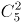种，此时剩余三名教师自动去往第三所学校，故总情况数为种。

故正确答案为A。

备注：本题存在歧义，题干未明确指出三所学校所需教师名额是否固定。若名额不固定，另一种解法为：先选出一所学校，派出1名教师，情况数为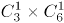种；再选出一所学校，派出2名教师，情况数为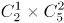种，此时剩余三名教师自动去往最后一所学校，故总情况数为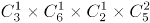种，对应C项。但现实生活中，支教名额应该是根据学校需求定好的，所以粉笔更倾向A项为正确答案。

**考点**：基础排列组合

**来源**：2022年湖北省公务员录用考试《行测》题（网友回忆版）第57题

### 第 62 题

某市举行庆典活动，将依次升空105架无人机，升空方式如下：每架无人机间距均相等，第一次升空n架，第二次升空n-1架，以此类推，最终在夜空中组成一个近似等边三角形背景的灯光秀，那么第10次升空的无人机数量是：

A. 3架

B. 5架

C. 8架

D. 10架

第 62 题 · 答案与解析

**参考答案（粉笔题库参考内容）**

B

**解析**

根据题意可知，每次升空的无人机数量组成等差数列。又因为“组成一个近似等边三角形”，则第一次升空n架（）为底边，最后一次升空的无人机在三角形的顶点上，数量为1架（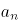），且公差d＝-1。根据等差数列求和公式：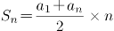，可得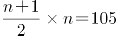，解得n＝14。再根据等差数列通项公式：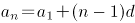，则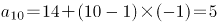，故第10次升空的无人机数量是5架。

故正确答案为B。

**考点**：数列问题

**来源**：2022年浙江省公务员录用考试《行测》题（C类）（网友回忆版）第14题

### 第 63 题

某地采用传统销售模式，销售一批鸡蛋需要20天，销售一批桃子需要25天。为推动销售，当地开启县领导直播带货模式，直播带货期间，鸡蛋的销售效率提高为原来的2倍，桃子销售效率为原来的3倍；其余销售时间依然按照传统模式进行，结果两种产品同时销售完成。那么销售期间直播带货的天数为：

A. 3

B. 5

C. 8

D. 10

第 63 题 · 答案与解析

**参考答案（粉笔题库参考内容）**

B

**解析**

除了销售时间相同，销售鸡蛋和销售桃子没有其它关系，所以二者是相互独立的，因此可赋值传统销售模式下的鸡蛋和桃子的销售效率均为1，则直播带货期间，鸡蛋销售效率为2，桃子销售效率为3。根据题意可得，该批鸡蛋总量为20×1=20，该批桃子总量为25×1=25。设销售期间直播带货的天数为x，则非直播带货的鸡蛋销售时间为，非直播带货的桃子销售时间为。因为两种产品同时销售完成，其中的直播带货时间相同，那么非直播带货的时间也相同，即20-2x=25-3x，解得x=5，因此销售期间直播带货的天数为5。

故正确答案为B。

**考点**：给效率比例型

**来源**：2022年浙江省公务员录用考试《行测》题（C类）（网友回忆版）第8题

### 第 64 题

北京冬奥会期间，冬奥会吉祥物“冰墩墩”纪念品十分畅销。销售期间某商家发现，进价为每个40元的“冰墩墩”，当售价定为44元时，每天可售出300个，售价每上涨1元，每天销量减少10个。现商家决定提价销售，若要使销售利润达到最大，则售价应为：

A. 51元

B. 52元

C. 54元

D. 57元

第 64 题 · 答案与解析

**参考答案（粉笔题库参考内容）**

D

**解析**

设“冰墩墩”纪念品售价共上涨x元，销售利润为y元。根据题意，可列方程：y=(44-40+x)×(300-10x)，即y=(4+x)×(300-10x)，令y=0，解得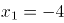，，当时，总利润最大，此时售价为44+13=57元。

故正确答案为D。

**考点**：函数最值问题

**来源**：2022年浙江省公务员录用考试《行测》题（C类）（网友回忆版）第9题

### 第 65 题

两个信号灯分别以30秒和36秒的固定间隔闪亮一次，若他们10点第一次同时闪亮，则第七次同时闪亮的时间为（ ）。

A. 10：15

B. 10：16

C. 10：18

D. 10：21

第 65 题 · 答案与解析

**参考答案（粉笔题库参考内容）**

C

**解析**

根据题意可得，两个信号灯同时闪亮的周期为180秒（30秒与36秒的最小公倍数），即两个信号灯以3分钟的固定间隔同时闪亮一次。从第一次同时闪亮到第七次同时闪亮之间，共间隔6个周期×3分钟=18分钟。若他们10点第一次同时闪亮，则第七次同时闪亮的时间为10：18。

故正确答案为C。

**考点**：周期相遇问题

**来源**：2022年河北省公务员录用考试《行测》题（网友回忆版）第65题

### 第 66 题

某助农志愿小分队采摘到甲、乙、丙三筐枸杞共144斤。第一次从甲筐中取出与乙筐一样重的枸杞放入乙筐，第二次再从现有乙筐中取出与丙筐一样重的枸杞放入丙筐，第三次从现有丙筐中取出与现有甲筐一样重的枸杞放入甲筐，此时三筐枸杞一样重。那么原来甲筐中有枸杞：

A. 36斤

B. 48斤

C. 56斤

D. 66斤

第 66 题 · 答案与解析

**参考答案（粉笔题库参考内容）**

D

**解析**

方法一：甲、乙、丙三筐共144斤，最终三筐枸杞一样重，每筐144÷3=48斤，根据题意反推如下表：

方法二：设最初甲、乙、丙分别有x斤、y斤、z斤枸杞，变化如下表：

可列方程组：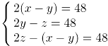，解得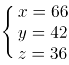。

故正确答案为D。

**考点**：和差倍比问题

**来源**：2022年内蒙古公务员录用考试《行测》题（网友回忆版）第64题

### 第 67 题

某方舱医院配有1000张床位，现已接收新冠确诊患者200名，并按床护比（护士数与床位数的比值）0.6：1配齐了护士人员。因疫情发展迅速，该医院又收治了700名患者，此时床护比下调为0.2：1，那么还需增加护士：

A. 80名

B. 60名

C. 40名

D. 20名

第 67 题 · 答案与解析

**参考答案（粉笔题库参考内容）**

B

**解析**

根据最初床护比为0.6：1，可求出最初200名患者配备的护士人数为200×0.6=120名；又收治700名患者后，患者总数变为200+700=900名，按照下调后床护比为0.2：1计算，共需护士900×0.2=180名，所以需增加护士人数=180-120=60名。

故正确答案为B。

**考点**：和差倍比问题

**来源**：2022年浙江省公务员录用考试《行测》题（C类）（网友回忆版）第13题

### 第 68 题

已知甲乙丙三数之和为90，甲数除以乙数与丙数除以甲数的结果，都是商4余1。则乙数为（ ）。

A. 2

B. 3

C. 4

D. 5

第 68 题 · 答案与解析

**参考答案（粉笔题库参考内容）**

C

**解析**

设乙数为x，则甲数为4x+1，丙数为4×（4x+1）+1=16x+5。根据“甲乙丙三数之和为90”，可列式x+（4x+1）+（16x+5）=90，解得x=4，即乙数为4。

故正确答案为C。

**来源**：2022年河北省公务员录用考试《行测》题（网友回忆版）第68题

### 第 69 题

清朝乾隆皇帝曾出上联“客上天然居，居然天上客”，纪昀以“人过大佛寺，寺佛大过人”对出下联，这副对联既可以顺读也可以逆读，被称作回文联。数学中也有类似回文数，如212、37473等，则三位数中回文数是奇数的概率为：

A. 

B. 

C. 

D. 

第 69 题 · 答案与解析

**参考答案（粉笔题库参考内容）**

D

**解析**

根据题意三位数是回文数的情况，即百位数字和个位数字相同，且由于三位数百位数字不能为0，只能是1-9中的任意一个，十位数字可以是0-9中的任意一个，故总情况数有9×10=90种。回文数是奇数的情况，即个位数字可以是1、3、5、7、9中的一个，百位数字和个位数字相同，十位数字可以是0-9中的任意一个，故满足条件的情况有5×10=50种。则三位数中回文数是奇数的概率为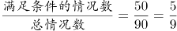。

故正确答案为D。

**考点**：给情况求概率

**来源**：2022年浙江省公务员录用考试《行测》题（C类）（网友回忆版）第15题

### 第 70 题

甲乙两人顺时针方向沿圆形跑道跑步。甲跑完一圈要10min，乙跑完一圈要12min，如果他们分别从圆形跑道直径两端同时出发，甲第一次追上乙需要（ ）分钟。

A. 30

B. 60

C. 15

D. 45

第 70 题 · 答案与解析

**参考答案（粉笔题库参考内容）**

A

**解析**

赋值圆形跑道长度为60，则甲每分钟的速度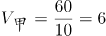，乙每分钟的速度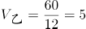。甲、乙分别从圆形跑道直径两端同时出发，即出发时两人相距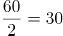，根据追及公式：，可得：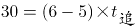，解得：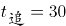，即甲第一次追上乙需要30分钟。

故正确答案为A。

**考点**：相遇追及

**来源**：2022年河北省公务员录用考试《行测》题（网友回忆版）第70题

### 第 71 题

某商场为庆祝开业三周年，制作了一个长方形大蛋糕，并切成四块，如图所示。假设这个蛋糕可供350人享用，左下角那块蛋糕平均可供50人享用，右上角那块蛋糕平均可供70人，则中间最大块蛋糕平均可供多少人享用？

A. 150

B. 155

C. 175

D. 180

第 71 题 · 答案与解析

**参考答案（粉笔题库参考内容）**

B

**解析**

假设平均每人享用蛋糕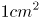，则蛋糕面积为，赋值蛋糕的长为35cm，宽为10cm。如下图所示：

根据“左下角那块蛋糕平均可供50人享用，右上角那块蛋糕平均可供70人”可知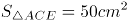，，根据三角形面积公式：，可得：CEcm，BFcm，则ED=35-10=25cm，DF=10-4=6cm，则，故，平均可供155人享用，即中间最大块蛋糕平均可供155人享用。

故正确答案为B。

**考点**：几何结论类-三角形相关、几何公式类-平面图形

**来源**：2022年浙江省公务员录用考试《行测》题（C类）（网友回忆版）第6题

### 第 72 题

某城市规划馆有一个边长为40米的正三角形数字展厅，展厅中布置有5台投影设备，用于展示城市的过去、现在以及畅想城市的未来。每台投影设备的尺寸忽略不计，则任意两台设备之间的最小距离：

A. 小于10米

B. 不超过16米

C. 不超过20米

D. 在23～28米之间

第 72 题 · 答案与解析

**参考答案（粉笔题库参考内容）**

C

**解析**

根据题意“在正三角形数字展厅内部布置5台投影设备”，假设其中3台投影设备放在正三角形数字展厅的三个顶点，即蓝色圆点处，如下图所示。此时若想使剩余2台设备的距离尽量大，连接正三角形各边上的中点，可得到小正三角形，从红色圆点处任选2个放置剩余2台投影设备即可得到最大间距，则任意两台设备之间的最小距离不超过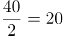米。

故正确答案为C。

**考点**：几何结论类-几何小题型、非典型最值问题

**来源**：2022年内蒙古公务员录用考试《行测》题（网友回忆版）第68题

### 第 73 题

A、B两个乡镇分布于山谷两侧，山谷间有一条宽为2km的河道（如下图所示）。当地政府决定在两个乡镇间修建一条跨河公路促进旅游发展。由于架桥费用高昂，所以要求跨河公路中的桥梁路段长度最短。那么根据图中数据，从A镇前往B镇的最短距离为：

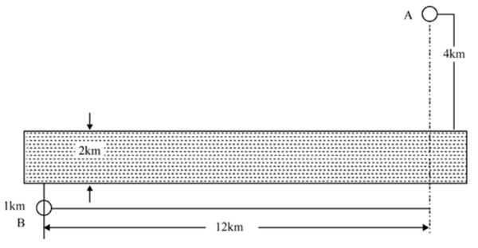

A. 17km

B. 15km

C. 19km

D. 20km

第 73 题 · 答案与解析

**参考答案（粉笔题库参考内容）**

B

**解析**

根据题目要求桥长2km，最短距离=AB最短距离+桥长，如下图所示，将河流看成一条直线，两点之间线段最短，连接AB构成直角三角形ABC，km。

从A镇前往B镇的最短距离=13+2=15km。

故正确答案为B。

**考点**：几何结论类-三角形相关、几何公式类-平面图形

**来源**：2022年浙江省公务员录用考试《行测》题（C类）（网友回忆版）第18题

### 第 74 题

有200人参加招聘会，其中法学70人，经济学60人，工业设计50人，统计学20人，至少有（ ）人找到工作才能保证一定有50人的专业相同。

A. 167

B. 168

C. 170

D. 175

第 74 题 · 答案与解析

**参考答案（粉笔题库参考内容）**

B

**解析**

题目问“至少······才能保证······”，为最值问题中的最不利构造题型。最不利的情况为每个专业最多只有49人找到工作，则最不利情况数为49（法学）+49（经济学）+49（工业设计）+20（统计学）=167人，在此基础上再任意多一人找到工作就可以满足有50人的专业相同的要求，即至少要有167+1=168人找到工作。

故正确答案为B。

**考点**：最不利构造

**来源**：2022年河北省公务员录用考试《行测》题（网友回忆版）第74题

### 第 75 题

用一个长为20厘米、宽为2厘米、高为1.5厘米的长方体木料，制作一串半径最大的木珠子，不考虑制作过程中的损耗，则这串珠子的数量最多为：

A. 10个

B. 13个

C. 14个

D. 20个

第 75 题 · 答案与解析

**参考答案（粉笔题库参考内容）**

C

**解析**

木珠子是球形的，需要从长方体木料的内部进行切割，由于长方体的高为1.5厘米，则木珠子的最大直径为长方体的高1.5厘米，即半径最大。长方体的宽为2厘米，木珠子的直径为1.5厘米，制作过程中，要令数量最多，木珠子错落摆放即满足要求。摆放过程注意不要超出长方体木料的长度，用前两个珠子的摆放作为演示：

AC是两个木珠子球心的连线，长度即为木珠子的直径1.5厘米，AC为斜边做直角三角形ABC，AC即两个球心间的最短距离。BC的长度为长方体的宽-木珠子的半径-B点距长方体左边的边长，且AB垂直BC，可得出B点距长方体左边的边长即A点距长方体边长的距离0.75厘米，可求BC长=2-0.75-0.75=0.5厘米，在直角三角形ABC中，利用勾股定理可以求出AB长为厘米，即在AB所在直线上，相邻两个珠子间距（把珠子看成点）为厘米，且第一个和最后一个珠子的球心距长方体木料两端至少为0.75厘米。则制作的珠子数量=段数+1，段数，即分为13段，那么珠子数量最多=13+1=14个。

故正确答案为C。

**考点**：几何结论类-三角形相关、非典型最值问题、几何公式类-立体图形

**来源**：2022年浙江省公务员录用考试《行测》题（C类）（网友回忆版）第19题

### 第 76 题

所给的四个选项中，哪一项填入问号处，不能使之呈现一定的规律性：

A. A

B. B

C. C

D. D

第 76 题 · 答案与解析

**参考答案（粉笔题库参考内容）**

D

**解析**

元素组成不同，且无明显属性规律，考虑数量规律。观察发现，图一、图三和图四均为多端点图形，图二为多圆相交图形，可以考虑笔画数。题干图形均为一笔画，而本题为选非题，故？处应选择不是一笔画的图形。A、B、C三项均为一笔画图形，D项为两笔画图形。只有D项不符合规律。

本题为选非题，故正确答案为D。

**考点**：数量规律-线

**来源**：2022年浙江省公务员录用考试《行测》题（A类）（网友回忆版）第77题

### 第 77 题

从所给的四个选项中，选择最合适的一个填入问号处，使之呈现一定的规律性：

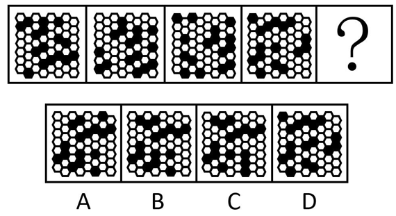

A. A

B. B

C. C

D. D

第 77 题 · 答案与解析

**参考答案（粉笔题库参考内容）**

A

**解析**

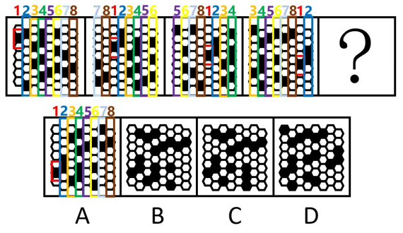

元素组成相同，优先考虑位置规律。观察发现，若将每列的元素分别标号后，如上图所示，每列的元素整体依次向右平移2列，且向右平移后又整体依次向下平移1格，只有A项符合此规律。

故正确答案为A。

**考点**：位置规律-平移

**来源**：2022年浙江省公务员录用考试《行测》题（C类）（网友回忆版）第88题

### 第 78 题

把下面的六个图形分为两类，使每一类图形都有各自的共同特征或规律，分类正确的一项是：

A. ①②③，④⑤⑥

B. ①③⑤，②④⑥

C. ①④⑤，②③⑥

D. ①⑤⑥，②③④

第 78 题 · 答案与解析

**参考答案（粉笔题库参考内容）**

D

**解析**

元素组成不同，且无明显属性规律，考虑数量规律。观察发现，题干图形分割明显，考虑面数量。图①⑤⑥均有6个面，图②③④均有9个面，即图①⑤⑥一组，图②③④一组。

故正确答案为D。

**考点**：数量规律-面

**来源**：2022年浙江省公务员录用考试《行测》题（C类）（网友回忆版）第83题

### 第 79 题

从所给的四个选项中，选择最合适的一个填入问号处，使之呈现一定的规律性：

A. A

B. B

C. C

D. D

第 79 题 · 答案与解析

**参考答案（粉笔题库参考内容）**

B

**解析**

元素组成相同，优先考虑位置规律。观察发现，第一组图形中，第一个图形上下翻转并保留原图形后得到第二个图形，第一个图形保持不变放置在下方，然后对第一个图形分别进行上下翻转后放置在上方、顺时针旋转后放置在左侧、逆时针旋转后放置在右侧得到第三个图形。第二组图形应用此规律，对应B项。

故正确答案为B。

**考点**：位置规律-综合

**来源**：2022年浙江省公务员录用考试《行测》题（C类）（网友回忆版）第87题

### 第 80 题

下图右框内纸盒的外表面中，不能折叠成左框内所示的纸盒的是：

A. A

B. B

C. C

D. D

第 80 题 · 答案与解析

**参考答案（粉笔题库参考内容）**

B

**解析**

本题考查六面体的空间重构。将题干立体图中的面依次标注为面a、面b、面c，如下图所示。

A项：选项与题干立体图一致，排除；

B项：题干立体图中面a与面b的公共边靠近面a中云朵的底部，而选项中面a与面b的公共边靠近面a中云朵的顶部，选项与题干立体图不一致，当选；

C项：选项与题干立体图一致，排除；

D项：选项与题干立体图一致，排除。

本题为选非题，故正确答案为B。

备注：本题作图不严谨，C项中面b与面a的公共边所对应的图形与题干立体图有差别，云朵的细节与立体图形不同，但对比B、C两项，B项错误更加明显，因此小粉笔建议选择B项。

**考点**：空间类-空间重构-六面体

**来源**：2022年浙江省公务员录用考试《行测》题（C类）（网友回忆版）第90题

### 第 81 题

马兰戈尼效应，指的是表面张力不同的两种液体存在表面张力梯度，表面张力大的对其周围表面张力小的液体的拉力强，使液体从表面张力小的一边向张力大的方向流动渗透。

根据上述定义，下列属于马兰戈尼效应的是：

A. 若干种不同的酒按密度大小依次缓慢倒进杯子，会形成分层，通过加冰块，可以加大或减小密度，分层更明显

B. 涂料配色过程中，涂料和干燥后的涂膜颜色存在细微差异，在湿膜时颜色一般比较浅，在干燥后，颜色会加深

C. 牛奶中加入几滴流体色素，没有搅拌的情况下色素相对集中，取少量洗洁精滴在色素所在位置，色素迅速往牛奶边缘扩散

D. 奶茶就是牛奶和茶叶水的充分混合，不同的奶粉和不同茶叶水搭配，产生不同风味的奶茶，而且奶粉和茶水的配比也影响奶茶口感

第 81 题 · 答案与解析

**参考答案（粉笔题库参考内容）**

C

**解析**

第一步：找出定义关键词。

“表面张力不同的两种液体”、“液体从表面张力小的一边向张力大的方向流动渗透”。

第二步：逐一分析选项。

A项：若干种不同的酒按密度大小依次缓慢倒进杯子形成分层，并没有出现流动渗透，不符合“液体从表面张力小的一边向张力大的方向流动渗透”，不符合定义，排除；

B项：涂料和干燥后的涂膜颜色存在细微差异，在湿膜时颜色一般比较浅，在干燥后，颜色会加深，说的是涂料干燥前和干燥后的颜色差异，只出现一种液体涂料，不符合“表面张力不同的两种液体”，并且也体现不出液体之间的流动渗透，不符合“液体从表面张力小的一边向张力大的方向流动渗透”，不符合定义，排除；

C项：牛奶中加入几滴流体色素，没有搅拌的情况下色素相对集中，取少量洗洁精滴在色素所在位置，色素迅速往牛奶边缘扩散，这是因为牛奶密度略高于色素，在牛奶中加入色素后，色素可以短暂漂浮在牛奶表面，洗洁精是一种表面活性剂，加入洗洁精后，色素表面的张力迅速下降，从而小于牛奶张力，便形成扩散效果，加入洗洁精后的牛奶与色素符合“表面张力不同的两种液体”，色素在洗洁精的作用下改变张力，从而向牛奶边缘扩散，符合“液体从表面张力小的一边向张力大的方向流动渗透”，符合定义，当选；

D项：奶茶是牛奶和茶叶水的混合物，在介绍奶茶的制作原材料，没有体现两种液体互相流动渗透，不符合“液体从表面张力小的一边向张力大的方向流动渗透”，不符合定义，排除。

故正确答案为C。

**考点**：原因结果

**来源**：2022年浙江省公务员录用考试《行测》题（C类）（网友回忆版）第97题

### 第 82 题

回应性监管是指政府通过制度设计，采用多样化的监管手段和策略对市场主体和社会组织进行动态化、智能化、差别化的监管。回应性监管强调监管主体的多元化，除政府以外，企业、社会组织，乃至被监管对象都是监管主体；在监管策略上，采取差异化、阶梯化的监管方式，即政府首先鼓励自我监管，难以奏效时才采取更为严厉的强化型自我监管直至命令控制型监管。

根据上述定义，下列选项没有体现回应性监管的是：

A. 某地主管部门因食品安全问题突击整顿涉事企业

B. 瑞典立法要求工作场所必须建立安全环保的内控体系

C. 英国成立企业、工会代表组成的大健康监管委员会

D. 聘请专业的第三方机构对企业安全生产状况进行评估

第 82 题 · 答案与解析

**参考答案（粉笔题库参考内容）**

A

**解析**

第一步：找出定义关键词。

“采用多样化的监管手段和策略”、“监管主体的多元化”。

第二步：逐一分析选项。

A项：某地主管部门直接对涉事企业进行了整顿，监管只有某地主管部门一个，没有体现出监管手段的多样化，不符合“采用多样化的监管手段和策略”，不符合定义，当选；

B项：瑞典立法要求建立内控体系，说明除政府外还有其他监管手段和策略，内控体系也体现了“差别化的监管”，符合“采用多样化的监管手段和策略”，符合定义，排除；

C项：英国成立企业、工会代表组成的大健康监管委员会，说明监管由不同主体共同完成，体现了多样化的监管手段和策略，符合“采用多样化的监管手段和策略”，符合定义，排除；

D项：聘请专业的第三方机构，说明除第三方机构外可能还有其他的监管主体，可能符合 “监管主体的多元化”，比A更好，符合定义，排除。

本题为选非题，故正确答案为A。

**考点**：方式目的

**来源**：2022年浙江省公务员录用考试《行测》题（C类）（网友回忆版）第92题

### 第 83 题

乡情治理是指乡情作用于基层社会治理主体和治理体系，在基层社会的意见整合、利益协调、矛盾化解、服务供给等治理过程中发挥重要作用的一种治理形态。“乡情”是一种基于地域以及附着在经济、社会、文化纽带上的特殊情感，体现为认同感、归属感、荣誉感及在此基础上的回馈意愿和公共精神。乡情治理的核心是存在一个由情感和认同构筑的场域，这个场域通过一些微观机制影响个体动机和群体行为，从而影响社会治理体系和过程。

根据上述定义，下列属于乡情治理的是：

A. 顺德人都以顺德是“世界美食之都”而自豪

B. 敢拼会赢的精神一直激励着闽南人勇闯南洋

C. 海外华侨华人一直有着爱国爱乡的光荣传统

D. 北岸乡贤成立妈祖慈善基金会服务当地桑梓

第 83 题 · 答案与解析

**参考答案（粉笔题库参考内容）**

D

**解析**

第一步：找出定义关键词。

“乡情作用于基层社会治理主体和治理体系”、“在基层社会的治理过程中发挥重要作用”、“由情感和认同构筑的场域”、“影响社会治理体系和过程”。

第二步：逐一分析选项。

A项：“以顺德是‘世界美食之都’而自豪”只表明顺德人对当地的情感和认同，但是没有体现出对基层社会的治理，不符合“乡情作用于基层社会治理主体和治理体系”、“在基层社会的治理过程中发挥作用”，不符合定义，排除；

B项：“敢拼会赢的精神”只表明这是闽南人的一种精神，并不是对于某地域的乡情，所以不存在由情感和认同构筑的场域，不符合“由情感和认同构筑的场域”，同时并没有体现出治理，不符合“乡情作用于基层社会治理主体和治理体系”，不符合定义，排除；

C项：“爱国爱乡的光荣传统”只是海外华侨华人的品格，并不是对于某地域的乡情，所以不存在由情感和认同构筑的场域，不符合“由情感和认同构筑的场域”，同时并没有体现出治理，不符合“乡情作用于基层社会治理主体和治理体系”，不符合定义，排除；

D项：“乡贤成立妈祖慈善基金会”说明当地人认同本地区的文化，存在由情感和认同构筑的场域，符合“由情感和认同构筑的场域”，而且“服务当地桑梓”是一种基层社会治理，符合“乡情作用于基层社会治理主体和治理体系”、“影响社会治理体系和过程”，符合定义，当选。

故正确答案为D。

**考点**：拆词

**来源**：2022年浙江省公务员录用考试《行测》题（C类）（网友回忆版）第93题

### 第 84 题

参照群体理论是关于人的社会心理态度和行为怎样受其从属的或追求的群体参照力所影响的社会心理学理论。参照群体是指个体从心理上把自己列入、与之对照，并在评价、态度、行为上和在规范与价值观形成上接受其影响的群体。

根据上述定义，下列选项不能用参照群体理论解释的是：

A. 小王平时喜欢便装，但是参加面试时他决定穿着西装

B. 夏秋之际，妈妈怕孩子受凉，很注意给孩子增减衣物

C. 小刘看其他影迷都购买了偶像同款商品，自己也去买

D. 小张父母都是医生，她比常人更在意身边的卫生状况

第 84 题 · 答案与解析

**参考答案（粉笔题库参考内容）**

B

**解析**

第一步：找出定义关键词。

“受其从属的或追求的群体参照力所影响”。

第二步：逐一分析选项。

A项：小王平时喜欢便装，但参加面试时穿了西装，是因为面试时大多数人都选择正式的西装，小王也受其影响，因而在面试时做出同样的选择，符合“受其从属的或追求的群体参照力所影响”，符合定义，排除；

B项：妈妈给孩子增减衣物是因为天气转凉，妈妈行为的变化是受天气变化的影响而不是群体的影响，不符合“受其从属的或追求的群体参照力所影响”，不符合定义，当选；

C项：小刘购买偶像同款商品是因为其他影迷都购买了，小刘的行为受影迷群体的影响，符合“受其从属的或追求的群体参照力所影响”，符合定义，排除；

D项：小张在意卫生状况是因为小张的父母都是医生，小张的行为受其父母的影响，符合“受其从属的或追求的群体参照力所影响”，符合定义，排除。

本题为选非题，故正确答案为B。

**考点**：单定义-其他句式

**来源**：2022年浙江省公务员录用考试《行测》题（C类）（网友回忆版）第94题

### 第 85 题

替代性满足指当欲望能量在最初对象上遇到阻碍时，就会向其他对象转移；如果再次遇阻，就再次转移，直到寻找到一个替代对象以消除紧张、满足欲望为止。

根据上述定义，下列选项不属于替代性满足的是：

A. 小李很喜欢旅游，因此经常利用自己的假期到全国各地旅游

B. 小王将自己不愉快的生活经历倾注于笔下，完成了一些作品

C. 小刘的小超市经营状况不佳，所以他一直有着天降横财的幻想

D. 小林梦想成为一个叱咤风云的英雄，他特别喜欢上网打战争游戏

第 85 题 · 答案与解析

**参考答案（粉笔题库参考内容）**

A

**解析**

第一步：找出定义关键词。

“欲望能量在最初对象上遇到阻碍”、“不断转移直到寻找到替代对象”。

第二步：逐一分析选项。

A项：小李喜欢旅游，这是他的“欲望能量”，他经常利用假期旅游，说明小李的“欲望能量”得到了满足，不符合“欲望能量在最初对象上遇到阻碍”，不符合定义，当选；

B项：愉快的生活是小王的“欲望能量”，小王有不愉快的生活经历，说明其“欲望能量”没有得到满足，符合“欲望能量在最初对象上遇到阻碍”；他利用不愉快的生活经历完成了一些作品，说明小王将写作作为最初欲望的替代，符合“不断转移直到寻找到替代对象”，符合定义，排除；

C项：经营好小超市是小刘的“欲望能量”，小刘的小超市经营状况不佳，说明其“欲望能量”没有得到满足，符合“欲望能量在最初对象上遇到阻碍”；他一直有天降横财的幻想，说明小刘将幻想作为最初欲望的替代，符合“不断转移直到寻找到替代对象”，符合定义，排除；

D项：做一个叱咤风云的英雄是小林的“欲望能量”，因此他特别喜欢上网打战争游戏，说明其“欲望能量”在现实中没有得到满足，符合“欲望能量在最初对象上遇到阻碍”；同时将网络游戏作为最初欲望的替代，符合“不断转移直到寻找到替代对象”，符合定义，排除。

本题为选非题，故正确答案为A。

**考点**：拆词

**来源**：2022年浙江省公务员录用考试《行测》题（C类）（网友回忆版）第95题

### 第 86 题

最小干预原则是指在保证文物安全的基本前提下，通过最小程度的介入来最大限度地维系文物的原本面貌，保留文物的历史、文化价值，以实现延续现状、降低保护性破坏的目标。

根据上述定义，下列选项不属于最小干预原则的是：

A. 某博物馆在修复古籍时不拆开原线绳，只修补蛀洞严重的书页，而不修补强度未受蛀洞影响的书页

B. 某博物馆的一幅雕塑作品中的人物手臂缺失，专家们查阅了原始资料，根据资料将其复原如初

C. 某古城墙修缮时，保留其残损的现状，在靠近边墙的一侧恢复了很窄的台阶供游人安全通过

D. 某古塔倾斜，专家们在研究后最终决定只纠偏一度，它看上去依旧是倾斜的状态

第 86 题 · 答案与解析

**参考答案（粉笔题库参考内容）**

B

**解析**

第一步：找出定义关键词。

“保证文物安全”、“最小程度的介入”、“最大限度地维系文物的原本面貌”、“延续现状、降低保护性破坏”。

第二步：逐一分析选项。

A项：某博物馆在修复古籍时不拆开原线绳，只修补蛀洞严重的书页，符合“最小程度的介入”，不修补强度未受蛀洞影响的书页，符合“最大限度地维系文物的原本面貌”，符合定义，排除；

B项：雕塑作品中的人物手臂缺失，根据资料将其复原如初，并没有保留现状，也没有体现是不是最小程度的改变，不符合“最小程度的介入”、“最大限度地维系文物的原本面貌”，不符合定义，当选；

C项：某古城墙修缮时，保留其残损的现状，符合“最大限度地维系文物的原本面貌”，在靠近边墙的一侧恢复了很窄的台阶，说明修复的地方很少，符合“最小程度的介入”，符合定义，排除；

D项：某古塔倾斜，专家们只纠偏一度，说明修复的很少，符合“最小程度的介入”，依旧保留倾斜的状态，符合“最大限度地维系文物的原本面貌”，符合定义，排除。

本题为选非题，故正确答案为B。

**考点**：方式目的

**来源**：2022年浙江省公务员录用考试《行测》题（C类）（网友回忆版）第96题

### 第 87 题

过滤气泡是指以大数据与算法推荐为底层架构，根据用户的使用时间、地区以及浏览习惯生成用户画像，并通过算法技术为其呈现独一无二的界面体验。网络上这种针对个人化搜索而提供筛选后结果的推荐算法，被称为过滤气泡。

根据上述定义，下列不属于过滤气泡的是：

A. 赵先生准备买车，上网看了很多汽车测评类的文章，买完车之后，浏览器上的内容几乎全是汽车类的资讯

B. 李先生经常网购图书，平台特意为他推送购书清单，打造个性化书店，让他在第一时间能得到新书的信息

C. 刘先生经常去某网络贴吧发帖，得到了很多人的关注，一些与他有相同爱好的人还建立了一个微信群进行交流

D. 王先生和张先生分别在各自手机上搜索某公司，王先生的搜索结果多为该公司的招聘信息，张先生的却多为该公司的投资信息

第 87 题 · 答案与解析

**参考答案（粉笔题库参考内容）**

C

**解析**

第一步：找出定义关键词。

“针对个人化搜索，提供筛选后结果”。

第二步：逐一分析选项。

A项：赵先生上网看测评类的文章后，浏览器为其推送相关内容，符合“针对个人化搜索，提供筛选后结果”，符合定义，排除；

B项：李先生经常网购图书，平台针对性推送购书清单，符合“针对个人化搜索，提供筛选后结果”，符合定义，排除；

C项：刘先生经常去某网络贴吧发帖，建立微信群的过程，没有体现出“针对个人化搜索，提供筛选后结果”，不符合定义，当选；

D项：两位先生分别在各自手机上搜索某公司后，搜索结果的不同，符合“针对个人化搜索，提供筛选后结果”，符合定义，排除。

本题为选非题，故正确答案为C。

**考点**：方式目的

**来源**：2022年浙江省公务员录用考试《行测》题（C类）（网友回忆版）第98题

### 第 88 题

深度学习是指在模仿人脑机制的神经网络中，对人工神经元的层进行了“多层处理”。深度学习不仅可以让AI（人工智能）读取大量图片，还可以让AI自主提取图片特征。得益于深度学习技术的面世，只要有大量数据，AI就能以极高的准确率进行学习，从而大幅度拓展了AI的应用范围。

根据上述定义，下列属于深度学习的是：

A. 人工智能图片教学走进课堂让学生体验深度学习

B. 问诊机器人可以迅速获取病患B超报告的风险信息

C. 某设区市在数字峰会期间提供无人驾驶汽车试乘服务

D. 安防巡检机器人通过图像识别技术判定工人是否佩戴安全帽

第 88 题 · 答案与解析

**参考答案（粉笔题库参考内容）**

D

**解析**

第一步：找出定义关键词。

“AI（人工智能）读取大量图片”、“自主提取图片特征”。

第二步：逐一分析选项。

A项：让学生观看人工智能的图片来体验深度学习，是让学生观看图片，不是让AI读取图片，不符合“AI（人工智能）读取大量图片”，不符合定义，排除；

B项：问诊机器人可以识别B超报告，但报告中不只含有图片，还含有文字性诊断结果可以直接告知病患风险信息，而不需要AI提取，不符合“AI（人工智能）读取大量图片”、“自主提取图片特征”，不符合定义，排除；

C项：提供无人驾驶汽车试乘服务，不是让AI读取图片，不符合“AI（人工智能）读取大量图片”、“自主提取图片特征”，不符合定义，排除；

D项：安防巡检机器人通过识别工人的图像来判定工人是否佩戴安全帽，符合“AI（人工智能）读取大量图片”、“自主提取图片特征”，符合定义，当选。

故正确答案为D。

**考点**：单定义-其他句式

**来源**：2022年浙江省公务员录用考试《行测》题（C类）（网友回忆版）第91题

### 第 89 题

衰老通常分为生理性衰老和病理性衰老。生理性衰老是指随着年龄增长出现的衰老，也就是自然老化。病理性衰老是指衰老速度由于负面情绪、物理创伤、营养匮乏、身体疾病等各种因素的作用而加快。

根据上述定义，下列诗词所描述的现象最符合病理性衰老的是：

A. 白头搔更短，浑欲不胜簪

B. 寒暑迭变，不觉渐成衰老

C. 惟草木之零落兮，恐美人之迟暮

D. 人生不得长欢乐，年少须臾老到来

第 89 题 · 答案与解析

**参考答案（粉笔题库参考内容）**

A

**解析**

第一步：找出定义关键词。

病理性衰老：“由于负面情绪、物理创伤、营养匮乏、身体疾病”、“衰老速度加快”；

生理性衰老：“随着年龄增长出现的衰老”、“自然老化”。

第二步：逐一分析选项。

A项：“白头搔更短，浑欲不胜簪”意思为“愁闷心烦只有搔首而已，致使白发疏稀插不上簪”，愁闷心烦符合“由于负面情绪、物理创伤、营养匮乏、身体疾病”，白发稀疏是衰老的明显特征之一，而更稀疏符合“衰老速度加快”，符合“病理性衰老”定义，当选；

B项：“寒暑迭变，不觉渐成衰老”意思为“冬天和夏天交替变化，没有感觉就已渐渐衰老”，时间的变化导致的衰老，不符合“由于负面情绪、物理创伤、营养匮乏、身体疾病”，也未体现“衰老速度加快”，不符合“病理性衰老”定义，排除；

C项：“惟草木之零落兮，恐美人之迟暮”意思为“想到树上黄叶纷纷飘零，而害怕美人头上也添上丝丝霜鬓”，诗人只是表达了害怕美人衰老，而不是描写美人已经衰老，又为何衰老，不符合“由于负面情绪、物理创伤、营养匮乏、身体疾病”，也未体现“衰老速度加快”，不符合“病理性衰老”定义，排除；

D项：“人生不得长欢乐，年少须臾老到来”意思为“人的一生得不到长久的欢乐，青春年少的时光总是过的很快，老年很快就来了”，诗人感叹的是时光飞逝，是由于时间的原因导致衰老，不符合“由于负面情绪、物理创伤、营养匮乏、身体疾病”，也未体现“衰老速度加快”，不符合“病理性衰老”定义，排除。

故正确答案为A。

注——本题出处如下：

https://baike.baidu.com/item/%E8%A1%B0%E8%80%81/1169838?fr=aladdin

**考点**：常规问法

**来源**：2022年湖北省公务员录用考试《行测》题（网友回忆版）第85题

### 第 90 题

薄膜干涉，指的是不同颜色的光波有不同的波长，当一束光波照射于薄膜，由于折射率不同，光波会被薄膜的上界面与下界面分别反射后再相遇，发生相互干涉而形成新的光波。对这一现象的研究可以用于计算薄膜的厚度、折射率等。

根据上述定义，下列不属于薄膜干涉的是：

A. 一片普通薄玻璃镶嵌在窗框里，屋外灿烂的阳光穿透玻璃，照在屋内镜子上也能产生强烈反光

B. 汽车玻璃上的贴膜会改变折射光线和反射光线的能量分配比例，增加对某一光波的反射光强度

C. 汽车在有积水的柏油路上驶过时，积水面会形成一层油膜，这层油膜在阳光下呈现出美丽的色彩

D. 自然环境中，两块干净平整的玻璃片紧紧压叠形成极薄空间，出现一些平行条纹，手指用力压紧玻璃时，条纹随之发生改变

第 90 题 · 答案与解析

**参考答案（粉笔题库参考内容）**

A

**解析**

第一步：找出定义关键词。

“一束光波照射于薄膜”、“薄膜使其形成新的光波”。

第二步：逐一分析选项。

A项：阳光穿透玻璃，照在屋内镜子上产生强烈反光，说明镜子对光进行了反射，但镜子上是否有薄膜并不清楚，不符合“一束光波照射于薄膜”，不符合定义，当选；

B项：光线照射在汽车玻璃上的贴膜上，符合“一束光波照射于薄膜”，改变折射光线和反射光线的能量分配比例，增加对某一光波的反射光强度，说明光波经过贴膜后形成了新的光波，符合“薄膜使其形成新的光波”，符合定义，排除；

C项：积水面形成的油膜在阳光下呈现出美丽的色彩，符合“一束光波照射于薄膜”，“美丽的色彩”说明肉眼看不到颜色的阳光经过油膜后形成了新的光波，符合“薄膜使其形成新的光波”，符合定义，排除；

D项：两块干净平整的玻璃片紧紧压叠形成极薄空间时，出现平行条纹，说明周围环境有光，符合“一束光波照射于薄膜”，手指用力压紧玻璃时，条纹随之发生改变，说明出现了新的光波，符合“薄膜使其形成新的光波”，符合定义，排除。

本题为选非题，故正确答案为A。

**考点**：大前提

**来源**：2022年湖北省公务员录用考试《行测》题（网友回忆版）第78题

### 第 91 题

岳父：泰山

A. 少女：娥眉

B. 儿子：孙子

C. 女婿：东床

D. 兄弟：伯仲

第 91 题 · 答案与解析

**参考答案（粉笔题库参考内容）**

C

**解析**

第一步：判断题干词语间逻辑关系。

“岳父”的别称叫“泰山”，二者为全同关系。

第二步：判断选项词语间逻辑关系。

A项：“少女”指未成年女孩，“娥眉”泛指貌美的女子，二者为交叉关系，与题干逻辑关系不一致，排除；

B项：“儿子”与“孙子”不是全同关系，与题干逻辑关系不一致，排除；

C项：“女婿”的别称叫“东床”，二者为全同关系，与题干逻辑关系一致，当选；

D项：“伯仲”指弟兄排行的次序，与“兄弟”不是全同关系，与题干逻辑关系不一致，排除。

故正确答案为C。

**考点**：逻辑关系-全同关系

**来源**：2022年浙江省公务员录用考试《行测》题（C类）（网友回忆版）第102题

### 第 92 题

墨鱼：乌贼

A. 蚱蜢：蝗虫

B. 蜜蜂：黄蜂

C. 知了：蝉

D. 金龟子：天牛

第 92 题 · 答案与解析

**参考答案（粉笔题库参考内容）**

C

**解析**

第一步：判断题干词语间逻辑关系。

墨鱼是乌贼的俗称，二者为全同关系。

第二步：判断选项词语间逻辑关系。

A项：蚱蜢和蝗虫的关系较有争议，部分资料显示二者为全同关系，与题干逻辑关系一致，保留；

B项：蜜蜂属于蜜蜂科，黄蜂属于胡蜂科，二者是两种不同的动物，为并列关系，与题干逻辑关系不一致，排除；

C项：知了是蝉的俗称，二者为全同关系，与题干逻辑关系一致，保留；

D项：金龟子是鞘翅目金龟总科的通称，天牛是多食亚目天牛科昆虫的总称，二者为并列关系，与题干逻辑关系不一致，排除。

对比A、C两项，A项中蚱蜢和蝗虫的关系较有争议，如下图所示，维基百科和百度百科都表明二者是全同关系，但现代汉语词典表明二者并不是同一种动物，目前无法确定出题人对二者的关系是如何判定的，相对来说，C项中的知了和蝉是比较明确的全同关系，因此，小粉笔将正确答案给到完全没有争议的C项。

故正确答案为C。

**考点**：逻辑关系-全同关系

**来源**：2022年河北省公务员录用考试《行测》题（网友回忆版）第92题

### 第 93 题

电脑：设备

A. 广播：传媒

B. 颜料：绘画

C. 文言：白话

D. 能源：煤炭

第 93 题 · 答案与解析

**参考答案（粉笔题库参考内容）**

A

**解析**

第一步：判断题干词语间逻辑关系。

电脑是一种设备，二者是种属关系。

第二步：判断选项词语间逻辑关系。

A项：传媒指传播媒介，特指报纸、广播、电视、网络等各种新闻工具，广播是一种传媒，二者是种属关系，与题干逻辑关系一致，当选；

B项：颜料是绘画所用的材料，二者不是种属关系，与题干逻辑关系不一致，排除；

C项：文言和白话为汉语书面语的两种形式，二者是并列关系而非种属关系，与题干逻辑关系不一致，排除；

D项：煤炭是一种能源，二者是种属关系，但两词顺序与题干相反，与题干逻辑关系不一致，排除。

故正确答案为A。

**考点**：逻辑关系-包容关系

**来源**：2022年浙江省公务员录用考试《行测》题（C类）（网友回忆版）第105题

### 第 94 题

粉笔暂未收录本题（来源缺题，题位保留）

第 94 题 · 答案与解析

**答案状态：unknown（来源未提供）**

**解析状态：unknown（来源未提供）**

### 第 95 题

针线：布料：服饰

A. 剪刀：彩纸：窗花

B. 刻刀：玺印：玉石

C. 玻璃：窗户：窗框

D. 鸡精：乌鸡：鸡汤

第 95 题 · 答案与解析

**参考答案（粉笔题库参考内容）**

A

**解析**

第一步：判断题干词语间逻辑关系。

针线是制作服饰的工具，布料是制作服饰的原材料，三者为工具、原材料、成品的对应关系。

第二步：判断选项词语间逻辑关系。

A项：剪刀是制作窗花的工具，彩纸是制作窗花的原材料，三者为工具、原材料、成品的对应关系，与题干逻辑关系一致，当选；

B项：刻刀是制作玺印的工具，玉石是制作玺印的原材料，三者为工具、成品、原材料的对应关系，但三词顺序与题干不同，与题干逻辑关系不一致，排除；

C项：玻璃和窗框是窗户的组成部分，与题干逻辑关系不一致，排除；

D项：鸡精是一种调味品，不是制作鸡汤的工具，与题干逻辑关系不一致，排除。

故正确答案为A。

**考点**：逻辑关系-对应关系

**来源**：2022年浙江省公务员录用考试《行测》题（C类）（网友回忆版）第107题

### 第 96 题

电影院：影片：放映

A. 图书馆：资料：查阅

B. 下水道：地漏：排水

C. 传染病：疫苗：防疫

D. 朋友圈：微信：聊天

第 96 题 · 答案与解析

**参考答案（粉笔题库参考内容）**

A

**解析**

第一步：判断题干词语间逻辑关系。

在电影院放映影片，放映影片是动宾关系，电影院是放映影片的地点。

第二步：判断选项词语间逻辑关系。

A项：在图书馆查阅资料，查阅资料是动宾关系，图书馆是查阅资料的地点，与题干逻辑关系一致，当选；

B项：地漏具有排水的功能，二者是功能对应关系，与题干逻辑关系不一致，排除；

C项：不能说在传染病防疫疫苗，且传染病不是一个地点，与题干逻辑关系不一致，排除；

D项：不能说在朋友圈聊天微信，且朋友圈不是一个地点，微信具有聊天的功能，二者是功能对应关系，与题干逻辑关系不一致，排除。

故正确答案为A。

**考点**：逻辑关系-对应关系、语法关系

**来源**：2022年浙江省公务员录用考试《行测》题（C类）（网友回忆版）第108题

### 第 97 题

肥：瘦：挑肥拣瘦

A. 上：下：欺上瞒下

B. 来：去：翻来覆去

C. 黑：白：黑白分明

D. 是：非：口是心非

第 97 题 · 答案与解析

**参考答案（粉笔题库参考内容）**

A

**解析**

第一步：判断题干词语间逻辑关系。

肥与瘦为反义词，且肥在第三个词语中的2号位，瘦在第三个词语中的4号位，第三个词语拆分之后，挑肥与拣瘦均为动宾结构。

第二步：判断选项词语间逻辑关系。

A项：上与下为反义词，上在第三个词语中的2号位，下在第三个词语中的4号位，第三个词语拆分之后，欺上与瞒下均为动宾结构，与题干逻辑关系一致，当选；

B项：来与去为反义词，来在第三个词语中的2号位，去在第三个词语中的4号位，第三个词语拆分之后，翻来与覆去不是动宾结构，与题干逻辑关系不一致，排除；

C项：黑与白为反义词，黑在第三个词语中的1号位，白在第三个词语中的2号位，与题干逻辑关系不一致，排除；

D项：是与非为反义词，是在第三个词语中的2号位，非在第三个词语中的4号位，第三个词语拆分之后，口是与心非不是动宾结构，与题干逻辑关系不一致，排除。

故正确答案为A。

**考点**：语义关系-反义关系、拆分思维、语法关系

**来源**：2022年内蒙古公务员录用考试《行测》题（网友回忆版）第94题

### 第 98 题

征稿：评选：颁奖

A. 运动：热身：放松

B. 节能：减排：环保

C. 设计：施工：监理

D. 麻醉：切开：缝合

第 98 题 · 答案与解析

**参考答案（粉笔题库参考内容）**

D

**解析**

第一步：判断题干词语间逻辑关系。

先征稿，再评选，最后颁奖，三者为动作上的先后顺序的对应关系。

第二步：判断选项词语间逻辑关系。

A项：先热身，再运动，两词顺序与题干相反，与题干逻辑关系不一致，排除；

B项：节能和减排是并列关系，不分先后，且节能和减排都属于环保措施，与题干逻辑关系不一致，排除；

C项：先设计，再施工，监理是指对工程项目等进行监督管理，监理的主要内容是熟悉所监理项目的合同条款、规范、设计图纸，有效开展现场监理工作，及时报告施工过程中出现的问题等，所以施工和监理可以同时发生，没有一定的先后顺序，与题干逻辑关系不一致，排除；

D项：先麻醉，再切开，最后缝合，三者为动作上的先后顺序的对应关系，与题干逻辑关系一致，当选。

故正确答案为D。

**考点**：逻辑关系-对应关系

**来源**：2022年浙江省公务员录用考试《行测》题（C类）（网友回忆版）第109题

### 第 99 题

入木三分 对于 （ ） 相当于 （ ） 对于 音乐

A. 绘画；珠圆玉润

B. 雕刻；黄钟大吕

C. 建筑；高山流水

D. 书法；余音绕梁

第 99 题 · 答案与解析

**参考答案（粉笔题库参考内容）**

D

**解析**

逐一代入选项。

A项：入木三分形容书法刚劲有力，也用来形容议论、见解深刻，与绘画无明显逻辑关系；珠圆玉润形容歌声婉转优美或文字流畅明快，用来形容音乐，二者为对应关系。前后逻辑关系不一致，排除；

B项：入木三分形容书法刚劲有力，也用来形容议论、见解深刻，与雕刻无明显逻辑关系；黄钟大吕形容正大、庄严、高妙的音乐或文辞，用来形容音乐，二者为对应关系。前后逻辑关系不一致，排除；

C项：入木三分形容书法刚劲有力，也用来形容议论、见解深刻，与建筑无明显逻辑关系；高山流水指知音难觅或乐曲高妙，用来形容音乐，二者为对应关系。前后逻辑关系不一致，排除；

D项：入木三分形容书法刚劲有力，也用来形容议论、见解深刻，用来形容书法，二者构成对应关系；余音绕梁形容歌声或音乐优美，耐人回味，用来形容音乐，二者构成对应关系。前后逻辑关系一致，当选。

故正确答案为D。

**考点**：逻辑关系-对应关系

**来源**：2022年湖北省公务员录用考试《行测》题（网友回忆版）第95题

### 第 100 题

晴空万里 对于 （ ） 相当于 （ ） 对于 识文断字

A. 天干物燥；才高八斗

B. 雨后春笋；妙笔生花

C. 阴云密布；胸无点墨

D. 倾盆大雨；味同嚼蜡

第 100 题 · 答案与解析

**参考答案（粉笔题库参考内容）**

C

**解析**

逐一代入选项。

A项：“晴空万里”形容天空晴朗，没有一点云彩，“天干物燥”意思是天气太干，物品也干燥，极易起火，二者无明显逻辑关系；“才高八斗”比喻才学极高，“识文断字”意思是能识字读书，指有一点文化知识，二者无明显逻辑关系，前后逻辑关系不一致，排除；

B项：“晴空万里”形容天空晴朗，没有一点云彩，“雨后春笋”指春天下大雨后，发出来的竹笋一下子就长出来很多，比喻新生事物迅速大量地涌现出来，二者无明显逻辑关系；“妙笔生花”比喻写作能力大有进步，或形容文章写得很出色，“识文断字”意思是能识字读书，指有一点文化知识，二者无明显逻辑关系，前后逻辑关系不一致，排除；

C项：“晴空万里”形容天空晴朗，没有一点云彩，“阴云密布”形容浓厚的云层或空气中的大量的烟尘遮蔽天日，二者为反义关系；“胸无点墨”意思是肚子里没有一点墨水，指没有文化，“识文断字”意思是能识字读书，指有一点文化知识，二者为反义关系，前后逻辑关系一致，当选；

D项：“晴空万里”形容天空晴朗，没有一点云彩，“倾盆大雨”形容雨大势急，二者为反义关系；“味同嚼蜡”意思是像吃蜡一样，没有一点儿味，形容语言或文章枯燥无味，“识文断字”意思是能识字读书，指有一点文化知识，二者无明显逻辑关系，前后逻辑关系不一致，排除。

故正确答案为C。

**考点**：语义关系-反义关系

**来源**：2022年浙江省公务员录用考试《行测》题（C类）（网友回忆版）第110题

### 第 101 题

研究发现，对居住地附近有至少30%的土地是公园和绿地的成年人而言，他们感到孤独的几率比居住地附近绿地面积不足10%的成年人要低26%。对于独居者而言，关联性甚至更大——在绿地面积达到或超过30%的地区，他们感到孤独的可能性降低了一半。

以下哪项如果为真，最能支持上述观点?

A. 越来越多的证据表明，孤独感与罹患抑郁症的风险增加有关

B. 城市重新造林可能有助于降低主观记忆减退甚至患阿尔茨海默症的风险

C. 以前没有定期接触自然的人以安全、积极和可持续的方式定期与自然接触，就有希望缓解孤独感

D. 绿地面积大小与社交互动频率正相关，经常与他人在绿地环境中交流有助于改善情绪和消除孤独感

第 101 题 · 答案与解析

**参考答案（粉笔题库参考内容）**

D

**解析**

第一步：找出论点和论据。

论点：对于独居者而言，关联性甚至更大——在绿地面积达到或超过30%的地区，他们感到孤独的可能性降低了一半。

论据：对居住地附近有至少30%的土地是公园和绿地的成年人而言，他们感到孤独的几率比居住地附近绿地面积不足10%的成年人要低26%。

论据给出一组“居住地附近绿地面积”与“孤独感”关系的数据，论点说的是“居住地附近绿地面积”与“独居者孤独感”的关系，论据和论点的话题一致，加强优先考虑补充论据，即解释原因或举例子。

第二步：逐一分析选项。

A项：该项说的是孤独感与罹患抑郁症风险的关系，而论点说的是居住地附近绿地面积与孤独感的关系，话题不一致，无法加强，排除；

B项：该项说的是城市造林对主观记忆减退及患阿尔茨海默症风险的影响，而论点说的是居住地附近绿地面积与孤独感的关系，话题不一致，无法加强，排除；

C项：该项说的是定期接触自然有望缓解孤独感，但并不明确“接触自然”与“居住地附近绿地面积”的关系，为不明确项，无法加强，排除；

D项：该项说的是绿地面积大小影响社交互动频率，且经常与他人在绿地环境中交流有助于改善情绪和消除孤独感，解释了为什么在绿地面积达到或超过30%的地区，独居者感到孤独的可能性会降低，补充论据，可以加强，当选。

故正确答案为D。

**考点**：补充论据

**来源**：2022年浙江省公务员录用考试《行测》题（C类）（网友回忆版）第115题

### 第 102 题

有些人的心情比较容易受到外界影响，比如飞行员担心遇到雷暴，虽然没有什么奇招，但有些食物的确能让大脑更好地运作，可可就是其中之一。这是因为可可含有大量的茶碱和咖啡因，它们可以有效的减轻压力和缓解疼痛。

以下哪项如果为真，最能支持上述观点？

A. 虽然可可富含咖啡因，但咖啡因只有在特定条件下才能发挥其减压作用

B. 据研究显示，可可中含有的茶碱和咖啡因可以刺激大脑分泌内啡肽，而内啡肽对减轻压力和缓解疼痛非常有效

C. 每天摄入主要原料为可可的黑巧克力对情绪会有一定影响

D. 每天至少30分钟的运动，有助于大脑产生缓解压力和焦虑所需的激素

第 102 题 · 答案与解析

**参考答案（粉笔题库参考内容）**

B

**解析**

第一步：找出论点和论据。

论点：有些食物的确能让大脑更好地运作，可可就是其中之一。

论据：可可含有大量的茶碱和咖啡因，它们可以有效的减轻压力和缓解疼痛。

本题论点说的是“可可”让“大脑更好地运作”，论据说的是“可可”中的“茶碱和咖啡因”可以“减轻压力和缓解疼痛”，“减轻压力和缓解疼痛”有助于“大脑更好地运作”，二者关系紧密，可以认为话题一致，加强可以考虑补充论据，即解释原因或举例。

第二步：逐一分析选项。

A项：指出可可中的咖啡因需要在“特定条件”下才能发挥减压作用，但无法确定食用可可时是否满足特定条件，也就无法判断减压作用是否能实现，属于不明确项，无法加强，排除；

B项：指出可可中含有的茶碱和咖啡因是通过刺激大脑分泌内啡肽来起到减轻压力和缓解疼痛作用的，进而能让大脑更好地运作，解释原因，补充论据，当选；

C项：指出用可可制作的黑巧克力对情绪有影响，但无法判断是好影响还是坏影响，能否让大脑更好的运作，属于不明确项，无法加强，排除；

D项：指出“运动”对于大脑的作用，而论点说的是“可可”对于大脑的作用，话题不一致，属于无关项，无法加强，排除。

故正确答案为B。

**考点**：补充论据

**来源**：2022年浙江省公务员录用考试《行测》题（C类）（网友回忆版）第118题

### 第 103 题

研究人员对人的“头骨突起”进行了一项研究。在这项研究中，调查对象包括1200名年龄在18岁至86岁的普通人群，研究发现，颅骨底部出现骨质突起的情况在年轻人中比在老年人中更为普遍，尤其是在18岁至30岁年龄组的男性当中，研究者认为，一些人颅骨底部出现的奇怪的“头骨突起”与他们长时间弯下脖子看智能手机时的奇怪角度有关。

以下各项如果为真，最能质疑上述结论的是：

A. 网上销售的塑形枕头深受“头骨突起”的年轻消费者欢迎

B. 该研究样本人群是随机抽取，它的结论适用于普通人群

C. 研究人员对年轻人更容易出现头骨突起的分析过程存在瑕疵

D. 研究者并未对调查对象每日弯下脖子看智能手机的时间进行记录

第 103 题 · 答案与解析

**参考答案（粉笔题库参考内容）**

D

**解析**

第一步：找出论点和论据。

论点：一些人颅骨底部出现的奇怪的“头骨突起”与他们长时间弯下脖子看智能手机时的奇怪角度有关。

论据：研究发现颅骨底部出现骨质突起的情况在年轻人中比在老年人中更为普遍，尤其是在18岁至30岁年龄组的男性当中。

本题论据在分析“年龄”与“头骨突起”的关系，论点在分析“长时间弯下脖子看智能手机时的奇怪角度”和“头骨突起”的关系，论据和论点话题不一致，优先考虑拆桥，即不能通过“年龄”推出“不良姿势看手机的时长”。

第二步：逐一分析选项。

A项：指出塑形枕头受到“头骨突起”的年轻消费者欢迎，是在强调部分头骨突起人群的购物偏好，但论点是在分析“头骨突起”产生的具体原因，话题不一致，无法削弱，排除；

B项：指出研究样本选取很科学，结论具有普适性，进一步说明了结论成立的科学性，为加强项，无法削弱，排除；

C项：指出研究中对年轻人更容易出现头骨突起的分析过程存在瑕疵，即论据中的研究过程是存在瑕疵的，可以削弱，保留；

D项：指出该研究未统计过不同年龄段的受访者用不良姿势看智能手机的时长，那就不能通过“年龄”推出“不良姿势看手机的时长”，可以削弱，保留；

比较C、D两项，C项只说分析过程存在瑕疵，但具体是什么瑕疵，是否会影响实验结论，表述并不明确，故D项更为明确。

故正确答案为D。

**考点**：削弱-实验类、拆桥

**来源**：2022年浙江省公务员录用考试《行测》题（C类）（网友回忆版）第114题

### 第 104 题

近日，有科学家撰文指出，即使保持现有的城市和农田面积，地球上至少还有种植1万亿棵或1.5万亿棵树的空间，面积可达900万平方公里，大致相当于美国的国土面积。而这些新树未来几十年里可以从大气中吸收近7500亿吨导致温室效应的二氧化碳，这几乎等同于人类在过去25年排放的碳污染的总和。因此，该科学家认为，对抗全球变暖最根本的方法是，种植1万亿棵或1.5万亿棵树。

以下各项如果为真，最能质疑这位科学家观点的是：

A. 还有其他可行方法可以应对气候变化，例如让人们从吃肉转向吃素

B. 对燃烧石油、煤炭和天然气的依赖，才是导致全球变暖的根本原因

C. 随着全球变暖尤其是热带地区变干燥，当前树木植被已在大片消失

D. 只有年轻的树木才能从空气中清除更多碳污染，热带地区最具潜力

第 104 题 · 答案与解析

**参考答案（粉笔题库参考内容）**

B

**解析**

第一步：找出论点和论据。

论点：对抗全球变暖最根本的方法是，种植1万亿棵或1.5万亿棵树。

论据：1万亿棵或1.5万亿棵新树未来几十年里可以从大气中吸收近7500亿吨导致温室效应的二氧化碳，这几乎等同于人类在过去25年排放的碳污染的总和。

论点讨论的是“对抗全球变暖最根本的方法是种1万亿棵或1.5万亿棵树”，论据讨论的是“通过种1万亿棵或1.5万亿棵树吸收导致温室效应的二氧化碳”，论点论据都在讨论种树可以对抗全球变暖，论点论据话题一致，削弱优先考虑削弱论点。

第二步：逐一分析选项。

A项：该项说的是还有其他可行方法可以应对气候变化，题干论点讨论的是应对全球变暖最根本的方法是种树，话题不一致，无法削弱，排除;

B项：该项说的是导致全球变暖的根本原因是对燃烧石油、煤炭和天然气的依赖，说明要想对抗全球变暖根本方法应该是减少对燃烧石油、煤炭和天然气的依赖，可以说明种树不能从根本上解决全球变暖，削弱论点，当选；

C项：该项说的是全球变暖尤其是热带地区变干燥导致当前树木植被已在大片消失，题干论点讨论的是应对全球变暖最根本的方法是种树，话题不一致，无法削弱，排除；

D项：该项说的是什么样的树木才能从空气中清除更多碳污染，题干论点讨论的是应对全球变暖最根本的方法是种树，无法削弱，排除。

故正确答案为B。

**考点**：削弱论点

**来源**：2022年浙江省公务员录用考试《行测》题（C类）（网友回忆版）第116题

### 第 105 题

有观点认为，体质的酸化是百病之源。无论是癌症，还是常见的高血压、糖尿病、痛风等，都是由于“酸性食物”吃多了导致体质酸化引起的。而鱼、肉、米饭、酒等人类的主副食品都是酸性的，尤其是我们的主食米饭，更被渲染成“酸性食物”的典型代表。

以下各项如果为真，最能反驳上述观点的是：

A. 人体的皮肤处于弱酸性状态时，比较不容易滋生细菌

B. 人体的酸碱度以7.4为佳，即身体偏碱性就是健康的

C. 人体有三个调节系统平衡酸碱，人的体质不会是酸性

D. 健康人的尿液是呈酸性的，人体本身就存在酸性物质

第 105 题 · 答案与解析

**参考答案（粉笔题库参考内容）**

C

**解析**

第一步：找出论点和论据。

论点：体质的酸化是百病之源。

论据：无论是癌症，还是常见的高血压、糖尿病、痛风等，都是由于“酸性食物”吃多了导致体质酸化引起的。

本题的论点和论据均在讨论“体质酸化”与“疾病”之间的关系，话题一致，削弱优先考虑削弱论点，即体质的酸化不是百病之源。

第二步：逐一分析选项。

A项：该项讨论的是“人体皮肤处于弱酸性状态”与“不容易滋生细菌”的关系，“人体皮肤处于弱酸性状态”不能代表论点中“体质的酸化”，且“不容易滋生细菌”不代表不容易生病，话题不一致，无法削弱，排除；

B项：该项指出身体偏碱性就是健康的，未明确说明酸性体质是否健康，不明确项，排除；

C项：该项指出人的体质不会是酸性的，说明酸性体质不存在，则酸性体质也不可能是百病之源，削弱论点，当选；

D项：该项指出健康人体存在酸性物质，但是存在酸性物质不代表健康人是“酸性体质”，话题不一致，无法削弱，排除。

故正确答案为C。

**考点**：削弱论点

**来源**：2022年浙江省公务员录用考试《行测》题（C类）（网友回忆版）第112题

### 第 106 题

伤害感受神经能够对造血干细胞动员进行调控，增强造血干细胞的黏附或迁移，降钙素基因相关肽（CGRP）是伤害感受神经元主要分泌的神经递质分子。研究者发现，给予CGRP可以显著增强造血干细胞动员。CGRP可以直接影响造血干细胞，诱导细胞表面形成CALCRL和RAMP1蛋白形成的二聚体受体，并促进造血干细胞进入血管。研究专家认为，吃辣可以促进造血干细胞动员。

如果上述结论为真，需要补充的前提是：

A. 骨髓神经纤维中高达77%都是伤害感受神经元

B. 辛辣食物导致的“辣味”是一种痛觉，会激活伤害感受神经

C. 辣的食物能够促进消化液的分泌，增加消化酶的活性，加速胃肠道蠕动

D. 造血干细胞会在神经的调控之下，从骨髓释放进入循环，对损失的血细胞进行补充

第 106 题 · 答案与解析

**参考答案（粉笔题库参考内容）**

B

**解析**

第一步：找出论点和论据。

论点：吃辣可以促进造血干细胞动员。

论据：伤害感受神经能够对造血干细胞动员进行调控，增强造血干细胞的黏附或迁移，降钙素基因相关肽（CGRP）是伤害感受神经元主要分泌的神经递质分子。研究者发现，给予CGRP可以显著增强造血干细胞动员。CGRP可以直接影响造血干细胞，诱导细胞表面形成CALCRL和RAMP1蛋白形成的二聚体受体，并促进造血干细胞进入血管。

本题论点说的是“吃辣”与“造血干细胞动员”之间的关系，论据说的是“伤害感受神经”与“造血干细胞动员”之间的关系，话题不一致，且提问方式为“前提”，加强优先考虑搭桥，即建立“吃辣”与“伤害感受神经”之间的联系。

第二步：逐一分析选项。

A项：指出骨髓神经纤维中的伤害感受神经元占比高，不能说明“吃辣”与“造血干细胞动员”之间的关系，话题不一致，无法加强，排除；

B项：指出“辣味”会激活神经纤维中的伤害感受神经，这说明吃辣可以影响伤害感受神经，进而影响造血干细胞动员，在“吃辣”与“伤害感受神经”之间建立了联系，搭桥项，可以加强，当选；

C项：指出辣的食物能够促进消化液的分泌、加速胃肠道蠕动，与造血干细胞无关，属于无关项，无法加强，排除；

D项：指出造血干细胞能够对损失的血细胞进行补充，未提及吃辣对其的影响，属于无关项，无法加强，排除。

故正确答案为B。

**考点**：搭桥

**来源**：2022年浙江省公务员录用考试《行测》题（C类）（网友回忆版）第113题

### 第 107 题

传统理论认为恐龙的灭绝是小行星撞击地球导致的，科学家表示，恐龙的多样性是从7600万年前开始下降。研究人员研究了六大恐龙群体的进化趋势，发现在6600万年白垩纪末期物种大灭绝之前的大约1000万年里，食草恐龙和食肉恐龙都在衰落。

由此可以推出：

A. 在小行星撞击地球并最终使恐龙灭绝之前恐龙就已经处境不佳

B. 在恐龙时代的最后1000万年里，六大恐龙的新物种形成速度下降，灭绝速度急剧上升

C. 在恐龙时代最后4000万年中的不同时期，六大恐龙的多样性都出现了下降，尽管降幅不一

D. 恐龙在小行星撞地球之前就面临危机，由于它们的灭绝速度超过新物种的速度，因此“尤其容易灭绝”

第 107 题 · 答案与解析

**参考答案（粉笔题库参考内容）**

A

**解析**

日常结论题，根据题干信息逐一分析选项。

A项：根据题干可知，恐龙的多样性从7600万年前就开始下降，食草恐龙和食肉恐龙都在衰落，这些发生在6600万年白垩纪末期物种大灭绝（小行星撞击地球的时间）之前的大约1000万年里，可以推出在小行星撞击地球并最终使恐龙灭绝之前恐龙就已经处境不佳，当选；

B项：题干只是指出在恐龙时代的最后1000万年里，食草恐龙和食肉恐龙都在衰落，并没有提及新物种形成速度和灭绝速度的情况，无中生有，无法推出，排除；

C项：题干中没有提及在恐龙时代“最后4000万年中的不同时期”，六大恐龙多样性的降幅问题，无中生有，无法推出，排除；

D项：题干中没有提及恐龙和新物种灭绝速度的比较，无中生有，无法推出，排除。

故正确答案为A。

**考点**：日常结论

**来源**：2022年湖北省公务员录用考试《行测》题（网友回忆版）第100题

### 第 108 题

研究者发现，蚕挑选桑叶要经过类似于计算机安全系统的验证。蚕口器下方的下颚须在触碰叶片时会先轻轻咬一口，下颚须中的味觉神经能以极高的灵敏度识别叶片表面的\-谷甾醇、绿原酸、异槲皮苷这三种物质；接着，它会用口器上的须形外颚叶来尝一下叶片叶汁中的糖分，须形外颚叶上的味觉神经比较迟钝，只有高浓度的糖才能激活；在确认是桑叶后它才开始大肆咀嚼。

由此可以推出：

A. 桑叶会分泌适合蚕生长的糖分和物质，故而它几乎只吃桑叶

B. 通过不同的器官感受不同的味道，这就是蚕判断桑叶的秘诀

C. 蚕在演化过程中，它的口器具备了通过触碰感知桑叶的能力

D. 这项研究有助于改进蚕的人工饲料，可在没有桑树的环境下养蚕

第 108 题 · 答案与解析

**参考答案（粉笔题库参考内容）**

B

**解析**

日常结论题，根据题干信息逐一分析选项。

A项：题干指出蚕是通过高浓度糖分激活须形外颚叶上的味觉神经来确认桑叶，没有提及蚕只吃桑叶的原因，无中生有，无法推出，排除；

B项：题干指出蚕口器下方的下颚须中的味觉神经能识别\-谷甾醇、绿原酸、异槲皮苷，接着，蚕会用口器上的须形外颚叶来尝一下叶片叶汁中的糖分，可以推出蚕通过不同的器官感受不同的味道来判断是否是桑叶，可以推出，当选；

C项：题干指出蚕依靠下颚须中的“味觉神经”识别叶片表面的一些物质，用口器上的须形外颚叶来“尝”糖分，因此蚕是依靠“味觉”来感知桑叶，而非依靠“碰触”，无法推出，排除；

D项：题干中没有提及蚕的饲养，也没有提及改进蚕的人工饲料，无中生有，无法推出，排除。

故正确答案为B。

**考点**：日常结论

**来源**：2022年浙江省公务员录用考试《行测》题（C类）（网友回忆版）第119题

### 第 109 题

DNA甲基化严密控制着基因的表达，在肿瘤发生发展过程中发挥着重要作用。DNA出错且甲基化缺失是导致癌症的一个重要成因。几乎所有的人类肿瘤中都存在肿瘤相关基因的异常甲基化。因此，DNA甲基化异常是癌症发生的一种警示性标志。研究者据此认为，可以使用DNA甲基化作为一种全新的癌症检测筛查标志物，来有效识别结直肠癌、肺癌、乳腺癌和肝癌等肿瘤。

以下各项如果为真，最能支持上述研究者观点的是：

A. 肿瘤抑制基因启动子区往往发生DNA高甲基化，而癌基因启动子区则呈现出低甲基化

B. DNA甲基化检测方法不断涌现，既说明该研究难度大，也说明这些方法都有其局限性

C. DNA甲基化检测方法具有生物学的稳定性，且样本需求量少，检查过程更加简单快捷

D. 基因启动子区异常甲基化在多种人类疾病发生发展机制的研究中受到越来越多的重视

第 109 题 · 答案与解析

**参考答案（粉笔题库参考内容）**

A

**解析**

第一步：找出论点和论据。

论点：可以使用DNA甲基化作为一种全新的癌症检测筛查标志物，来有效识别结直肠癌、肺癌、乳腺癌和肝癌等肿瘤。

论据：DNA甲基化异常是癌症发生的一种警示性标志。

本题论点探讨“DNA甲基化”和“筛查癌症的标志”之间的关系，论据说的是“DNA甲基化”和“癌症警示性标志”之间的关系，二者话题一致，优先考虑补充论据加强，可以举例子，也可以解释原因。

第二步：逐一分析选项。

A项：该项指出肿瘤抑制基因启动子区呈现DNA高甲基化，而癌基因启动子区呈现DNA低甲基化，解释了为什么DNA甲基化可以作为癌症检测筛查的标志物，解释原因，可以加强，当选；

B项：该项讨论DNA甲基化检测方法的研究难度以及局限性，但并未提及DNA甲基化是否可以作为癌症检测筛查的标志物，与论点讨论的话题不一致，无法加强，排除；

C项：该项讨论DNA甲基化检测方法有稳定性高、简单快捷等优势，但并未提及DNA甲基化是否可以作为癌症检测筛查的标志物，与论点讨论的话题不一致，无法加强，排除；

D项：该项讨论基因启动子区异常甲基化在研究中受到越来越多的重视，但并未提及DNA甲基化是否可以作为癌症检测筛查的标志物，与论点讨论的话题不一致，无法加强，排除。

故正确答案为A。

**考点**：补充论据

**来源**：2022年浙江省公务员录用考试《行测》题（C类）（网友回忆版）第111题

### 第 110 题

欧洲杯比赛期间，小赵、小钱、小孙、小李预测甲、乙两支队伍能否进入决赛。他们的对话如下：

小赵：如果甲进入决赛，则乙也能进入决赛。

小钱：我看甲进入决赛没有问题。

小孙：在我看来，甲能够进入决赛，但乙进不了。

小李：我的看法是，如果甲不能进入决赛，则乙进决赛。

结果出来后，他们四人的预测有两个真、两个假，关于甲和乙是否进入决赛，以下推论正确的是：

A. 甲和乙都进入决赛

B. 甲和乙都没有进入决赛

C. 甲进入决赛，乙没有进入决赛

D. 甲没有进入决赛，乙进入决赛

第 110 题 · 答案与解析

**参考答案（粉笔题库参考内容）**

D

**解析**

第一步：分析题干找关系。

①小赵：甲乙；

②小钱：甲；

③小孙：甲 且 -乙；

④小李：-甲乙。

分析题干条件，①、③为矛盾关系，必有一真一假。

第二步：看其余。

根据题干推理可知，四人预测为两真两假，故②、④也必有一真一假。由“AB”=“-A 或 B”可知，④“-甲乙”=“甲 或 乙”，此时，若②“甲”为真，则④“甲 或 乙”为真，与②、④必有一真一假矛盾，故②“甲”为假，即甲没有进入决赛，此时④“甲 或 乙”为真，根据或关系的否一推一，可知乙进入决赛。

故正确答案为D。

**考点**：两真两假

**来源**：2022年浙江省公务员录用考试《行测》题（C类）（网友回忆版）第120题

## 材料 1

近年来，我国新能源汽车销量及保有量快速提升，充电基础设施布局也日渐完善。2021年新能源汽车销量达352.1万辆，同比增长157.51%；截至2021年，我国新能源汽车保有量达784万辆，同比增长59.25%。

### 第 111 题

2016—2021年我国公共充电桩数量同比增速最大的年份是：

A. 2016年

B. 2019年

C. 2020年

D. 2021年

第 111 题 · 答案与解析

**参考答案（粉笔题库参考内容）**

A

**解析**

根据题干“2016-2021年······同比增速最大的年份是”，可判定本题为一般增长率比较问题。定位统计图1可知2015—2021年我国公共充电桩数量。根据公式：增长率，可得我国公共充电桩数量同比增速分别为：

2016年，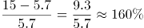；

2019年，；

2020年，；

2021年，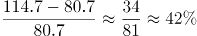。

则2016—2021年我国公共充电桩数量同比增速最大的年份是2016年。

故正确答案为A。

**考点**：一般增长率、综合资料

**来源**：2022年湖北省公务员录用考试《行测》题（网友回忆版）第111题

### 第 112 题

2021年北京市、上海市、广东省公共充电桩数量之和占全国公共充电桩总数的比重约为：

A. 28.7%

B. 33.3%

C. 39.8%

D. 46.7%

第 112 题 · 答案与解析

**参考答案（粉笔题库参考内容）**

B

**解析**

根据题干“2021年······占······的比重约为”，可判定本题为现期比重问题。定位图1可得：2021年我国公共充电桩数量为114.7万台；定位图2可得：2021年广东省、上海市、北京市公共充电桩数量依次为181846台、103249台、96840台。根据公式：比重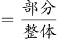，则2021年北京市、上海市、广东省公共充电桩数量之和占全国公共充电桩总数的比重为。

故正确答案为B。

**考点**：现期比重、综合资料

**来源**：2022年湖北省公务员录用考试《行测》题（网友回忆版）第112题

### 第 113 题

2016—2021年我国公共充电桩数量同比增速未超过50%的年份有：

A. 1个

B. 2个

C. 3个

D. 4个

第 113 题 · 答案与解析

**参考答案（粉笔题库参考内容）**

C

**解析**

根据题干“······同比增速未超过50%······”，可判定本题为一般增长率问题。定位图1可知2015—2021年我国公共充电桩数量。根据公式：增长率，同比增速未超过50%，即现期量1.5基期量。

2016年：15＞5.7×1.5=8.55，不满足；

2017年：21.4＜15×1.5=22.5，满足；

2018年：30＜21.4×1.5=32.1，满足；

2019年：51.6＞30×1.5=45，不满足；

2020年：80.7＞51.6×1.5=77.4，不满足；

2021年：114.7＜80.7×1.5=121.05，满足。

因此2016—2021年我国公共充电桩数量同比增速未超过50%的年份有3个。

故正确答案为C。

**考点**：一般增长率、综合资料

**来源**：2022年湖北省公务员录用考试《行测》题（网友回忆版）第114题

### 第 114 题

2016—2021年我国公共充电桩数量年均增长量约为：

A. 15.57万台

B. 17.35万台

C. 18.17万台

D. 19.94万台

第 114 题 · 答案与解析

**参考答案（粉笔题库参考内容）**

D

**解析**

根据题干“2016—2021年······年均增长量约”，可判定本题为年均增长量问题。定位图1可得，2016年我国公共充电桩数量为15万台，2021年我国公共充电桩数量为114.7万台，根据年均增长量公式：年均增长量万台。

故正确答案为D。

**考点**：年均增长量、综合资料

**来源**：2022年湖北省公务员录用考试《行测》题（网友回忆版）第113题

### 第 115 题

下列选项能够从上述资料中推出的是：

A. 2022年我国公共充电桩数量超过180万台

B. 2021年我国公共充电桩数量超过5万台的省级行政区域有7个

C. 2016—2021年我国公共充电桩数量同比增速最小的年份是2017年

D. 2021年我国省级行政区域公共充电桩数量前5名之和占全国总数的比重约为48.9%

第 115 题 · 答案与解析

**参考答案（粉笔题库参考内容）**

D

**解析**

A项：材料中没有给出2022年我国公共充电桩数量的相关数据，因此无法计算，不能推出，错误；

B项：定位图2可得，2021年我国公共充电桩数量超过5万台的省级行政区域有8个，分别是广东省、上海市、江苏省、北京市、浙江省、山东省、湖北省、安徽省，并非7个，错误；

C项：定位图1可得，2017年我国公共充电桩数量同比增速为，2018年我国公共充电桩数量同比增速为，2017年我国公共充电桩数量同比增速高于2018年，并非最小，错误；

D项：定位图1、2可得，2021年我国公共充电桩数量为114.7万台，2021年我国省级行政区域公共充电桩数量前5名之和为181846+103249+97265+96840+82041182000+103000+97000+97000+82000=561000=56.1万台，占全国总数的比重为，正确。

故正确答案为D。

**考点**：综合分析、综合资料

**来源**：2022年湖北省公务员录用考试《行测》题（网友回忆版）第115题

## 材料 2

2020年末，全国共有艺术表演团体17581个，从业人员43.69万人，其中各级文化和旅游部门所属艺术表演团体2060个，从业人员10.75万人。2020年，全国文化和旅游部门所属艺术表演团体共组织政府采购公益演出13.38万场，比上年下降14.9%；观众0.86亿人次，下降27.9%。

### 第 116 题

2020年，在全国艺术表演团体中，各级文化和旅游部门所属艺术表演团体从业人员占比约为：

A. 11.7%

B. 24.6%

C. 27.4%

D. 31.7%

第 116 题 · 答案与解析

**参考答案（粉笔题库参考内容）**

B

**解析**

根据题干“2020年，······占比约为”，可判定本题为现期比重问题。定位文字材料可得：2020年末，全国共有艺术表演团体从业人员43.69万人，其中各级文化和旅游部门所属艺术表演团体从业人员10.75万人。则2020年，在全国艺术表演团体中，各级文化和旅游部门所属艺术表演团体从业人员占比。

故正确答案为B。

**考点**：现期比重、综合资料

**来源**：2022年浙江省公务员录用考试《行测》题（C类）（网友回忆版）第67题

### 第 117 题

2019年全国艺术表演团体演出场次比2012年增长了：

A. 约80%

B. 约100%

C. 约120%

D. 约140%

第 117 题 · 答案与解析

**参考答案（粉笔题库参考内容）**

C

**解析**

根据题干“2019年······比2012年增长了”，结合选项为百分数，可判定本题为一般增长率问题。定位统计表可得：2012年、2019年全国艺术表演团体演出场次分别为135.02万场、296.80万场。根据公式：增长率，可得2019年全国艺术表演团体演出场次比2012年增长了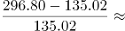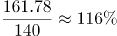，与C项最接近。

故正确答案为C。

**考点**：一般增长率、综合资料

**来源**：2022年浙江省公务员录用考试《行测》题（C类）（网友回忆版）第68题

### 第 118 题

2011~2020年期间，全国艺术表演团体演出收入的年平均值：

A. 大于100亿元

B. 等于100亿元

C. 小于100亿元

D. 无法算出

第 118 题 · 答案与解析

**参考答案（粉笔题库参考内容）**

A

**解析**

根据题干“2011~2020年······的年平均值”，可判定本题为现期平均数问题。定位表格材料可得：2011~2020年全国艺术表演团体演出收入分别为52.67亿元、64.15亿元、82.07亿元、75.70亿元、93.93亿元、120.86亿元、147.68亿元、152.27亿元、126.78亿元、86.63亿元。根据选项的范围设置，利用“削峰填谷”，以100为基准，分别作差为：-47.33、-35.85、-17.93、-24.3、-6.07、20.86、47.68、52.27、26.78、-13.37，，即所求年平均值大于100亿元。

故正确答案为A。

**考点**：现期平均数、综合资料

**来源**：2022年内蒙古公务员录用考试《行测》题（网友回忆版）第115题

### 第 119 题

以下折线图中，能准确反映2011~2020年国内演出观众人次变化的是：

A. A

B. B

C. C

D. D

第 119 题 · 答案与解析

**参考答案（粉笔题库参考内容）**

C

**解析**

定位表格材料可得：2011年、2012年、2013年、2014年、2015年、2016年、2017年、2018年、2019年、2020年国内演出观众人次分别为：7.46亿人次、8.28亿人次、9.01亿人次、9.10亿人次、9.58亿人次、11.81亿人次、12.47亿人次、11.76亿人次、12.30亿人次、8.93亿人次，人次变化趋势为开始缓慢升高，排除B、D两项；最后下降，排除A项。

故正确答案为C。

**考点**：直接找数、综合资料

**来源**：2022年浙江省公务员录用考试《行测》题（C类）（网友回忆版）第69题

### 第 120 题

不能够从上述资料中推出的是：

A. 2015年，全国艺术表演团体平均演出收入不足100万元

B. 2018年，全国艺术表演团体演出收入同比增速快于2016年

C. 2019年，全国文化和旅游部门所属艺术表演团体组织的政府采购公益演出中，观众超过1亿人次

D. 2020年，全国艺术表演团体演出场次与国内演出观众人次均同比下降

第 120 题 · 答案与解析

**参考答案（粉笔题库参考内容）**

B

**解析**

A项：定位表格材料可得，2015年全国艺术表演团体演出收入为93.93亿元，表演团体数为10787个。则2015年全国艺术表演团体平均演出收入为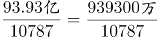万元＜100万元，正确。

B项：定位表格材料可得，2018年全国艺术表演团体演出收入为152.27亿元，2017年为147.68亿元，故2018年全国艺术表演团体演出收入同比增速为；2016年全国艺术表演团体演出收入为120.86亿元，2015年为93.93亿元，故2016年全国艺术表演团体演出收入同比增速为。因此2018年全国艺术表演团体演出收入同比增速低于2016年，而非快于2016年，错误。

C项：定位文字材料可得，2020年，全国文化和旅游部门所属艺术表演团体组织政府采购公益演出观众0.86亿人次，下降27.9%。则2019年观众人次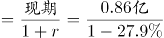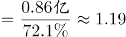亿人次＞1亿人次，正确。

D项：定位表格材料可得，2020年全国艺术表演团体演出场次225.61万场＜2019年演出场次296.80万场；2020年国内演出观众人次8.93亿人次＜2019年观众人次12.30亿人次。因此2020年全国艺术表演团体演出场次与国内演出观众人次均同比下降，正确。

本题为选非题，故正确答案为B。

**考点**：综合分析、综合资料

**来源**：2022年浙江省公务员录用考试《行测》题（C类）（网友回忆版）第70题

## 材料 3

### 第 121 题

2012—2020年中，在职退休比最接近3的是：

A. 2020年

B. 2019年

C. 2013年

D. 2012年

第 121 题 · 答案与解析

**参考答案（粉笔题库参考内容）**

D

**解析**

方法一：根据题干“2012—2020年中，在职退休比······”，可判定本题为比值计算问题。定位统计图可得2012—2020年在职职工参保人数与退休职工参保人数。根据在职退休比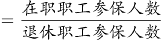，可得各年份在职退休比分别为：

A项，2020年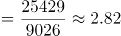；

B项，2019年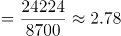；

C项，2013年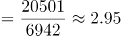；

D项，2012年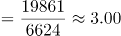。

在职退休比最接近3的是2012年。

方法二：定位统计图折线数据，观察可知2012、2013、2019、2020年在职退休比最接近3的是2012年。

故正确答案为D。

**考点**：比值计算、综合资料

**来源**：2022年浙江省公务员录用考试《行测》题（C类）（网友回忆版）第71题

### 第 122 题

2019年，职工医保参保人数共：

A. 30322万人

B. 31681万人

C. 32924万人

D. 34455万人

第 122 题 · 答案与解析

**参考答案（粉笔题库参考内容）**

C

**解析**

定位统计图可知，2019年在职职工医保参保人数为24224万人，退休职工医保参保人数为8700万人，则2019年职工医保参保人数为在职职工医保参保人数与退休职工医保参保人数之和：24224+8700=32924万人。

故正确答案为C。

**考点**：综合资料、简单加减计算

**来源**：2022年湖北省公务员录用考试《行测》题（网友回忆版）第117题

### 第 123 题

下列年份中，在职职工参保人数同比增速大小排序错误的是：

A. 2017年＞2016年

B. 2018年＞2017年

C. 2019年＞2018年

D. 2020年＞2019年

第 123 题 · 答案与解析

**参考答案（粉笔题库参考内容）**

C

**解析**

根据题干“······同比增速大小排序”，可判定本题为一般增长率问题。定位统计图可得2016-2020年在职职工参保人数，根据公式，增长率，代入公式可得2016-2020年在职职工参保人数同比增速分别为：，，，，。因此，2019年同比增速小于2018年同比增速，C项排序错误。

本题为选非题，故正确答案为C。

**考点**：一般增长率、综合资料

**来源**：2022年浙江省公务员录用考试《行测》题（C类）（网友回忆版）第72题

### 第 124 题

假设2021年居民医保基金收入同比增速与2020年相同，那么，2021年居民医保基金收入约为：

A. 9598亿元

B. 9689亿元

C. 9727亿元

D. 9873亿元

第 124 题 · 答案与解析

**参考答案（粉笔题库参考内容）**

B

**解析**

根据题干“假设2021年······同比增速与2020年相同······2021年······约为”，结合材料时间为2012-2020年，可判定本题为现期计算问题。定位统计表可得：2019年居民医保基金支出和结余率分别为8191亿元和4.5%，2020年基金收入为9115亿元。根据结余率，则有，解得2019年居民医保基金收入亿元（也可结合本篇材料第3题得出此数据）。根据公式：增长率、现期量=基期量×（1+增长率）。则2021年居民医保基金收入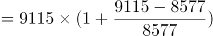亿元，与B项最接近。

故正确答案为B。

**考点**：现期计算、综合资料

**来源**：2022年浙江省公务员录用考试《行测》题（C类）（网友回忆版）第74题

### 第 125 题

能够从上述资料中推出的有：

①2017年职工医保在职退休比高于2016年

②2020年居民医保参保人数比上年略有增加

③2012—2020年间，职工医保参保人数持续增加

④2012—2020年间，居民医保基金支出增长金额最快的是2017年

A. 1

B. 2

C. 3

D. 4

第 125 题 · 答案与解析

**参考答案（粉笔题库参考内容）**

B

**解析**

①：定位统计图可得：2017年职工医保在职退休比相较于2016年有所下降，故2017年退休比＜2016年退休比，错误；

②：材料所给数据均为职工医保参保人数，未出现居民医保参保人数相关数据，故无法推出，错误；

③：定位统计图可得：在职职工参保人数和退休职工参保人数2012年-2020年每年均在增加，故职工医保参保总人数也持续增加，正确；

④：定位统计表可得2012-2020年的数据，根据公式：增长率，

2013年，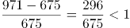；

2014年，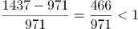；

2015年，；

2016年，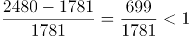；

2017年，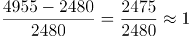；

2018年，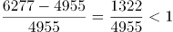；

2019年，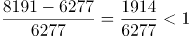；

2020年，基金支出较上年下降，增长率<0。故2017年增速最快，正确；

综上所述，只有③④正确，共2项。

故正确答案为B。

【备注】根据历年真题教研，对于④的问法，如果材料有2011年数据，需要计算2012年的增速，但如果材料没有2011年的数据，则不用计算。因此判定④正确。

**考点**：综合分析、综合资料

**来源**：2022年浙江省公务员录用考试《行测》题（C类）（网友回忆版）第75题

## 材料 4

2020年，由软件产品、信息技术服务、信息安全产品和服务、嵌入式系统软件四大业务形态构成的我国软件和信息技术服务业持续恢复，收入保持较快增长，信息技术服务加快云化发展，软件应用服务化、平台化趋势明显。

2020年，软件产品实现收入22758亿元，同比增长10.1%，占全行业比重为27.9%。其中，工业软件产品实现收入1974亿元，增长11.2%，为支撑工业领域的自主可控发展发挥重要作用。

2020年，信息技术服务实现收入49868亿元，同比增长15.2%，增速高出全行业平均水平1.9个百分点，占全行业收入比重为61.1%。其中，电子商务平台技术服务收入9095亿元，同比增长10.5%；云服务、大数据服务共实现收入4116亿元，同比增长11.1%。

2020年，信息安全产品和服务实现收入1498亿元，同比增长10.0%，增速较上年回落2.4个百分点。

2020年嵌入式系统软件实现收入7492亿元，同比增长12.0%，增速较上年提高4.2个百分点，占全行业收入比重为9.2%。嵌入式系统软件已成为产品和装备数字化改造、各领域智能化增值的关键性带动技术。

### 第 126 题

2020年电子商务平台技术服务收入占全行业收入的比重约为：

A. 7.6%

B. 11.1%

C. 15.3%

D. 18.2%

第 126 题 · 答案与解析

**参考答案（粉笔题库参考内容）**

B

**解析**

根据题干“2020年······占······的比重约为”，结合材料时间是2020年，可判定本题为现期比重问题。定位文字材料第二段、第三段可知：2020年，软件产品实现收入22758亿元，同比增长10.1%，占全行业比重为27.9%；电子商务平台技术服务收入9095亿元。根据公式：比重，则2020年全行业收入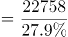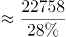亿元，故题干所求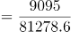，与B项最接近。

故正确答案为B。

**考点**：文字资料、现期比重

**来源**：2022年浙江省公务员录用考试《行测》题（C类）（网友回忆版）第76题

### 第 127 题

与2019年相比，2020年占全行业收入比重上升的是：

A. 软件产品

B. 信息技术服务

C. 信息安全产品和服务

D. 嵌入式系统软件

第 127 题 · 答案与解析

**参考答案（粉笔题库参考内容）**

B

**解析**

根据题干“与2019年相比，2020年占全行业收入比重上升的是”，可判定本题为两期比重问题。定位材料第二段至第五段可得：2020年，软件产品、信息技术服务、信息安全产品和服务、嵌入式系统软件实现收入分别同比增长10.1%、15.2%、10.0%、12.0%。定位材料第三段“2020年，信息技术服务实现收入49868亿元，同比增长15.2%，增速高出全行业平均水平1.9个百分点，”则2020年全行业收入同比增速=15.2%-1.9%=13.3%。根据两期比重比较结论：部分增长率＞整体增长率，比重上升。观察可知，只有信息技术服务收入同比增速（15.2%）＞全行业收入同比增速（13.3%），即与2019年相比，2020年占全行业收入比重上升的是信息技术服务。

故正确答案为B。

备注：由于题目为单选题，在考场上可直接根据第三段中“2020年，信息技术服务实现收入······增速高出全行业平均水平······”，秒选B项。

**考点**：文字资料、两期比重

**来源**：2022年浙江省公务员录用考试《行测》题（C类）（网友回忆版）第78题

### 第 128 题

2019年全行业实现收入约为：

A. 7.2万亿元

B. 7.4万亿元

C. 8.2万亿元

D. 8.4万亿元

第 128 题 · 答案与解析

**参考答案（粉笔题库参考内容）**

A

**解析**

根据题干“2019年······约为”，结合材料时间为2020年，可判定本题为基期计算问题。定位文字材料第三段可得：2020年，信息技术服务实现收入49868亿元，同比增长15.2%，增速高出全行业平均水平1.9个百分点，占全行业收入比重为61.1%。根据公式：整体量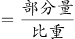，则2020年全行业实现收入亿元，同比增速=15.2%-1.9%=13.3%。根据公式：基期量，则2019年全行业实现收入亿元=7.2万亿元。

故正确答案为A。

**考点**：文字资料、基期计算

**来源**：2022年浙江省公务员录用考试《行测》题（C类）（网友回忆版）第77题

### 第 129 题

2019年嵌入式系统软件同比增速相较于信息安全产品和服务同比增速：

A. 快2.0%

B. 快8.6%

C. 慢4.6%

D. 慢7.5%

第 129 题 · 答案与解析

**参考答案（粉笔题库参考内容）**

C

**解析**

根据题干“2019年······同比增速相较于······同比增速”，可判定本题为一般增长率问题。定位材料第五段，2020年嵌入式系统软件实现收入7492亿元，同比增长12.0%，增速较上年提高4.2个百分点，则2019年嵌入式系统软件同比增速为12.0%-4.2%=7.8%；定位材料第四段，2020年信息安全产品和服务实现收入1498亿元，同比增长10.0%，增速较上年回落2.4个百分点，则2019年信息安全产品和服务同比增速为10.0%+2.4%=12.4%，二者相差：7.8%-12.4%=-4.6%，即慢4.6%。

故正确答案为C。

**考点**：文字资料、一般增长率

**来源**：2022年浙江省公务员录用考试《行测》题（C类）（网友回忆版）第79题

### 第 130 题

下列选项不能从上述资料推出的是：

A. 2019年信息安全产品和服务实现收入约为1361.8亿元

B. 2019年信息安全产品和服务占全行业收入比重最低

C. 2020年信息安全产品和服务占全行业收入比重为2.8%

D. 2019年信息技术服务收入占全行业收入比重低于61.1%

第 130 题 · 答案与解析

**参考答案（粉笔题库参考内容）**

C

**解析**

A项：定位文字材料第四段可得：2020年，信息安全产品和服务实现收入1498亿元，同比增长10.0%。根据公式：基期量，则2019年信息安全产品和服务实现收入为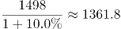亿元，正确；

B项：定位文字材料可知2020年软件产品、信息技术服务、信息安全产品和服务、嵌入式系统软件的实现收入及同比增长率。根据公式：比重，整体量一致，比较比重的大小，只需比较部分量的大小即可。根据公式：基期量，则2019年软件产品、信息技术服务、信息安全产品和服务、嵌入式系统软件的实现收入分别为亿元、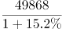亿元、亿元、亿元。分母（1+增长率）相差不大，现期量最小的是信息安全产品和服务，则其基期量最小，占全行业收入比重最低，正确；

C项：定位文字材料第一段可知：软件产品、信息技术服务、信息安全产品和服务、嵌入式系统软件四大业务形态构成我国软件和信息技术服务业。定位文字材料第二、三、五段可知2020年软件产品、信息技术服务、嵌入式系统软件实现收入占全行业收入的比重分别是27.9%、61.1%、9.2%。因此，2020年信息安全产品和服务占全行业收入比重为1-27.9%-61.1%-9.2%=1.8%，错误；

D项：定位文字材料第三段可得：2020年，信息技术服务实现收入同比增长15.2%，增速高出全行业平均水平1.9个百分点，占全行业收入比重为61.1%。根据两期比重比较口诀“部分增长率大于整体增长率，则比重上升”。部分增长率（15.2%）大于整体增长率（15.2%-1.9%），比重上升，即2019年信息技术服务收入占全行业收入比重低于61.1%，正确。

本题为选非题，故正确答案为C。

**考点**：文字资料、综合分析

**来源**：2022年浙江省公务员录用考试《行测》题（C类）（网友回忆版）第80题

