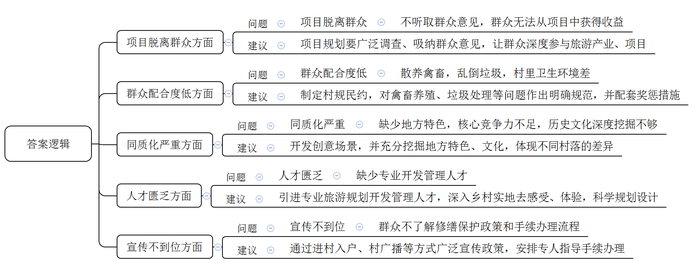
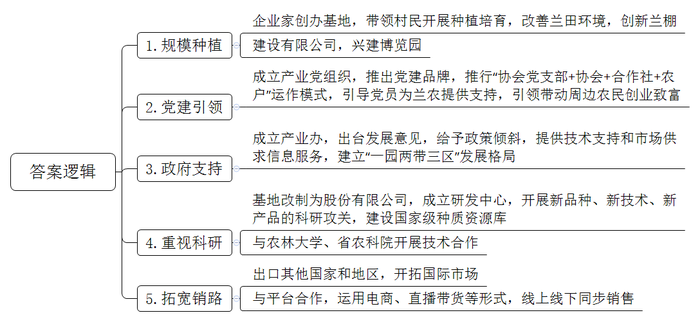
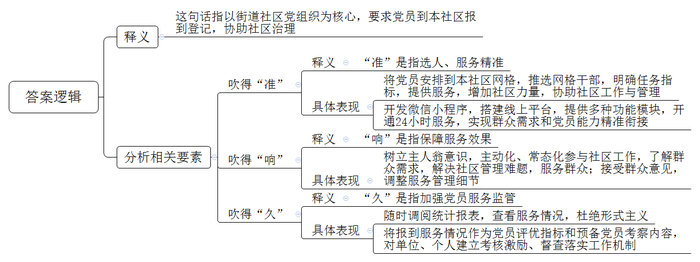
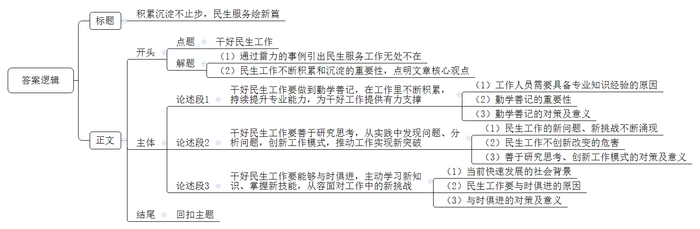

# 2023年公务员多省联考《申论》题（河北B卷）

<!-- gwy:overview:start -->
> **河北 · 2023 · 申论 · B类** ｜ 4 题 · 图片 4 处 · 答案随题折叠

导航：[题目](#题目)
<!-- gwy:overview:end -->

> 候选采集稿。参考答案及解析来自粉笔页面，不代表官方答案或真实高分答卷；来源使用许可与原卷对应关系仍需人工核实。

## 给定材料

### 材料 material-f16a5587e5b9ede5

近日，为优化文旅产业布局，促进乡村旅游升级发展，合江县宽石镇召开了一场关于乡村旅游规划调整升级的座谈会，听取各方的意见建议。以下是座谈会的主要发言记录：

合江县发展和改革局陈副局长：乡村旅游的落脚点应该是乡村，游客去农村主要还是想体验乡村特色和风情。开展乡村旅游规划，千万不能摒弃乡村的质朴与自然，不能按照城市规划的思路去规划设计，把农村建得跟城市一样。规划还是要着眼于“游客为什么来、什么游客来、游客怎么来、游客来了干什么、怎样让游客介绍人来”这几个问题。解决好这些问题，乡村旅游才可能发展起来。

村民老赵：镇里要在我们村搞旅游项目，都不听听我们的想法，我感觉跟我们也没有太大关系，虽然这几年村里是整洁了一些，生活也便利了一些，但外面的人来旅游，我们也做不了什么，没有实际的收益。我觉得让村民们能赚到钱才实在，否则我还是愿意去城里打工，我们那儿的好多人跟我的想法一样。

石茂村村委会刘主任：我们规划得再好，可有些村民就是不太配合，还是喜欢把鸡鸭养得到处都是，卫生也不好好处理，垃圾随处乱倒，有的村民养的狗还追着人家到处跑，外面的人来了自然不会高兴，不告你就算不错了。

灰石村驻村第一书记老张：我感觉，我们镇乡村旅游的主题内容同质化比较严重，比如花海，除了规模不一样，其他大抵相同；农家乐，就是简单的餐饮，加上棋牌、钓鱼，就没有其他内容了；采摘、观光活动的体验感也是千篇一律，体现不了我们这个地方的特色农业和文化。旅游产业的核心竞争力不足，历史文化深度挖掘不够，乡村核心的魂、自身的特色、差异化竞争等方面鲜有挖掘。

江流村村委会李主任：我们村经过调研了解、征求意见，筹划建设“造田公社”景观，计划以农业种植为基础，将农田开发成可观、可玩、可学的各类创意场景，这个还是比较有特色的。另外，最好有懂行的人来帮我们做一些旅游开发管理的事情。

市规划设计院潘工程师：乡村旅游规划设计要融入当地县镇、服务于村庄，处理好传统村落、基本农田保护与开发的关系，避免大拆大建、无效投入，所以规划就非常重要。如果规划和周遭环境格格不入，不能很好地尊重村民意愿，这样的规划哪怕自身再优秀，也不是好作品，这都需要专业的规划人才深入乡村实地去感受、体验，寻找最佳的解决方案。

村民老牛：村里说我家的老宅比较有特色，要修缮保护起来，政府会出一部分钱，但我们对这一块的政策不太了解，手续怎么办都不知道，村里也没什么人说得清楚，都是传来传去，走了不少弯路，也没有彻底解决问题，能不能有专门的人来指导我们怎么做？

合江县文化体育和旅游局钱副局长：这几年，乡村旅游遍地开花、如火如荼，大家都想分一杯羹，但规划要对建设以后的事情有个统筹考虑。有的地方注重硬环境建设，却忽视软环境治理，管理跟不上，配套服务也不行，个别还发生过安全事故，谁敢再去啊；有的地方基础设施和配套服务都完善了，但游客量却没有增加，收益也不可观，主要是没有对受众人群、出游目的、消费能力等进行系统分析，宣传推介就更加无从说起了。

宽石镇李镇长：乡村旅游规划不能各自为政，要以“一盘棋”思想抓好统筹，根据各村的实际情况制定规划，再把散落的珍珠串成项链，形成我们镇的特色旅游项目。这样，游客到了我们镇，就可以根据实际需要订制项目，比如红色旅游、文化旅游、生态旅游等，既可以一揽子游下来，也可以分类订制游。

### 材料 material-1bc4b6d3a1b03748

近日，L县兰花博览园数百亩连片种植大棚里，建兰、墨兰、春兰、寒兰等兰花吐蕊盛开，散发出淡淡幽香；工人们忙着分株、整理、包装。L县是全国最大的国兰基地和兰花集散地。近年来，该县充分借助“世界兰花之乡”“中国兰花名镇”优势，打造“红领兰香”党建品牌，不断做大做强兰花特色农业产业。曾经的山间“兰草”，成了当地的“振兴花”和兰农的“致富花”。去年，L县兰花总产值超20亿元，兰农人均年收入3.6万元。

“宁可出门不提篮，不可家中不栽兰。”这是L县民间流传的一句俗语。L县种养兰花历史悠久，野生兰花资源丰富，是春兰、建兰和寒兰的主产区和原生地，在朋口镇，家家户户都有种养兰花的传统。

说起种植兰花，不得不提“世界兰花培育之星”饶春荣。1980年，饶春荣高中毕业回到朋口镇桂花村，看到广东客商经常慕名前来收购兰花，便利用当地得天独厚的兰花资源，在村里办起全县第一个兰花基地，带领村民一起种植、培育兰花。

为种好兰花，饶春荣想方设法改变兰田环境，不断创新兰棚，多次自费出国到马来西亚、新加坡、韩国等地学习先进技术。在县、镇的支持下，饶春荣创办了L县兰花有限公司，兴建兰花博览园，建起全国最大的国兰生产基地。

如何让兰花成为富农强镇的好产业？朋口镇以L县兰花公司为龙头，成立全县第一个产业党组织“L县兰花协会党支部”，由饶春荣担任党支部书记，推出“红领兰香”党建品牌，推行“协会党支部+协会+合作社+农户”运作模式，引导党员为兰农提供品种、技术、市场等方面支持，引领带动周边农民创业致富。

张松妹便是该模式的受益者。起初，她种植的5亩兰花出现了烂头、叶子长黑斑等病情。L县兰花协会党支部的杨先金得知后，主动到她的兰苑教她及时施药、调控大棚温湿度，帮她渡过了难关。现在，张松妹新建了兰花圃、成立了合作社，种兰年收入达50万元，还带动更多兰农一起致富。

“兰逢国泰香播远，山涧野草变成宝。兰花产业的发展离不开党的好政策和县、镇的全力支持。”饶春荣深有感触地说。

为进一步做大做强兰花产业，L县成立兰花产业办，出台《关于加快兰花产业发展的若干意见》，在规划用地、资金补助、市场推广、展览、信息、科研等方面给予政策倾斜，为全县兰花产业提供技术支持和市场供求信息服务。

目前，L县已形成“一园两带三区”的兰花产业发展格局：以L县兰花博览园为龙头、朋口镇为中心，辐射莒溪、宣和、新泉、庙前等乡镇，沿国道205线、319线打造天马-良增兰花产业带和朋口-培田兰花产业带，并设立良增示范区、官厅背示范区、张家营示范区。

2020年1月，国家科学技术奖励大会上，以L县兰花基地为重要平台开展的科研项目《中国特色兰科植物保育与种质创新及产业化关键技术》，获得2019年度国家科学技术进步奖二等奖，这是我国兰花领域首个国家科技进步奖。

“由于人为任意采挖、气候变化影响，20世纪八九十年代，许多野生兰花种类濒临灭绝。”L县兰花公司总经理饶小琼是饶春荣的女儿，跟随父亲养兰10多年，对研发创新深有感触。

2011年，L县兰花基地改制为股份有限公司，加快研发步伐，当年便突破国兰无性繁殖组培技术。该技术不仅能快速繁育优质种苗、缩短生长周期、降低生产成本，还能改变传统国兰种源采集方式，为兰农提供更多更优质的兰花种苗。得益于成功研发国兰生产繁殖技术、国兰工厂化育苗工艺及大田配套栽培技术，企业推动兰花品种从50余种增至1200余种，“东方红荷”“丹霞一品”“冠豸彩球”等200余种成为享誉全国的精品。兰花的平均价格也从过去的几千元大幅下降，实现从“贵族化”向“平民化”“大众化”转变，走进千家万户。

此后，L县兰花有限公司成立国兰研发中心，以新品种、新技术、新产品为研发目标，组织开展科研攻关大比武，建成国家级国兰种质资源库。同时，与福建农林大学、省农科院深入开展技术合作，其中《建兰新品种规模繁育与栽培配套技术示范推广》项目入选福建省科技计划星火项目，《中国特色兰科植物保育与种质创新及产业化关键技术》项目获国家科学技术进步奖二等奖。

在朋口镇朋东村官厅背兰花产业片区的花田苗木农民专业合作社，兰花大棚里绿意盎然，一股清新淡雅的香气扑鼻而来，花架上摆满了争芳斗艳的各色兰花，工作人员正热情地用手机对着一盆盆亭亭玉立的兰花进行网络直播销售。

在相隔不过几百米的宏源花卉有限公司兰花圃，淘宝直播、抖音直播同样火热进行。“这盆100元起拍，每次加价20元，3分钟计时开始！”话音刚落，手机屏幕迅速滚动，“新粉”“铁粉”“钻粉”不断报价。不一会儿，屏幕左上角的观看数量已逾2万人次。

“网络直播通过一对多的方式直达消费终端，不仅有效拓宽销售渠道，而且能倒逼企业持续提升产品和服务质量。”宏源花卉负责人邱声华表示，疫情以来，无接触的电商直播成为朋口兰花企业主要销售方式，并带动L县兰花销售逆势上扬。

L县兰花的名气越来越大，还出口到东南亚、日本、韩国、俄罗斯等10余个国家和地区。如何让L县兰花产业更上一层楼？当地引领兰农依托L县兰花公司国兰研发中心，自主研发兰花新品种，为兰花电商销售提供“新鲜血液”。同时，与拼多多、淘宝等网络平台合作，运用电商、直播带货等形式，线上线下同步销售，兰花一年网络销售额达1.5亿元。

### 材料 material-cc394d6910cefe64

近年来，G区以街道社区党组织为核心，创新建立“社区吹哨、党员报到”工作机制，要求全区机关和国有企事业单位在职党员及其他有履职能力的党员，主动到本人居住地社区报到登记，做到“社区一吹哨、党员马上到；居民有点单、党员立接单”。以下是上级有关部门就这项工作进行调研座谈时，部分干部群众的发言摘要：

区委组织部有关负责人：我们把“报到党员”管理服务和社区党组织体系有机融合起来，以“社区—小区—楼栋”为主线，将在职党员统筹安排到社区网格中，从中推选网格党组织第一书记、兼职委员等，要求每位党员每年至少参加1次社区党组织生活、与社区干部进行1次座谈、开展1次社区调研、认领1个“微心愿”、当1天社区志愿者、结对1户困难群众。按照我们区现有在职党员数量估算，能为我们区每个社区增加近40倍的工作力量。

某社区工作人员：我们社区存在不少疑难事，以往靠社区一己之力是难以解决的。现在这个快速响应机制，真是给我们帮了大忙。大部分党员本身就住在社区，他们对社区情况更熟悉，在自己家门口就能服务，我们社区工作开展也就更精准，管理起来也就更顺畅了。现在，很多机关企事业单位党组织都是主动找我们社区结对互动，对我们社区工作人员来说，真是雪中送炭。

市直机关党工委某部门负责人：我们市直各单位在职党员纷纷响应区里的号召，回到自己居住地社区报到。因为党员熟悉自己居住的社区，关心自己社区的发展，有利于树立“主人翁”意识，同时方便参与社区网格党建工作，也便于参选社区议事代表、小区业委会成员、楼栋长等，很有积极意义。

在职党员代表、某小区业委会成员：我居住的小区一直是一个无物业管理小区，长期面临垃圾清运不及时、车辆乱停乱放等难题。“社区吹哨、党员报到”工作部署后，我第一时间到社区报到，与社区干部一道挨家挨户上门走访，收集居民意见，带头帮忙搞卫生，推动小区成立了业委会，收到了很好的效果。现在，我们报到的党员常态化融入到社区，在服务群众的过程中，大家互相走动多了，邻里关系也更融洽了。

市大数据公司某项目负责人：受G区委托，我们开发了“吹哨报到”微信小程序，搭建“居民点单、社区下单、党员接单”平台，提供线上实名注册、地理位置签到、服务“云记录”、满意度评价、报到排行榜、信息数据汇总等功能模块。无论是社区还是居民个人，只要有需求，都可以24小时线上“点单”“下单”，提出困难诉求、发布服务需求。党员可根据自己的专长或兴趣勾选服务类型，大数据匹配后会推送给党员，实现了群众的需求端和党员的能力端精准衔接。此外，各级党组织也可随时调阅系统自动生成的统计报表等，查看所属党员的服务情况。

某社区居民王奶奶：对于我一个老太太来说，社区替我们“吹哨”，真是一场及时雨啊。前几天，我6岁的小孙子晚上8点突然从楼梯上摔下来，那天他爸妈都出差，小孙子疼得哇哇大哭。情急之下，我向社区求救，社区工作人员立刻帮我在平台上“吹哨”“下单”，才5分钟时间，市人民医院骨科的赵医生就“接单”了，他刚下班，就住在我们小区。经过赵医生的专业检查，我孙子就是软组织损伤，没有骨折或脱臼，我这颗悬着的心一下子就落下了，现在我也学会自己“下单”了，太方便了。

区委党建办负责人：我们最近组织了一次网络调查，13617名党员群众对我们“社区吹哨、党员报到”这项工作投出满意票，占参与调查人数的96.5%，还有不少群众主动出谋划策，对一些具体管理服务细节提出了好建议。这说明，大部分老百姓认为我们这个“哨”吹得好！既然群众对我们这么肯定，我们应该要做得更好才行，那种“走一圈、晃两下、纸上留点痕、网上晒个照”形式主义的报到，我们是坚决杜绝的，每个党员任务指标、接单完成情况、满意度评价等都是有备案的，这项工作要“久久为功”。

区委副书记：社区“吹哨”，既要吹得“准”，还要吹得“响”、吹得“久”。下一步，我们也将把党员到社区报到情况作为党员评先评优等方面的一项重要指标和培养考察预备党员的一项参考内容，对单位、个人建立考核激励、督查落实等工作机制。我们只有真正把吹哨的权力赋予社区，才能把资源和力量下沉到社区一线，既解决了社区工作人员不足的问题，又增强了社区党组织的组织力，大家凝心聚力，才能一起为老百姓办好事。

## 题目

### 第 1 题

**根据****“****给定资料**1**”，请梳理宽石镇乡村旅游规划中存在的问题，并提出相应的改进建议。（25分）**

关联材料：材料 material-f16a5587e5b9ede5

作答要求：

要求：问题梳理全面准确；对策有针对性、具体可行。不超过400字。

第 1 题 · 答案与解析

**参考答案（粉笔题库参考内容）**

1.问题：项目脱离群众。不听取群众意见，群众无法从项目中获得收益。建议：项目规划要广泛调查、吸纳群众意见，让群众深度参与旅游产业、项目。

2.问题：群众配合度低。散养禽畜，乱倒垃圾，村里卫生环境差。建议：制定村规民约，对禽畜养殖、垃圾处理等问题作出明确规范，并配套奖惩措施。

3.问题：同质化严重。缺少地方特色，核心竞争力不足，历史文化深度挖掘不够。建议：开发创意场景，并充分挖掘地方特色、文化，体现不同村落的差异。

4.问题：人才匮乏。缺少专业开发管理人才。建议：引进专业旅游规划开发管理人才，深入乡村实地去感受、体验，科学规划设计。

5.问题：宣传不到位。群众不了解修缮保护政策和手续办理流程。建议：通过进村入户、村广播等方式广泛宣传政策，安排专人指导手续办理。

**解析**

**参考答案说明：**本参考答案分别围绕“项目脱离群众”“群众配合度低”“同质化严重”“人才匮乏”“宣传不到位”五个方面的问题及对应的建议展开，进行了分条撰写；各条具体要点之间在内容上相互并列，没有交叉。

**考点**：考点提出对策类

**来源**：来源2023年公务员多省联考《申论》题（河北B卷）

粉笔申论页面对本题只提供「解析视频」入口，该入口是会员推广位，页面无视频地址与文字解析。

### 第 2 题

**根据****“给定资料**2**”，概括梳理L县兰花产业发展的具体做法。（20分）**

关联材料：材料 material-1bc4b6d3a1b03748

作答要求：

要求：紧扣资料，内容全面，条理清晰，表达准确。不超过300字。

第 2 题 · 答案与解析

**参考答案（粉笔题库参考内容）**

1.规模种植。企业家创办基地，带领村民开展种植培育，改善兰田环境，创新兰棚；建设有限公司，兴建博览园。

2.党建引领。成立产业党组织，推出党建品牌，推行“协会党支部+协会+合作社+农户”运作模式，引导党员为兰农提供支持，引领带动周边农民创业致富。

3.政府支持。成立产业办，出台发展意见，给予政策倾斜，提供技术支持和市场供求信息服务，建立“一园两带三区”发展格局。

4.重视科研。基地改制为股份有限公司，成立研发中心，开展新品种、新技术、新产品的科研攻关，建设国家级种质资源库；与农林大学、省农科院开展技术合作。

5.拓宽销路。出口其他国家和地区，开拓国际市场；与平台合作，运用电商、直播带货等形式，线上线下同步销售。

**解析**

**参考答案说明：**本参考答案从“规模种植”“党建引领”“政府支持”“重视科研”“拓宽销路”五个方面进行了分条撰写。各条答案要点之间在内容上相互并列，没有交叉。

**考点**：考点概括措施类

**来源**：来源2023年公务员多省联考《申论》题（河北B卷）

粉笔申论页面对本题只提供「解析视频」入口，该入口是会员推广位，页面无视频地址与文字解析。

### 第 3 题

**“给定资料**3**”中，画线部分提到，“社区****‘****吹哨****’，既要吹得****‘****准****’，还要吹得****‘****响****’、吹得****‘****久****’。”请你谈谈对这句话的理解。（15分）**

关联材料：材料 material-cc394d6910cefe64

作答要求：

要求：紧扣材料、逻辑清晰、内容全面。不超过300字。

第 3 题 · 答案与解析

**参考答案（粉笔题库参考内容）**

这句话指以街道社区党组织为核心，要求党员到本社区报到登记，协助社区治理。

1.“准”是指选人、服务精准。将党员安排到本社区网格，推选网格干部，明确任务指标，提供服务，增加社区力量，协助社区工作与管理；开发微信小程序，搭建线上平台，提供多种功能模块，开通24小时服务，实现群众需求和党员能力精准衔接。

2.“响”是指保障服务效果。树立主人翁意识，主动化、常态化参与社区工作，了解群众需求，解决社区管理难题，服务群众；接受群众意见，调整服务管理细节。

3.“久”是指加强党员服务监管。随时调阅统计报表，查看服务情况，杜绝形式主义；将报到服务情况作为党员评优指标和预备党员考察内容，对单位、个人建立考核激励、督查落实工作机制。

**解析**

**参考答案说明**：（1）思路方面，本参考答案按照词句解释题“释义+分析相关要素+总结评价”的一般答题思路展开。（2）内容方面，本参考答案首先整体阐释了给定句的含义；其次分别介绍了“吹得‘准’”“吹得‘响’”和“吹得‘久’”的具体含义及表现。（3）词句表达方面，本参考答案加上了“是指”等连接词来承接上下文。

**考点**：考点词句解释类

**来源**：来源2023年公务员多省联考《申论》题（河北B卷）

粉笔申论页面对本题只提供「解析视频」入口，该入口是会员推广位，页面无视频地址与文字解析。

### 第 4 题

**“给定资料**4**”中提到“干好工作就要不断积累和沉淀，不断积累和沉淀要永远在路上。”请根据对这句话的理解和对给定资料的思考，自选角度，自拟题目，写一篇议论文章。（40分）**

关联材料：材料 material-f16a5587e5b9ede5

作答要求：

要求：

（1）观点明确，见解深刻；

（2）内容全面，结构完整；

（3）思路清晰，语言流畅；

（4）不少于1000字。

第 4 题 · 答案与解析

**参考答案（粉笔题库参考内容）**

**积累沉淀不止步，民生服务****绘新篇**

“干好工作需要积累和沉淀，不断积累和沉淀要永远在路上。”雷力在社保窗口的感悟，恰是民生服务工作的生动注脚。而从社保窗口延伸开去，无论是社区的便民服务站，还是街头的就业指导点，民生服务的每一个角落都如这般，于琐碎中见分量，于细微处显担当。它像一场没有终点的马拉松，承载着群众对美好生活的向往，唯有以持续的积累沉淀打磨初心与能力，方能在为民服务的路上，写下温暖而坚实的答卷。

**干好****民生****工作要做到****勤学善记，****在****工作里****不断****积累，持续****提升****专业****能力****，为干好工作提供有力支撑。**民生服务工作涉及面广、政策性强，从社会保障到医疗卫生，从教育就业到住房保障，每一项都与群众的切身利益息息相关。这就要求工作人员具备扎实的专业知识和丰富的实践经验。勤学善记，便是积累专业知识的有效途径。通过学习政策法规、业务知识，记录工作中的点滴经验与心得，不断充实自己的知识宝库。只有如此，在面对群众的各种问题和需求时，才能做到心中有数、应对自如，以专业的素养为群众提供优质高效的服务，赢得群众的信任与支持。

**干好****民生****工作要善于****研究思考****，从实践中发现问题、分析问题，****创新****工作模式，推动工作实现新突破。**民生服务工作并非一成不变，随着社会的发展和群众需求的变化，新问题、新挑战不断涌现。如果墨守成规、按部就班，就难以满足群众日益增长的美好生活需要。因此，工作人员要善于研究思考，深入基层、深入群众，了解他们的实际困难和需求，从实践中发现问题、分析问题，并积极探索解决问题的新方法、新途径。通过创新工作模式，打破传统思维的束缚，提高工作效率和质量，为民生服务工作注入新的活力与动力，让群众享受到更加便捷、贴心的服务。

**干好****民生****工作****要****能够****与时俱进，****主动****学习新知识、掌握新技能，****从容面对工作中的****新****挑战****。**当今时代，科技进步日新月异，信息化、数字化浪潮席卷而来，对民生服务工作产生了深远影响。从线上办事平台的推广到大数据在民生领域的应用，从智能服务设备的普及到远程医疗、在线教育等新业态的兴起，都要求工作人员紧跟时代步伐，主动学习新知识、掌握新技能。只有不断提升自己的数字化素养和创新能力，才能适应新时代民生服务工作的要求，更好地利用现代科技手段为群众服务，让民生服务更加精准、高效、智能，切实增强群众的获得感、幸福感和安全感。

“不积跬步，无以至千里；不积小流，无以成江海。”民生服务工作是一项长期而艰巨的任务，需要工作人员不断积累沉淀：以勤学善记夯实基础，以研究思考开拓创新，以与时俱进迎接挑战。如此，工作者方能在服务中传递温暖，于点滴间汇聚民生幸福长河。

**解析**

**文章分析**

**积累沉淀不止步，民生服务绘新篇**

【**标题的优点：**首先，标题中含有主题词，使文章主题更突出、清晰。其次，在形式上采用对称式结构，使标题更加完整、饱满。】

（1）“干好工作需要积累和沉淀，不断积累和沉淀要永远在路上。”雷力在社保窗口的感悟，恰是民生服务工作的生动注脚。而从社保窗口延伸开去，无论是社区的便民服务站，还是街头的就业指导点，民生服务的每一个角落都如这般，于琐碎中见分量，于细微处显担当。（2）它像一场没有终点的马拉松，承载着群众对美好生活的向往，唯有以持续的积累沉淀打磨初心与能力，方能在为民服务的路上，写下温暖而坚实的答卷。

【**开头的优点：**★内容方面：范文的开头是紧扣“干好民生工作”这一主题展开的。首先，开头点出主题，做到了主题明确。其次，对“干好民生工作”这一主题进行了分析阐述：（1）首先通过雷力的事例引出民生服务工作无处不在；（2）其次强调民生工作不断积累和沉淀的重要性，点明文章核心观点。★文字表达方面：使用了“无论是……还是……”等关联词，使语言表达有逻辑性；还使用了比喻的修辞手法，使文字表达更加形象。】

**干好民生工作要做到勤学善记，在工作里不断积累，持续提升专业能力，为干好工作提供有力支撑。**（1）民生服务工作涉及面广、政策性强，从社会保障到医疗卫生，从教育就业到住房保障，每一项都与群众的切身利益息息相关。这就要求工作人员具备扎实的专业知识和丰富的实践经验。（2）勤学善记，便是积累专业知识的有效途径。（3）通过学习政策法规、业务知识，记录工作中的点滴经验与心得，不断充实自己的知识宝库。只有如此，在面对群众的各种问题和需求时，才能做到心中有数、应对自如，以专业的素养为群众提供优质高效的服务，赢得群众的信任与支持。

【**论述段****1的优点：**★观点句：范文的观点句是紧扣“干好民生工作”这一文章主题提出的。形式上，它在段首处直接写出，位置突出，容易发现。内容上，关键词突出，内容要点明确，可以明显看出它是从“勤学善记”这个角度入手展开论述。★论述内容：（1）首先指出工作人员需要具备专业知识经验的原因；（2）其次强调勤学善记的重要性；（3）最后指出勤学善记的对策及意义。注意：以上三个方面的内容都是紧扣“干好民生工作要做到勤学善记，在工作里不断积累，持续提升专业能力，为干好工作提供有力支撑”这个观点句进行分析论述的，论述的针对性强，内容层次丰富。在论述方法上主要采用了讲道理的方式，论证清晰有力。】

**干好民生工作要善于研究思考，从实践中发现问题、分析问题，创新工作模式，推动工作实现新突破。**（1）民生服务工作并非一成不变，随着社会的发展和群众需求的变化，新问题、新挑战不断涌现。（2）如果墨守成规、按部就班，就难以满足群众日益增长的美好生活需要。（3）因此，工作人员要善于研究思考，深入基层、深入群众，了解他们的实际困难和需求，从实践中发现问题、分析问题，并积极探索解决问题的新方法、新途径。通过创新工作模式，打破传统思维的束缚，提高工作效率和质量，为民生服务工作注入新的活力与动力，让群众享受到更加便捷、贴心的服务。

【**论述段****2****的优点：**★观点句：范文的观点句是紧扣“干好民生工作”这一文章主题提出的。形式上，它在段首处直接写出，位置突出，容易发现。内容上，关键词突出，内容要点明确，可以明显看出它是从“研究思考”这个角度入手展开论述。★论述内容：（1）首先指出民生工作的新问题、新挑战不断涌现；（2）其次指出民生工作不创新改变的危害；（3）最后指出善于研究思考、创新工作模式的对策及意义。注意：以上三个方面的内容都是紧扣“干好民生工作要善于研究思考，从实践中发现问题、分析问题，创新工作模式，推动工作实现新突破”这个观点句进行分析论述的，论述的针对性强，内容层次丰富。在论述方法上主要采用了讲道理的方式，论证清晰深刻。】

**干好民生工作要能够与时俱进，主动学习新知识、掌握新技能，从容面对工作中的新挑战。**（1）当今时代，科技进步日新月异，信息化、数字化浪潮席卷而来，对民生服务工作产生了深远影响。（2）从线上办事平台的推广到大数据在民生领域的应用，从智能服务设备的普及到远程医疗、在线教育等新业态的兴起，都要求工作人员紧跟时代步伐，主动学习新知识、掌握新技能。（3）只有不断提升自己的数字化素养和创新能力，才能适应新时代民生服务工作的要求，更好地利用现代科技手段为群众服务，让民生服务更加精准、高效、智能，切实增强群众的获得感、幸福感和安全感。

【**论述段****3****的优点：**★观点句：范文的观点句是紧扣“干好民生工作”这一文章主题提出的。形式上，它在段首处直接写出，位置突出，容易发现。内容上，关键词突出，内容要点明确，可以明显看出它是从“与时俱进”这个角度入手展开论述。★论述内容：（1）首先指出当前快速发展的社会背景；（2）其次指出民生工作要与时俱进的原因；（3）最后指出与时俱进的对策及意义。注意：以上三个方面的内容都是紧扣“干好民生工作要能够与时俱进，主动学习新知识、掌握新技能，从容面对工作中的新挑战”这个观点句进行分析论述的，论述的针对性强，内容层次丰富。最后，在论述方法上主要采用了讲道理的方式，论证深刻有力。】

【**论述段之间的关系：**★内容的内在逻辑：范文的论述段之间是依照并列的逻辑展开的。论述段1先写了“干好民生工作要做到勤学善记，在工作里不断积累，持续提升专业能力，为干好工作提供有力支撑”，论述段2接着写了“干好民生工作要善于研究思考，从实践中发现问题、分析问题，创新工作模式，推动工作实现新突破”，论述段3最后写了“干好民生工作要能够与时俱进，主动学习新知识、掌握新技能，从容面对工作中的新挑战”。三个论述段分别从“勤学善记”“研究思考”“与时俱进”的角度展开，整体论述思路清晰。】

“不积跬步，无以至千里；不积小流，无以成江海。”民生服务工作是一项长期而艰巨的任务，需要工作人员不断积累沉淀：以勤学善记夯实基础，以研究思考开拓创新，以与时俱进迎接挑战。如此，工作者方能在服务中传递温暖，于点滴间汇聚民生幸福长河。

【**结尾的优点：**范文的结尾回扣了“干好民生工作”这个主题，并且进行了总结提升。】

**考点**：考点文章写作题

**来源**：来源2023年公务员多省联考《申论》题（河北B卷）

粉笔申论页面对本题只提供「解析视频」入口，该入口是会员推广位，页面无视频地址与文字解析。

