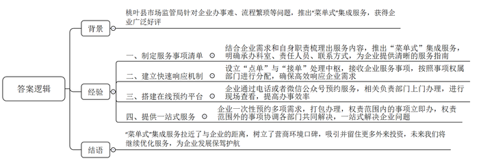
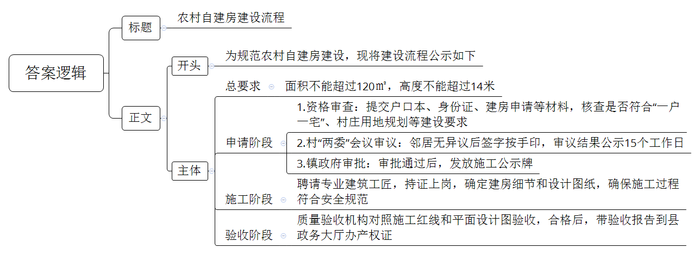
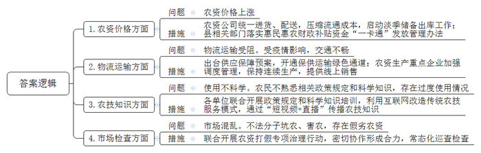

# 2023年公务员多省联考《申论》题（河北C卷）

> 候选采集稿。参考答案及解析来自粉笔页面，不代表官方答案或真实高分答卷；来源使用许可与原卷对应关系仍需人工核实。

## 给定材料

### 材料 material-51eca12e69eb489c

“菜单式”服务，智慧化监管，企业通过手机App，就能享受到“一站式”服务。桃叶县这项市场监管工作中的智慧监管新模式，获得了企业点赞。

“我们这边电梯的信息需要更新。”在桃叶县福多多购物广场的办公室里，马秀丽正拿着一本册子打电话。这本册子是桃叶县市场监管局亲商助企“菜单式”集成服务事项清单，按照清单预约服务又被称为“点单”。“下一步我们尽快为您上门服务。”接到企业的“点单”后，县市场监管局个体私营经济发展促进科的工作人员王梅就开始忙活起来了。

王梅所在的个体私营经济发展促进科是桃叶县市场监管局整个“菜单式”集成服务事项清单“点单”和“接单”的处理中枢。接到企业的“点单”后，王梅按照“菜单”上的事项权属部门来进行分配。

桃叶县市场监管局特种设备安全监管科的工作人员“接单”后，立即来到福多多购物广场。企业的工作人员已经将相关材料准备好，双方在会议室进行了沟通。因为涉及11台电梯的资料变更，材料较多，工作人员耐心地对每一份材料进行查看。以前，企业想要办理电梯变更手续，需要自己跑多次才能解决，而这次，“接单”不到6小时，县市场监管局的工作人员就将办好的证件送到了福多多购物广场。

而这也不是福多多购物广场第一次从“菜单”中受惠了。福多多购物广场总经理林旭还清楚地记得第一次面对县市场监管局送来的“菜单”时，虽然有很多业务需要“点单”，但还是选择了观望。在县市场监管局朱局长的耐心指导下，林旭抱着试试看的态度，在去年6月份点了第一单，这第一单就让林旭有了意想不到的收获。“原来这类培训，我们需要找外边的第三方公司，从来也没想过第一次‘点单’，就让市场监管局免费对我们进行了食品安全培训。”通过这次培训，林旭将购物广场重新进行了规划调整，更好地合规经营。

“去年3月份，县市场监管局到企业调研，了解企业需求。不少企业表示，想按规定办理各项许可手续，但却不知道该找哪个部门，具体该怎么办。还有一些企业因之前办理手续的过程十分繁琐，对政府工作部门产生了看法。为了解决这个问题，我们结合自身职责梳理出55项服务内容，去年5月推出了‘菜单式’集成服务，在这个菜单上，28个承办科室、责任人员、联系方式等一目了然，企业如需服务，只需电话或者通过微信公众号下单，市场监管局负责部门将会上门办理。”特种设备安全监管科赵科长介绍说。

跟企业的距离近了，营商环境的口碑才能树立起来，好的口碑才能让地方吸引并留住更多的外来投资。桃叶县的“菜单式”服务，让不少投资者眼前一亮，扎根当地创业发展的信心更强了。

贾潮是桃叶县当地人，早年在外地经商办企，2021年，他经过招商引资回到家乡，建立了肉类熟食生产工厂。随着企业的发展，贾潮想要拓展业务，但是怎么去拓展让他有些发愁。“我们当时有几样事要做，第一是申请一个商标；第二是我们有个宣传车要做车体广告；第三是我们有一个专利，申请专利的流程怎么走，也没搞明白；第四就是特别急需对中层管理人员进行食品安全的培训。”贾潮的这四件事在当时就考虑过，但碍于不熟悉流程一直搁置着。去年7月份，贾潮想着先把商标给注册了，就在他去市场监管局咨询商标注册流程时，却意外收获了一份“菜单”。“我们正在办理商标注册的时候，市场监管局张科长就过来了，说现在有这个‘点单’服务，我说这挺好，原来申请商标什么的都很麻烦，还得找第三方，花的钱也多。现在有了这个‘菜单’，我一次‘点单’，商标注册、专利申报、食品安全知识培训、广告备案登记四个服务事项，一次性就打包办好了。”贾潮说。

“他提出的这四项业务，涉及到3个不同的科室，以前要办的话，就分别要跑3个科室。现在我们根据集成服务的要求，按照流程，由分管局长牵头，安排知识产权科与食品生产科、广告科组成专班，把这3个科室集中到一块，帮企业把提出的问题和困难一次性解决掉，让企业只跑一趟，一次办好。”县市场监管局蔡副局长说，“只要是企业有需求向我们提出来了，如果是我们的服务事项，那不用说我们立即就办；不是我们的服务事项，我们也会协调有关部门一起来解决。”

“去年3月到企业调研完，我们就一直琢磨着要搭建一个平台，为企业真正解决一些问题，而不是走马观花。去年5月推出这个‘菜单式’集成服务以来，县市场监管局先后接受企业‘点单’836件，一次办结率100%。”县市场监管局朱局长说。

### 材料 material-9e391a95eeeb3de1

长年在外经商的老陈，老家在F县山高镇小楼村。一年前，老陈和家人商量后，向村里提出了建房申请。“我今年68岁了，在外奋斗大半辈子，最大的心愿就是回家乡将危旧老屋翻盖成新房子。”老陈说。

旧房新建进入实质性操作，村里的土地协管员谢珍上门和老陈仔细沟通起了建房流程。“近几年农村建房出了新规定，面积不能超过120平方米，总高度不能超过14米。此外手续要全，审批要过，建设过程中也不能出半点岔子。”谢珍对老陈说。

以前在F县，只要邻居没意见，农村的房子几乎是想怎么建就怎么建。超大面积、五六层的房屋，在当地很常见。因此，F县过去农村自建房“两违”（违法违规占用破坏自然资源和违法违规建设行为）问题不少。2016年起，F县开展农村自建房“两违”问题集中整治，由县、镇主要领导挂帅，并建立五级网格员巡查机制，对建房的前、中、后期实施全程监管。

谢珍将老陈一家的户口本、身份证、建房申请等材料一一收上来，仔细核查建房是否符合“一户一宅”、村庄用地规划等建设要求。资格审查通过后，村里召开村两委会议审议，四周邻居无异议后签字按手印，审议结果要在村里公示15个工作日。之后，所有材料提交镇政府审批。经过一个多月的等待，老陈终于盼来了他的施工公示牌。那天，他特意骑辆小三轮去镇上，像得了宝贝似的把牌子“抱”了回来。半米见方的施工公示牌上，房屋建设人、建筑红线图、乡村建设规划许可证、建筑平面图、工匠带头人等信息一一在列。把牌子往门前一立，老陈喜笑颜开，噼里啪啦的鞭炮声中，房子开始动工了。

老陈早年也干过工匠，可还是毫不犹豫地请了个专业工匠。“建房是大事，不能马虎。”建新房，老陈做足了功课：“现在的乡村工匠都得经过培训，持证上岗。找他们建房，安全和质量都有保障！”工匠曾师傅在村里口碑不错，老陈这次也找了他负责施工，两人就建房细节和设计图纸前后沟通了4次。图纸一出，双方签订施工合同、安全质量承诺书。“往后，在房子建造的安全和规范方面，我就是第一责任人。”曾师傅说。曾师傅也是老工匠出身，从事房屋建设30多年。可没想到，半年前，自己又重新走进课堂，参加了县里组织的乡村工匠培训。学完培训班的课程，曾师傅领到了工匠培训证，证书上“安全模范”四个字格外醒目。

隔三差五，老陈就会在工地上碰见镇、村干部和村镇规划建设执法管理人员。一打听才知道，县里对新建房的监管有新规定，明确相应干部必须在建房过程中“四到场”——宅基地申请审查到场，批准后丈量放样到场，施工关键节点巡查到场，竣工验收到场。村党支部书记老林来的次数最多，对本村建房中的问题，老林要发现在第一线，解决在第一线，不能解决的，要及时上报镇“两违”办处理。“超出规定限制一厘米都不行。”在现场，老林一看安全是否达标，二看建房每一步是否符合规定。“建房要审批，施工要挂牌，无牌必停工。”写在村里墙上的这句标语，人人都知晓，老陈知道，这句话可不是说说而已。村里有户人家，就因为建房不规范，公示牌被收走，整改后才重新开工，一拖就是几个月。有了前车之鉴，老陈建房的每一步都走得很扎实。

三声鞭炮后，老陈家房屋主体结构终于大功告成。随后，质量验收机构对照着原先的施工红线图、平面设计图，开展竣工验收。拿着尺子和测绘仪，测绘人员丈量房屋面积……全部指标合格后，带着验收报告的老陈，到县里的行政服务大厅办手续。捧着刚刚到手的新房产权证，老陈激动又感慨：“房子顺利竣工不容易，今年新年可以搬进新房过了，全家都高兴！”质量、安全各方面达标后，老陈的新建房被纳入F县房屋结构安全监管范围。“经过标准化改造，危房变新房，老陈建房的故事，就是F县自建房建设走向规范的一个生动缩影。”县住建局负责人说。

### 材料 material-2b4ee863f50c2d48

D省是农业大省，2022年春耕备耕农资供应面临艰巨任务。农资供应是否量足价稳质优，事关夏粮能否增产和粮食安全大局。针对广大农民关心的问题，2022年3月，省市有关部门组成调研组深入J县基层，摸实情、求实招。

“从今年初开始，小麦追肥用到的氮肥、尿素等价格普遍上涨，2月中下旬尿素平均价格达到每吨2500元，3月上旬价格已升至每吨3000元。”新庄镇种植农民专业合作社理事长告诉调研组，“今年种子、农药、肥料进货价格为多年来的高点。农药价格涨幅程度不等，最高的翻了两番。”

县农资公司陈总介绍，受国际肥料市场价格带动、国内生产成本推动、春耕陆续开始化肥需求量增加、疫情影响农资物流运输等多种因素叠加影响，近期尿素、磷酸二铵、氯化钾、国产复合肥的平均批发价格同比分别上涨34.85%、15.81%、88.91%、36.26%。化肥是粮食的“粮食”，化肥保供稳价直接关系到全年粮食生产目标的实现。为应对当前农资价格上涨带来的不利影响，公司采用统一进货、统一配送的方式，压缩流通环节成本，降低农户农资支出。同时根据市场化肥价格变化情况，及时启动了商业化肥淡季储备的出库工作，平均每吨化肥的价格较市场价格低300元左右，有力维护了市场稳定，保障了农业生产安全和农民利益。预计春耕期间，公司将供应化肥近5000吨、农药近90吨，确保农资不断档、不脱销。

县农业农村局张副局长介绍，在国家发展改革委、财政部等部门统筹安排下，今年第一批300多万吨春耕肥储备已开始向市场投放，后续还有大量储备化肥将陆续投放市场。近日，中央财政下达200亿元资金，对实际种粮农民发放一次性补贴，缓解农资价格上涨带来的影响，调动农民种粮积极性。县里进一步落实惠民惠农财政补贴资金“一卡通”发放管理办法，及时将耕地地力保护补贴、种粮补贴等直接发放到种粮农民的社会保障卡银行账户，每亩的补贴超过100元。

2022年初，D省出现了局部疫情，抗疫任务较为繁重，对当地交通物流造成了一些影响，但调研组在J县看到，春耕备耕一点没耽误。他们一手抓防疫，一手忙备耕，不让疫情误农情。化肥厂等农资生产重点企业加强了管理，保持连续生产。农民可以线上下单买种子、买化肥。一辆辆满载种、肥的货车通过绿色通道奔驰在乡间，让农资进村入户。

县疫情防控指挥部负责人介绍，县里出台了疫情防控期间滞销农产品销售及春耕农资供应保障预案，开通了农资“点对点”保供运输绿色通道，严格禁止随意设卡拦截、断路封路等行为，并全力打通经营网点到田间地头“最后一公里”。

在县职业技术学校，县农技中心、融媒体中心等正联合开展第二期“农技专家当主播”培训，资深农技（艺）师、返乡“新农人”、种田“老把式”共20多人参加培训。授课专家向调研组介绍，农资买得起、运得进、用得上，还要科学用。不少农民朋友对农药安全、合理使用的政策规定和科学知识不太熟悉，有的过度使用农药、化肥、农膜等。县里利用互联网的强渗透性和广覆盖性改造提升传统农技服务模式，通过“短视频+直播”形式传播农技知识，为生产安全、绿色、优质的农产品提供更便捷、更精准、更高效的农技服务支撑。

“你好，请配合工作，我们要进行商品质量抽检……”在一处农资门市，调研组看到县综合行政执法局三名工作人员正在开展执法检查。带队负责人介绍，春耕备耕期间，是农资销售旺季，也是不法分子坑农、害农的高发期。县农业农村局联合县公安局、县综合行政执法局等单位，开展农资打假专项治理行动，密切协作，形成合力，对种子、肥料、农药等农资经营门店和生产企业进行常态化巡查检查，突出抓好假劣种子坑农害农、肥料养分不足、农药兽药添加禁用药物、农膜质量差等问题，确保群众买到放心农资。

## 题目

### 第 1 题

**市里拟召开以****“暖企惠企纾困解难，营造良好营商环境”为主题的工作经验交流座谈会，请你根据给定资料**1**，草拟一份发言提纲，介绍桃叶县市场监管局亲商助企、开展“菜单式”集成服务的经验。（25分）**

关联材料：材料 material-51eca12e69eb489c

作答要求：

要求：

（1）紧扣资料，内容全面，列出要点即可；

（2）逻辑清晰，语言流畅；

（3）不超过400字。

### 第 2 题

**假如你是****F县住建局工作人员，请根据给定资料**2**，为本县村民拟写一份农村自建房建设流程。（15分）**

关联材料：材料 material-9e391a95eeeb3de1

作答要求：

要求：

（1）流程完整，顺序合理；

（2）条理清晰，语言准确；

（3）不超过300字。

### 第 3 题

**请你根据给定资料**3**，概括J县在春耕备耕农资供应使用等方面遇到的问题及采取的措施。（20分）**

关联材料：材料 material-2b4ee863f50c2d48

作答要求：

要求：

（1）问题梳理全面、准确、有条理；

（2）所提措施与问题相对应，具体明确；

（3）不超过300字。

### 第 4 题

**请结合给定资料**4**，深入思考“干好工作需要积累和沉淀，不断积累和沉淀要永远在路上”这句话，自选角度，自拟题目，联系实际，写一篇议论文章。（40分）**

关联材料：材料 material-51eca12e69eb489c

作答要求：

要求：

（1）观点明确，论证充分，思路清晰，表达流畅；

（2）联系实际，不拘泥于给定资料；

（3）不少于1000字。

## 答案与解析

第 1 题

**参考答案（粉笔题库参考内容）**

背景：桃叶县市场监管局针对企业办事难、流程繁琐等问题，推出“菜单式”集成服务，获得企业广泛好评。

经验：一、制定服务事项清单。结合企业需求和自身职责梳理出服务内容，推出“菜单式”集成服务，明确承办科室、责任人员、联系方式，为企业提供清晰的服务指南。二、建立快速响应机制。设立“点单”与“接单”处理中枢，接收企业服务事项，按照事项权属部门进行分配，确保高效响应企业需求。三、搭建在线预约平台。企业通过电话或者微信公众号预约服务，相关负责部门上门办理，进行现场查看，提高办事效率。四、提供一站式服务。企业一次性预约多项需求，打包办理，权责范围内的事项立即办，权责范围外的事项协调各部门共同解决，一站式解决企业问题。

结语：“菜单式”集成服务拉近了与企业的距离，树立了营商环境口碑，吸引并留住更多外来投资，未来我们将继续优化服务，为企业发展保驾护航。

**解析**

**参考答案说明：**（1）格式方面，本参考答案不写标题，只写正文部分。（2）正文部分，一方面从内容上来看，本参考答案的开头先写到了桃叶县市场监管局开展“菜单式”集成服务的相关背景；接着主体从“制定服务事项清单”“建立快速响应机制”“搭建在线预约平台”“提供一站式服务”四个方面介绍了具体的工作经验；最后结尾部分进行了总结展望。另一方面，形式上，本参考答案做到了分段、分条撰写，整体上条理较为清晰。

**考点**：考点总结类

**来源**：来源2023年公务员多省联考《申论》题（河北C卷）

粉笔申论页面对本题只提供「解析视频」入口，该入口是会员推广位，页面无视频地址与文字解析。

第 2 题

**参考答案（粉笔题库参考内容）**

农村自建房建设流程

为规范农村自建房建设，现将建设流程公示如下：

一、总要求：面积不能超过120㎡，高度不能超过14米。

二、申请阶段：1.资格审查：提交户口本、身份证、建房申请等材料，核查是否符合“一户一宅”、村庄用地规划等建设要求。2.村“两委”会议审议：邻居无异议后签字按手印，审议结果公示15个工作日。3.镇政府审批：审批通过后，发放施工公示牌。

三、施工阶段：聘请专业建筑工匠，持证上岗，确定建房细节和设计图纸，确保施工过程符合安全规范。

四、验收阶段：质量验收机构对照施工红线和平面设计图验收，合格后，带验收报告到县政务大厅办产权证。

**解析**

**参考答案说明：**（1）格式方面，本参考答案写到了“标题”“正文”两个部分。（2）正文部分，一方面从内容来看，开头简单交代了发文目的；主体从“总要求”“申请阶段”“施工阶段”“验收阶段”四个方面介绍农村自建房的建设流程。另一方面，形式上，本参考答案做到了分段、分条撰写，整体上条理较为清晰。

**考点**：考点宣传类

**来源**：来源2023年公务员多省联考《申论》题（河北C卷）

粉笔申论页面对本题只提供「解析视频」入口，该入口是会员推广位，页面无视频地址与文字解析。

第 3 题

**参考答案（粉笔题库参考内容）**

1.问题：农资价格上涨。措施：农资公司统一进货、配送，压缩流通成本，启动淡季储备出库工作；县相关部门落实惠民惠农财政补贴资金“一卡通”发放管理办法。

2.问题：物流运输受阻。受疫情影响，交通不畅。措施：出台供应保障预案，开通保供运输绿色通道；农资生产重点企业加强调度管理，保持连续生产，提供线上销售。

3.问题：使用不科学。农民不熟悉相关政策规定和科学知识，存在过度使用情况。措施：各单位联合开展政策规定和科学知识培训，利用互联网改造传统农技服务模式，通过“短视频+直播”传播农技知识。

4.问题：市场混乱。不法分子坑农、害农，存在假劣农资。措施：联合开展农资打假专项治理行动，密切协作形成合力，常态化巡查检查。

**解析**

**参考答案说明**：本参考答案从“农资价格”“物流运输”“农技知识”“市场检查”这四个方面展开，每个方面内部先阐释问题，再给出相应的解决对策，做到了所提措施与问题相对应。各条答案要点之间在内容上相互并列，没有交叉。

**考点**：考点多要素组合类

**来源**：来源2023年公务员多省联考《申论》题（河北C卷）

粉笔申论页面对本题只提供「解析视频」入口，该入口是会员推广位，页面无视频地址与文字解析。

第 4 题

**参考答案（粉笔题库参考内容）**

**积累沉淀不止步，民生服务****绘新篇**

“干好工作需要积累和沉淀，不断积累和沉淀要永远在路上。”雷力在社保窗口的感悟，恰是民生服务工作的生动注脚。而从社保窗口延伸开去，无论是社区的便民服务站，还是街头的就业指导点，民生服务的每一个角落都如这般，于琐碎中见分量，于细微处显担当。它像一场没有终点的马拉松，承载着群众对美好生活的向往，唯有以持续的积累沉淀打磨初心与能力，方能在为民服务的路上，写下温暖而坚实的答卷。

**干好****民生****工作要做到****勤学善记，****在****工作里****不断****积累，持续****提升****专业****能力****，为干好工作提供有力支撑。**民生服务工作涉及面广、政策性强，从社会保障到医疗卫生，从教育就业到住房保障，每一项都与群众的切身利益息息相关。这就要求工作人员具备扎实的专业知识和丰富的实践经验。勤学善记，便是积累专业知识的有效途径。通过学习政策法规、业务知识，记录工作中的点滴经验与心得，不断充实自己的知识宝库。只有如此，在面对群众的各种问题和需求时，才能做到心中有数、应对自如，以专业的素养为群众提供优质高效的服务，赢得群众的信任与支持。

**干好****民生****工作要善于****研究思考****，从实践中发现问题、分析问题，****创新****工作模式，推动工作实现新突破。**民生服务工作并非一成不变，随着社会的发展和群众需求的变化，新问题、新挑战不断涌现。如果墨守成规、按部就班，就难以满足群众日益增长的美好生活需要。因此，工作人员要善于研究思考，深入基层、深入群众，了解他们的实际困难和需求，从实践中发现问题、分析问题，并积极探索解决问题的新方法、新途径。通过创新工作模式，打破传统思维的束缚，提高工作效率和质量，为民生服务工作注入新的活力与动力，让群众享受到更加便捷、贴心的服务。

**干好****民生****工作****要****能够****与时俱进，****主动****学习新知识、掌握新技能，****从容面对工作中的****新****挑战****。**当今时代，科技进步日新月异，信息化、数字化浪潮席卷而来，对民生服务工作产生了深远影响。从线上办事平台的推广到大数据在民生领域的应用，从智能服务设备的普及到远程医疗、在线教育等新业态的兴起，都要求工作人员紧跟时代步伐，主动学习新知识、掌握新技能。只有不断提升自己的数字化素养和创新能力，才能适应新时代民生服务工作的要求，更好地利用现代科技手段为群众服务，让民生服务更加精准、高效、智能，切实增强群众的获得感、幸福感和安全感。

“不积跬步，无以至千里；不积小流，无以成江海。”民生服务工作是一项长期而艰巨的任务，需要工作人员不断积累沉淀：以勤学善记夯实基础，以研究思考开拓创新，以与时俱进迎接挑战。如此，工作者方能在服务中传递温暖，于点滴间汇聚民生幸福长河。

**解析**

**文章分析**

**积累沉淀不止步，民生服务绘新篇**

【**标题的优点：**首先，标题中含有主题词，使文章主题更突出、清晰。其次，在形式上采用对称式结构，使标题更加完整、饱满。】

（1）“干好工作需要积累和沉淀，不断积累和沉淀要永远在路上。”雷力在社保窗口的感悟，恰是民生服务工作的生动注脚。而从社保窗口延伸开去，无论是社区的便民服务站，还是街头的就业指导点，民生服务的每一个角落都如这般，于琐碎中见分量，于细微处显担当。（2）它像一场没有终点的马拉松，承载着群众对美好生活的向往，唯有以持续的积累沉淀打磨初心与能力，方能在为民服务的路上，写下温暖而坚实的答卷。

【**开头的优点：**★内容方面：范文的开头是紧扣“干好民生工作”这一主题展开的。首先，开头点出主题，做到了主题明确。其次，对“干好民生工作”这一主题进行了分析阐述：（1）首先通过雷力的事例引出民生服务工作无处不在；（2）其次强调民生工作不断积累和沉淀的重要性，点明文章核心观点。★文字表达方面：使用了“无论是……还是……”等关联词，使语言表达有逻辑性；还使用了比喻的修辞手法，使文字表达更加形象。】

**干好民生工作要做到勤学善记，在工作里不断积累，持续提升专业能力，为干好工作提供有力支撑。**（1）民生服务工作涉及面广、政策性强，从社会保障到医疗卫生，从教育就业到住房保障，每一项都与群众的切身利益息息相关。这就要求工作人员具备扎实的专业知识和丰富的实践经验。（2）勤学善记，便是积累专业知识的有效途径。（3）通过学习政策法规、业务知识，记录工作中的点滴经验与心得，不断充实自己的知识宝库。只有如此，在面对群众的各种问题和需求时，才能做到心中有数、应对自如，以专业的素养为群众提供优质高效的服务，赢得群众的信任与支持。

【**论述段****1的优点：**★观点句：范文的观点句是紧扣“干好民生工作”这一文章主题提出的。形式上，它在段首处直接写出，位置突出，容易发现。内容上，关键词突出，内容要点明确，可以明显看出它是从“勤学善记”这个角度入手展开论述。★论述内容：（1）首先指出工作人员需要具备专业知识经验的原因；（2）其次强调勤学善记的重要性；（3）最后指出勤学善记的对策及意义。注意：以上三个方面的内容都是紧扣“干好民生工作要做到勤学善记，在工作里不断积累，持续提升专业能力，为干好工作提供有力支撑”这个观点句进行分析论述的，论述的针对性强，内容层次丰富。在论述方法上主要采用了讲道理的方式，论证清晰有力。】

**干好民生工作要善于研究思考，从实践中发现问题、分析问题，创新工作模式，推动工作实现新突破。**（1）民生服务工作并非一成不变，随着社会的发展和群众需求的变化，新问题、新挑战不断涌现。（2）如果墨守成规、按部就班，就难以满足群众日益增长的美好生活需要。（3）因此，工作人员要善于研究思考，深入基层、深入群众，了解他们的实际困难和需求，从实践中发现问题、分析问题，并积极探索解决问题的新方法、新途径。通过创新工作模式，打破传统思维的束缚，提高工作效率和质量，为民生服务工作注入新的活力与动力，让群众享受到更加便捷、贴心的服务。

【**论述段****2****的优点：**★观点句：范文的观点句是紧扣“干好民生工作”这一文章主题提出的。形式上，它在段首处直接写出，位置突出，容易发现。内容上，关键词突出，内容要点明确，可以明显看出它是从“研究思考”这个角度入手展开论述。★论述内容：（1）首先指出民生工作的新问题、新挑战不断涌现；（2）其次指出民生工作不创新改变的危害；（3）最后指出善于研究思考、创新工作模式的对策及意义。注意：以上三个方面的内容都是紧扣“干好民生工作要善于研究思考，从实践中发现问题、分析问题，创新工作模式，推动工作实现新突破”这个观点句进行分析论述的，论述的针对性强，内容层次丰富。在论述方法上主要采用了讲道理的方式，论证清晰深刻。】

**干好民生工作要能够与时俱进，主动学习新知识、掌握新技能，从容面对工作中的新挑战。**（1）当今时代，科技进步日新月异，信息化、数字化浪潮席卷而来，对民生服务工作产生了深远影响。（2）从线上办事平台的推广到大数据在民生领域的应用，从智能服务设备的普及到远程医疗、在线教育等新业态的兴起，都要求工作人员紧跟时代步伐，主动学习新知识、掌握新技能。（3）只有不断提升自己的数字化素养和创新能力，才能适应新时代民生服务工作的要求，更好地利用现代科技手段为群众服务，让民生服务更加精准、高效、智能，切实增强群众的获得感、幸福感和安全感。

【**论述段****3****的优点：**★观点句：范文的观点句是紧扣“干好民生工作”这一文章主题提出的。形式上，它在段首处直接写出，位置突出，容易发现。内容上，关键词突出，内容要点明确，可以明显看出它是从“与时俱进”这个角度入手展开论述。★论述内容：（1）首先指出当前快速发展的社会背景；（2）其次指出民生工作要与时俱进的原因；（3）最后指出与时俱进的对策及意义。注意：以上三个方面的内容都是紧扣“干好民生工作要能够与时俱进，主动学习新知识、掌握新技能，从容面对工作中的新挑战”这个观点句进行分析论述的，论述的针对性强，内容层次丰富。最后，在论述方法上主要采用了讲道理的方式，论证深刻有力。】

【**论述段之间的关系：**★内容的内在逻辑：范文的论述段之间是依照并列的逻辑展开的。论述段1先写了“干好民生工作要做到勤学善记，在工作里不断积累，持续提升专业能力，为干好工作提供有力支撑”，论述段2接着写了“干好民生工作要善于研究思考，从实践中发现问题、分析问题，创新工作模式，推动工作实现新突破”，论述段3最后写了“干好民生工作要能够与时俱进，主动学习新知识、掌握新技能，从容面对工作中的新挑战”。三个论述段分别从“勤学善记”“研究思考”“与时俱进”的角度展开，整体论述思路清晰。】

“不积跬步，无以至千里；不积小流，无以成江海。”民生服务工作是一项长期而艰巨的任务，需要工作人员不断积累沉淀：以勤学善记夯实基础，以研究思考开拓创新，以与时俱进迎接挑战。如此，工作者方能在服务中传递温暖，于点滴间汇聚民生幸福长河。

【**结尾的优点：**范文的结尾回扣了“干好民生工作”这个主题，并且进行了总结提升。】

**考点**：考点文章写作题

**来源**：来源2023年公务员多省联考《申论》题（河北C卷）

粉笔申论页面对本题只提供「解析视频」入口，该入口是会员推广位，页面无视频地址与文字解析。

