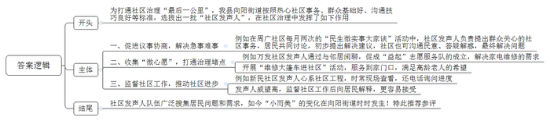
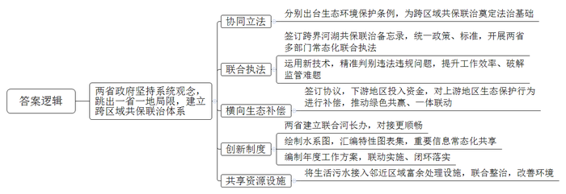
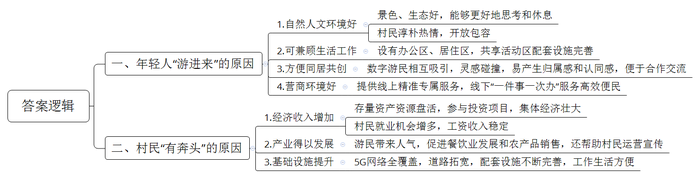
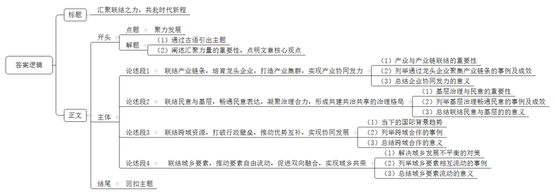

# 2025年公务员多省联考《申论》题（河北A卷）

<!-- gwy:overview:start -->
> **河北 · 2025 · 申论 · A类** ｜ 4 题 · 图片 4 处 · 答案随题折叠

导航：[题目](#题目) · [材料 1](#材料-1)
<!-- gwy:overview:end -->

> 候选采集稿。参考答案及解析来自粉笔页面，不代表官方答案或真实高分答卷；来源使用许可与原卷对应关系仍需人工核实。

## 给定材料

### 材料 1

清晨，向阳街道周广社区里喧闹起来。“民生微实事大家谈”的展板前，街坊们围坐一处，居委会干部、物业公司代表也纷纷到场，热络“开聊”——

“10栋门前的地闲着太可惜了！杂草丛生，影响市容市貌。”一开场，社区发声人杨大姐率先提出了大家都关切的闲置地块问题。

“这次议事的主题是‘建设美丽家园’，对于这个地块的利用，大家有什么好主意吗？”随着本次“民生微实事大家谈”主持人、周广社区邵书记的提问，居民们纷纷建言献策。

“一半种上紫苏、一半种上辣椒，改造成花园式菜地。”

“种出来的劳动成果，由咱们全体居民定期采摘。”

“暑假期间，还可以组织亲子活动，让孩子们参与进来，感受农耕的苦与乐。”

经过一番热烈讨论，不仅解决办法有了，邻里相亲的温暖氛围也在大伙儿心间荡漾开。当邵书记宣布讨论结果时，现场掌声热烈、叫好声不断。

每月两次的“民生微实事大家谈”活动，既是居民畅所欲言、共商共议的舞台，也是社区沟通民意、答疑解惑的平台。社区发声人负责提出最近大家关心的社区事务，居民共同讨论，提出初步解决建议。小区所面临的一桩桩急事、难事，都得到妥善解决。“这样的议事机制非常好！大家坐在一起，像‘拉家常’一样，想说什么就说什么，很多问题都得到了及时解决！”杨大姐欣喜地说。

去年，向阳街道举行了社区发声人聘任仪式，12名社区发声人正式“持证上岗”。这些社区发声人是根据热心于社区事务、群众基础好、具备良好沟通技巧和社区影响力等标准，通过自愿报名、社区推荐、公开选拔等方式，从每个社区选拔出来的。杨大姐是这次受聘的社区发声人之一，在周广社区生活了三十多年。杨大姐是个不折不扣的社区“红人”，她一直热心参与社区的公益活动，从电梯加装到处理居民纠纷，都可以看到她的身影。“有了这个新身份，担子更重了，但覆盖面也更广，可以帮助更多群众去发声。”杨大姐说，接下来她要努力提升自己的能力，充当好联系社区和居民的桥梁，为居民解决更多难事烦心事，增进邻里之间的信任与互助。

“家电坏了找‘益起’。”在万发社区，有一支“益起”志愿服务队伍，专门从事常见的家电维修，服务范围已覆盖全街道，名声也越来越响亮。这支队伍的成立源自万发社区发声人老陈和邻居们的一次闲聊。“我家高压锅坏了，小区附近没有维修点，我都找过很多次了。”周阿姨无奈地说道。她的话打开了大家的话匣子：“我家的电视机也坏了，我一个星期都没看上电视。”“我家空调最近很吵，让人根本没办法睡。”……老陈这才发觉社区周边没有家电维修点。他把成立家电维修志愿服务队的想法告诉了社区书记老方，老方一听，立刻表示支持，当天就在社区微信群里发布了招募公告。很快，“益起”志愿服务队就成立了。“社区发声人能从小处着手，收集‘微心愿’，有助于及时打通社区治理的堵点。”向阳街道办事处郭主任表示。

目前，“益起”志愿服务队共有成员25名。“社区发声人把居民的烦恼告诉我们，起到了很好的沟通作用。”志愿者李先生说，“能为大家解决一些小问题，我也很开心。”随着服务范围的逐渐扩大，越来越多的居民知道了这支队伍。不少高龄老人提出了“便民维修来到家门口”的希望。老陈把他们的希望告诉了志愿服务队，经过多方协商，志愿服务队开展“维修大篷车进社区”活动，将“小修小补”搬到了居民家门口。

“最近停车位的工程进展到哪一步了？”新民社区的社区发声人老魏心系项目，从施工开始就时不时到现场看看，出差在外还打电话到社区询问进度。“已经在划线了，很快就能完工。”新民社区党委丁书记耐心回答。“很多居民平时工作忙，不一定了解一个项目有多少事要做，有时会着急，我们的解释也听不进去。”丁书记说，社区发声人在居民中威望较高，他们定期监督社区的工作，然后向居民解释，居民更容易接受。“我们已经习惯接受社区发声人的监督了，有了他们的督促，社区就会进步得更快。”

社区发声人队伍广泛搜集居民的“问题清单”“需求清单”。去年以来，向阳街道下辖6个社区已收集群众需求115个，确定项目106个，投入资金1611.80万元，其中社会资本1134.79万元。伴随着社区发声人队伍的助力，“小而美”的变化在向阳街道时时发生。

“社区是社会治理的基本单元，是党和政府联系、服务群众的‘最后一公里’，也是城市精细化治理的‘主战场’。”郭主任表示，“社区发声人能有效联结起社区治理中的断层，以声聚能，把社区和居民‘联’起来，‘聚’成共建共治共享的不息动能。”

### 材料 2

向南河上，波光潋滟、水天一色，乘船顺流而下，宛若穿行画中。谁能想到，这条美丽的河流曾经黑臭熏城，鱼虾难存。向南河贯通A、B两省多个行政区域，河流两岸开发强度高，生态环境容量有限，资源能源消耗量大，结构性污染突出，生态环境跨域性特征明显，无论是大气治理还是水环境治理，都不是某一方所能单独承担的。

如何做好生态环境跨域治理？“必须坚持系统观念，跳出一省一地的局限，建立跨区域的共保联治体系。”A省人大常委会委员季主任表示。A、B两省人大常委会协同立法，分别出台向南河生态环境保护条例，为跨区域的共保联治奠定了法治基础。

“要想彻底治好向南河，单靠哪一段使劲儿都不灵，只有在‘联动’上做文章，才能真正解决污染问题。”向南河沿岸某市生态环境保护综合行政执法大队唐队长说。向南河分属A、B两省管辖，过去因河道治理政策不同步、标准不统一，沿线企业跨省非法倾倒固体废弃物问题一直得不到有效解决。

这个“老大难”问题，现在终于“破题”：两省政府已经签订跨界河湖共保联治备忘录，统一政策、统一标准，开展两省水上公安、水务等部门常态化联合执法。两省联合执法队运用遥感影像和无人机遥测、移动采集系统等新技术手段，对生态违法违规问题精准判别，有效提升两省共保联治的工作效率，破解了向南河流域广、监管工作量大的难题。“条件具备了，不管违法行为发生在哪边，我们都能迅速开展协同打击。”唐队长说。

今年，两省还签订了横向生态补偿协议。根据协议，B省以水生态产品量化补偿方式投入3000多万元，对A省向南河流域范围内青虾养殖区实施有序退养。这项跨界合作，形成了上下游政府、周边农户、两地企业绿色共赢格局，横向生态补偿机制进一步推动了两地一体联动。

“我们上个月下发了一批两省跨界河流协同处置问题清单，不到一个月，两地就报送了整改方案。”设在A省省级河长办的两省联合河长办公室内，老谭正在逐一核实上月交办的处置问题清单整改方案。老谭是来自B省的一位县级河长，是B省派往A省的第三批两省联合河长办工作人员之一。为什么两省要建立联合河长办？“这由我们两省的地理位置和河流特性决定。”老谭介绍，向南河贯穿两省，两省互为上下游，过去在跨界河流管护中，一直存在因行政壁垒导致的信息不畅、责任不清、目标不统一等问题，尤其是遇到跨省治理问题，基层政府解决不了，只能层层上报，一级一级协调解决，费时久，效率低。制度创新是共保联治的重要保障，A、B两省经多次会商，决定成立两省联合河长办公室来解决跨省涉河问题。如此一来，在统筹解决跨省涉河问题时，对接更加顺畅，共保联治的效率也提高了。联合河长办建立后，双方联合绘制了跨界河流水系图，汇编了跨界河流特性图表集，将重要涉河信息纳入“一张图”管理，实现常态化信息共享。“联合河长办按年度编制工作方案，下发给两省相关部门、各级河长办。”老谭说，一个方案管两地，共同编制、联动实施、闭环落实，干什么、怎么干，变得一目了然。

A省梁化镇与B省江市镇一桥相连，向南河从两镇中间穿过。去年，这里的国控断面出现水质连续超标问题。两地在排查中发现，问题出在江市镇的老街社区，居民将生活污水直排河道，对向南河水质产生了影响。江市镇老街社区没有建设污水处理厂和污水管网。“当时我们计划修建污水处理设施，但需要时间。同时我们又了解到，对岸的梁化镇污水处理厂的污水处理能力有富余。”江市镇党委陈书记说，于是他们便提出把老街社区的污水跨区域接入梁化镇污水处理厂。污水跨区域处理意味着梁化镇环卫分公司将面临大量复杂繁琐的工作，但公司刘经理想得很明白：“两个镇一衣带水，那边的排污问题不解决，这边把污水处理得再好也没用。”两地经协商达成一致，老街社区的生活污水接入梁化镇污水处理厂处理，向南河重新变得清澈见底。以这次合作为契机，两镇对域内向南河段联合进行了整治。“共保联治，两地受益。现在，河水绿了，两岸种草坪、栽绿植、修步道，居民的生活环境大大改善了。”陈书记说。

共保联治推动了两省跨界流域共同治理、融合发展。“过去，向南河是分界线，把两地划分开来；现在，向南河是联结带，把两地结合起来。”季主任说。

### 材料 3

谧湖社区是一个位于Y县R村的数字游民社区。上午9时许，城市里早高峰的喧嚣还未褪去，这里有一批年轻人已经以另一种节奏开启了新的一天。明亮的共享办公区飘散着咖啡香，陆续有年轻人来到这里，有的围坐在圆桌旁展开讨论，有的敲着键盘沉浸于工作。推开门，外面便是绿树成荫、河水潺潺的美景。“在这样的环境里，仿佛在大自然的怀抱中，让人心灵安静，思想集中，累了也能得到更好的休息。”插画师小李说。

数字游民，是指利用现代信息技术进行远程工作，不受工作地点束缚，凭着移动设备闯天下的人。“数字时代重塑了人与空间的关系，人与空间的联结更灵活、更多元。”程序员小石说，“相比大城市到处可见的钢筋水泥，我更喜欢这里的绿水青山、鸟语花香。”小石来了3个星期，对这里已经熟悉了，周末还会和社区的伙伴们到村子里教小朋友弹吉他、画国画。“小朋友们很喜欢我们，有些大人也开始跟着学了，乡村的周末开始有了文艺风。”小石笑着说，“这里的人淳朴热情，我们很快就玩到了一起。”

为了建设数字游民社区，Y县政府引进一家经验丰富的公司进行合作。“我们一开始就明确要求，要把这里打造成兼顾生活与工作、同居共创的理想栖息地。”县团委沈书记兼任数字游民社区专班负责人，负责统筹社区建设和发展的各项事务。沈书记说：“现在，社区内除了办公区和居住区，还建有小剧场、图书馆、会议室等共享活动区。”一年前，社区正式对外开放，县政府同步推出数字游民社区线上服务专区，开设社区服务、特色活动、资源对接等专题专栏，为数字游民提供精准专属服务，很快就有300余人报名。“这些来自全国各地、各行各业的人们拥有不同知识背景和经历，互相吸引，更容易产生出灵感的火花。同为数字游民，大家很容易产生归属感和认同感。”沈书记说，社区经常举办分享会，供大家交流经验，分享资源，或发布创业设想，帮助招募合伙人。

来自北京的颜小姐是一名保险经理人，她的工作是为客户提供养老规划。“在这里，我不仅新认识了生活中的朋友，也迅速找到了事业上的合伙人。”颜小姐说。在和另一名社区成员愉快相处的过程中，颜小姐获得了灵感。“这里有令人心驰神往的自然环境，也有开放包容的人文环境，可以在社区附近引入旅游兼居住项目，为城市里缺少陪伴并愿意发挥余热的退休人员创造与年轻人共同体验生活的机会，鼓励他们向年轻人分享资源与人生经验。”颜小姐在社区分享会上提出了自己的想法，很快就和社区内有意向的游民达成合作。不久前，项目正式落地，迎来第一批客人。

“以前只有社区的人来喝咖啡，现在村子里来喝咖啡的人也多了起来。”数字游民小姚是一位咖啡师，借助社区的资源和场地实现了开一家咖啡店的梦想，如今店里聘用了八位当地村民，每月利润上万元。回想起当初办理营业执照的经历时，小姚忍不住夸赞：“我申请办理营业执照的当天，政府工作人员就把事情圆满办结，真正做到了‘只跑一次’，省时省力。”而这份高效源于区政务办联合社区所在镇政府共同推出的数字游民“一件事一次办”便民服务。区政府建立了跨部门协同管理机制和工作流程，设立数字游民“一件事一次办”综合专窗，提供社保医保参保、灵活就业登记、薪资劳动纠纷调解等服务。“数字游民很多是有想法、有技能的创业者或是想在乡村发展事业的探索者。”区政务办陈主任说，当地正持续改善营商环境，推动数字游民与乡村产生更多的联结，将数字游民吸纳到乡村振兴“人才池”，助力乡村发展。

谧湖社区是在B村旧茶厂的基础上扩建起来的，每年收取租金，村里还参与了社区的共享食堂投资建设，这为村集体每年带来20多万元的收入。村民老祝在谧湖社区当了一年保安，对数字游民的认识越来越深：“刚来社区工作时，我不明白什么叫‘数字游民’，后来才知道是只要有电脑就能工作的人。”老祝和很多数字游民熟悉起来了，经常帮他们接收快递、跑跑腿，“他们从老远的地方来，也挺不容易的，尽量帮帮他们。”村里还有不少像老祝这样的村民在谧湖社区工作，每月能拿到一份固定的工资。“我们这里有风景有地方，就是人气不够。”让老祝印象最深的是，自从社区建立以来，村子里热闹了起来，数字游民来了，参观游览的人也来了，村子里开起了好几家小吃店，村民种的蔬菜、水果也不用再挑到镇上去卖了，常常是刚采摘，就被数字游民们一抢而光。

“社区搭起年轻人与乡村‘双向奔赴’的桥梁，促进资源双向流动。”沈书记说。让他感到高兴的是，这群年轻人和当地村民的互动也在不断加深：社区里的年轻人会帮经常去的几家餐厅设计海报、门头、菜单等，他们还在网络平台直播村周边的吃喝游玩地、介绍村子里的特产……“5G网络已经实现了全覆盖，通往高速公路的道路正在拓宽，配套设施也在不断完善，工作生活将更加方便。”沈书记表示，B村数字游民社区二期项目建设正加快推进，将进一步盘活闲置农房等乡村存量资产资源，深化与村集体经济组织的合作，探索乡村振兴新模式。<u>“建设数字游民社区，不仅吸引更多年轻人‘游进来’，也让村民‘有奔头’。”</u>

### 材料 4

在J市一家轨道交通装备有限公司的产学研基地内，工作人员正在忙碌。“我们每年投入研发的费用超过营业收入的4%。”公司齐经理介绍，在市政府的支持鼓励下，企业联合多家知名高校开展产学研合作，助推新工艺研发和产业人才培育等，公司迅速发展为轨道交通预制装配新材料领域的龙头企业，主要产品的市场占有率处于行业领先水平。在这家龙头企业的带动下，特种塑料生产、加工等周边产业不断兴起，一个化工新材料产业集群正在J市崛起。

“打造特色产业集群，能高效推动企业联合协作，携手共进，是加快培育新质生产力、扎实推进新型工业化的重要途径。”J市王市长说，J市积极发挥政府“有形之手”的作用，出台建设特色产业集群实施方案，规划了六个特色产业集群，涵盖高端家纺、智能装备、化工新材料等传统特色优势产业和新兴产业，还建立“一群一班、一群一策”工作机制，每个产业集群设立一个工作专班，由一名区领导牵头负责，实施针对性的建设策略。

近年来，J市围绕特色产业集群梳理完善产业链全景图、招商地图，板块联动，持续发起项目攻坚。仅去年，J市就新立项重大产业项目52个，总投资391亿元，涉及新一代信息技术、新材料、高端装备等多个领域。“我们继续围绕主导产业、链主企业，通过补链完善产业链上下游。未来，我们还将严把准入门槛，高效配置资源，聚力招引一批投资体量大、科技含量高、产业质态好的优质项目。”J市招商部门负责人表示，“我们不仅把企业招进来，还帮企业闯出来，共同建立高质量产业集群。”

在J市一家专门从事大工件自动化喷涂装备研发的企业，机器人正在给一段风电机组叶片做喷涂测试。这家只有十来个人的企业，核心成员都是当地新引进的高科技人才。公司技术总监田总说：“我们在网上看到J市政府牵头成立了特色产业集群发展基金，提交申请后成功拿到三百多万元的资助，解决了我们的资金困难。光是今年年初，我们签下的订单金额就超过百万。”J市是工业大市，但科创人才不足是当地发展的痛点。J市建设产业园、创新中心等科创载体，供人才团队“拎包入驻”，还在北京、上海等地建立了多个科创基地，设立市外孵化机构。“科创飞地突破了空间限制，把我们和科技前沿紧密联系起来，第一时间捕捉到科技创新的信息。”市科技局张局长说。

当前，J市涌现出一批在各自领域破解技术压制、实现自主替代的优质企业，产业集群化发展优势凸显。一家半导体技术有限公司厂区内，生产设备马力十足，全速运转。这家公司致力于研发和生产应用于功率半导体模块的覆铜陶瓷基板，已建成从基板到线路板以及表面处理的全流程工艺生产线，产品已获得国内知名车企的认可且批量生产。得益于不断的创新，一项核心技术撑起了一个冠军企业，打破了国外对这一领域的垄断。“我们重点聚焦自主可控，围绕重点产业链，梳理建立‘卡脖子’技术产品清单。”王市长说，市政府设立了核心技术和关键零部件攻关专项，鼓励骨干企业及产业链上下游企业组建联合平台，对“卡脖子”核心技术、重大装备和关键零部件的共性需求开展攻关，集聚力量打赢关键核心技术攻坚战。

机器人焊接、全自动等离子切割、3D打印，J市一家机器人共享工厂的生产车间内一片忙碌；头脑风暴、产品设计、复盘迭代，研发团队共享研发设计能力……这家企业将生产机器人所需要的生产要素，如厂房、设备、技术等，共享给中小型机器人生产企业，为中小企业提供前期的概念性验证服务，同时也让自身的资源得到充分利用，取得收益。赵厂长说：“一张订单传到特色产业集群共享数据中心，需要的场所、人力、设备、零件一一分解，然后有相同需要的企业迅速联结。通过共享，中小企业获得了资源，大企业获得了收益。”J市依托5G、工业互联网等数字化、智能化基础设施，建设特色产业集群共享数据中心，围绕生产制造的各个环节，优化资源配置，促进中小企业联合协作。“任何一家企业持续健康发展，都需要设备、资金、技术等多种条件。但这些对于中小企业来说，很难全部满足。”J市工信局童局长说，“特色产业集群既需要龙头企业的带领，也要中小企业的协力。”有了共享数据中心，一个企业接单，众多企业协同生产，在智能平台调度下，有再多订单也能消化，中小企业既不愁无单可做，也不愁有单难做。

依托25家链主企业，J市正调动起全市的各种资源联合协作，加快推进重点产业链纵向延伸和横向协作，大力推进特色产业集群向“新”而行、向“质”图强。“<u>在当今这个充满活力的时代，我们要善于汇聚各种力量形成合力。联结好当下，就能畅通奔向未来的路。</u>”王市长说。

## 题目

### 第 1 题

**省级组织社区治理优秀案例评选，****S县拟推荐向阳街道社区的案例。假如你是S县政府办的工作人员，请根据“给定资料**1**”，拟写这份推荐材料的主要内容要点。（20分）**

关联材料：材料 1

作答要求：

要求：

（1）紧扣资料、内容全面、重点突出；

（2）条理清晰、有逻辑性；

（3）不超过400字。

第 1 题 · 答案与解析

**参考答案（粉笔题库参考内容）**

为打通社区治理“最后一公里”，我县向阳街道按照热心社区事务、群众基础好、沟通技巧良好等标准，选拔出一批“社区发声人”，在社区治理中发挥了如下作用：

一、促进议事协商，解决急事难事。例如在周广社区每月两次的“民生微实事大家谈”活动中，社区发声人负责提出群众关心的社区事务，居民共同讨论，初步提出解决建议，社区也可沟通民意、答疑解惑，最终解决问题。

二、收集“微心愿”，打通治理堵点。例如万发社区发声人通过与邻居闲聊，促成“益起”志愿服务队的成立，解决家电维修的需求；开展“维修大篷车进社区”活动，服务到家门口，满足高龄老人的希望。

三、监督社区工作，推动社区进步。例如新民社区发声人心系社区工程，时常现场查看，还电话询问进度；发声人威望高，监督社区工作后向居民解释，更容易接受。

社区发声人队伍广泛搜集居民问题和需求，如今“小而美”的变化在向阳街道时时发生！特此推荐参评！

**解析**

**参考答案说明**：（1）格式方面，根据题干要求，本参考答案只需撰写“正文”部分。（2）正文部分，一方面从内容上来看，围绕“向阳街道社区治理”这一主题，本参考答案的开头先介绍了向阳街道选拔“社区发声人”的背景情况；接着主体部分从“促进议事协商，解决急事难事”“收集‘微心愿’，打通治理堵点”“监督社区工作，推动社区进步”三个方面给出了推荐理由；最后结尾部分进行了总结。另一方面，形式上，本参考答案做到了分段分条撰写，整体上条理较为清晰。

### 第 2 题

**根据****“给定资料**2**”，概括A、B两省共同治理向南河的经验。（20分）**

关联材料：材料 2

作答要求：

要求：

（1）内容全面、表达准确、条理清晰；

（2）不超过300字。

第 2 题 · 答案与解析

**参考答案（粉笔题库参考内容）**

两省政府坚持系统观念，跳出一省一地局限，建立跨区域共保联治体系。

1.协同立法。分别出台生态环境保护条例，为跨区域共保联治奠定法治基础。

2.联合执法。签订跨界河湖共保联治备忘录，统一政策、标准，开展两省多部门常态化联合执法；运用新技术，精准判别违法违规问题，提升工作效率、破解监管难题。

3.横向生态补偿。签订协议，下游地区投入资金，对上游地区生态保护行为进行补偿，推动绿色共赢、一体联动。

4.创新制度。两省建立联合河长办，对接更顺畅；绘制水系图，汇编特性图表集，重要信息常态化共享；编制年度工作方案，联动实施、闭环落实。

5.共享资源设施。将生活污水接入邻近区域富余处理设施，联合整治，改善环境。

**解析**

**参考答案说明：**本参考答案呈“总-分”结构，首句先介绍了A、B两省共同治理向南河的总体做法，接着从“协同立法”“联合执法”“横向生态补偿”“创新制度”“共享资源设施”五个方面进行了分条撰写。各条要点之间在内容上相互并列，没有交叉。

### 第 3 题

**“给定资料**3**”中提到“建设数字游民社区，不仅吸引更多年轻人‘游进来’，也让村民‘有奔头’。”请分析沈书记这样说的原因。（20分）**

关联材料：材料 3

作答要求：

要求：

（1）紧扣资料、分析全面、条理清晰；

（2）不超过300字。

第 3 题 · 答案与解析

**参考答案（粉笔题库参考内容）**

一、年轻人“游进来”的原因：1.自然人文环境好。景色、生态好，能够更好地思考和休息；村民淳朴热情，开放包容。2.可兼顾生活工作。设有办公区、居住区，共享活动区配套设施完善。3.方便同居共创。数字游民相互吸引，灵感碰撞，易产生归属感和认同感，便于合作交流。4.营商环境好。提供线上精准专属服务，线下“一件事一次办”服务高效便民。

二、村民“有奔头”的原因：1.经济收入增加。存量资产资源盘活，参与投资项目，集体经济壮大；村民就业机会增多，工资收入稳定。2.产业得以发展。游民带来人气，促进餐饮业发展和农产品销售，还帮助村民运营宣传。3.基础设施提升。5G网络全覆盖，道路拓宽，配套设施不断完善，工作生活方便。

**解析**

**参考答案说明**：本参考答案分别介绍了年轻人“游进来”以及村民“有奔头”的原因，其中年轻人“游进来”的原因从“自然人文环境好”“可兼顾生活工作”“方便同居共创”“营商环境好”这四个方面展开；村民“有奔头”的原因从“经济收入增加”“产业得以发展”“基础设施提升”这三个方面展开。各条答案要点之间在内容上相互并列，没有交叉。

### 第 4 题

**“给定资料**4**”中提到“在当今这个充满活力的时代，我们要善于汇聚各种力量形成合力。联结好当下，就能畅通奔向未来的路”，请对此进行深入思考，参考给定资料，联系实际，自选角度，自拟题目，写一篇文章。（40分）**

关联材料：材料 1、材料 2、材料 3、材料 4

作答要求：

要求：

（1）观点明确，见解深刻，内容充实；

（2）思路清晰，语言流畅；

（3）参考给定资料，但不拘泥于给定资料；

（4）不少于1000字。

第 4 题 · 答案与解析

**参考答案（粉笔题库参考内容）**

**汇聚联结之力，共赴时代新程**

“积力之所举，则无不胜也；众智之所为，则无不成也。”在当今充满活力的时代，汇聚各种力量形成合力，已成为推动社会进步与发展的关键。联结当下各方资源，畅通奔向未来的路，这不仅是一种发展智慧，更是时代赋予我们的使命。

**联结产业链条，培育龙头企业，打造产业集群，实现产业协同发力。**产业是经济发展的基石，而产业链的联结则是产业发展的强大引擎。以深圳的电子信息产业为例，华为、腾讯等龙头企业凭借强大的研发实力和市场影响力，吸引上下游众多中小企业集聚，形成了涵盖芯片设计、软件开发等完整的产业链条。通过产业集群，企业间实现了资源共享、优势互补，实现了降本增效。在激烈的市场竞争中，各企业协同发力，共同抵御风险，推动了产业在全球占据领先地位，成为城市经济发展的重要支柱。

**联结民意与基层，畅通民意表达，凝聚治理合力，形成共建共治共享的治理格局。**基层治理是国家治理的基石，民意则是基层治理的源头活水。浙江诸暨的“枫桥经验”给我们提供了诸多启示：当地通过建立多样化的民意表达渠道，如村民议事会、社区听证会等，让民众充分参与到基层事务的决策与管理中。民众的诉求得到及时回应，问题得以有效解决，极大地激发了民众参与基层治理的积极性。这种联结民意与基层的模式，使基层治理从“政府独奏”转变为“全民合唱”，凝聚起强大的治理合力，营造出和谐稳定的社会环境。

**联结跨域资源，打破行政壁垒，推动优势互补，实现协同发展。**在经济全球化的大背景下，区域之间的合作与协同发展已成为大势所趋。长江三角洲地区便是实践的典范。上海作为经济中心，拥有强大的金融、科技与人才资源；江苏制造业基础雄厚；浙江民营经济活跃。三地打破行政壁垒，加强区域合作，通过产业转移、技术共享、人才流动等方式，实现优势互补，形成了一体化发展的强大合力。这种跨域合作不仅促进了区域经济的快速增长，还提升了长三角地区在全球的竞争力。

**联结城乡要素，推动要素自由流动，促进双向融合，实现城乡共荣。**城乡发展不平衡是我国面临的重要问题，联结城乡要素是解决这一问题的有效途径。乡村通过发展乡村旅游、特色农业等产业，吸引了城市的资金、技术与人才流入。同时，乡村的生态环境、农产品等资源也为城市提供了新的发展空间与消费选择。城乡要素的自由流动，使乡村焕发出新的活力，城市也获得了更广阔的发展腹地，实现了城乡的共同繁荣。

“孤举者难起，众行者易趋。”在时代的浪潮中，我们唯有联结各方力量，形成强大合力，才能在发展的道路上披荆斩棘，实现国泰民安的美好愿景。

**文章分析**

**汇聚联结之力，共赴时代新程**

【**标题的优点：**首先，范文的标题突出了“聚力发展”这一主题。其次，形式上，文字简洁明快，不拖沓。】

（1）“<u><u>积力之所举</u></u>，<u><u>则无不胜也</u></u>；众智之所为，则无不成也。”（2）在当今充满活力的时代，<u><u>汇聚各种力量形成合力</u></u>，<u><u>已成为推动社会进步与发展的关键</u></u>。<u><u>联结当下各方资源</u></u>，畅通奔向未来的路，<u><u>这不仅是一种发展智慧</u></u>，<u><u>更是时代赋予我们的使命</u></u>。

【**开头的优点：**★内容方面：范文的开头是紧扣“聚力发展”这一主题展开的。首先，开头点出主题，做到了主题明确。其次，对“聚力发展”这一主题进行了分析阐述：（1）通过古语引出主题；（2）阐述汇聚力量的重要性，点明文章核心观点。★文字表达方面：使用了“不仅……更……”的关联词，使语言表达有逻辑性。】

**联结产业链条，培育龙头企业，打造产业集群，实现产业协同发力。**（1）<u><u>产业是经济发展的基石</u></u>，而<u><u>产业链的联结则是产业发展的强大引擎</u></u>。（2）<u><u>以深圳的电子信息产业为例</u></u>，华为、腾讯等<u><u>龙头企业</u></u>凭借强大的研发实力和市场影响力，<u><u>吸引上下游众多中小企业集聚</u></u>，形成了涵盖芯片设计、软件开发等完整的产业链条。<u><u>通过产业集群</u></u>，<u><u>企业间实现了资源共享</u></u>、<u><u>优势互补</u></u>，实现了<u><u>降本增效</u></u>。（3）在激烈的市场竞争中，<u><u>各企业协同发力</u></u>，<u><u>共同抵御风险</u></u>，<u><u>推动了产业在全球占据领先地位</u></u>，<u><u>成为城市经济发展的重要支柱</u></u>。

【**论述段****1的优点：**★观点句：范文的观点句是紧扣“聚力发展”这一文章主题提出的。形式上，它在段首处直接写出，位置突出，容易发现。内容上，关键词突出，内容要点明确，可以明显看出它是从“联结产业链”这个角度入手。★论述内容：（1）首先指出产业与产业链联结的重要性；（2）其次列举通过龙头企业聚集产业链条的事例及成效；（3）最后总结企业协同发力的意义。注意：以上三个方面的内容都是紧扣“联结产业链条，培育龙头企业，打造产业集群，实现产业协同发力”这个观点句进行分析论述的，论述的针对性强，内容层次丰富。最后，在论述方法上主要采用了讲道理与举例子结合，做到了丰富多样。】

**联结民意与基层，畅通民意表达，凝聚治理合力，形成共建共治共享的治理格局。**（1）<u><u>基层治理是国家治理的基石</u></u>，<u><u>民意则是基层治理的源头活水</u></u>。（2）<u><u>浙江诸暨的</u></u>“<u><u>枫桥经验</u></u>”给我们提供了诸多启示：<u><u>当地通过建立多样化的民意表达渠道</u></u>，如村民议事会、社区听证会等，让民众充分参与到基层事务的决策与管理中。民众的<u><u>诉求得到及时回应</u></u>，<u><u>问题得以有效解决</u></u>，<u><u>极大地激发了民众参与基层治理的积极性</u></u>。（3）这种<u><u>联结民意与基层的模式</u></u>，使基层治理从“政府独奏”转变为“全民合唱”，<u><u>凝聚起强大的治理合力</u></u>，<u><u>营造出和谐稳定的社会环境</u></u>。

【**论述段****2****的优点：**★观点句：范文的观点句是紧扣“聚力发展”这一文章主题提出的。形式上，它在段首处直接写出，位置突出，容易发现。内容上，关键词突出，内容要点明确，可以明显看出它是从“联结民意与基层”这个角度入手。★论述内容：（1）首先指出基层治理与民意的重要性；（2）其次列举基层治理畅通民意的事例及成效；（3）最后总结联结民意与基层的的意义。注意：以上三个方面的内容都是紧扣“联结民意与基层，畅通民意表达，凝聚治理合力，形成共建共治共享的治理格局”这个观点句进行分析论述的，论述的针对性强，内容层次丰富。最后，在论述方法上主要采用了讲道理与举例子结合，做到了丰富多样。】

**联结跨域资源，打破行政壁垒，推动优势互补，实现协同发展。**（1）<u><u>在经济全球化的大背景下</u></u>，<u><u>区域之间的合作与协同发展已成为大势所趋</u></u>。（2）<u><u>长江三角洲地区便是实践的典范</u></u>。<u><u>上海</u></u>作为经济中心，拥有强大的金融、科技与人才资源；<u><u>江苏</u></u>制造业基础雄厚；<u><u>浙江</u></u>民营经济活跃。<u><u>三地打破行政壁垒</u></u>，<u><u>加强区域合作</u></u>，通过产业转移、技术共享、人才流动等方式，实现优势互补，形成了一体化发展的强大合力。（3）这种<u><u>跨域合作不仅促进了区域经济的快速增长</u></u>，<u><u>还提升了长三角地区在全球的竞争力</u></u>。

【**论述段****3****的优点：**★观点句：范文的观点句是紧扣“聚力发展”这一文章主题提出的。形式上，它在段首处直接写出，位置突出，容易发现。内容上，关键词突出，内容要点明确，可以明显看出它是从“联结区域”这个角度入手。★论述内容：（1）首先指出当下的国际背景趋势；（2）其次列举跨域合作的事例；（3）最后总结跨域合作的意义。注意：以上三个方面的内容都是紧扣“联结跨域资源，打破行政壁垒，推动优势互补，实现协同发展”这个观点句进行分析论述的，论述的针对性强，内容层次丰富。最后，在论述方法上主要采用了讲道理与举例子结合，做到了丰富多样。】

**联结城乡要素，推动要素自由流动，促进双向融合，实现城乡共荣。**（1）<u><u>城乡发展不平衡</u></u>是我国面临的重要问题，<u><u>联结城乡要素是解决这一问题的有效途径</u></u>。（2）<u><u>乡村通过发展</u></u>乡村旅游、特色农业<u><u>等产业</u></u>，<u><u>吸引了城市的资金</u></u>、<u><u>技术与人才流入</u></u>。同时，<u><u>乡村的</u></u>生态环境、农产品<u><u>等资源也为城市提供了新的发展空间与消费选择</u></u>。（3）<u><u>城乡要素的自由流动</u></u>，<u><u>使乡村焕发出新的活力</u></u>，<u><u>城市也获得了更广阔的发展腹地</u></u>，<u><u>实现了城乡的共同繁荣</u></u>。

【**论述段****4****的优点：**★观点句：范文的观点句是紧扣“聚力发展”这一文章主题提出的。形式上，它在段首处直接写出，位置突出，容易发现。内容上，关键词突出，内容要点明确，可以明显看出它是从“联结城乡”这个角度入手。★论述内容：（1）首先指出解决城乡发展不平衡的对策；（2）其次列举城乡要素相互流动的事例；（3）最后总结城乡要素流动的意义。注意：以上三个方面的内容都是紧扣“联结城乡要素，推动要素自由流动，促进双向融合，实现城乡共荣”这个观点句进行分析论述的，论述的针对性强，内容层次丰富。最后，在论述方法上主要采用了讲道理与举例子结合，做到了丰富多样。】

【**论述段之间的关系：**★内容的内在逻辑：范文的论述段之间是依照并列的逻辑展开的。论述段1先写了“联结产业链条，培育龙头企业，打造产业集群，实现产业协同发力”，论述段2接着写了“联结民意与基层，畅通民意表达，凝聚治理合力，形成共建共治共享的治理格局”，论述段3再写了“联结跨域资源，打破行政壁垒，推动优势互补，实现协同发展”，论述段4最后写了“联结城乡要素，推动要素自由流动，促进双向融合，实现城乡共荣”。这四个论述段分别从“联结产业链”“联结民意与基层”“联结区域”“联结城乡”展开，相互并列，逻辑清晰。】

“孤举者难起，众行者易趋。”在时代的浪潮中，我们唯有联结各方力量，形成强大合力，才能在发展的道路上披荆斩棘，实现国泰民安的美好愿景。

【**结尾的优点：**范文的结尾回扣了“聚力发展”这个主题，并且进行了总结呼吁。】

**解析状态：unknown（来源未提供）**

