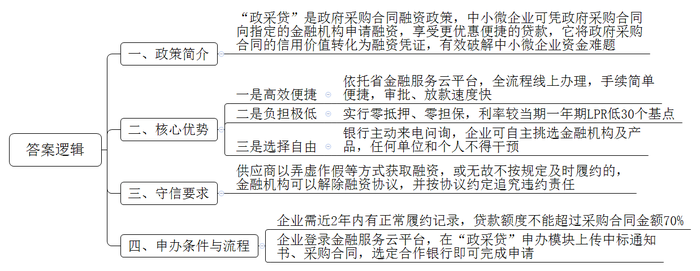
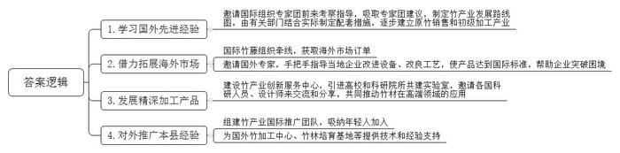
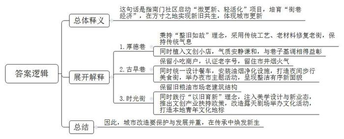
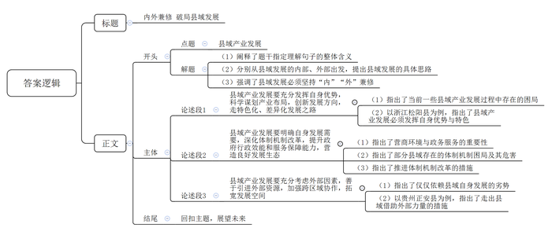

# 2026年公务员多省联考《申论》题（河北B、普通选调卷）

<!-- gwy:overview:start -->
> **河北 · 2026 · 申论 · B类** ｜ 4 题 · 图片 4 处 · 答案随题折叠

导航：[题目](#题目) · [材料 1](#材料-1)
<!-- gwy:overview:end -->

> 候选采集稿。参考答案及解析来自粉笔页面，不代表官方答案或真实高分答卷；来源使用许可与原卷对应关系仍需人工核实。

## 给定材料

### 材料 1

“没想到不用担心担保和抵押，只凭政府采购合同就很快拿到了贷款，利率还比普通商业贷款低。”文西科技有限公司陈总感慨。当时，公司通过“政采贷”成功获得了42万元融资，解了项目启动资金短缺的燃眉之急。

“政采贷”，即政府采购合同融资。中小微企业凭借政府采购合同可以向指定的金融机构申请融资，享受更优惠便捷的贷款。通过“政采贷”，F省将政府采购合同的信用价值转化为融资凭证，有效破解了中小微企业“钱从哪里来”的难题。

文西科技有限公司是一家从事科技服务的民营企业。2024年初，公司中标了C市某劳务采购项目，项目金额50万元。“当时我们公司成立不到3年，前期投入比较大，还有一定资金缺口。”陈总介绍。2024年3月，市财政局电话告知文西公司“政采贷”政策后，公司登录F省金融服务云平台，直接用政府采购合同向所在地的工行某支行申请了贷款，在两个工作日后就收到了银行发放的贷款，利率低至3.35%。

近年来，F省依托金融服务云平台，由各市县（区）财政部门牵头，通过对接银行、中征系统及众多政府采购供应商，积极推进“政采贷”业务，实现了中标公告、采购合同和融资需求的在线高效传递。“云平台上还汇聚了市场监管、税务、人社等多部门的数据，切实缓解了银企信息不对称的难题，实现了‘让数据多跑路、跑通路’。”F省财政厅政府采购处处长介绍。

“中标后就有五家大银行打来电话问需不需要贷款。有的银行可以完全线上远程操作，有的承诺优惠利率，有的审批通过后1天就能放款。几家银行的手续都特别简单便捷。”F省灿光家私有限公司温经理说。为进一步规范并激励全省金融机构开展“政采贷”业务，2024年，省财政厅会同人民银行F省分行出台相关文件，要求任何单位和个人不得干预供应商选择金融机构及金融产品，不得干预金融机构向供应商提供贷款。同时，省级财政对金融机构按照当年发放的线上“政采贷”金额的千分之二给予奖励。2025年1至8月，F省8家金融机构发放贷款33亿元，获得奖补资金660万元。

“现在企业只要通过云平台中的‘政采贷’申办模块上传中标通知书和采购合同，选择合作银行，就能完成申请。我们在后台可以获取到平台中的企业证照和历史交易数据，收到申请后就能快速进行审核。”某银行F省分行齐行长介绍。F省要求金融机构在开展“政采贷”业务前必须向同级财政部门和人民银行报备，并对金融机构贷款额度、期限和利率等作出了明确规定。“根据上级要求，我行推出‘政采贷’零抵押、零担保，目前的贷款利率较当期一年期LPR（贷款市场报价利率）低30个基点。同时，我行将授信审批时间由要求的不超过5个工作日缩短至不超过3个工作日，申请提交到放款时间由要求的不超过10个工作日缩短至不超过7个工作日。我行还通过引入大数据辅助审批，有效减少了人工审批成本。”齐行长说。

为了让政策更好地落地，F省建立了政府采购交易分析风控模型和回款账款直接推送至财政部门预算管理一体化系统的模式，为贷款自动化审批、线上合同签订和系统锁定回款提供了有力技术支撑。“一方面，我们实现了各级平台入口统一、省市县信息全域覆盖，让‘政采贷’业务做到了推送信息、锁定回款账户、申请贷款、预授信、审批放款和贷后风控的全流程线上闭环操作，对于没有及时归还贷款或者金融机构存在违规行为的，我们及时进行风险提醒；另一方面，我们打通了金融服务云平台和监管平台的数据壁垒，保证监管部门可以第一时间查看‘政采贷’和保函数据。”金融服务云平台建设小组汪继说道。

省财政厅也对供应商和金融机构同步提出了守信要求。如果供应商以弄虚作假等方式获取融资，或无故不按规定及时履约的，金融机构可以解除融资协议，并按协议约定追究违约责任。如果金融机构发布不实信息、虚假宣传或违背服务承诺开展融资，将由相关部门责令限期改正，若情节严重，将终止融资业务合作资格。

“目前我们开展业务的要求是客户必须在最近2年内有正常履约记录，贷款额度不能超过客户持有采购合同金额的70%。”某银行网点信贷经理小贾说，“金融服务云平台会及时滚动近期政府采购中标且未进行贷款业务的公司信息，我们会根据标的金额、近三年内公司是否申请过‘政采贷’和公司的经营状况等信息精准匹配我们的产品并进行推介。”

### 材料 2

Y县坐拥全国十分之一的竹林资源。这里云雾缭绕、层峦叠翠，得天独厚的生态环境孕育出“壁厚、节长、径大、质优”的好竹子。而今，这一根根竹子正以更环保、更时尚、更高附加值的姿态漂洋过海，为世界讲述中国绿色发展的鲜活故事。

时间回到八年前，当时Y县的竹资源优势尚未得到充分发掘，存在有想法没办法、有产品没产业、有销售没市场的问题。“要么卖原竹，要么做成箩筐扁担卖，也就赚点辛苦钱。”竹农老高说。“当时县里确实也没捋清思路。”Y县林业局刘局长介绍，“经过多次调研，我们对如何走好‘两山’转化的路子进行了深入论证，最后决定向外取经。”

2019年Y县政府邀请国际竹藤组织专家团来县里考察指导，由此开启了竹产业国际化发展的历程。来自肯尼亚的卡玛乌是竹藤组织的林业专家，当时他站在竹海边，对随风摆动的阵阵“竹浪”惊叹不已：“这简直就是绿色的黄金！”卡玛乌告诉当地竹农，在他的家乡，木材资源短缺，很多地区不得不使用塑料制品，而竹子三到五年就能成材，是理想的木材替代品。

短短半个月时间，Y县政府带着专家团走遍了全县竹林。按照专家团的建议，在接下来的两年中，县政府制定了竹产业发展路线图，再由有关部门结合实际制定配套措施：推出“竹艺贷”“碳汇竹林保险”等创新金融产品，为相关企业发展注入金融活水；与职业院校合作开设竹工艺相关专业，培育新型“竹匠”，强化企业人才保障；不断推进基础设施改造提升，改善林区道路，建设冷链仓储物流设施，降低运输损耗。

在各方的努力下，Y县的原竹销售和初级加工产业逐步建立，2021年新增竹林5万亩，组建竹业合作经济组织16家，隆泰竹业就是其中一家以竹胶板为主要产品的公司。该公司和县林业局在竹山附近合作建设了一个竹材物理分解点，采伐队每日将新鲜竹材运至分解点进行初步的切割、干燥后再统一分拣装车，大大提升了效率。经粗加工后的竹材由专车运至工业园再加工，通过国际竹藤组织的渠道销售至世界各地。公司成立不到2年，产值就破了5000万元，成为了Y县的明星企业。

2023年，Y县物美价优的竹产品吸引了众多客户的关注，在国际竹藤组织的牵线下，Y县的竹产业接到了更多来自海外市场的订单。“第一次接到欧洲订单时，我们连客户需要的规格都很陌生。”Y县竹产业协会杜会长回忆道，“特别是对方要求的防霉处理标准，我们听都没听过。”为了帮助企业突破困境，Y县邀请了德国竹材处理专家汉斯博士。他在Y县待了整整三个月，手把手教当地企业改进设备、改良工艺，产品最终达到欧盟标准。

“之前，我们确实和先进水平还有差距。”杜会长介绍，“他们的原材料其实不如我们，但经过精深加工后能得到更优良的产品。”由此，Y县下决心大力发展竹纤维、竹炭、竹基复合材料等精深加工产品，建设了竹产业创新服务中心，引进高校和科研院所共建实验室，邀请各国科研人员、设计师来交流和分享，共同推动竹材在建筑材料、汽车内饰等高端领域的应用。如今，走进Y县竹产业创新服务中心，处处可见国际合作的景象：实验室里，来自巴西的研究员正在测试竹基复合材料的强度；设计中心里，意大利设计师正与Y县工匠热烈讨论着新款竹家具的细节；会议室里，来自印尼的青年竹艺师布迪，正在展示他最新的作品。“我的创意是将印尼文化符号融入到竹艺作品中，用国际化的思维进行设计。”布迪说，“因为，竹子是世界的语言。”

2025年，老高的竹林里来了一群特殊的客人——来自国际竹藤组织的“竹海生态游”考察团。“那些外国朋友对我的砍竹方式特别感兴趣，还学着用传统工具编竹篮。”老高笑着说，“一位厄瓜多尔的专家告诉我，他们那也有大片竹林，但利用率远不如我们县。”这次交流让老高意识到，Y县的经验正在被世界所需要。今年，他的儿子大学毕业后选择回乡，加入了县里的竹产业国际推广团队。“年轻人脑子活，会说外语，正在把我们Y县的竹子故事讲给世界听。”老高语气中满是自豪。

在Y县竹产业示范园，一座现代化的竹材加工厂正在运转。这里生产的竹建材，正源源不断地运往“一带一路”沿线国家。在埃塞俄比亚，Y县技术支持建立的竹加工中心，已经能生产出符合当地需求的竹家具；在加纳，借鉴Y县模式的竹林培育基地初见成效。“国际合作不仅是把别人的好经验学回来，也要让我们的好技术、好产品走出去，大家在交流互鉴中发展。”杜会长说。

夕阳西下，竹影婆娑。Y县的根根翠竹，正以最朴素的方式，连接起Y县与世界，书写着国际合作助力绿色发展的生动篇章。

### 材料 3

近日，S市举办了“街巷里的中国——城市微旅行游记征集大赛”，鼓励市民与游客用脚步丈量街巷、以文字记录温度。以下是获奖作品《在老街巷中，触摸一座城的重生》：

五月的风裹着暖意，吹过南门社区灰墙黛瓦的街巷。我终于站在这条被朋友反复“种草”的厚德巷——它不到500米，青石板路蜿蜒向前，两侧是错落的屋檐与探出墙头的绿意。游客络绎不绝，几乎每个人都举着手机，对准一扇花窗、一道砖纹、一面爬满藤蔓的老墙，留下珍贵的记忆……

朋友告诉我，这儿不仅是网红打卡地，更藏着一座城市更新的秘密。

三年前，南门社区还只是城区核心地带中一片被忽略的角落。尽管周边商场林立、写字楼群起，这里却仍散落着不少老旧院落与文保建筑，像被时光遗忘的拼图碎片。后来，社区启动了“微更新、轻活化”项目——他们称之为“街巷经济”的培育。于是，三年的时间里，几条曾经边缘的小巷在精心培育中一步步“活”了起来。

我慢慢向前走，指尖划过粗粝的砖墙。百年前，厚德巷曾是文人墨客荟萃之地，众多名人故居、老茶馆、旧书店沿街而建。后来，这里逐渐没落，老建筑也日渐斑驳。现在，整条巷子改造秉持的是“整旧如故”的理念。路上，恰好碰见一位正在修复砖雕的老师傅，“我们都是采用传统工艺修复这条街的门窗砖瓦，你看，我们特意从周边搜集相同年代的老材料，为的就是让这老街啊，修旧如旧。”往前走，一些老建筑的门前还挂着木牌，用中英双语静静讲述这座院落的往昔，传统的气息在这一刻真实可触。

转角处，一家名为“九九拾遗”的文创小店自然地融入巷景之中。老板娘九九是土生土长的本地人，她一边整理以老巷风貌为灵感制作的纸灯，一边感叹道：“改造后的厚德巷，不仅样子没变，连气氛也还是从前那样。”她的小店，就像巷中其他铺子一样，并不时髦喧闹，而是以安静谦和的气质，与巷子的基调相得益彰。

走出厚德巷，穿过一条马路，空气突然变得热闹起来——香味、人声、炊烟扑面而来。这里是古早巷，南门社区最有烟火气的地方。

南门社区唐主任正好也在烟火气里。她介绍，这里原本聚集了上百家小吃摊，臭豆腐、烤猪蹄、瘦肉丸……虽然人气旺，却油烟弥漫、摊点杂乱，“很多人来了又走，留不住。”

但现在，古早巷并没有被清理一空，也没有赶走一家商户，反而整洁、有序了。正在炸酥肉的大姐开心地说：“你看，社区不仅帮我们统一设计餐车，还装了油烟净化器，现在我们做生意更体面、更安心啦。”一路上，各式各样的小吃让人垂涎欲滴，我点了一份老伯卖的烤年糕。“我在这做了三十年。以前这里是脏乱差，现在成了名片！”老伯指着餐车上“古早巷老字号”的标识说，“这是社区给我们认证的，有了这个，老客更认，新客也更放心。”

晚上七点，巷子限制了机动车通行，变成了步行美食街，灯光渐渐亮起，暖黄色的光束从檐角洒下，整条古早巷成了一条“地上的星河”。

“我们要做的，是让市井烟火留得住人，也留得住心。”唐主任说，“周末我们还经常举办‘夜市主题日’，很多家长都带着孩子来体验。”正说着，巷口突然响起锣鼓声——原来是一场非遗舞狮表演正在开场，人群欢呼涌动。运气真好，赶上他们的夜市主题活动！

而最让我惊艳的，是离古早巷不远的时光街：青绿的主色调、简洁的设计线条、潮流的店铺招牌，年轻人三三两两坐在户外咖啡座上聊天，这像是从杂志里跳出来的一片理想街区。

谁能想到，改造的时候，它的前身竟是一个设施陈旧、货车扰民、居民抱怨连连的旧粮油市场？唐主任告诉我，改造的时候，社区并没有抹掉它的过去，而是在保留老建筑结构的基础上，注入美学设计与新业态。“那时候我们提出一个理念，叫‘以旧育新’。”她说道，“不是仿古，也不是复旧，而是要让旧空间自己长出新的生命。”

在这里开设独立书店的主理人小陈坦言：“最初我们想在这儿做文创，很多人都不看好。但社区推出了实实在在的扶持政策，不仅引入社会资本设立‘创新孵化基金’，还提供租金减免和品牌推广支持，让我们这样的小店也有了走下去的底气。”如今，时光街已成为本地青年文化的一个重要地标。曾经的仓库屋顶被改造成了开放式的露天剧场，沉浸式话剧、音乐会、艺术节纷纷在此落地。

夜幕缓缓落下，我坐在时光街一角，写下最后一页游记：如果你问我，为什么一条老街值得专门来看？我想我找到了答案。<u>它们既有“老”的气韵，又有“新”的气象，方寸之地大有乾坤。</u>厚德巷、古早巷、时光街——它们并没有变成千篇一律的“文旅样板”，而是以三种不同的方式，讲述同一件事：一座城市如何温柔地对待自己的过去，又如何勇敢地走向未来。

你若来，不要只记得拍照——你要触摸它的砖瓦，聆听它的故事，品尝它的小吃，感受它古韵悠长中的生机盎然。

### 材料 4

“现在办业务方便多了。”N县童新小提琴有限公司杨经理说，“原来办这项业务需要去三个窗口、交三套材料，现在到一个窗口交一套材料就都办好了。”

改变源自N县2020年开始的改革。“当时根据省委、市委部署，N县结合自身发展实际需要，推动职能相近的机构进行跨部门整合。”N县县委王书记介绍，“我们按照地理位置、主导产业等在省内外寻找发展建设标杆，并组织县乡干部到先进发达地区跟班学习，针对性开展外训和专题学习研讨。根据外训学习的成果，县里重新规划梳理了各项各类审批制度、办事流程，有效提升了行政效能和服务保障能力。”

“过去县里的招商服务中心就只负责招商，招回来后还要经过好几个部门，最终能不能落地、落地效果如何，都没有很好的保障。”县项目推进中心林主任说。合并后的N县项目推进中心主要负责招商引资、项目推进、省县重点工程推进等，将招商、签约、投产等一系列环节串联起来，为企业提供全周期服务。林主任接着说：“招商也要有的放矢。我们在前期会进行大量的调研考察，新产业的发展、产业发展的新突破不能陷入与周边地区同质化的困局，要立足‘人无我有、人有我优’的原则。”

N县原本没有小提琴产业。“项目推进中心联系我的时候我心里还打着鼓，就我自己，从头开始，能行吗？后来他们告诉我，县里通过本地在外人才库发现了许多像我这样在外地从事小提琴制作的老乡，就主动上门讲解各种优惠政策，动员我们一起返乡创业。而且，县里不是‘一招了之’，补贴发放、厂房租赁、技能培训……我们遇到了什么问题县里都能及时帮我们解决，新出了优惠政策也会马上上门告知，真是太贴心了！”杨经理说。

“不仅要扶持企业‘站’起来、‘立’得住，更要鼓励企业走出去。”N县曲县长说。一方面，N县创新推行“两会一日”机制，通过“企业茶话会+项目督查会+现场办公日”的组合拳有效收集企业诉求，破解企业发展难题；另一方面，N县制定出台市场开拓扶持方案，提供资金支持企业参加国内外各类展会，定期组织赴外考察交流团，护航企业“破圈出海”。如今，N县拥有小提琴生产及配套企业100余家，产品销往全球多个国家和地区，企业的发展带动了超过1.5万人就业。

“鸟儿要飞高飞远，既要找到适合的飞行路径，又要丰满自身的羽翼。”王书记说，“我们在制定N县中长期发展规划时，强调要根据本县实际情况和特殊性，打好‘特色牌’，走好‘差异路’。”

“N县从前是农业管农业、科技管科技，研究提出的建议也没法很好落地。”C大学乡村振兴研究院汪研究员说，“改革后，N县围绕全县‘一盘棋’，群策群力开展科技攻关，取得了很好的效果。”N县经过调研发现，县里的碱性土壤和相对干旱的气候非常适合蜜瓜生长。之后，县政府与省农科院积极开展合作，培育出适合当地种植的多个蜜瓜品种。2025年，全县蜜瓜产业产值近6亿元，成为了N县的另一支柱产业。

N县佳果农业有限公司负责人老段对此深有感触：“以前种粮食收成不好，大家日子过得苦呵呵的。现在种了蜜瓜，产量高，还不愁卖。我们县里和竹淮高新区签了合作协议，每年要供应一大批蜜瓜给那边的大企业，对方也会派专家来给我们做电商销售的培训，帮我们开网店。听说今年那边还要开我们县的特色农产品专卖店呢！”说起下一步的计划，老段干劲满满，“据说最近县里在组织去D省的参观交流团，那里有几个地方的蜜瓜也很不错。我打算报名，过去看一看、学一学，回来也和大家分享分享！”

“对县域而言，其发展同时受到外部因素和自身实际的双重影响，<u>破解县域发展的难题，要立足县域看县域，也要跳出县域看县域</u>。”汪研究员表示。

“我们县自然资源禀赋有限，发展基础相较东部经济强县还是比较薄弱，要跟上大部队、保障发展成效，就只能在其他方面做文章。跨地区协作是一个很好的机会，但与此同时，我们也要做好服务，‘内外兼修’，全面发展。”王书记坦言，“找准自身优势，大胆改革，勇于创新，选对赛道，N县才能发展得更稳、更好。”

## 题目

### 第 1 题

**C市财政局拟联合金融机构邀请本地中小微企业代表召开推介会，并在会上发放推介材料，宣传推广“政采贷”。请根据给定资料1，列出这份推介材料的内容要点。（20分）**

关联材料：材料 1

作答要求：

要求：

（1）紧扣材料，内容全面，简明扼要，条理清晰；

（2）不超过400字。

第 1 题 · 答案与解析

**参考答案（粉笔题库参考内容）**

一、政策简介：“政采贷”是政府采购合同融资政策，中小微企业可凭政府采购合同向指定的金融机构申请融资，享受更优惠便捷的贷款，它将政府采购合同的信用价值转化为融资凭证，有效破解中小微企业资金难题。

二、核心优势：一是高效便捷。依托省金融服务云平台，全流程线上办理，手续简单便捷，审批、放款速度快。二是负担极低。实行零抵押、零担保，利率较当期一年期LPR低30个基点。三是选择自由。银行主动来电问询，企业可自主挑选金融机构及产品，任何单位和个人不得干预。

三、守信要求：供应商以弄虚作假等方式获取融资，或无故不按规定及时履约的，金融机构可以解除融资协议，并按协议约定追究违约责任。

四、申办条件与流程：企业需近2年内有正常履约记录，贷款额度不能超过采购合同金额70%。企业登录金融服务云平台，在“政采贷”申办模块上传中标通知书、采购合同，选定合作银行即可完成申请。

**解析**

**参考答案说明**：根据题干要求，正文分为“政策简介”“核心优势”“守信要求”“申办条件与流程”四个部分，其中，核心优势具体围绕“高效便捷”“负担极低”“选择自由”这三个方面展开。各条答案要点之间在内容上相互并列，没有交叉。

**考点**：宣传类

**来源**：2026年公务员多省联考《申论》题（河北B、普通选调卷）

### 第 2 题

**请根据给定资料2，概括Y县通过国际交流合作发展竹产业的做法。（20分）**

关联材料：材料 2

作答要求：

要求：

（1）内容全面，表达准确，条理清晰；

（2）不超过300字。

第 2 题 · 答案与解析

**参考答案（粉笔题库参考内容）**

1.学习国外先进经验。邀请国际组织专家团前来考察指导，吸取专家团建议，制定竹产业发展路线图，由有关部门结合实际制定配套措施，逐步建立原竹销售和初级加工产业。

2.借力拓展海外市场。国际竹藤组织牵线，获取海外市场订单；邀请国外专家，手把手指导当地企业改进设备、改良工艺，使产品达到国际标准，帮助企业突破困境。

3.发展精深加工产品。建设竹产业创新服务中心，引进高校和科研院所共建实验室，邀请各国科研人员、设计师来交流和分享，共同推动竹材在高端领域的应用。

4.对外推广本县经验。组建竹产业国际推广团队，吸纳年轻人加入；为国外竹加工中心、竹林培育基地等提供技术和经验支持。

**解析**

**参考答案说明：**本参考答案从“学习国外先进经验”“借力拓展海外市场”“发展精深加工产品”“对外推广本县经验”四个方面展开，各条答案要点之间在内容上相互并列，没有交叉。

**考点**：概括措施类

**来源**：2026年公务员多省联考《申论》题（河北B、普通选调卷）

### 第 3 题

**给定资料3中提到：“它们既有‘老’的气韵，又有‘新’的气象，方寸之地大有乾坤”。请根据该给定资料，谈谈你对这句话的理解。（20分）**

关联材料：材料 3

作答要求：

要求：

（1）理解准确，分析透彻，层次清晰；

（2）不超过300字。

第 3 题 · 答案与解析

**参考答案（粉笔题库参考内容）**

这句话是指南门社区启动“微更新、轻活化”项目，培育“街巷经济”，在方寸之地实现新旧共生，体现城市更新。具体有：1.厚德巷：秉持“整旧如故”理念，采用传统工艺、老材料修复老街，保持传统气息；同时植入文创小店，气质安静谦和，与巷子基调相得益彰。2.古早巷：保留小吃商户，认证老字号，留住市井烟火气；同时统一设计餐车，安装油烟净化设施，打造夜间步行美食街，举办夜市主题活动，呈现整洁有序新面貌。3.时光街：保留旧粮油市场老建筑结构；同时践行“以旧育新”理念，注入美学设计与新业态，推出文创产业扶持政策，改造露天剧场举办文化活动，打造本地青年文化地标。因此，城市改造要保护与发展并重，在传承中焕发新生。

**解析**

**参考答案说明：**（1）思路方面，本参考答案按照词句解释题“总体释义+展开解释+总结”的一般答题思路展开。（2）内容方面，本参考答案先对题干给定句子进行了总体释义；接着，展开解释部分介绍了“厚德巷”“古早巷”“时光街”这三条街巷“老”的气韵与“新”的气象的具体表现，最后进行了总结。（3）词句表达方面，本参考答案加上了“具体有”“因此”等连接词来承接上下文，使答案更加顺畅。

**考点**：词句解释类

**来源**：2026年公务员多省联考《申论》题（河北B、普通选调卷）

### 第 4 题

**给定资料4中提到：“破解县域发展的难题，要立足县域看县域，也要跳出县域看县域。”请根据你对这段话的理解和对给定资料的思考，自选角度，自拟题目，联系实际，写一篇议论文章。（40分）**

关联材料：材料 1、材料 2、材料 3、材料 4

作答要求：

要求：

（1）观点明确，内容充实，论证充分，结构完整，思路清晰，语言流畅；

（2）参考给定资料，不拘泥于给定资料；

（3）不少于1000字。

第 4 题 · 答案与解析

**参考答案（粉笔题库参考内容）**

**内外兼修** **破局县域发展**

“破解县域发展的难题，要立足县域看县域，也要跳出县域看县域。”这句话深刻揭示了县域产业发展的内在逻辑。“立足县域看县域”，要求我们扎根实际、摸清家底，找准自身优势，明确发展短板，夯实县域内生发展根基；“跳出县域看县域”，则提醒我们不能囿于一隅，要放眼全局、借势发力，在更广阔的坐标系中定位自身。唯有坚持“立足自身”与“放眼外界”的辩证统一，做到“内”“外”兼修，方能让县域产业破局突围、长效发展。

**县域产业发展要充分发挥自身优势，科学谋划产业布局，创新发展方向，走特色化、差异化发展之路。**当下不少县域急于追赶发展步伐，盲目照搬邻县产业模式、扎堆布局通用型产业，陷入恶性竞争、资源空耗的发展困局。破解这一困境，关键在于回归自身、深耕特色。浙江松阳县敏锐捕捉到境内拥有200平方公里山间平原及丰富公路场景的优势，结合本土交通新材料领域“小巨人”企业基础，果断将综合交通产业确立为发展新赛道。“历史上有基因、现实中有场景”，松阳县的实践告诉我们，县域发展唯有立足自身特色资源禀赋，坚守“人无我有、人有我优”原则，方能开辟出一条不可替代的高质量发展航道。

**县域产业发展要明确自身发展需要，深化体制机制改革，提升政府行政效能和服务保障能力，营造良好发展生态。**优良的营商环境和完善的政务服务是县域产业发展的核心软实力。但长期以来，部分县域存在权责划分不清、审批流程繁琐等体制机制短板，不仅挫伤市场主体信心，更严重制约县域产业集聚和经济提质升级。对此，县域必须以自身发展需求为导向，明确自身短板，深耕政务服务改革，破除部门壁垒、精简办事流程，为企业提供落地、经营、发展全周期服务，统筹县域资源实现全域一盘棋，以体制革新激活治理效能，以优质服务涵养一流营商环境，为产业落地生根、发展壮大保驾护航。

“不谋全局者，不足谋一域。”县域产业发展不能闭门造车、故步自封，在深耕本土、练好内功的基础上，还应“跳出县域”，在内外联动中寻求破局突围的新动能。

**县域产业发展要充分考虑外部因素，善于引进外部资源，加强跨区域协作，拓宽发展空间。**县域的资源有限，发展基础相对薄弱，想要保障发展成效，就必须打破地域壁垒，积极对接发达地区，通过区域结对、产业共建等方式引进先进技术、优质人才与市场资源，同时搭建对外交流平台，助力本土产业走出去。贵州正安县在粤黔协作中与横琴粤澳深度合作区结对，在吉他产业发展中探索出了“澳门设计、正安生产、横琴销售”模式，从设计到生产再到出口，形成了一条跨地域的产业协作链条。这条跨越山海的协作之路，不仅破解了产业发展瓶颈，更为县域产业抢占先机、赢得主动打开了广阔空间。

县域振兴，需内外兼修、多维发力。立足本土深耕特色、改革提质，跳出县域借力赋能、跨域协作，方能推动县域经济高质量、可持续发展。

**文章分析**

**内外兼修** **破局县域发展**

【**标题的优点：**标题中含有主题词，使文章主题更突出、清晰。】

（1）“破解县域发展的难题，要立足县域看县域，也要跳出县域看县域。”<u>这句话深刻揭示了县域产业发展的内在逻辑</u>。（2）“<u>立足县域看县域</u>”，<u>要求我们扎根实际、摸清家底</u>，<u>找准自身优势</u>，<u>明确发展短板</u>，<u>夯实县域内生发展根基</u>；“<u>跳出县域看县域</u>”，<u>则提醒我们不能囿于一隅</u>，<u>要放眼全局、借势发力</u>，<u>在更广阔的坐标系中定位自身</u>。（3）唯有<u>坚持“立足自身”与“放眼外界”的辩证统一</u>，<u>做到“内”“外”兼修</u>，方能让县域产业破局突围、长效发展。

【**开头的优点：**★内容方面。范文的开头是紧扣题目给定的“县域产业发展”这一主题展开的。首先，阐释了题干指定理解句子的整体含义；其次，分别从县域发展的内部、外部出发，提出县域发展的具体思路；最后，强调了县域发展必须坚持“内”“外”兼修。★文字表达方面。运用了“唯有”“方能”等连词，使语言表达有逻辑性、并增强文章气势。】

**县域产业发展要充分发挥自身优势，科学谋划产业布局，创新发展方向，走特色化、差异化发展之路。**（1）当下<u>不少县域急于追赶发展步伐</u>，<u>盲目照搬邻县产业模式、扎堆布局通用型产业</u>，<u>陷入恶性竞争、资源空耗的发展困局</u>。（2）破解这一困境，关键在于<u>回归自身、深耕特色</u>。浙江松阳县敏锐捕捉到境内拥有200平方公里山间平原及丰富公路场景的优势，结合本土交通新材料领域“小巨人”企业基础，果断将综合交通产业确立为发展新赛道。“历史上有基因、现实中有场景”，松阳县的实践告诉我们，县域发展唯有立足自身特色资源禀赋，坚守“人无我有、人有我优”原则，方能开辟出一条不可替代的高质量发展航道。

【**论述段1的优点：**★观点句：范文的观点句是紧扣“县域产业发展”这一主题提出的。形式上，它在段首处直接写出，位置突出，容易发现。内容上，关键词突出，内容要点明确，可以明显看出主要论述从“县域产业发展要充分发挥自身优势”方面入手。★论述内容：（1）指出了当前一些县域产业发展过程中存在的困局；（2）以浙江松阳县为例，指出了县域产业发展必须发挥自身优势与特色。注意：以上两个方面的内容都是紧扣“县域产业发展要充分发挥自身优势，科学谋划产业布局，创新发展方向，走特色化、差异化发展之路”这个观点句进行分析论述的，论述的针对性强，内容层次丰富。在论述方法上以道理论证为主，论述清晰透彻。】

**县域产业发展要明确自身发展需要，深化体制机制改革，提升政府行政效能和服务保障能力，营造良好发展生态。**（1）<u>优良的营商环境和完善的政务服务是县域产业发展的核心软实力</u>。（2）但长期以来，<u>部分县域存在权责划分不清、审批流程繁琐等体制机制短板</u>，不仅<u>挫伤市场主体信心</u>，更严重<u>制约县域产业集聚和经济提质升级</u>。（3）对此，县域必须<u>以自身发展需求为导向</u>，<u>明确自身短板</u>，<u>深耕政务服务改革</u>，<u>破除部门壁垒、精简办事流程</u>，<u>为企业提供落地、经营、发展全周期服务</u>，<u>统筹县域资源实现全域一盘棋</u>，<u>以体制革新激活治理效能</u>，<u>以优质服务涵养一流营商环境</u>，<u>为产业落地生根、发展壮大保驾护航</u>。

【**论述段2的优点：**★观点句：范文的观点句是紧扣“县域产业发展”这一主题提出的。形式上，它在段首处直接写出，位置突出，容易发现。内容上，关键词突出，内容要点明确，可以明显看出主要论述从“县域产业发展要明确自身发展需要”方面入手。★论述内容：（1）指出了营商环境与政务服务的重要性；（2）指出了部分县域存在的体制机制困局及其危害；（3）指出了推进体制机制改革的措施。注意：以上三个方面的内容都是紧扣“县域产业发展要明确自身发展需要，深化体制机制改革，提升政府行政效能和服务保障能力，营造良好发展生态”这个观点句进行分析论述的，论述的针对性强，内容层次丰富。在论述方法上以道理论证为主，论述清晰透彻。】

“不谋全局者，不足谋一域。”县域产业发展不能闭门造车、故步自封，在深耕本土、练好内功的基础上，还应“跳出县域”，在内外联动中寻求破局突围的新动能。

【**过渡段的优点：**本段强调了县域产业发展不能局限于县域内思维，还要走出县域，借助外部力量助力县域产业发展，起到了承上启下的作用。】

**县域产业发展要充分考虑外部因素，善于引进外部资源，加强跨区域协作，拓宽发展空间。**（1）县域的<u>资源有限</u>，<u>发展基础相对薄弱</u>，（2）想要保障发展成效，就<u>必须打破地域壁垒</u>，<u>积极对接发达地区</u>，<u>通过区域结对、产业共建等方式引进先进技术、优质人才与市场资源</u>，同时<u>搭建对外交流平台</u>，<u>助力本土产业走出去</u>。贵州正安县在粤黔协作中与横琴粤澳深度合作区结对，在吉他产业发展中探索出了“澳门设计、正安生产、横琴销售”模式，从设计到生产再到出口，形成了一条跨地域的产业协作链条。这条跨越山海的协作之路，不仅破解了产业发展瓶颈，更为县域产业抢占先机、赢得主动打开了广阔空间。

【**论述段3的优点：**★观点句：范文的观点句是紧扣“县域产业发展”这一主题提出的。形式上，它在段首处直接写出，位置突出，容易发现。内容上，关键词突出，内容要点明确，可以明显看出主要论述从“县域产业发展要充分考虑外部因素”方面入手。★论述内容：（1）指出了仅仅依赖县域自身发展的劣势；（2）以贵州正安县为例，指出了走出县域借助外部力量的措施。注意：以上两个方面的内容都是紧扣“县域产业发展要充分考虑外部因素，善于引进外部资源，加强跨区域协作，拓宽发展空间”这个观点句进行分析论述的，论述的针对性强，内容层次丰富。在论述方法上以道理论证为主，论述清晰透彻。】

【**论述段之间的关系：**三个论述段都围绕着“县域产业发展”这一主题展开，首先论述了“县域产业发展要依靠自身优势”，接着论述了“县域产业发展要推进体制机制改革”，最后论述了“县域产业发展要借助外部力量”，三段呈现出并列关系，论述清晰明了，内容丰富。】

县域振兴，需内外兼修、多维发力。立足本土深耕特色、改革提质，跳出县域借力赋能、跨域协作，方能推动县域经济高质量、可持续发展。

【**结尾的优点：**范文的结尾回扣了“县域产业发展”这一主题，并且进行了总结与升华。】

**解析状态：unknown（来源未提供）**

**考点**：文章写作题

**来源**：2026年公务员多省联考《申论》题（河北B、普通选调卷）

