# 2008年河南省公务员录用考试《行测》题

<!-- gwy:overview:start -->
> **河南 · 2008 · 行测 · 统考** ｜ 140 题 · 图片 75 处 · 答案随题折叠

| 题型模块 | 题量 | 题号 |
| --- | ---: | ---: |
| 言语理解与表达 | 40 | 1–40 |
| 数量关系 | 20 | 41–60 |
| 判断推理 | 40 | 61–100 |
| 常识判断 | 20 | 101–120 |
| 资料分析 | 20 | 121–140 |
| **合计** | **140** | |

导航：[题型与作答说明](#题型与作答说明) · [题目](#题目) · [材料 1](#材料-1)
<!-- gwy:overview:end -->

> 候选采集稿。参考答案及解析来自粉笔页面，不代表官方答案或真实高分答卷；来源使用许可与原卷对应关系仍需人工核实。

## 题型与作答说明

言语理解与表达

（40题）

本部分包括表达与理解两方面的内容。请根据题目要求，在四个选项中选出一个最恰当的答案。

数量关系

（20题）

本部分包括数字推理与数学运算两种类型的题目。

判断推理

（40题）

本部分包括演绎推理、定义判断、图形推理与类比推理四种类型的题目。

常识判断

（20题）

请你依据所掌握的知识作出判断，选择最为合理的一个选项。

资料分析

（20题）

本部分主要是对文字资料、统计图、统计表的分析。请根据资料提供的信息进行分析、比较、计算、处理，选择最适当的答案。

## 题目

### 第 1 题

（1）日本政界的一些人妄图＿＿＿＿＿日本侵华的历史，引起中日两国人民的强烈反对。

（2）端午节，民间有在身上挂香荷包的习俗，据说，这样可以＿＿＿＿＿疾病。

（3）见到这一情景，她那满腔怨恨，似乎一下子都＿＿＿＿＿了。

从下列四个选项中选择最恰当的一组填入横线中：

A. 窜改 驱除 融解

B. 篡改 祛除 融解

C. 窜改 祛除 溶解

D. 篡改 驱除 溶解

第 1 题 · 答案与解析

**参考答案（粉笔题库参考内容）**

B

**解析**

第一空，根据文意可知，横线处需填入一个感情色彩偏消极的词语，且需表达出日本政界的一些人妄图恶意改动、歪曲日本侵华的历史之意。B、D两项“篡改”指用作伪的手段改动或曲解，感情色彩偏消极，符合文意，均保留。A、C两项“窜改”指改动（成语、文件、古书等），侧重对具体文字材料的改动，比如窜改文件、窜改账目，与“历史”搭配不当，均排除。

第二空，搭配“疾病”。B项“祛除”指除去（疾病、疑惧、邪祟等），搭配恰当，当选。D项“驱除”指赶走，除掉，常与“蚊蝇”“邪恶”等搭配，与“疾病”搭配不当，排除。

第三空，代入验证。B项“融解”指融化，也可用于抽象事物如情绪、关系的化解，搭配“满腔怨恨”恰当，当选。

故正确答案为B。

**考点**：实词填空、词的辨析-感情色彩、词的辨析-搭配对象、词的辨析-词义侧重

**来源**：2008年河南省公务员录用考试《行测》题第1题

### 第 2 题

学生的智力＿＿＿＿＿包括知识，＿＿＿＿＿包括能力，尤其是独立思考和发明创造的能力。一个学生＿＿＿＿＿有知识，＿＿＿＿＿没有自己动手的习惯和勇于创新的精神，＿＿＿＿＿不能成为适应新时代要求的有用之才。

从下列四个选项中选择最恰当的一组填入横线中：

A. 不但 而且 只要 即使 也

B. 虽然 但也 如果 但是 就

C. 既 又 如果 却 也

D. 一方面 一方面 只要 但是 就

第 2 题 · 答案与解析

**参考答案（粉笔题库参考内容）**

C

**解析**

第一空、第二空，由题干可知，知识与能力是并重的，二者构成并列或递进关系。A项“不但······而且”表示递进关系，C项”既······又······”、D项“一方面······一方面······”均表示并列关系，保留。B项“虽然······但也······”表示转折关系，不符合逻辑关系，排除。

第四空，根据“有知识”和“没有自己动手的习惯和勇于创新的精神”可知，前后构成反义，只有C项“却”符合文意，当选。

故正确答案为C。

**考点**：关联关系-并列关系

**来源**：2008年河南省公务员录用考试《行测》题第2题

### 第 3 题

社会主义制度的巩固，社会主义事业的发展，只能是两个文明同时建设，互相促进的结果。＿＿＿＿＿两手都硬起来，＿＿＿＿＿两个文明一起上；单有一手硬，＿＿＿＿＿可能有一时的效果，＿＿＿＿＿最终两个文明建设都上不去。

从下列四个选项中选择最恰当的一组填入横线中：

A. 既然 就能 也 而

B. 只要 就能 即使 反而

C. 因为 所以 尽管 可

D. 只有 才能 虽然 但

第 3 题 · 答案与解析

**参考答案（粉笔题库参考内容）**

D

**解析**

本题考查选择关联词填空的能力。

由“社会主义事业的发展，<u>只能</u>是两个文明<u>同时</u>建设，互相促进的结果”可知，“两个文明同时建设”是社会主义事业发展的必要条件。

因此，前两个横线处应填入表示必要条件关系的关联词，选项中只有D项“只有······才能”符合要求。

B项中的“只要······就能”是充分条件关系，材料没有说“两手都硬”就一定能使“两个文明一起上”；C项“因为······所以”是因果关系；A项“既然······就能”也是强调某种因果。

A、B、C都不合语境，予以排除。

后两个空格构成转折关系，D项“虽然······但”可以满足要求；A项“也······而”不能搭配；B项“即使······反而”不能搭配（“即使”表假设，“反而”表转折）；C项“尽管······可”搭配不当。

故正确答案为D。

**考点**：对应关系-前后呼应

**来源**：2008年河南省公务员录用考试《行测》题第3题

### 第 4 题

（1）为了把幼儿园办成孩子喜欢、家长放心的乐园，她把全部心血都＿＿＿＿＿在天真烂漫的孩子身上了。

（2）一般而言，年轻人对流行歌曲会有更多的兴趣，而老年人在这方面就要＿＿＿＿＿多了。

（3）如果生命中只有鲜花和奖杯而没有挫折和痛苦，那么这种人生＿＿＿＿＿显得太单薄了！

从下列四个选项中选择最恰当的一组填入横线中：

A. 灌注 淡薄 未免

B. 注入 淡泊 不免

C. 倾注 淡漠 难免

D. 贯注 淡薄 以免

第 4 题 · 答案与解析

**参考答案（粉笔题库参考内容）**

A

**解析**

第一空，搭配“心血”，A项“灌注”比喻把心血、精力等集中投入某事业，B项“注入”指流入、灌入，C项“倾注”指感情、精力集中到一个目标上，均与“心血”搭配得当，保留。D项“贯注”指（精神或精力）集中，与“心血”搭配不当，排除。

第二空，根据文意可知，横线处应体现老年人对流行歌曲兴趣不高，A项“淡薄”指（感情、兴趣等）不浓厚，符合文意，保留。B项“淡泊”形容恬淡，不追名逐利，C项“淡漠”形容没有热情，冷淡，侧重形容“态度”，均与文意不符，排除。

第三空，代入验证。根据文意可知，横线处应体现如果生命中只有鲜花和奖杯而没有挫折和痛苦，这样的人生会显得单薄，A项“未免”指不能不说是，实在是，符合文意，当选。

故正确答案为A。

**考点**：实词填空、词的辨析-搭配对象、词的辨析-词义侧重

**来源**：2008年河南省公务员录用考试《行测》题第4题

### 第 5 题

梁先生一个人出去见马歇尔•司徒雷登的时候，总是带着我＿＿＿＿＿翻译。当时除梁先生外，罗隆基和陈达他们＿＿＿＿＿民盟国际关系委员会主任和宣传委员会主任的身份同外国人＿＿＿＿＿的机会更多，但马歇尔•司徒雷登对梁先生更加＿＿＿＿＿。

从下列四个选项中选择最恰当的一组填入横线中：

A. 担任 以 接触 尊重

B. 担任 据 接见 敬重

C. 委任 用 接待 保重

D. 出任 凭 接受 着重

第 5 题 · 答案与解析

**参考答案（粉笔题库参考内容）**

A

**解析**

第一空，根据文意可知，横线处应体现我承担翻译的工作，A、B两项“担任”指担当某种职务或工作，符合文意，保留。C项“委任”指派人担任职务，主语通常为“上级”“组织”等，与文段语境不符，排除；D项“出任”指出来担任（某种职务），强调正式地、公开地担任较高的职务，此处“翻译”工作并非较高的职务，排除。

第二空，搭配“身份”，A项“以······身份”为常见搭配，保留。B项“据”指按照、依据，多搭配“调查”“研究”等，与“身份”搭配不当，排除。

第三空，代入验证。根据文意可知，横线处应体现罗隆基和陈达等人以民盟国际关系委员会主任和宣传委员会主任的身份与外国人打交道，A项“接触”指人们间的接近交往，符合文意，保留。

第四空，代入验证。根据文意可知，横线处应体现马歇尔•司徒雷登对梁先生更重视、看重，A项“尊重”指敬重、重视，符合文意，当选。

故正确答案为A。

**考点**：实词填空、词的辨析-搭配对象、词的辨析-词义侧重

**来源**：2008年河南省公务员录用考试《行测》题第5题

### 第 6 题

问题＿＿＿＿＿没有解决，＿＿＿＿＿变得更严重。

填在横线处最恰当的一项为（    ）。

A. 如果 那么

B. 因为 所以

C. 即使 也

D. 不但 反而

第 6 题 · 答案与解析

**参考答案（粉笔题库参考内容）**

D

**解析**

根据“没有解决”“变得更严重”可知，两个分句之间为递进关系，需填入表递进关系的关联词，对应D项。

A项“如果 那么”、C项“即使 也”表示假设关系，与文意不符，均排除；

B项“因为 所以”表示因果关系，“没有解决”不是“变得更严重”的原因，排除。

故正确答案为D。

**来源**：2008年河南省公务员录用考试《行测》题第6题

### 第 7 题

1843年，柏辽兹听了《马太受难曲》后，这样写，“每个人都在用眼睛跟踪歌本上的词句，大厅里鸦雀无声，既没有表示赞赏，也没有指责的声音，更没有鼓掌喝彩，人们仿佛是在教堂里倾听圣歌，不是在默默地听音乐，而是在参加一次礼拜仪式。人们崇拜＿＿＿＿＿，信赖他，毫不怀疑他的＿＿＿＿＿。”

从下列四个选项中选择最恰当的一组填入横线中：

A. 柴科夫斯基 深邃性

B. 巴赫 神圣性

C. 肖斯塔科维奇 战斗性

D. 肖邦 抒情性

第 7 题 · 答案与解析

**参考答案（粉笔题库参考内容）**

B

**解析**

本题可从第二空入手，根据“柏辽兹听了《马太受难曲》后，这样写······仿佛是在教堂里倾听圣歌，不是在默默地听音乐，而是在参加一次礼拜仪式”可知，横线处需体现崇高、庄重之意。B项“神圣性”指事物因宗教、文化或道德价值被赋予庄严崇高的本质属性，符合文意，保留。A项“深邃性”指事物在物理、思想或情感层面具有深远、复杂、难以穷究的内在属性，文段未体现《马太受难曲》的深刻或难懂，仅强调其带来的庄重感，与文段语境不符，排除；C项“战斗性”指在意识形态或实践领域中展现的对抗性特质，D项“抒情性”指在文学或表达中，抒发情感所具有的能力和作用，均与文意无关，排除。

第一空，代入验证。《马太受难曲》是巴赫的宗教名作，B项符合文意，当选。

故正确答案为B。

【文段出处】书籍《音乐影响了我的写作》

**考点**：实词填空、对应关系-前后呼应

**来源**：2008年河南省公务员录用考试《行测》题第7题

### 第 8 题

“男不耕耘，女不蚕织，衣必文采，食必粱肉”。这是汉代＿＿＿＿＿上呈汉文帝的奏疏《论贵粟疏》中的句子，句中说的是＿＿＿＿＿。

从下列四个选项中选择最恰当的一组填入横线中：

A. 司马迁 女红

B. 晁错 商人

C. 贾谊 将军

D. 班固 农夫

第 8 题 · 答案与解析

**参考答案（粉笔题库参考内容）**

B

**解析**

本题考查实词填空。

在不具备这方面知识的情况下，我们不妨从第二空入手。“男不耕耘”，男的不必耕地耘田，排除D项“农夫”；“女不蚕织”，女的不用养蚕织布，排除A项“女红”；“衣必文采”，穿的必定是华美的衣服，排除C项的“将军”。

并且《论贵粟疏》是晁错的作品。

故正确答案为B。

**考点**：实词填空、对应关系-前后呼应

**来源**：2008年河南省公务员录用考试《行测》题第8题

### 第 9 题

对于全体人民，＿＿＿＿＿对于农村贫民，一个很重要的改善，就是孩子上学不花钱。＿＿＿＿＿让所有孩子上学不花钱，人民＿＿＿＿＿能不再像现在这样没有文化，＿＿＿＿＿不再完全没有文化。

从下列四个选项中选择最恰当的一组填入横线中：

A. 尤其 只有 才 至少

B. 包括 只有 才 以至

C. 特别 如果 就 或者

D. 尤其 如果 就 甚至

第 9 题 · 答案与解析

**参考答案（粉笔题库参考内容）**

A

**解析**

第一空，根据文段“全体人民”具体到“农村贫民”，是在一个更大的范围内进一步强调其中更需关注的群体，语义上形成递进，A、D项“尤其”、C项“特别”均可体现出程度上的加重，保留；B项“包括”仅表示包含关系，无法体现出这种强调和递进，排除。

第二空和第三空，根据文段可知，上学是有文化的前提，故横线要表示必要条件，A项“只有······才”为必要条件关联词，符合文意，保留。C、D项“如果······就”表示假设关系，排除。

第四空，验证A项，横线后A项“至少”表示最低限度，可体现出从“没有文化”到“至少不再完全没有文化”的层次推进，符合文意，当选。

故正确答案为A。

**考点**：对应关系-前后呼应

**来源**：2008年河南省公务员录用考试《行测》题第9题

### 第 10 题

生产的社会化要求企业内部实现＿＿＿＿＿的分工合作。

从下列四个选项中选择最恰当的一组填入横线中：

A. 周密

B. 缜密

C. 全面

D. 广泛

第 10 题 · 答案与解析

**参考答案（粉笔题库参考内容）**

A

**解析**

本题考查实词辨析与最佳搭配。

“广泛”明显不合语境，故D项排除。

“缜密”指周密、细致（多指思想），文段中指企业内部的分工合作，排除B项。

“周密”指周到而细密。

C项为干扰项，“全面”虽然也有周密的意思，但是“社会化”强调彼此依靠，“分工与合作”，要更亲密，强调相互作用，全面只是面上的都具备，因此用“周密”最贴切。

故正确答案为A。

**考点**：实词填空、词的辨析-搭配对象、词的辨析-词义侧重

**来源**：2008年河南省公务员录用考试《行测》题第10题

### 第 11 题

人体皮肤由表皮层与真皮层组成，表皮层与真皮层之间有一称为“基层”的中间组织。人在青春期皮肤有相当＿＿＿＿＿的新陈代谢活动。人到中年后，表皮细胞的新陈代谢开始＿＿＿＿＿，表皮基层的折曲与厚度显著减少，真皮内的成纤维细胞亦停止繁殖，因此，所分泌的胶原及胶质纤维也显著下降。由于＿＿＿＿＿胶原及弹性纤维的支持，皮肤就开始＿＿＿＿＿，皱纹于是出现。

从下列四个选项中选择最恰当的一组填入横线中：

A. 活跃 放缓 缺乏 松弛

B. 程度 停止 没有 松弛

C. 程度 放缓 缺乏 松懈

D. 活跃 停止 没有 松懈

第 11 题 · 答案与解析

**参考答案（粉笔题库参考内容）**

A

**解析**

本题考查实词语境最佳选择。

“青春期”的新陈代谢用“相当活跃”形容比“相当程度”更贴切。中年后新陈代谢开始“停止”明显不当，应该是“放缓”。

文段中只提到“所分泌的胶原及胶质纤维也显著下降”，并没有说胶原和弹性纤维就没有了，所以第三空用“缺乏”更恰当。“皮肤松弛”是常用搭配，“松懈”不合适。

故正确答案为A。

**考点**：实词填空、词的辨析-搭配对象、词的辨析-词义侧重

**来源**：2008年河南省公务员录用考试《行测》题第11题

### 第 12 题

下列句子中没有语病的一句是：

A. 电视、广播、影像、媒体、信息所组成的世界，在“影像化生存”的今天，正代替人们身边的现实成为生活本身，同时深刻地影响并改变着我们

B. 巴厘岛爆炸事件后，台湾民航业经营状况比“9•11”事件过后还糟糕，而春节大陆包机给走下坡路的台湾民航业带来了希望

C. 中山陵风景区应当与玄武湖风景区连接起来将中山风景区打造成世界一流，成为南京核心景观

D. “两会”代表提出的能否取消六环公路收费的建议若被采纳，就可以吸引更多的人到郊区投资，还可以提高公路使用率

第 12 题 · 答案与解析

**参考答案（粉笔题库参考内容）**

B

**解析**

此题考查病句辨析的能力。

A项电视、广播、影像、媒体、信息五者并非并列关系；C项“打造成”之后缺少宾语；D项“能否”是两方面，而之后的意思只有一方面。

故正确答案为B。

**来源**：2008年河南省公务员录用考试《行测》题第12题

### 第 13 题

下列句子中没有语病的一句是（    ）。

A. 最近，武汉市发动了全面的质量大检查运动，要在这次运动中建立加强技术管理制度等一系列的工作

B. 首尔大学最终调查报告鉴于认定黄禹锡有关克隆技术的论文造假，韩国政府决定取消其“韩国最高科学家”称号，并免去他担任的一切公职

C. 进入乌镇，信步于幽深街巷中，你就会觉得自己好像浏览着一部关于江南水乡的线装书

D. 他们在遇到困难的时候，并没有消沉，而是在大家的信赖和关怀中得到了力量，树立了克服困难的信心

第 13 题 · 答案与解析

**参考答案（粉笔题库参考内容）**

C

**解析**

A项，成分残缺，应该在“建立”前面加上“完成”，改为“完成建立加强技术管理制度等一系列的工作”。

B项，“鉴于”的位置不正确，应该放在句首，改为“鉴于首尔大学最终调查报告认定黄禹锡有关克隆技术的论文造假”。

C项，没有语病。

D项，介词搭配不当，应该将“在……中”改为“从……中”。

故正确答案为C。

**来源**：2008年河南省公务员录用考试《行测》题第13题

### 第 14 题

把文段后的句子重新排序，上下语意最连贯的是：

上海磁悬浮列车选用德国最新的TR08型号， ＿＿＿ 在TR系列中，TR05之前的型号采用的是短定子直线电动机驱动，TR05到TR08采用的都是长定子直线电动机驱动。

①他们研究的车型均用TR加编号命名。

②有人把德国生产的世界第一台有载人能力的磁悬浮列车称为TR02。

③德国是最早开始研究磁悬浮列车技术的国家。

④其研究主要集中在电磁型磁悬浮列车技术上。

A. ③④①②

B. ②①④③

C. ③①②④

D. ②③④①

第 14 题 · 答案与解析

**参考答案（粉笔题库参考内容）**

A

**解析**

此题属于排序填空题。

在内容上，③句承接上文解释为什么选用德国列车，并以句首的“德国”一词与上文呼应；④句紧接③句的“研究”并以代词“其”与上句呼应；①②与两句下文同一层次，围绕“TR”系列介绍相关情况，而②句置后，正好与下文的系列型号相接，正确顺序为③④①②。

故正确答案为A。

**考点**：确定捆绑、语句排序题、语句填空题混合题型

**来源**：2008年河南省公务员录用考试《行测》题第14题

### 第 15 题

下面哪句话正确：

A. 没想到在回家的路上，我更遇到了一件让人不愉快的事

B. 这些学生到底有没有自律精神？为什么连那么很小的事都做不好？

C. 我觉得学习既然重要，但它并不是全部，您不明白我的意思吗？

D. 在麦当劳吃饭时，我看见一幅回收旧电池的广告，它引起了我的注意

第 15 题 · 答案与解析

**参考答案（粉笔题库参考内容）**

D

**解析**

此题考查病句辨析的能力。

A项语序不当，“更”应放在“让人不愉快的事”之前；B项中“很”字赘余；C项中“既然……但是”搭配不当。

故正确答案为D。

**来源**：2008年河南省公务员录用考试《行测》题第15题

### 第 16 题

下列无语病的一句是：

A. 手机价格降得最厉害，同一型号的手机年末和年初的价格悬殊一半多

B. 中国在这几年可以说是正掀起了学电脑高潮

C. 我国向太平洋预定海域发射运载火箭圆满成功

D. 小王经过三年的艰苦拼搏，高考取得了优异的成就

第 16 题 · 答案与解析

**参考答案（粉笔题库参考内容）**

C

**解析**

此题考查病句辨析的能力。

A项“悬殊”和“一半多”不能连用，应该去掉“一半多”；B项“正”不能和“了”这一表示完成时态的词连用；D项“成就”用词不当，应该用“成绩”。

故正确答案为C。

**来源**：2008年河南省公务员录用考试《行测》题第16题

### 第 17 题

下列无语病的一句是：

A. 老师们认真研究听取了同学们的意见，认为同学们的意见是正确的

B. 因为我的形象思维发达，对数字一类东西简直是先天反应慢，数学对于我就不感兴趣

C. 今年元旦，早晨六点左右，广场上就站了上万名观看升旗仪式的人群

D. 他们大力发扬了敢拼敢搏的精神，终于夺得了冠军

第 17 题 · 答案与解析

**参考答案（粉笔题库参考内容）**

D

**解析**

此题考查病句辨析的能力。

A项语序不当，“研究”和“听取”的顺序颠倒，可改为“听取并研究”；B项中的“数学对于我就不感兴趣”不符合语言习惯；C项“人群”不能用数量词修饰，可改为“群众”。

故正确答案为D。

**来源**：2008年河南省公务员录用考试《行测》题第17题

### 第 18 题

下列无语病的一句是（  ）。

A. 梵高在死了许多年之后，评论家们众星捧月似地赞美他

B. 我们要借助党团组织及社会团体力量，开展好这一活动

C. 相声大师侯宝林的名字对中年人是熟悉的

D. 我国目前的测控通信网，是我国航天史上规模最庞大、技术最先进、可靠性更高的系统

第 18 题 · 答案与解析

**参考答案（粉笔题库参考内容）**

B

**解析**

A项，句式杂糅，有两个主语，可将前半句改为“在梵高死了许多年后”。

C项，语序不当，应改为“中年人对相声大师侯宝林的名字是熟悉的”。

D项，“可靠性更高”中的“更”字运用不当，与前面两个分句无法并列，可改为“最”。

故正确答案为B。

**来源**：2008年河南省公务员录用考试《行测》题第18题

### 第 19 题

选出没有语病的一项（  ）。

A. 沙雾迷茫，把檐下的麻雀都害得不住咳嗽而搬了家

B. 一张报纸的生命力就在于能否为读者奉上丰富、新鲜、优质的精神食粮

C. 老师对我们十四个同学历来等量齐观，从不偏向谁

D. 全年内订阅本刊的读者，如对本刊不满意，本刊赔偿读者全年的征订费

第 19 题 · 答案与解析

**参考答案（粉笔题库参考内容）**

A

**解析**

B项，属于“一面对两面”的错误，应将前半句改为“一张报纸是否有生命力”。

C项，用词不当，“等量齐观”指对有差别的事物平等对待，这里用来修饰“人”，不恰当。

D项，表意不明，应去掉“内”，可改为“全年订阅本刊的读者”。

本题为选非题，故正确答案为A。

**来源**：2008年河南省公务员录用考试《行测》题第19题

### 第 20 题

下列句子中没有语病的一项是：

A. 生命就是需要不断地超越，也需要不断地突破，才不致枯滞的

B. 据厂家介绍，这种多功能治疗仪的价值还在逐步被发现和推广

C. 这次诗歌节上参加活动的大多是以青年为主

D. 降低能耗是企业目前当务之急的头等大事

第 20 题 · 答案与解析

**参考答案（粉笔题库参考内容）**

A

**解析**

B项，“价值”与“推广”搭配不当，故排除。

C项，“大多”与“为主”语意重复，故排除。

D项，“当务之急”与“头等大事”语意重复，故排除。

故正确答案为A。

**来源**：2008年河南省公务员录用考试《行测》题第20题

### 第 21 题

下列诗句中，表示期盼将来相聚的一句是：

A. 君问归期未有期

B. 巴山夜雨涨秋池

C. 何当共剪西窗烛

D. 却话巴山夜雨时

第 21 题 · 答案与解析

**参考答案（粉笔题库参考内容）**

C

**解析**

此题属于非典型的语句表达，考查诗句理解。

这首诗是李商隐的《夜雨寄北》。这四句诗的意思是：你经常问我什么时候回家，我没有固定的时间回来；巴蜀地区秋夜里下着大雨，池塘里涨满了水。何时你我能重新相聚，在西窗下同你一起剪烛夜谈，再来叙说今日巴山夜雨的情景呢？

因此C项“何当共剪西窗烛”，表示期盼将来相聚之意。

故正确答案为C。

**来源**：2008年河南省公务员录用考试《行测》题第21题

### 第 22 题

下列诗句中，表示音讯不通，相思之情无法传送的一项是：

A. 江天一色无纤尘，皎皎空中孤月轮

B. 此时相望不相闻，愿逐月华流照君

C. 鸿雁长飞光不度，鱼龙潜跃水成文

D. 昨夜闲潭梦落花，可怜春半不还家

第 22 题 · 答案与解析

**参考答案（粉笔题库参考内容）**

C

**解析**

题目中四个选项均出自张若虚的《春江花月夜》。

A项，“江天一色无纤尘，皎皎空中孤月轮”意为江水和天空变成了一种颜色，没有一点微小的灰尘，明亮的天空中只有一轮孤月悬挂，诗人意在描绘春江月夜的幽美恬静，未涉及音讯传递的内容，排除；

B项，“此时相望不相闻，愿逐月华流照君”意为这时一同望着天上的月亮却不能传递音信，我希望随着月光流去照耀着您，侧重借助月光传递相思之情，排除；

C项，“鸿雁长飞光不度，鱼龙潜跃水成文”意为鸿雁不停地飞翔而不能飞出无边的月光，月照江面鱼龙在水中跳跃激起阵阵波纹，鸿雁和鱼龙在古代文化中常被视为传递书信的使者，诗中强调它们无法突破物理空间的限制，暗示现实中音信断绝的困境，相比B项，更侧重音讯不通，相思之情无法传送，当选；

D项，“昨夜闲潭梦落花，可怜春半不还家”意为天夜里梦见花落闲潭，可惜的是春天已过了一半自己却还不能回家，诗人意在抒发因离家已久无法回家的孤独和惆怅之感，无“音讯不通”之意，排除。

故正确答案为C。

**来源**：2008年河南省公务员录用考试《行测》题第22题

### 第 23 题

下列成语使用恰当的一项是：

A. 他十分激动，大声争辩道：“你们说的这些都是杯弓蛇影，无中生有，完全不符合事实。”

B. 意大利队攻势凌厉，逼得对方节节败退，抱头鼠窜

C. 无论什么工作，只要局长一发话，他总是首当其冲地抢着去干

D. 这篇通讯虽然写得不错，但报道不及时，已是明日黄花了

第 23 题 · 答案与解析

**参考答案（粉笔题库参考内容）**

D

**解析**

A项，“杯弓蛇影”是指将映在酒杯里的弓影误认为蛇，比喻因疑神疑鬼而引起恐惧，句中强调不符合事实，置于此处不恰当，排除；

B项，“抱头鼠窜”是指抱着头，像老鼠那样惊慌逃跑，形容受到打击后狼狈逃跑，含贬义，置于此处与“节节败退”搭配不当，排除；

C项，“首当其冲”比喻最先受到冲击或承受灾难，置于此处不恰当，排除；

D项，“明日黄花”原指重阳节过后逐渐萎谢的菊花，后多比喻过时的事物或消息，符合句意，当选。

故正确答案为D。

**来源**：2008年河南省公务员录用考试《行测》题第23题

### 第 24 题

某名人收到香港某组织的请教问题的信，这位名人一时难以确切答复。过了几天，他弄清了问题原委，即写复信。

你认为作为复信的开头，哪一项最好：

A. 惠书收到，琐事缠身，迟复为歉

B. 惠函歇悉，未及时奉复，深感不安

C. 惠书已悉，承蒙信赖，迟复为歉

D. 惠书已阅，难题一时不解，迟复为歉

第 24 题 · 答案与解析

**参考答案（粉笔题库参考内容）**

D

**解析**

根据题意，最合适的复信开头首先要礼貌，而且能解释清楚“迟复”的原因并表达歉意。

D项实事求是，且言语恳切，适合作为复信开头。

A项“琐事缠身”并不是“迟复”的真实原因，没有实事求是；B项首先没有说明“迟复”的原因，且“函”一般指公文，用在此处不合适，“未及时奉复，深感不安”与“名人”身份不符；C项也没有说明“迟复”的原因。

故正确答案为D。

**来源**：2008年河南省公务员录用考试《行测》题第24题

### 第 25 题

下面四句话表现了与讲话人的亲密关系的不同程度，排出由“亲”到“疏”的正确顺序来：

①明天到我家来吃晚饭。

②您明天晚上能来我家吃个便饭吗？

③明天早点回家吃晚饭！

④您哪天有时间，如果能赏光来我家聚聚，吃顿便饭，那我们全家将会感到非常高兴。

A. ①②③④

B. ④②①③

C. ③①②④

D. ③①④②

第 25 题 · 答案与解析

**参考答案（粉笔题库参考内容）**

C

**解析**

由生活常识可知，亲密关系程度一般与语气正式、客气程度成反比。

从“回家吃晚饭”可以看出是一家人，因此③是关系最亲密的；④的语气特别正式、客气，因而是关系最疏远的；②的语气明显比①要客气。

故正确答案为C。

**来源**：2008年河南省公务员录用考试《行测》题第25题

### 第 26 题

下面这段话的中心意思是：

环保总局叫停环保违规项目，正是公共服务型政府的职能归位。相比建设钢铁厂、发电厂和汽车生产线，政府更应当干的事情是保护环境，投资教育和建立健全社会保障体系等，众所周知，前者正面临着过度投资后的全面过剩，而后者却有数以万亿的财政窟窿等待填补。

A. 政府应该向公共服务型方向转变

B. 政府应投资环境、教育和社会保障事业

C. 政府应均衡投资，不应使一方面过剩，一方面出现窟窿

D. 处理好当务之急，政府应缓建钢铁厂、发电厂和汽车生产线

第 26 题 · 答案与解析

**参考答案（粉笔题库参考内容）**

A

**解析**

由提问标志词“中心意思”可以判断出本题为中心理解题。

根据结构层次可知材料是“举例说明—提出观点—论证观点”的结构。即先通过引用“环保总局叫停环保违规项目”这个“公共服务型政府的职能归位”的例子引出政府应该向“保护环境，投资教育和建立健全社会保障体系等”这些公共服务性方向转变，其后再论证这种转变的重要性。故A项正确。

B项理解片面，是投资环境、教育和社会保障事业等公共服务性方向的事业，而不仅仅是这几个方面的事业；C、D项没有把握重点。

故正确答案为A。

**考点**：分述句特征-其他

**来源**：2008年河南省公务员录用考试《行测》题第26题

### 第 27 题

下面这段话主要讲述的是：

在公路发展的早期，它们的趋势还能顺从地貌，即沿河流或森林的边缘发展。可如今，公路已无所不在，狼、熊等原本可以自由游荡的动物种群被分割得七零八落。与大型动物的种群相比，较小动物的种群在数量上具有更大的波动性，更容易发生杂居现象。

A. 公路的发展造成了动物生存状态的改变

B. 公路越发展，对动物越不利

C. 公路发展的程度不同，动物所受影响的程度也不同

D. 公路的发展应考虑对动物的影响

第 27 题 · 答案与解析

**参考答案（粉笔题库参考内容）**

A

**解析**

根据提问方式可知本题为中心理解题。

文段主要谈了无所不在的公路对大型动物种群和较小动物种群的影响，即公路发展造成了动物生存状态的改变，A项正确。

B、C项说得太绝对；D项没有把握重点，文段谈论的是问题，而不是解决问题的方法。

故正确答案为A。

**考点**：关联词-转折

**来源**：2008年河南省公务员录用考试《行测》题第27题

### 第 28 题

给下面这段文字加个小标题，最恰当的一项是：

在光滑的冰面上开车是不容易的，可是我在北极见到的芬兰司机，在冰道上开车的时速和在柏油马路上一样快。为了保障安全，这里的汽车都备有两套轮子。一套是夏季用的普通轮子，一套是适用于冰面的带针的轮子。公路上的另一奇景是白天行驶的车辆都开着灯，据说这样事故发生率比较低。

A. 北极奇闻

B. 北极见闻

C. 冰上趣闻

D. 冰上轶事

第 28 题 · 答案与解析

**参考答案（粉笔题库参考内容）**

B

**解析**

据提问知此题属于标题填入题。

文段中主要写了作者在北极看到的在冰面上行车的景象和听到的有关说法。

因此，B项概括最全面，写出了地点和事件，且有“见”有“闻”。

A项“奇”字用得不恰当，文段中讲述的事情并不奇特，不足以用“奇”来形容；C、D项的地点没有特指，很多地方都有冰面，但只有一个北极，“轶事”指世人不知道的史事，用在此处不合适。且这三项都没有突出作者“亲眼所见”这一点。

故正确答案为B。

**考点**：标题填入题

**来源**：2008年河南省公务员录用考试《行测》题第28题

### 第 29 题

下面这段文字所能推导出的结论是：

长期以来，在传统观念的影响下，对于司法机关在执法过程中侵害公民、法人和其他组织的合法权益的行为，缺乏有效可行的保障机制来恢复和弥补被侵权人的权利。遭受侵害的当事人不知道怎样保护自己的合法权益，更没有一条光明的、可靠的渠道来支持这种保护。

A. 长期以来，司法机关的执法受到传统观念的影响

B. 目前还没有保障机制来弥补被司法机关侵犯的权利

C. 司法机关在执法过程中使受侵害的当事人无法保护自己的合法权益

D. 制定规范和约束司法机关执法过程中的法律势在必行

第 29 题 · 答案与解析

**参考答案（粉笔题库参考内容）**

B

**解析**

文段主要指出的是传统的司法程序由于受到传统思想影响，而对公民权利造成伤害，并且这种伤害缺少必要的保障和弥补机制。

只有B项指出缺乏保障机制，正确。

A项未把握重点；C项表述错误，司法机关并不是“当事人不知道该怎样保护自己的合法权益”的原因；D项“制定规范和约束司法机关执法过程中的法律”，文中并没有支持该观点的描述，正确的解决办法是建立保障机制在执法后期“恢复和弥补被侵权人的权力”。

故正确答案为B。

**考点**：主题词、分述句特征-其他、特殊问法

**来源**：2008年河南省公务员录用考试《行测》题第29题

### 第 30 题

下面这段话最想传达给读者的意思是：

无论懒惰者还是勤勉者，养金鱼都不成问题。勤勉者可以每一天换一次水，懒惰者尽可以一月换一次。只是如果突然改变换水的习惯，变一天为一月，或变一月为一天，金鱼都可能莫名其妙地暴死。勤勉者据此得出结论：金鱼必须一天一换水；懒惰者也得出相反的结论：金鱼只能一月一换水。

A. 人们总是根据自己的经验得出结论

B. 人们总是依照自己的习惯处理事情

C. 对待同一个事物，尽可能用不同的方法

D. 无论人，还是鱼，习惯是不能一下子改变的

第 30 题 · 答案与解析

**参考答案（粉笔题库参考内容）**

A

**解析**

根据提问方式可知本题为中心理解题。

懒惰者和勤勉者同样养金鱼却根据各自的经验得出了不同的结论。懒惰者认为金鱼只能一月换一次水，而勤勉者认为金鱼必须一天换一次水。两者都只是根据各自的经验得出的结论，没有看到问题的本质所在。

所以文段最想传达给读者的意思是“人们总是根据自己的经验得出结论”，A项正确。

B、D项都是文中的字面意思，未把握重点；文段中虽然有提到“一天换一次水”和“一个月换一次水”这两种方法都可以养活金鱼，但也提到要是换成不规律的换水，金鱼就有可能莫名其妙的暴死，因此文段中提炼不出C项的观点。

故正确答案为A。

**来源**：2008年河南省公务员录用考试《行测》题第30题

### 第 31 题

台湾诗人余光中曾参加一次文艺大奖颁奖仪式，获奖者大都是黑发晚辈，只有余光中是白发老者。余光中风趣睿智的致辞赢得了满堂喝彩，他的致辞是：

A. 我这老头子能与年轻人一同获奖，首先感谢评委的公正，一视同仁

B. 长江后浪推前浪，一代更比一代强。年轻人能赶上我，我十分欣慰

C. 我虽然是个老头子，但我的心态年轻，我永不服老，所以能与年轻人同台获奖

D. 一个人年轻时同老头子一同获奖，表示他已经成名。可年老时还能同小伙子一同获奖，说明他尚未落伍

第 31 题 · 答案与解析

**参考答案（粉笔题库参考内容）**

D

**解析**

D项的致辞既褒奖了年轻人又没有贬低自己，是最好的。

A项毫无特色；B项以长辈自居，不风趣；C项有“自夸”之嫌，没有体现风趣睿智。

故正确答案为D。

**来源**：2008年河南省公务员录用考试《行测》题第31题

### 第 32 题

对于构建当代中国人文精神的路径，学术界曾做出多种探索，有人试图从中国传统文化中挖掘资源。有人则主张借鉴西方近现代的人文、人道文化传统，也有人主张二者并举，\_\_\_\_\_\_\_\_。 填入横线上最恰当的一句是（ ）。

A. 这些探索都有客观的真理性

B. 这些探索都是极为难能可贵的

C. 这些探索都具有时代特色

D. 这些探索都有一定的合理性

第 32 题 · 答案与解析

**参考答案（粉笔题库参考内容）**

D

**解析**

文段阐述了学术界对于构建当代中国人文精神路径的多种探索，最后一句话对这些探索做出了评价，既然是探索，那么就是值得鼓励的，就是在当前还不能下定论的，因此，横线上所填的内容应该是相对积极肯定的，同时不能够太绝对和武断，综合考虑这四个选项，D项最为合适，指出这三条路径具有一定的合理性，表述积极又客观。

A项，“客观的真理性”这一说法过于绝对，目前只是探索，还不能下定论。

B项，“极为难能可贵”通常是指没有人愿意去做或者困难极大的情况下有人愿意挺身而出进行探索，但是这从文段中看不出也推不出来。

C项，所谓“时代特色”，指一个时代在社会生活、精神生活、物质生活等方面所体现出来的区别于其他时代的特色。从文段的表述中无法看出这些探索所体现的时代特色。

故正确答案为D。

**考点**：横线在结尾

**来源**：2008年河南省公务员录用考试《行测》题第32题

### 第 33 题

古往今来，没有一场真正的根本性变革，不是大大推动社会生产力发展的。

“真正的根本性变革”对“社会生产力发展”是否有推动作用：

A. 怎能会有

B. 怎能没有

C. 可能会有

D. 可能没有

第 33 题 · 答案与解析

**参考答案（粉笔题库参考内容）**

B

**解析**

“没有······不是”是一个双重否定句，意思是所有的都是，与B项“怎能没有”的意思相同。

故正确答案为B。

**考点**：关联词-并列

**来源**：2008年吉林省公务员录用考试《行测》题（甲级）第37题

### 第 34 题

依托于信息技术革命的网络社会改变了人们传统的空间和时间感受。空间和时间都不再是固定的，成为了“流动的空间”和“压缩的时间”。利用高速传播的音像信息，人们可以立刻进入到一个不同的空间，并参与其中；凭借强大的信息存储能力，不同时间发生的事情都能集中为同一个瞬间。

下面对“网络社会”的理解，不正确的一项是：

A. 网络社会依托于信息技术革命，即信息实现大量储存和高速传播

B. 网络社会的空间和时间都不是固定的，人们感受的是“流动的空间”和“压缩的时间”

C. 网络社会改变了人们传统的时间感受，不同时间发生的事情可以在同一个瞬间展开

D. 网络社会改变了人们传统的空间感受，人们在同一时间里，既可以在这个空间，又可以在另一空间

第 34 题 · 答案与解析

**参考答案（粉笔题库参考内容）**

D

**解析**

本题考查词语理解类词句理解题。

根据文段网络社会改变了人们传统的空间感受，“人们可以立刻进入到一个不同的时空”，而不是“在同一时间里，既可以在这个空间，又可以在另一空间”，D理解不正确。

A、B、C三项的内容都可以从文段中推断出来。

故正确答案为D。

**考点**：实词

**来源**：2008年河南省公务员录用考试《行测》题第34题

### 第 35 题

所谓科学精神，不过是哲学上的多元主义的另一种说法而已。哲学上的多元主义，就是＿＿＿＿＿，否认有什么事物第一原因和宇宙、人类的什么终极目的。

填入横线上最恰当的是：

A. 否认绝对真理的存在

B. 认为这个世界无须认识

C. 政治上权威主义的根据

D. 一种绝对化的主张

第 35 题 · 答案与解析

**参考答案（粉笔题库参考内容）**

A

**解析**

此题考查语句填空。

联系下文“否认有什么事物第一原因和宇宙、人类的什么终极目的”，“第一”、“终极”都带有“绝对”的意思，故科学精神是否认绝对真理的存在，可知A项最合适，不仅衔接流畅，而且在内容上是并列的。

文段中没有支持B、C、D观点的描述。

故正确答案为A。

**考点**：横线在中间

**来源**：2019年1月天津市定向招录选调生考试综合能力测试试卷（精选）第19题

### 第 36 题

童年的记忆一下子涌了出来，就像无意中吃到一块不够时尚但又熟悉味道的水果糖，能包含所有孩提时期的甜蜜。那儿的光雕让我想到了天堂，它们就是我记忆中天堂的样子：有高大、拱形的门，门上缀着千万盏灯，璀璨又迷离。它们能驱散在黑夜中愈加浓郁的思念······水上公园的光雕还配了激光焰火，超过300米的“银河瀑布”横跨整个湖面。在一片辉煌之中，焰火组成的“红日”冉冉升起······它们丰富着我对天堂的想象。

根据本文，下列表述哪一项是不正确的？（  ）

A. 在一片辉煌之中，焰火组成的冉冉升起的“红日”丰富着我对天堂的想象

B. 那儿的光雕让我想到了天堂，仿佛它们就是我记忆中天堂的样子

C. 记忆中天堂门上缀着千万盏灯，璀璨又迷离，能驱散在黑夜中愈加浓郁的思念

D. 童年的记忆一下子涌了出来，就像吃到一块时尚又熟悉味道的水果糖

第 36 题 · 答案与解析

**参考答案（粉笔题库参考内容）**

D

**解析**

本题属于细节判断题。可将各项带回原文进行一一对应。

A项，对应原文“在一片辉煌之中，焰火组成的‘红日’冉冉升起······它们丰富着我对天堂的想象”，符合文意。

B项，对应原文“那儿的光雕让我想到了天堂，它们就是我记忆中天堂的样子”，符合文意。

C项，对应原文“门上缀着千万盏灯，璀璨又迷离。它们能驱散在黑夜中愈加浓郁的思念”，符合文意。

D项，对应原文“童年的记忆一下子涌了出来，就像无意中吃到一块不够时尚但又熟悉味道的水果糖”，原文说的是“不够时尚”，该项说的是“时尚”，明显不符合原文。

本题为选非题，故正确答案为D。

**考点**：细节判断题

**来源**：2008年河南省公务员录用考试《行测》题第36题

### 第 37 题

下列句子中，用了与其他三句不同的修辞手法的是：

A. 那把长锸，千年来始终与金杖玉玺、铁戟钢锤反复辩论

B. 如地震前兆，如海啸将临，如山崩即至，浑身有一种莫名的紧张

C. 它却卑处一隅，像一位绝不炫耀、毫无所求的乡间母亲

D. 这里的水却不同，要说多也不算太多，但股股叠叠都精神焕发，合在一起比赛着飞奔的力量

第 37 题 · 答案与解析

**参考答案（粉笔题库参考内容）**

B

**解析**

此题考查修辞辨析。

A项“长锸与……辩论”将长锸、金杖玉玺、铁戟钢锤拟人化；B项“如……如……如……”运用了排比；C项“它却卑处一隅”将它拟人化；D项说水“精神焕发”、“比赛”，将水拟人化。

因此A、C、D都采用了拟人的修辞手法，只有B项运用了排比的修辞手法。

故正确答案为B。

**来源**：2008年河南省公务员录用考试《行测》题第37题

### 第 38 题

与“不受制约的权力必然产生腐败”意思完全相同的一项是：

A. 腐败的权力都是不受制约的

B. 不腐败的权力都是受到制约的

C. 受制约的权力不会产生腐败

D. 只有不受制约的权力才会产生腐败

第 38 题 · 答案与解析

**参考答案（粉笔题库参考内容）**

B

**解析**

考查语句理解类词句理解题。

原句换句话说，可以是“只要是不受制约的权力就会产生腐败”，或者是“没有产生腐败的权力肯定是受到制约的”。B项正确。

“不受制约”是“产生腐败”的充分条件，不是必要条件，所以“产生腐败了，并不一定没有受到制约”，换句话说就是“制约了也有可能产生腐败”，A、C、D项不正确。

故正确答案为B。

**考点**：句子

**来源**：2008年河南省公务员录用考试《行测》题第38题

### 第 39 题

下列四句话，用的词语相同，但强调的重点却不同，其中分别强调“受话人”和“打电话”这件事的一组是：

①他上午在家里是给我打了一次电话

②他上午是在家里给我打了一次电话

③他是上午在家里给我打了一次电话

④他上午在家里给我是打了一次电话

A. ②③

B. ①②

C. ①④

D. ③④

第 39 题 · 答案与解析

**参考答案（粉笔题库参考内容）**

C

**解析**

“是”字后面是说话人要强调的内容，①句强调“受话人”—— 我；②句强调地点——在家里；③句强调时间——上午；④句强调“打电话”这件事。

故正确答案为C。

**来源**：2008年河南省公务员录用考试《行测》题第39题

### 第 40 题

如果把地球的历史浓缩为一小时，至最后15分钟时，生命方粉墨登场，在还剩下6分钟的时候，陆地上开始闪现动物的身影，而当第58分钟到来时，一切大局已定。

上面这段话的中心意思是：

A. 地球的历史很漫长

B. 地球上生命存在的历史很长

C. 地球上生命出现的时间很晚

D. 地球上有了生命才大局已定

第 40 题 · 答案与解析

**参考答案（粉笔题库参考内容）**

C

**解析**

据提问可知此题为中心理解题。

整个文段运用了比喻的修辞手法。阅读可知文段的中心为“至最后15分钟时……闪现动物的身影”。由“最后15分钟时，生命方粉墨登场”的语气及“最后”、“方”可知文段意在说明生命出现的时间晚。C项正确。

A、B项脱离语境，文段中没有支持其观点的描述；D项理解错误，文中有提到“当第58分钟到来时，一切大局已定”，而生命在第45分钟就出现了。

故正确答案为C。

**来源**：2008年河南省公务员录用考试《行测》题第40题

### 第 41 题

，，，，。

A. 

B. 

C. 

D. 

第 41 题 · 答案与解析

**参考答案（粉笔题库参考内容）**

D

**解析**

这是一组分数数列，分子分母分别各构成一组新数列。分子数列为2，4，6，8，(  )。是一组公差为2的等差数列，括号内当为10。分母数列为3，7，11，15，(  )。是一组公差为4的等差数列，括号内当为19。

故正确答案为D。

**来源**：2008年河南省公务员录用考试《行测》题第41题

### 第 42 题

，，，，。

A. 

B. 2

C. 

D. \-1

第 42 题 · 答案与解析

**参考答案（粉笔题库参考内容）**

A

**解析**

原数列可变形为、、、、。

则未知项为，即。

故正确答案为A。

**来源**：2008年河南省公务员录用考试《行测》题第42题

### 第 43 题

2，6，18，54，。

A. 186

B. 162

C. 194

D. 196

第 43 题 · 答案与解析

**参考答案（粉笔题库参考内容）**

B

**解析**

原数列为等比数列，公比为3，则未知项为54×3＝162。

故正确答案为B。

**来源**：2008年河南省公务员录用考试《行测》题第43题

### 第 44 题

2，3，6，15，。

A. 32

B. 42

C. 52

D. 62

第 44 题 · 答案与解析

**参考答案（粉笔题库参考内容）**

B

**解析**

原数列为二级等比数列。

后项减去前项得到新数列：1、3、9、(27)，为等比数列。则未知项为15＋27＝42。

故正确答案为B。

**来源**：2008年河南省公务员录用考试《行测》题第44题

### 第 45 题

8，8，12，24，60，。

A. 90

B. 120

C. 180

D. 240

第 45 题 · 答案与解析

**参考答案（粉笔题库参考内容）**

C

**解析**

原数列为二级作商数列。

后项除以前项得到新数列：1、1.5、2、2.5、(3)，成等差数列。则未知项为60×3＝180。

故正确答案为C。

**来源**：2008年河南省公务员录用考试《行测》题第45题

### 第 46 题

0，1，4，15，56，。

A. 203

B. 205

C. 207

D. 209

第 46 题 · 答案与解析

**参考答案（粉笔题库参考内容）**

D

**解析**

原数列为四倍递推数列。

数列中相邻两项，后项的4倍减去前项等于下一项，具体规律如下：1×4－0＝4，4×4－1＝15，15×4－4＝56，则未知项为56×4－15＝209。

故正确答案为D。

**来源**：2008年河南省公务员录用考试《行测》题第46题

### 第 47 题

A. 188690

B. 188790

C. 188890

D. 188990

第 47 题 · 答案与解析

**参考答案（粉笔题库参考内容）**

B

**解析**

题目中每一项加数均能被6整除，故正确选项各位相加应为3的倍数，且为偶数，只有B符合。

故正确答案为B。

**来源**：2008年河南省公务员录用考试《行测》题第47题

### 第 48 题

1.10，4.21，9.30，，64.80

A. 25.51

B. 25.50

C. 36.51

D. 36.50

第 48 题 · 答案与解析

**参考答案（粉笔题库参考内容）**

A

**解析**

这是一组分组的小数数列，整数部分和小数部分分别各构成一组新数列。整数部分数列为1，4，9，(    )，64。是一组平方数列，开方后新数列为1，2，3，(    )，8，是一组递推和数列，1+2=3，2+3=(5)，3+5=8，所以整数部分当为5的平方25。小数部分数列为10，21，30，(    )，80。是一组机械分组数列，百分位一组数列为0，1，0，(    )，0。可见括号内当为1。小数点后一位的一组列为1，2，3，(    )，8。也是一组递推和数列，括号内为5。

故正确答案为A。

**来源**：2008年河南省公务员录用考试《行测》题第48题

### 第 49 题

0，6，24，60，。

A. 116

B. 120

C. 121

D. 144

第 49 题 · 答案与解析

**参考答案（粉笔题库参考内容）**

B

**解析**

观察数列，每项周围均有幂次数，考虑幂次修正数列。其中：、、、。底数为1，2，3，4，是公差为1的等差数列，下一项底数为5，指数均为3，修正项为减去对应项底数，下一项修正项为-5。故所求项为：。

故正确答案为B。

**来源**：2008年河南省公务员录用考试《行测》题第49题

### 第 50 题

3，5，7，9，13，15，21，23，。

A. 29

B. 31

C. 33

D. 35

第 50 题 · 答案与解析

**参考答案（粉笔题库参考内容）**

B

**解析**

从第三项开始，奇数项减去前面的偶数项得到新数列：2、4、6、(8)，成等差数列，则未知项为23＋8＝31。

故正确答案为B。

**来源**：2008年河南省公务员录用考试《行测》题第50题

### 第 51 题

A. 3866

B. 3855

C. 3840

D. 3877

第 51 题 · 答案与解析

**参考答案（粉笔题库参考内容）**

C

**解析**

计算原式个位上的数字，7＋2＋6＋5＝20，个位数为0。

故正确答案为C。

**来源**：2008年河南省公务员录用考试《行测》题第51题

### 第 52 题

的值是：

A. 6.30

B. 6.49

C. 7.56

D. 7.34

第 52 题 · 答案与解析

**参考答案（粉笔题库参考内容）**

D

**解析**

计算原式尾数，4＋9＋6＋5＝24，末位为4。

故正确答案为D。

**来源**：2008年河南省公务员录用考试《行测》题第52题

### 第 53 题

用10张同样长的纸条粘接成一条长61厘米的纸条，如果每个接头处都重叠1厘米，那么每张纸条长多少厘米：

A. 7

B. 6.9

C. 6.1

D. 7.1

第 53 题 · 答案与解析

**参考答案（粉笔题库参考内容）**

A

**解析**

设每张纸条长a厘米，每个接头重叠1厘米，则10张纸条共有9个接头，即9厘米，列出方程为10a－9＝61，解得方程为a＝7厘米。

故正确答案为A。

**来源**：2008年河南省公务员录用考试《行测》题第53题

### 第 54 题

有一笔奖金，按1:2:3的比例来分，已知第三人分450元，那么这笔奖金总共是多少元：

A. 1150

B. 1000

C. 900

D. 750

第 54 题 · 答案与解析

**参考答案（粉笔题库参考内容）**

C

**解析**

根据题意可知，三个奖金赋值份数为1，2，3份，这笔奖金共分为6份，而分到3份的第三人拿到了450元，则6份为450×2＝900元。

故正确答案为C。

**考点**：和差倍比问题

**来源**：2008年河南省公务员录用考试《行测》题第54题

### 第 55 题

一列火车通过一条长1140米的桥梁（车头上桥至车尾离桥）用50秒，火车穿越长1980米的隧道用80秒，则这列火车车身是多少米：

A. 260

B. 270

C. 360

D. 380

第 55 题 · 答案与解析

**参考答案（粉笔题库参考内容）**

A

**解析**

该题目列方程得解，设列车车身长n米，则列出方程为(1140＋n)÷50＝(1980＋n)÷80，解得n＝260米。

故正确答案为A。

**考点**：火车过桥

**来源**：2008年河南省公务员录用考试《行测》题第55题

### 第 56 题

一个游泳池，甲管注满水需6小时，甲、乙两管同时注水，注满要4小时。如果只用乙管注水，那么注满水需多少小时：

A. 14

B. 12

C. 10

D. 8

第 56 题 · 答案与解析

**参考答案（粉笔题库参考内容）**

B

**解析**

解析1：

该题为工程问题，直接赋值求解，甲单独完成注水，时间为6小时，甲和乙共同注水时间是4小时，取最小公倍数为12作为总工程量。则甲和乙一起注水4小时，甲完成的工作量为份，乙完成的工作量为12－8＝4份，乙每小时完成1份工作量，单独注水需要12个小时完成12份工作量。

解析2：

该问题为工程问题，可以比例转化求解。赋值工程量为6，甲单独注水时间为6，甲乙同注水4小时，甲完成的工程量是，则乙完成的工程量是6－4＝2，则甲乙效率比为2:1，单独注水时间比为1:2。

则乙单独注水需要12小时。

故正确答案为B。

**考点**：给完工时间型

**来源**：2008年河南省公务员录用考试《行测》题第56题

### 第 57 题

某工厂，三月比二月产量高20%，二月比一月产量高20%，则三月比一月高：

A. 40%

B. 44%

C. 48%

D. 52%

第 57 题 · 答案与解析

**参考答案（粉笔题库参考内容）**

B

**解析**

设一月产量为1，则二月为1.2，三月为1.2×1.2＝1.44，1.44－1＝44%。

故正确答案为B。

**考点**：和差倍比问题

**来源**：2008年河南省公务员录用考试《行测》题第57题

### 第 58 题

一条双向铁路上有11个车站，相邻两站都相距7千米。从早晨7点，有18列货车由第11站顺次发出，每隔5分钟发一列，都驶向第一站，速度都是每小时60千米；早晨8点，由第1站发一列客车，向第11站驶出，时速100千米，在到达终点前，货车与客车都不停靠任何一站。

那么，在哪里客车能与3列货车先后相遇：

A. 在第四、五站之间

B. 在第五、六站之间

C. 在第六、七站之间

D. 在第七、八站之间

第 58 题 · 答案与解析

**参考答案（粉笔题库参考内容）**

B

**解析**

铁路总长为千米，货车行驶速度为60千米/小时=1千米/分钟，货车每隔5分钟一列，则每两列相邻货车之间距离为5千米。当客车8点出发时，第一列货车已行驶60千米，此时客车与第一列货车相距70-60=10千米，客车与第一列货车相遇需行驶千米，之后每行驶千米相遇一辆货车。则客车货车相遇时距第一站距离为6.25+3.125(n-1)=3.125(n+1)（n为遇到的货车数）。

根据题意要求，如果客车在连续两站之间相遇了3列货车，则与这3列货车中的第一辆所相遇的地点距离站点不超过：千米，即的余数小于0.75，可知3.125(n+1)的计算结果应十分接近于7的倍数。结合选项分析，当n=8时，，，0.125&lt;0.75，可知客车行驶28.125千米，在第五、六站之间，分别和第8、9、10辆货车相遇。

故正确答案为B。

**考点**：相遇追及

**来源**：2008年河南省公务员录用考试《行测》题第58题

### 第 59 题

一对成熟的兔子每月繁殖一对小兔子，而每对小兔子一个月后就变成一对成熟的兔子，那么从一对刚出生的兔子开始，一年后可变成多少对兔子：

A. 55

B. 89

C. 144

D. 233

第 59 题 · 答案与解析

**参考答案（粉笔题库参考内容）**

D

**解析**

1月1日1对小兔子，2月1日1对大兔子，3月1日1对大兔子1对小兔子，4月1日2对大兔子1对小兔子，5月1日3对大兔子2对小兔子，符合递推数列，求一年以后的数目即求n=13时候的值。

递推数列为1，1，2，3，5，8，13，21，34，55，89，144，233。

故正确答案为D。

**考点**：数列问题

**来源**：2008年河南省公务员录用考试《行测》题第59题

### 第 60 题

某一年中有53个星期二，并且当年的元旦不是星期二，那么下一年的最后一天是星期几：

A. 星期一

B. 星期二

C. 星期三

D. 星期四

第 60 题 · 答案与解析

**参考答案（粉笔题库参考内容）**

C

**解析**

若该年为平年，共有52个星期多1天，若要有53个星期二，可知该年第一天及最后一天均为星期二，与题干信息不符，由此可知该年为366天的闰年。共有52个星期多2天，元旦不是星期二，可知元旦为星期一，元旦后一天为星期二，且该年最后一天也为星期二。因该年为闰年，则下一年为平年，故下一年最后一天为星期二后一天，即星期三。

故正确答案为C。

**考点**：星期日期问题

**来源**：2008年河南省公务员录用考试《行测》题第60题

### 第 61 题

心理学家认为，恐惧是由于对将要接触的事物无知造成的，也就是说心里没底，所以才会害怕。那么，冒险是什么意思？冒险就是“明知山有虎，偏向虎山行”。

这意味着：

A. 冒险的人心里有底

B. 冒险的人在某种程度上克服了恐惧

C. 冒险的人眼里只有“纸老虎”

D. 冒险的人有打虎的本事

第 61 题 · 答案与解析

**参考答案（粉笔题库参考内容）**

B

**解析**

第一步：抓住每句话中的对象及其关系。

第一句强调：会害怕⇒心里没底，第二句说明冒险的人是知道有危险而上的。

第二步：逐一判断选项的正确。

题干中提到冒险是“明知山有虎，偏向虎山行”，意思是知道有危险还要去挑战危险。A选项，是否是因为心里有底才去挑战危险，无从得知；B选项，在某种程度上克服了恐惧是可以得到的结论；C选项，冒险的人是否将山中真正的老虎看作“纸老虎”，也无从得知；D选项，跟A项类似，冒险的人是否有打虎的本事无从得知。综上所述，比较而言，B项相对更符合题意。

故正确答案为B。

**考点**：日常结论

**来源**：2008年河南省公务员录用考试《行测》题第61题

### 第 62 题

球队的主要队员的平均薪水很高，因为他们代表了这一职业的精华，是每年这一国家成千上万球员中最好的。他们的薪水不能与一般的商人、医生或律师相比，必须与商业巨头、最好的外科医生和主要的律师事务所的合伙人相比。

作者要说明的观点是：

A. 主要队员所需的技术与高薪水的商人、医生和律师所需的相同

B. 在市场经济中，任何货物或服务所应付的价格都是由市场供求关系决定的

C. 与其他高技术的职业相比，主要队员的薪水并不过分高

D. 寻求最大报酬的主要队员与商人、医生、律师有着同样的经济上的动机

第 62 题 · 答案与解析

**参考答案（粉笔题库参考内容）**

C

**解析**

第一步：抓住每句话中的对象及其关系。

第一句强调因为球队的主要球员是该职业的精华，所以他们平均薪水很高，第二句说明他们薪水与最好的外科医生、商业巨头和主要的律师事务所的合伙人相比应该是基本一致的。

第二步：逐一判断选项的正确。

A选项，主要队员所需的技术是踢球的技术，而其他职业需要的是其他的技术，不能说是相同的，因此A项错；B选项，题干中并没有提到市场供求关系，因此B项错；C选项，符合题干要表达的；D选项，题干仅说他们的薪水不能与一般的商人、医生或律师相比，D项说他们有同样的“经济上的动机”没有依据，两者完全无关。

故正确答案为C。

**考点**：日常结论

**来源**：2008年河南省公务员录用考试《行测》题第62题

### 第 63 题

某仓库失窃，四个保管员因涉嫌被传讯，四人的口供如下：

甲：我们四个人都没有作案

乙：我们中有人作案

丙：乙和丁至少有一个人没有作案

丁：我没有作案

如果四个人中有两人说的是真话，有两个人说的是假话，则以下哪项判断成立：

A. 说真话的是甲和丙

B. 说真话的是甲和丁

C. 说真话的是乙和丁

D. 说真话的是乙和丙

第 63 题 · 答案与解析

**参考答案（粉笔题库参考内容）**

D

**解析**

第一步：找突破口。

本题突破口为甲和乙的话互相矛盾，可知必为一真一假。

第二步：看其他的话。

根据四个人中有两人说的是真话，有两个人说的是假话可知，丙和丁的话也必然一真一假。

第三步：逐一假设并推导。

如果丁的话是真的，则乙和丁中至少丁没有作案，丙的话即为真，这与突破口得到的“丙和丁的话也必然一真一假”的结论矛盾，故而丁的话不可能为真。

如果丙的话为真，丁的话为假，可知丁是作案的，乙没作案。这一假设成立。

第四步：判断突破口中两句话的真假。

那么甲“我们四个人都没有作案”必然为假，乙“我们中有人作案”必然为真，综上，说真话的是乙和丙。

故正确答案为D。

**考点**：两真两假

**来源**：2008年河南省公务员录用考试《行测》题第63题

### 第 64 题

摧毁了市政大楼的那场火灾爆发于今晨黎明前，最后一个消防员直到今天下午晚些时候才离开。没有人会在那样一场大火附近而又没注意到火灾的发生。托马斯一定看到了那场大火，不管他现在怎样地否认，他今天早上像通常一样从他的公寓去了图书馆。若不经过市政大楼，从他的公寓到图书馆之间就无路可走。

上述论述的主要结论是：

A. 托马斯今天早晨在那场大火灾的附近

B. 托马斯声称没有看到那场火灾

C. 托马斯看到了那场火灾

D. 托马斯今天早晨从他的公寓直接到了图书馆

第 64 题 · 答案与解析

**参考答案（粉笔题库参考内容）**

C

**解析**

第一步：翻译题干。

第一句：火灾发生在市政大楼，该句为事实信息，即已经成立的事实。第二句：在大火附近⇒注意到火灾发生。第三句：托马斯从公寓去图书馆，该句为事实信息，即已经成立的事实。第四句：从公寓去图书馆⇒经过市政大楼。

第二步：从事实信息开始推导，得到结论。

由第一步中第三句的事实信息“托马斯从公寓去图书馆”和第四句的“从公寓去图书馆⇒经过市政大楼”得到“托马斯经过市政大楼”，又知第一句的事实信息“火灾发生在市政大楼”，从而再得到“托马斯在大火附近”，又知第二句的“在大火附近⇒注意到火灾发生”，从而再得到“托马斯注意到火灾发生”，即托马斯看到了那场火灾。

通过分析，A项和C项中的说法都是正确的，但C项中说法要比A项中说法更深入，同时C项中说法已经将A项中说法包括在内了。

故正确答案为C。

**考点**：常规翻译

**来源**：2008年河南省公务员录用考试《行测》题第64题

### 第 65 题

血液中的高浓度脂肪蛋白质含量的增加，会使人体阻止吸收过多胆固醇的能力增加，从而降低血液中的胆固醇。有些人通过有规律的体育锻炼和减肥，能明显地增加血液中高浓度脂肪蛋白的含量。

根据上述论述，可以推出的最恰当的结论是：

A. 有些人通过规律的体育锻炼降低了血液中的胆固醇，则这些人一定是胖子

B. 常进行体育锻炼的人，特别是胖子，随着年龄的增长，血液中出现高胆固醇的风险越来越大

C. 体育锻炼和减肥是降低血液中高胆固醇的最有效的方法

D. 有些人可以通过有规律的体育锻炼和减肥来降低血液中的胆固醇

第 65 题 · 答案与解析

**参考答案（粉笔题库参考内容）**

D

**解析**

日常结论题，根据题干信息逐一分析选项。

A项：题干没有讨论“通过规律的体育锻炼降低了血液中的胆固醇的人”和“胖子”之间的必然关系，无法推出，排除；

B项：题干没有讨论“年龄”与胆固醇风险的关系，也无法推出常锻炼的人（特别是胖子）年龄增长后胆固醇风险增大，无法推出，排除；

C项：题干没有讨论体育锻炼和减肥是不是降低血液中高胆固醇的“最有效”的方法，无法推出，排除；

D项：根据“有些人通过有规律的体育锻炼和减肥，能明显地增加血液中高浓度脂肪蛋白的含量”以及“血液中的高浓度脂肪蛋白质含量的增加，会使人体阻止吸收过多胆固醇的能力增加，从而降低血液中的胆固醇”可知，有些人可以通过有规律的体育锻炼和减肥来降低血液中的胆固醇,可以推出，当选。

故正确答案为D。

**考点**：日常结论

**来源**：2008年河南省公务员录用考试《行测》题第65题

### 第 66 题

一切有利于生产力发展的方针政策都是符合人民根本利益的，改革开放有利于生产力的发展，所以改革开放是符合人民根本利益的。

以下哪种推理方式与上面的这段论述最为相似：

A. 一切行动听指挥是一支队伍能够战无不胜的纪律保证。所以，一个企业、一个地区要发展，必须提倡令行禁止、服从大局

B. 经过对最近六个月销售的健身器跟踪调查，没有发现一台因质量问题而退货或返修。因此，可以说这批健身器的质量是合格的

C. 如果某种产品超过了市场需求，就可能出现滞销现象。“卓群”领带的供应量大大超过了市场需求，因此，一定会出现滞销现象

D. 凡是超越代理权限所签的合同都是无效的。这份房地产建设合同是超越代理权限签订的，所以它是无效的

第 66 题 · 答案与解析

**参考答案（粉笔题库参考内容）**

D

**解析**

第一步：翻译题干。

有利于生产力发展⇒符合人民根本利益，改革开放⇒有利于生产力发展，结论：改革开放⇒符合人民根本利益。

第二步：逐一翻译选项。

A项：战无不胜⇒行动听指挥，结论：要发展⇒令行禁止、服从大局；

B项：没有退货或返修，结论：质量合格；

C项：商品超过市场需求⇒滞销，“卓群”领带超过市场需求，结论：滞销；

D项：超越权限签订⇒无效，房地产建设合同⇒超越权限签订，结论：房地产建设合同⇒无效；

对比选项与题干的格式可以看出，D与题干一致。

故正确答案为D。

**考点**：推理形式

**来源**：2008年河南省公务员录用考试《行测》题第66题

### 第 67 题

只有干部，才学习法律知识；我又不是干部，所以我不用学习法律知识。

以下推理中哪一项与上述推理结构最为相似：

A. 如果考试不合格，就不能进入南京大学学习；张进入了南京大学学习，所以张考试合格了

B. 只要考试合格，就可以进入南京大学学习；张考试不合格，所以张不能进入南京大学学习

C. 只有考试合格，才能进入南京大学学习；张考试不合格，所以张不能进入南京大学学习

D. 只有考试合格，才能进入南京大学学习；张考试合格了，所以张可以进入南京大学学习

第 67 题 · 答案与解析

**参考答案（粉笔题库参考内容）**

C

**解析**

第一步：翻译题干，利用充分必要条件。

学习法律知识⇒干部，我⇒－干部，结论：我⇒－学习法律知识。

第二步：逐一翻译选项。

A项：－考试合格⇒－进入南京大学学习，张⇒进入南京大学学习，结论：张⇒考试合格；

B项：考试合格⇒进入南京大学学习，张⇒－考试合格，结论：张⇒－进入南京大学学习；

C项：进入南京大学学习⇒考试合格，张⇒－考试合格，结论：张⇒－进入南京大学学习；

D项：进入南京大学学习⇒考试合格，张⇒考试合格，结论：张⇒进入南京大学学习。

对比选项与题干的格式可以看出，C项与题干一致。

故正确答案为C。

**考点**：推理形式

**来源**：2008年河南省公务员录用考试《行测》题第67题

### 第 68 题

只要诊断准确并且救治及时，那么这个病人就不会死亡。现在这个病人不幸死亡了。

如果上述断定是真的，下面也一定真的是：

A. 对这个病人诊断不准确，但救治及时

B. 对这个病人诊断是准确的，但救治不及时

C. 如果这个病人死亡的原因是诊断不准确，那么救治不及时不会是原因

D. 如果对这个病人的诊断是准确的，那么，造成死亡的原因一定是救治不及时

第 68 题 · 答案与解析

**参考答案（粉笔题库参考内容）**

D

**解析**

第一步：翻译题干，利用充分必要条件。

第一句：诊断准确∧救治及时⇒－病人死亡。第二句：病人死亡，该句为事实信息，即已经成立的事实。

第二步：从事实信息开始推导，得到结论。

利用逆否规则得到－（诊断准确∧救治及时），利用摩根规则再得到（－诊断准确）∨（－救治及时）。

第三步：逐一翻译选项并判断选项的正确。

由于第二步只能得到结论（－诊断准确）∨（－救治及时），从而无法判断是诊断不准确还是救治不及时还是两者同时造成了病人的死亡，因此A项和B项都是错误的；

（－诊断准确）∨（－救治及时）为相容选言命题，肯定一个选言支无法推出绝对表达的结论；但否定其中一个选言支必然推出肯定另外一个选言支，因此C项错误，D项正确。

故正确答案为D。

**考点**：常规翻译

**来源**：2008年河南省公务员录用考试《行测》题第68题

### 第 69 题

在一次社会调查中发现，A市的人均国民生产总值高于B市和C市，而D市的人均国民生产总值比C市高又低于E市，由此可以推出（    ）。

A. E市的人均国民生产总值高于A市

B. B市的人均国民生产总值高于C市

C. A市的人均国民生产总值高于D市

D. 在五个城市的人均国民生产总值排名中，C市最多名列第四

第 69 题 · 答案与解析

**参考答案（粉笔题库参考内容）**

D

**解析**

第一步：翻译题干。

本题是组合排列题，可以用不等式比较大小：

A＞B；A＞C；E＞D＞C。

第二步：根据题干信息进行推导。

A项，A、E都比C大，但A、E之间大小无法比较，排除。

B项，B和C之间大小无法比较，排除。

C项，A、D都比C大，但A、D之间大小无法比较，排除。

D项，由题干可知，A、D、E都比C大，则C最多排第四名，正确。

第三步：再次标注答案。

故正确答案为D。

**考点**：组合排列-单题-其他

**来源**：2008年河南省公务员录用考试《行测》题第69题

### 第 70 题

博物学家：几十年来，我们已经了解到大蜥蜴，一种新西兰的爬行动物，在南部岛屿已濒临灭绝。但是，因为南部岛屿大蜥蜴与北部岛屿大蜥蜴被认为是同一种类的生物，所以没有必要去保护它们。然而新的研究表明南部岛屿大蜥蜴是一种仅在那个地方发现的、与众不同的生物。因为人们现在知道如果南部岛屿大蜥蜴灭绝了，那么这个种类的大蜥蜴就会因此全部灭绝，所以人们不得不防止它们灭绝，即使这意味着要杀死许多以它们为食的没有灭绝危险的自然捕食者。

下面哪一项最有助于证明博物学家论述的合理性：

A. 为了最大限度地增加地球上的生物数量，人们应当采取措施来保护所有当地的动物群体

B. 当一动物有死亡危险时，人们有义务帮助挽救它的生命，即使这样做会妨碍到其他动物或人类的健康或幸福

C. 某一地区性的生物灭绝不会迫使人们去尽力防止它的灭绝，而全球性的生物灭绝则迫使人们努力去保护它

D. 应该控制故意和非故意地影响到动物生存的人类活动

第 70 题 · 答案与解析

**参考答案（粉笔题库参考内容）**

C

**解析**

第一步：找到论点和论据。

本题论点是新的研究表明南部岛屿大蜥蜴是一种仅在那个地方发现的、与众不同的生物。因为人们现在知道如果南部岛屿大蜥蜴灭绝了，那么这个种类的大蜥蜴就会因此全部灭绝，所以人们不得不防止它们灭绝，即使这意味着要杀死许多以它们为食的没有灭绝危险的自然捕食者。

论据是几十年来，我们已经了解到大蜥蜴，一种新西兰的爬行动物，在南部岛屿已濒临灭绝。但是，因为南部岛屿大蜥蜴与北部岛屿大蜥蜴被认为是同一种类的生物，所以没有必要去保护它们。

第二步：判断加强方式。

论点强调这个种类的大蜥蜴就会因此全部灭绝，即指全球性灭绝，论据强调大蜥蜴在南部岛屿已濒临灭绝，即指区域性灭绝，论点与论据的地区范围不同，需加强论证，在论点和论据间搭桥。

第三步：分析并判断选项正确。

A项中采取措施来保护动物群体，B项中挽救有死亡危险的动物，D项中控制人类活动均与区域性、全球性灭绝无直接关系，属无关选项；C项中即在全球性灭绝和区域性灭绝间搭桥，是答案。

故正确答案为C。

**考点**：搭桥

**来源**：2008年河南省公务员录用考试《行测》题第70题

### 第 71 题

人身关系是与人身不可分离、以人身利益为内容，不直接体现财产利益的社会关系。人身关系包含人格关系和身份关系两类，人格关系是基于人格利益而发生的社会关系；身份关系是以特定的身份利益为内容的社会关系。

根据定义，下列属于身份关系的是：

A. 王某因收养宫某而形成的父子关系

B. 李某将电视机赠与张某而形成的赠与关系

C. 赵某因创作而对《雾霜凝美集锦》改编

D. 沈某基于朋友义气，无偿借给李某一万元人民币

第 71 题 · 答案与解析

**参考答案（粉笔题库参考内容）**

A

**解析**

第一步：判断考查定义。

题目考查“身份关系”，所以仅需在题干中重点阅读“身份关系”相关内容。

第二步：抓住定义中的关键词。

关键词包括“特定的身份利益”。

第三步：逐一判断选项。

A项符合关键词，因此属于身份关系；

B项涉及财产利益，属于财产关系，不涉及身份利益，因此不属于身份关系；

C项涉及著作权利益，属于人格关系，因此不属于身份关系；

D项是由财产关系引申出的信用关系，还是属于财产关系，因此不属于身份关系。

故正确答案为A。

**考点**：常规问法

**来源**：2008年河南省公务员录用考试《行测》题第71题

### 第 72 题

绝对反义词，也称互补反义词，这类反义词意义上互相排斥，肯定甲必否定乙；肯定乙必否定甲；同时否定甲就必肯定乙；否定乙就必肯定甲。

根据上述定义，下列属于绝对反义词的一组是：

A. 高兴——生气

B. 完整——残缺

C. 寒冷——温暖

D. 卑微——高尚

第 72 题 · 答案与解析

**参考答案（粉笔题库参考内容）**

B

**解析**

第一步：抓住定义中的关键词。

关键词包括“互补”，“互相排斥”，“肯定甲必否定乙”，“肯定乙必否定甲”，“否定甲就必肯定乙”，“否定乙就必肯定甲”。

第二步：逐一判断选项。

根据以上定义和关键词可知：绝对反义词是没有其他状态的，不是甲就是乙，不是乙就是甲。A、C和D中除了选项所给两个状态都还有其他的状态，只有B中完整、残缺之间是没有其他状态的，符合定义。

故正确答案为B。

**考点**：单定义-其他句式

**来源**：2008年河南省公务员录用考试《行测》题第72题

### 第 73 题

法律关系是指法律在调整人们行为过程中所形成的一种特殊的社会关系，即法律上的权利义务关系。它由法律关系主体、法律关系内容和法律关系客体三要素构成。

根据上述定义，下面对法律关系的叙述，不正确的一项是：

A. 法律关系是根据法律规范建立的一种合法关系

B. 法律关系是体现意志性的特殊社会关系

C. 法律关系是社会生活中存在的事实关系

D. 法律关系是特定法律主体之间的权利义务关系

第 73 题 · 答案与解析

**参考答案（粉笔题库参考内容）**

C

**解析**

第一步：抓住定义中的关键词。

关键词包括“法律在调整人们行为”，“社会关系”，“权利义务关系”，“三要素”。

第二步：逐一判断选项。

A项体现的是关键词中的“法律在调整人们行为”，因此A项正确；B项体现的是关键词中的“社会关系”，因此B项正确；D项体现的是关键词中的“权利义务关系”，因此D项正确；C项中社会生活中存在的“事实关系”不符合关键词“权利义务关系”，因此C项错。

故正确答案为C。

**考点**：单定义-其他句式

**来源**：2008年河南省公务员录用考试《行测》题第73题

### 第 74 题

彼得原理是美国学者劳伦斯•彼得在对组织中人员晋升的相关现象研究后得出的一个结论，即在各种组织中，由于习惯于对在某个等级上称职的人员进行晋升提拔，因而雇员总是趋向于晋升到其不称职的地位。彼得原理有时也被称为“向上爬”原理。

下列现象中符合彼得原理的是：

A. 张教授的课很受大家欢迎，最近被提升为校长，从此他忙得焦头烂额

B. 作为优秀的体操运动员的他，退役后被国家体操队聘为教练，工作很快得到大家的认可

C. 小王一直是公司的营销人员，业绩很好，最近被提升为业务主管

D. 小李因其舅舅是公司的总经理，很快就被提升到了管理阶层，他干得很吃力

第 74 题 · 答案与解析

**参考答案（粉笔题库参考内容）**

A

**解析**

第一步：抓住定义中的关键词。

关键词包括“在某个等级上称职”，“晋升到不称职的地位”。

第二步：逐一判断选项。

A项符合关键词，因此符合彼得原理；B项中运动员成为教练后得到大家的认可，说明其称职，因此B项不符合彼得原理；C项中并未说明小王提升为业务主管后是否称职的问题，因此C项不符合彼得原理；D项中小李在原来的工作岗位上是否称职未曾提及，因此D项不符合彼得原理。

故正确答案为A。

**考点**：原因结果

**来源**：2008年河南省公务员录用考试《行测》题第74题

### 第 75 题

从众行为是指个人因受到群体的压力而在知觉判断、动作等方面作出与众人趋于一致的行为。

下面不属于从众行为的是：

A. 我一直喜欢蓝颜色，没想到是今年的流行色

B. 吃完饭，大家都要去唱歌，虽然我并不喜欢，但还是跟大家一起去了

C. 既然大家都同意这个方案，那我也同意

D. 今年流行皮大衣，虽然我并不宽裕，但还是咬牙买了一件

第 75 题 · 答案与解析

**参考答案（粉笔题库参考内容）**

A

**解析**

第一步：抓住定义中的关键词。

关键词包括“个人”，“受到群体的压力”，“与众人趋于一致”。

第二步：逐一判断选项。

A项中个人对于蓝颜色的喜欢是“一直”，显然并不属于定义中所指明的“受到群体的压力”，因此A项不属于从众行为；B、C、D三项中行为均符合关键词。

故正确答案为A。

**考点**：拆词

**来源**：2008年河南省公务员录用考试《行测》题第75题

### 第 76 题

行政裁决是指行政主体依照法律授权，对平等主体之间发生的、与行政管理活动密切相关的、特定的民事纠纷（争议）进行审查并作出裁决的具体行政行为。

下面属于行政裁决行为的是：

A. 某环境部门调解甲、乙双方因环境污染引起的损害赔偿纠纷

B. 某劳动争议仲裁委员会解决某纺织厂和其职工老张之间因解除劳动合同而引起的争议

C. 某县政府解决甲、乙双方土地使用权归属的纠纷

D. 某村委会终于解决了张、李两家因儿女恋爱问题而产生的长期纠纷

第 76 题 · 答案与解析

**参考答案（粉笔题库参考内容）**

C

**解析**

第一步：抓住定义中的关键词。

关键词包括“行政主体”，“平等主体”，“行政管理”，“民事纠纷”，“审查并作出裁决”。

第二步：逐一判断选项。

A中是“调解”不是“裁决”，因此不属于行政裁决；B项中的劳动仲裁委员会不是行政主体，因此不属于行政裁决；C符合关键词，因此属于行政裁决；D中与行政管理活动无关，因此不属于行政裁决。

故正确答案为C。

备注：事实上A中行为属于行政调解。行政调解是国家行政机关根据法律、行政法规的相关规定，对属于本机关职权管辖范围内的平等主体之间的民事纠纷，通过耐心的说服教育，使纠纷的双方当事人互相谅解，在平等协商的基础上达成一致协议，从而合理、彻底地解决纠纷矛盾。

**考点**：单定义-其他句式

**来源**：2008年河南省公务员录用考试《行测》题第76题

### 第 77 题

有价证券是指设定并证明持券人有权取得一定财产权利的书面凭证。有价证券所代表的一定权利与记载该权利的书面凭证合二为一，权利人行使权利，原则上不得离开证券进行。

下面不属于有价证券的是：

A. 股票

B. 国库券

C. 合同

D. 支票

第 77 题 · 答案与解析

**参考答案（粉笔题库参考内容）**

C

**解析**

第一步：抓住定义中的关键词。

关键词强调“取得一定财产权利”的“书面凭证”。

第二步：逐一判断选项。

A、B和D均符合关键词，C中的合同不是取得一定财产权利的书面凭证，因此不属于有价证券。

故正确答案为C。

**考点**：单定义-其他句式

**来源**：2008年河南省公务员录用考试《行测》题第77题

### 第 78 题

正式沟通是指在组织系统内，依据一定的组织原则所进行的信息传递与交流。例如组织与组织之间的公函来往，组织内部的文件传达、召开会议、上下级之间的定期的情报交换等。另外，团体所组织的参观访问、技术交流、市场调查等也在此列。

下面属于正式沟通渠道的是：

A. 小道消息

B. 朋友聚会

C. 食堂的午餐

D. 员工会议

第 78 题 · 答案与解析

**参考答案（粉笔题库参考内容）**

D

**解析**

第一步：抓住定义中的关键词。

关键词包括“依据一定的组织原则”，“信息传递与交流”。

第二步：逐一判断选项。

A中小道消息，B中朋友聚会，C中食堂午餐均不符合“依据一定的组织原则”，因此不属于正式沟通渠道；D中的员工会议完全符合关键词，因此属于正式沟通渠道。

故正确答案为D。

**考点**：拆词

**来源**：2008年河南省公务员录用考试《行测》题第78题

### 第 79 题

管理学中产品定位是指企业为了满足目标市场，确定产品（或服务）的功能、质量、价格、包装、销售渠道、服务方式等。

根据以上定义，下面哪种行为不属于管理学中产品定位的范畴：

A. 我们的产品将为在校学生服务

B. 考虑到消费人群的收入状况，我们的产品将定价在1000元上下

C. 我们的服务主要将通过上门维修来实现

D. 我们的服务会让你有美的享受

第 79 题 · 答案与解析

**参考答案（粉笔题库参考内容）**

D

**解析**

第一步：抓住定义中的关键词。

关键词包括“满足目标市场”，“确定产品（或服务）各个方面”。

第二步：逐一判断选项。

A项是确定服务对象，B项是确定产品价格，C项是确定服务方式，因此A、B和C均属于产品定位；D项中是对于客户服务可能达到的效果，不属于产品定位。

本题为选非题，故正确答案为D。

**考点**：方式目的

**来源**：2008年河南省公务员录用考试《行测》题第79题

### 第 80 题

人身权是与公民人身不能分离的没有财产内容的民事权利。其特征是：①人身权与民事权利主体的人身紧密相连，不能转让，随主体的消亡而自动消失；②人身权没有财产内容；③人身权基于人身关系而产生，具有专有性。

根据上述定义，下列权利中哪个不属于人身权：

A. 姓名权

B. 继承权

C. 肖像权

D. 荣誉权

第 80 题 · 答案与解析

**参考答案（粉笔题库参考内容）**

B

**解析**

第一步：抓住定义中的关键词。

关键包括“没有财产内容”，“不能转让”。

第二步：逐一判断选项。

A、C和D中的权利均符合关键词，B中继承权涉及财产并且存在转让，因此不属于人身权。

故正确答案为B。

**考点**：单定义-其他句式

**来源**：2008年河南省公务员录用考试《行测》题第80题

### 第 81 题

从所给的四个选项中，选择最合适的一个填入问号处，使之呈现一定的规律性：

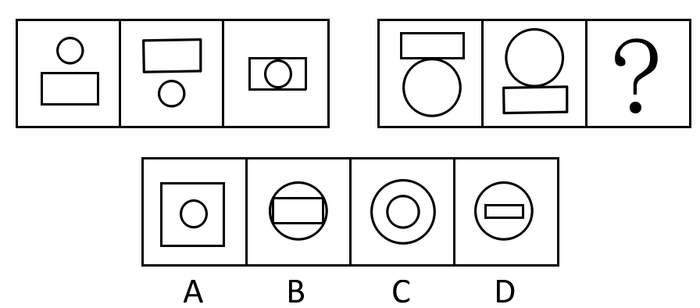

A. A

B. B

C. C

D. D

第 81 题 · 答案与解析

**参考答案（粉笔题库参考内容）**

B

**解析**

元素组成相同，考查位置规律--静态位置关系。通过观察第一组图形发现，圆先在矩形的上部，然后在矩形的下部，最后在矩形的内部，并且圆与矩形的大小始终不变；第二组图形规律应该为矩形先在圆的上部，然后在圆的下部，最后在圆的内部，并且矩形与圆的大小始终不变，通过分析选项，只有B项的图形符合。

故正确答案为B。

**考点**：位置规律-平移

**来源**：2008年河南省公务员录用考试《行测》题第81题

### 第 82 题

从所给的四个选项中，选择最合适的一个填入问号处，使之呈现一定的规律性：

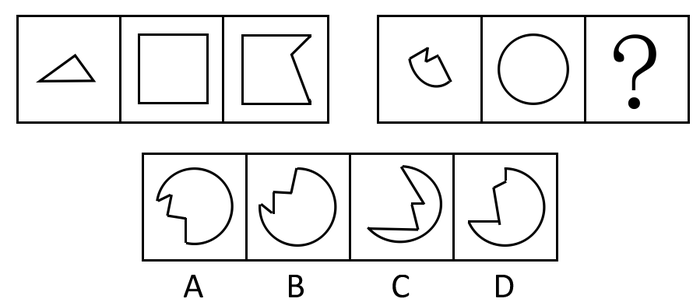

A. A

B. B

C. C

D. D

第 82 题 · 答案与解析

**参考答案（粉笔题库参考内容）**

A

**解析**

观察第一组图形发现规律：第一个图形与第三个图形拼接在一起得到第二个图形，因此第二组图形也应符合此规律，通过分析只有A项中的图形符合。

故正确答案为A。

**考点**：样式规律-加减同异

**来源**：2008年河南省公务员录用考试《行测》题第82题

### 第 83 题

从所给的四个选项中，选择最合适的一个填入问号处，使之呈现一定的规律性：

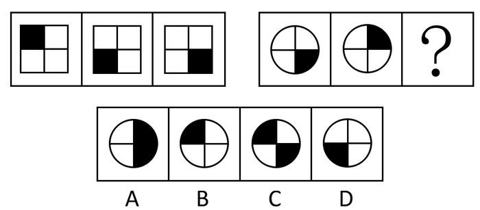

A. A

B. B

C. C

D. D

第 83 题 · 答案与解析

**参考答案（粉笔题库参考内容）**

B

**解析**

元素组成相同，考查位置规律。观察第一组图形发现规律：第一个图形逆时针旋转90度得到第二个图形，第二个图形逆时针旋转90度得到第三个图形，因此第二组图形也应符合此规律，第二组图形中第二个图形逆时针旋转90度得到B项中图形。

故正确答案为B。

**考点**：位置规律-旋转

**来源**：2008年河南省公务员录用考试《行测》题第83题

### 第 84 题

从所给的四个选项中，选择最合适的一个填入问号处，使之呈现一定的规律性：

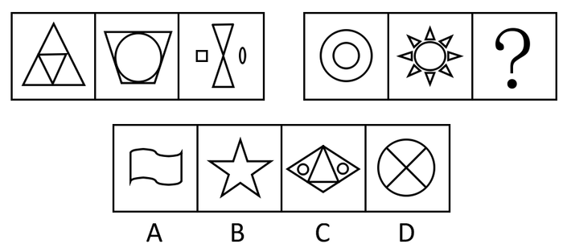

A. A

B. B

C. C

D. D

第 84 题 · 答案与解析

**参考答案（粉笔题库参考内容）**

C

**解析**

本题为数元素数量，第一组图形中，图形种类的数量分别为1、2、3；第二组图形也应当符合这一规律，即空缺处应该有3种图形，通过分析选项只有C项中图形符合。

故正确答案为C。

**考点**：数量规律-素

**来源**：2008年河南省公务员录用考试《行测》题第84题

### 第 85 题

从所给的四个选项中，选择最合适的一个填入问号处，使之呈现一定的规律性：

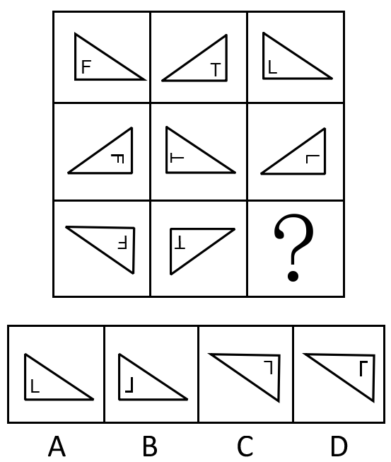

A. A

B. B

C. C

D. D

第 85 题 · 答案与解析

**参考答案（粉笔题库参考内容）**

C

**解析**

以列为单位，元素组成相同，考位置。这组图形中外面的三角和内部的折角有不同的变动规律。第三列图形中，外面的每一个三角形都与第二列的三角形成轴对称；而内部的折角变化规律与第一列图形中的F变化规律保持一致，即顺时针旋转90度两次得到第三个图形中的F，那么空缺处折角的方向变化也应当与第一列中F的方向一致，顺时针旋转90度两次，符合上面两个规律的只有C项中的图形。

故正确答案为C。

**考点**：位置规律-综合

**来源**：2008年河南省公务员录用考试《行测》题第85题

### 第 86 题

从所给的四个选项中，选择最合适的一个填入问号处，使之呈现一定的规律性：

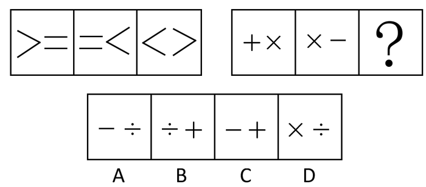

A. A

B. B

C. C

D. D

第 86 题 · 答案与解析

**参考答案（粉笔题库参考内容）**

C

**解析**

第一组图形中，每个运算符号均出现两次，因此第二组图形也应符合该规律，通过分析选项只有C项中图形符合。

故正确答案为C。

**考点**：样式规律-遍历

**来源**：2008年河南省公务员录用考试《行测》题第86题

### 第 87 题

从所给的四个选项中，选择最合适的一个填入问号处，使之呈现一定的规律性：

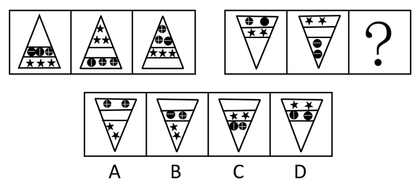

A. A

B. B

C. C

D. D

第 87 题 · 答案与解析

**参考答案（粉笔题库参考内容）**

B

**解析**

元素组成完全相同，考查位置变化。观察第一组图形，可发现每一个三角中的每一行的三个元素（空白、三个方块、三个三角）是依次向下边移动的，底层的便移到最上面一层。第二组图形，前两个三角中的每一行的三个元素（空白、两个三角、两个方块）是依次向上边移动的，顶层的便移到最下面一层，B选项符合题意。

故正确答案为B。

**考点**：位置规律-平移

**来源**：2008年河南省公务员录用考试《行测》题第87题

### 第 88 题

从所给的四个选项中，选择最合适的一个填入问号处，使之呈现一定的规律性：

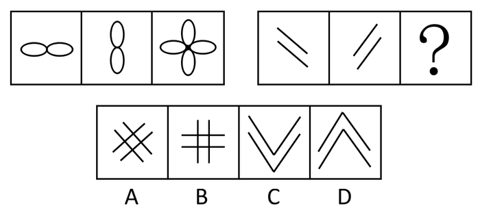

A. A

B. B

C. C

D. D

第 88 题 · 答案与解析

**参考答案（粉笔题库参考内容）**

A

**解析**

第一组图形中，第三个图形是第一、二个图形的中心重合叠加而成。第二组图形也应当符合这一规律，通过分析选项只有A项中图形符合。

故正确答案为A。

**考点**：样式规律-加减同异

**来源**：2008年河南省公务员录用考试《行测》题第88题

### 第 89 题

从所给的四个选项中，选择最合适的一个填入问号处，使之呈现一定的规律性：

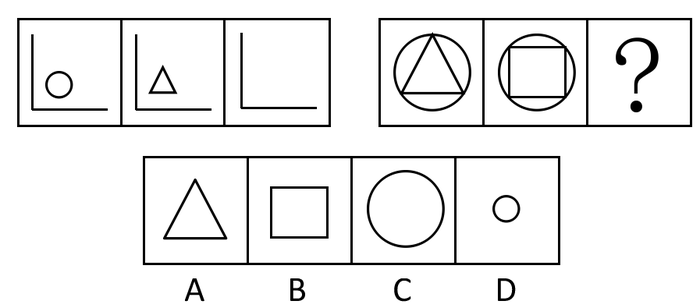

A. A

B. B

C. C

D. D

第 89 题 · 答案与解析

**参考答案（粉笔题库参考内容）**

C

**解析**

第一组图形中，第三个图形是第一、第二个图形唯一没有变化的元素，到第三个图形中仍然没有变化，而变化的图形在第三个图形中没有出现。第二组图形也应当符合这一规律，通过分析只有C项中图形符合。

故正确答案为C。

**考点**：数量规律-素、样式规律-遍历

**来源**：2008年河南省公务员录用考试《行测》题第89题

### 第 90 题

从所给的四个选项中，选择最合适的一个填入问号处，使之呈现一定的规律性：

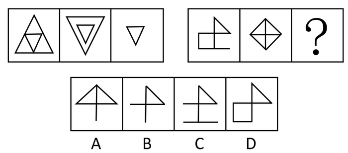

A. A

B. B

C. C

D. D

第 90 题 · 答案与解析

**参考答案（粉笔题库参考内容）**

B

**解析**

元素组成相似，求同。第一组图形中，第三个图形是第一、二个图形叠加后去异存同而成的图形。第二组图形也应当符合这一规律，通过分析只有B项中图形符合。

故正确答案为B。

**考点**：样式规律-加减同异

**来源**：2008年河南省公务员录用考试《行测》题第90题

### 第 91 题

农民：土地

A. 商人：商品

B. 赌球：球员

C. 工人：机器

D. 无产者：资本家

第 91 题 · 答案与解析

**参考答案（粉笔题库参考内容）**

C

**解析**

第一步：判断题干词语间逻辑关系。

题干两词是对应关系，且是职业和生产资料的对应关系。

第二步：判断选项词语间逻辑关系。

与题干逻辑关系相同的即为C。A和B没有生产资料，D是并列关系。

故正确答案为C。

**考点**：逻辑关系-对应关系

**来源**：2008年河南省公务员录用考试《行测》题第91题

### 第 92 题

大泽乡起义：“王侯将相，宁有种乎？”

A. 黄巢起义：“天子当兵强马壮者为之！”

B. 金田起义：“均贫富，等贵贱。”

C. 红巾起义：“天下多男子，皆兄弟之辈。”

D. 黄巾起义：“苍天已死，黄天当立。”

第 92 题 · 答案与解析

**参考答案（粉笔题库参考内容）**

D

**解析**

第一步：判断题干词语间逻辑关系。

题干是对应关系，且是起义与口号一一对应关系。

第二步：判断选项词语间逻辑关系。

与题干逻辑关系相同的即为D。黄巢起义的口号是“天补均平”；金田起义即太平天国起义，口号为“天下多男子全是兄弟之辈，天下多女子尽是姊妹之群”；红巾起义的口号是“石人一只眼，挑动黄河天下反”；黄巾起义的口号是“苍天已死，黄天当立”。

故正确答案为D。

**考点**：逻辑关系-对应关系

**来源**：2008年河南省公务员录用考试《行测》题第92题

### 第 93 题

蔚蓝：天空

A. 伟大：祖国

B. 苍白：灰白

C. 树林：碧绿

D. 庄严：眼睛

第 93 题 · 答案与解析

**参考答案（粉笔题库参考内容）**

A

**解析**

第一步：判断题干词语间逻辑关系。

蔚蓝的天空为偏正结构。

第二步：判断选项词语间逻辑关系。

A项，伟大的祖国为偏正结构，与题干逻辑关系一致，当选；

B项，苍白和灰白为并列关系，与题干逻辑关系不一致，排除；

C项，碧绿的树林为偏正结构，但与题干词语顺序相反，排除；

D项，庄严和眼睛无明显逻辑关系，排除。

故正确答案为A。

**考点**：语法关系

**来源**：2008年河南省公务员录用考试《行测》题第93题

### 第 94 题

纸上谈兵：赵括

A. 指鹿为马：秦始皇

B. 暗度陈仓：韩信

C. 草木皆兵：项羽

D. 世外桃源：陆游

第 94 题 · 答案与解析

**参考答案（粉笔题库参考内容）**

B

**解析**

第一步：判断题干词语间逻辑关系。

题干两词是对应关系，且是历史典故与其主人公一一对应关系。

第二步：判断选项词语间逻辑关系。

与题干逻辑关系相同的即为B。赵括是纸上谈兵的主人公，赵高是指鹿为马的主人公，韩信是暗度陈仓的主人公，苻坚是草木皆兵的主人公，世外桃源出自东晋陶渊明的《桃花源记》，与陆游无关。

故正确答案为B。

**考点**：逻辑关系-对应关系

**来源**：2008年河南省公务员录用考试《行测》题第94题

### 第 95 题

红与黑：于连

A. 黄飞虎：封神演义

B. 金锁记：张爱玲

C. 儒林外史：范进

D. 子君：伤逝

第 95 题 · 答案与解析

**参考答案（粉笔题库参考内容）**

C

**解析**

第一步：判断题干词语间逻辑关系。

题干两词是对应关系，且是作品与角色的一一对应关系。

第二步：判断选项词语间逻辑关系。

与题干逻辑关系相同的即为C。于连是《红与黑》的角色，黄飞虎是《封神演义》的角色，但A顺序颠倒；张爱玲是《金锁记》的作者，而非角色，B错；C范进是《儒林外史》的角色，且顺序正确；子君是《伤逝》的角色，但D顺序颠倒。

故正确答案为C。

**考点**：逻辑关系-对应关系

**来源**：2008年河南省公务员录用考试《行测》题第95题

### 第 96 题

路漫漫其修远兮，吾将上下而求索：《离骚》

A. 千里之行，始于足下：《史记》

B. 天时不如地利，地利不如人和：《韩非子》

C. 三军可夺帅也，匹夫不可夺志也：《论语》

D. 有志者，事竟成：《老子》

第 96 题 · 答案与解析

**参考答案（粉笔题库参考内容）**

C

**解析**

第一步：判断题干词语间逻辑关系。

题干是对应关系，且是名句与其出处的对应关系。

第二步：判断选项词语间逻辑关系。

与题干逻辑关系相同的即为C。“千里之行，始于足下”出自《老子》，而非《史记》，A错；“天时不如地利，地利不如人和”出自《孟子•公孙丑下》，而非《韩非子》，B错；“三军可夺帅也，匹夫不可夺志也”出自《论语•子罕》，C正确；“有志者，事竟成”出自《后汉书•耿弇传》，而非《老子》，D错。

故正确答案为C。

**考点**：逻辑关系-对应关系

**来源**：2008年河南省公务员录用考试《行测》题第96题

### 第 97 题

歇斯底里：癔症（    ）。

A. 买单：结账

B. 脚踏车：自行车

C. 引擎：发动机

D. 可口可乐：饮料

第 97 题 · 答案与解析

**参考答案（粉笔题库参考内容）**

C

**解析**

第一步：判断题干词语间逻辑关系。

题干两个词属于全同关系，“歇斯底里”是对英文单词“Hysteria”的音译外来词，与“癔症”这个本土词是同义词，是一种较常见的精神病。

第二步：逐一分析选项。

A 项，买单和结账都是结清账单的意思，但“买单”一词改自粤语“埋单”，并非是音译外来词，该项对应关系与题干不一致，排除。

B 项，脚踏车即自行车，是以脚踩踏板为动力，中国北方多称自行车，而南方多称脚踏车，该项对应关系与题干不一致，排除。

C 项，引擎是英文单词“Engine”的音译外来词，是发动机的同义词，该项逻辑与题干一致，应选。

D 项，可口可乐是饮料的一种，两者是包含关系而非全同关系，该项逻辑结构与题干不符，排除。

故正确答案为C。

**考点**：逻辑关系-全同关系

**来源**：2008年河南省公务员录用考试《行测》题第97题

### 第 98 题

韩国：首尔（    ）。

A. 美国：纽约

B. 加拿大：多伦多

C. 伊斯兰堡：巴基斯坦

D. 埃及：开罗

第 98 题 · 答案与解析

**参考答案（粉笔题库参考内容）**

D

**解析**

第一步：判断题干词语间逻辑关系。

题干两个词属于对应关系，韩国的首都是首尔。

第二步：判断选项词语间逻辑关系。

A项，美国的首都是华盛顿不是纽约，与题干不符。

B项，加拿大的首都是渥太华不是多伦多，与题干不符。

C项，伊斯兰堡是巴基斯坦的首都，逻辑结构与题干不符。

D项，埃及的首都是开罗，符合题意。

故正确答案为D。

**考点**：逻辑关系-对应关系

**来源**：2008年河南省公务员录用考试《行测》题第98题

### 第 99 题

氧气：臭氧（    ）。

A. 盐：氯化钠

B. 硫酸：硫

C. 石墨：金刚石

D. 石灰水：氢氧化钙

第 99 题 · 答案与解析

**参考答案（粉笔题库参考内容）**

C

**解析**

第一步：判断题干词语间逻辑关系。

题干两个词语是对应关系，氧气和臭氧是同素异形体，均由氧元素构成。同素异形体是相同元素组成，不同形态的单质。

第二步：判断选项词语间逻辑关系。

A项，氯化钠是盐的主要成分，两者不是同素异形体，排除。

B项，硫酸是一种含氧酸，具有腐蚀性；硫是一种非金属元素，两者不是同素异形体，排除。

C项，石墨和金刚石都是碳的同素异形体，均由碳元素构成，正确。

D项，澄清的石灰水是指氢氧化钙的水溶液，浑浊的石灰水是石灰水中的氢氧化钙与二氧化碳反应产生沉淀，二者不是同素异形体，排除。

故正确答案为C。

**考点**：逻辑关系-对应关系

**来源**：2008年河南省公务员录用考试《行测》题第99题

### 第 100 题

贞观之治：唐太宗（    ）。

A. 文景之治：汉武帝

B. 开元盛世：唐玄宗

C. 康乾盛世：顺治

D. 安史之乱：杨玉环

第 100 题 · 答案与解析

**参考答案（粉笔题库参考内容）**

B

**解析**

第一步：判断题干词语间逻辑关系。

题干两个词属于对应关系，贞观之治对应唐太宗在位期间的盛世。

第二步：判断选项词语间逻辑关系。

A项，文景之治对应汉文帝和汉景帝统治时期出现的盛世，与汉武帝无关，与题干不符。

B项，开元盛世对应唐玄宗在位期间的盛世，符合题意。

C项，康乾盛世对应康熙帝和乾隆帝在位时的盛世，与顺治帝无关，与题干不符。

D项，安史之乱对应唐玄宗天宝年间的安禄山和史思明的叛乱，与杨玉环无直接关系，与题干不符。

故正确答案为B。

**考点**：逻辑关系-对应关系

**来源**：2008年河南省公务员录用考试《行测》题第100题

### 第 101 题

2000年，张明因盖房挖地基，发现一个坛子，内有500块银圆及一张棉布，上写“为防日寇搜查，特埋此，王建林1938年7月1日”。王建林为王天民的爷爷，在抗战期间被日寇杀害，解放后王天民被宣布为中农。这500块银圆：

A. 应归张明所有，作为发现人，他可按先占原则取得银圆所有权

B. 应归王天民所有

C. 应由张明与王天民平分

D. 属于无主财产，应归国家所有

第 101 题 · 答案与解析

**参考答案（粉笔题库参考内容）**

B

**解析**

500块银元是王建林的所有物，虽然他本人去世了，但他的孙子是法定继承人，有权继承银元。

故正确答案为B。

**考点**：民法典

**来源**：2008年河南省公务员录用考试《行测》题第101题

### 第 102 题

人民法院受理原告的起诉后，一定产生的法律后果有：

A. 受诉法院对该案件行使管辖权

B. 受诉法院必须对本案作出判决

C. 诉讼时效中断

D. 原告不可撤诉

第 102 题 · 答案与解析

**参考答案（粉笔题库参考内容）**

C

**解析**

《最高人民法院关于审理民事案件适用诉讼时效制度若干问题的意见》第12条规定：当事人一方向人民法院提交起诉状或者口头起诉的，诉讼时效从提交起诉状或者口头起诉之日起中断。

A项错误，应是受诉人民法院对案件行使审判权；

B项错误，受理后经审查不符合起诉条件的，裁定驳回起诉；

D项错误，原告在人民法院受理案件之后，宣告判决之前，可以要求撤诉。

故正确答案为C。

**考点**：诉讼法

**来源**：2008年河南省公务员录用考试《行测》题第102题

### 第 103 题

法治国家要求形成独立、合理的法律：

A. 司法权

B. 决策机制

C. 执行机构

D. 运行机制

第 103 题 · 答案与解析

**参考答案（粉笔题库参考内容）**

D

**解析**

在法治国家中，法律要实现其社会功能，就要首先形成独立合理的运行机制。建立独立的法律运行机制，要求法律系统必须具有相对独立性，具有自己特定的形式要件和运行目标。

故正确答案为D。

**考点**：法理学

**来源**：2008年河南省公务员录用考试《行测》题第103题

### 第 104 题

根据企业破产法律制度的规定，不属于破产费用的一项是：

A. 破产案件受理费

B. 债权人会议费

C. 清算组催收债务所需费用

D. 清算期间破产企业职工生活费

第 104 题 · 答案与解析

**参考答案（粉笔题库参考内容）**

D

**解析**

《企业破产法》第四十一条规定：人民法院受理破产申请后发生的下列费用为破产费用：

（1）破产案件的诉讼费用；

（2）管理、变价和分配债务人财产的费用；

（3）管理人执行职务的费用、报酬和聘用工作人员的费用。

A、B、C三项均属于破产费用；

D项的职工生活费不属于破产费用。

本题为选非题，故正确答案为D。

**考点**：劳动法和经济法

**来源**：2008年河南省公务员录用考试《行测》题第104题

### 第 105 题

在法庭审判过程中，当＿＿＿＿＿＿时，可以延期审理：

A. 被取保候审的被告人逃匿至外地下落不明

B. 合议庭成员对案件有严重分歧

C. 需要通知新的证人到庭

D. 公诉人与辩护律师意见尖锐对立

第 105 题 · 答案与解析

**参考答案（粉笔题库参考内容）**

C

**解析**

延期审理指在诉讼过程中，由于发生了法律规定的情况，致使人民法院不能在原定的日期对案件进行审理时，人民法院把已经决定开庭审理或者已经开庭审理的案件，改到另一日期进行审理。在诉讼中有下列情形之一的，可以延期审理：

（1）必须到庭的当事人和其他诉讼参与人有正当理由没有到庭。

（2）当事人临时申请回避。

（3）需要通知新的证人到庭，调取新的证据，重新鉴定、勘验，或者需要补充调查的可以延期审理。

（4）其他应当延期审理的情形。

故正确答案为C。

**考点**：诉讼法

**来源**：2008年河南省公务员录用考试《行测》题第105题

### 第 106 题

在一起民事侵权案件中，当事人提起上诉时：

A. 只能向第二审人民法院提出

B. 通过原审人民法院提出

C. 由第二审人民法院接收上诉状，然后移交给原审人民法院

D. 由第一审人民法院接收上诉状，第二审法院不接收上诉状

第 106 题 · 答案与解析

**参考答案（粉笔题库参考内容）**

B

**解析**

《民事诉讼法》第149条规定：上诉状应当通过原审人民法院提出，并按照对方当事人或者代表人的人数提出副本。当事人直接向第二审人民法院上诉的，第二审人民法院应当在五日内将上诉状移交原审人民法院。

故正确答案为B。

**考点**：诉讼法

**来源**：2008年河南省公务员录用考试《行测》题第106题

### 第 107 题

由于被告人的犯罪行为使国家财产、集体财产遭受损失的，人民检察院在提起公诉时，可以：

A. 予以追缴

B. 予以没收

C. 责令赔偿

D. 提起附带民事诉讼

第 107 题 · 答案与解析

**参考答案（粉笔题库参考内容）**

D

**解析**

《刑事诉讼法》第77条规定：被害人由于被告人的犯罪行为而遭受物质损失的，在刑事诉讼过程中，有权提起附带民事诉讼。如果是国家财产、集体财产遭受损失的，人民检察院在提起公诉的时候，可以提起附带民事诉讼。人民法院在必要的时候，可以查封或者扣押被告人的财产。

故正确答案为D。

【备注】本题所涉规定已修改，根据现行《刑事诉讼法》第一百零一条第二款规定：“如果是国家财产、集体财产遭受损失的，人民检察院在提起公诉的时候，可以提起附带民事诉讼。”

**考点**：诉讼法

**来源**：2008年河南省公务员录用考试《行测》题第107题

### 第 108 题

投保人为了达到骗取保险金的目的，故意杀害被保险人，造成被保险人死亡，法院应对投保人：

A. 以故意杀人罪定罪

B. 以保险诈骗罪定罪

C. 以故意杀人罪和保险诈骗罪定罪，按照牵连犯的处罚原则从一重罪处罚

D. 以故意杀人罪和保险诈骗罪实行数罪并罚

第 108 题 · 答案与解析

**参考答案（粉笔题库参考内容）**

D

**解析**

《刑法》第198条第二款的规定：投保人、被保险人故意造成财产损失的保险事故，投保人、受益人故意造成被保险人死亡、伤残或者疾病，骗取保险金，同时构成其他犯罪的，依照数罪并罚的规定处罚。因此，投保人或者受益人故意杀害保险人，然后骗取保险金的，应以故意杀人罪和保险诈骗罪实行并罚。

故正确答案为D。

**考点**：刑法

**来源**：2008年河南省公务员录用考试《行测》题第108题

### 第 109 题

甲、乙两公司合作开发完成一项发明，在双方事先没有约定的情况下：

A. 申请专利的权利属于甲公司

B. 申请专利的权利属于乙公司

C. 申请专利的权利属于甲、乙两公司共有

D. 当甲公司不同意专利申请权时，乙公司可以单独申请专利

第 109 题 · 答案与解析

**参考答案（粉笔题库参考内容）**

C

**解析**

《专利法》第8条规定：两个以上单位或者个人合作完成的发明创作、一个单位或者个人接受其他单位或者个人委托所完成的发明创造，除另有协议的以外，申请专利的权利属于完成或者共同完成的单位或者个人；申请被批准后，申请的单位或者个人为专利权人。

故正确答案为C。

**考点**：民法典

**来源**：2008年河南省公务员录用考试《行测》题第109题

### 第 110 题

某选区在举行人民代表大会代表直接选举时，应参加选举的选民为25000人，实际参加选举的选民为12350人。该选区三位候选人甲、乙、丙最后实际获得选票依次为6250票、3500票、2600票。按照法律规定，选举结果是：

A. 甲当选

B. 乙当选

C. 丙当选

D. 三人均不得当选

第 110 题 · 答案与解析

**参考答案（粉笔题库参考内容）**

D

**解析**

《选举法》第41条规定：在选民直接选举人民代表大会代表时，选区全体选民的过半数参加投票，选举有效。代表候选人获得参加投票的选民过半数的选票时，始得当选。题干中参加投票的选民没有超过全体选民的一半，因而选举无效，三人均不当选。

故正确答案为D。

**考点**：宪法

**来源**：2008年河南省公务员录用考试《行测》题第110题

### 第 111 题

人民警察在执行公务中使用拉响警报器和回转警灯的警车，其他车辆应给让道，这体现了行政主体享有：

A. 行政职权

B. 行政特权

C. 行政优先权

D. 行政强制权

第 111 题 · 答案与解析

**参考答案（粉笔题库参考内容）**

C

**解析**

行政优先权，是指国家为保障行政主体有效地行使行政职权而赋予行政主体许多职务上的优先条件。行政优先权的内容主要包括：

（1）先行处置权。在紧急情况下，行政主体可以不受某些程序规定的制约，先行处置。

（2）获得社会协助权。行政主体享有获得社会协助权，即行政主体在从事紧急公务时，有关组织或个人有协助执行或提供方便的强制性义务，违反者将承担法律责任。

（3）行政行为的推定有效。在行政复议和行政诉讼期间，只要没有法律上的特定规定，原则上不停止该行政行为的执行。

题干中的让道是获得社会协助权的体现。

故正确答案为C。

**考点**：行政法

**来源**：2008年河南省公务员录用考试《行测》题第111题

### 第 112 题

李某为天宇有限责任公司的经理，按照公司章程规定，李某有权签发金额在5万元以下的汇票，2007年1月12日，李某为公司签发了一张该公司为付款人，金额为6.5万元的汇票。关于该汇票的票据责任人，下列说法正确的是：

A. 李某是票据责任人

B. 天宇有限责任公司是票据责任人

C. 李某和天宇有限责任公司共同承担连带责任

D. 天宇有限责任公司只承担5万元票据责任，其余金额由李某承担

第 112 题 · 答案与解析

**参考答案（粉笔题库参考内容）**

B

**解析**

在该题中，李某的行为应为表见代表，签发行为有效，天宇有限责任公司是票据责任人。表见代表是指行为人虽无代理权，但由于本人的行为，造成了足以使善意第三人相信其有代理权的表象，而与善意第三人进行的、由被代理人承担法律后果的代理行为。

故正确答案为B。

本题相关知识点：表见代理制度是基于本人的过失或本人与无权代理人之间存在特殊关系，使相对人有理由相信无权代理人享有代理权而与之为民事法律行为，代理行为的后果由本人承受的一种特殊的无权代理。

**考点**：民法典

**来源**：2008年河南省公务员录用考试《行测》题第112题

### 第 113 题

辽宁省某海关在对我国公民赖星星进行过关检查时，认为其有走私嫌疑，于是限制其人身自由24小时，海关的这一行为属于：

A. 行政强制措施

B. 行政监督检查

C. 行政强制执行

D. 行政处罚

第 113 题 · 答案与解析

**参考答案（粉笔题库参考内容）**

A

**解析**

A选项正确，行政强制措施是指行政机关在实施行政管理的过程中，依法对公民人身自由进行暂时性限制，或者对公民、法人或者其他组织的财产实施暂时性控制的措施；

B选项不正确，行政监督检查是指行政机关或法定授权的组织依法对管理相对人遵守法律、法规和规章的情况进行督促检查。检查的具体内容主要是公民、法人或其他组织是否依法正当行使权利和履行义务；

C选项不正确，行政强制执行是指行政机关或者由行政机关申请人民法院，对不履行发生法律效力的行政决定的公民、法人或者其他组织，依法强制其履行义务的行为；

D选项不正确，行政处罚是指行政机关依法对违反行政管理秩序的公民、法人或者其他组织，以减损权益或者增加义务的方式予以惩戒的行为。

根据含义，题干中某海关限制赖某人身自由的行为属于行政强制措施。

故正确答案为A。

**考点**：行政法

**来源**：2008年河南省公务员录用考试《行测》题第113题

### 第 114 题

依据我国刑事诉讼法的规定，不服判决的上诉和抗诉期限为：

A. 7日

B. 10日

C. 15日

D. 30日

第 114 题 · 答案与解析

**参考答案（粉笔题库参考内容）**

B

**解析**

《刑事诉讼法》第183条规定：不服判决的上诉和抗诉的期限为十日，不服裁定的上诉和抗诉的期限为五日，从接到判决书、裁定书的第二日起算。

故正确答案为B。

**考点**：诉讼法

**来源**：2008年河南省公务员录用考试《行测》题第114题

### 第 115 题

没有约定标的物的合同：

A. 未成立

B. 可以撤销

C. 因违法而成为无效合同

D. 可以解除

第 115 题 · 答案与解析

**参考答案（粉笔题库参考内容）**

A

**解析**

合同成立的要件是：

（1）两个或两个以上当事人；

（2）双方意思表示一致（即达成一致）。

《合同法》规定：当事人订立合同，采取要约、承诺方式。要约是希望和他人订立合同的意思表示，该意思表示应当符合下列规定：内容具体确定；表明经受要约人承诺，要约人即受该意思表示约束。没有标的物的意思表示内容不确定，因而合同不成立。

故正确答案为A。

**考点**：民法典

**来源**：2008年河南省公务员录用考试《行测》题第115题

### 第 116 题

有管辖权的人民法院由于特殊原因而不能行使管辖权时，应当：

A. 移送毗邻地区的法院

B. 报请上级人民法院指定管辖

C. 宣布延期再审

D. 判决驳回起诉

第 116 题 · 答案与解析

**参考答案（粉笔题库参考内容）**

B

**解析**

指定管辖是指上级人民法院用裁定的方式将某一案件交由某一个下级人民法院管辖。《民事诉讼法》第37条规定：有管辖权的人民法院由于特殊原因，不能行使管辖权的，由上级人民法院指定管辖。移送管辖是指某一人民法院受理民事案件后，发现自己对该案没有管辖权，将案件移送给有管辖权的人民法院受理。受移送的人民法院认为受移送的案件依照规定不属于本院管辖，应当报请上级人民法院指定管辖，不得再自行移送。

故正确答案为B。

**考点**：诉讼法

**来源**：2008年河南省公务员录用考试《行测》题第116题

### 第 117 题

我国宪法规定，在法律规定范围内的个体经济、私营经济等非公有制经济，是社会主义市场经济的重要组成部分，国家对于非公有制经济发展的政策是：

A. 指导、监督、合理控制

B. 指导、监督和帮助

C. 鼓励、支持和引导

D. 鼓励、指导和帮助

第 117 题 · 答案与解析

**参考答案（粉笔题库参考内容）**

C

**解析**

《宪法》第11条规定：在法律规定范围内的个体经济、私营经济等非公有制经济，是社会主义市场经济的重要组成部分。国家保护个体经济、私营经济等非公有制经济的合法的权利和利益。国家鼓励、支持和引导非公有制经济的发展，并对非公有制经济依法实行监督和管理。

故正确答案为C。

**考点**：宪法

**来源**：2008年河南省公务员录用考试《行测》题第117题

### 第 118 题

根据我国土地管理法的规定，某省会城市欲征用基本农田以外的耕地45公顷作为建设用地，依法有权批准的是：

A. 该市人大常委会

B. 该省人民政府

C. 国务院土地行政主管部门

D. 国务院

第 118 题 · 答案与解析

**参考答案（粉笔题库参考内容）**

D

**解析**

《土地管理法》第45条规定：征收下列土地的，由国务院批准：基本农田；基本农田以外的耕地超过三十五公顷的；其他土地超过七十公顷的。

故正确答案为D。

**考点**：其他法律法规

**来源**：2008年河南省公务员录用考试《行测》题第118题

### 第 119 题

对于行政复议机关在法定期间没有作出复议决定的案件。当事人对原具体行政行为不服，向人民法院起诉的，应当以＿＿＿＿＿＿为被告：

A. 作出原具体行政行为的机关

B. 复议机关

C. 作出原具体行政行为的机关与复议机关

D. 作出原具体行政行为的机关或复议机关

第 119 题 · 答案与解析

**参考答案（粉笔题库参考内容）**

A

**解析**

《最高人民法院关于执行&lt;中华人民共和国行政诉讼法>若干问题的解释》第22条规定：复议机关在法定期间内不作复议决定，当事人对原具体行政行为不服提起诉讼的，应当以作出原具体行政行为的行政机关为被告；当事人对复议机关不作为不服提起诉讼的，应当以复议机关为被告。

故正确答案为A。

**考点**：行政法

**来源**：2008年河南省公务员录用考试《行测》题第119题

### 第 120 题

为促进资金融通商品流通，保障债权的实现，发展社会主义市场经济，我国担保法规定了五种法定的担保方式，下列各项表述正确的是：

A. 保证、抵押、质押、留置和定金

B. 抵押、质押、留置、出典和定金

C. 保证、抵押、留置、出典和定金

D. 保证、抵押、质押、出典和定金

第 120 题 · 答案与解析

**参考答案（粉笔题库参考内容）**

A

**解析**

《担保法》第2条规定：担保方式为保证、抵押、质押、留置和定金。上述5种担保方式中，留置是法定担保方式，即债权人依照法律规定行使留置权，无需当事人之间约定。其他4种担保方式需由当事人之间约定，是协议的担保方式。

故正确答案为A。

**考点**：民法典

**来源**：2008年河南省公务员录用考试《行测》题第120题

## 材料 1

请根据下列文字资料，完成以下各题：

        2005年我国对外贸易出口总额达到7620亿美元，占全球贸易出口总额的比重由2001年的4.3%提高到2005年的7.3%。2005年，我国对外贸易进出口总额为14221亿美元，居世界第三位，占全球贸易进出口总额的6.7%。2005年我国吸引外国直接投资额由2001年的469亿美元增加到603亿美元，居世界第三位。

        近年来，我国外汇储备持续大幅增长，2001年我国外汇储备2122亿美元，2005年比2001年增长了2.9倍，居世界第二位，为我国经济持续、稳定发展奠定了重要基础。

### 第 121 题

2005年全球贸易出口总额是多少亿美元：

A. 104383.56

B. 55626

C. 1043.84

D. 177209.3

第 121 题 · 答案与解析

**参考答案（粉笔题库参考内容）**

A

**解析**

根据文字资料进行估算：

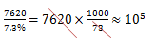

故正确答案为A。

**考点**：文字资料、现期比重

**来源**：2008年河南省公务员录用考试《行测》题第121题

### 第 122 题

2005年我国对外贸易是：

A. 逆差

B. 顺差

C. 平衡

D. 不知道

第 122 题 · 答案与解析

**参考答案（粉笔题库参考内容）**

B

**解析**

由题中可知2005年我国对外贸易进口总额为14221－7620＝6601亿美元，则进口总额－出口总额＝6601－7620＜0。进口小于出口为顺差，进口大于出口为逆差。

故正确答案为B。

**考点**：文字资料、简单加减计算

**来源**：2008年河南省公务员录用考试《行测》题第122题

### 第 123 题

2005年我国吸引外资直接投资较2001年增长的百分比是：

A. 128.57

B. 228.57

C. 28.57

D. 70.31

第 123 题 · 答案与解析

**参考答案（粉笔题库参考内容）**

C

**解析**

利用估算法列出算式为。

故正确答案为C。

**考点**：一般增长率、文字资料

**来源**：2008年河南省公务员录用考试《行测》题第123题

### 第 124 题

2005年我国外汇储备额大约是：

A. 6千亿美元左右

B. 不到3千亿美元

C. 8千亿美元左右

D. 10千亿美元以上

第 124 题 · 答案与解析

**参考答案（粉笔题库参考内容）**

C

**解析**

根据题意估算，列出算式为2122×3.9≈2000×4＝8千亿美元。

故正确答案为C。

**考点**：文字资料、现期计算

**来源**：2008年河南省公务员录用考试《行测》题第124题

### 第 125 题

下列表述不正确的是：

A. 2005年我国对外贸易出口总额占全世界的比重较2001年提高了3个百分点

B. 2005年我国对外贸易进口总额为6601亿美元

C. 2005年我国对外贸易进出口总额占世界的比重较2001年提高了3个百分点

D. 2005年我国的外汇储备居世界第二位

第 125 题 · 答案与解析

**参考答案（粉笔题库参考内容）**

C

**解析**

本题要求选出“不正确”的一项。由资料中可知：

A项2005年我国对外贸易出口总额达到7620亿美元，占全球贸易出口总额的比重由2001年的4.3%提高到2005年的7.3%，正确；

B项14221－7620＝6601亿美元，正确；

C项资料中并未提及2001年我国对外贸易进出口总额占世界的比重，错误；

D项我国外汇储备持续大幅增长，2001年我国外汇储备2122亿美元，2005年比2001年增长了2.9倍，居世界第二位，正确。

故正确答案为C。

**考点**：文字资料、综合分析

**来源**：2008年河南省公务员录用考试《行测》题第125题

## 材料 2

请根据下列图形资料，完成以下各题。

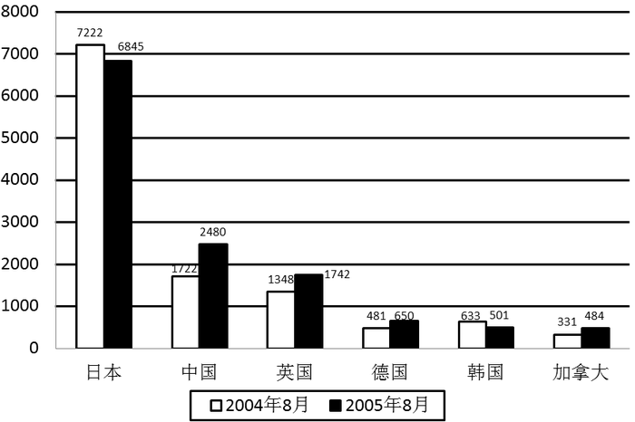

### 第 126 题

2005年8月拥有美国国库券数量最多的国家是：

A. 中国

B. 韩国

C. 德国

D. 日本

第 126 题 · 答案与解析

**参考答案（粉笔题库参考内容）**

D

**解析**

由图黑色部分数据直接读出，日本为拥有美国国库券最多国家。

故正确答案为D。

**考点**：直接找数、统计表

**来源**：2008年河南省公务员录用考试《行测》题第126题

### 第 127 题

2005年8月与2004年8月相比，拥有美国国库券数量下降的国家是：

A. 日本和韩国

B. 中国和日本

C. 韩国和加拿大

D. 英国和德国

第 127 题 · 答案与解析

**参考答案（粉笔题库参考内容）**

A

**解析**

直接比较图中每个国家白色和黑色柱形图，得日本和韩国数量下降。

故正确答案为A。

**考点**：直接找数、统计表

**来源**：2008年河南省公务员录用考试《行测》题第127题

### 第 128 题

2005年8月拥有美国国库券数量最少的国家是：

A. 韩国

B. 加拿大

C. 德国

D. 英国

第 128 题 · 答案与解析

**参考答案（粉笔题库参考内容）**

B

**解析**

直接比较黑色柱状图的数值大小，答案为加拿大。

故正确答案为B。

**考点**：文字资料、直接找数

**来源**：2008年河南省公务员录用考试《行测》题第128题

### 第 129 题

我国2005年8月拥有美国国库券数量与2004年同期相比增长率大约是：

A. 29%

B. 10%

C. 44%

D. 80%

第 129 题 · 答案与解析

**参考答案（粉笔题库参考内容）**

C

**解析**

直除法计算，列出算式为。

故正确答案为C。

**考点**：一般增长率、统计表

**来源**：2008年河南省公务员录用考试《行测》题第129题

### 第 130 题

2005年8月与2004年8月相比，拥有美国国库券增加数额最多的国家是：

A. 中国

B. 日本

C. 英国

D. 德国

第 130 题 · 答案与解析

**参考答案（粉笔题库参考内容）**

A

**解析**

美国国库券增加数额增长的国家为中国、英国、德国、加拿大。分别减法估算，中国2480－1722≈700，其他三个国家不到500。

故正确答案为A。

**考点**：简单加减计算、统计表

**来源**：2008年河南省公务员录用考试《行测》题第130题

## 材料 3

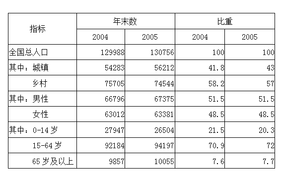

### 第 131 题

2005年与2004年对比，全国乡村人口比重：

A. 下降1.2

B. 上升1.2个百分点

C. 下降1.2个百分点

D. 上升1.2

第 131 题 · 答案与解析

**参考答案（粉笔题库参考内容）**

C

**解析**

列出算式为57%-58.2%=-1.2%。

故正确答案为C。

**考点**：简单加减计算、统计表

**来源**：2008年河南省公务员录用考试《行测》题第131题

### 第 132 题

2005年与2004年对比，男性人口比重：

A. 有所上升

B. 有所下降

C. 无法判断

D. 基本没变

第 132 题 · 答案与解析

**参考答案（粉笔题库参考内容）**

D

**解析**

读表直接得出2005年的男性人口比重为51.5%，2004年的男性人口比重为51.5%。

故正确答案为D。

**考点**：直接找数、统计表

**来源**：2008年河南省公务员录用考试《行测》题第132题

### 第 133 题

资料显示，2005年比2004年我国人口老龄化程度：

A. 有所加重

B. 有所减轻

C. 没有变化

D. 无法判断

第 133 题 · 答案与解析

**参考答案（粉笔题库参考内容）**

A

**解析**

列出算式为7.7%－7.6%＝0.1%，可见是有所加重的。

故正确答案为A。

**考点**：简单加减计算、统计表

**来源**：2008年河南省公务员录用考试《行测》题第133题

### 第 134 题

我国劳动力资源，2005年（末）比2004年（末）增加：

A. 2013万人

B. 2374万人

C. 94197万人

D. 26504万人

第 134 题 · 答案与解析

**参考答案（粉笔题库参考内容）**

A

**解析**

劳动力人口应为15到64岁的人口，列出算式为94197－92184≈2000万人。

故正确答案为A。

**考点**：简单加减计算、统计表

**来源**：2008年河南省公务员录用考试《行测》题第134题

### 第 135 题

按年末总人口计算，2005年人口增长率为：

A. 5.91‰

B. 5.21‰

C. 6.32‰

D. 6.54‰

第 135 题 · 答案与解析

**参考答案（粉笔题库参考内容）**

A

**解析**

，且答案很接近6‰。

故正确答案为A。

**考点**：一般增长率、统计表

**来源**：2008年河南省公务员录用考试《行测》题第135题

## 材料 4

请根据下列图表资料，完成以下各题。

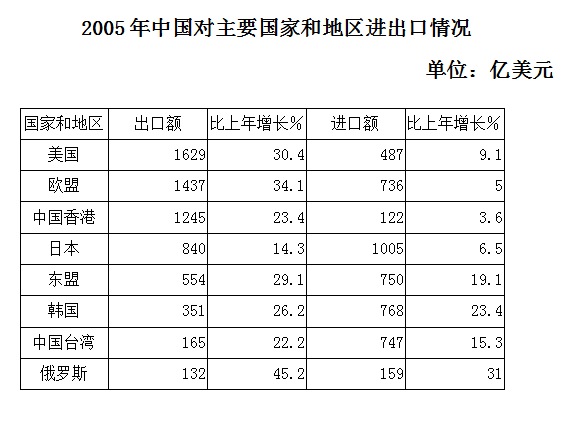

### 第 136 题

根据表格资料，下列国家和地区，与中国进出口贸易总额最大的是：

A. 中国香港

B. 日本

C. 韩国

D. 俄罗斯

第 136 题 · 答案与解析

**参考答案（粉笔题库参考内容）**

B

**解析**

依次将进口和出口额之和进行大小比较。显然日本总和约为2000亿美元为最大。

故正确答案为B。

**考点**：简单加减计算、统计表

**来源**：2008年河南省公务员录用考试《行测》题第136题

### 第 137 题

根据表格资料，下列国家和地区，中国与之贸易顺差最大的国家和地区是：

A. 欧盟

B. 日本

C. 美国

D. 俄罗斯

第 137 题 · 答案与解析

**参考答案（粉笔题库参考内容）**

C

**解析**

估算法比较。进口小于出口为顺差。观察表中可知，日本和俄罗斯都是进口大于出口，为贸易逆差，排除B、D项。欧盟：1437－736≈700。美国1629－487≈1150。

故正确答案为C。

**考点**：简单加减计算、统计表

**来源**：2008年河南省公务员录用考试《行测》题第137题

### 第 138 题

根据表格资料，下列国家和地区，中国对其出口额增长最快的是：

A. 英国

B. 日本

C. 东盟

D. 俄罗斯

第 138 题 · 答案与解析

**参考答案（粉笔题库参考内容）**

D

**解析**

先判断题干，增长最快是对增长率的比较。观察表中增长率一栏，可发现对俄罗斯的出口额增长率为45.2%，高于其他国家或地区。

故正确答案为D。

**考点**：直接找数、统计表

**来源**：2008年河南省公务员录用考试《行测》题第138题

### 第 139 题

中国对欧盟进出口贸易总额中，出口额增长率比进口额增长率：

A. 高29.1

B. 低29.1

C. 高29.1个百分点

D. 低29.1个百分点

第 139 题 · 答案与解析

**参考答案（粉笔题库参考内容）**

C

**解析**

列出算式为出口增长率-进口增长率=34.1%-5%=29.1%。

故正确答案为C。

**考点**：简单加减计算、统计表

**来源**：2008年河南省公务员录用考试《行测》题第139题

### 第 140 题

中国从表中8个国家和地区的平均进口额为：

A. 597亿美元

B. 650亿美元

C. 453亿美元

D. 516亿美元

第 140 题 · 答案与解析

**参考答案（粉笔题库参考内容）**

A

**解析**

利用凑整法。

故正确答案为A。

**考点**：简单加减计算、统计表

**来源**：2008年河南省公务员录用考试《行测》题第140题

