# 2009年河南省公务员录用考试《行测》题

<!-- gwy:overview:start -->
> **河南 · 2009 · 行测 · 统考** ｜ 135 题 · 图片 14 处 · 答案随题折叠

| 题型模块 | 题量 | 题号 |
| --- | ---: | ---: |
| 言语理解与表达 | 35 | 1–35 |
| 数量关系 | 20 | 36–55 |
| 判断推理 | 40 | 56–95 |
| 常识判断 | 25 | 96–120 |
| 资料分析 | 15 | 121–135 |
| **合计** | **135** | |

导航：[题型与作答说明](#题型与作答说明) · [题目](#题目) · [材料 1](#材料-1)
<!-- gwy:overview:end -->

> 候选采集稿。参考答案及解析来自粉笔页面，不代表官方答案或真实高分答卷；来源使用许可与原卷对应关系仍需人工核实。

## 题型与作答说明

言语理解与表达

（35题）

根据题目要求，在四个选项中选出一个正确答案。

数量关系

（20题）

本部分包括数字推理与数学运算两种类型的试题。

判断推理

（40题）

本部分包括图形推理、定义判断、逻辑判断与类比推理四种类型的试题。

常识判断

（25题）

根据题目要求，在四个选项中选出一个正确答案。

资料分析

（15题）

所给出的图、表或一段文字均有5个问题要你回答。你应根据资料提供的信息进行分析、比较、计算和判断处理，从四个备选答案中选出符合题意的答案。

## 题目

### 第 1 题

从下列四个选项中选择最合适的词语填入横线中：

在东京举行的2007年国际机器人展览上，日本最大的机器人制造商安川公司开发的机器人＿＿＿＿＿超群，具有击鼓的技能。

A. 本事

B. 本领

C. 技巧

D. 技能

第 1 题 · 答案与解析

**参考答案（粉笔题库参考内容）**

B

**解析**

本题考查语境逻辑关系的实词辨析题。

B项“本领”指能力，“本领超群”，搭配合理且符合文意。

因此，结合选项应该选择B。

A项“本事”是指胜任工作的技能，这个词过于口语化，而且多用于人，不符合语境，排除；C项“技巧”不符合文意所说机器人具有的功能，排除；D项“技能”与下文重复，不符合行文的规则，排除。

故正确答案为B。

**考点**：实词填空、词的辨析-搭配对象、词的辨析-词义侧重

**来源**：2009年河南省公务员录用考试《行测》题第1题

### 第 2 题

从下列四个选项中选择最合适的词语填入横线中：

和我关系要好的同学很不平，执意拉着我去＿＿＿＿＿那位说我考试作弊的主考老师。

A. 问讯

B. 讯问

C. 诘责

D. 询问

第 2 题 · 答案与解析

**参考答案（粉笔题库参考内容）**

C

**解析**

本题考查语境逻辑关系的实词辨析。“诘责”指诘问谴责，显然这里是要向主考老师追问缘由，讲清情况，C项“诘责”符合语境。

因此，结合选项应该选择C。

A项“问讯”属于书面语，问候、询问之意，排除；B项“讯问”即审问，显然不合文中场景，排除；D项“询问”指征求意见，打听的意思，语气程度过轻，不符合语境，排除。

故正确答案为C。

**考点**：实词填空、词的辨析-词义侧重

**来源**：2009年河南省公务员录用考试《行测》题第2题

### 第 3 题

从下列四个选项中选择最合适的词语填入横线中：

在法制社会中，想问题、办事情，都应该以法律为＿＿＿＿＿，不能随心所欲。

A. 标的

B. 准则

C. 标准

D. 准绳

第 3 题 · 答案与解析

**参考答案（粉笔题库参考内容）**

D

**解析**

此题属于考查实词辨析和语境填空。

B项“准则”和D项“准绳”，都有言论和行动等所依据的规范这个意思，相较而言“准绳”更符合法律作为不可逾越的底线这个意向，法律不但要遵守，更有越界要付出代价的概念，一般“法律”和“准绳”构成固定搭配，所以D项正确。

因此，结合选项应该选择D。

A项“标的”指有靶子、目的的意思，而法律应该是规范，意思不符，排除；C项“标准”是衡量事物的准则，文中需要法律施加影响的主体是“想问题、办事情”，“标准”一般规范的是具体细致的事项，用在这里不合适，排除。

故正确答案为D。

**考点**：实词填空、词的辨析-搭配对象、词的辨析-词义侧重

**来源**：2009年河南省公务员录用考试《行测》题第3题

### 第 4 题

从下列四个选项中选择最合适的词语填入横线中：

北京的圆明园，自康熙四十八年起，先后＿＿＿＿＿了一百五十多年，荟萃了中外胜景，被誉为“万园之园”。

A. 营造

B. 建造

C. 建筑

D. 建设

第 4 题 · 答案与解析

**参考答案（粉笔题库参考内容）**

A

**解析**

根据“自康熙四十八年起······一百五十多年，荟萃了中外胜景”可知，横线处所填词语应体现长期、精心打造之意，A项“营造”指有目的、有计划地造，能够体现圆明园建造历史之久、工艺之复杂、花费人力、物力之多，符合文意，当选。

B项“建造”指建筑或修建，相较于A项“营造”，无法体现圆明园的长期、精细营造过程，排除；

C项“建筑”多作名词，指建筑物，作动词时，多指修建房屋、道路、桥梁等公共设施，与“圆明园”这类大型园林搭配不当，排除；

D项“建设”指创立新事业，增加新设施，多与“经济”“思想”“现代化强国”等宏观对象搭配，与“圆明园”搭配不当，且相较于A项“营造”，无法体现圆明园的长期、精细营造过程，排除。

故正确答案为A。

**考点**：实词填空、对应关系-前后呼应、词的辨析-搭配对象、词的辨析-词义侧重

**来源**：2009年河南省公务员录用考试《行测》题第4题

### 第 5 题

从下列四个选项中选择最合适的词语填入横线中：

他＿＿＿＿＿在色彩与线条的世界中，一个星期没有离开过设计室，终于出色的完成了任务。

A. 沉溺

B. 沉沦

C. 沉陷

D. 沉浸

第 5 题 · 答案与解析

**参考答案（粉笔题库参考内容）**

D

**解析**

本题考查语境搭配的实词辨析。

D项“沉浸”比喻处在某种境界之中，为中性词，感情色彩及语义与语境“色彩与线条的世界”相符。

因此，结合选项应该选择D。

选项A“沉溺”表示深深陷入某种生活行为、习惯或意识活动的不良境地，为贬义词，与文意所述不符，排除；B项“沉沦”指陷入疾病、厄运之中或罪恶的、困苦的境界，也是贬义词，同理排除；C项“沉陷”为深深陷入，与“出色完成任务”的结果相比，程度过深，排除。

故正确答案为D。

**考点**：实词填空、词的辨析-感情色彩、词的辨析-程度轻重

**来源**：2009年河南省公务员录用考试《行测》题第5题

### 第 6 题

从下列四个选项中选择最合适的词语填入横线中：

我们也要有清醒的认识，防止不法分子利用互联网等宣传手段＿＿＿＿＿群众舆论。

A. 把持

B. 控制

C. 掌握

D. 操纵

第 6 题 · 答案与解析

**参考答案（粉笔题库参考内容）**

D

**解析**

本题考查固定搭配和语境逻辑关系的实词辨析题。

B、D两项都有掌控的意思，选择含贬义色彩的“操纵”与原文色彩统一。

因此，结合选项应该选择D。

A项“把持”是指独占位置、权利等，不让别人参与或者控制（感情等），与群众舆论这个对象不搭配，直接排除；C项“掌握”应该是掌握某种本领、技巧，与“舆论”不能搭配，直接排除。

故正确答案为D。

**考点**：实词填空、词的辨析-感情色彩、词的辨析-搭配对象

**来源**：2009年河南省公务员录用考试《行测》题第6题

### 第 7 题

从下列四个选项中选择最合适的词语填入横线中：

立春过后，大地渐渐从沉睡中苏醒过来。冰雪融化，草木萌发，各种花＿＿＿＿＿开放。再过两个月，燕子＿＿＿＿＿归来。

A. 次第 翩然

B. 依次 悄悄

C. 相继 悄然

D. 竞相 姗姗

第 7 题 · 答案与解析

**参考答案（粉笔题库参考内容）**

A

**解析**

本题属于考查语境逻辑的实词辨析题。

首先看第一空，形容各种花开的状态，D项“竞相”与“立春时节”不相符合，直接排除。第二空形容燕子归来，B项“悄悄”与燕子能看到、听到叫声的实际情况不符，直接排除。剩下A、C两项。

第一空，“次第”和“相继”都有一个接一个的意思，但文学色彩上“相继”比“次第”稍逊，“次第”更符合这句话所描述的春来大地的景象。

故正确答案为A。

**考点**：实词填空、对应关系-前后呼应、词的辨析-搭配对象、词的辨析-词义侧重

**来源**：2009年河南省公务员录用考试《行测》题第7题

### 第 8 题

从下列四个选项中选择最合适的词语填入横线中：

网络并不是文学经典遭遇尴尬的＿＿＿＿＿，但网络＿＿＿＿＿的癖性，确实将文学经典本来就脆弱的存在又推入到了一个更加感伤的历史时空。

A. 元凶巨恶 首当其冲

B. 罪魁祸首 无懈可击

C. 元凶巨恶 钻头觅缝

D. 罪魁祸首 无孔不入

第 8 题 · 答案与解析

**参考答案（粉笔题库参考内容）**

D

**解析**

本题考查成语辨析。

第二空为关键切入点，网络传播的特点就是到处都在。A项“首当其冲”比喻最先受到攻击遭遇灾害或受到伤害，强调“最先”，可以排除；B项“无懈可击”形容十分严密，找不到漏洞，这里不是要强调“严密”，也可以排除；D项“无孔不入”比喻有空子就钻，C项“钻头觅缝”比喻到处寻找门路，比较起来，“无孔不入”与“癖性”相照应，用在这里更为合适，保留。

第一空的意思是说网络造成了文学经典遭遇尴尬的局面，“元凶巨恶”和“罪魁祸首”都指灾祸的引发者，但“罪魁祸首”含贬义，形容做恶犯罪的头目，更符合文意表达，也验证了D项为正确答案。

故正确答案为D。

**考点**：成语填空、词的辨析-感情色彩、词的辨析-搭配对象

**来源**：2009年河南省公务员录用考试《行测》题第8题

### 第 9 题

从下列四个选项中选择最合适的词语填入横线中：

目前，中国政府发展面临着双重压力：＿＿＿＿＿深化改革，从“放权让利”转向注重“产权”与“制度”；＿＿＿＿＿实现政府自身变革。

A. 先要 要

B. 既要 又要

C. 除了要 还要

D. 一边要 另一边要

第 9 题 · 答案与解析

**参考答案（粉笔题库参考内容）**

D

**解析**

本题考查关联词。

文意是说要解决中国政府面临的双重压力，而“深化改革”和“政府自身变革”两个方式显然是并行的、同时的，并不存在先后关系，首先排除A项。两个句子中间是分号，如果是B项、C项两个分句的联系就很紧密，不适宜用分号，排除。

故正确答案为D。

**来源**：2009年河南省公务员录用考试《行测》题第9题

### 第 10 题

从下列四个选项中选择最合适的词语填入横线中：

生命是一场充满意外收获的伟大＿＿＿＿＿，看上去难以掌握，其实＿＿＿＿＿无处不在。

A. 冒险 机遇

B. 历程 惊险

C. 历险 机会

D. 奇迹 刺激

第 10 题 · 答案与解析

**参考答案（粉笔题库参考内容）**

C

**解析**

本题可从第二空入手，由转折词“其实”可知，横线处表达的语义应与“难以掌握”相反，A项“机遇”指时机、机会，C项“机会”指恰好的时候，时机，均是可以掌握的，符合文意，保留。B项“惊险”指危险，使人惊惧紧张，D项“刺激”指使事物积极发展变化，多是意料之外的，无法把握，不能与“难以掌握”构成转折关系，排除。

第一空，根据“生命是一场充满意外收获的伟大”可知，横线处所填词语应体现生命的特点，C项“历险”指经历危险，重点强调经历的过程，与题干中的“生命是一场充满意外收获”对应准确，当选。A项“冒险”指不顾危险地进行某种活动，侧重主动行为，文段中“生命”是客观的过程，不符合文意，排除。

故正确答案为C。

【文段出处】公民导刊《让生活危险起来》

**考点**：关联关系-转折关系、实词填空、词的辨析-搭配对象、词的辨析-词义侧重

**来源**：2009年河南省公务员录用考试《行测》题第10题

### 第 11 题

下列各句句意明确、无语病的一句是：

A. 本台今天中午将播出国家安全生产委员会主任就安全生产问题的电视讲话

B. 他的父母都是中学教员，他妈妈就在他的母校西乡一中任教。这次千里迢迢作为校方代表也赶来北京了

C. 这本杂志的对象主要是面向语文教师及其他语文工作者

D. 顺着笛声看去，只见一个青年坐在湖边吹笛，这笛声吹得是那么哀怨、凄楚

第 11 题 · 答案与解析

**参考答案（粉笔题库参考内容）**

A

**解析**

本题考查病句辨析。

A项语义正确，没有错误。

因此，结合选项应该选择A。

B项后一句主语搭配混乱，“千里迢迢”不能作“赶来北京”的主语，应该放到“也”后面，排除；C项句式杂糅，“对象主要是XXX”和“面向XXX”是两个句子，排除；D项中存在主谓搭配不当的语法错误，“笛声”不能用“吹”来形容，排除。

故正确答案为A。

**来源**：2009年河南省公务员录用考试《行测》题第11题

### 第 12 题

下面句子中，没有错误的一句是：

A. 一个天使般的微笑若能化解一个人多年的苦闷，就应该是无价的，也应该是摆脱困境的有效方法之一

B. 葵花子、西瓜子和小核桃等炒货，都是小孩子们深受欢迎的食品

C. 地铁紧张施工时，隧道突然发生塌方，工段长奋不顾身，用身体掩护工友的安全，自己却负了重伤

D. 各级财政部门要提高科学管理水平，特别是对农村基础设施建设经费的管理上，要做到心中有数，全盘考虑，周密安排

第 12 题 · 答案与解析

**参考答案（粉笔题库参考内容）**

A

**解析**

本题考查病句辨析。

B项中存在成分颠倒的错误，应该是“深受小孩子们欢迎的食品”；C项中存在动宾搭配不当的错误，用身体掩护“工友”，而不是“工友的安全”；D项介词使用错误，应该把“对······管理上”的“对”改成“在”。

故正确答案为A。

**来源**：2009年河南省公务员录用考试《行测》题第12题

### 第 13 题

下面句子中，没有错误的一句是：

A. 经过认真研究，教练组认为，迎战这样的对手，“紧逼”莫若“联防”好

B. 建国后，大批留学生专家回国，从而开展了国际前沿的研究项目

C. 尽管我们前进的道路上还有困难，但黑暗已经过去，毕竟黎明就在前面

D. 且不说距离发达国家还有一段路要走，何况达到标准以后我们仍有许多问题需要解决

第 13 题 · 答案与解析

**参考答案（粉笔题库参考内容）**

B

**解析**

本题考查病句辨析。

A项用词重复，“莫若”表示没有、无，已经表达了紧逼比联防好，后面那个“好”多余；C项关联词使用不当，“毕竟”表示追根究底所得的结论，强调原因或结果，但“黎明就在前面”并不是“黑暗已经过去”的原因或结果；D项关联词使用不当，“且不说”之后要继续表达递进的条件，应该用“更何况”才能匹配这个程度。

故正确答案为B。

**来源**：2009年河南省公务员录用考试《行测》题第13题

### 第 14 题

下面句子中，没有错误的一句是：

A. 问题很复杂，你不了解一下就大发议论，不免太主观了

B. 这家企业改革的任务，不止是减员，更重要的是增效

C. 不用说发奖金了，单是基本工资就保证不了

D. 我这里有两间闲房，你们尚且在这里住着

第 14 题 · 答案与解析

**参考答案（粉笔题库参考内容）**

C

**解析**

本题考查病句辨析。

A项中的“不免”是表示由于前面所说的原因而不能避免某种消极的结果，文意是说不应该太主观，用“未免”合适；

B项“不止”一般与数量有关，“止”有终止的意思，但文意是两个任务都重要，应该用“不只”，有选择性，不只这个，还要那个；

D项中“尚且”表示进一层的意思，提出程度更甚的事例作为衬托，但文意“两间闲房”和“在这里住”之间没有更进一层，应该改为“暂且”，表示时间不长、不是永久的。

故正确答案为C。

**来源**：2009年河南省公务员录用考试《行测》题第14题

### 第 15 题

下列各句中错误的一句是：

A. 这是我和家人分开之后，第一次感受到孤寂的滋味

B. 看着健壮如昔的胞叔和穿着棉制服的妹妹们，我好像走入了梦境

C. 现在我们来考察人的肉体以及表现肉体的艺术，研究一下哪些是有益肉体特征

D. 四川确实山清水秀，土家族的民俗风情，使我置身画卷之中，心旷神怡

第 15 题 · 答案与解析

**参考答案（粉笔题库参考内容）**

D

**解析**

本题考查病句辨析。

D项主语混乱，“使我······”的主语是“四川”还是“民俗风情”不清楚。

故正确答案为D。

**来源**：2009年河南省公务员录用考试《行测》题第15题

### 第 16 题

下列各句中错误的一句是：

A. 中国传统文人究竟有哪些共通的精神素质和心理习惯，这个问题现在已有不少海外学者在悉心研究

B. 2008年7月20日，胡锦涛主席与前俄罗斯总统普京在人民大会堂进行了会面

C. 在富丽的大观园中筑一个稻香春未免失之矫揉，农舍野趣只在最平易的乡村里

D. 近年来，我们搬了好几次家，每次搬的时候都引来许多围观的人

第 16 题 · 答案与解析

**参考答案（粉笔题库参考内容）**

B

**解析**

本题考查病句辨析。

B项中的“前”修饰的内容出现混淆，按照题意“前”应该修饰总统普京，而不是“俄罗斯”，因此正确的顺序是“俄罗斯前总统普京”。

故正确答案为B。

**来源**：2009年河南省公务员录用考试《行测》题第16题

### 第 17 题

下列句子中有错误的一句是：

A. 他的抓举成绩可以提高到180-190公斤，成为一流的世界选手

B. 固体在液体里是沉还是浮，决定于浮力比固体重量的小还是大

C. 上网的诱惑令现代人无法拒绝，但是昂贵的网上消费又使网迷们心痛不已

D. 鉴于她的优异成绩，毕业后水妹子留校成了该校生物系最年轻的教师

第 17 题 · 答案与解析

**参考答案（粉笔题库参考内容）**

A

**解析**

本题考查病句辨析。

A项中的“提高到”应该指一个点，而句中180-190是一个范围，属于动宾搭配不当。

故正确答案为A。

**来源**：2009年河南省公务员录用考试《行测》题第17题

### 第 18 题

下列各句中没有歧义的一句是：

A. 热爱人民的领袖

B. 连我都不怕，你还怕他

C. 那束花散发出一种轻微的香味

D. 你是属狗的

第 18 题 · 答案与解析

**参考答案（粉笔题库参考内容）**

C

**解析**

本题考查歧义辨析。

A项的歧义在于是“人民的领袖被人热爱”（爱领袖）还是“领袖热爱人民”（爱人民）；

B项的歧义在于语气差异，“你连我都不怕，你还怕他”（你不怕他）或是“我都不怕他，你还怕他吗？”（你可能会怕他）；

D项的歧义在于这是一句污蔑性的语言还是说你的属相是狗。

故正确答案为C。

**来源**：2009年河南省公务员录用考试《行测》题第18题

### 第 19 题

下列各句中，表达没有歧义的一句是：

A. 她还欠款1000元

B. 执着的危险是对人生持有的态度

C. 县里通知他10月5日前去报到

D. 只要你单位同意，报销差旅费，安排住处，领取大会出席证问题可由我们解决

第 19 题 · 答案与解析

**参考答案（粉笔题库参考内容）**

B

**解析**

本题考查歧义辨析。

A项，歧义在于她还了欠款1000元，还是她仍然欠1000元，有歧义，排除；

B项，表意明确，当选；

C项，歧义在于10月5日之前去报到，还是10月5日当天去报到，有歧义，排除；

D项，歧义在于单位同意的前提下，报销差旅费，安排住处，领取大会出席证都由我们来解决，还是单位同意报销差旅费，安排住处，只有领取大会出席证由我们来解决，有歧义，排除。

本题为选非题，故正确答案为B。

**来源**：2009年河南省公务员录用考试《行测》题第19题

### 第 20 题

下列各句中，表达有歧义的一句是：

A. 你为什么打他

B. 小马一天只抽一盒香烟

C. 真正的学者往往拥有一颗忧国忧民的心

D. 构建主义是认知主义的进一步发展

第 20 题 · 答案与解析

**参考答案（粉笔题库参考内容）**

A

**解析**

本题考查歧义句辨析。

A项的歧义在于“你凭什么打他”（表愤慨）还是“你因为什么原因打他”（表疑问）。

故正确答案为A。

**来源**：2009年河南省公务员录用考试《行测》题第20题

### 第 21 题

很久以前，一位挪威的青年男子漂洋过海到法国，他要报考巴黎音乐学院。考试的时候，尽管他竭力将自己的水平发挥到最佳状态，但还是未被录取。

作者接下来可能介绍的是：

A. 考试的详情

B. 未被录取的原因

C. 巴黎音乐学院的历史

D. 考试后的遭遇

第 21 题 · 答案与解析

**参考答案（粉笔题库参考内容）**

D

**解析**

本题考查接语选择。

重点在开头“很久以前”，表明文章开头是要讲一位挪威青年考试失利的故事。而后的叙述已经完整表达了事情的经过，如果要继续讲C项“巴黎音乐学院的历史”、B项“未被录取的原因”、A项“考试的详情”三项中的一个，就应该在叙述到这个位置停止，专门详细说，而不是都略讲完，最后再画蛇添足详细说其中一个。可见前述三项都是这个故事背景中的一部分，接下来会进一步叙述考试之后发生的事情。

故正确答案为D。

**考点**：接语选择题

**来源**：2009年河南省公务员录用考试《行测》题第21题

### 第 22 题

性格内向从本质上说是一种个性特征。它与害羞和具有孤僻的性格特征不同，与疾病无关。它也不是你能改变的事物。

作者接下来最可能主要介绍的是：

A. 性格外向的本质

B. 如何改变性格内向

C. 性格内向的危害

D. 性格内向的特征

第 22 题 · 答案与解析

**参考答案（粉笔题库参考内容）**

D

**解析**

本题考查接语选择。

文段的主题词是“性格内向”，首先判定性格内向是一种个性特征。三个分句“与······不同”、“与······无关”、“也不是”均否定了既有的关于性格内向是什么的描述，接下来就应该提出作者自己的观点——性格内向的个性特征究竟是什么。

因此，结合选项应该选择D。

A项“性格外向”与题目主题词不符，故排除；B项与题目说“也不是你能改变的”相矛盾，故排除；C项“危害”题目中并未涉及，故排除。

故正确答案为D。

**考点**：接语选择题

**来源**：2009年河南省公务员录用考试《行测》题第22题

### 第 23 题

王尔德说，过去书是由文人来写，大众阅读，现在书由大众来写，无人阅读，这话在今天还能让人点头称是。虽然王尔德以后，一个多世纪之中人类世界又产生了无数的畅销书， ＿＿＿＿＿＿＿＿＿＿ ，但我们都心知肚明，王尔德此处的“阅读”，可不是茶余饭后，娱乐至死的意思，反而有点像中国人说的“皓首穷经”，至少也要先有个开卷获益的资格。

填入横线上最恰当的是：

A. 有无数畅销书作家冉冉升起

B. 又产生了无数的畅销书作家

C. 有无数年轻作家冉冉升起

D. 又产生了无数的年轻作家

第 23 题 · 答案与解析

**参考答案（粉笔题库参考内容）**

A

**解析**

该题考查语句的选择填空，画横线部分在中间，起到承上启下的作用。前文提到“王尔德以后，一个多世纪之中人类世界又产生了无数的畅销书”后文论述“但‘阅读’，可不是茶余饭后，娱乐至死的意思”，所以横线应与“无数的畅销书”话题一致，应该体现“畅销书作家”，排除C、D两项。由于B项“又······又······”的结构表示几种情况或几种性质同时存在，但是畅销书和畅销书作家之间显然不是共时的关系，一般是由于书畅销了，写书的人才能称为畅销书作家，有先后因果顺承的意思。故这里用“又······又······”不妥，所以A、B两个相近意思选项中A项更准确。

因此，结合选项应该选择A。

此外，本文没有强调“作家是否年轻”的问题，可以据此排除C、D项。

故正确答案为A。

**考点**：横线在中间

**来源**：2009年河南省公务员录用考试《行测》题第23题

### 第 24 题

人的爱心是从小开始培育的。对母亲的爱，对母亲的孝敬，对母亲的感恩，也当是从小开始。然而，我们刚好忽视了从小开始的培育。无论幼儿园、还是小学，我们少不了对孩子爱国家，爱集体等方面的教育，而不知什么原因独独缺少对母亲之爱的教育。我不知道，<u>一个人连他的母亲都不懂得去爱，都不去爱，那么他怎么去爱其他的人，去爱其他。</u>

根据文意，文中对划线句子理解最准确的是：

A. 我们应该把对母亲的爱的培养作为重要教育任务

B. 对国家、对集体的爱都应该以对母亲的爱为基础

C. 人的爱心包括很多方面，学校培养不能顾此失彼

D. 只有懂得如何爱母亲，才能真正去爱他人和他物

第 24 题 · 答案与解析

**参考答案（粉笔题库参考内容）**

D

**解析**

本题考查语境中句子理解。

划线句子之前的“我不知道”表明了作者质疑的语气，就句子本身而言，作者的态度是应该先爱母亲，才会爱其他的人。

因此，结合选项应该选择D。

B项偷换概念，把“对国家、对集体的爱”等同于“其他的人、去爱其他”，先排除；A、C两项不是针对划线句子的理解，这句话没说“重要教育任务”，也没说学校应该如何培养，可以排除。

故正确答案为D。

**考点**：句子

**来源**：2009年河南省公务员录用考试《行测》题第24题

### 第 25 题

作为一名教师，无论你意识到没有，自己都是半个演员。有人角色感强一些，有人弱一些；有人表演能力强一些，有人弱一些。在知识、见识都差不多的情况下，教学效果的程度就体现在表演意识和表演能力的差别上了。

这段话主要支持了这样一个观点，即：

A. 教师应把课堂作为舞台，自己当成演员

B. 教师的表演意识和能力影响着教学效果

C. 表演能力强的教师往往有好的教学效果

D. 知识、见识、表演等都是教师的必修课

第 25 题 · 答案与解析

**参考答案（粉笔题库参考内容）**

B

**解析**

本题为中心理解题。

材料第一句首先认定“教师是演员”，之后分类说“演出”的情况，最后总结“表演”的差别体现在教学效果上。

因此，结合选项应该选择B。

A项引申过度，没有忠于材料谈表演与教学效果的关系，先排除；C项“表演强”和“效果好”的因果关系过于绝对，也排除；D项原题并没有论述“知识、见识”是教师必修课，也排除。

故正确答案为B。

**考点**：分述句特征-引入铺垫

**来源**：2009年河南省公务员录用考试《行测》题第25题

### 第 26 题

而一个国家“软实力”的构成和积累，正是包括这种塑造其自身文化、传统、宗教内在吸引力和感化力的国家公关能力，更包括以国家主动出面来推销、强化某种价值观、生活方式、甚至是特定意识形态和政治制度的实力。冷战时期，美苏两大阵营的对峙绝非仅仅是军事和意识形态之争，更是国家政府公关层面上的较量。苏联垮台，原因既有美国“星球大战”这一战略“阴”谋之功，也有“美国之音”、“自由欧洲电台”那些伐谋攻心之力。

这段话主要阐述了一个国家“软实力”：

A. 所指代的内容

B. 和“硬实力”之别

C. 应发挥的作用

D. 作用范围比较特殊

第 26 题 · 答案与解析

**参考答案（粉笔题库参考内容）**

A

**解析**

本题为中心理解题。

从结构上看文段属于总分关系，开头通过“······正是包括······更包括······”讲了软实力包括“国家公关能力”和“推销、强化······的实力”。后面举冷战时期的例子说明软实力是公关层面的较量。这说明文段意在阐述国家“软实力”究竟是什么，由哪些构成。

因此，结合选项应该选择A。

B项错误，文中并没有与硬实力对比；C项错误，发挥作用没有提及；D项错误，有提到范围，但并没有说“特殊”。

故正确答案为A。

**考点**：分述句特征-举例子

**来源**：2009年河南省公务员录用考试《行测》题第26题

### 第 27 题

自德洛尔1967年在《公共行政评论》杂志上发表了《政策分析家：一个政府部门中新的职业性角色》以来，“政策分析者”一词已普遍地用以指称那些职业从事政策研究的学术家或实践者，与这一特殊角色密切相关的职业伦理也已引起了人们的广泛关注。

作者接下来很有可能介绍的是：

A. 政策分析的特点

B. 职业伦理的特点

C. 职业伦理政策分析的特殊性

D. 政策分析职业伦理的特殊性

第 27 题 · 答案与解析

**参考答案（粉笔题库参考内容）**

D

**解析**

本题考查接语选择。

文段先介绍了“政策分析者”的概念，并提出这个特殊群体的职业伦理引发关注，由此判断接下来论述的主语应该是“政策分析者的职业伦理”。

因此，结合选项应该选择D。

A项表述太宽泛；B项省略了职业伦理的限定词，扩大主体；C项模糊了主从修饰关系，核心应该是职业伦理而非政策分析。

故正确答案为D。

**考点**：接语选择题

**来源**：2009年河南省公务员录用考试《行测》题第27题

### 第 28 题

独立学院的办学成本，是指学校在培训学生知识、技能、技巧以及各种综合素质过程中所发生的各种耗费。具体包括学院教职员工的工资性支出、学院各部门的行政事业经费支出、学院保证教学活动的正常进行所需要的各种业务支出、校园校舍维护修缮支出、固定资产构建与使用费等内容。对办学成本进行适当的分类，一方面可以为办学成本核算提供具体的成本核算指标要求，另一方面也为对办学成本进行全面系统的有效控制提供更为有用的信息指标体系。

作者接下来最有可能介绍的是：

A. 独立学院的特点

B. 独立学院办学成本控制的有效途径

C. 独立学院办学成本的分类

D. 独立学院办学成本怎样核算

第 28 题 · 答案与解析

**参考答案（粉笔题库参考内容）**

C

**解析**

本题考查接语选择。

重点看文段最后一句话的主体，“对办学成本进行适当的分类”，“一方面”、“另一方面”并列结构提出了“适当的分类”的好处。接下来理所当然应该进一步介绍如何分类，C选项合适。

因此，结合选项应该选择C。

A项主体不对，先排除；B、D项成本“怎样核算”和“控制途径”与文章叙述的意思相差太远。

故正确答案为C。

**考点**：接语选择题

**来源**：2009年河南省公务员录用考试《行测》题第28题

### 第 29 题

决策理论强调管理就是决策是有一定的科学意义的，但它认为管理中除了决策别无它有，将决策的概念规定为管理的同一概念，从而把管理限制在一个较为狭窄的领域，就有些以偏概全了。管理的概念不仅包括决策，还包括核算、统计等基础性工作，而且低层人员中要做的更多的是“业务决策”。

这段文字主要说明了：

A. 决策理论的局限性

B. 决策理论强调决策的科学意义

C. 管理与决策的关系

D. 管理包含决策

第 29 题 · 答案与解析

**参考答案（粉笔题库参考内容）**

A

**解析**

本题为中心理解题。

文段首句为主旨句，关联词“但”后为要强调的部分，即“它认为管理中除了决策别无它有，······就有些以偏概全了”，意含否定。第二句是对第一句的观点进行进一步的阐述说明，通过“不仅······而且······”提出作者对决策理论中管理概念的个人理解，说明决策理论的不足之处，即“决策理论的局限性”。

因此，结合选项应该选择A。

B项属于作者认为的“以偏概全”的观点，排除；文段说的是决策理论认为的管理的内容，并没有论证管理与决策的关系，排除C、D两项。

故正确答案为A。

**考点**：关联词-转折、分述句特征-其他

**来源**：2009年河南省公务员录用考试《行测》题第29题

### 第 30 题

用外科手术的技术处置不正常的大脑，对于医学界来说已经不是一个新鲜的课题。精神外科的本意，即是通过外科手术改变人的不正常的精神活动和行为表现。

作者接下来最有可能介绍的是：

A. 早期使用的外科手术方法是什么

B. 外科手术存在的风险性

C. 采用外科手术后对不正常大脑的改变情况

D. 现代精神外科的定义

第 30 题 · 答案与解析

**参考答案（粉笔题库参考内容）**

A

**解析**

本题考查接语选择。

文段首先引出精神外科的本意，指出“行为目的是改变人的不正常的精神活动和行为”。依据逻辑接下来应该描述外科手术是如何改变人的不正常精神活动和行为的，选项A与这个意思最为契合。

因此，结合选项应该选择A。

B项错误，“风险”并未提及；C项“改变情况”应该是结果，应该在如何改变之后叙述才通顺；D项“定义”题目已经给出，再说属于重复。

故正确答案为A。

**考点**：接语选择题

**来源**：2009年河南省公务员录用考试《行测》题第30题

### 第 31 题

素质是能力发展的自然基础，但不是能力本身。素质作为先天生成的解剖生理结构，不能现成地决定能力。刚出生的婴儿没有能力，只是由于他生来具有一定的生理特点，因而他具有能力发展的一般可能性。

这段文字的主旨是：

A. 素质是能力的基础

B. 素质是先天的

C. 素质与能力的关系

D. 能力是后天发展的

第 31 题 · 答案与解析

**参考答案（粉笔题库参考内容）**

C

**解析**

本题为中心理解题。

文中要重点关注“素质”与“能力”两个关键词，第一句是说素质不是能力本身，第二句说素质不能现成地决定能力，第三句举例补充能力可以后天发展，C项“关系说”符合文意，当选。

因此，结合选项应该选择C。

A项夸大文意，“基础”一说缺了“自然”这个限定词，可排除；B、D两项过于片面，分别单一叙述素质和能力，可排除。

故正确答案为C。

**考点**：主题词、分述句特征-其他

**来源**：2009年河南省公务员录用考试《行测》题第31题

### 第 32 题

超Y理论认为人们是怀着不同的需要和动机加入组织，主要的需要是实现胜任。胜任感的获得受外部环境、本人的权利、自由、地位、成就、交往需要等强度的制约。当工作任务的性质与组织结构相适应时，胜任感最容易满足，工作效率高，反之就低。

与这段文字意思相符的是：

A. 人们都是怀着实现胜任感的需要加入组织的

B. 满足胜任感是促进工作效率的有效措施

C. 胜任感由外部环境、本人权利、自由、地位、成就、交往需要来决定

D. 超Y理论是研究工作效率的理论

第 32 题 · 答案与解析

**参考答案（粉笔题库参考内容）**

B

**解析**

本题考查细节判断。

文章逻辑是人们因为需要胜任才加入组织——胜任感受各种因素制约——胜任感越满足，工作效率越高。

因此，结合选项应该选择B，B项说法是文中“胜任感最容易满足，工作效率高，反之就低”一句的同义替换。

A项不准确，原文说“主要的需要是实现胜任”，而非文中说“都是怀着”；C项“决定”过于夸张，原文只是说“受到制约”；D项说法没有根据，文中没有足够信息判定超Y理论研究工作效率。

故正确答案为B。

**考点**：细节判断题

**来源**：2009年河南省公务员录用考试《行测》题第32题

### 第 33 题

汉代是中国历史上的重要时期。在这一时期，高度集权的“大一统”的政治体制基本形成，并且经历了多次社会动荡的历史考验而更为完备。秦文化、楚文化和齐鲁文化等有深厚历史基础的地域文化在这时实现了历史性的融合，形成了以统一的汉文化为标志的文化共同体。这一时期我们民族对于世界文明进步的贡献，有光荣的历史记录。在汉代，妇女的地位，妇女的作用，妇女的权利保障，与其他若干历史时期，特别是与一些人以为可以较典型地体现出中国传统文化特色的宋明时代，在某些方面有明显的不同。

作者接下来很有可能介绍的是：

A. 女权的历史变化特点

B. 汉代女权的特点

C. 汉代妇女的社会地位

D. 汉代妇女的物质生活情况与精神生活地位

第 33 题 · 答案与解析

**参考答案（粉笔题库参考内容）**

B

**解析**

本题考查接语选择。

根据前后文一致的原则，下文所述内容应该与文段最后一句有承接关系。文段最后一句提到了汉代妇女的地位、作用、权利保障与其他历史时期的明显不同，即女权的内容有所不同。因此，接下来最可能介绍的就是汉代女权（权利保障）的特点。

因此，结合选项应该选择B。

A项错误，文中仅说了汉代的女权问题；C、D两项描述片面，提到的社会地位、物质状况、精神地位都应该统归到权利保障之下，而非单个叙述其本身。

故正确答案为B。

**考点**：接语选择题

**来源**：2009年河南省公务员录用考试《行测》题第33题

### 第 34 题

肉、禽、蛋等主要副食品与米、面等粮食价格的每次上涨，都会引起社会的广泛关注。客观看，有些价格上涨是合理的，有些上涨是不合理的。对此，政府和城镇居民要理性分析，尤其要善于倾听广大农民的心声，然后予以协调和平衡，使其价格趋于合理。在当今我国城乡二元制没有打破的前提下，政府不能简单以牺牲农民利益来维护城市需要，动辄祭出“限价”的法器打压农产品价格，来维持副食品价格的表面稳定，要知道城里人的利益需要维护，农民的利益也不能舍弃。

这段话主要支持了这样一个观点，即：

A. 肉、禽、蛋、米、面等价格波动会牵动多方利益

B. 城里人的利益和农民的利益因为农产品得以衔接

C. 缺乏理性分析的“限价”其实是损害农民的利益

D. 舍弃农民利益而维护城里人利益实在是本末倒置

第 34 题 · 答案与解析

**参考答案（粉笔题库参考内容）**

C

**解析**

本题为中心理解题。

这段文字由农产品的价格上涨，引出针对农产品的“限价”问题，意在说明并不是所有的农产品价格上涨都是不合理的，不能单纯为了维护城里人的利益而牺牲农民的利益。

因此，结合选项应该选择C。

A项是说农产品价格波动的影响，这不是文段主要说明的内容，故排除；B项城里人的利益和农民的利益通过什么衔接也不是文段想要说明的问题，故排除；D项农民利益与城里人利益都要维护，要在二者之间协调平衡，并不存在哪个为本、哪个为末的情况，故排除。

故正确答案为C。

**考点**：分述句特征-引入铺垫

**来源**：2009年河南省公务员录用考试《行测》题第34题

### 第 35 题

如果一个社会只允许有“成功/失败”的二元对立语境存在，这个社会是有问题的。事实上，本来就不应该用这种武断的二元对立模式来进行价值判断，有人愿意成功向上、出人头地，这无可厚非；但也要允许一些人发发呆、做做梦，过点没有多少追求的小日子。每个人的性格、成长经历都各自不同，不是非得每个人都得走不是成功就是失败这两条路，在这条路之间，还有N条路通向各人所理解的成功。

这段话主要支持了这样一个观点，即：

A. 每个人心中都有不同的标准，成功不能统一衡量

B. 那些发呆、做梦的人永远都不可能获得成功

C. 持有“成功/失败”二元观点的人是有问题的

D. 判断一个人成功与否要和其性格与经历结合起来

第 35 题 · 答案与解析

**参考答案（粉笔题库参考内容）**

A

**解析**

本题为中心理解题。

材料否定了“成功/失败”的二元对立价值判断模式，认为在成功与失败两条路之间，还有N条路通向各人所理解的成功。也就是说，每个人都有关于成功的理解，标准不应只有一个。

故正确答案为A。

B项与文意相反，材料是说要允许一些人发发呆、做做梦，也许在他们看来这也是成功的一种，排除；C项说有问题的是“人”，而材料中说的是“这个社会”，属偷换概念，排除；D项说的是如何判断一个人是否成功，并不是材料中主要讲的内容，排除。

故正确答案为A。

**考点**：关联词-转折、特殊问法

**来源**：2009年河南省公务员录用考试《行测》题第35题

### 第 36 题

5，9，14，27，48，86，( )。

A. 170

B. 162

C. 157

D. 134

第 36 题 · 答案与解析

**参考答案（粉笔题库参考内容）**

C

**解析**

题干数列单调递增且无明显特征，作差作和后均无规律，考虑递推数列。数列增加幅度较小，考虑递推和规律。观察发现，5+9+14-1=27、9+14+27-2=48、14+27+48-3=86，规律为：第一项+第二项+第三项-修正项=第四项，修正项是公差为1的等差数列。因此所求项为27+48+86-4=157。

故正确答案为C。

**来源**：2009年河南省公务员录用考试《行测》题第36题

### 第 37 题

\-1，1，7，17，31，（    ），71

A. 37

B. 41

C. 50

D. 49

第 37 题 · 答案与解析

**参考答案（粉笔题库参考内容）**

D

**解析**

观察题干数列，单调递增且无明显特征，优先考虑作差。后项减前项得新数列：2、6、10、14、（    ）、（    ），是公差为4的等差数列，则新数列第一个括号数值为14+4=18，所求项为31+18=49。验证答案，新数列第二个括号为18+4=22，题干数列最后一项为22+49=71，符合规律。

故正确答案为D。

**来源**：2009年河南省公务员录用考试《行测》题第37题

### 第 38 题

16，4，( )，4，16，36。

A. 7

B. 2

C. 1

D. 0

第 38 题 · 答案与解析

**参考答案（粉笔题库参考内容）**

D

**解析**

题干数列数值较小且无明显特征，优先考虑作差。后项减前项得新数列：-12、（    ）、（    ）、12、20，新数列呈递增趋势，猜测是公差为8的等差数列，那么第一个括号里数值应为-12+8=-4，所求项为-4+4=0。验证答案，新数列第二个括号的数值应为-4+8=4，原数列括号后一项为0+4=4，符合规律。

故正确答案为D。

**来源**：2009年河南省公务员录用考试《行测》题第38题

### 第 39 题

4，7，11，17，27，( )，79。

A. 81

B. 45

C. 70

D. 79

第 39 题 · 答案与解析

**参考答案（粉笔题库参考内容）**

B

**解析**

题干数列单调递增且无明显特征，优先考虑作差。后项减前项得新数列①：3、4、6、10、（    ）、（    ），仍无明显特征，再次作差，后项减前项得新数列②：1、2、4、（    ）、（    ），猜测是公比为2的等比数列，则新数列②第一个括号为4×2=8，新数列①第一个括号为8+10=18，所求项为18+27=45。验证答案，新数列②第二个括号为8×2=16，新数列①第二个括号为16+18=34，题干最后一项为34+45=79，符合规律。

故正确答案为B。

**来源**：2009年河南省公务员录用考试《行测》题第39题

### 第 40 题

2，2，8，21，42，( )。

A. 72

B. 74

C. 86

D. 90

第 40 题 · 答案与解析

**参考答案（粉笔题库参考内容）**

A

**解析**

题干数列单调递增且无明显特征，优先考虑作差。后项减前项得新数列①：0、6、13、21、（    ），仍无明显特征，再次作差，后项减前项得新数列②：6、7、8、（    ），是公差为1的等差数列。因此新数列②的下一项是8+1=9，新数列①的下一项是9+21=30，所求项为30+42=72。

故正确答案为A。

**来源**：2009年河南省公务员录用考试《行测》题第40题

### 第 41 题

| 12 | 6 | ? |
| ---: | ---: | ---: |
| 6 | 8 | 20 |
| 14 | 12 | 40 |

A. 6

B. 10

C. 20

D. 30

第 41 题 · 答案与解析

**参考答案（粉笔题库参考内容）**

D

**解析**

九宫格图形数阵，优先考虑每行或者每列相同的规律。观察第二、第三行发现：6×2+8=20，14×2+12=40，即每行中：第一项×2+第二项=第三项。因此所求项为12×2+6=30。

故正确答案为D。

**来源**：2009年河南省公务员录用考试《行测》题第41题

### 第 42 题

| 30 | 5 | 6 |
| ---: | ---: | ---: |
| 48 | ? | 12 |
| 72 | 3 | 24 |

A. 4

B. 2

C. 8

D. 12

第 42 题 · 答案与解析

**参考答案（粉笔题库参考内容）**

A

**解析**

九宫格图形数阵，优先考虑每行或者每列相同的规律。观察第一、第三行发现： 5×6=30，3×24=72，即每行中：第二项×第三项=第一项。因此?×12=48，解得?=4。

故正确答案为A。

**来源**：2009年河南省公务员录用考试《行测》题第42题

### 第 43 题

| 7 | ? | 20 |
| ---: | ---: | ---: |
| 6 | 22 | 30 |
| 17 | 21 | 40 |

A. 10

B. 11

C. 13

D. 27

第 43 题 · 答案与解析

**参考答案（粉笔题库参考内容）**

B

**解析**

九宫格图形数阵，优先考虑每行或者每列相同的规律。观察第二、第三行发现：6+22+2=30，17+21+2=40，即每行中：第一项+第二项+2=第三项。因此，7+?+2=20，解得?=11。

故正确答案为B。

**来源**：2009年河南省公务员录用考试《行测》题第43题

### 第 44 题

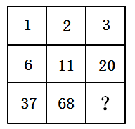

A. 76

B. 96

C. 121

D. 125

第 44 题 · 答案与解析

**参考答案（粉笔题库参考内容）**

D

**解析**

九宫格图形数阵，优先考虑每行或者每列相同的规律，发现横向与纵向均无规律，考虑其内部整体规律。数阵中的所有数值从小到大排成一个新的数列：1、2、3、6、11、20、37、68、（    ），观察新数列发现：1+2+3=6，2+3+6=11，3+6+11=20，6+11+20=37，11+20+37=68，规律为：第一项+第二项+第三项=第四项。因此所求项为20+37+68=125。

故正确答案为D。

**来源**：2009年河南省公务员录用考试《行测》题第44题

### 第 45 题

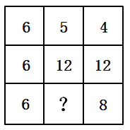

A. 6

B. 7

C. 8

D. 10

第 45 题 · 答案与解析

**参考答案（粉笔题库参考内容）**

D

**解析**

九宫格图形数阵，优先考虑每行或者每列相同的规律。观察第一、第三列发现：6×6=6×6，4×12=6×8，即每列中：第一项×第二项=6×第三项。因此5×12=6×?，解得?=10。

故正确答案为D。

**来源**：2009年河南省公务员录用考试《行测》题第45题

### 第 46 题

在一次救灾扶贫中，给贫困户发米粮，如果每个家庭发50公斤，多230公斤。如果每个家庭发60公斤，则少50公斤。

问这批粮食共多少公斤？

A. 1780

B. 1630

C. 1730

D. 1550

第 46 题 · 答案与解析

**参考答案（粉笔题库参考内容）**

B

**解析**

设贫困户有x家，根据题意可知，50x+230=60x-50，解得x=28。则这批粮食的总量为50×28+230=1630公斤。

故正确答案为B。

**考点**：和差倍比问题

**来源**：2009年河南省公务员录用考试《行测》题第46题

### 第 47 题

三种动物赛跑，已知狐狸的速度是兔子的2/3，兔子的速度是松鼠的2倍，一分钟松鼠比狐狸少跑14米，那么半分钟兔子比狐狸多跑多少米：

A. 28

B. 14

C. 19

D. 7

第 47 题 · 答案与解析

**参考答案（粉笔题库参考内容）**

B

**解析**

根据题意可知，三种动物速度之间的比例关系为狐狸/兔子 = 2/3、兔子/松鼠 = 2/1，设兔子的速度为6a米/分，则狐狸的速度为4a米/分，松鼠的速度为3a米/分。一分钟松鼠比狐狸少4a-3a=14米，解得a=14。因此半分钟兔子比狐狸多跑(6a − 4a)/2 = a = 14米。

故正确答案为B。

**考点**：普通行程

**来源**：2009年河南省公务员录用考试《行测》题第47题

### 第 48 题

三名工人师傅李群、张强和王充分别加工200个零件，他们同时开始工作，当李群加工200个零件的任务全部完成时，张强才加工了160个，王充还有48个没有加工。当张强加工200个零件的任务全部完成时，王充还有多少个零件没有加工？

A. 15

B. 25

C. 9

D. 10

第 48 题 · 答案与解析

**参考答案（粉笔题库参考内容）**

D

**解析**

方法一：张强加工160个零件时，王充加工了200-48=152个，即张强和王充的效率比为160:152=20:19。赋值张强与王充的工作效率分别为20、19，张强加工200个零件用时为200/20 = 10，此时王充加工的零件数为19×10=190个，还有200-190=10个零件没有加工。

方法二：张强加工160个零件时，王充加工了200-48=152个，即张强和王充的效率比为160:152=20:19。设张强加工200个零件时王充加工了x个，根据题意可得，200:x=20:19，解得x=190，还有200-190=10个零件没有加工。

故正确答案为D。

**考点**：给具体单位型

**来源**：2009年河南省公务员录用考试《行测》题第48题

### 第 49 题

大盒放有若干支同样的钢笔，小盒放有若干支同样的圆珠笔，两盒笔的总价相等。如果从大盒取出8支钢笔放入小盒，从小盒取出10支圆珠笔放入大盒，必须还要再在大盒中添两支同样的钢笔，两盒笔的总价才相等。如果从大盒里取10支钢笔放入小盒，从小盒取出8支圆珠笔放入大盒，那么大盒内笔的总价比小盒少了44元。

每支钢笔多少元？

A. 8

B. 6

C. 5

D. 4

第 49 题 · 答案与解析

**参考答案（粉笔题库参考内容）**

C

**解析**

设原有每盒笔的总价为A元，每支钢笔x元，每支圆珠笔y元，根据题意可列方程组：

A-8x+10y+2x=A-10y+8x······①，A-10x+8y+44=A+10x-8y······②。①式化简得y=0.7x，代入②式可得x=5，即每支钢笔5元。

故正确答案为C。

**考点**：和差倍比问题

**来源**：2009年河南省公务员录用考试《行测》题第49题

### 第 50 题

一批商品，期望获得50%的利润来定价，结果只销掉70%的商品，为尽早销售掉剩下的商品，商店决定按定价打折出售，这样所获得的全部利润是原来所期望利润的82%，问打了多少折扣？

A. 4折

B. 6折

C. 7折

D. 8折

第 50 题 · 答案与解析

**参考答案（粉笔题库参考内容）**

D

**解析**

赋值商品进价为10元，数量为10件，那么按照获利50%的利润定价时的售价为10 × (1+50%) = 15元，原期望利润为10×（15-10）=50元。实际按照15元定价销售7件商品，利润为7×（15-10）=35元，剩余3件商品按照定价打折出售，实际获得的全部利润= 50 × 82% = 41元，说明3件商品共获利41-35=6元，每件的利润为6/3=2元，实际售价为10+2=12元，则折扣=折后价/折前价=12/15=80%，即打8折。

故正确答案为D。

**考点**：经济利润问题

**来源**：2009年河南省公务员录用考试《行测》题第50题

### 第 51 题

某商场举办羽绒服专卖会，一件羽绒服连续两次8折降价销售（即连续2次降价20%），降价后的价格为320元，问原价是多少元？

A. 500

B. 450

C. 400

D. 600

第 51 题 · 答案与解析

**参考答案（粉笔题库参考内容）**

A

**解析**

设原价为x元。根据“连续两次8折降价销售，降价后的价格为320元”可列式：x × 0.8 × 0.8 = 320，解得x=500，即原价为500元。

故正确答案为A。

**考点**：经济利润问题

**来源**：2009年河南省公务员录用考试《行测》题第51题

### 第 52 题

某时刻时针和分针正好成90度的夹角，问至少经过多少时间，时针和分针又一次成90度夹角？

A. 30分钟

B. 31.5分钟

C. 32.2分钟

D. 32.7分钟

第 52 题 · 答案与解析

**参考答案（粉笔题库参考内容）**

D

**解析**

每分钟分针转过的角度为：360°/60 = 6°，时针转过的角度为：360°/(12×60) = 0.5°，即每分钟分针比时针多转过5.5°。从时针和分针正好成90°夹角到两者又一次成90°夹角，这中间分针至少比时针多转过180°，此时经过时间为180°/5.5° ≈ 32.7分钟。

故正确答案为D。

**考点**：非典型最值问题

**来源**：2009年河南省公务员录用考试《行测》题第52题

### 第 53 题

某市居民生活用电每月标准用电量的基本价格为每度0.60元，若每月用电量超过标准用电量，超出部分按照基本价格的80%收费。某户九月份的用电量为100度，共交电费57.60元，则该市每月标准用电量为：

A. 60度

B. 70度

C. 80度

D. 90度

第 53 题 · 答案与解析

**参考答案（粉笔题库参考内容）**

C

**解析**

若该户在标准用电量内使用100度电，则需交电费100×0.60=60元，而实际交费57.60元，说明其用电量超过标准用电量。设该市每月标准用电量为x度，根据总收费为两部分的和，可列式：0.60x + 0.60 × 80%×(100−x) = 57.60，解得，即该市每月标准用电量为80度。

故正确答案为C。

**考点**：分段计算问题

**来源**：2009年河南省公务员录用考试《行测》题第53题

### 第 54 题

一种挥发性药水，原来有一整瓶，第二天挥发后变为原来的1/2；第三天变为第二天的2/3；第四天变为第三天的3/4，请问第几天时药水还剩下1/30瓶？

A. 75天

B. 30天

C. 12天

D. 100天

第 54 题 · 答案与解析

**参考答案（粉笔题库参考内容）**

B

**解析**

根据题意可知，第二天剩余1/2瓶，第三天剩余1/2 × 2/3 = 1/3瓶，第四天剩余1/3 × 3/4 = 1/4瓶······因此规律为第N天剩余1/(N-1) × (N-1)/N1/N瓶（N≥2），故第30天时药水还剩下1/30瓶。

故正确答案为B。

**考点**：数列问题

**来源**：2009年河南省公务员录用考试《行测》题第54题

### 第 55 题

整数64具有可被它的个位数字所整除的性质。

试问在10和50之间有多少个整数具有这种性质？

A. 15

B. 16

C. 17

D. 18

第 55 题 · 答案与解析

**参考答案（粉笔题库参考内容）**

C

**解析**

整数可以拆分为十位数字×10+个位数的形式，如64=6×10+4。已知整数能被个位数整除，根据倍数特性，说明其十位数字×10能被个位数整除，即当个位数为十位数字×10的约数的时候，满足题干性质。

在10和50之间的数中，十位数字可能出现的情况为1、2、3、4，分类讨论如下：

①十位数字为1，个位数1、2、5是1 × 10 = 10的约数，故11、12、15具备题干的性质，有3个数；

②十位数字为2，个位数1、2、4、5是2 × 10 = 20的约数，故21、22、24、25具备题干的性质，有4个数；

③十位数字为3，个位数1、2、3、5、6是3×10=30的约数，故31、32、33、35、36具备题干的性质，有5个数；

④十位数字为4，个位数1、2、4、5、8是4×10=40的约数，故41、42、44、45、48具备题干的性质，有5个数。

综上所述，10和50之间共有3+4+5+5=17个数满足题干中的性质。

故正确答案为C。

**考点**：公倍数与公约数问题

**来源**：2009年河南省公务员录用考试《行测》题第55题

### 第 56 题

从所给的四个选项中，选择最合适的一个填入问号处，使之呈现一定的规律性：

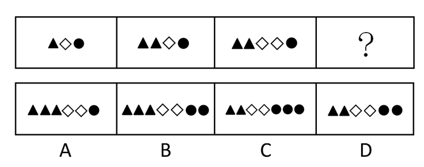

A. A

B. B

C. C

D. D

第 56 题 · 答案与解析

**参考答案（粉笔题库参考内容）**

D

**解析**

元素组成凌乱，考查数量关系。后一个图形都比前一个图形增加了一个元素，并且增加的元素都不一样，即图1-2增加的是三角形，图2-3增加的是菱形。由此，3-4应该增加一个圆。

故正确答案为D。

**考点**：数量规律-素

**来源**：2009年河南省公务员录用考试《行测》题第56题

### 第 57 题

从所给的四个选项中，选择最合适的一个填入问号处，使之呈现一定的规律性：

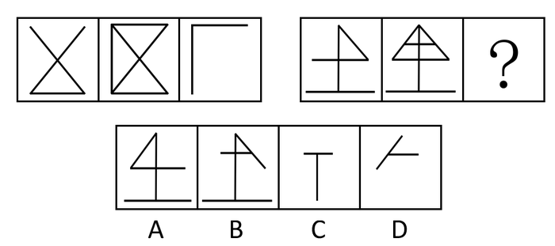

A. A

B. B

C. C

D. D

第 57 题 · 答案与解析

**参考答案（粉笔题库参考内容）**

D

**解析**

每一组的前两个图形叠加后去同存异得到第三个图。

故正确答案为D。

**考点**：样式规律-加减同异

**来源**：2009年河南省公务员录用考试《行测》题第57题

### 第 58 题

从所给的四个选项中，选择最合适的一个填入问号处，使之呈现一定的规律性：

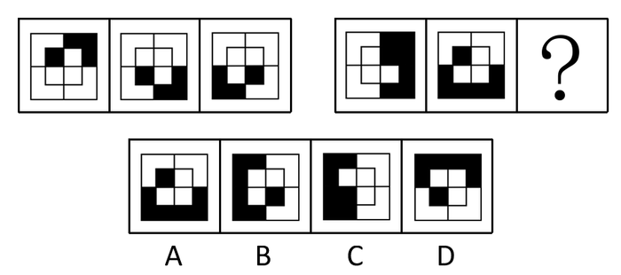

A. A

B. B

C. C

D. D

第 58 题 · 答案与解析

**参考答案（粉笔题库参考内容）**

C

**解析**

元素组成相同，考查位置规律。注意大阴影和小阴影分开找规律，两组图形外圈的黑方块组成的图形依次顺时针旋转90°，内圈的黑方块依次逆时针转90°。

故正确答案为C。

**考点**：位置规律-旋转

**来源**：2009年河南省公务员录用考试《行测》题第58题

### 第 59 题

左边给定的是纸盒的外表面，下列哪一项能由它折叠而成：

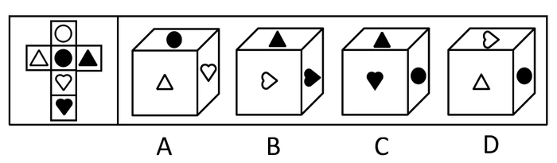

A. A

B. B

C. C

D. D

第 59 题 · 答案与解析

**参考答案（粉笔题库参考内容）**

B

**解析**

A项中三角形的方向错误，三角形的一边应与桃心的面平行，错误；B项正确；C项中黑点和黑桃心的面是对立面，不可能相邻，错误；D项的顶面不是空心桃心，应该是空心圆，错误。

故正确答案为B。

**考点**：空间类-空间重构-六面体

**来源**：2009年河南省公务员录用考试《行测》题第59题

### 第 60 题

从所给的四个选项中，选择最合适的一个填入问号处，使之呈现一定的规律性：

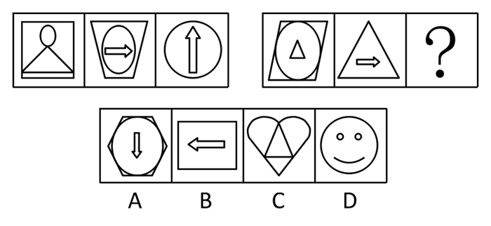

A. A

B. B

C. C

D. D

第 60 题 · 答案与解析

**参考答案（粉笔题库参考内容）**

C

**解析**

元素组成相似，单一元素周遍。第一组图形中都有圆，第二组图形中都有三角形。

故正确答案为C。

**考点**：数量规律-素、样式规律-遍历

**来源**：2009年河南省公务员录用考试《行测》题第60题

### 第 61 题

从所给的四个选项中，选择最合适的一个填入问号处，使之呈现一定的规律性：

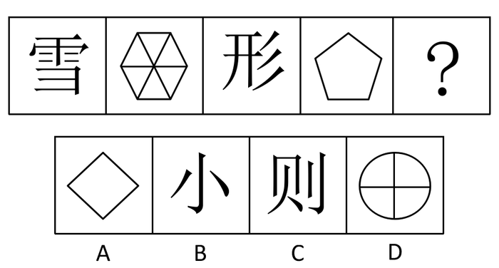

A. A

B. B

C. C

D. D

第 61 题 · 答案与解析

**参考答案（粉笔题库参考内容）**

B

**解析**

元素组成凌乱，奇偶性表现明显。运用奇偶项规律，偶数项线条数为9、5 ，等差为4；对于奇数项，汉字的笔画成11、7、3的等差数列变化规律，公差为4。

故正确答案为B。

**考点**：数量规律-线、文字/字母/数字类

**来源**：2009年河南省公务员录用考试《行测》题第61题

### 第 62 题

从所给的四个选项中，选择最合适的一个填入问号处，使之呈现一定的规律性：

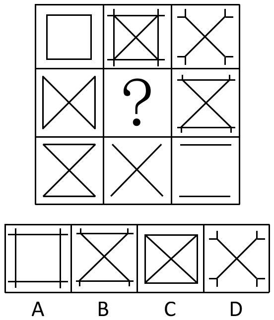

A. A

B. B

C. C

D. D

第 62 题 · 答案与解析

**参考答案（粉笔题库参考内容）**

A

**解析**

元素组成相似，元素叠加。这个题目很妙，不论是横行，还是数列， 前两个图形叠加后去同存异得到第三个图。

故正确答案为A。

**考点**：样式规律-加减同异

**来源**：2009年河南省公务员录用考试《行测》题第62题

### 第 63 题

从所给的四个选项中，选择最合适的一个填入问号处，使之呈现一定的规律性：

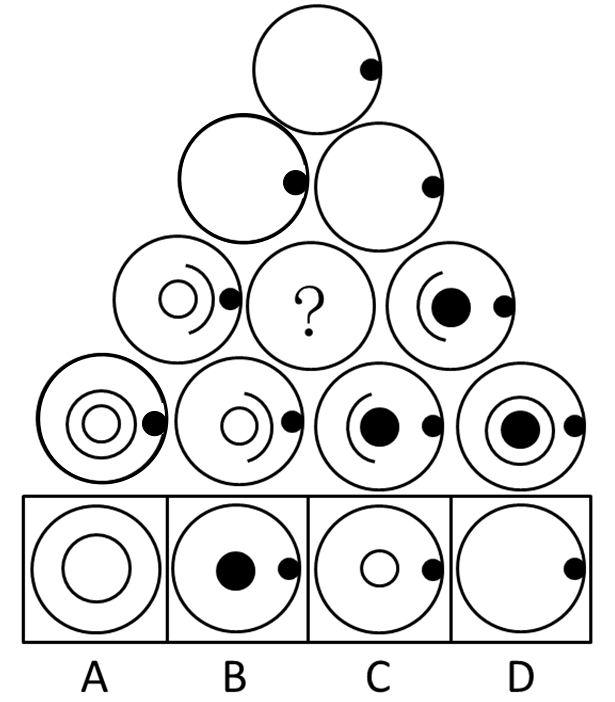

A. A

B. B

C. C

D. D

第 63 题 · 答案与解析

**参考答案（粉笔题库参考内容）**

D

**解析**

元素组成相似，元素叠加运算。下面一行相邻的两个图形，取其共同部分，即为二者上方的图形。
故正确答案为D。

**考点**：样式规律-加减同异

**来源**：2009年河南省公务员录用考试《行测》题第63题

### 第 64 题

从所给的四个选项中，选择最合适的一个填入问号处，使之呈现一定的规律性：

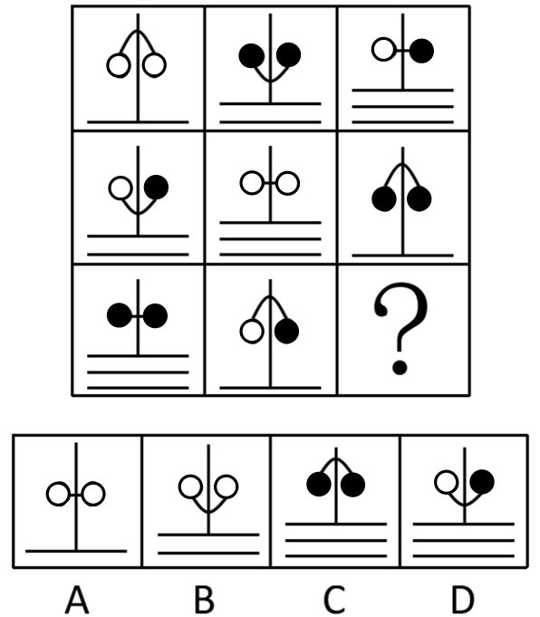

A. A

B. B

C. C

D. D

第 64 题 · 答案与解析

**参考答案（粉笔题库参考内容）**

B

**解析**

元素组成相似，元素周遍。每一行的两个圆圈都出现一黑一白、两白、两黑三种情况，每一行图形底部的小线段呈现1、2、3条的规律。

故正确答案为B。

**考点**：样式规律-遍历

**来源**：2009年河南省公务员录用考试《行测》题第64题

### 第 65 题

从所给的四个选项中，选择最合适的一个填入问号处，使之呈现一定的规律性：

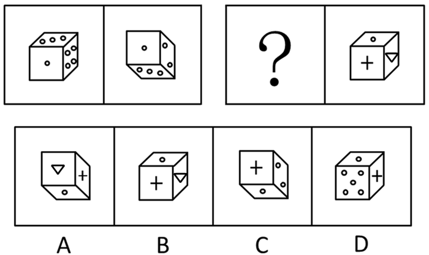

A. A

B. B

C. C

D. D

第 65 题 · 答案与解析

**参考答案（粉笔题库参考内容）**

C

**解析**

由图（1）到图（2）的变化规律为：图（1）顺时针旋转180°得到图（2），所以看不见右侧四个白点的面，而能够看到四个白点的相对面。图（3）按照此规律，应该看不见图（4）中右侧三角形，且旋转180°后得到C选项的图形。

故正确答案为C。

**考点**：位置规律-旋转、空间类-空间重构-六面体

**来源**：2009年河南省公务员录用考试《行测》题第65题

### 第 66 题

商业秘密指不为公众所知悉、能为权利人带来经济利益、具有实用性并经权利人采取保密措施的技术信息和经营信息。

根据上述定义，下列属于商业秘密的是：

A. 商场促销活动的细则

B. 学校后勤集团的管理规定

C. 天府饭店招牌菜东坡肉的秘方

D. 动画制作的方法

第 66 题 · 答案与解析

**参考答案（粉笔题库参考内容）**

C

**解析**

第一步：抓住定义中的关键词。

关键词强调“不为公众所知悉”、“经权利人采取保密措施的技术信息”。

第二步：逐一判断选项。

A、B、D三项公众都可知悉，只有C项符合定义。

故正确答案为C。

**考点**：拆词

**来源**：2009年河南省公务员录用考试《行测》题第66题

### 第 67 题

生物链指的是由动物、植物和微生物互相提供食物而形成的相互依存的链条关系。这种关系在大自然中很容易看到。生物链也可以理解为自然界中的食物链，它形成了大自然中“一物降一物”的现象，维系着物种间天然的数量平衡。

根据上述定义，下列不属于生物链的是：

A. 微生物——小鱼——大鱼——鲨鱼

B. 植物——食草动物——食肉动物

C. 植物的叶和果——昆虫——鸟——鹰

D. 水——云——雨——水

第 67 题 · 答案与解析

**参考答案（粉笔题库参考内容）**

D

**解析**

第一步：抓住定义中的关键词。

关键词强调“动物、植物和微生物互相提供食物”。

第二步：逐一判断选项。

A、B、C三项都符合题干定义，D项完全不符合题干中“互相提供食物”这一要点。

故正确答案为D。

**考点**：拆词

**来源**：2009年河南省公务员录用考试《行测》题第67题

### 第 68 题

汽车交通事故的特征之一是在道路上发生。这里的“道路”包括公路、城市街道和胡同（里巷），以及车站、公共广场、公共停车场等供车辆、行人通行的场所。公路则是指根据公路法的规定，经公路主管部门验收认定的城间、城乡间、乡间能行使汽车的公共道路，包括国道、省道、县道和乡道。特征二是在汽车营运过程中发生，即至少有一方车辆处于启动、行驶、刹车、减速、加速、转弯等运动过程中。

根据上述定义，下列属于汽车交通事故的是：

A. 李某尚未取得驾照，却擅自将贴有“训练”标志的车开到闹市区，与一出租车相撞

B. 火车在高速行驶中，一行人在铁道上行走，被卷入车底丧生

C. 某市公交站里停放的一辆7路公交车无故起火

D. 田野里耕种的拖拉机突然失灵，撞向田埂

第 68 题 · 答案与解析

**参考答案（粉笔题库参考内容）**

A

**解析**

第一步：抓住定义中的关键词。

关键词强调“汽车”、“道路”、“营运过程中发生”。

第二步：逐一判断选项。

A项符合定义；B项是火车，且是在铁轨上，不符合定义；C项不是在营运过程中发生的，故不符合定义；D项是拖拉机，不符合定义。

故正确答案为A。

**考点**：拆词

**来源**：2009年河南省公务员录用考试《行测》题第68题

### 第 69 题

基本归因错误是指人们经常把他人的行为归因于人格或态度等内在特质上，而忽视他们所处情境的重要性。

根据上述定义，下列属于基本归因错误的是：

A. 小张考试没有及格，老师认为他平时没有努力批评了他，其实这段时间小张的妈妈生病住院了，小张陪母亲，休息不够

B. 小李考试没有及格，他认为自己太笨了，不是读书的料

C. 小王第一次到北京去玩，经常迷路，他说自己到了北京怎么就成了路盲

D. 小石参加公务员考试没有通过，他认为不是自己准备不足，而是题目出得太刁钻了

第 69 题 · 答案与解析

**参考答案（粉笔题库参考内容）**

A

**解析**

第一步：抓住定义中的关键词。

关键词强调“人们对他人行为的评价”、“忽视他们所处情境”。

第二步：逐一判断选项。

只有A项符合对他人的评价这一要点，而B、C、D三项都是自己对自己做评价。

故正确答案为A。

**考点**：主客体

**来源**：2009年河南省公务员录用考试《行测》题第69题

### 第 70 题

组织公民行为是指一种由员工自主决定的行为，不包括在员工的正式工作要求当中，但它无疑会促进组织的有效性。

根据上述定义，下列属于组织公民行为的是：

A. 小王按时上下班

B. 小王经常帮助同事小李照顾其生病的父亲

C. 小王喜欢集邮，并结交了许多朋友

D. 小王经常被上司要求加班

第 70 题 · 答案与解析

**参考答案（粉笔题库参考内容）**

B

**解析**

第一步：抓住定义中的关键词。

关键词强调“自主决定的行为”、“不包括在员工的正式工作要求当中”、“促进组织的有效性”。

第二步：逐一判断选项。

A项是正式工作要求，排除；C项不符合“促进组织的有效性”这一要点；D项不符合“自主决定的行为”，以上三项均不符合定义。B项符合定义。

故正确答案为B。

**考点**：单定义-其他句式

**来源**：2009年河南省公务员录用考试《行测》题第70题

### 第 71 题

紧急避险是指为了使国家、公共利益、本人或他人的人身财产和其他权利避免正在发生的危险，不得已而采取的损害另一方较小的合法权益，以保护较大的合法权益的行为。

根据上述定义，下列不属于紧急避险的是：

A. 小王开车经过一个路口时，对面突然冲出一个踩着滑板的孩子，小王为了躲避孩子，将车头一转，撞到了路边的电线杆上

B. 小李在湖边钓鱼，突然听到有人落水叫“救命”，于是急忙赶去救人，事后发现自己放在岸边的东西都不见了

C. 飞机在飞行的过程中遇到极其恶劣的天气，为了保护乘客的安全，机长下令紧急迫降，从而延误了航班到港的时间

D. 小王买醋回家发现自己没带钥匙，而家里有浓烟冒出，情急之下，保安只得将门锁劈坏

第 71 题 · 答案与解析

**参考答案（粉笔题库参考内容）**

B

**解析**

第一步：抓住定义中的关键词。

关键词强调“不得已而采取的损害另一方较小的合法权益，以保护较大的合法权益的行为”。

第二步：逐一判断选项。

A、C、D三项都符合定义，B项并没有发生“不得已而采取的损害另一方较小的合法权益，以保护较大的合法权益的行为”。

故正确答案为B。

**考点**：方式目的

**来源**：2009年河南省公务员录用考试《行测》题第71题

### 第 72 题

重婚是指有配偶的男女未办离婚手续又与他人登记结婚，或者没有登记结婚而与他人同居而构成事实上的婚姻关系的，以及未婚男女明知他人有配偶而与之结婚的行为。

根据上述定义，下列行为属于重婚的是：

A. 甲在家乡已经结婚，出门打工后被人拐卖给了乙，被迫与乙生活在一起

B. 甲乙离婚后又同居在一起

C. 甲在隐瞒了自己已结婚的情况下与乙领取了结婚证书

D. 甲乙同居多年，甲突然提出分手，并很快与丙结婚

第 72 题 · 答案与解析

**参考答案（粉笔题库参考内容）**

C

**解析**

第一步：抓住定义中的关键词。

关键词强调“未办离婚手续又与他人登记结婚”、“构成事实上的婚姻关系”、“明知他人有配偶而与之结婚”。

第二步：逐一判断选项。

A项中的甲被拐卖给乙，但并未与乙登记结婚，不符合定义中的关键词，故不属于重婚；

B项中的甲乙已经离婚，然后同居，不符合“未办离婚手续又与他人登记结婚”，故不属于重婚；

C项中甲未离婚又与乙登记结婚，符合“未办离婚手续又与他人登记结婚”，属于重婚；

D项中的甲乙同居多年，虽然已构成事实上的婚姻关系，但甲在与丙结婚之前，已经和乙分手，故不属于重婚。

故正确答案为C。

**考点**：拆词

**来源**：2009年河南省公务员录用考试《行测》题第72题

### 第 73 题

预谋故意是指行为人产生犯罪故意之后，经过一段时间的准备才实施犯罪行为的心理态度。

根据上述定义，下列属于预谋故意的是：

A. 一青年在夜路上看见一个单身女子，遂起歹念，抢了她的皮包后逃走

B. 老王出门忘记锁门，以至于外人经过时偷走了贵重物品若干

C. 某人开快车，将一路人撞伤致死

D. 甲某与邻居乙某长期关系不合，趁乙某不注意时，甲某向乙某的水井里投毒，致使乙某一家中毒身亡

第 73 题 · 答案与解析

**参考答案（粉笔题库参考内容）**

D

**解析**

第一步：抓住定义中的关键词。

关键词强调“经过一段时间的准备才实施”。

第二步：逐一判断选项。

A、B、C三项都是即刻发生的犯罪行为，只有D项是经过一段时间的准备才实施的犯罪行为。

故正确答案为D。

**考点**：大前提

**来源**：2009年河南省公务员录用考试《行测》题第73题

### 第 74 题

典范借鉴是指从他人（或对方）那里发现、学习并应用最佳做法的过程，以达到帮助改善自身业绩的目的。

根据上述定义，下列属于典范借鉴的是：

A. 小李过去买股票总是亏损，在学习了经济学的基本知识后，炒股赚了一些钱

B. 甲市领导吸取了乙市城市建设的经验，提出了令人满意的城市建设规划图

C. 小王看小李种植烟叶收入颇丰，他也开始种烟叶

D. 小张在小李帮助下，终于通过了英语四级考试

第 74 题 · 答案与解析

**参考答案（粉笔题库参考内容）**

B

**解析**

第一步：抓住定义中的关键词。

关键词强调“从他人（或对方）那里发现、学习并应用”、“改善自身业绩”。

第二步：逐一判断选项。

A项不符合“从他人（或对方）那里发现、学习并应用”，不符合定义；B项符合定义；C项小王开始并没有种植烟叶，不符合“改善自身业绩”，不符合定义；D项是帮助行为，不符合定义。

故正确答案为B。

**考点**：方式目的

**来源**：2009年河南省公务员录用考试《行测》题第74题

### 第 75 题

共同犯罪是指两人以上共同故意犯罪。共同犯罪必须具备以下要件：一是犯罪主体必须是两人以上达到刑事责任年龄并具有刑事责任能力的人；二是有共同的犯罪故意；三是有共同的犯罪行为。

根据上述定义，下列属于共同犯罪的行为是：

A. 张某因为生意上与王某有过节，张某和他的司机两人商议后，一起将王某杀害并弃尸

B. 一犯罪团伙让一些不到10岁的小孩子在夜市里趁机偷盗

C. 李某把偷来的手机当做礼物送给女朋友，女朋友不知情

D. 一歹徒在行凶杀人过程中，旁观者没有制止

第 75 题 · 答案与解析

**参考答案（粉笔题库参考内容）**

A

**解析**

第一步：抓住定义中的关键词。

关键词强调“两人以上共同故意犯罪”、“达到刑事责任年龄”。

第二步：逐一判断选项。

A项中张某和他的司机两人将王某杀害并弃尸，符合“二人以上共同故意犯罪”和“达到刑事责任年龄”，属于共同犯罪；B项中“不到10岁的小孩”不符合“达到刑事责任年龄”，故不属于共同犯罪；C项中的李某是个人，且女友不知情，不符合“两人以上共同故意犯罪”，不属于共同犯罪；D项中的一歹徒不符合“两人以上共同故意犯罪”，故不属于共同犯罪。

故正确答案为A。

**考点**：单定义-其他句式

**来源**：2009年河南省公务员录用考试《行测》题第75题

### 第 76 题

举证责任的价值，主要是指诉讼中的原告、被告或第三人所承担的举证责任对胜诉和败诉的决定性作用。

从这段文字可以推出：

A. 举证责任没有价值

B. 举证责任主要由原告、被告或第三人承担

C. 举证责任的价值在于可以让原告胜诉

D. 举证责任主要由公安机关或人民检察院承担

第 76 题 · 答案与解析

**参考答案（粉笔题库参考内容）**

B

**解析**

第一步：抓住题干的中心思想。

题干强调“原告、被告或第三人所承担的举证责任对胜诉和败诉的决定性作用”。

第二步：逐一判断正确选项。

A项错误，举证责任对胜诉和败诉起决定性作用；C项错误， 举证责任对胜诉和败诉起决定性作用，其价值并不在于可以让原告胜诉；D项错误，题干并未提到，无从得知；B项正确，与题干意思一致。

故正确答案为B。

**考点**：日常结论

**来源**：2009年河南省公务员录用考试《行测》题第76题

### 第 77 题

现代社会中对人权最大威胁来自公权力，其中行政权由于具有扩张性、主动性等特征，尤其容易造成对行政相对人人权的侵犯。行政诉讼作为一种对人权的法律救济途径，在人权的法律保障中起着重要作用。

从这段文字可以推出：

A. 人权是不容侵犯的

B. 人权不同于公权力

C. 行政诉讼可以有效保障人权

D. 行政诉讼可以作为人权的一种形式

第 77 题 · 答案与解析

**参考答案（粉笔题库参考内容）**

B

**解析**

第一步：抓住题干的中心思想。

第一句强调人权最大威胁来自公权力，第二句说明行政诉讼在人权的法律保障中起着重要作用。

第二步：逐一判断选项的作用。

由题干首句便可推出人权不同于公权力，故B项正确。干扰项为C项，行政诉讼作为一种对人权的法律救济途径，在人权的法律保障中虽起着重要的作用，但其是否有效还要看具体的实施，因此从本题干是推不出C项的。A、D两项明显错误。

故正确答案为B。

**考点**：日常结论

**来源**：2009年河南省公务员录用考试《行测》题第77题

### 第 78 题

科技大学少年班学生谢彦波，被人们称为“神童”、“未来的诺贝尔奖获得者”，因不能处理好与导师的关系，被迫中途结束了美国的留学生涯。

从这段文字中可以推出：

A. 现代社会不上学也能成才

B. 神童未必真的是高人一等

C. 中外文化差异很大

D. 现代社会更看重人的综合素质

第 78 题 · 答案与解析

**参考答案（粉笔题库参考内容）**

D

**解析**

第一步：抓住题干的中心思想。

题干描述了“神童”因不能处理好与导师的关系，被迫中途结束了美国的留学生涯。

第二步：根据题干判断正确选项。

“不上学”和“成才”的关系在题干中并未涉及，A错误；“神童是否高人一等”并不能从题干中体现，B错误；“不能处理好与导师的关系而被迫中途退学”并不是中外文化的差异，而是个人问题，C错误；由题干可知，神童虽然智商高但如果不能与人相处好仍会在社会上遇到障碍，因此看出社会重视人的综合素质，D正确。

故正确答案为D。

**考点**：日常结论

**来源**：2009年河南省公务员录用考试《行测》题第78题

### 第 79 题

学术腐败的后果相当严重。学术腐败严重影响了学界的纯洁形象，玷污了这一片净土，沉重打击了那些真正具有实力和水平的学者，学术腐败的黑色蔓延逐渐阻碍社会的进一步发展。

这一结论最适宜用来解释的现象是：

A. 因为李教授否定了小王的开题报告，使得小王只能延迟一年毕业

B. 有两个学生在期末考试中交了雷同卷，于是给了他们0分

C. 鲁老师因为最近工作太忙，只能勉强发表了一篇论文

D. 王教授的论文多是占用其研究生的或从国外抄袭的事情曝光后，引起了强烈的反响

第 79 题 · 答案与解析

**参考答案（粉笔题库参考内容）**

D

**解析**

第一步：抓住题干的中心思想。

题干描述了学术腐败的蔓延阻碍社会发展这一现象。

第二步：根据题干判断正确选项。

D项是典型的学术腐败事例，而A、B、C三项都没有涉及学术腐败问题。

故正确答案为D。

**考点**：日常结论

**来源**：2009年河南省公务员录用考试《行测》题第79题

### 第 80 题

《中华人民共和国消费者权益保护法》中惩罚性损害赔偿适用的目的就是为了使原告遭受的损失获得全部的补偿，用来弥补补偿性赔偿的不足。

这一结论最适宜用来解释的现象是：

A. 足球场上球员顶撞裁判被红牌罚下

B. 小张在马路上随地吐痰被罚款5元

C. 王老师在超市买的洗衣粉是假冒伪劣产品，获得了超市的50元赔偿金

D. 罗阿姨在商场被别人撞倒，住进了医院，商场报销了所有的费用

第 80 题 · 答案与解析

**参考答案（粉笔题库参考内容）**

C

**解析**

第一步：抓住题干的中心思想。

题干描述了惩罚性损害赔偿这一现象，是为了使原告遭受的损失获得全部的补偿，用来弥补补偿性赔偿的不足。

第二步：根据题干判断正确选项。

A、B两项明显不符合，排除；对于D项，罗阿姨在事件中不符合“消费者”这一主体特征，故排除；而C项中的王老师符合“消费者”这一主体特征，其次50元的赔偿属于惩罚性损害赔偿，当选。

故正确答案为C。

**考点**：日常结论

**来源**：2009年河南省公务员录用考试《行测》题第80题

### 第 81 题

发热是小儿疾病常见的症状。临床上常常有这样的患儿，在外感高烧消退后，往往会持续一段时间的低烧，检查相关的体征和实验室指标均正常，患儿没有明显的不适，精神状况良好，西药无特效的治疗方法。另有一些患者有不明原因的发热，往往持续高烧1到2个月不退，西医诊断原因不明而难以治疗。因此这些患儿往往投治于中医。

从这段文字可以推出：

A. 小儿持续发热没有特效的治疗方法

B. 西药对小儿持续发热很有作用

C. 中医治疗小儿持续发热效果较好

D. 中医治疗小儿持续发热有秘方

第 81 题 · 答案与解析

**参考答案（粉笔题库参考内容）**

C

**解析**

第一步：抓住题干的中心思想。

第一句说明了西医对于一些高烧患儿无特效的治疗方法，第二句说明西医对于诊断原因不明的高烧患儿难以治疗，故往往投治于中医。

第二步：根据题干判断正确选项。

题干只提到西医对小儿持续发热没有很好的治疗方法，所以A项错误；B项与题干内容相反，错误；根据最后一句话，可知中医治疗小儿持续发热效果较好，但是否有秘方根据题干是推不出的，D项错误；由高烧患儿难以治疗，故往往投治于中医，可知C项正确。

故正确答案为C。

**考点**：日常结论

**来源**：2009年河南省公务员录用考试《行测》题第81题

### 第 82 题

美国著名的智囊公司—兰德公司花费了20年的时间跟踪世界500家大公司，发现百年长生不衰的企业具有一个共同的特征，就是树立了超越利润的社会目标，不以利润为唯一追求目标。

从这段文字可以推出：

A. 百年企业都不追求利润

B. 百年企业不追求最大利润

C. 企业价值观中最主要的、最核心的是企业的利润观

D. 树立超越利润最大化的价值观是百年企业的精神文化基础

第 82 题 · 答案与解析

**参考答案（粉笔题库参考内容）**

D

**解析**

第一步：抓住题干的中心思想。

题干描述了百年企业的特征：树立超越利润的社会目标，不以利润为唯一追求目标。

第二步：根据题干判断正确选项。

题干中说“不以利润为唯一追求目标”并不意味着不追求利润，同样，也不意味着不追求最大利润，A、B两项错误；题干中说“树立了超越利润的社会目标”意味着企业价值观中最核心的是超越利润的社会目标，C项错误；由题干中“就是树立了超越利润的社会目标，不以利润为唯一追求目标”可知，百年企业的特征是树立了超越利润的价值观，D项正确。

故正确答案为D。

**考点**：日常结论

**来源**：2009年河南省公务员录用考试《行测》题第82题

### 第 83 题

只有门球打得好的人才能加入门球协会；所有门球协会的人都戴着太阳帽；有的退休老同志是门球协会会员；某街道的人都不会打门球。

由此不能确认真假的一项是：

A. 该街道上的人都不是门球协会会员

B. 该街道上有的人戴着太阳帽

C. 有的退休老同志戴着太阳帽

D. 有的退休老同志门球打得好

第 83 题 · 答案与解析

**参考答案（粉笔题库参考内容）**

B

**解析**

第一步：翻译题干，利用充分必要条件。

第一句：门球协会会员→门球打得好；

第二句：门球协会会员→戴着太阳帽，有的退休老同志→门球协会会员，即有的退休老同志→门球协会会员→戴着太阳帽；

第三句：某街道的人→不会打门球，即有某街道的人→不会打门球→—门球协会会员。

第二步：逐一翻译选项并判断正确选项。

A项：某街道的人→—门球协会会员，即题干第三句话，正确；

B项：某街道的人→戴着太阳帽，由题干无法推出此结论，B错误；

C项：有的退休老同志→戴着太阳帽，即题干第二句话，正确；

D项：有的退休老同志→门球打得好，由第一句和第二句话可推出有的退休老同志→门球协会会员→门球打得好，正确。

故正确答案选B。

**考点**：集合推理

**来源**：2009年河南省公务员录用考试《行测》题第83题

### 第 84 题

知名度和美誉度反映了社会公众对一个组织的认识和赞许的程度，两者都是公共关系学所强调追求的目标。一个组织形象如何，取决于它的知名度和美誉度。公共关系策划者需要明确的是：只有不断提高知名度，才能不断提高组织的美誉度。知名度只有以美誉度为基础才能产生积极的效应。同时，美誉度要以知名度为条件，才能充分显示其社会价值。

由此可知，知名度和美誉度的关系是：

A. 知名度高，美誉度必然高

B. 知名度低，美誉度必然低

C. 只有美誉度高，知名度才能高

D. 只有知名度高，美誉度才能高

第 84 题 · 答案与解析

**参考答案（粉笔题库参考内容）**

D

**解析**

第一步：翻译题干，利用充分必要条件。

由题干可知：提高美誉度→提高知名度。

第二步：逐一翻译选项并判断对错。

A项，知名度高→美誉度高，“知名度高”属于肯后件，无法推出绝对表达的结论，错误；

B项，知名度低→美誉度低，题干并未给出知名度低的任何推理，错误；

C项，知名度高→美誉度高，“知名度高”属于肯后件，无法推出绝对表达的结论，错误；

D项，美誉度高→知名度高，符合题干推论，正确。

故正确答案为D。

**考点**：常规翻译

**来源**：2009年河南省公务员录用考试《行测》题第84题

### 第 85 题

奥林匹克运动会的赞助商要想通过奥运会取得商业上的成功，仅仅在名片上增加“五环”或支起帐篷招揽游客是远远不够的。近15年来，作为奥林匹克运动会的全球性赞助商，VISA国际组织认为要想有效地利用这一全球最大的体育和文化盛事，并非只是简单的往奥运圣火里扔钱的活动。

据此我们知道：

A. 通过对奥运会的赞助以达到商业上的成功，还需要有效的市场营销

B. 赞助奥林匹克运动会是一种往奥运圣火里扔钱的活动

C. VISA国际组织是全球最大的奥林匹克运动会赞助商

D. VISA国际组织没有支起帐篷招揽游客

第 85 题 · 答案与解析

**参考答案（粉笔题库参考内容）**

B

**解析**

第一步：抓住每句话的重点。

第一句话说明赞助商要取得商业上的成功单靠在名片上增加“五环”或支起帐篷招揽游客是远远不够，第二句话说明VISA作为奥运会的赞助商，并非只是简单的往奥运圣火里扔钱。

第二步：逐一判断各选项的作用。

A项，原文只表达了“成功单靠在名片上增加‘五环’或支起帐篷招揽游客是远远不够”，但是还要做什么并不能从文段中推出，“还需要市场营销”属于无中生有，过度引申，错误；

B项，从最后一句话“不只是简单的往奥运圣火里扔钱的活动”可知，是“往奥运圣火里扔钱的活动”，故正确；

C项，忽略了“15年来”这个时间修饰语，由题干可知，VISA是奥运会的赞助商，但没有提到是全球最大，错误；

D项，不能从题干中直接得出，不能确定其是否支起帐篷招揽顾客，错误。

故正确答案为B。

**考点**：日常结论

**来源**：2009年河南省公务员录用考试《行测》题第85题

### 第 86 题

美国：旧金山

A. 韩国：釜山

B. 法国：撒哈拉

C. 德国：威尼斯

D. 日本：檀香山

第 86 题 · 答案与解析

**参考答案（粉笔题库参考内容）**

A

**解析**

第一步：判断题干词语间逻辑关系。

题干两词是对应关系，且是国家和该国城市之间的对应关系。

第二步：判断选项词语间逻辑关系。

与题干相同的逻辑关系即为A项，釜山是韩国的第二大城市；B项撒哈拉沙漠不是城市；C项威尼斯在意大利，而不是德国；D项檀香山是美国夏威夷州首府和港口城市，和日本不对应。

故正确答案为A。

**考点**：逻辑关系-对应关系

**来源**：2009年河南省公务员录用考试《行测》题第86题

### 第 87 题

绿豆：豌豆

A. 红豆：豆奶

B. 豆奶：麦片

C. 牛奶：奶牛

D. 燕子：燕窝

第 87 题 · 答案与解析

**参考答案（粉笔题库参考内容）**

B

**解析**

第一步：判断题干词语间逻辑关系。

题干两个词的关系是并列关系。绿豆和豌豆都是豆类的一种。

第二步：判断选项词语间逻辑关系。

A项，红豆和豆奶不属于同类，不是并列关系，不符合题意，排除。

B项，豆奶和麦片都是冲食食品的一种，属于并列关系，符合题意，当选。

C项，牛奶是奶牛的产物，二者不同类，不是并列关系，不符合题意，排除。

D项，燕窝是燕类所筑的巢窝，燕窝与燕子，二者不同类，不是并列关系，不符合题意，排除。

故正确答案为B。

**考点**：逻辑关系-并列关系

**来源**：2009年河南省公务员录用考试《行测》题第87题

### 第 88 题

《西游记》：孙悟空

A. 《三国演义》：宋江

B. 贾宝玉：《红楼梦》

C. 《祝福》：祥林嫂

D. 《水浒传》：罗贯中

第 88 题 · 答案与解析

**参考答案（粉笔题库参考内容）**

C

**解析**

第一步：判断题干词语间逻辑关系。

题干两词语间是对应关系，且是作品与作品中的人物的对应关系。前词是作品，后词是作品中的人物。

第二步：判断选项词语间逻辑关系。

A中的宋江是《水浒传》中的人物；B项作品与人物顺序反了；C项祥林嫂是《祝福》中的人物，正确。D项罗贯中是《三国演义》的作者，不是《水浒传》中的人物。

故正确答案为C。

**考点**：逻辑关系-对应关系

**来源**：2009年河南省公务员录用考试《行测》题第88题

### 第 89 题

希望：失望

A. 开始：结束

B. 幸福：哭泣

C. 喜欢：欢喜

D. 婴儿：老人

第 89 题 · 答案与解析

**参考答案（粉笔题库参考内容）**

A

**解析**

第一步：判断题干词语间逻辑关系。

希望和失望是反义词。

第二步：判断选项词语间逻辑关系。

A项的开始和结束也是反义词，正确；B项幸福的反义词是悲伤；C项喜欢的反义词是讨厌；D项两词为对应关系。

故正确答案为A。

**考点**：语义关系-反义关系

**来源**：2009年河南省公务员录用考试《行测》题第89题

### 第 90 题

（  ）  之于  因循  好像  陈迹  之于  （  ）

A. 连续 老友

B. 创造 回避

C. 遵从 往事

D. 力行 古屋

第 90 题 · 答案与解析

**参考答案（粉笔题库参考内容）**

C

**解析**

第一步：将选项逐一代入，判断各选项前后部分逻辑关系。

A、B、D代入题干后无明显的逻辑关系，C项代入题干，遵从和因循是近义词，往事和陈迹也是近义词。

第二步：逻辑关系相同即为答案。

由第一步的分析可知，C项前后都为全同关系。

故正确答案为C。

**考点**：逻辑关系-全同关系

**来源**：2009年河南省公务员录用考试《行测》题第90题

### 第 91 题

（  ）之于 汉 好像 隋 之于 （  ）

A. 周 唐

B. 明 清

C. 商 五代

D. 秦 唐

第 91 题 · 答案与解析

**参考答案（粉笔题库参考内容）**

D

**解析**

第一步：将选项逐一代入，判断各选项前后部分逻辑关系。

将四个选项都代入题干，发现前、后部分的两词间都是朝代的先后顺序。

第二步：分析之后确定答案。

秦之后为汉，隋之后为唐。

故正确答案为D。

**考点**：逻辑关系-对应关系

**来源**：2009年河南省公务员录用考试《行测》题第91题

### 第 92 题

（  ）之于 岛屿 好像 陆地 之于 （  ）

A. 海洋 湖泊

B. 荒凉 辽阔

C. 山岗 海洋

D. 海洋 山岳

第 92 题 · 答案与解析

**参考答案（粉笔题库参考内容）**

D

**解析**

A项：海洋之于岛屿，陆地之于湖泊，虽然湖泊是在陆地上，但是湖泊并不高于地表面，而是陆地低洼处积水形成，前后词的逻辑关系没有D项更加对应；

B项：荒凉之于岛屿，陆地之于辽阔，形容词和所修饰的名词顺序前后颠倒；

C项：山岗之于岛屿，陆地之于海洋，山岗和岛屿都是突出、高于地表面或海表面的陆地部分，而陆地和海洋是两种地表面形态，前面一组都是陆地部分，后面一组为陆地和海洋，对应逻辑关系不正确；

D项：对应关系。海洋之于岛屿，陆地之于山岳，岛屿是在海洋里，山岳是在陆地上，而且岛屿高出海平面，山岳高出地表面。

故正确答案为D。

**考点**：逻辑关系-对应关系

**来源**：2009年河南省公务员录用考试《行测》题第92题

### 第 93 题

（  ） 之于 实用 好像 抽象 之于 （  ）

A. 实际 空间

B. 理论 具体

C. 原则 模糊

D. 理论 概念

第 93 题 · 答案与解析

**参考答案（粉笔题库参考内容）**

B

**解析**

第一步：将选项逐一代入，判断各选项前后部分的逻辑关系。

A项中前面部分无明显逻辑关系，后面部分是属性关系；

B项中前面部分是反义关系，后面部分也是反义关系；

C项中前面部分无明显逻辑关系，后面部分是全同关系；

D项中前面部分是全同关系，后面部分是属性关系。

第二步：逻辑关系相同即为答案。

根据第一步可知，逻辑关系完全相同的是B项。

故正确答案为B。

**考点**：语义关系-反义关系

**来源**：2009年河南省公务员录用考试《行测》题第93题

### 第 94 题

（  ） 之于 黑暗 好像 白天 之于 （  ）

A. 黄昏 黎明

B. 夜晚 日光

C. 夜晚 光明

D. 黄昏 月亮

第 94 题 · 答案与解析

**参考答案（粉笔题库参考内容）**

C

**解析**

第一步：将选项逐一代入，判断各选项前后部分的逻辑关系。

A项中前面部分是对应关系，“黄昏”之后是“黑暗”，后面部分是对应关系，“黎明”之后是“白天”；

B项中前面部分是属性关系，后面部分是对应关系；

C项中前面部分是属性关系，后面部分也是属性关系；

D项中前面部分是对应关系，后面部分无明显逻辑关系。

第二步：前后逻辑关系相同即为答案。

根据第一步可知，逻辑关系相同的是A、C两项，但A项中前后部分不对应，若选A项，题干后面部分应该改为“黎明之于白天”，而C项中前后项的前词“夜晚”与“白天”对应，后词“黑暗”与“光明”对应。

故正确答案为C。

**考点**：逻辑关系-对应关系

**来源**：2009年河南省公务员录用考试《行测》题第94题

### 第 95 题

（  ） 之于 山 好像 绿 之于 （  ）

A. 高 地

B. 青 水

C. 远 色

D. 大 地

第 95 题 · 答案与解析

**参考答案（粉笔题库参考内容）**

B

**解析**

逐一分析选项。

A项，高山是偏正结构，绿地也是偏正结构，前后逻辑关系一致，保留；

B项，青山是偏正结构，绿水也是偏正结构，前后逻辑关系一致，保留；

C项，远山是偏正结构，绿是一种色，二者为种属关系，前后逻辑关系不一致，排除；

D项，大山是偏正结构，绿地也是偏正结构，前后逻辑关系一致，保留。

比较A、B、D项，B项青山、绿水均为固定搭配，且绿水青山也是固定搭配。

故正确答案为B。

**考点**：语法关系

**来源**：2009年河南省公务员录用考试《行测》题第95题

### 第 96 题

全国人大代表根据什么组成代表团？

A. 民族

B. 职业

C. 选举单位

D. 地域

第 96 题 · 答案与解析

**参考答案（粉笔题库参考内容）**

C

**解析**

根据《中华人民共和国全国人民代表大会组织法》第一章第四条，全国人民代表大会代表按照选举单位组成代表团。各代表团分别推选代表团团长、副团长。

故正确答案为C。

**考点**：宪法

**来源**：2009年河南省公务员录用考试《行测》题第96题

### 第 97 题

供电合同中，供电方的义务不包括：

A. 赔偿因断电造成的损失

B. 中断供电事先通知

C. 安全供电

D. 对事故断电的抢修

第 97 题 · 答案与解析

**参考答案（粉笔题库参考内容）**

A

**解析**

A项错误，赔偿是一种责任，是对于过错的一种救济，而非义务；

B项正确，根据《中华人民共和国民法典》六百五十二条：供电人因供电设施计划检修、临时检修、依法限电或者用电人违法用电等原因，需要中断供电时，应当按照国家有关规定事先通知用电人。未事先通知用电人中断供电，造成用电人损失的，应当承担损害赔偿责任。可知供电方有事先通知义务；

C项正确，根据《中华人民共和国民法典》六百五十一条：供电人应当按照国家规定的供电质量标准和约定安全供电。供电人未按照国家规定的供电质量标准和约定安全供电，造成用电人损失的，应当承担损害赔偿责任。可知，供电方有安全供电义务；

D项正确，根据《中华人民共和国民法典》六百五十三条：因自然灾害等原因断电，供电人应当按照国家有关规定及时抢修。未及时抢修，造成用电人损失的，应当承担损害赔偿责任。可知对于事故断电供电方有抢修的义务。

本题为选非题。

故正确答案为A。

**考点**：民法典

**来源**：2009年河南省公务员录用考试《行测》题第97题

### 第 98 题

解决我国水资源季节变化大的措施是：

A. 防止水污染

B. 兴建水库

C. 跨流域调水

D. 节约水

第 98 题 · 答案与解析

**参考答案（粉笔题库参考内容）**

B

**解析**

我国水资源的特点有两个：一是季节变化大，二是南北分布不均。解决第一个问题就是要兴建水库，在枯水期蓄水，丰水期放水，保持一年四季都有一定的水资源可以利用；解决第二个问题的方法就是跨流域调水，目前正在进行的南水北调工程就是该种举措，但是想要实现水资源的可持续利用，最根本的就是节约用水，减少水污染。

故正确答案为B。

**考点**：中国地理

**来源**：2009年河南省公务员录用考试《行测》题第98题

### 第 99 题

公安机关是国务院和地方各级人民政府领导下的一个职能部门，是国家的：

A. 权力机关

B. 检察机关

C. 行政机关

D. 审判机关

第 99 题 · 答案与解析

**参考答案（粉笔题库参考内容）**

C

**解析**

公安机关属于国家的行政机关。

故正确答案为C。

**本题相关知识点：**

公安机关是人民政府的重要组成部分，是国家的行政机关，同时它又担负着刑事案件的侦查任务，因而它又是国家的司法机关之一。公安机关是政府的一个职能部门，依法管理社会治安，行使国家的行政权，同时公安机关又依法侦查刑事案件，行使国家的司法权。公安机关的性质具有双重性，即既有行政性又有司法性。

**来源**：2009年河南省公务员录用考试《行测》题第99题

### 第 100 题

有些垃圾可以用卫生填埋、焚烧、高温堆肥等方法处理。下列垃圾中，不适合用这样的方法处理的是：

A. 农作物垃圾

B. 锂电池

C. 广告用纸

D. 棉纺织品

第 100 题 · 答案与解析

**参考答案（粉笔题库参考内容）**

B

**解析**

锂电池里面用的电解液是有机物，一旦释放将会对环境造成危害。而焚烧锂电池可能会造成爆炸。废旧锂电池应该经过专业的回收处理，不能采用卫生填埋、焚烧或高温堆肥的方法。

故正确答案为B。

**考点**：生活常识

**来源**：2009年河南省公务员录用考试《行测》题第100题

### 第 101 题

要洗掉茶壶中的水垢，可选用的试剂是：

A. 食盐水

B. 小苏打溶液

C. 醋酸

D. 烧碱

第 101 题 · 答案与解析

**参考答案（粉笔题库参考内容）**

C

**解析**

茶壶里的水垢，其主要成分是碳酸钙，想要洗掉，可用具有弱酸性的溶液来洗刷。

A、B、D三项中的物质都不会与碳酸钙发生化学反应。

故正确答案为C。

**考点**：生活常识

**来源**：2009年河南省公务员录用考试《行测》题第101题

### 第 102 题

被毒蛇咬以后，不可采取的措施是：

A. 立即喝酒解毒

B. 用清水冲洗伤口或灼烧伤口，除去伤口毒液

C. 放低上肢，用布条在咬伤处近心端5公分处扎紧

D. 将伤口割开，放出有毒的血液

第 102 题 · 答案与解析

**参考答案（粉笔题库参考内容）**

A

**解析**

A项错误，喝酒会加快血液循环，从而加速蛇毒的扩散，不可取；

B、C、D三项属于正确的处理方法。

本题为选非题。

故正确答案为A。

**考点**：生活常识

**来源**：2009年河南省公务员录用考试《行测》题第102题

### 第 103 题

若出现什么现象时，应首先考虑计算机是否感染了病毒？

A. 不能读取光盘

B. 程序运行速度明显变慢

C. 启动时报告硬件问题

D. 软盘插不进驱动器

第 103 题 · 答案与解析

**参考答案（粉笔题库参考内容）**

B

**解析**

如果你的计算机感染了病毒，那么系统的运行速度会大幅度变慢。病毒入侵后，首先占领内存这个据点，然后便以此为根据地在内存中开始漫无休止地复制自己，随着它越来越庞大，很快就占用了系统大量的内存，导致正常程序运行时因缺少主内存而变慢，甚至不能启动；同时病毒程序会迫使CPU转而执行无用的垃圾程序，使得系统始终处于忙碌状态，从而影响了正常程序的运行，导致计算机速度变慢。

故正确答案为B。

**考点**：物理常识

**来源**：2009年河南省公务员录用考试《行测》题第103题

### 第 104 题

城市铁路桥的铁道两边往往留有一定宽度，足够一个人行走。但是铁路桥是严禁行人通行的。禁止行人通行的主要原因是：

A. 担心行人被高速行进中的火车上的突出物剐到

B. 由于铁路桥的护栏间隙较大，行人容易从护栏间隙中坠落

C. 高速行驶的火车扰动空气，气流改变造成向外的推力，有将附近物体推下桥的危险

D. 高速行驶的火车扰动空气，气流改变造成向内的吸力，有将附近物体卷入的危险

第 104 题 · 答案与解析

**参考答案（粉笔题库参考内容）**

D

**解析**

空气从气压高的地方向气压低的地方流动。列车在高速行驶时，车身周围空气减少，由于空气的稀薄，空气压强很小，远处的空气就会压过来，造成指向车身的空气流动，也就造成向内的吸力，有将附近物体卷入的危险。所以人遇到高速行驶的火车时，应该与之保持足够远的距离，如果来不及躲避，应尽量降低体位，如趴在地上。火车上不允许有足可以剐到人的突出物，因为这也会影响到火车的安全，故排除A项；护栏间隙较大是一个完全可以弥补的问题，不致于严禁行人通行，故排除B项；而火车扰动空气基本上不会造成向外的推力，故排除C项。

故正确答案为D。

**考点**：生活常识

**来源**：2009年河南省公务员录用考试《行测》题第104题

### 第 105 题

关于管理幅度、管理层次与组织规模三者的关系，表述正确的是：

A. 管理幅度既定，管理层次与组织规模成正比

B. 管理幅度既定，管理层次与组织规模成反比

C. 组织规模既定，管理层次与管理幅度成正比

D. 管理层次既定，管理幅度与组织规模成反比

第 105 题 · 答案与解析

**参考答案（粉笔题库参考内容）**

A

**解析**

组织中从最高主管到具体工作人员之间的不同层次称之为管理层次。一个组织管理层次的多少，受到组织规模和管理幅度的影响。在管理幅度给定的条件下，管理层次与组织规模的大小成正比，组织规模越大，包括的成员数越多，需要的管理层次就越多。在组织规模给定的条件下，管理层次与管理幅度成反比，每个主管能直接控制的下属人数越多，所需的管理层次就越少。

故正确答案为A。

**来源**：2009年河南省公务员录用考试《行测》题第105题

### 第 106 题

甲乙是一对恋人，在互换照片之后，终止了恋爱关系，甲向乙索要自己的照片，乙十分不满，就用笔在甲的照片上乱画一番，然后还给甲，乙的行为侵犯了甲的：

A. 姓名权

B. 肖像权

C. 名誉权

D. 荣誉权

第 106 题 · 答案与解析

**参考答案（粉笔题库参考内容）**

B

**解析**

公民的肖像权，他人不得侵犯，我国法律保护公民的人格尊严，禁止用侮辱、诽谤等方式侵害公民、法人的肖像权，而本题中乙的乱涂画的行为，侵害了甲的肖像权。

故正确答案为B。

**考点**：民法典

**来源**：2009年河南省公务员录用考试《行测》题第106题

### 第 107 题

四书不包括：

A. 《论语》

B. 《孟子》

C. 《楚辞》

D. 《中庸》

第 107 题 · 答案与解析

**参考答案（粉笔题库参考内容）**

C

**解析**

《四书》是《论语》、《孟子》、《中庸》、《大学》这四部著作的总称。

故正确答案为C。

**本题相关知识点：**

四书五经是四书和五经的合称，是中国儒家经典的书籍。四书指的是《论语》《孟子》《大学》和《中庸》；而五经指的是《诗经》《尚书》《礼记》《周易》《春秋》，简称为“诗、书、礼、易、春秋”。在之前，还有一本《乐经》，合称“诗、书、礼、乐、易、春秋”，这六本书也被称做“六经”，其中的《乐经》后来亡佚了，就只剩下了五经。《四书五经》是南宋以后儒学的基本书目，儒生学子的必读之书。

**考点**：文学常识

**来源**：2009年河南省公务员录用考试《行测》题第107题

### 第 108 题

我国刑法规定的完全不负刑事责任的年龄为不满：

A. 14周岁

B. 16周岁

C. 18周岁

D. 20周岁

第 108 题 · 答案与解析

**参考答案（粉笔题库参考内容）**

A

**解析**

【备注】：本题根据刑法修正案十一，无正确答案，题目已过时。

根据《刑修十一》第十七条第一、二、三款规定：已满十六周岁的人犯罪，应当负刑事责任。

已满十四周岁不满十六周岁的人，犯故意杀人、故意伤害致人重伤或者死亡、强奸、抢劫、贩卖毒品、放火、爆炸、投放危险物质罪的，应当负刑事责任。

已满十二周岁不满十四周岁的人，犯故意杀人、故意伤害罪，致人死亡或者以特别残忍手段致人重伤造成严重残疾，情节恶劣，经最高人民检察院核准追诉的，应当负刑事责任。

故正确答案为A。

**本题相关知识点：**

《中华人民共和国刑法》关于刑事责任能力年龄的规定：

第十七条　已满十六周岁的人犯罪，应当负刑事责任。

已满十四周岁不满十六周岁的人，犯故意杀人、故意伤害致人重伤或者死亡、强奸、抢劫、贩卖毒品、放火、爆炸、投放危险物质罪的，应当负刑事责任。

已满十二周岁不满十四周岁的人，犯故意杀人、故意伤害罪，致人死亡或者以特别残忍手段致人重伤造成严重残疾，情节恶劣，经最高人民检察院核准追诉的，应当负刑事责任。

对依照前三款规定追究刑事责任的不满十八周岁的人，应当从轻或者减轻处罚。

因不满十六周岁不予刑事处罚的，责令其父母或者其他监护人加以管教；在必要的时候，依法进行专门矫治教育。

**考点**：刑法

**来源**：2009年河南省公务员录用考试《行测》题第108题

### 第 109 题

我国法的制定的基本原则之一是：

A. 以事实为根据

B. 公民在法律面前人人平等

C. 灵活性与原则性相结合

D. 领导与群众相结合

第 109 题 · 答案与解析

**参考答案（粉笔题库参考内容）**

C

**解析**

A项错误，它是制定法律的依据；

B项错误，它是宪法赋予公民的基本权利之一，但制定法律时并不遵循人人平等的原则；

C项正确，我国制定法律的基本原则是坚持原则性和灵活性相结合的原则；

D项错误，它是我国制定法律的基本出发点。

故正确答案为C。

**考点**：宪法

**来源**：2009年河南省公务员录用考试《行测》题第109题

### 第 110 题

当事人订立合同，应当具有：

A. 民事权利能力

B. 民事行为能力

C. 民事权利能力和民事行为能力

D. 相应的民事权利和民事行为能力

第 110 题 · 答案与解析

**参考答案（粉笔题库参考内容）**

D

**解析**

我国《合同法》规定，当事人订立合同，应当具有相应的民事权利能力和民事行为能力。

故正确答案为D。

**考点**：民法典

**来源**：2009年河南省公务员录用考试《行测》题第110题

### 第 111 题

“不以物喜，不以己悲”告诉我们：

A. 不能因为自己的成功或失败而或喜或悲

B. 不能因为环境的好坏和自己的得失而或喜或悲

C. 不能因为自己的物质条件好坏而或喜或悲

D. 不能因为自己强于或不如别人而或喜或悲

第 111 题 · 答案与解析

**参考答案（粉笔题库参考内容）**

B

**解析**

这句话的外在意思是不因外物（财物、外物）的丰富、富有而骄傲和狂喜；也不因为个人的失意潦倒而悲伤。内在涵义是指无论面对失败还是成功，都要保持一种恒定淡然的心态，不因一时的成功和失败而妄自菲薄，无论何时都保持一种豁达淡然的心态，不因外界的好事而兴高采烈也不因自己的不幸遭遇而垂头丧气，坚持自己的原则，不受外界的影响。

故正确答案为B。

**本题相关知识点：**

“不以物喜，不以己悲”出自北宋文学家范仲淹的名著《岳阳楼记》，讲究淡然平静的心态，即无论外界或自我有何种起伏喜悲，都要保持一种豁达淡然，是中国传统的道家思想。

**考点**：文学常识

**来源**：2009年河南省公务员录用考试《行测》题第111题

### 第 112 题

用橡皮擦可以去掉铅笔字迹，原因是：

A. 橡皮可以吸附石墨

B. 橡皮可以溶解石墨

C. 橡皮与石墨相互排斥

D. 橡皮刮破纸张的表面

第 112 题 · 答案与解析

**参考答案（粉笔题库参考内容）**

A

**解析**

铅笔芯是由石墨加上粘土制成的。石墨质软，色黑，容易附着在纸上，所以能写出字。橡皮很软，摩擦力大，又有些黏性，能把纸上的字迹带走，又不损伤纸面。

故正确答案为A。

**考点**：生活常识

**来源**：2009年河南省公务员录用考试《行测》题第112题

### 第 113 题

与私人产品相比，公共产品的核心特征是：

A. 强制性

B. 无偿性

C. 非排他性

D. 排他性

第 113 题 · 答案与解析

**参考答案（粉笔题库参考内容）**

C

**解析**

公共产品有两个主要特征：一是非竞争性。一部分人对某一产品的消费不会影响另一些人对该产品的消费，一些人从这一产品中受益不会影响其他人从这一产品中受益，受益对象之间不存在利益冲突。例如国防保护了所有公民，其费用以及每一公民从中获得的好处不会因为多生一个小孩或出国一个人而发生变化。二是非排他性，是指产品在消费过程中所产生的利益不能为某个人或某些人所专有，要将一些人排斥在消费过程之外，不让他们享受这一产品的利益是不可能的。例如，消除空气中的污染是一项能为人们带来好处的服务，它使所有人能够生活在新鲜的空气中，要让某些人不能享受到新鲜空气的好处是不可能的。

故正确答案为C。

**考点**：宏观经济与调控政策

**来源**：2009年河南省公务员录用考试《行测》题第113题

### 第 114 题

2008年8月8日奥运会圣火在国家体育场“鸟巢”点燃，请问，奥运会圣火来源于：

A. 东方文明发源地埃及

B. 西方文明发源地希腊

C. 西方文明发源地罗马

D. 东方文明发源地印度

第 114 题 · 答案与解析

**参考答案（粉笔题库参考内容）**

B

**解析**

圣火起源于古希腊神话传说。相传古希腊神普罗米修斯为解救饥寒交迫的人类，瞒着宙斯偷取火种带到人间。古希腊在每届奥运会举行以前，人们都要在赫拉神庙前点燃圣火。普罗米修斯的事迹感动了世人，后来人们为了纪念普罗米修斯这位英雄，在燃起“圣火”之前，必须向他祭祀，于是古代奥运会规定在开幕前必须进行隆重的点火仪式。这就是古代神话和现实英雄主义相结合的基础下产生出来的“圣火”。奥运“圣火”的由来和意义就这样被希腊人浪漫地奠定了下来。现代奥林匹克运动恢复后，1912 年顾拜旦提出了点燃奥林匹克圣火的建议，1928 年开始实施点燃奥林匹克圣火的仪式。自1936 年，奥林匹克圣火开始从奥运会的故乡希腊奥林匹克点燃火炬，然后将火炬接力传到主办国，并于奥运会开幕前一天到达举办城市，开幕式时进入会场，一般由东道国著名运动员点燃塔上焰火，直到闭幕时熄灭。

故正确答案为B。

**来源**：2009年河南省公务员录用考试《行测》题第114题

### 第 115 题

行政制裁，是指国家行政机关对行政违法者依其行政责任所实施的强制性处罚措施。

行政制裁不包括：

A. 行政处罚

B. 行政处理

C. 行政处分

D. 劳动教养

第 115 题 · 答案与解析

**参考答案（粉笔题库参考内容）**

B

**解析**

行政制裁分为行政处分、行政处罚和劳动教养三种。

行政处分是国家行政机关依照行政隶属关系，对违反行政法的行政机关工作人员所实施的行政制度，有警告、记过、记大过、降级、撤职和开除六种形式。

行政处罚是指由特定的行政机关对违反行政法的公民、法人或者其他组织所实施的行政制裁。行政处罚的种类包括：警告、通报批评；罚款、没收违法所得、没收非法财物；暂扣许可证件、降低资质等级、吊销许可证件；限制开展生产经营活动、责令停产停业、责令关闭、限制从业；行政拘留；法律、行政法规规定的其他行政处罚六类。

劳动教养是由公安行政机关对违反行政法规、危害社会秩序和他人人身安全尚不构成犯罪的违法行为者所实施的惩罚措施。2013年12月28日全国人大常委会通过了关于废止有关劳动教养法律规定的决定。

故正确答案为B。

**考点**：行政法

**来源**：2009年河南省公务员录用考试《行测》题第115题

### 第 116 题

心脏位于人体胸腔的两肺之间偏左的位置，形状像桃子，大小：

A. 与自己拳头一般大小

B. 与自己肝脏一般大小

C. 与自己肾脏一般大小

D. 无一定大小

第 116 题 · 答案与解析

**参考答案（粉笔题库参考内容）**

A

**解析**

心脏是人体内泵血的机性动力器官，重约300克，约占人体重量的0.5%，其大小相当于人的拳头。

故正确答案为A。

**考点**：生物常识

**来源**：2009年河南省公务员录用考试《行测》题第116题

### 第 117 题

科学发展观的基本内容是：

A. 物质文明、精神文明和政治文明建设的统一

B. 经济社会进步与环境保护的协调发展

C. 经济社会发展与人的全面发展的统一

D. 全面协调可持续发展

第 117 题 · 答案与解析

**参考答案（粉笔题库参考内容）**

D

**解析**

科学发展观是坚持以人为本，全面、协调、可持续的发展观。

故正确答案为D。

**本题相关知识点：**

科学发展观，是中共中央总书记胡锦涛在2003年7月28日的讲话中提出的“坚持以人为本，树立全面、协调、可持续的发展观，促进经济社会和人的全面发展”，按照“统筹城乡发展、统筹区域发展、统筹经济社会发展、统筹人与自然和谐发展、统筹国内发展和对外开放”的要求推进各项事业的改革和发展的一种方法论，也是中国共产党的重大战略思想。在中国共产党第十七次全国代表大会上写入党章，成为中国共产党的指导思想之一。

**来源**：2009年河南省公务员录用考试《行测》题第117题

### 第 118 题

历史课上，李老师让同学们收集有关日本偷袭珍珠港、斯大林格勒、《联合国宣言》的资料作为下堂活动课的讨论主题，该活动课的主题应该是：

A. 第一次世界大战

B. 世界二次大战

C. 中东战争

D. 拉丁美洲独立运动

第 118 题 · 答案与解析

**参考答案（粉笔题库参考内容）**

B

**解析**

日本偷袭珍珠港和斯大林格勒战役都发生在第二次世界大战期间。

故正确答案为B。

**来源**：2009年河南省公务员录用考试《行测》题第118题

### 第 119 题

甲于夜晚在一条封闭的高速公路上正常驾驶时，乙翻越护栏横穿公路，被甲撞死，交警认定甲的行为不构成交通肇事罪。

下列说法中，不应作为交警认定依据的是：

A. 甲的行为和乙的死亡之间不存在因果关系

B. 甲的行为没有违反交通法规，缺乏交通肇事的客观要件

C. 本案属于意外事件

D. 甲对乙的死亡没有罪过

第 119 题 · 答案与解析

**参考答案（粉笔题库参考内容）**

A

**解析**

交通肇事罪，是指违反道路交通管理法规，发生重大交通事故，致人重伤、死亡或者使公私财产遭受重大损失，依法被追究刑事责任的犯罪行为。交通肇事罪是一种过失危害公共安全的犯罪。根据我国刑法理论，任何一种犯罪的成立都必须具备四个方面的构成要件，即犯罪客体、犯罪客观方面、犯罪主体和犯罪主观方面。所以，我们仍用犯罪构成的四要件说来阐述交通肇事罪的特征。题中甲正常行驶，没有违反交通法规，所以对乙的死亡不存在过错，属于人的意志以外的事件，但是不存在过错和不存在因果关系是不同的概念，乙的死亡是由甲的行为引起的，认为他们不存在因果关系的说法是不成立的。

故正确答案为A。

**考点**：刑法

**来源**：2009年河南省公务员录用考试《行测》题第119题

### 第 120 题

解决中国农村剩余劳动力问题，最主要的途径是：

A. 向城市转移一部分农村剩余劳动力

B. 走农业集约化道路，多吸纳一部分农村劳动力，减少农业剩余劳动力的数量

C. 通过发展乡镇企业吸收农村剩余劳动力

D. 通过增加耕地数量安置农村劳动力

第 120 题 · 答案与解析

**参考答案（粉笔题库参考内容）**

C

**解析**

A项错误，向城市转移一部分农村剩余劳动力，是解决农村剩余劳动力的有效途径，可以增加农民收入，但是城市的吸纳能力也是有限的；

B项错误，走农业集约化道路，需要的劳动力会变少；

C项正确，要从根本上解决农村剩余劳动力问题，就要做好“开源”工作，一方面可以发展劳动力密集型农业，吸纳一部分劳动力，另一方面走城镇化道路，通过大力发展乡镇企业来吸收农村剩余劳动力；

D项错误，增加耕地数量不符合国情。

故正确答案为C。

**考点**：中国地理

**来源**：2009年河南省公务员录用考试《行测》题第120题

## 材料 1

随着信息技术的迅猛发展和广泛应用，网络已经深入到社会的各个领域。青少年网络成瘾问题已经引起家庭、学校和社会的广泛关注，成为一个普遍关注的社会问题。

        某市，2006年的统计数据表明，该市青少年网络成瘾人数为30000人，比例达10%。其中，网络游戏成瘾的比例占到60%，同比2005年网络游戏成瘾人数增长了20%，网络游戏成瘾比例提高了5个百分点。网络成瘾表现出显著的性别差异，男性青少年网络成瘾的比例高达20%，女性青少年的这一比例为5%，且女性青少年网络成瘾者中，60%沉溺于网络聊天，网络游戏成瘾的比例只有30%。青少年网络成瘾问题不仅严重阻碍了青少年身心的健康发展，对社会的健康、和谐也造成了极大的危害。

### 第 121 题

2006年该市男女青少年网络成瘾者各有多少人？

A. 15000 15000

B. 20000 10000

C. 25000 5000

D. 18000 12000

第 121 题 · 答案与解析

**参考答案（粉笔题库参考内容）**

B

**解析**

根据题干“2006年该市男女青少年网络成瘾者各有多少人”，结合材料中分别给出男女青少年网络成瘾的比例，可判定本题为现期比重问题。定位文字材料第二段可得：2006年该市青少年网络成瘾人数为30000人，比例达10%······男性青少年网络成瘾的比例高达20%，女性青少年的这一比例为5%。根据公式：整体=部分/比重，可得该市有青少年30000/10% = 300000人。

方法一：设2006年该市男女青少年网络成瘾者各有x人、y人，根据题意可列式：x/20%+y/5%= 300000······①，x+y=30000······②，解得x=20000，y=10000。

方法二：结合青少年人数=男性青少年人数+女性青少年人数，可用混合比重解题。根据线段法“距离与量成反比”可得：男性青少年人数/女性青少年人数 =(10% - 5%)/(20% - 10%) = 1/2，则男性青少年人数=300000×1/(1+2)= 300000 × 1/3= 100000人，女性青少年人数=300000-100000=200000人。故男女青少年网络成瘾者分别有100000×20%=20000人，200000×5%=10000人。

故正确答案为B。

**考点**：文字资料、现期比重

**来源**：2009年河南省公务员录用考试《行测》题第121题

### 第 122 题

该市2005年青少年网络游戏成瘾人数为多少人？

A. 10000

B. 12000

C. 15000

D. 18000

第 122 题 · 答案与解析

**参考答案（粉笔题库参考内容）**

C

**解析**

根据题干“2005年······为多少人”，结合材料时间为2006年，可判定本题为基期计算问题。定位文字材料第二段可得：2006年该市青少年网络成瘾人数为30000人······其中，网络游戏成瘾的比例占到60%，同比2005年网络游戏成瘾人数增长了20%。根据公式：部分=整体×比重，可得2006年青少年网络游戏成瘾人数为30000 × 60%=18000人。根据公式：基期量=现期量/(1+增长率)，可得2005年人数为18000/(1+20%)=15000人。

故正确答案为C。

**考点**：基期计算、文字资料

**来源**：2009年河南省公务员录用考试《行测》题第122题

### 第 123 题

该市2005年青少年网络成瘾人数为多少人？

A. 27273

B. 25487

C. 15858

D. 28576

第 123 题 · 答案与解析

**参考答案（粉笔题库参考内容）**

A

**解析**

根据题干“2005年······为多少人”，结合材料时间为2006年，可判定本题为基期计算问题。定位文字材料第二段可得：2006年网络游戏成瘾的比例占到60%，同比2005年······网络游戏成瘾比例提高了5个百分点。则2005年网络游戏成瘾比例=60%-5%=55%，由本篇第2题可知：2005年网络游戏成瘾人数为15000人，故2005年青少年网络成瘾人数=部分/比重=15000/55%≈27273人。

故正确答案为A。

**考点**：基期计算、文字资料

**来源**：2009年河南省公务员录用考试《行测》题第123题

### 第 124 题

该市2006年男性青少年网络游戏成瘾在网络成瘾中所占的比例为：

A. 60%

B. 65%

C. 70%

D. 75%

第 124 题 · 答案与解析

**参考答案（粉笔题库参考内容）**

D

**解析**

根据题干“2006年男性青少年网络游戏成瘾在······中所占的比例为”，结合材料中给出2006年青少年和女性青少年网络游戏成瘾的比例，可判定本题为混合比重问题。定位文字材料第二段可得：2006年该市青少年网络成瘾人数为30000人······其中，网络游戏成瘾的比例占到60%······女性青少年网络成瘾者中······网络游戏成瘾的比例只有30%。由本篇第1题可知：2006年男性青少年网络成瘾的人数为20000人，女性青少年网络成瘾的人数为10000人。设2006年男性青少年网络游戏成瘾在网络成瘾中所占的比例为x，根据线段法“距离与量成反比”可得：(x-60%)/(60%-30%)=10000/20000，解得x=75%。

故正确答案为D。

**考点**：文字资料、混合比重

**来源**：2009年河南省公务员录用考试《行测》题第124题

### 第 125 题

该市2006年，男女青少年各有多少人？

A. 100000 200000

B. 150000 150000

C. 250000 100000

D. 300000 100000

第 125 题 · 答案与解析

**参考答案（粉笔题库参考内容）**

A

**解析**

根据题干“2006年，男女青少年各有多少人”，结合材料中分别给出青少年网络成瘾人数及男女青少年网络成瘾的比例，可判定本题为现期比重问题。定位文字材料第二段可得：2006年男性青少年网络成瘾的比例高达20%，女性青少年的这一比例为5%。由本篇第1题可知：2006年男性青少年网络成瘾的人数为20000人，女性青少年网络成瘾的人数为10000人。根据公式：整体=部分/比重，可得2006年男性青少年有20000/20%=100000人，女性青少年有10000/5% = 200000人。

故正确答案为A。

备注：若本篇材料第1题采用方法二求解，则已求出男、女青少年人数，可直接选A。

**考点**：文字资料、现期比重

**来源**：2009年河南省公务员录用考试《行测》题第125题

## 材料 2

2002～2006年我国各类教育招生人数

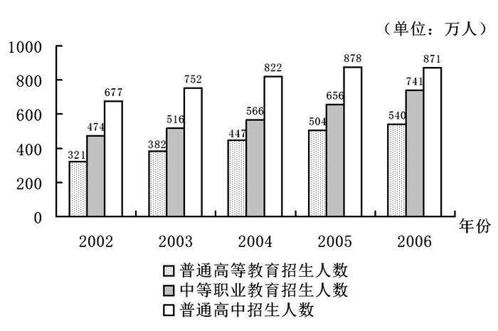

### 第 126 题

2006年我国中等职业教育招生人数比2005年多：

A. 14.96%

B. 12.96%

C. 11.14%

D. 9.14%

第 126 题 · 答案与解析

**参考答案（粉笔题库参考内容）**

B

**解析**

根据题干“2006年······比2005年多”，结合选项为百分数，可判定本题为一般增长率计算问题。定位统计图可得：2005年、2006年我国中等职业教育招生人数分别为656万人、741万人。根据公式：增长率= (现期量−基期量)/基期量，2006年我国中等职业教育招生人数比2005年多(741-656)/656 = 85/656≈ 12.96%。

故正确答案为B。

**考点**：一般增长率、统计图

**来源**：2009年河南省公务员录用考试《行测》题第126题

### 第 127 题

下列数值最大的是：

A. 2003年较2002年我国普通高中招生人数增长率

B. 2004年较2003年我国普通高中招生人数增长率

C. 2004年较2003年我国中等职业教育招生人数增长率

D. 2005年较2004年我国普通高等教育招生人数增长率

第 127 题 · 答案与解析

**参考答案（粉笔题库参考内容）**

D

**解析**

根据题干“下列数值最大的是”，结合选项全部为增长率，可判定本题为一般增长率比较问题。根据公式“增长率= (现期量−基期量)/基期量”，定位统计图可得：

A项：(752−677)/677 = 75/677≈11.1%；

B项：(822 − 752)/752 = 70/752≈9.3%；

C项：(566 - 516)/516 = 50/516≈9.7%；

D项：(504-447)/447 = 57/447≈12.8%；

比较可知，D项数值更大。

故正确答案为D。

**考点**：一般增长率、统计图

**来源**：2009年河南省公务员录用考试《行测》题第127题

### 第 128 题

2006年相对于2002年，下列说法错误的是：

A. 普通高等教育招生人数增加219万

B. 中等职业教育招生人数增长率为56.33%

C. 中等职业教育招生人数增长率比普通高中招生人数增长率高27.67个百分点

D. 普通高中招生人数增幅大于普通高等教育招生人数增幅

第 128 题 · 答案与解析

**参考答案（粉笔题库参考内容）**

D

**解析**

A项：定位统计图可得，2002年、2006年我国普通高等教育招生人数分别为321万人、540万人。则2006年相对于2002年，普通高等教育招生人数增加540－321＝219万，正确；

B项：定位统计图可得，2002年、2006年我国中等职业教育招生人数分别为474万人、741万人。则2006年相对于2002年，中等职业教育招生人数的增长率= (现期量−基期量)/基期量=(741-474)/474= 267/474 ≈ 56.33%，正确；

C项：定位统计图可得，2002年、2006年我国普通高中招生人数分别为677万人、871万人。则2006年相对于2002年，普通高中招生人数的增长率= (现期量−基期量)/基期量=(871-677)/677= 194/677 ≈ 28.66%；由B项可知，中等职业教育招生人数的增长率约为56.33%。56.33%-28.66%=27.67%，正确；

D项：定位统计图可得，2006年相对于2002年，普通高等教育招生人数的增长率= (现期量−基期量)/基期量= (540 − 321)/321=219/321＞ 50%；由C项可知，普通高中招生人数的增长率约为28.66%。则219/321＞ 28.66%，普通高等教育招生人数的增长率更大，错误。

本题为选非题，故正确答案为D。

**考点**：统计图、综合分析

**来源**：2009年河南省公务员录用考试《行测》题第128题

### 第 129 题

比较数值

Ⅰ：我国普通高等教育招生人数2006年与2002年之差

Ⅱ：我国中等职业教育招生人数2005年与2002年之差

Ⅲ：我国普通高中招生人数2005年与2002年之差

则下列关系成立的是：

A. Ⅰ>Ⅲ>Ⅱ

B. Ⅲ>Ⅱ>Ⅰ

C. Ⅰ>Ⅱ>Ⅲ

D. Ⅲ>Ⅰ>Ⅱ

第 129 题 · 答案与解析

**参考答案（粉笔题库参考内容）**

A

**解析**

定位统计图可得，Ⅰ：我国普通高等教育招生人数2006年与2002年之差为540-321=219万；Ⅱ：我国中等职业教育招生人数2005年与2002年之差为656-474=182万；Ⅲ：我国普通高中招生人数2005年与2002年之差为878-677=201万。则Ⅰ＞Ⅲ＞Ⅱ。

故正确答案为A。

**考点**：排序类、统计图

**来源**：2009年河南省公务员录用考试《行测》题第129题

### 第 130 题

根据上图，以下说法成立的是：

A. 我国普通高中招生人数持续上涨

B. 我国中等职业教育招生人数逐年增幅持续上涨

C. 我国普通高等教育招生人数2006年比2004年多39万

D. 我国三类招生总人数2005年比2003年增加23.52%

第 130 题 · 答案与解析

**参考答案（粉笔题库参考内容）**

D

**解析**

A项：定位统计图可得，2005年我国普通高中招生人数为878万人，2006年为871万人。2005年大于2006年，并非持续上涨，错误；

B项：定位统计图可得，2004-2006年我国中等职业教育招生人数分别为566万人、656万人、741万人。根据公式：增长率= (现期量−基期量)/基期量，则2005年和2006年中等职业教育招生人数的增幅分别为(656-566)/566=90/566 、(741−656)/656=85/656，由于前者分子大分母小，则分数更大，故2005年增幅大于2006年增幅，并非持续上涨，错误；

C项：定位统计图可得，2004年我国普通高等教育招生人数为447万人，2006年为540万人，则2006年比2004年多540-447=93万，并非39万，错误；

D项：定位统计图可得，2003年我国三类招生总人数为382+516+752=1650万，2005年为504+656+878=2038万。根据公式：增长率= (现期量−基期量)/基期量，我国三类招生总人数2005年比2003年增加(2038 − 1650)/1650=388/1650≈23.52%，正确。

故正确答案为D。

**考点**：统计图、综合分析

**来源**：2009年河南省公务员录用考试《行测》题第130题

## 材料 3

根据下表完成以下各题。

**2001年苏南五市与广东五市经济发展比较**

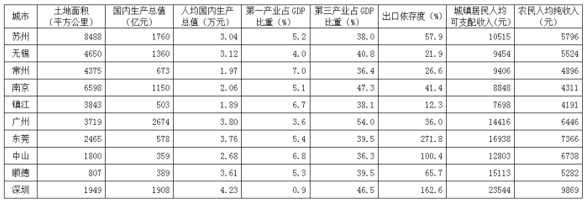

| 城市 | 土地面积（平方公里） | 国内生产总值（亿元） | 人均国内生产总值（万元） | 第一产业占GDP比重（%） | 第三产业占GDP比重（%） | 出口依存度（%） | 城镇居民人均可支配收入（元） | 农民人均纯收入（元） |
| --- | ---: | ---: | ---: | ---: | ---: | ---: | ---: | ---: |
| 苏州 | 8488 | 1760 | 3.04 | 5.2 | 38.0 | 57.9 | 10515 | 5796 |
| 无锡 | 4650 | 1360 | 3.12 | 4.0 | 40.8 | 21.9 | 9454 | 5524 |
| 常州 | 4375 | 673 | 1.97 | 7.0 | 36.4 | 26.6 | 9406 | 4896 |
| 南京 | 6598 | 1150 | 2.06 | 5.1 | 47.3 | 41.4 | 8848 | 4311 |
| 镇江 | 3843 | 503 | 1.89 | 6.7 | 38.1 | 12.3 | 7698 | 4191 |
| 广州 | 3719 | 2674 | 3.80 | 3.6 | 54.0 | 36.0 | 14416 | 6446 |
| 东莞 | 2465 | 578 | 3.76 | 5.4 | 39.5 | 271.8 | 16938 | 7366 |
| 中山 | 1800 | 359 | 2.68 | 6.8 | 36.3 | 100.4 | 12803 | 6738 |
| 顺德 | 807 | 389 | 3.61 | 5.3 | 39.5 | 65.7 | 15113 | 5282 |
| 深圳 | 1949 | 1908 | 4.23 | 0.9 | 46.5 | 162.6 | 23544 | 9869 |

### 第 131 题

10个城市中，土地面积最大与最小的城市分别是：

A. 苏州 顺德

B. 苏州 镇江

C. 南京 镇江

D. 广州 顺德

第 131 题 · 答案与解析

**参考答案（粉笔题库参考内容）**

A

**解析**

定位统计表可得：10个城市中，土地面积最大和最小的城市分别为苏州（8488平方公里），顺德（807平方公里）。

故正确答案为A。

**考点**：直接找数、统计表

**来源**：2009年河南省公务员录用考试《行测》题第131题

### 第 132 题

2001年深圳市城镇居民人均可支配收入比南京市高：

A. 5558元

B. 14696元

C. 15396元

D. 758元

第 132 题 · 答案与解析

**参考答案（粉笔题库参考内容）**

B

**解析**

定位统计表可得：2001年深圳市、南京市城镇居民人均可支配收入分别为23544元、8848元。则2001年深圳市城镇居民人均可支配收入比南京市高23544-8848=14696元。

故正确答案为B。

**考点**：简单加减计算、统计表

**来源**：2009年河南省公务员录用考试《行测》题第132题

### 第 133 题

下面的描述不正确的是：

A. 2001年，10个城市中农民人均纯收入低于5000元的城市有3个

B. 总的来看，广东五市经济发展的出口依存度高于苏南五市

C. 广州市的人均国内生产总值在10城市中处于首位

D. 2001年，广东五市的国内生产总值大于苏南五市的国内生产总值

第 133 题 · 答案与解析

**参考答案（粉笔题库参考内容）**

C

**解析**

A项：定位统计表最后一列可得：2001年，10个城市中农民人均纯收入低于5000元的城市有常州（4896元）、南京（4311元）、镇江（4191元），共3个，正确；

B项：定位统计表第七列可得：2001年，苏南五市的出口依存度分别为57.9%、21.9%、26.6%、41.4%、12.3%，广东五市分别为36.0%、271.8%、100.4%、65.7%、162.6%。总的来看，广东五市经济发展的出口依存度大多高于苏南五市，正确；

C项：定位统计表第四列可得：2001年，人均国内生产总值广州市（3.80万元）＜深圳市（4.23万元），即广州市人均国内生产总值并非首位，错误；

D项：定位统计表第三列可得：2001年，广东五市国内生产总值为2674+578+359+389+1908=5908亿元，苏南五市为1760+1360+673+1150+503=5446亿元，前者大于后者，正确。

本题为选非题，故正确答案为C。

**考点**：统计表、综合分析

**来源**：2009年河南省公务员录用考试《行测》题第133题

### 第 134 题

根据上表，我们可以推算出2001年广州市第二产业的产值约为：

A. 1133亿元

B. 1144亿元

C. 997.6亿元

D. 1096.8亿元

第 134 题 · 答案与解析

**参考答案（粉笔题库参考内容）**

A

**解析**

根据题干“2001年广州市第二产业的产值约为”，结合材料中可给2001年广州市国内生产总值和第一产业、第三产业占GDP的比重，可判定本题为现期比重问题。定位统计表可得：2001年广州市国内生产总值为2674亿元，第一产业和第三产业占GDP的比重分别为3.6%和54.0%。根据公式：部分=整体×比重，则2001年广州市第二产业产值为2674 × (1 - 3.6% - 54.0%)= 2674 × 42.4%≈1134亿元，与A项最接近。

故正确答案为A。

**考点**：现期比重、统计表

**来源**：2009年河南省公务员录用考试《行测》题第134题

### 第 135 题

如果2001年南京市的城镇居民人均可支配收入比2000年增长了7.5%，那么2000年南京市的城镇居民人均可支配收入约为：

A. 8176元

B. 8849元

C. 8195元

D. 8231元

第 135 题 · 答案与解析

**参考答案（粉笔题库参考内容）**

D

**解析**

根据题干“2000年······约为”，结合材料时间为2001年，可判定本题为基期计算问题。定位统计表可得：2001年南京市城镇居民人均可支配收入为8848元。由题干可得：2001年南京市的城镇居民人均可支配收入比2000年增长了7.5%。根据公式：基期量=现期量/(1+增长率)，2000年南京市城镇居民人均可支配收入为8848/(1+7.5%)=8848/1.075≈8231元。

故正确答案为D。

**考点**：基期计算、统计表

**来源**：2009年河南省公务员录用考试《行测》题第135题

