# 2013年921联考《行测》题（河南卷）

<!-- gwy:overview:start -->
> **河南 · 2013 · 行测 · 统考** ｜ 120 题 · 图片 75 处 · 答案随题折叠

| 题型模块 | 题量 | 题号 |
| --- | ---: | ---: |
| 言语理解与表达 | 30 | 1–30 |
| 数量关系 | 15 | 31–45 |
| 判断推理 | 35 | 46–80 |
| 常识判断 | 20 | 81–100 |
| 资料分析 | 20 | 101–120 |
| **合计** | **120** | |

导航：[题型与作答说明](#题型与作答说明) · [题目](#题目) · [材料 1](#材料-1)
<!-- gwy:overview:end -->

> 候选采集稿。参考答案及解析来自粉笔页面，不代表官方答案或真实高分答卷；来源使用许可与原卷对应关系仍需人工核实。

## 题型与作答说明

言语理解与表达

（30题）

本部分包括表达与理解两方面的内容。请根据题目要求，在四个选项中选出一个最恰当的答案。

数量关系

（15题）

本部分包括数字推理与数学运算两种类型的题目。

判断推理

（35题）

本部分包括图形推理、定义判断、类比推理和逻辑判断四种类型的题目。

常识判断

（20题）

请你依据所掌握的知识作出判断，选择最为合理的一个选项。

资料分析

（20题）

本部分主要是对文字资料、统计图、统计表的分析。请根据资料提供的信息进行分析、比较、计算、处理，选择最适当的答案。

## 题目

### 第 1 题

2500多年过去了，如今摆在你面前的是＿＿＿＿了的城堡旧址，暗淡了的刀光剑影，＿＿＿＿了的舟踪桨声和远去了的鼓角筝鸣，一腔思古之幽情迸然而发。

依次填入划横线部分最恰当的一项是：

A. 淹没 消失

B. 淹没 消逝

C. 湮没 消失

D. 湮没 消逝

第 1 题 · 答案与解析

**参考答案（粉笔题库参考内容）**

D

**解析**

本题考查实词辨析。“湮没”指埋没、没人知道，一般是指人或社会事物。“淹没”指大水漫过、盖过。根据“摆在你面前的”可知，城堡旧址并不是被大水淹没的，第一空应填“湮没”，排除A、B两项。“消失”指(事物)逐渐减少以至没有；“消逝”指(声音、时间等)慢慢逝去，不再存在。文段中的桨声与鼓角筝鸣都属于声音，因此第二空用“消逝”更适合。

故正确答案为D。

**考点**：实词填空、词的辨析-词义侧重

**来源**：2013年921联考《行测》题（河南卷）第1题

### 第 2 题

个性化车站有的以传统文化中最具代表性的礼器、祥瑞图案为＿＿＿＿＿＿＿，用红黑相间的艺术壁画展示古国遗韵；有的则用瓷板山水画、菩提树雕塑墙和艺术山水＿＿＿＿＿＿＿出“宁静致远”的意境。

依次填入划横线部分最恰当的一项是：

A. 原形 创造

B. 原型 营造

C. 原型 创造

D. 原形 营造

第 2 题 · 答案与解析

**参考答案（粉笔题库参考内容）**

B

**解析**

本题考查实词辨析。

第一空，“原型”指原始的模型，特指文学艺术作品中塑造人物形象所依据的现实生活中的人。“原形”指本来的形状，原来的形态。第一空所填词语表示的是礼器和祥瑞图案等作为个性化车站的建设模型，因此用“原型”恰当，排除A、D两项。

第二空，C项“创造”侧重想出新方法、做出新成绩等等，与“意境”搭配不当，排除。B项，“营造······的意境”是较为固定的搭配，当选。

故正确答案为B。

**考点**：实词填空、词的辨析-搭配对象、词的辨析-词义侧重

**来源**：2013年921联考《行测》题（河南卷）第2题

### 第 3 题

人体的免疫能力分为固有免疫和适应免疫，其中适应免疫是人体在＿＿＿＿＿＿适应外界环境中锻炼成长而来的。如果孩子＿＿＿＿＿＿处在过于干净的环境中，完全不接触细菌，他们体内的免疫细胞就会像没有打过仗的新兵，不知道怎样杀灭有害物质，保护人体健康。

依次填入划横线部分最恰当的一项是：

A. 不断 长期

B. 逐渐 继续

C. 积极 仍然

D. 主动 始终

第 3 题 · 答案与解析

**参考答案（粉笔题库参考内容）**

A

**解析**

本题属于实词辨析。从第二空入手，“继续”和“仍然”表达的是一种延续性动作，前文没有涉及到“延续性”的相关内容，只有对人体免疫能力的介绍，故排除B、C两项；第一空，“主动”在文段中找不到依据和相关内容，排除D项；A项的“不断”则可以和第二空的“长期”形成前后照应。

故正确答案为A。

**考点**：实词填空、对应关系-前后呼应

**来源**：2013年921联考《行测》题（河南卷）第3题

### 第 4 题

有的工作，难度极大，却能够马到成功；有的事情，举手之劳，却办得一塌糊涂。一个重要原因在于，干事情的人是临事而惧、周密＿＿＿＿＿＿＿，还是临事不备、＿＿＿＿＿＿＿上阵。态度不同，结果迥异。

依次填入划横线部分最恰当的一项是：

A. 筹措 仓忙

B. 筹备 轻装

C. 策划 赤膊

D. 筹划 仓促

第 4 题 · 答案与解析

**参考答案（粉笔题库参考内容）**

D

**解析**

第一空，“临事而惧、周密······”中“、”表示并列关系，即“周密······”应和“临事而惧”意思相近。“临事而惧”指遇到事情小心谨慎，横线处填入B项“筹备”、C项“策划”、D项“筹划”后，均能表达准备周到细密之意，符合文意，保留。

第二空，根据文段提示，“是······还是······”前后表示语义相反，“临事不备”指遇到事情却没有做好准备。故横线所填词语要与第一空语义相反，体现出做事情没有准备之意。D项“仓促”形容匆忙，表示事到临头没有准备就绪，符合文意，当选。B项“轻装”上阵比喻没有思想顾虑，轻松投入工作中，与文意不符，排除；C项“赤膊”上阵意为毫无掩饰地做某事，体现不出没有准备的消极感情色彩，排除。

故正确答案为D。

**考点**：关联关系-并列关系、实词填空、词的辨析-词义侧重

**来源**：2013年921联考《行测》题（河南卷）第4题

### 第 5 题

西汉时期，产自西域的树脂类香料传入中国，改变了古人直接焚烧萧艾、蕙草等植株的形式，香具＿＿＿＿＿。汉初已有许多专门用于焚香的香炉，但大多造型简单。据说汉武帝嗜好熏香，＿＿＿＿＿＿地追求长生不老之术，命人模拟道家传说中东方海上仙山“博山”的景象，制成一类造型特殊的香炉――博山炉。

依次填入划横线部分最恰当的一项是：

A. 比比皆是 大张旗鼓

B. 大行其道 矢志不渝

C. 应运而生 孜孜不倦

D. 五花八门 兢兢业业

第 5 题 · 答案与解析

**参考答案（粉笔题库参考内容）**

C

**解析**

本题属于成语辨析题。

第一空，填入的成语表示香具顺应了树脂类香料传入中国后的需要而产生，B项“大行其道”指某种观念或事物的流行、盛行（包含贬义），文段描述的是树脂类香料传入中国后香具产生，并没有“流行”之意，程度过重，排除；A项“比比皆是”意为到处都是，形容极其常见，强调数量多，D项“五花八门”形容花样繁多、变化莫测，文段均无从体现，排除。C项“应运而生”旧指应天命而产生，现指适应时机而产生。符合文意，保留。

第二空，根据文段可知，第二空应填入一个表现汉武帝对长生不老之术的不知疲倦的态度，C项“孜孜不倦”符合语境，当选。

故正确答案为C。

【成语积累】

“大行其道”指某种新潮事物流行、盛行，成为一种风尚。

“五花八门”比喻事物繁多，变化莫测。

“比比皆是”意为到处都是，形容极其常见。

**考点**：对应关系-前后呼应、成语填空

**来源**：2013年921联考《行测》题（河南卷）第5题

### 第 6 题

作为曾经和数理传统同样重要的研究范式，博物学传统其实从19世纪末开始就逐渐＿＿＿＿。仅仅是在大自然中观察、采集、记录而缺少定量分析，从医生、军官到传教士都能玩一把的博物学，在科学研究日益精细化、职业化的大趋势中显得＿＿＿＿＿＿。

依次填入划横线部分最恰当的一项是：

A. 衰落 格格不入

B. 转型 特立独行

C. 蜕变 曲高和寡

D. 退化 大材小用

第 6 题 · 答案与解析

**参考答案（粉笔题库参考内容）**

A

**解析**

结合文段语境，可以看出博物学以前很重要，现在却衰落了。B项“转型”一般是往好的方向转变，C项“蜕变”是比喻事物由一种状态转变成另一种状态，主要是往好的方向发展，蜕变前后之间具有明显的对比关系，均不符合语境，排除；根据“从医生、军官到传教士都能玩一把的博物学，在科学研究日益精细化、职业化的大趋势中显得”可知，谈论的主体是“博物学”，D项“大材小用”比喻使用不当，浪费人才，主体论述不一致，排除。A项“格格不入”指彼此不协调，不相容，符合文意，当选。

故正确答案为A。

**考点**：关联关系-转折关系、对应关系-前后呼应、混搭填空

**来源**：2013年921联考《行测》题（河南卷）第6题

### 第 7 题

玩是孩子的天性，这一点很多做父母的都知道；但是怎么玩，玩什么，很多人未必有＿＿＿＿＿＿＿的认识。孩子本来可以从玩中开发智慧和能力，却被白白地＿＿＿＿＿＿＿。应该明白，孩子不能为玩而玩，而是要玩出名堂来。

依次填入划横线部分最恰当的一项是：

A. 明确 消耗

B. 清楚 浪费

C. 科学 虚度

D. 合理 耽误

第 7 题 · 答案与解析

**参考答案（粉笔题库参考内容）**

B

**解析**

从第二空入手，横线前“但”表转折，结合转折前可知，转折后应表达孩子没有从玩中开发智慧和能力，应该达到的效果没有达到。B项“浪费”指对人力、财务、时间等用得不当或没有节制，D项“耽误”指因拖延或错过时机而误事，均符合文意，保留。A项“消耗”指（精神、东西、力量等）因使用或受损失而逐渐减少，与文意不符，排除；C项“虚度”指白白地度过，与“白白地”语义重复，排除。

再看第一空，根据“但是怎么玩、玩什么”可知，横线处意在表达父母对孩子应该怎么玩没有清晰的认识，B项“清楚”指对事物了解很透彻，符合文意，当选。D项“合理”指合乎道理或事理，文段表达的是不知道怎么做，而非是否合理，排除。

故正确答案为B。

**考点**：关联关系-转折关系、实词填空、对应关系-前后呼应

**来源**：2013年921联考《行测》题（河南卷）第7题

### 第 8 题

我们唯一的地球面积有限，除了那些不适合人居住的地域，亚洲、非洲、拉丁美洲的许多国家剩下的国土已然＿＿＿＿＿＿。越是密集拥挤的地方，污染治理的压力也越大。而治理污染越是困难，人口反而越发失控。当人口承载量日趋饱和，对环境本来是正常的利用，也渐渐变成了不计后果的＿＿＿＿。

依次填入划横线部分最恰当的一项是：

A. 捉襟见肘 索取

B. 寥寥无几 掠夺

C. 不堪重负 破坏

D. 人满为患 占用

第 8 题 · 答案与解析

**参考答案（粉笔题库参考内容）**

A

**解析**

第一空，修饰“国土”，根据文段语境可知，国土有限，而人口将越来越多，说明国土将难以承载和应对越来越多的人口。B项“寥寥无几”表示数量很少，而国土不可数，排除；C项“不堪重负”指承受不了繁重的负荷，不能担当重任，指在经济上或别的方面无法承受，D项“人满为患”是指因人多造成了困难，由材料中“人口承载量日趋饱和”可知，二者程度表述均过重，排除。A项“捉襟见肘”比喻资金、物质条件以及能力上的匮乏或欠缺，也可比喻困难重重，应付不过来，形容国土不能应付越来越多的人口，保留。

第二空，表示对环境从正常利用变成不考虑后果的索取，A项“索取”符合文意，当选。

故正确答案为A。

**考点**：混搭填空、词的辨析-搭配对象、词的辨析-程度轻重

**来源**：2013年921联考《行测》题（河南卷）第8题

### 第 9 题

捐赠制度对美国社会的每一个人和企业都至关重要。因为美国政府是通过税收的方式来＿＿＿＿慈善的，倘若个人或企业将收益的部分或全部捐赠给非营利机构，那么它的计税标准就会降低。不过，对于捐赠者来说，把钱捐给任何非营利机构都是一样的，这就让教育机构和文化机构之间形成了类似市场竞争的关系，这有助于社会资源的合理分配，让慈善事业和文化产业也能＿＿＿＿＿＿。

依次填入划横线部分最恰当的一项是：

A. 鼓励 优胜劣汰

B. 提倡 互惠互利

C. 推广 取长补短

D. 刺激 百家争鸣

第 9 题 · 答案与解析

**参考答案（粉笔题库参考内容）**

A

**解析**

本题考查实词和成语辨析。将第二空作为本题突破口，从“让教育机构和文化机构之间形成了类似市场竞争的关系，这有助于社会资源的合理分配”可知，把钱捐给非营利机构使它们之间形成良性的竞争，A项“优胜劣汰”最能和“市场竞争关系”形成对应。“优胜劣汰”是指生物在生存竞争中，适应力强的保存下来，适应力差的被淘汰。题干中没有提到文化事业对慈善事业的帮助，“互惠互利”和“取长补短”均不适用。“百家争鸣”指允许各种学术流派发表意见，不符合文意。

验证：第一空填入“鼓励”，前后通顺，符合文意。

故正确答案为A。

**考点**：对应关系-主题词、对应关系-前后呼应、混搭填空、词的辨析-搭配对象

**来源**：2013年921联考《行测》题（河南卷）第9题

### 第 10 题

在西方近代史上，德意志民族似乎在很多事情上都比较＿＿＿＿，哲学领域也是如此，当由培根肇始的英国经验论和由笛卡尔创立的大陆唯理论之间的激烈争论形成了西方近代哲学的第一次高潮时，德国的哲学讲坛依然被早已腐朽不堪的经院哲学＿＿＿＿。

依次填入划横线部分最恰当的一项是：

A. 迟缓 统治

B. 特别 左右

C. 落后 控制

D. 独特 笼罩

第 10 题 · 答案与解析

**参考答案（粉笔题库参考内容）**

A

**解析**

第一空，文段说德意志民族似乎许多事情与哲学领域相似，后面对哲学领域具体展开描述，由“西方近代哲学的第一次高潮”和“早已腐朽不堪的经院哲学”对比可知，德意志民族很多事很不先进。D项“独特”和B项“特别”无从体现，排除。A、C两项中的“迟缓”和“落后”都能表示不先进的语义，保留。

第二空，A项“统治”表示绝对权威，而C项“控制”只是强调限制、约束，文段强调的是德国哲学被腐朽不堪的经院哲学统领的状态，所以统治更为合适。

故正确答案为A。

**考点**：实词填空、对应关系-前后呼应

**来源**：2013年921联考《行测》题（河南卷）第10题

### 第 11 题

毫无疑问，真正的批评家应该拥有的是＿＿＿＿＿＿的内心和不带任何偏见的眼睛。除了来自自身灵魂深处和纯粹学术性的＿＿＿＿＿＿之外，不该成为任何权势或利益集团的代言人和施惠者的吹鼓手。

依次填入划横线部分最恰当的一项是：

A. 纯净 判断

B. 平静 结论

C. 强大 分析

D. 成熟 观察

第 11 题 · 答案与解析

**参考答案（粉笔题库参考内容）**

A

**解析**

本题考查实词辨析。文段第一句“……和……”连接两个并列的成分，由“不带任何偏见”可知，前文修饰限定“内心”也应该是“没有偏见”的，这也符合“真正的批评家”应具备的不偏不倚的态度，只有A项的“纯净”可以体现出“没有偏见”。“强大”“平静”“成熟”都不能体现出“没有偏见”。A项第二空的“判断”也与后面的“不该成为任何权势或利益集团的代言人和施惠者的吹鼓手”形成照应。

故正确答案为A。

**考点**：关联关系-并列关系、实词填空

**来源**：2013年921联考《行测》题（河南卷）第11题

### 第 12 题

世界建筑文化源远流长。自古以来，人们在建筑房屋的过程中，创造着自己的建筑文化。因此，建筑汇聚了文化的精华，也体现了建筑师的人文修养。纵观历史上优秀的建筑师，除了学识渊博外，大都有着丰富的阅历，而不是＿＿＿＿＿＿的理论家，正因此，他们才能＿＿＿＿＿＿，迁想妙得，将自己意匠独造的想象力渗入建筑之中，丰富人类的建筑文化。

依次填入划横线部分最恰当的一项是：

A. 循规蹈矩 融会贯通

B. 纸上谈兵 博采众长

C. 闭门造车 才华横溢

D. 墨守成规 推陈出新

第 12 题 · 答案与解析

**参考答案（粉笔题库参考内容）**

B

**解析**

第一空，根据前文“除了学识渊博外，大都有着丰富的阅历”可知，横线处成语表达他们并不是空有理论没有实践的。A 项“循规蹈矩”原指遵守规矩，现多指拘泥于旧的准则，不敢稍作变通，D 项“墨守成规”形容因循守旧，不肯改进，均不涉及实践，排除。

第二空，根据前文“正因此”可知，横线处成语表达丰富阅历所带来的结果，B 项“博采众长”指广泛地采纳各家的长处，填入文段合适，当选。C 项“才华横溢”多指文学艺术方面，很有才华，填入文段因果关系不成立，排除。

故正确答案为B。

**考点**：关联关系-因果关系、关联关系-并列关系、对应关系-前后呼应、成语填空

**来源**：2013年921联考《行测》题（河南卷）第12题

### 第 13 题

在诸多自然现象中，火可能是曾让人最＿＿＿＿＿＿的事物。古人曾认为，火是诸神的＿＿＿＿＿＿，是元素之一，或是物种本身蕴藏的燃素释放的过程。直到拉瓦锡提出氧化学说，人类才认识到燃烧是剧烈的氧化反应。

依次填入划横线部分最恰当的一项是：

A. 害怕 创造

B. 惊奇 安排

C. 迷惑 恩赐

D. 崇拜 荣誉

第 13 题 · 答案与解析

**参考答案（粉笔题库参考内容）**

C

**解析**

第一空，根据后文“直到拉瓦锡提出氧化学说，人类才认识到燃烧是剧烈的氧化反应”可知，在这之前人们并不清楚火的本质究竟是什么，对火的认知是模糊、不清楚的，横线处应体现“疑惑、不理解”之意。C项“迷惑”指辨不清是非、摸不着头脑，符合文意，保留。A项“害怕”指因遇到危险、困难而畏惧或发慌的心理状态，B项“惊奇”指惊讶奇怪，D项“崇拜”指尊崇敬拜，三者均无法体现“认知不清、不明白”，与文意不符，排除。

第二空，代入验证。C项“恩赐”指赏赐或施舍，“诸神的恩赐”为常见搭配，体现出古人将火看作是神灵给予的美好馈赠，契合古人对火缺乏科学认知、将其神化的语境，符合文意，当选。

故正确答案为C。

**考点**：实词填空、对应关系-解释说明

**来源**：2013年921联考《行测》题（河南卷）第13题

### 第 14 题

科学家通过基因改造，设计出了能在激光脉冲照射下收缩的肌肉细胞。这种被称为“生物综合设计”的仿生学新理念除了＿＿＿＿＿＿＿自然生物进行设计，还直接使用了真正的肌肉组织，不但融合了生物组织的优点并跳过仿生肌肉阶段，将目标专注于寻找新的理论和方法来实现轻量、低耗的肌肉组织控制系统，同时也模糊了自然物和机械装置的＿＿＿＿＿＿＿。

依次填入划横线部分最恰当的一项是：

A. 参考 界限

B. 对比 概念

C. 模仿 功能

D. 根据 差异

第 14 题 · 答案与解析

**参考答案（粉笔题库参考内容）**

A

**解析**

结合语境，由“仿生学新理念”和“自然生物”可知，第一空填入“参考”“模仿”“根据”均可，“对比”不合适，排除B项。

第二空，“模糊界限”是固定搭配，“模糊”不能与“功能”“差异”搭配，排除C、D两项。

故正确答案为A。

**考点**：实词填空、对应关系-前后呼应、词的辨析-搭配对象

**来源**：2013年921联考《行测》题（河南卷）第14题

### 第 15 题

在一定程度上，技术的飞速发展与国家之间的竞争有着＿＿＿＿＿＿的关系。二战抑或冷战时期，某些领域尤其是军事领域的科学突破即是例证，以登月为标志的航天科技的突飞猛进只是其中之一。但如果将今天的进步缓慢归因于竞争不充分，甚至怀念那样一个阴暗、极端、意识狭隘的时代，显然是＿＿＿＿的。人类所有可以称道的文明进步最终在于包容和协助，事实上，目前的太空探索也正是朝着国际合作的方向努力。

依次填入划横线部分最恰当的一项是：

A. 相辅相成 荒谬

B. 此消彼长 无奈

C. 不可或缺 可怕

D. 休戚与共 落伍

第 15 题 · 答案与解析

**参考答案（粉笔题库参考内容）**

A

**解析**

第一空，由“某些领域尤其是军事领域的科学突破即是例证”可知，技术的飞速发展与国家之间的竞争应该是促进关系，A项“相辅相成”意思是指两件事物互相配合，互相补充，相互促进，符合文意，保留。B项“此消彼长”指这个上升，那个下降，体现不出促进的含义，排除；C项“不可或缺”意思是指非常重要，无法替代或缺少，国家竞争对技术发展是不是不可替代的，在文段中并无对应，排除；D项“休戚与共”形容彼此之间关系密切，利害一致，也不符合语境，排除。

第二空，代入验证，“怀念那个时代”的做法是不可取的，A项“荒谬”即不合常理，填入文段符合文意，当选。

故正确答案为A。

**考点**：对应关系-解释说明、混搭填空

**来源**：2013年921联考《行测》题（河南卷）第15题

### 第 16 题

星云是由星际空间的气体和尘埃结合成的云雾状天体。星云里的物质密度是很低的，若拿地球上的标准来衡量的话，有些地方是真空的。可是星云的体积十分庞大，常常方圆达几十光年。星云和恒星有着“血缘”关系，恒星抛出的气体将成为星云的部分，星云物质在引力作用下压缩成为恒星。在一定条件下，星云和恒星是能够互相转化的。

下列说法与这段文字相符的是：

A. 星云的质量和状态都非常稳定

B. 星云与恒星相距遥远

C. 星云与恒星均为气雾状天体

D. 星云与恒星的构成物质是相似的

第 16 题 · 答案与解析

**参考答案（粉笔题库参考内容）**

D

**解析**

本题属于细节判断题。A、B两项的内容在文段中未提及；文中只在首句提到了星云是云雾状天体，没有说恒星也是，C项偷换“云雾状”和“气雾状”概念；文中提到“星云和恒星之间有‘血缘’关系”“能够互相转化”，可知二者在物质构成上必然相近，D项内容与文段相符。

故正确答案为D。

**考点**：细节判断题

**来源**：2013年921联考《行测》题（河南卷）第16题

### 第 17 题

虚拟博物馆兴起于上世纪90年代，相比实体博物馆，虚拟博物馆可以展示所有的藏品，观众无需与藏品保持距离，只需轻点鼠标就可以从不同方位看到作品，并实现人机交互，因此不少人担心实体博物馆会逐渐失去魅力。而事实恰恰是，通过数字化的复制，人们了解到那些原作，便更想走进实体博物馆接触它们。

这段文字意在强调：

A. 虚拟博物馆与实体博物馆并不存在冲突

B. 虚拟博物馆使艺术传播的途径更加简单

C. 复制作品不能取代原作给人的心灵震撼

D. 博物馆虚拟化能极大实现艺术教育功能

第 17 题 · 答案与解析

**参考答案（粉笔题库参考内容）**

A

**解析**

“而事实恰恰是”是典型的表转折的短句，转折之后是重点。文段先叙述不少人担心实体博物馆会逐渐失去魅力，然后通过“而事实恰恰是”进行了转折，因此文段的重点强调“通过数字化的复制，人们······更想走进实体博物馆接触它们”，即虚拟博物馆可以对实体博物馆的发展形成促进作用，以此来纠正虚拟博物馆的出现让实体博物馆“逐渐失去魅力”的观点。即作者意在说明虚拟博物馆与实体博物馆并不存在冲突，对应A项。

B项：仅突出虚拟博物馆的一个作用，但没有涉及虚拟博物馆对实体博物馆的影响，排除。

C项：偏离文意，文段重点不是论述复制作品带来的心灵体验，排除。

D项：文段未提及，无中生有，排除。

故正确答案为A。

**考点**：关联词-转折

**来源**：2013年921联考《行测》题（河南卷）第17题

### 第 18 题

在西方思想史中，像卢梭那样具有重大影响和广泛争议的人物不多，他有一句很著名的遗言：“我把我的一生献给真理。”这也是他的座右铭，他一生都在为之奋斗，他的书起初并没有产生太大的社会影响，只是引起很多争论，如果有影响，也只限于学术界。他的思想产生社会影响是从1789年法国大革命开始，《社会契约论》起到很大的推动作用，广大普通民众开始受到影响。

这段文字意在说明：

A. 卢梭如何为自己的座右铭而奋斗

B. 卢梭的思想被社会接纳的过程缓慢曲折

C. 《社会契约论》如何被百姓认可

D. 真理总是要经历波折才能推动社会发展

第 18 题 · 答案与解析

**参考答案（粉笔题库参考内容）**

B

**解析**

文段首先论述了卢梭在西方思想史上的崇高地位，接着谈到他的思想的普及过程：在起初并没有产生太大的社会影响，只能影响学术界，直到1789年法国大革命以后才为普通民众所接受。由此可见，社会对卢梭思想的接受经历了一个曲折缓慢的过程，对应B项。A项“卢梭如何为自己的座右铭而奋斗”不是文段论述的重点，C项文段主题词并非“《社会契约论》”，D项过度解读，均排除。

故正确答案为B。

**考点**：主题词

**来源**：2013年921联考《行测》题（河南卷）第18题

### 第 19 题

粟和稷实际就是人们常见的小米，当它在民间作为人们餐桌上的主食时，名字是粟；当它被呈入宫廷，作为社稷坛上祭天的成果时，名字是稷。一种作物同时拥有了两种不同的名字，在这种作物的分工背后，隐藏着人为的分工，在历史长河的某一瞬间，小米们走上了两条路，一种是名为粟的粮食，一种是名为稷的祭品；人们也走上了两条路，一群是种田人，一群是读书人。前者只在民间从事劳作，后者只负责朝堂上的记录，不知道这神圣的名字与餐桌上的小米是同一种材质。当阅读文字的眼睛不再关注田野，当握笔的手不再触碰种子与农具，隔阂的出现便顺理成章。

这段文字意在说明：

A. 粟和稷在名字上的纷争由来已久

B. 社会阶层的隔阂是粟和稷分歧的根源

C. 用于祭天的稷被人为地神圣化了

D. 粟和稷的分工实际上是一种偶然结果

第 19 题 · 答案与解析

**参考答案（粉笔题库参考内容）**

B

**解析**

文段首先论述了小米在民间和宫廷具有两种不同的称呼，接着论述这种称呼上的分歧的原因：人们走上了两条路——民间和朝堂，“当阅读文字的眼睛不再关注田野，当握笔的手不再触碰种子与农具，隔阂的出现便顺理成章”，即处在不同社会阶层的人之间的隔阂造成了对小米称呼上的不同，对应B项。

A项，“名字上的纷争”无中生有，文段未谈及小米两种名字的纷争，排除；

C项，“用于祭天的稷”非文段重点，文段主要在说两种名字和人之间的隔阂，排除；

D项，“偶然结果”与文意不符，文段提到“隔阂的出现便顺理成章”说明是必然的结果，而非偶然，排除。

故正确答案为B。

**考点**：分述句特征-引入铺垫

**来源**：2013年921联考《行测》题（河南卷）第19题

### 第 20 题

如果说逻辑源自“先验”，即逻辑超越经验、先于经验而存在，那么到底有无超越具象事物的抽象逻辑存在？如果有，我们又如何推知其存在？不少逻辑学家常以类似“三角形内角和等于180度”这样的命题来证明逻辑的先验性――自然，作为数理逻辑的符号系统尤其如此，似乎逻辑形式可以不依赖于人们的经验而具有推理的自洽性和永恒正确性，客观世界的事物都必须通过“逻辑的安排”才得以使人们有一清晰系统的认识。倘若真是如此，我们不禁要问，人类作为经验性的存在，又如何知晓有一个超越经验的逻辑存在？无疑，承认先验逻辑的存在，势必陷入独断论的泥潭或陷入神秘主义的窠臼。

这段文字意在：

A. 质疑先验逻辑的存在

B. 说明神秘主义是不可取的

C. 论述逻辑是对经验的总结

D. 解释客观世界有时是没有逻辑的

第 20 题 · 答案与解析

**参考答案（粉笔题库参考内容）**

A

**解析**

本题属于中心理解题。文段首先提出了疑问：到底有无超越具象事物的抽象逻辑存在？经过重重分析，作者最后得出结论“承认先验逻辑的存在，势必陷入独断论的泥潭或神秘主义的窠臼”，由此可见，作者实际上是否定了先验逻辑的存在，对应A项。

B、C两项：文段中没有阐述，排除。

D项：无中生有，排除。

故正确答案为A。

**来源**：2013年921联考《行测》题（河南卷）第20题

### 第 21 题

①风格的形成也意味着艺术的成熟，风格越强烈，给人的印象越深刻

②但冰冻三尺非一日之寒，风格的形成不是一件容易的事，更不能刻意设计而行

③颜柳欧赵、苏黄米蔡，风格鲜明，流传千古

④它是个人漫长的艺术探索历程，有时甚至要付出一生的精力

⑤书法有个性，能形成自己的风格，几乎是每一位书法家的追求

⑥古人云：“学书初谓未及，中则过之，后乃通会，通会之际，人书俱老。”

将以上6个句子重新排列，语序正确的是：

A. ③⑤④②①⑥

B. ⑤③①②④⑥

C. ⑥⑤④③①②

D. ⑥③⑤①④②

第 21 题 · 答案与解析

**参考答案（粉笔题库参考内容）**

B

**解析**

首先对比选项，判断首句，⑤句提到的是“每一位书法家”这一概念，而③句以八位书法家作为具体举例说明的内容，由此可知⑤句应在③句前面，排除A、D两项。对比B、C两项，都出现了③①②三句的捆绑，最大区别就是④句在②之后还是在③句之前。②句提到“风格的形成”不容易，④句提到“它”指代词，指代②句中的“风格的形成”说它是漫长的过程，衔接恰当，B项当选。③句只提到了几位书法家，与④句的话题不一致，无法捆绑，排除C项。

故正确答案为B。

**考点**：确定捆绑、确定首句-非首句特征

**来源**：2013年921联考《行测》题（河南卷）第21题

### 第 22 题

从大自然的天籁之音，到社会生活中所发出的各种声响，人类无法离开声音。但在很长的历史阶段内，却缺乏有效保存声音的技术手段。在留声机与唱片问世以前数千年内，声音虽然川流不息地承载、传递着文明与生活，但它的初始内容却无法得到保存，许多记载于历史文献的声音遂成绝响，这是文明的一大遗憾。直至19世纪末，随着工业革命的浪潮席卷欧美，人类在记录、复制声音的领域内取得了突破，留声机、唱片相继问世。

这段文字意在说明：

A. 人类为有效保存声音的初始内容做出了长期的努力

B. 声音保存技术是工业革命的重大成果之一

C. 录音技术的突破使得人类文明得以更完整地留存

D. 声音资料的匮乏是人类文明进程中的缺憾之一

第 22 题 · 答案与解析

**参考答案（粉笔题库参考内容）**

C

**解析**

文段开篇指出声音在人类文明与日常生活中的不可或缺，随后通过转折强调由于缺乏有效的声音保存技术，在留声机和唱片出现之前的漫长历史中，大量承载文明信息的声音无法留存，是人类文明的一大遗憾，接着指出，19世纪末随着录音技术的突破，留声机与唱片相继问世。故文段重点在尾句，强调声音保存技术的突破使得人类文明能够更好地被保存，对应C项。

A项，“长期的努力”，无中生有，文段并未提及人类为此所做的持续尝试，排除；

B项，“工业革命的成果”非重点，文段重点在于录音技术对文明保存的意义，而非工业革命本身，排除；

D项，“文明进程中的缺憾之一”对应尾句前的内容，非重点，排除。

故正确答案为C。

**考点**：分述句特征-其他

**来源**：2013年921联考《行测》题（河南卷）第22题

### 第 23 题

人类思维进化的顺序，是从具象到抽象，从图形到语言。粗粗了解一点文物史的人都知道，早期文明及其器物上只有图形，如世界各地的史前壁画，如半坡陶器上的鱼纹、人脸等。没有文字，因为语言能力不发达。语言能力发达以后，才有文字，人类文明才真正脱离原始阶段。而文字的进化本身也遵循同样过程，最初是图形，不脱具象，涵盖力很有限，慢慢离开图形阶段，真正成为文字，表示人的语言能力愈来愈深刻，思维愈来愈独立。

这段文字谈论的主题是：

A. 研究文物史的意义

B. 语言文字的主要功能

C. 史前文明的表现形式

D. 人类思维的演变过程

第 23 题 · 答案与解析

**参考答案（粉笔题库参考内容）**

D

**解析**

文段开篇指出人类思维进化的顺序是从具象到抽象、从图形到语言，接着以史前壁画、半坡陶器图形等早期文物为例进行解释说明，介绍早期只有图形、无文字是语言思维不足所致，语言思维能力发达之后，才有了文字，人类文明也得以发展。文字自身演化同样遵循由具象到抽象的规律，以此佐证开篇观点。故文段重在围绕人类思维的演变过程这一主题进行论述，对应D项。

A项，“研究文物史的意义”为文段举例部分内容，用来说明思维进化规律，非重点，排除；

B项，“语言文字的主要功能”为文段未论述内容，无中生有，排除；

C项，“史前文明的表现形式”为文段举例部分内容，非重点，排除。

故正确答案为D。

**考点**：分述句特征-其他

**来源**：2013年921联考《行测》题（河南卷）第23题

### 第 24 题

文化是物质设备和各种知识的结合体，人使用设备和知识以便生存。为了某种目的，人有时要改变文化。人如果扔掉某件工具而去获取一件新工具，那是因为他相信新工具更适用。这个变迁过程必定是一种综合体，亦即他过去的经验、他对目前形势的了解以及他对未来结果的期望。过去的经验并不总是过去实事的真实写照，因为过去的实事，经过记忆的选择已经起了变化；目前的形势也并不总能得到准确的理解，因为它吸引注意力的程度常受利害关系的影响；未来的结果不会总如人所期望的那样，因为它是希望和努力以外的其他许多力量的产物。所以，新工具最后也可能被证明并不适合人的目的。

如果新工具最终被证明并不适合人的目的，下列哪种原因是作者没有明确提到的？

A. 所选择的工具与生产力水平不适应

B. 所依据的历史经验有可能是错误的

C. 对当前客观形势的认识可能不全面

D. 发展过程中出现始料未及的新情况

第 24 题 · 答案与解析

**参考答案（粉笔题库参考内容）**

A

**解析**

本题属于细节判断题。由文中“过去的经验并不总是过去实事的真实写照”可知，B项是“新工具最终被证明并不适合人的目的”的原因之一；由文中“目前的形势也并不总能得到准确的理解”可知，C项是“新工具最终被证明并不适合人的目的”的原因之一；由文中“未来的结果不会总如人所期望的那样”可知，D项也是“新工具最终被证明并不适合人的目的”的原因。只有A项原因在文中找不到明确依据。

本题为选非题，故正确答案为A。

**考点**：细节判断题

**来源**：安徽省2019年面向全国重点高校定向招录选调生《行测》题（网友回忆版）第18题

### 第 25 题

很多貌似过时的史学争论所代表的其实是一种力求接触人类最大多数的努力。想想有多少人已经消失在过去，他们在人数上远比如今生存在地球上的后代更多。最令人激动、最有创意的历史研究应该挖掘出事件背后那些人们所经历和体验过的人类生存状态。这类研究有过不同的名字――心态史、社会思想史、历史人类学或文化史，不管什么标签，目的只有一个，即理解生活的意义：不是去徒劳地寻找这一伟大哲学之谜的终极答案，而是＿＿＿＿＿＿＿＿＿＿。

填入划横线部分最恰当的一句是：

A. 将研究聚集于下层百姓的日常生活及其意义世界

B. 要到前人的日常生活与思想观念中去探求和了解他们对这一问题的回答

C. 寻找和掌握社会发展必然规律并以这种“客观真理”来解释和改造社会

D. 相信过去的人们以自己特殊的生存策略开辟了人类生活方式的无限可能性

第 25 题 · 答案与解析

**参考答案（粉笔题库参考内容）**

B

**解析**

本题为语句填空题，根据“不是······而是······”可知，填入语句要与“去徒劳地寻找这一伟大哲学之谜的终极答案”语意上存在转折，但形式上要相对应。A项中的“下层百姓”在文中未体现，并且与前句不搭配，排除；B项“到前人的日常生活与思想观念”和“去徒劳地寻找”在语意上转折，“探求和了解”与“寻找”呼应，“这一问题的回答”与“这一伟大哲学之谜的终极答案”呼应，故形式上相对应，当选；C项“改造社会”和D项“生活方式”均与前文概念衔接不当，且句式不对应，排除。

故正确答案为B。

**考点**：横线在结尾

**来源**：2013年921联考《行测》题（河南卷）第25题

### 第 26 题

玫瑰也许是我们能见到的最复杂的花卉。其花型、颜色和香味千变万化，既有雅致的种玫瑰，也有馨香的园林玫瑰，还有宝石般耀眼的现代杂交玫瑰。如今，世界各地生长着200多个种类的玫瑰，由于人们不断通过杂交试图获得更美、更香、花期更长的玫瑰，因此我们常见的园艺和商业用途的玫瑰品种一直在以每5年一批的速度进行着更新换代。要识别出一种玫瑰非常困难，连专家们的观点也往往有很大差异，因为玫瑰的种类非常容易发生变化，也很容易杂交；杂交玫瑰不仅可以通过人工控制进行选种，也大量地自然形成。

这段文字意在说明：

A. 杂交技术在培育玫瑰新品种中作用显著

B. 如何对玫瑰进行科学分类目前尚无定论

C. 玫瑰的商业价值刺激着人们不断开发新品种

D. 自然属性与人为需求导致玫瑰品种十分复杂

第 26 题 · 答案与解析

**参考答案（粉笔题库参考内容）**

D

**解析**

本题考查文段主旨。故文段第一句提出玫瑰品种复杂，接着阐述了人们为了获得更美、花期更长的玫瑰而对玫瑰进行杂交，最后说明识别一种玫瑰非常困难的原因是玫瑰种类易发生变化且易杂交。可见文段意在说明玫瑰品种十分复杂是因为其自然属性和人为需要，对应D项。

A、C两项：为文段部分内容，表述片面，排除。

B项：文段未提及，排除。

故正确答案为D。

**考点**：分述句特征-多角度论述

**来源**：2013年921联考《行测》题（河南卷）第26题

### 第 27 题

学术的意义是求真，探求真理本来应该是每个学者的崇高职责，诚实也应该是治学的最基本的态度。人类的活动很难找出还有哪一种像学术这样强调真实，学者也因之受到公众的敬仰，甚至被视为社会的良心。如果由于学术不端行为的频发，而使科学界的声誉受到严重损害，败坏了科学研究在公众心目中的形象，那么它必然会阻碍科学的进步。

这段文字意在：

A. 倡导诚实严肃的治学风气

B. 反思科研领域的不端行为

C. 提示阻碍科学发展的因素

D. 审视科研领域的诚信问题

第 27 题 · 答案与解析

**参考答案（粉笔题库参考内容）**

A

**解析**

文段为总-分结构。第一句即为主题句，提出了诚实应是治学最基本的态度，接着阐述因为学术强调真实，学者才被视为社会的良心，最后用反面论证阐述了学术不端行为的负面影响，以此来再一次强调诚实对学术界的重要性。由此可见文段意在倡导诚实严肃的治学风气，对应A项。B、C、D三项均为反面论证的引申，排除。

故正确答案为A。

**考点**：关联词-对策、分述句特征-多角度论述

**来源**：2013年921联考《行测》题（河南卷）第27题

### 第 28 题

与之相比，国际游客在中国的消费行为多是到餐饮店享受中国美食，或到小商品市场买些小商品，一般不会到百货店和大型超市去买东西。国际游客来了，却带动不了中国商业的发展，为什么？因为中国没有品牌商品的定价权，零售业的经营方式带有相当大的“食利”性质，导致中国虽已成为制造业大国，却还不是国际游客的购物天堂。因此，不能简单地将旅游作为平衡国际贸易顺差、减少贸易摩擦的一种手段，而应从国家利益的高度，限制欧美品牌在中国市场实行最高价格定位的做法，从法律角度理清欧美品牌在中国市场的价格政策是否形成了价格垄断。

这段文字上一段谈论的内容最可能是：

A. 中国餐饮业在欧美的发展状况

B. 中国本土消费者对市场的巨大带动

C. 品牌商品定价权的形成机制

D. 国际游客在欧美的消费

第 28 题 · 答案与解析

**参考答案（粉笔题库参考内容）**

C

**解析**

本题属于接语选择题。文段首先指出国际游客来中国，带动不了中国商业的发展，接着说明原因是中国没有品牌商品的定价权，最后提出应该从国家利益出发限制欧美品牌在中国市场实行高价格定位，本文段的论述主体是品牌商品定价权，前后话题要一致，前文应该是和品牌商品定价权相关的内容，C项最为合适。

故正确答案为C。

**考点**：接语选择题

**来源**：2013年921联考《行测》题（河南卷）第28题

### 第 29 题

传统社会中，不管是中国还是欧洲，由于绝大多数技术知识都被行会、手工作坊等保留为私人知识，相互之间难以共享，不能取长补短，于是人们往往是简单重复前人的工作，而不是“站在巨人的肩膀上”进行累积创新。那么在各个种族的平均寿命、智力水平都基本相同的情况下，人均创新效率并不会有多大差异，中国对西方的人口优势将导致中国对西方的技术优势，因此，\_\_\_\_\_\_。

填入划横线部分最恰当的一句是：

A. 专利制度是导致产业革命在欧洲而非中国发生的关键所在

B. 近代中国与欧洲在知识积累和技术进步模式上产生了巨大分野

C. 技术进步是长期经济增长最重要的推动力

D. 中国很长时间都在技术总量上遥遥领先于欧洲

第 29 题 · 答案与解析

**参考答案（粉笔题库参考内容）**

D

**解析**

本题属于语句填空题。空格的位置在最后，“因此”表明填入语句起着总结全文的作用。文段先提出传统社会人们知识难以共享，导致了人们只能简单重复前人工作。其造成的结果是在平均寿命、智力水平相同情况下，中国对西方的人口优势将导致技术优势。“因此”引出的结论句应点明技术优势所带来的结果，而技术优势优于欧洲必然导致技术总量优于欧洲。故D项符合。

A、B两项原文未提及；C项与前文内容没有直接相关性。

故正确答案为D。

**考点**：横线在结尾

**来源**：2013年921联考《行测》题（河南卷）第29题

### 第 30 题

清末学者康有为在《广艺舟双楫》中将晚清书法衰微的现象归咎于传统书法范本面目失真，这是承袭了清代中叶学者对书法范本的认识，与书法史的真实状况并不十分吻合，与书法史发展的实际趋势也多有出入。当代书法家启功先生则在《论书绝句》提出，这种令人生厌的“馆阁书”与朝廷在科举考试中标举卷面书写“黑大光圆”密不可分。那么，在不能废除“馆阁书”书写要求的前提下，士人即便有条件取法摹刻精良的书法范本，也不能从根本上改掉“馆阁书”的书写习惯，这在康氏写成《广艺舟双楫》之后的时代中得到了验证。

对这段文字的主旨概括最准确的是：

A. 批评康有为书法研究中存在的误区

B. 探讨晚清书法艺术衰微不振的原因

C. 强调科举考试对书法艺术的负面影响

D. 分析书写模式与创作风气之间的关系

第 30 题 · 答案与解析

**参考答案（粉笔题库参考内容）**

B

**解析**

本题属于因果类文段。文段开头给出晚清书法艺术衰微这一结果，接下来通过“归咎于”引出康有为和启功先生分析书法艺术衰微的两个不同的原因，最后一句话是对后半部分的原因做进一步说明。故文段的中心在解释晚清书法艺术衰微的原因，B项明确体现了主旨，且“探讨”一词很好地体现了康有为和启功先生的分析。

A 项批评语义程度过重，文中并未作出评价，且“书法研究”概念范围扩大，文中说的是“晚清书法”，排除；C 项中的“书法艺术”扩大概念，原文说的是“晚清书法”，排除；D 项为无中生有，排除。

故正确答案为B。

**考点**：分述句特征-其他

**来源**：2013年921联考《行测》题（河南卷）第30题

### 第 31 题

射箭运动员进行训练，10支箭共打了93环，且每支箭的环数都不低于8环。问命中10环的箭数最多能比命中9环的多几支：

A. 2

B. 3

C. 4

D. 5

第 31 题 · 答案与解析

**参考答案（粉笔题库参考内容）**

D

**解析**

方法一：由题干可知，“每支箭的环数都不低于8环”，所以环数只能取8、9、10环。假设10支箭都打了8环，则最低打了80环，而实际打的93环中多出的93–80=13环，则是由9环和10环贡献的。与80环相比，每一个9环相当于多1环，每一个10环相当于多2环，设10环的有_a_支，9环的有b支，则得到方程2a+b=13。要让a–b最大，则应a取最大值，b取最小值。a最大可取6，则b=1，二者相差6-1=5支。

方法二：从另一个极端出发，如果每支箭的环数都打中10环，应该是100环，而实际为93环，少了7环。现在要求命中10环的箭数“最多”能比命中9环的多几支，即要求10环尽量多，同时9环尽量少。所以少的7环应尽可能由8环的箭产生，但是由于每支8环只能差2的整数倍，所以最多差6环，还需要有一支9环的。所以10环6支，9环1支，8环3支可以让差距最大。

故正确答案为D。

【秒杀计】如果列方程，属于不定方程，未知数的个数多于方程个数，需要用代入法解决。而题目真正的考点在于对“最多”这个词的理解，即10环尽量多，9环尽量少，在这个前提下分析题目，才能得到最简单的方式。

**考点**：非典型最值问题

**来源**：2013年921联考《行测》题（河南卷）第31题

### 第 32 题

某单位为业务技能大赛获奖职工发放奖金，一、二、三等奖每人奖金分别为800、700和500元。11名获一、二、三等奖的职工共获奖金6700元，问有多少人获得三等奖：

A. 3

B. 4

C. 5

D. 6

第 32 题 · 答案与解析

**参考答案（粉笔题库参考内容）**

D

**解析**

设获一、二、三等奖的人数分别是x、y、z，则列方程组800x＋700y＋500z＝6700。简化为8x+7y+5z=67①；x+y+z=11②。不定方程可采用消元结合排除法来解决。思路一：倍数关系。消去未知数z，得到3x＋2y＝12，y只能取3的倍数。所以y=3，则推出x=2，z=6。思路二：排除法。消去无关未知数y（7×②-①），得到2z-x=10，此时根据选项代入，z只能取大于5的数，否则x将为负值或为0人，只能选D项。

故正确答案为D。

【秒杀技】按照平均值的思想，如果11个人的平均奖金为600元（只考虑500元和700元的平均值），那么总奖金应该为6600元，但是由于题目中还包含800元的获奖者，所以只有当获得500元的人超过半数，才能够使总金额达到6700元甚至更低，只能选D项。

**来源**：2013年921联考《行测》题（河南卷）第32题

### 第 33 题

某科室共有8人，现在需要抽出两个2人的小组到不同的下级单位检查工作，问共有多少种不同的安排方案？

A. 210

B. 260

C. 420

D. 840

第 33 题 · 答案与解析

**参考答案（粉笔题库参考内容）**

C

**解析**

方法一：分两步解决。对于第一个检查单位先从8人中任意抽出2人，有C_8^2种方案；对于另一个检查单位则只能从剩下的6人中抽出2人，有C_6^2种方案。根据乘法原理，共有种方案。

方法二：同样分为两步。先从8人中选出4人备选，则有C_8^4种方案；再从选拔出的4人中选取2人去第一个单位的方案有C_4^2种，剩下的去第二个单位，无需挑选。根据乘法原理，共有种方案。

故正确答案为C。

【秒杀计】

两种方法本质上没有区别，推荐使用第一种思路，更直观。考查的是最基本的排列组合思想：“分类用加、分步用乘”，本题明显按照步骤来筛选，所以中间用乘法连接。

**考点**：基础排列组合

**来源**：2013年921联考《行测》题（河南卷）第33题

### 第 34 题

某单位有职工15人，其中业务人员9人。现要从整个单位选出3人参加培训，要求其中业务人员的人数不少于非业务人员的人数。问有多少种不同的选人方法：

A. 156

B. 216

C. 240

D. 300

第 34 题 · 答案与解析

**参考答案（粉笔题库参考内容）**

D

**解析**

按照业务员的数量进行分类。第一类：业务员3人，非业务员0人，则从9个业务员中选3人，选法有C_9^3=84种；第二类：业务员2人，非业务员1人，则先从9个业务员里面选2人，有C_9^2=36种，再从6个非业务员里面选1人，有C_6^1=6种，二者相乘等于216种。将两类进行求和可得，选法有84+216=300种。

故正确答案为D。

【秒杀计】本题考查排列组合类题目的重要知识点——分类讨论，只要找到关键分类点“业务人员数”，进行分类计算，即可得到结果。

**考点**：基础排列组合

**来源**：2013年921联考《行测》题（河南卷）第34题

### 第 35 题

李工程师家里有4口人，母、妻、儿、本人。2013年，4人的年龄和为152岁，平均年龄正好比李工程师年龄小2岁，比妻子大2岁，若2007年时，妻子年龄正好是儿子的6倍，问哪一年时，母亲年龄正好是妻子年龄的2倍：

A. 2004年

B. 2006年

C. 2008年

D. 2010年

第 35 题 · 答案与解析

**参考答案（粉笔题库参考内容）**

B

**解析**

在2013年，由总年龄152岁可知，4人平均年龄为152÷4=38岁，所以当年李工程师是40岁，妻子是36岁。则2007年妻子是30岁，所以儿子当年是5岁，即2013年儿子是11岁，得出母亲2013年是65岁。所以母亲和妻子的年龄差为65–36=29岁，即妻子29岁时，母亲年龄是她的2倍，即2006年。

故正确答案为B。

【本题相关知识点】首先由总和得到平均值；进而按照各年的条件关系，推出母亲和妻子的年龄差。解题的关键在于“年龄差不变”这个知识点，即若现在a比b多r岁，问多少年前a是b的2倍？解法的关键为：当a是b的2倍的时候，a–b应该跟现在的年龄差r相等，所以a–b=r，即当b=r的时候，a是b的2倍。

**考点**：年龄问题

**来源**：2013年921联考《行测》题（河南卷）第35题

### 第 36 题

某高校组织了篮球比赛。其中机械学院队、外语学院队、材料学院队和管理学院队被分在同一个小组，每两队之间进行一场比赛且无平局。结果机械学院队赢了管理学院队，且机械学院队、外语学院队和材料学院队胜利的场数相同，则管理学院队胜了多少场？

A. 3

B. 2

C. 1

D. 0

第 36 题 · 答案与解析

**参考答案（粉笔题库参考内容）**

D

**解析**

4支队伍两两比赛，一共需要进行C_4^2=6场比赛。由于机械、外语、材料三个学院胜利的场次一样，且不能为0（因为机械赢了管理，所以至少赢1场以上），所以三个学院只能胜1或2场。如果三个学院都仅胜1场，则余下的管理学院需要胜3场（即不败），与题干相冲突。所以三个学院只能都胜2场，管理学院胜0场，满足条件。

故正确答案为D。

【秒杀计】本题属于排列组合的知识，作为限制条件，核心解题技巧是从关键信息出发，通过假设法排除错误选项。

**考点**：排列组合问题-其他

**来源**：2013年921联考《行测》题（河南卷）第36题

### 第 37 题

6辆汽车排成一列纵队，要求甲车和乙车均不在队头或队尾，且正好间隔两辆车。问共有多少种不同的排法？

A. 48

B. 72

C. 90

D. 120

第 37 题 · 答案与解析

**参考答案（粉笔题库参考内容）**

A

**解析**

假设6辆车的位置为A—B—C—D—E—F，按照题干的说法，甲、乙均不在队头或队尾，即不能放在A或F，同时中间还需要间隔两辆车，所以甲、乙的位置只能选择B或E。即题目转化为“4辆汽车放入A、C、D、F位置，甲、乙两车放入B、E位置，一共有多少种方法？”依据条件，前4辆汽车一共有A_4^4 = 24种情况，甲、乙两车一共有A_2^2=2种情况，二者相乘，一共有48种情况。

故正确答案为A。

【秒杀计】本题需要画图辅助理解，得到关键信息“甲、乙只能在B或E位置”，即可求解。本题如果增加一个车位，就非常复杂了，需要分类讨论。而在现有情况下，不需要分类讨论。

**考点**：基础排列组合

**来源**：2013年921联考《行测》题（河南卷）第37题

### 第 38 题

某单位有18名男员工和14名女员工，分为3个科室，每个科室至少有5名男员工和2名女员工，且女员工的人数都不多于男员工，问一个科室最多可以有多少名员工？

A. 14

B. 16

C. 18

D. 20

第 38 题 · 答案与解析

**参考答案（粉笔题库参考内容）**

B

**解析**

想让“其中一个科室员工尽量多”，即需要该科室的男员工和女员工都尽量多，而由于“女员工的人数都不多于男员工”，所以只要让该科室的男员工尽量多，女员工相应配合即可。依题意，为了让其余两个科室男员工人数尽量少，所以只给他们最低限额5名，则最后一个科室可以有男员工18–5–5=8名，相应的女员工也为8名，此时员工数最大，即16名。

故正确答案为B。

【本题相关知识点】本题的关键是找到突破口“男员工数量决定员工数量”。

**考点**：构造数列

**来源**：2013年921联考《行测》题（河南卷）第38题

### 第 39 题

现有3个箱子，依次放入1、2、3个球，然后将3个箱子随机编号为甲、乙、丙，接着在甲、乙、丙3个箱子里分别放入其箱内球数的2、3、4倍。两次共放了22个球。最终甲箱中球比乙箱：

A. 多1个

B. 少1个

C. 多2个

D. 少2个

第 39 题 · 答案与解析

**参考答案（粉笔题库参考内容）**

A

**解析**

【解析】第一次放入共6个球，所以第二次共放入22–6=16个球，依据条件可列方程得：2甲+3乙+4丙=16。观察可知，乙的球数必须为偶数，否则方程不平衡，所以乙是原来的2个球的箱子。代入1、3两值可知，甲=3，丙=1。所以甲中有9个球，乙中有8个球，多1个。

故正确答案为A。

**来源**：2013年921联考《行测》题（河南卷）第39题

### 第 40 题

为保证一重大项目机械产品的可靠性，试验小组需要对其进行连续测试。测试人员每隔5小时观察一次，当观察第120次时，手表的时针正好指向10。问观察第几次时，手表的时针第一次与分针呈60度角？

A. 2

B. 4

C. 6

D. 8

第 40 题 · 答案与解析

**参考答案（粉笔题库参考内容）**

D

**解析**

首先确定第一次观察的时间：“当观察120次时”，实际经过了119个周期（每个周期5小时），由于钟表每12小时重复一次，所以只要是12的倍数即回到原状态。因此不妨假设如果再多观察一次，手表应该显示为15点，相当于从最初经过了120个周期（即回到原状态），所以第一次时间为15点即3点。进而再确定第二步，夹角为60度。只有当时钟在2点或者10点的时候，时针和分针才呈夹角60度，3点之后需要经过7个5小时，才能够先到达2点钟位置，所以为第8次观察。

故正确答案为D。

【本题相关知识点】本题主要考查周期问题，重复的周期在计算时可以忽略。对于钟表问题，可以佩戴有表盘的手表进场，必要时辅助计算。

**考点**：周期余数问题

**来源**：2013年921联考《行测》题（河南卷）第40题

### 第 41 题

A、B、C三辆卡车一起运输1次，正好能运完1集装箱的某种货物。现三辆卡车一起执行该种货物共40集装箱的运输任务，A运7次、B运5次、C运4次，正好运完5集装箱的量。此时C车休息，而A、B车各运了21次，又完成了12集装箱的量。问如果此后换为A、C两车同时运输，至少还需要各运多少次才能运完剩余的该种货物？

A. 30

B. 32

C. 34

D. 36

第 41 题 · 答案与解析

**参考答案（粉笔题库参考内容）**

D

**解析**

根据题意列方程：A+B+C=1①，7A+5B+4C=5②，21A+21B =12③，由①和②可得，2A=C，所以方程③可化为7A+7C+7B+14B =12，所以得到B=5/14。再代入①得到，所以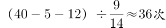。

故正确答案为D。

**考点**：给具体单位型

**来源**：2013年921联考《行测》题（河南卷）第41题

### 第 42 题

小王和小张各加工了10个零件，分别有1个和2个次品。若从两人加工的零件里各随机选取2个，则选出的4个零件中正好有1个次品的概率为：

A. 小于25%

B. 25%—35%

C. 35%—45%

D. 45%以上

第 42 题 · 答案与解析

**参考答案（粉笔题库参考内容）**

C

**解析**

由于只有1个次品，那么次品归属为谁，就应该分两种情况讨论。

第一种情况，次品为小王的。那么从小王的9个正品中选1个再从1个次品中选一个有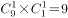种情况，从小张的8个正品中选2个有C_8^2=28种情况，二者相乘为252种情况；

第二种情况，次品为小张的。那么从小张的8个正品中选1个再从2个次品中选一个有种情况，从小王的9个正品中选2个有C_9^2=36种情况，二者相乘为576种情况；所以最终将2种情况相加得到828种情况。

再计算总的情况，每人都从10个里面取2个有C_10^2=45种情况，所以二者相乘一共有45×45=2025种情况，最后得出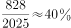。

故正确答案为C。

**考点**：给情况求概率

**来源**：2013年921联考《行测》题（河南卷）第42题

### 第 43 题

中午12点，甲驾驶汽车从A地到B地办事，行驶1小时，走了总路程的15%。此后甲的速度增加了15公里/小时，又行驶了30分钟，距离B地还有3/4的路程。此后甲的速度如果再增加15公里/小时，问几点能到B地：

A. 16：00

B. 16：30

C. 17：00

D. 17：30

第 43 题 · 答案与解析

**参考答案（粉笔题库参考内容）**

B

**解析**

假设原来甲的速度为x，第1小时行驶总路程15%，随后的30分钟行驶100%－15%－75%＝10%，则根据行程问题比例关系 可以解得x=45。所以之前的1小时30分钟一共行驶了45+30=75公里，剩余路程为75×3=225公里。所以需要时间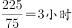，故需要4.5小时，最终16:30到达。

故正确答案为B。

**考点**：普通行程

**来源**：2013年921联考《行测》题（河南卷）第43题

### 第 44 题

甲购买了A、B、C三种书籍各若干本捐赠给希望小学。其中B书籍比C书籍少了3本，比A书籍多2本；B书籍的单价比A书籍低4元，比C书籍高4元。其购买B书籍的总开销与C书籍相当，比A书籍少4元。问甲购买三种书籍一共用了多少元？

A. 724

B. 772

C. 940

D. 1084

第 44 题 · 答案与解析

**参考答案（粉笔题库参考内容）**

D

**解析**

直接列方程求解：设B类书籍的本数为x，单价为y，那么A类书籍本数为x-2，C类书籍的本数为x+3，A类书籍的单价为y+4，C类书籍的单价为y-4。

根据书籍的总开销可以列方程：xy=(x+3)(y-4)=(x-2)(y+4)-4，解得x=15，y=24。故一共花了3×24×15+4=1084元。

故正确答案为D。

**考点**：经济利润问题

**来源**：2013年921联考《行测》题（河南卷）第44题

### 第 45 题

某单位安排职工参加百分制业务知识考试，小周考了88分，还有另外2人的得分比他低。若所有人的得分都是整数，没有人得满分，且任意5人的得分不完全相同，问参加考试的最多有多少人？

A. 38

B. 44

C. 50

D. 62

第 45 题 · 答案与解析

**参考答案（粉笔题库参考内容）**

C

**解析**

为了让参加考试的人“最多”，则尽可能在每一个分数段都有尽可能多的人分数相同。从88~99分，共有12个整数分数可以重复，同时又由于“任意5人的得分不完全相同”，所以要求重复的分数的人数最多为4人。这样一共有48人，再加上两个低于88分的人，所以最多50人。

故正确答案为C。

**考点**：构造数列

**来源**：2013年921联考《行测》题（河南卷）第45题

### 第 46 题

从所给的四个选项中，选择最合适的一个填入问号处，使之呈现一定的规律性：

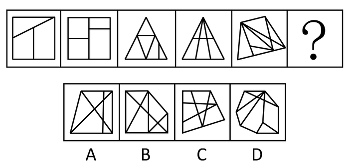

A. A

B. B

C. C

D. D

第 46 题 · 答案与解析

**参考答案（粉笔题库参考内容）**

B

**解析**

元素组成凌乱，本题考查数数。题目呈现明显的封闭区域，优先考虑面数量变化，其数量为3、4、5、6、7，那么选项应该是8个封闭区域。A项为7个，B项为8个，C项为9个，D项为9个。

故正确答案为B。

**考点**：数量规律-面

**来源**：2013年921联考《行测》题（河南卷）第46题

### 第 47 题

把下面的六个图形分为两类，使每一类图形都有各自的共同特征或规律，分类正确的是：

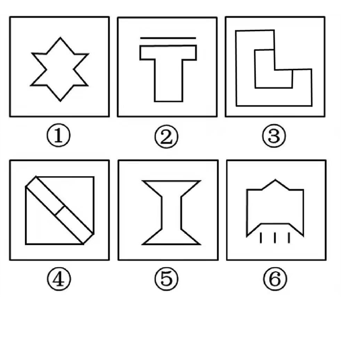

A. ①②④，③⑤⑥

B. ①②⑥，③④⑤

C. ①⑤⑥，②③④

D. ①④⑤，②③⑥

第 47 题 · 答案与解析

**参考答案（粉笔题库参考内容）**

D

**解析**

元素组成凌乱，先考虑属性。都满足对称，接着数对称轴的个数，发现②③⑥图形对称轴个数为1条，①④⑤图形对称轴个数为2条。

故正确答案为D。

**考点**：属性规律-对称性

**来源**：2013年921联考《行测》题（河南卷）第47题

### 第 48 题

把下面的六个图形分为两类，使每一类图形都有各自的共同特征或规律，分类正确的一项是：

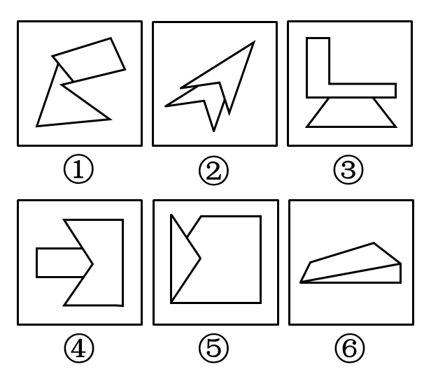

A. ①②④，③⑤⑥

B. ①②⑤，③④⑥

C. ①③⑤，②④⑥

D. ①③⑥，②④⑤

第 48 题 · 答案与解析

**参考答案（粉笔题库参考内容）**

D

**解析**

元素组成凌乱，且都是由两个图形组合而成，观察二者间的关系。两个图形或者是1条边相接（有一条公共边），或者是2条边相接（有两条公共边），所以①③⑥一组，②④⑤一组。

故正确答案为D。

**考点**：特殊规律-图形间关系

**来源**：2013年921联考《行测》题（河南卷）第48题

### 第 49 题

从所给的四个选项中，选择最合适的一个填入问号处，使之呈现一定的规律性：

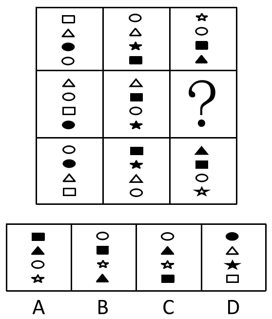

A. A

B. B

C. C

D. D

第 49 题 · 答案与解析

**参考答案（粉笔题库参考内容）**

C

**解析**

元素组成相似，优先考虑样式规律。题干图形均由黑白小图形构成，且数量不同，优先考虑黑白运算。九宫格优先横行看，第一行中，空心长方形加空心圆形等于空心五角星，两个空心三角形相加等于空心圆形，实心圆形加实心五角星等于实心长方形，空心圆形加实心长方形等于实心三角形，经验证第三行符合此规律，因此第二行应用此规律，只有C项符合。

故正确答案为C。

**考点**：样式规律-黑白运算

**来源**：2013年921联考《行测》题（河南卷）第49题

### 第 50 题

以下是给定纸盒的外表面，下列哪一个纸盒能由以下表面折叠而成：

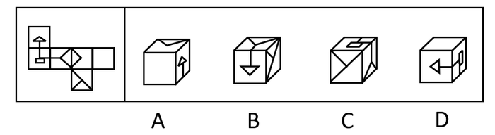

A. A

B. B

C. C

D. D

第 50 题 · 答案与解析

**参考答案（粉笔题库参考内容）**

A

**解析**

六面体折纸盒问题。用相对面、相邻边排除。B项中的正面和侧面在原图中处于相对位置，不能同时看到，排除；C项中正面与侧面的图在原图中应有交点，而此处没有，排除；D项侧面的竖线应朝上，排除。

故正确答案为A。

**考点**：空间类-空间重构-六面体

**来源**：2013年921联考《行测》题（河南卷）第50题

### 第 51 题

根据知识能否清晰地表述和有效地转移，可以把知识分为显性知识和隐性知识。显性知识是能够被人类以一定符码系统（最典型的是语言，也包括数学公式、各类图表、盲文、手势语、旗语等诸种符号形式）加以完整表述的知识。隐性知识是指用文字、语言、图像等形式不易表达清楚的主观知识，它以个人、团队、组织的经验、印象、技术诀窍、组织文化、风俗等形式存在。

根据以上定义，属于显性知识的是：

A. 徒弟通过观察、模仿和亲身实践，终于学会国家级工艺大师的微雕技术

B. 小石在厨师班学习烹饪，老师再三强调火候，他尽力注意后炒出的菜仍然味道不够好

C. 外语教育专业毕业的小夏刚担任外语教师时，总是不能很好地控制课堂

D. 小红每天背10个外语单词，半年后她能很快读完一篇外文短篇小说

第 51 题 · 答案与解析

**参考答案（粉笔题库参考内容）**

D

**解析**

第一步：抓住定义中的关键词。

显性知识的关键词：“符码系统（语言、教学公式、各类图表、盲文、手势语、旗语）”“完整表述”。隐性知识的关键词包括：“用文字、语言、图像等形式不易表达清楚的主观知识”“以个人、团队、组织的经验、印象、技术诀窍、组织文化、风俗等形式”。

第二步：逐一判断选项。

A项，观察、模仿、亲身实践都属于个人的经验、技术诀窍，并不是通过符码系统就能准确表达出来，属于自己的主观知识；

B项，烹饪时的火候属于个人的经验，对每道菜在烹饪时的火到底开多大、烹饪多长时间，这个无法用具体的公式、数字去衡量，对火候的掌握是自己的主观知识；

C项，对课堂的掌控力包含许多方面，如课程的讲解、纪律的维持等，然而对于如何才能提高课堂的掌控，靠的是教师教学经验的积累和总结，因而属于个人的经验、主观的知识，而不是读了一本书、学了一个公式就能掌控好课堂的；

D项，英语单词属于语言文字，语言文字是一种符码系统，掌握了一定数量的单词，就可以读完一本小说，因而这里完全符合显性知识的定义。综上所述，A、B、C三项都属于隐性知识，只有D项属于显性知识。

故正确答案为D。

**考点**：常规问法

**来源**：2013年921联考《行测》题（河南卷）第51题

### 第 52 题

当所学的新知识相对于原有认知结构为上位关系，即原有知识是从属观念，而新学习的知识是总括性观念，这样的学习即为上位学习。相反，如果新知识与原有知识是下位关系，则为下位学习。而如果新知识仅仅是由原知识的相关内容合理组合构成的，不能与原有某些特定的内容构成上位关系或下位关系，那么，这时的学习就是同位学习。

根据上述定义，下列属于上位学习的是：

A. 学生先学习平行四边形再学习矩形

B. 在学完所有的内容之后进行总复习

C. 先学习理论知识，再进行实践技能的操作

D. 教师为讲解某语法结构，先举了很多例句

第 52 题 · 答案与解析

**参考答案（粉笔题库参考内容）**

D

**解析**

第一步：抓住定义中的关键词。

“上位学习”的关键词是：“原有知识是从属观念，而新学习的知识是总括性观念”。

从上位学习的定义可以得到下位学习的关键词包括：“原有知识是总括性观念，而新学习的知识是从属观念”。

同位学习的关键词是：“新知识仅仅是由原知识的相关内容合理组合构成的，不能与原有某些特定的内容构成上位关系或下位关系”。

第二步：逐一判断选项。

A项中矩形是平行四边形的一种特殊形式，属于平行四边形，因此平行四边形是总括性概念，矩形是从属概念。先学习总括性，后学习从属性，属于下位学习。

B项中总复习是在学完所有内容之后进行的，只是对原有知识内容的回顾和总结，二者并不存在谁是总括、谁是从属的概念，总复习也不是对新知识的学习。这里不涉及题干给出的三种概念。

C项中理论知识是从实践中总结得到的，先学习理论，再进行实践，这二者是相辅相成的，实践并不是理论知识的学习，而是理论的实际运用，也并不是新知识的学习。这里也不涉及题干给出的三种概念。

D项中语法是语言的构成方式之一，它指导和规范语言的正确书写和使用，因而是总括性的。例句则是语法结构具体的展现，通过例句的学习，进一步提炼出语法结构，这是一种归纳式学习，所以例句属于从属性的。这里是先学习从属性，后学习总括性，属于上位学习。

故正确答案为D。

**考点**：常规问法

**来源**：2013年921联考《行测》题（河南卷）第52题

### 第 53 题

知识溢出是指知识接受者将获得的知识与自有知识相融合后得出新的知识，却没有给予知识的提供者以补偿，因而提供者没有享受原知识的全部收益，或者给予的补偿小于知识创造的成本，接受者自觉或不自觉地未承担知识的全部成本的现象。

根据上述定义，下列属于知识溢出的是：

A. 学生从辅导班学到了某题的解题方法和技巧，并且可熟练地解答这一类型的题目

B. 某公司代理国外知名电子产品的生产与销售，后引入生产线为这款电子产品生产配套的充电设备，公司效益大增

C. 某公司通过与海外研究机构联合工作，引入对方的技术开发出一款新产品，双方约定共享产权和效益

D. 某城市设计机构参与了另外一个大城市的规划方案，结合本市原有设计方案和实际情况设计了新区交通网络

第 53 题 · 答案与解析

**参考答案（粉笔题库参考内容）**

D

**解析**

第一步：抓住定义中的关键词。

知识溢出的关键词：①“知识接受者将获得的知识与自有知识相融合后得出新的知识”、②“没有给予知识的提供者以补偿”、③“或者给予的补偿小于知识创造的成本”、④“接受者自觉或不自觉地未承担知识的全部成本”。

第二步：逐一判断选项。

A项，学生学习的是解题技巧，并没有与自己的知识融合后得出新的知识，所以不符合关键词①；学生从辅导班学习解题技巧，辅导班是收费的，学生作为知识接受者，给与知识提供者即辅导班学费，即为足够的补偿，不符合关键词②。

B项，代理生产和销售也好、引入新生产线也好，均只是对国外生产技术的照搬，并没有体现出将外国的新技术与自身技术结合后得到新的技术，因此不符合①；题干对于是否有补偿，以及补偿程度，并未提及。

C项，引入对方开发的新产品，共享产权和效益，说明此公司在收益和权利上与对方分享，提供了足够的补偿，不符合②、③、④。

D项，参考本市原有设计方案属于自有知识，根据实际情况设计说明获取了另一个城市的相关知识，二者结合后设计出了新区交通网络，属于知识创新，符合①；这里没有提及是否对原设计方案的设计方给与补偿，属于半对半错选项。

综上所述，A、B、C三项均为明显错误选项。

故正确答案为D。

**考点**：原因结果

**来源**：2013年921联考《行测》题（河南卷）第53题

### 第 54 题

竞争性决策指的是在有竞争对手存在的情况下，不是根据客观的自然状态，而是根据竞争对手的策略而作出的决策。

根据以上定义，以下哪项属于竞争性决策：

A. 由于同类竞争，小李将库存产品一律三折出售

B. 为打击新开张的对门商店，小刘将所有商品一律低于批发价出售3天

C. 甲公司董事会一致决定高薪聘请与其有竞争关系的乙公司的副总经理为公司总经理

D. 为吸引优质生源，甲校的奖学金金额总是比乙校高10%

第 54 题 · 答案与解析

**参考答案（粉笔题库参考内容）**

D

**解析**

第一步：抓住定义中的关键词。

竞争性决策的关键词：①“在有竞争对手存在的情况下”、②“不是根据客观的自然状态”、③“根据竞争对手的策略”。

第二步：逐一判断选项。

A项，存在同类竞争，符合①；一律三折出售，符合②；但是没有提到竞争对手的策略，关键词③的情况不明晰，属于半对半错选项，排除；

B项，对门新开张，符合①；一律低于批发价出售3天，符合②；同样没有提到竞争对手的策略，属于半对半错选项，排除；

C项，有竞争关系的乙公司，符合①；高薪聘请对方的副总经理为总经理，符合②；但仍然没有提到乙公司的竞争策略，属于半对半错选项，排除；

D项，甲校与乙校争夺优质生源，存在竞争关系，符合①；甲校奖学金设置总是比乙校高10%，说明不管乙校如何提高奖学金，甲校都比乙校高10%，体现出了乙校的竞争策略即用奖学金吸引生源，符合②、③，当选。

故正确答案为D。

**考点**：方式目的

**来源**：2013年921联考《行测》题（河南卷）第54题

### 第 55 题

权力是指一个人影响另一个人的能力。其中强制性权力是建立在惧怕基础上，一个人如果不服从的话就可能产生消极的后果，出于对这种惧怕，这个人就对强制性权力作出了反应。奖赏性权力是指人们服从一个人的愿望或指示是因为这种服从能给他们带来益处。因此，那些能给人们带来他们所期望的报酬的人就拥有了权力。法定性权力是指一个人通过组织正式层级结构中的职位所获得的权力。法定性权力取决于个人在组织中的职位，它是政府或官方明确规定的权威地位。有些人能使事情发生，是因为他们有这么做的权力与权威。

根据上述定义，下列各项中没有涉及到上述三种权力的是：

A. 经理要求所有员工放弃假期在公司加班，虽然不情愿，但员工们都没有提出异议

B. 四岁的小明发现，只要他给小朋友糖吃，小朋友就愿意和他玩，所以他经常从家里带糖在幼儿园与小朋友们分享

C. 小刘在下班途中被抢劫，看到歹徒只有一人，小刘决定反抗，但是当他看到歹徒拿出刀来，他又放弃了反抗的想法

D. 小李在工作决策上与老王产生分歧。经过考虑后，小李认为老王的经验比他更丰富，处理过更多同类事务，所以决定听从老王的决策

第 55 题 · 答案与解析

**参考答案（粉笔题库参考内容）**

D

**解析**

第一步：抓住定义中的关键词。

强制性权力的关键词：“惧怕”“产生消极后果”。

奖赏性权力的关键词：“益处”“所期望的报酬”。法定性权力的关键词：“组织正式层级结构中的职位”“政府或官方明确规定的权威地位”。

第二步：逐一判断选项。

A项，经理是公司正式层级结构中的职位，其有权要求员工加班，属于法定性权力；

B项，小朋友陪小明玩，小明就给他们糖吃，糖是一种益处，是小朋友期待的益处，属于奖赏性权力；

C项，小刘看到对方手里有刀，如果不服从对方，而执意反抗，很有可能自己的生命安全受到危害，符合“惧怕”和“产生消极后果”的关键词，属于强制性权力；

D项，小李和老王在工作决策上产生分歧，最后又采纳老王的决策的原因只是因为其经验丰富，这里没有体现出“惧怕”“产生消极后果”，没有体现出“益处”“所期望的报酬”，也没有说是因为老王在单位里的职位高而必须听老王的，不符合“组织正式层级结构中的职位”“政府或官方明确规定的权威地位”。

综上所述，A、B、C三项均符合一种权力的定义，只有D项不符合其中任何一种。

本题为选非题，故正确答案为D。

**考点**：特殊问法

**来源**：2013年921联考《行测》题（河南卷）第55题

### 第 56 题

服务是指为他人做事，并使他人从中受益的一种有偿或无偿的活动，不以或很少以实物形式而以提供活劳动的形式满足他人某种特殊需要。

根据以上定义，以下不属于服务的是：

A. 小周的车出现故障去维修，汽车修理店更换了价值2000余元的零件

B. 为方便学生随时取款，某银行在校园里安装了一部自动取款机

C. 某医院派出医疗队深入农村，为农民上门诊断治疗

D. 某小区居民小王在小区网络论坛上发帖要求提高物业管理水平

第 56 题 · 答案与解析

**参考答案（粉笔题库参考内容）**

D

**解析**

第一步：抓住定义中的关键词。

关键词包括：“为他人做事”“使他人从中受益”“不以或很少以实物形式而以提供活劳动的形式满足他人某种特殊需要”。

第二步：逐一判断选项。

A项，汽车修理店为小周维修和更换零部件，收取2000余元的费用，为小周做事、使小周受益，是有偿活动，汽车修理店付出了劳动，满足了小周维修汽车的需要，因此完全符合服务的定义；B项，银行安装自动取款机，方便了学生取款，是一种无偿劳动，使得学生受益，这是一种实物的形式，满足了学生取款的需要，因此也属于服务；C项，医院派医疗队深入农村，为农民上门诊断治疗，是为农民做事，使农民从中受益，这是一种劳动的形式，满足了农民医疗保健的需要，因此该项也属于服务；D项，小王发帖子要求提高物业管理水平，这是满足了自己作为业主对物业管理的需要，并且他提出的要求是否被满足也不确定，也就意味着并不知道这件事情能否使他人受益，因此，不符合定义。

综上所述，A、B、C三项均符合服务的定义，只有D项不符合。

本题为选非题，故正确答案为D。

**考点**：方式目的

**来源**：2013年921联考《行测》题（河南卷）第56题

### 第 57 题

情报是指运用一定的媒体(载体)，越过空间和时间传递给特定用户，以解决科研、生产、经营中的具体问题所需要的特定知识和信息。

根据以上定义，以下不属于情报的是：

A. 某企业从客户那里得知竞争对手对产品进行技术革新大幅降低了成本后，决定转产

B. 果农赵某利用网络向农林研究所技术员小李请教，治好了樱桃的褐斑穿孔病

C. 看到电视台报道某地出产的土豆大量堆积且售价低廉，某学校食堂电话订购了2000斤

D. 小孙和朋友每次外出旅游前，都在网络上用电子地图查好路线，并将路线发到手机上

第 57 题 · 答案与解析

**参考答案（粉笔题库参考内容）**

D

**解析**

第一步：抓住定义中的关键词。

关键词包括：“运用一定的媒体（载体）”“越过空间和时间”“特定用户”“科研、生产、经营中的具体问题”“特定知识和信息”。

第二步：逐一判断选项。

A项，企业是这里的“特定用户”，客户相当于“一定的媒体（载体）”，借客户之口了解到情况属于“越过空间和时间”，转产涉及“经营”中的具体问题，技术革新降低成本符合“特定知识和信息”，因此A项符合情报的定义；B项，赵某是“特定用户”，网络是“一定的媒体（载体）”且符合“越过空间和时间”，果树栽培属于“生产中的具体问题”，如何治疗褐斑穿孔病符合“特定知识和信息”，因此B项符合情报的定义；C项，某学校食堂是“特定用户”，电视台报道属于“一定的媒体（载体）”且符合“越过空间和时间”，订购土豆属于“经营中的具体问题”，土豆大量堆积且售价低廉属于“特定知识和信息”，因此C项符合情报的定义；D项，小孙和朋友属于“特定用户”，网络属于“一定的媒体（载体）”且符合“越过空间和时间”，路线符合“特定知识和信息”，但是出去游玩并不符合“科研、生产、经营中的具体问题”，而是属于生活中的具体问题。

综上所述，A、B、C三项均符合情报的定义，只有D项不符合。

本题为选非题，故正确答案为D。

**考点**：方式目的

**来源**：2013年921联考《行测》题（河南卷）第57题

### 第 58 题

灯塔效应是指私有商品可以在市场交换，并具有市场价值和市场价格，但公共商品没有市场交换，也没有市场价格和市场价值，因此消费者几乎都不愿意个人支付公共商品的费用，从而让别人来消费。

根据上述定义，下列符合灯塔效应的是：

A. 某沿海地区要治理水质污染，由于资金不足，有关部门向当地一些大型企业借款，但企业大都不愿意借款

B. 某新开盘的高层塔楼设立了多部电梯，公摊面积较大，住在低层的居民认为自己不需要使用电梯，因此不愿交纳电梯维护费用

C. 某村庄为解决水源不足的问题，号召村民集资建水渠从邻村河流引水过来，响应这一号召的村民很多

D. 某小区举办图书展销会，购买图书的居民享受五折优惠，小区居民虽然光顾展会的人较多，但大多数人并没有购买图书

第 58 题 · 答案与解析

**参考答案（粉笔题库参考内容）**

B

**解析**

第一步：抓住定义中的关键词。

关键词包括：“公共商品没有市场交换，也没有市场价格和市场价值”“消费者几乎都不愿意个人支付公共商品的费用”。

第二步：逐一判断选项。

A项，政府治理水污染属于政府的公共服务职能，属于公共商品的范畴，但是大企业并不是个人，而是团体、组织，不符合“个人支付”；B项，楼层内的电梯属于“公共商品”，低层的居民不愿意支付费用，符合“消费者几乎都不愿意个人支付公共商品的费用”，因此符合灯塔效应；C项，水渠属于“公共商品”，响应号召的居民很多，说明消费者愿意支付，因此该选项不符合灯塔效应的定义；D项，图书展销会上的图书属于私有商品，具有市场价格和价值，因此不属于灯塔效应。

综上所述，A、C、D三项均不符合灯塔效应的定义，只有B项符合。

故正确答案为B。

**考点**：原因结果

**来源**：2013年921联考《行测》题（河南卷）第58题

### 第 59 题

动力定型是指一种在固定程序的条件作用下建立的暂时联系系统。在这一种系统内，各个条件刺激被严格的序列和时间呈现，以获得每个刺激确切而不变的效果，最后的效果就是在大脑皮质的活动中建立了一种动力定型。

根据上述定义，下列不符合此理论的是：

A. 乒乓球运动员通过练习确保击球的稳定性

B. 小学生学习写字过程中老师不断纠正姿势

C. 篮球明星每天都要练习超过一千次的投篮

D. 动物园饲养员喂动物之前每次都要吹口哨

第 59 题 · 答案与解析

**参考答案（粉笔题库参考内容）**

D

**解析**

第一步：抓住定义中的关键词。

关键词包括：“在固定程序的条件作用下建立的暂时联系系统”“各个条件刺激被严格的序列和时间呈现”“获得每个刺激确切而不变的效果”“在大脑皮质的活动中建立了一种动力定型”。

第二步：逐一判断选项。

A项，乒乓球运动员通过练习，不断地重复击球动作，击球过程中的准备、挥拍、击球、收拍这一系列的动作是固定的程序，各个动作具有严格的序列和事件呈现，每个分动作稳定保持进而获得确切而不变的效果——击球的稳定，符合动力定型的概念；B项，初学者学习写字，首先要端正的是写字的姿势，坐姿、拿笔的姿势等保持正确，正是体现了固定的程序，最终得到确切而不变的效果——写字姿势的正确，符合动力定型的概念；C项，练习投篮与练习乒乓球击球的道理如出一辙，符合动力定型的概念；D项，喂养动物之前吹口哨只是一种经典条件反射，在口哨声和喂食之间建立了一种简单的条件反射，口哨声是单一的条件刺激，不符合定义。

综上所述，A、B、C三项均符合动力定型的定义，只有D项不符合。

本题为选非题，故正确答案为D。

**考点**：方式目的

**来源**：2013年921联考《行测》题（河南卷）第59题

### 第 60 题

服务链是服务行业企业通过向消费者提供服务来最大限度地满足消费者的需求，为消费者提供良好的消费环境和消费过程中的各种服务，这些服务以现代信息技术、物流技术、系统工程等现代科学技术为基础，以最大限度地满足消费者需求为出发点，把与服务有关的各个方面按照一定的方式组织起来，形成完整的服务体系。

根据上述定义，下列能构成服务链的是：

A. 几个废品收购者在某小区内成立的专门回收二手电器的废品回收站

B. 与某品牌电脑的销售相关的各大商场卖场以及家电维修公司

C. 开发商与新楼盘招标物业公司，多家物业公司前来竞争

D. 学校为给学生提供更多生活便利，在宿舍区设立银行网点及超市等

第 60 题 · 答案与解析

**参考答案（粉笔题库参考内容）**

B

**解析**

第一步：找出定义关键词。

“服务行业企业”、“良好的消费环境和消费过程中的各种服务”、“以现代信息技术、物流技术、系统工程等现代科学技术为基础”、“把与服务有关的各个方面按照一定的方式组织起来，形成完整的服务体系”。

第二步：逐一分析选项。

A项：废品收购者并非企业，仅单一回收业务，未形成服务体系，不符合“服务行业企业”、“把与服务有关的各个方面按照一定的方式组织起来，形成完整的服务体系”，不符合定义，排除；

B项：商场、维修公司均为服务企业，整合销售与售后环节，依托现代科技形成完整服务体系，符合“服务行业企业”、“良好的消费环境和消费过程中的各种服务”、“以现代信息技术、物流技术、系统工程等现代科学技术为基础”、“把与服务有关的各个方面按照一定的方式组织起来，形成完整的服务体系”，符合定义，当选；

C项：仅体现物业公司竞争，未整合服务环节、未面向消费者提供完整服务，不符合“把与服务有关的各个方面按照一定的方式组织起来，形成完整的服务体系”，不符合定义，排除；

D项：学校并非服务行业企业，仅增设网点，未依托现代科技整合服务，不符合“服务行业企业”、“把与服务有关的各个方面按照一定的方式组织起来，形成完整的服务体系”，不符合定义，排除。

故正确答案为B。

**考点**：方式目的

**来源**：2013年921联考《行测》题（河南卷）第60题

### 第 61 题

机芯：手表

A. 主机：计算机

B. 瓶盖：酒瓶

C. 压缩机：空调

D. 车轴：轮胎

第 61 题 · 答案与解析

**参考答案（粉笔题库参考内容）**

C

**解析**

第一步：判断题干词语间逻辑关系。

机芯和手表是组成关系，且机芯是手表的核心元件。

第二步：判断选项词语间逻辑关系。

A项：主机是计算机的组成部分，二者是组成关系，但主机不是计算机的核心元件，与题干逻辑关系不一致，排除；

B项：瓶盖和酒瓶是组成关系，但瓶盖不是酒瓶的核心元件，与题干逻辑关系不一致，排除；

C项：压缩机是空调的组成部分，二者是组成关系，且压缩机是空调的核心元件，与题干逻辑关系一致，当选；

D项：车轴和轮胎是并列关系，二者都是组成汽车的零部件，与题干逻辑关系不一致，排除。

故正确答案为C。

**考点**：逻辑关系-包容关系

**来源**：2013年921联考《行测》题（河南卷）第61题

### 第 62 题

学生证：学生

A. 驾驶证：开车

B. 学位证：学校

C. 结婚证：夫妻

D. 身份证：护照

第 62 题 · 答案与解析

**参考答案（粉笔题库参考内容）**

C

**解析**

第一步：判断题干词语间逻辑关系。

学生证和学生是对应关系，学生证是证明学生身份的文件。

第二步：判断选项词语间逻辑关系。

A项，驾驶证和开车是对应关系，有了驾驶证可以开车，但开车不是一种身份，我们不能说驾驶证是证明开车的文件，与题干关系不一致；

B项，学位证和学校是对应关系，在学校完成了学业可以获得学位证，但学校也不是一种身份，我们不能说学位证是证明学校的文件，与题干关系不一致；

C项，结婚证和夫妻是对应关系，结婚证是证明夫妻身份的文件，与题干关系一致；

D项，身份证和护照是并列关系，二者都是证明身份的证件，身份证在国内使用，护照在国外使用，与题干关系不一致。

故正确答案为C。

**考点**：逻辑关系-对应关系

**来源**：2013年921联考《行测》题（河南卷）第62题

### 第 63 题

比赛：裁判

A. 歌唱：指挥

B. 诉讼：法官

C. 驾驶：司机

D. 考试：监考

第 63 题 · 答案与解析

**参考答案（粉笔题库参考内容）**

B

**解析**

第一步：判断题干词语间逻辑关系。

比赛和裁判是对应关系，裁判裁决比赛最终的胜负。

第二步：判断选项词语间逻辑关系。

A项，歌唱和指挥是对应关系，但是指挥只是起到引导大家歌唱的作用，并不能对歌唱的结果起到裁决作用；B项，诉讼和法官是对应关系，法官裁决诉讼最终的胜负；C项，驾驶和司机是主谓关系，司机驾驶汽车；D项，考试和监考是对应关系，监考只是负责考场纪律的监督，并不能决定最后的考试成绩。

故正确答案为B。

**考点**：逻辑关系-对应关系

**来源**：2013年921联考《行测》题（河南卷）第63题

### 第 64 题

玉佩：荷包

A. 国画：水墨

B. 走马灯：灯笼

C. 管乐：圆号

D. 长镜头：蒙太奇

第 64 题 · 答案与解析

**参考答案（粉笔题库参考内容）**

D

**解析**

第一步：判断题干词语间逻辑关系。

玉佩和荷包是并列关系，二者都是古时文人雅士的挂件装饰。

第二步：判断选项词语间逻辑关系。

A项，国画和水墨是对应关系，国画多采用水墨为原料作画，用水墨作成的画为水墨画；

B项，走马灯和灯笼是种属关系，走马灯是灯笼的一种；

C项，圆号是管乐器的一种，其所奏的音乐为管乐，因此圆号和管乐为对应关系；

D项，长镜头和蒙太奇是并列关系，二者都是电影里的一种表现手法。长镜头是指用比较长的时间（有的长达10分钟），对一个场景、一场戏进行连续的拍摄，形成一个比较完整的镜头段落。蒙太奇是把分切的镜头剪辑起来的手段。

故正确答案为D。

**考点**：逻辑关系-并列关系

**来源**：2013年921联考《行测》题（河南卷）第64题

### 第 65 题

下单：送货：签收

A. 候机：登机：安检

B. 招聘：培训：录用

C. 彩排：调音：演奏

D. 上膛：瞄准：射击

第 65 题 · 答案与解析

**参考答案（粉笔题库参考内容）**

D

**解析**

第一步：判断题干词语间逻辑关系。

下单、送货、签收按照事件发生的先后逻辑顺序进行，先下单，再送货，最后签收。

第二步：判断选项词语间逻辑关系。

A项：候机、登机、安检的逻辑顺序错误，应该是先安检、再候机、最后登机；B项：招聘、培训、录用的逻辑顺序错误，应该是先招聘，后录用，再培训；C项：彩排、调音、演奏的逻辑顺序错误，应该是先调音，后演奏，演奏又是彩排的一部分；D项：上膛、瞄准、射击是按照事件发生的先后逻辑顺序进行的，先上膛，后瞄准，再射击。

故正确答案为D。

**考点**：逻辑关系-对应关系

**来源**：2013年921联考《行测》题（河南卷）第65题

### 第 66 题

军人：医生：军医

A. 司机：警察：交警

B. 舞蹈：说唱：二人转

C. 学科：研究：科研

D. 汽车：电动车：电动汽车

第 66 题 · 答案与解析

**参考答案（粉笔题库参考内容）**

D

**解析**

第一步：判断题干词语间逻辑关系。

军人和医生是交叉关系，二者职业的交叉为军医。

第二步：判断选项词语间逻辑关系。

A项，司机和警察是交叉关系，但二者交叉后不能得到交警，交警是维持交通秩序的警察，和司机没有必然联系，排除；

B项，舞蹈和说唱是并列关系，但二者的交叉并不一定得到二人转，还有其他表演形式是舞蹈和说唱相结合的，排除；

C项，学科和研究不是交叉关系，学科是名词，表示按照学问的性质划分的门类，而研究是动词，排除；

D项，汽车和电动车是交叉关系，二者的交叉得到电动汽车，电动汽车是以电力为能源驱动的汽车，当选。

故正确答案为D。

**考点**：逻辑关系-交叉关系

**来源**：2013年921联考《行测》题（河南卷）第66题

### 第 67 题

中秋节：月饼：团圆

A. 圣诞节：圣诞老人：礼物

B. 清明节：扫墓：踏青

C. 情人节：巧克力：约会

D. 重阳节：菊花酒：敬老

第 67 题 · 答案与解析

**参考答案（粉笔题库参考内容）**

D

**解析**

第一步：判断题干词语间逻辑关系。

中秋节、月饼、团圆是对应关系，而且具有象征意义，中秋节吃月饼，二者象征着团圆。

第二步：判断选项词语间逻辑关系。

A项，圣诞节、圣诞老人、礼物是对应关系，圣诞老人在圣诞节前夜为每家每户送礼物，但缺乏象征意义，礼物不是圣诞节和圣诞老人的象征意义，排除；

B项，清明节、扫墓、踏青是对应关系，清明节是扫墓、踏青的节日，但是缺乏象征意义，踏青不是清明节和扫墓的象征意义，排除；

C项，情人节、巧克力、约会是对应关系，人们在情人节送巧克力表达爱意，但约会并不只在情人节进行，而且约会也不是情人节和巧克力的象征意义，排除；

D项，重阳节、菊花酒、敬老是对应关系，重阳节喝菊花酒，二者象征着敬老，当选。

故正确答案为D。

**考点**：语义关系-比喻象征义、逻辑关系-对应关系

**来源**：2013年921联考《行测》题（河南卷）第67题

### 第 68 题

书签对于 （  ）相当于 （  ） 对于 浏览器

A. 阅读 网页

B. 书本 收藏夹

C. 记录 网页

D. 书本 插件

第 68 题 · 答案与解析

**参考答案（粉笔题库参考内容）**

B

**解析**

逐一代入选项。

A项：书签是辅助阅读的工具，二者为工具与行为的对应关系；通过浏览器浏览网页，二者为工具与对象的对应关系，前后逻辑关系不一致，排除；

B项：书签可以用来标记书本的阅读位置，以便下次查找，继续阅读，二者为标记工具和载体的对应关系；收藏夹可以用来标记浏览器的浏览网页，以便下次查找，继续浏览，二者为标记工具和载体的对应关系，前后逻辑关系一致，当选；

C项：书签用于记录本次阅读结束的地方，二者为功能对应关系；通过浏览器浏览网页，二者为工具对应关系，前后逻辑关系不一致，排除；

D项，书签可以用来标记书本的阅读位置，以便下次查找，继续阅读，二者为标记工具和载体的对应关系；插件是浏览器的扩展组件，用于增强浏览器的功能，并非起到标记作用，前后逻辑关系不一致，排除。

故正确答案为B。

**考点**：逻辑关系-对应关系

**来源**：2013年921联考《行测》题（河南卷）第68题

### 第 69 题

（  ） 对于 织物 相当于 彩陶 对于 （  ）

A. 刺绣 陶器

B. 染料 彩绘

C. 丝绸 岩画

D. 织机 图案

第 69 题 · 答案与解析

**参考答案（粉笔题库参考内容）**

A

**解析**

第一步：将选项逐一代入，判断各选项前后部分的逻辑关系。

A项，刺绣和织物是种属关系，刺绣是织物的一种；彩陶和陶器是种属关系，彩陶是陶器的一种。

B项，染料和织物是对应关系，染料可以使织物上色；彩陶和彩绘是对应关系，彩陶有色彩是因为陶器上有彩绘，但是二者词语的前后顺序不同。

C项，丝绸和织物是种属关系，丝绸是织物的一种；彩陶和岩画是并列关系，二者都是一种古时的艺术创作形式。

D项，织机和织物是对应关系，用织机来织出织物；彩陶和图案并不是这种工具性的关系，彩陶上面有图案。

第二步，逻辑关系相同，即为答案。

综上所述，只有A项两组词的逻辑关系相同。

故正确答案为A。

**考点**：逻辑关系-包容关系

**来源**：2013年921联考《行测》题（河南卷）第69题

### 第 70 题

剪子对于 （  ） 相当于 （  ） 对于 秒表

A. 指甲 赛跑

B. 厨刀 卷尺

C. 剪纸 计时

D. 理发师 裁判

第 70 题 · 答案与解析

**参考答案（粉笔题库参考内容）**

B

**解析**

逐一代入选项。

A项，用剪子修剪指甲，二者为工具与作用对象的对应关系；用秒表为赛跑计时，二者为工具与作用对象的对应关系，但前后顺序相反，前后逻辑关系不一致，排除；

B项，剪子和厨刀都是工具，且都有改变原有物体形状的功能，二者为并列关系；卷尺和秒表都是工具，且都有测量的功能，二者为并列关系，前后逻辑关系一致，当选；

C项，剪子是剪纸的工具，二者为工具对应关系；秒表是计时的工具，二者为工具对应关系，但前后顺序相反，前后逻辑关系不一致，排除；

D项，理发师用剪子理发，二者为工具对应关系；裁判用秒表计时，二者为工具对应关系，但前后顺序相反，前后逻辑关系不一致，排除。

故正确答案为B。

**考点**：逻辑关系-并列关系

**来源**：2013年921联考《行测》题（河南卷）第70题

### 第 71 题

科学家在南极洲的海底钻探揭晓了数千万年前南极洲的真实状况，他们发现了与现今截然不同的远古南极洲。在距今4800万-5500万年前的始新世时期，这里温度较高，或许拥有一片绿色海岸。

以下哪项如果为真，最能支持上述结论？

A. 研究员观察了分布在同一深度的海底火山锥体，发现始新世时期曾出现了大规模的火山喷发

B. 研究发现，南极洲最温暖的地带——南设得南群岛上生长着200种淡水藻类，这些藻类有时也会在冰面上生长

C. 科学家在海底沉积层中发现了木棉树的花粉，而木棉树是一种生长于热带地区的植物，它的树干不仅粗大且能储存水分

D. 在海底探测中，科学家发现了一些类似原核生物的化石，这意味着南极洲有可能孕育了早期的生命形态

第 71 题 · 答案与解析

**参考答案（粉笔题库参考内容）**

C

**解析**

第一步：分析题干，找到论点论据。

论点：始新世时期，温度较高，或许拥有一片绿色海岸。

第二步：逐一判别选项。

A项，发现了火山喷发，火山喷发与温度高，与绿色植物没有必然联系，属于无关选项，不能支持，排除；

B项，所述的现在最温暖的情况，与题目所述无关，不能支持，排除；

C项，科学家发现了木棉树的花粉，而木棉树是一种生长于热带地区的植物，树干能储存水分，生长在热带说明当地温度较高，能储存水分说明当地有供植物生存的水资源，可能生长有大量绿色植物，所以C项可以支持题干；

D项说明当地孕育了早期的生命形态，与温度较高和绿色海岸无关，排除。

故正确答案为C。

**考点**：补充论据

**来源**：2013年921联考《行测》题（河南卷）第71题

### 第 72 题

近日，研究人员在对实验鼠的神经回路进行分析中，发现导致特发性震颤的致病基因，研究人员分析了行走时下半身出现强烈震颤的实验鼠的基因及其中枢神经系统，发现实验鼠的“Teneurin-4”基因出现变异，导致神经细胞的轴突外没有形成髓鞘。神经类似电线，轴突相当于电线中的导线，而髓鞘如同覆盖在导线外的绝缘层。研究员认为，实验鼠是由于髓鞘没有正常形成，导致神经回路“短路”，才出现震颤症状。研究人员据此得出结论，人类发生这种震颤的原因也是相同的。

研究人员的论证要想成立，最需要补充以下哪个作为前提条件：

A. 研究发现，“Teneurin-4”基因功能受到抑制的转基因实验鼠也存在髓鞘发育不全的状况

B. 人类也有功能相同的“Teneurin-4”基因

C. 特发性震颤一直被认为是由基因导致的，但与此相关的具体基因及其引发症状的详细机制此前一直不明

D. 患有特发性震颤疾症的人类与实验鼠发病时的症状相同

第 72 题 · 答案与解析

**参考答案（粉笔题库参考内容）**

B

**解析**

第一步：分析题目，找到论点论据。

论据：实验鼠关于出现震颤原因的实验，证明是实验鼠的“Teneurin-4”基因出现变异。

论点：人类发生这种震颤的原因也是基因出现变异。

第二步：逐一判别选项。

A项，补充了一个条件来证明实验鼠的震颤和Teneurin-4有关，但是跟结论中的人类是没有关系的，因此，不能支持结论；

B项，人类也有功能相同的“Teneurin-4”基因，就能够在实验鼠和人类之间建立联系，属于类比实验推理，这个是题目推理的前提，正确；

C项，表述与题目论点无关，是无关选项；

D项，表述症状相同，与论证无直接关系，排除。

故正确答案为B。

**考点**：搭桥

**来源**：2013年921联考《行测》题（河南卷）第72题

### 第 73 题

一般情况下，女性比男性更为健谈。而一项涉及交谈习惯的报告显示，许多时候男性比女性更能主导谈话，在讨论中平均说出更多的词汇。因此，有人认为，以话语量衡量，两性在语言方面的差异并不大。

以下哪项如果为真，最不能支持上述结论：

A. 成年人中，女性在和同学、父母、子女谈话时，大多占据主导地位，而男性则较为收敛，要稍逊一筹

B. 在辩论赛或一些富有争议的话题中，男性往往滔滔不绝，而在涉及情感的话题中，女性则发言更多

C. 研究发现，在夫妻之间的交谈中，男女双方的平均谈话量差异不大，只是因地域不同而有差异

D. 一般年纪小的女孩比男孩平均说话更多，这与其语言学习速度较快有关，但13岁以后，男孩平均比女孩说话更多

第 73 题 · 答案与解析

**参考答案（粉笔题库参考内容）**

A

**解析**

第一步：分析题目，找到论点论据。

论点为：以话语量衡量，两性在语言方面的差异并不大。

论据是：女性更为健谈，男性更能主导谈话，各有所长。

第二步：逐一分析选项。

A项，证明了成年人中，女性谈话的主导地位，削弱了论据内容，不能支持，所以A是正确的；

B项，谈争论的情况下，男女各有其长，各有其短，能加强论点；

C项，夫妻关系中男女差异不大，能支持论点；

D项，按年龄段男女谈话也是各有所长，支持论点。

本题为选非题，故正确答案为A。

**考点**：加强选非题

**来源**：2013年921联考《行测》题（河南卷）第73题

### 第 74 题

一项调查发现，家长在子女学习音乐上的投资是“物有所值”的，因为那些曾经学习过音乐的孩子，在长大后往往会拥有更高的学历、更好的职业前景，或获得更丰厚的收入。

以下哪项为真时，不能作为支持论据：

A. 调查资料中包括很多功成名就的人士，例如知名科学家或历届总统，他们大都在孩提时代学习过音乐

B. 许多成功的被访者表示学音乐令他们身心平衡并容易感到满足，他们的生活因音乐而更加充实

C. 学习音乐需要自律，在音乐学习中常涉及到科学、语言艺术等其他学科的知识，因此对学生的视野开拓和习惯养成颇有益处

D. 在类似大合唱的音乐学习中，学生必须学会和他人合作，学会聆听与帮助，这将有助于一个人的事业发展

第 74 题 · 答案与解析

**参考答案（粉笔题库参考内容）**

B

**解析**

第一步：分析题干，找到论点和论据。

论点：家长在子女学习音乐上的投资是“物有所值”的。

论据：那些曾经学习过音乐的孩子，在长大后往往会拥有更高的学历、更好的职业前景，或获得更丰厚的收入。

第二步：逐一分析选项。

A项：通过知名科学家或历届总统在孩提时代大都学习过音乐来证明音乐确实能够带来更好的职业前景，因此，学习音乐确实“物有所值”，举例支持论点；

B项：只说明学音乐令他们身心平衡并容易感到满足，生活因音乐而更加充实，未体现音乐对学历、职业前景和收入的影响，因此，属于无关选项，无法支持；

C项：学习音乐对学习其他学科也是有好处的，并且对学生的视野开拓和习惯养成也有益，都直接说明了音乐对学习的好处，解释说明学习音乐确实“物有所值”，支持论点；

D项：以大合唱举例来证明学习音乐对事业是有帮助的，说明学习音乐确实“物有所值”，支持论点。

本题为选非题，故正确答案为B。

**考点**：加强选非题

**来源**：2013年921联考《行测》题（河南卷）第74题

### 第 75 题

一项研究中，研究人员想对比蜂蜜和止咳药物对呼吸道感染儿童的治疗效果。结果显示蜂蜜不仅具有镇咳作用，还有助于睡眠，因此研究者认为对于患呼吸道感染的儿童来说，蜂蜜比止咳药更有效。

以下哪项如果为真，最能削弱上述结论：

A. 据了解，目前许多药店中治疗咳嗽的药物大都为成人提供，并不适合6岁以下的儿童

B. 实验表明，一部分儿童的咳嗽是因肺热引起，一周后就可自行痊愈，并不需要用药

C. 研究发现，蜂蜜止咳效果更佳的原因可能是它可以放松受刺激的喉部，并非真正地治疗感染

D. 一些1周岁以内的幼儿不宜食用蜂蜜，因为蜂蜜可能对幼儿的肠道产生刺激作用，引发小儿腹泻

第 75 题 · 答案与解析

**参考答案（粉笔题库参考内容）**

C

**解析**

第一步：找出论点和论据。

论点：对于患呼吸道感染的儿童来说，蜂蜜比止咳药更有效。

论据：蜂蜜不仅具有镇咳作用，还有助于睡眠。

第二步：逐一分析选项。

A项：治疗咳嗽的药物是否适合6岁以下的儿童，与蜂蜜和止咳药谁更有效无关，无法削弱，排除；

B项：是否需要用药与蜂蜜和止咳药谁更有效无关，无法削弱，排除；

C项：蜂蜜止咳的原因是因为放松了受刺激的喉部，否定了蜂蜜的治疗作用，直接削弱论点，当选；

D项：蜂蜜可能引发小儿腹泻，指出了蜂蜜的副作用，与蜂蜜和止咳药谁更有效无关，无法削弱，排除。

故正确答案为C。

**考点**：削弱论点

**来源**：2013年921联考《行测》题（河南卷）第75题

### 第 76 题

地幔位于地壳以下数十公里到约2900公里深处，包裹着地球内部的地核。根据地球内部地震波传播速度的不同，地幔被认为在地下660公里处分为上下两层，上地幔由橄榄石等镁含量较高的矿物组成，而下地幔的构成并不清楚。以往，研究人员认为，由于经历地球诞生后约40亿年的内部对流运动，地幔已经均一化，构成上地幔与下地幔的矿物质应是相同的。但近来研究发现，构成地幔上下层的矿物质并不相同。

要得到上述结论，最需要补充的论据是：

A. 不同矿物中地震波的传播速度不同，据此利用新型地震波速度仪测量发现上下地幔地震波的传播速度不一样

B. 实验显示，地幔自从地球诞生以来就在持续对流运动，不过随着内部温度的变化，对流的速度会不断改变

C. 以前的研究认为地幔成分受到40多亿年前陨石冲击的影响，但后来发现地幔成分与太阳系其他行星的平均构成是一致的，陨石冲击并未带来显著变化

D. 据研究，上地幔很可能是岩浆的发源地，物质呈液态，但下地幔的温度、压力和密度均增大，物质呈可塑性固态

第 76 题 · 答案与解析

**参考答案（粉笔题库参考内容）**

A

**解析**

第一步：分析题干，找到论点论据。

论点：近来研究发现，构成地幔上下层的矿物质并不相同。

第二步：逐一判别选项。

题干当中从论据到结论缺少的是地幔上下层矿物质不同的依据。

A项，不同矿物中地震波的传播速度不同，据此利用新型地震波速度仪测量发现上下地幔地震波的传播速度不一样，得出物质不同，为正确答案；

B项，对流运动的速度改变和上下地幔的矿物质是否相同无明显联系，属无关选项；

C项，地幔是否受陨石影响与其物质构成是否相同无关，属无关选项；

D项，物质呈现的形态不同无法证明物质本身是否相同，水和冰一个液态一个固态，但物质成分是相同的，因此，不能支持论点。

故正确答案为A。

**考点**：补充论据

**来源**：2013年921联考《行测》题（河南卷）第76题

### 第 77 题

应该看到，“少数人靠觉悟，多数人靠政策”。将各种社会问题归结为良知不守，则有逻辑倒置和认知错位之嫌。很多问题，是缺“法”导致缺“德”，而不是相反。如果监管和惩罚机制能够得到严格执行，食品生产者的“投毒冲动”就能得到有效抑制；如果制度健全，使好人流血不再流泪，藏于人心的本然良知就能够转化为见义勇为的实际行为。

由此可以推出：

A. 如果良知不能化为行动，说明制度仍有待完善

B. 只有制度健全，才不会良知不守

C. 只要守住良知，就不会有各种社会问题

D. 只有制度健全，才不会有各种社会问题

第 77 题 · 答案与解析

**参考答案（粉笔题库参考内容）**

A

**解析**

第一步：翻译题干有效信息。

①将各种社会问题归结为良知不守→有逻辑倒置和认知错位之嫌

②监管惩罚得到执行→“投毒冲动”能得到有效抑制

③制度健全→能够转化为实际行为

第二步：逐一判别选项。

A项，“如果良知不能化为行动，说明制度仍有待完善”正是③的逆否命题，可以得到，所以A项正确；B项，守良知与制度健全间没有必然联系，无法推出；C项，题干并没有关于守住良知和社会问题之间的翻译关系，无法推出；D项，错误如B项，二者间没有直接联系，无法推出。

故正确答案为A。

**考点**：常规翻译

**来源**：2013年921联考《行测》题（河南卷）第77题

### 第 78 题

一项研究发现，新鲜蔬菜分别常温、冷藏放置两天后，亚硝酸盐含量会升高，并不同程度高出国家标准限值，对人的身体会造成轻到重度的中毒情况。对此，研究人员将5种久置的蔬菜用果蔬洗涤剂浸泡5到10分钟，用清水冲洗干净后，又测试了亚硝酸盐含量。结果显示，蔬菜中亚硝酸盐的含量明显降低，并很快降低到安全值。因此研究人员认为，久置蔬菜经果蔬洗涤剂清洗后可放心食用。

下面哪项如果为真，最能削弱研究人员的实验结论：

A. 5种蔬菜中亚硝酸盐含量不同

B. 果蔬洗涤剂中的化学物质会破坏蔬菜的口感

C. 实验中亚硝酸盐含量只是短时间内降低，很快就恢复到超标状态

D. 在清水中浸泡20分钟以上也能达到在实验中同样的效果

第 78 题 · 答案与解析

**参考答案（粉笔题库参考内容）**

C

**解析**

第一步：找出论点和论据。

论点：久置蔬菜经果蔬洗涤剂清洗后可放心食用。

论据：研究人员将5种久置的蔬菜用果蔬洗涤剂浸泡5到10分钟，用清水冲洗干净后，又测试了亚硝酸盐含量。结果显示，蔬菜中亚硝酸盐的含量明显降低，并很快降低到安全值。

本题论据的实验证明果蔬洗涤剂能快速降低久置蔬菜的亚硝酸盐含量至安全值，论点通过论据的实验得出“可放心食用”的结论。二者话题一致，削弱可以考虑削弱论点、削弱论据等。

第二步：逐一分析选项。

A项：该项指出5种蔬菜中亚硝酸盐含量不同，而论点讨论的是果蔬洗涤剂能否让久置蔬菜变得可放心食用，蔬菜本身的初始亚硝酸盐含量差异，并不影响洗涤剂能否降低其含量至安全值的结论，二者话题不一致，为无关项，无法削弱，排除；

B项：该项指出果蔬洗涤剂中的化学物质会破坏蔬菜的口感，而论点讨论的是蔬菜经清洗后能否放心食用，口感好坏与食用安全性无关，二者话题不一致，为无关项，无法削弱，排除；

C项：该项指出实验中亚硝酸盐含量只是短时间内降低，很快就恢复到超标状态，说明实验中观测到的“亚硝酸盐降至安全值”只是暂时现象，无法保证人们实际食用时蔬菜的亚硝酸盐含量仍处于安全范围，是对论据实验结果的直接削弱，削弱论据，可以削弱，当选；

D项：该项指出在清水中浸泡20分钟以上也能达到同样效果，只能说明清水也有降低亚硝酸盐的作用，但无法否认果蔬洗涤剂清洗能让蔬菜可放心食用的结论，二者话题不一致，为无关项，无法削弱，排除。

故正确答案为C。

**考点**：削弱-实验类、削弱论据

**来源**：2013年921联考《行测》题（河南卷）第78题

### 第 79 题

研究人员将某种植物乳酸菌混入实验鼠的饲料，在实验鼠食用这种饲料4周后，又持续两周给其施加足以引起睡眠障碍的精神压力，然后让实验鼠在夜间活动时间段蹬转轮，测试其活动量。结果显示，摄取过该乳酸菌的实验鼠活动量下降趋势得到遏制，而没有食用含该乳酸菌饲料的对照组实验鼠白天入睡困难，睡眠不足，导致其夜晚活动量明显下降。因此，研究人员认为摄取乳酸菌能改善由精神压力引起的睡眠障碍。

以下哪项如果为真，最能质疑上述结论：

A. 实验鼠一般白天睡觉，夜间时段出来活动

B. 摄取乳酸菌的实验鼠体内，一种与睡眠障碍有关的基因表达量得到抑制

C. 该植物乳酸菌与大部分乳酸菌成分不一致

D. 除了蹬转轮，实验鼠晚间没有其他活动

第 79 题 · 答案与解析

**参考答案（粉笔题库参考内容）**

C

**解析**

第一步：找出论点和论据。

论点：摄取乳酸菌能改善由精神压力引起的睡眠障碍。

论据：根据对比实验验证植物乳酸菌对实验鼠的影响。

本题的论点讨论的是乳酸菌可以改善睡眠障碍，论据讨论的是植物乳酸菌对实验鼠睡眠的影响，二者讨论话题不一致，优先考虑拆桥。

第二步：逐一分析选项。

A项：该项指出实验鼠白天睡觉，夜晚活动的生活习性，与论点讨论的乳酸菌可以改善睡眠障碍无关，话题不一致，无法削弱，排除；

B项：该项指出摄取乳酸菌可以抑制实验鼠体内影响睡眠障碍基因的表达量，证明其可以改善睡眠障碍，具有加强作用，无法削弱，排除；

C项：该项指出实验中的“植物乳酸菌”与论点中的“乳酸菌”成分不一致，说明无法通过实验中的结果来得到论点，即拆断了论据和论点之间的联系，属于拆桥项，可以削弱，当选；

D项：该项指出实验鼠仅进行蹬转轮活动，与论点讨论的乳酸菌可以改善睡眠障碍无关，话题不一致，无法削弱，排除。

故正确答案为C。

**考点**：削弱-实验类、拆桥

**来源**：2013年921联考《行测》题（河南卷）第79题

### 第 80 题

T国几大电力企业近日联合宣布，除非国产煤炭价格下调，否则将放弃国产煤炭。发言人表示，目前进口煤炭的价格已经降至每吨100美元以内，而国产煤炭价格仍然居高不下。但是，煤炭行业业内人士表示，一旦煤炭价格持续走低，中小型煤矿将生存艰难，大型煤矿企业生产的动力也会严重不足，整个国内煤炭生产行业将面临严峻的形势。一段时间后，该业内人士判断，目前国内煤炭生产企业已经形势严峻。

该业内人士的判断必须基于以下哪项事实：

A. 国内煤炭企业在这段时间内减少了煤炭产量

B. 该国国产煤炭价格始终居高不下

C. 国产煤炭在与进口煤炭的价格竞争中没有优势

D. 该国几大电力企业没有放弃购买国产煤炭

第 80 题 · 答案与解析

**参考答案（粉笔题库参考内容）**

D

**解析**

第一步：翻译题干。

①-放弃国产煤炭→国产煤炭价格下调；

②国产煤炭价格下调→整个国内煤炭生产行业将面临严峻的形势；

③该业内人士判断：前国内煤炭生产企业已经形势严峻。

将①②串联成：④-放弃国产煤炭→国产煤炭价格下调→整个国内煤炭生产行业将面临严峻的形势；

第二步：逐一分析选项。

提问为“该业内人士判断基于的事实”相当于本题给出了结论，需要从结论出发反推条件。

根据肯前必肯后，结合条件④可知，想要推出“前国内煤炭生产企业已经形势严峻”，需要“-放弃国产煤炭”或“国产煤炭价格下调”，对应D项。

故正确答案为D。

**考点**：常规翻译

**来源**：2013年921联考《行测》题（河南卷）第80题

### 第 81 题

下列属于贯彻落实党的十八大“全面提高党的建设科学”的是：

A. 作出在全党开展深入学习实践科学发展观活动的部署

B. 提出建设马克思主义学习型政党、建设学习型党组织

C. 出台了关于改进工作作风、密切联系群众的八项规定

D. 开展创建先进基层党组织、争当优秀共产党员的活动

第 81 题 · 答案与解析

**参考答案（粉笔题库参考内容）**

C

**解析**

十八大后，2012年12月4日，中共中央政治局召开会议，审议并一致同意了关于改进工作作风、密切联系群众的八项规定。而A、B、D三项的阐述在十八大之前就提出了，题目的题眼是“贯彻落实党的十八大”，根据时间顺序，可将正确答案定位为C项。

故正确答案为C。

**来源**：2013年921联考《行测》题（河南卷）第81题

### 第 82 题

关于我国宪法，下列说法不正确的是：

A. 不满四十五周岁的公民不能被选为国家主席

B. 人民行使国家权力的机关是各级人民政府

C. 人民法院和人民检察院均由人民代表大会产生

D. 城市郊区的土地，除由法律规定属于国家所有的以外，属于集体所有

第 82 题 · 答案与解析

**参考答案（粉笔题库参考内容）**

B

**解析**

B项错误，《宪法》第二条规定，人民行使国家权力的机关是全国人民代表大会和地方各级人民代表大会。而各级人民政府是权力机关的执行机关。其他各项表述正确。

本题为选非题，故正确答案为B。

**考点**：宪法

**来源**：2013年921联考《行测》题（河南卷）第82题

### 第 83 题

神舟十号飞船是中国航天计划中的一艘载人宇宙飞船，是“神舟”号系列飞船之一。关于神舟十号，下列说法正确的是：

A. 标志着我国全面掌握了空间交会对接技术

B. 第一次将我国女航天员载入太空

C. 在酒泉卫星发射中心发射升空

D. 是中国第四艘载人飞船

第 83 题 · 答案与解析

**参考答案（粉笔题库参考内容）**

C

**解析**

A项错误，“全面掌握”表述过于绝对；B项错误，第一次将我国女航天员载入太空的应该是神舟九号；C项正确，北京时间2013年6月11日17时38分，神舟十号载人飞船在酒泉卫星发射中心发射升空；D项错误，应该是中国第五艘载人飞船。

故正确答案为C。

**考点**：科技理论与成就

**来源**：2013年921联考《行测》题（河南卷）第83题

### 第 84 题

关于古琴，下列说法不正确的是：

A. “高山流水”的故事与该乐器有关

B. 古琴通常以桐木为琴材

C. “竹林七贤”中的阮咸善弹古琴

D. “目送归鸿，手挥五弦”说的是古琴

第 84 题 · 答案与解析

**参考答案（粉笔题库参考内容）**

C

**解析**

A、B、D三项正确，C项错误，“竹林七贤”中的阮咸不善弹古琴，阮咸擅长弹直颈琵琶，后来也称该乐器为阮，而“竹林七贤”中的嵇康善弹古琴，嵇康死前弹了曲《广陵散》，且《广陵散》是当时第一名曲。

本题为选非题，故正确答案为C。

**考点**：文化常识

**来源**：2013年921联考《行测》题（河南卷）第84题

### 第 85 题

下列城市在古代曾经作为都城。以下对应关系完全正确的是：

A. 洛阳：东汉 北宋

B. 西安：秦朝 西汉

C. 北京：西周 元朝

D. 南京：东吴 东晋

第 85 题 · 答案与解析

**参考答案（粉笔题库参考内容）**

D

**解析**

A项错误，北宋的都城是汴梁（今河南开封）；B项错误，秦朝的都城是咸阳；C项错误，西周的都城是镐京，西周末年迁至洛邑（今洛阳）；D项正确，南京为六朝古都，东吴、东晋、南朝的宋、齐、梁、陈六个政权曾在此建都，所以D项正确。

故正确答案为D。

**考点**：中国历史

**来源**：2013年921联考《行测》题（河南卷）第85题

### 第 86 题

关于我国的地理环境，下列说法不正确的是：

A. 领土总面积居世界第三位

B. 领土最东端位于黑龙江和乌苏里江主航道中心线汇合处

C. 南北跨越纬度近50度，大部分在温带，小部分在热带、寒带

D. 我国与14个国家接壤

第 86 题 · 答案与解析

**参考答案（粉笔题库参考内容）**

C

**解析**

A项正确，中国面积仅次于俄罗斯、加拿大，排世界第三；B项正确，中国最东端在黑龙江与乌苏里江主航道中心线汇合处（约135°E）；由于我国最北端在黑龙江漠河以北黑龙江主航道主线（约53°N），最南端在南海南沙群岛上的曾母暗沙（约4°N），因此C项前半句“南北跨越纬度近50度”正确，但是我国并没有在寒带的地区，因此C项的后半句“大部分在温带，小部分在热带、寒带”表述错误；D项正确，中国与14个国家接壤：东为朝鲜，东北为俄罗斯，北为蒙古，西北为哈萨克斯坦，西为吉尔吉斯斯坦、塔吉克斯坦、阿富汗，西南为巴基斯坦、印度、尼泊尔、不丹，南为缅甸、老挝、越南。

本题为选非题，故正确答案为C。

**考点**：中国地理

**来源**：2013年921联考《行测》题（河南卷）第86题

### 第 87 题

关于我国的水资源与水能，下列说法错误的是：

A. 我国水能大部分分布在西南地区，按河流统计以雅鲁藏布江水系最多

B. 我国水能资源理论蕴藏量居世界首位

C. 我国已经被联合国列为13个贫水国家之一

D. 我国是一个水资源短缺、水灾频繁的国家

第 87 题 · 答案与解析

**参考答案（粉笔题库参考内容）**

A

**解析**

A项错误，我国水能资源分布不均衡，大部分在西南地区，雅鲁藏布江水能蕴藏量丰富，在我国仅次于长江。其他选项表述无误。

本题为选非题，故正确答案为A。

**考点**：中国地理

**来源**：2013年921联考《行测》题（河南卷）第87题

### 第 88 题

沈阳、北京、台北三大故宫举世闻名，按照建造时间先后排序正确的是：

A. 沈阳故宫 北京故宫 台北故宫

B. 沈阳故宫 台北故宫 北京故宫

C. 北京故宫 沈阳故宫 台北故宫

D. 台北故宫 沈阳故宫 北京故宫

第 88 题 · 答案与解析

**参考答案（粉笔题库参考内容）**

C

**解析**

北京故宫于明代永乐十八年（1420年）建成；沈阳故宫始建于后金天命十年（明天启五年，1625年）；台北故宫博物院始建于1962年，1965年夏落成。因此三大故宫的建造时间为北京—沈阳—台北。

故正确答案为C。

**考点**：中国历史

**来源**：2013年921联考《行测》题（河南卷）第88题

### 第 89 题

下列保健食品广告用语符合国家有关规定的是：

A. 某双岐软胶囊广告：快速治疗慢性腹泻，根除结肠炎

B. 某三七袋泡茶广告：坚持服用，治疗高血压、脂肪肝

C. 某灵芝孢子油胶囊广告：高效抗肿瘤，呵护肿瘤患者

D. 某螺旋藻片广告：增强免疫力，调理肠胃，调节血脂

第 89 题 · 答案与解析

**参考答案（粉笔题库参考内容）**

D

**解析**

《保健食品管理办法》第二十三条规定：“保健食品的标签、说明书和广告内容必须真实，符合其产品质量要求，不得有暗示可使疾病痊愈的宣传。”A项中的“快速治疗”、B项中的“治疗”、C项中的“高效抗”等字眼，均违反此规定。

故正确答案为D。

**考点**：其他法律法规

**来源**：2013年921联考《行测》题（河南卷）第89题

### 第 90 题

下列建筑最节能的是：

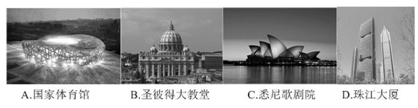

A. A

B. B

C. C

D. D

第 90 题 · 答案与解析

**参考答案（粉笔题库参考内容）**

D

**解析**

D项正确，“珠江大厦”被认为是对抗环境污染的一盏“明灯”。这座大厦可利用风能、太阳能发电，正在引领绿色建设技术的新潮流，树立起一个绿色标杆。

故正确答案为D。

**考点**：科技理论与成就

**来源**：2013年921联考《行测》题（河南卷）第90题

### 第 91 题

下列说法错误的是：

A. 甲某盗取其他网游玩家账号下的一批游戏装备，已涉嫌触犯刑法

B. 乙某在网络游戏中向网游玩家出售虚拟货币，其所得属非法利益

C. 丙某在某网游上的账号积分被网游公司清零，丙某对此享有诉权

D. 丁某网游账号内虚拟货币丢失，丁某可向法院主张追回虚拟货币

第 91 题 · 答案与解析

**参考答案（粉笔题库参考内容）**

B

**解析**

A项正确，甲某构成盗窃罪，涉嫌触犯刑法。B项错误，《关于加强网络游戏虚拟货币管理工作的通知》：“网络游戏虚拟货币是指由网络游戏运营企业发行，游戏用户使用法定货币按一定比例直接或间接购买，存在于游戏程序之外，以电磁记录方式存储于网络游戏运营企业提供的服务器内，并以特定数字单位表现的一种虚拟兑换工具。网络游戏虚拟货币用于兑换发行企业所提供的指定范围、指定时间内的网络游戏服务……”明确其合法性。C项正确，网游公司构成违约，丙某对此享有诉权。D项正确，虚拟货币是一种商品，是法律意义上的物，可以向法院主张追回。

本题为选非题，故正确答案为B。

**考点**：其他法律法规

**来源**：2013年921联考《行测》题（河南卷）第91题

### 第 92 题

下列说法正确的是：

A. 在灭火时，冷水和热水的灭火效果相同

B. 刹车失灵的情况下，如选择跳车，则向后跳相对比较安全

C. 露水多出现在阴天、空气湿度大的情况下

D. 白炽灯的灯丝断了，重新搭上后，会比原来亮

第 92 题 · 答案与解析

**参考答案（粉笔题库参考内容）**

D

**解析**

A项错误，热水的蒸汽层会在燃烧物上笼罩，使其与外界氧气的接触减少，这样比冷水更易起到灭火的作用。B项错误，刹车失灵的情况下，因惯性向前跳比较安全。C项错误，晴天时没有云层，太阳直接照射，空气垂直方向上温差较大，空气中的水蒸气容易在底层大气液化形成露珠。D项正确，白炽灯的灯丝断后再接上，电压不变，电阻变小了，所以功率变大，灯会变得更亮。

故正确答案为D。

**考点**：生活常识

**来源**：2013年921联考《行测》题（河南卷）第92题

### 第 93 题

在人与自然的认识上，与西方“认识你自己”这一著名哲学思考接近同一时期的东方思想是：

A. 存天理，灭人欲

B. 逝者如斯夫，不舍昼夜

C. 天人感应

D. 形灭神灭

第 93 题 · 答案与解析

**参考答案（粉笔题库参考内容）**

B

**解析**

“认识你自己！”——这是铭刻在希腊圣城德尔斐神殿上的著名箴言。这句话出自苏格拉底（前469—前399）。A项错误，“存天理，灭人欲”是宋代理学思想；B项正确，“逝者如斯夫，不舍昼夜”是孔子（前551年—前479年）的思想；C项错误，“天人感应”是西汉董仲舒提倡的观点；D项错误，“形灭神灭”是南北朝范缜的思想。

故正确答案为B。

**考点**：文学常识

**来源**：2013年921联考《行测》题（河南卷）第93题

### 第 94 题

根据《生产安全事故报告和调查处理条例》，下列说法不正确的是：

A. 造成30人以上死亡的是特别重大事故

B. 重大事故必须逐级上报至国务院安全生产监督管理部门

C. 特别重大事故由事故发生地省级人民政府负责调查

D. 报告事故的内容应当包括事故发生单位概况

第 94 题 · 答案与解析

**参考答案（粉笔题库参考内容）**

C

**解析**

C项错误，《生产安全事故报告和调查处理条例》第十九条规定，特别重大事故由国务院或者国务院授权有关部门组织事故调查组进行调查。

本题为选非题，故正确答案为C。

**来源**：2013年921联考《行测》题（河南卷）第94题

### 第 95 题

关于我国的岛屿，下列说法不正确的是：

A. 我国最大的群岛是舟山群岛

B. 崇明岛是由于长江携带的泥沙在入海口附近堆积形成的沙岛

C. 海南岛是因地沉降、海平面上升而形成的大陆岛

D. 我国的珊瑚礁岛主要分布在东海海域

第 95 题 · 答案与解析

**参考答案（粉笔题库参考内容）**

D

**解析**

D项错误，我国的珊瑚礁岛主要分布在台湾岛和海南岛沿岸以及南海诸岛。A、B、C三项表述均是正确的。

本题为选非题，故正确答案为D。

**考点**：中国地理

**来源**：2013年921联考《行测》题（河南卷）第95题

### 第 96 题

文学名篇有时会涉及到一些当地的特色民居，以下对应错误的是：

①陈忠实 《白鹿原》   窑洞

②林语堂 《边城》    吊脚楼

③阿来  《尘埃落定》  骑楼

④老舍  《四世同堂》  四合院

A. ①③

B. ②④

C. ③④

D. ②③

第 96 题 · 答案与解析

**参考答案（粉笔题库参考内容）**

D

**解析**

《边城》的作者是沈从文，对应错误；《尘埃落定》是描写四川阿坝地区的故事，而骑楼是一种近代商住建筑，在两广、福建、海南等地曾经是城镇的主要建筑形式。所以②③错误。

本题为选非题，故正确答案为D。

**考点**：文学常识

**来源**：2013年921联考《行测》题（河南卷）第96题

### 第 97 题

发酵是人类较早接触的一种生物化学反应，如今在食品工业、生物和化学工业中均有广泛应用。以下没有用到发酵工艺的是：

A. 酱油

B. 醋

C. 蔗糖

D. 味精

第 97 题 · 答案与解析

**参考答案（粉笔题库参考内容）**

C

**解析**

发酵即通过对微生物（或动植物细胞）进行大规模的生长培养，使之发生化学变化和生理变化，A、B、D三项都用到了发酵工艺，C项蔗糖是将甘蔗或甜菜用机器压碎，收集糖汁，过滤后用石灰处理，除去杂质，再用二氧化硫漂白；将经过处理的糖汁煮沸，抽去沉底的杂质，刮去浮到面上的泡沫，然后熄火待糖浆结晶成为蔗糖，没有发酵的过程。

本题为选非题，故正确答案为C。

**考点**：生活常识

**来源**：2013年921联考《行测》题（河南卷）第97题

### 第 98 题

下列国家与别称对应错误的是：

A. 加拿大――枫叶之邦

B. 荷兰――风车王国

C. 印度――万塔之国

D. 奥地利――音乐王国

第 98 题 · 答案与解析

**参考答案（粉笔题库参考内容）**

C

**解析**

C项错误，正确的对应是印度——孔雀之国；缅甸——万塔之国。

本题为选非题，故正确答案为C。

**考点**：世界地理

**来源**：2013年921联考《行测》题（河南卷）第98题

### 第 99 题

关于被誉为空难“见证人”的黑匣子，下列说法错误的是：

A. 是航空飞行记录仪器

B. 通常安装在飞机中部位置

C. 具有极强的抗磁干扰能力

D. 外壳采用绝热、防冲击保护材料

第 99 题 · 答案与解析

**参考答案（粉笔题库参考内容）**

B

**解析**

“黑匣子”是飞机专用的电子记录设备之一，名为航空飞行记录器。黑匣子具有极强的抗火、耐压、耐冲击振动、耐海水（或煤油）浸泡、抗磁干扰等能力，即便飞机已完全损坏，黑匣子里的记录数据也能完好保存。世界上大部分的空难原因都是通过黑匣子找出来的。黑匣子通常安装在机尾，因为科学家通过对多起飞行事故分析，发现飞行器的机尾部分不容易损坏。

本题为选非题，故正确答案为B。

**考点**：科技理论与成就

**来源**：2013年921联考《行测》题（河南卷）第99题

### 第 100 题

防火墙是一项确保网络信息安全的设备，下列关于防火墙的描述错误的是：

A. 可保护内部网免受非法用户的侵入

B. 能有效地记录互联网上的活动

C. 是一个安全策略的检查站，所有进出信息都必须经过防火墙

D. 是一种能有效查杀病毒，保护电脑安全的杀毒软件

第 100 题 · 答案与解析

**参考答案（粉笔题库参考内容）**

D

**解析**

防火墙指的是一个由软件和硬件设备组合而成，将内部网和公众访问网分开的保护屏障，是一种隔离技术，最大限度地阻止网络中的黑客来访问你的网络。所有进出信息都必须通过防火墙，使可疑的网站被拒绝于门外，保护内部网不受非法用户的侵入，但不能查杀病毒。

本题为选非题，故正确答案为D。

**考点**：其他

**来源**：2013年921联考《行测》题（河南卷）第100题

## 材料 1

根据以下材料，回答下列各题。

        2011年全国共举办展览6830场，比2010年增加9.2%；展出面积为8120万平方米，比2010年增长8.5%；50人以上专业会议64.2万场，比2010年增加17.4%；万人以上节庆活动6.5万场，比2010年增长3%；出国境展览面积60万平方米，比2010年增长13.8%，实施项目1375个，参展企业4万家；提供社会就业岗位1980万人次；直接产值3016亿元，比2010年增长17.7%，占全国GDP的0.64%，占全国第三产业的13%。

        根据统计分析，2011年北京、上海、广州三城市增长幅度较大，三个城市共举办展览1380场，比2010年增长33.8%，占全国的20%；展览面积为2523万平方米，比2010年增长13.4%，占全国展览面积的31%，在世界商展百强排行榜中，中国占14席，其中北京4席，上海4席，广州3席，香港2席，深圳1席。

        从展会的类型分析，经贸类的占70%，消费类的占25%，文化展示类的占5%。从组展商分析，国有、集体、股份、联营等占30%，民营及其他内资企业占25%，港澳及外商投资企业占5%，行业商（协）会占25%，政府或事业单位占15%。

        2011年Z省共举办展会696场（列全国第一），展览面积为734万平方米，50人以上企业会议2.85万场，万人以上节庆活动452场，出国境参展面积25.9万平方米，出省参展面积34.5万平方米，提供社会就业岗位122万人次，会展业的直接收入327亿元，占全省GDP的1%，占全省第三产业的23%。

### 第 101 题

2011年，从展会的类型分析，消费类的比文化展示类的多多少场？

A. 1707

B. 1528

C. 1366

D. 1124

第 101 题 · 答案与解析

**参考答案（粉笔题库参考内容）**

C

**解析**

题干所求为消费类比文化展示类多多少场，材料已知2011年全国展览总数及各类型占比，可判定本题为现期比重问题。定位文字材料第一段可得：2011年全国共举办展览6830场；定位文字材料第三段可得：从展会的类型分析，消费类占25%，文化展示类占5%。根据公式：部分量=总量×部分量占总量的比重，故2011年消费类比文化展示类多6830×25%-6830×5%=6830×(25%-5%)=6830×20%=1366场。

故正确答案为C。

**考点**：文字资料、现期比重

**来源**：2013年921联考《行测》题（河南卷）第101题

### 第 102 题

2011年全国第三产业产值约为多少亿人民币：

A. 47125

B. 32584

C. 28956

D. 23200

第 102 题 · 答案与解析

**参考答案（粉笔题库参考内容）**

D

**解析**

根据题干“2011年全国第三产业产值”，且材料已知2011年直接产值及其占第三产业比重，可判定本题为现期比重问题。定位文字材料第一段可得：直接产值3016亿元，占全国第三产业的13%。根据公式：，故3016/13%≈3000/(1/8)=3000×8\=24000亿元，与D项最接近。

故正确答案为D。

**考点**：文字资料、现期比重

**来源**：2013年921联考《行测》题（河南卷）第102题

### 第 103 题

2010年平均每场展览展出面积约为多少平方米：

A. 11000

B. 12000

C. 13000

D. 14000

第 103 题 · 答案与解析

**参考答案（粉笔题库参考内容）**

B

**解析**

根据题干“2010年平均每…平方米”，结合材料数据为2011年，可判定本题为基期平均数问题。定位文字材料第一段可得：2011年全国共举办展览6830场，比2010年增加9.2%；展出面积为8120万平方米，比2010年增长8.5%。根据基期平均数公式：，故8120/6830×=812/683。

故正确答案为B。

**考点**：基期平均数、文字资料

**来源**：2013年921联考《行测》题（河南卷）第103题

### 第 104 题

2011年北京、上海、广州三城市举办的展览场次占全国的比重与2010年相比约：

A. 增加了4个百分点

B. 减少了4个百分点

C. 增加了8个百分点

D. 减少了8个百分点

第 104 题 · 答案与解析

**参考答案（粉笔题库参考内容）**

A

**解析**

根据题干“2011年…占…比重与2010年相比”，且选项为百分点，可判定本题为两期比重问题。定位文字材料第一段可得：2011年全国共举办展览6830场，比2010年增加9.2%；定位文字材料第二段可得：2011年北京、上海、广州三城市共举办展览1380场，比2010年增长33.8%，占全国的20%。根据两期比重差公式：，可得当部分量增长率a大于总量增长率b时，比重上升。a=33.8%，b=9.2%，a＞b，故2011年三城市举办展览占全国的比重高于2010年，排除B、D两项；将数据代入公式，已知2011年三城市举办展览占全国的20%，故两年的比重差=20%×=20%×≈1/5×0.25/1.30.05/1.3≈3.8%，与A项最接近。

故正确答案为A。

**考点**：两期比重、文字资料

**来源**：2013年921联考《行测》题（河南卷）第104题

### 第 105 题

根据上述资料，下列表述正确的是：

A. 2010年全国万人以上节庆活动场次不到6万场

B. 在世界商展百强排行榜中，中国上榜城市中有一半为北方城市

C. 从组展商分析，2011年国有、集体、股份、联营以及政府或事业单位比例超过一半

D. 2011年，Z省出国境参展面积占全国比重超过40%

第 105 题 · 答案与解析

**参考答案（粉笔题库参考内容）**

D

**解析**

A项：定位文字材料第一段：2011年全国万人以上节庆活动6.5万场，比2010年增长3%。根据公式：，6.5-6.5×3%≈6.5-0.2=6.3万场，超过6万场，错误；

B项：定位文字材料第二段：在世界商展百强排行榜中，中国占14席，其中北京4席，上海4席，广州3席，香港2席，深圳1席。中国上榜城市有5个，其中北方城市只有北京，故中国上榜城市中北方城市所占比重不到一半，错误；

C项：定位文字材料第三段：从组展商分析，国有、集体、股份、联营等占30%，政府或事业单位占15%。故国有、集体、股份、联营以及政府或事业单位比例&lt;30%+15%=45%，不到一半，错误；

D项：定位文字材料第四段：2011年Z省出国境参展面积25.9万平方米；定位文字材料第一段：2011年全国出国境展览面积60万平方米。根据公式：，故≈43%，超过40%，正确。

故正确答案为D。

**考点**：文字资料、综合分析

**来源**：2013年921联考《行测》题（河南卷）第105题

## 材料 2

根据以下资料，回答下列各题。

        2012年某市开展了市民阅读情况调查。调查采取随机抽样方式，访问了本市12周岁以上的1000名市民。

        调查显示，多数受访者保持每天阅读的良好习惯。其中，阅读时间在1—2小时的为44.8%，2—3小时的为11.6%，3小时以上的为7.5%。

**表1　市民每天阅读时间分布　单位：%**

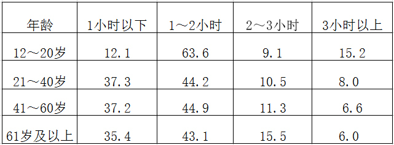

        2011年，42.8%的受访者阅读量在1－6本书，即每年读书一本以上；10.8%阅读量在7－12本书，即每2个月读书一本以上；10.5%阅读量在13本及以上的书，即每月读书一本以上。

**表2　市民每年读书的数量分布　单位：%**

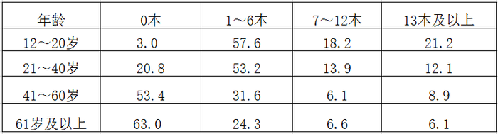

        当被问及没有更多时间阅读的原因时，57.9%的受访者选择“工作学习太忙”，比重最高；其次为“家务太多”，比重为28.7%；“没有值得读的好书”“娱乐活动太多”“对阅读不感兴趣”“书价太贵”的比重依次为17.5%、18.1%、10.3%、23.5%。

### 第 106 题

将没有更多时间阅读的原因按选择人数从多到少排序，排名第三的是：

A. 没有值得读的好书

B. 娱乐活动太多

C. 对阅读不感兴趣

D. 书价太贵

第 106 题 · 答案与解析

**参考答案（粉笔题库参考内容）**

D

**解析**

根据题干“…按选择人数从多到少…排名第三”，结合材料已知受访总人数及选择人数占比，可判定本题为现期比重问题。定位文字材料第一段可得：受访总人数为1000名；定位文字材料最后一段可得：将没有更多时间阅读的原因按选择人数占比从多到少排序，前三名依次为工作学习太忙（57.9%）、家务太多（28.7%）、书价太贵（23.5%）。根据部分量=总量×部分量占总量的比重，可知当总量一定时，比重越高，则部分量越大。故按选择人数从多到少的顺序为：工作学习太忙、家务太多、书价太贵，排名第三的是书价太贵。

故正确答案为D。

**考点**：直接找数、综合资料

**来源**：2013年921联考《行测》题（河南卷）第106题

### 第 107 题

受访者中有多少人每天阅读时间在1小时以上？

A. 448

B. 523

C. 564

D. 639

第 107 题 · 答案与解析

**参考答案（粉笔题库参考内容）**

D

**解析**

题干所求为受访者中每天阅读时间在1小时以上的人数，结合材料已知受访者总数及阅读时间占比，可判定本题为现期比重问题。定位文字材料第一段可得：受访者共1000名；定位文字材料第二段可得：阅读时间在1~2小时的为44.8%，2~3小时的为11.6%，3小时以上的为7.5%。根据部分量=总量×部分量占总量的比重，故每天阅读时间在1小时以上的人数=1000×（44.8%+11.6%+7.5%）=1000×63.9%=639人。

故正确答案为D。

**考点**：现期比重、综合资料

**来源**：2013年921联考《行测》题（河南卷）第107题

### 第 108 题

受访者中，以下哪个年龄段的平均阅读时间与所有受访者的平均阅读时间差别最大：

A. 12―20岁

B. 21―40岁

C. 41―60岁

D. 61岁及以上

第 108 题 · 答案与解析

**参考答案（粉笔题库参考内容）**

A

**解析**

定位表格材料一可得：12~20岁阅读时间小于1小时的人数所占比重远小于其他三个年龄段，而阅读时间3小时以上的人数所占比重远高于其他年龄段。故12~20岁的受访者与所有受访者的平均阅读时间差别最大。

故正确答案为A。

**考点**：直接找数、综合资料

**来源**：2013年921联考《行测》题（河南卷）第108题

### 第 109 题

下列哪项与受访者中不读书人数比例最接近：

A. 61岁及以上受访者中每天读书1小时以下者的比例

B. 41~60岁受访者中每年读书1—6本者的比例

C. 12~20岁受访者中每天读书1—2小时者的比例

D. 21~40岁受访者中每年读书7—12本者的比例

第 109 题 · 答案与解析

**参考答案（粉笔题库参考内容）**

A

**解析**

定位文字材料第三段可得：2011年，42.8%的受访者阅读量在1－6本书；10.8%阅读量在7－12本书；10.5%阅读量在13本及以上的书。故受访者中不读书人数比例=1-（42.8%+10.8%+10.5%）=1-64.1%=35.9%。

A项：定位表格材料一可知：61岁及以上受访者中每天读书1小时以下者的比例为35.4%；

B项：定位表格材料二可知：41~60岁受访者中每年读书1—6本者的比例为31.6%；

C项：定位表格材料一可知：12~20岁受访者中每天读书1—2小时者的比例为63.6%；

D项：定位表格材料二可知：21~40岁受访者中每年读书7—12本者的比例为13.9%。

故只有A项与受访者中不读书人数比例最接近。

故正确答案为A。

**考点**：简单加减计算、综合资料

**来源**：2013年921联考《行测》题（河南卷）第109题

### 第 110 题

以下说法正确的是：

A. 绝大多数12—20岁的受访者每天阅读在3个小时以上

B. 40岁以上的受访者中有一半以上的人一年不读书

C. 大部分受访者每年读书在6本以上

D. 受访者中每年阅读量在13本及以上者不到100人

第 110 题 · 答案与解析

**参考答案（粉笔题库参考内容）**

B

**解析**

A项：根据表格材料一可知：12~20岁的受访者每天阅读在3个小时以上的比重为15.2%，不能称为“绝大多数”，错误；

B项：根据表格材料二可知：41-60岁的受访者每年读书0本的比例为53.4%；61岁及以上的受访者每年读书0本的比例为63%。两者均超过一半，故40岁以上的受访者中有一半以上的人一年不读书，正确；

C项：根据文字材料第三段可知：10.8%的受访者阅读量在7~12本书，10.5%的受访者阅读量在13本及以上。故每年读书6本以上的受访者占比=10.8%+10.5%=21.3%，二者之和不能称为“大部分”，错误；

D项：根据文字材料第一段可知：受访者人数为1000名；根据文字材料第三段可知：10.5%的受访者每年阅读量在13本及以上。根据部分量=总量×部分量占总量的比重，故受访者中每年阅读量在13本及以上者=1000×10.5%=105人，超过100人，错误。

故正确答案为B。

**考点**：综合分析、综合资料

**来源**：2013年921联考《行测》题（河南卷）第110题

## 材料 3

2011年，民航行业完成运输总周转量577.44亿吨公里，比上年增长7.2%。其中旅客周转量403.53亿吨公里，增长12.2%；货邮周转量173.91亿吨公里。

         2011年，国内航线完成运输周转量380.61亿吨公里，比上年增长10.2%。其中港澳台航线完成12.64亿吨公里，增长9.1%；国际航线完成周转量196.84亿吨公里，增长2.0%。

        2011年，全行业运输收入水平为5.83元/吨公里，同比增长0.56元/吨公里。其中国内航线(不含港澳台航线)6.91元/吨公里，同比增加0.69元/吨公里；港澳台航线7.58元/吨公里；国际航线3.68元/吨公里。

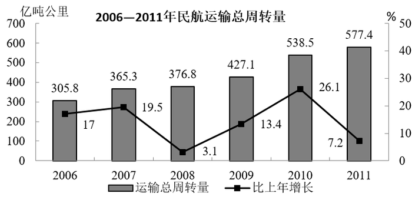

### 第 111 题

2006—2011年，民航运输总周转量同比增长率最低的年份，平均每月完成运输总周转量约为多少亿吨公里？

A. 25

B. 30

C. 31

D. 36

第 111 题 · 答案与解析

**参考答案（粉笔题库参考内容）**

C

**解析**

根据题干“2006-2011年······平均每月······亿吨公里”，可判定本题为现期平均数问题。定位图形材料可知：2006-2011年，民航运输总周转量同比增长率最低的年份为2008年（3.1%），其运输总周转量为376.8亿吨公里。，故376.8/12，与C项最接近。

故正确答案为C。

**考点**：现期平均数、综合资料

**来源**：2013年921联考《行测》题（河南卷）第111题

### 第 112 题

2011年货邮周转量比上年：

A. 减少了2.8%

B. 减少了12.8%

C. 增加了2.8%

D. 增加了12.8%

第 112 题 · 答案与解析

**参考答案（粉笔题库参考内容）**

A

**解析**

根据题干“比上年”，结合选项“%”，且材料已知2011年总周转量、旅客周转量及其增长率，可判定本题为混合增长率问题。定位文字材料第一段可得：2011年，民航行业完成运输总周转量比上年增长7.2%。其中旅客周转量403.53亿吨公里，增长12.2%；货邮周转量173.91亿吨公里。根据线段法，距离和量成反比，旅客周转量：货邮周转量=403.53：173.91≈2.3：1，假设货邮周转量增长率为a，则（12.2%-7.2%）：（7.2%-a） =1：2.3，即2.3×（12.2%-7.2%）=（7.2%-a），故a=7.2%-2.3×5%=7.2%-11.5%=-4.3%，与A选项最接近。

故正确答案为A。

**考点**：一般增长率、综合资料

**来源**：2013年921联考《行测》题（河南卷）第112题

### 第 113 题

2011年民航运输收入比2010年增长了多少亿元：

A. 227

B. 396

C. 528

D. 640

第 113 题 · 答案与解析

**参考答案（粉笔题库参考内容）**

C

**解析**

根据题干“2011年······比2010年增长了多少亿元”，可判定本题为增长量计算问题。定位文字材料最后一段可得：2011年，全行业运输收入水平为5.83元/吨公里，同比增长0.56元/吨公里；定位图形材料可得：2010年和2011年民航运输周转总量分别为538.5亿吨公里、577.4亿吨公里。根据增长量=现期量-基期量、运输收入＝运输周转量×运输收入单价可知：2011年民航运输收入比2010年增加了：577.4×5.83-538.5×（5.83-0.56）=577.4×5.83-538.5×5.83+538.5×0.56=（577.4-538.5）×5.83+538.5×0.56≈40×5.8+540×0.6=232+324=556亿元，与C项最接近。

故正确答案为C。

**考点**：增长量计算、综合资料

**来源**：2013年921联考《行测》题（河南卷）第113题

### 第 114 题

2006—2011年，有几年的运输总周转量同比增长低于50亿吨公里：

A. 1

B. 2

C. 3

D. 4

第 114 题 · 答案与解析

**参考答案（粉笔题库参考内容）**

C

**解析**

根据题干“2006—2011年，有几年······同比增长低于50亿吨公里”，可判定本题为增长量计算问题。定位图形材料可得：2006-2011年民航运输总周转量分别为305.8亿吨公里、365.3亿吨公里、376.8亿吨公里、427.1亿吨公里、538.5亿吨公里、577.4亿吨公里；2006年运输周转总量增长率为17%。根据公式：增长量=现期量-基期量可知，2007-2011年的增长量分别为：

2007年：365.3-305.8=59.5亿吨公里；

2008年：376.8-365.3=11.5亿吨公里；

2009年：427.1-376.8=50.3亿吨公里；

2010年：538.5-427.1=111.4亿吨公里；

2011年：577.4-538.5=38.9亿吨公里。

根据公式：，可知≈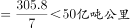。

故运输总周转量同比增长低于50亿吨公里的有：2006年、2008年、2011年共3年。

故正确答案为C。

**考点**：增长量计算、综合资料

**来源**：2013年921联考《行测》题（河南卷）第114题

### 第 115 题

以下关于2011年民航运输情况的描述与资料相符的是：

A. 总周转量比5年前翻了一番

B. 国内航线完成的运输周转量超过民航行业总周转量的七成

C. 港澳台航线运输收入超过国际航线

D. 国内航线运输周转量占总体比重同比上升

第 115 题 · 答案与解析

**参考答案（粉笔题库参考内容）**

D

**解析**

A项，定位图形材料可得：2011年民航运输总周转量为577.4亿吨公里，2006年民航运输总周转量为305.8亿吨公里。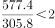，并未翻一番，错误；

B项，定位文字材料第二段可得：2011年国内航线完成运输周转量为380.61亿吨公里；定位文字材料第一段可得：2011年民航行业总周转量为577.44亿吨公里。根据公式：，故≈66%，不到七成，错误；

C项，定位文字材料第二段可得：2011年港澳台航线完成运输周转量12.64亿吨公里，国际航线完成196.84亿吨公里；定位文字材料最后一段可得：2011年港澳台航线运输收入水平为7.58元/吨公里；国际航线为3.68元/吨公里。根据运输收入=运输周转量×运输收入单价可知，港澳台航线运输收入=12.64×7.58≈100亿元，国际航线运输收入=196.84×3.68≈200×3.5=700亿元，前者小于后者，错误；

D项，定位文字材料第一段可得：2011年民航行业完成运输总周转量同比增长7.2%；定位文字材料第二段可得：2011年国内航线完成运输周转量同比增长10.2%。根据两期比重比较结论，当部分量增长率a大于总量增长率b时，比重上升。a=10.2%，b=7.2%，a＞b，故国内航线运输周转量占比同比上升，正确。

故正确答案为D。

**考点**：综合分析、综合资料

**来源**：2013年921联考《行测》题（河南卷）第115题

## 材料 4

**2005—2011年城镇职工基本医疗保险参保人员数和享受待遇人数**

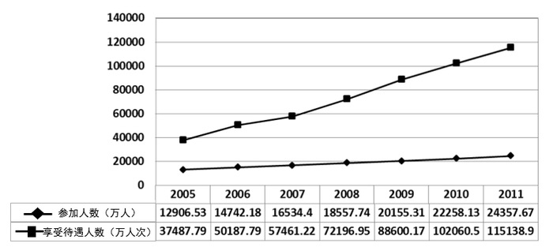

**2005—2011年城镇职工基本医疗保险平均实际报销比例变化情况**

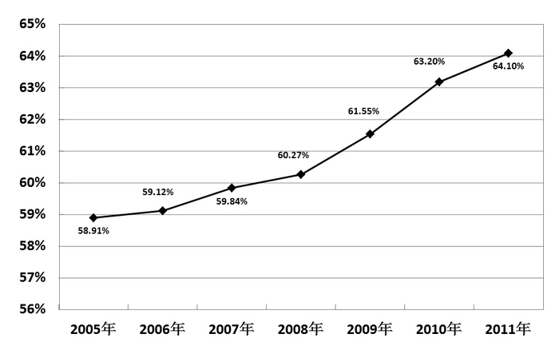

### 第 116 题

2005-2011年，城镇职工基本医疗保险平均实际报销比例同比增长最快的是：

A. 2007年

B. 2008年

C. 2009年

D. 2010年

第 116 题 · 答案与解析

**参考答案（粉笔题库参考内容）**

D

**解析**

定位图形材料二可得：2006-2010年的平均实际报销比例分别为：59.12%、59.84%、60.27%、61.55%、63.20%。故2007-2010年平均实际报销比例同比增长分别为：

2007年：59.84%-59.12%=0.72个百分点；

2008年：60.27%-59.84%=0.43个百分点；

2009年：61.55%-60.27%=1.28个百分点；

2010年：63.20%-61.55%=1.65个百分点。

故2010年平均实际报销比例同比增长最快。

故正确答案为D。

**考点**：简单加减计算、统计图

**来源**：2013年921联考《行测》题（河南卷）第116题

### 第 117 题

2005-2011年，平均每年新增城镇职工基本医疗保险参保者约为多少亿人？

A. 0.17

B. 0.19

C. 0.21

D. 0.23

第 117 题 · 答案与解析

**参考答案（粉笔题库参考内容）**

B

**解析**

根据题干“2005-2011年，平均每年新增······多少亿人”，可判定本题为年均增长量问题。定位图形材料一可知：2005年参保人员数=12906.53万人≈1.29亿人，2011年参保人员数=24357.67万人≈2.43亿人。根据公式：，故2005-2011年，平均每年新增城镇职工基本医疗。

故正确答案为B。

**考点**：年均增长量、统计图

**来源**：2013年921联考《行测》题（河南卷）第117题

### 第 118 题

2010年平均每个参保人员享受的基本医疗保险次数约比2006年：

A. 上升了15%

B. 上升了35%

C. 下降了15%

D. 下降了35%

第 118 题 · 答案与解析

**参考答案（粉笔题库参考内容）**

B

**解析**

根据题干“2010年平均······约比2006年”，结合选项“上升/下降+单位”，可判定本题为平均数的增长率问题。定位图形材料一可知：2010年基本医疗保险参保人员数为22258.13万人，享受待遇人数为102060.5万人次；2006年参保人员数为14742.18万人，享受待遇人数为50187.79万人次。可知，故4.5次；3.3次。可见2010年平均享受次数比2006年上升了，排除C、D两项。根据公式：，2010年平均每个参保人员享受的基本医疗保险次数比2006年上升了，与B项最接近。

故正确答案为B。

**考点**：平均数的增长率、统计图

**来源**：2013年921联考《行测》题（河南卷）第118题

### 第 119 题

某职工2008年就医4次，平均每次产生费用2400元，每次均享受与当年全国城镇职工基本医疗保险平均实际报销比例相当的基本医疗保险待遇。则他当年自己实际支付的医疗费用约为多少钱？

A. 3406元

B. 3814元

C. 5193元

D. 5785元

第 119 题 · 答案与解析

**参考答案（粉笔题库参考内容）**

B

**解析**

本题所求为依据报销比例计算实际支付费用，故可判定为比值计算问题。定位题干可知：就医4次，平均每次产生费用2400元；定位图形材料二可得：2008年平均实际报销比例为60.27%。实际支付费用=总费用×（1-平均实际报销比例），故实际支付的医疗费用=4×2400×（1-60.27%）≈9600×40%=3840元，与B项最接近。

故正确答案为B。

**考点**：比值计算、统计图

**来源**：2013年921联考《行测》题（河南卷）第119题

### 第 120 题

以下关于城镇职工基本医疗保险状况的描述正确的是：

A. 2008年的参保人数同比增量超过其余年份

B. 2006-2011年，享受待遇人次数平均每年增加不到一亿

C. 2009-2011年，参保人数增长率均低于10%

D. 2007-2009年，平均每个参保人员享受待遇人次逐年增加

第 120 题 · 答案与解析

**参考答案（粉笔题库参考内容）**

D

**解析**

A项，定位图形材料一可知：2005-2011年的参保人员数分别为12906.53万人、14742.18万人、16534.4万人、18557.74万人、20155.31万人、22258.13万人、24357.67万人。根据公式：增长量=现期量-基期量，2006-2011年的增长量分别为：

2006年，；

2007年，16534.4-14742.18≈1800万人；

2008年，18557.74-16534.4≈2000万人；

2009年，20155.31-18557.74≈1600万人；

2010年，22258.13-20155.31≈2100万人；

2011年，24357.67-22258.13≈2100万人。

故2010年和2011年的参保人数同比增量均超过2008年，错误。

B项，定位图形材料一可知：2006年享受待遇人数为50187.79万人次，2011年为115138.9万人次。根据公式：，2006—2011年，享受待遇人次数平均每年增加，超过1亿，错误。

C项，定位图形材料一可知：2008-2011年参保人数分别为18557.74万人、20155.31万人、22258.13万人、24357.67万人。根据公式：，2009-2011年的增长率分别为：

2009年，；

2010年，；

2011年，。

故2010年的参保人数增长率超过10%，错误。

D项，定位图形材料一可知：2007-2009年参保人员数分别为16534.4万人、18557.74万人、20155.31万人；2007-2009年享受待遇人数分别为57461.22万人、72196.95万人、88600.17万人。，则2007-2009年的平均次数分别为：

2007年，≈3.5次；

2008年，≈3.9次；

2009年，≈4次，

故2007-2009年，平均每个参保人员享受待遇人次逐年增加，正确。

故正确答案为D。

**考点**：统计图、综合分析

**来源**：2013年921联考《行测》题（河南卷）第120题

