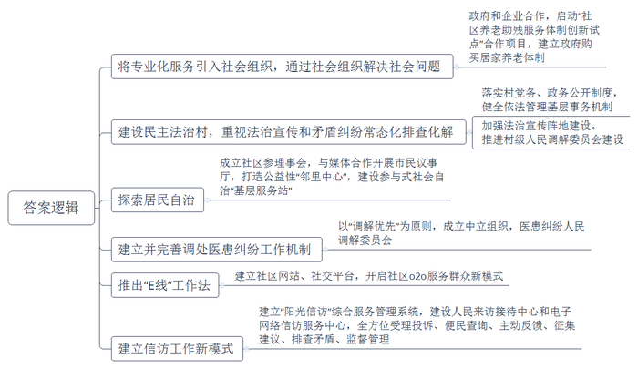
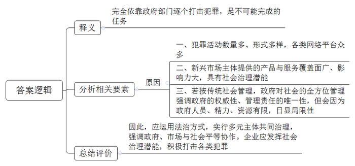
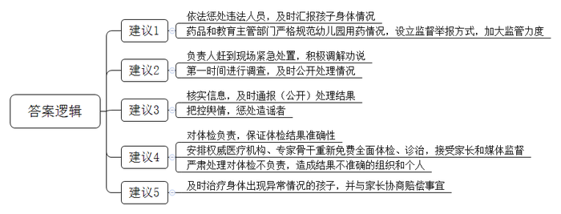
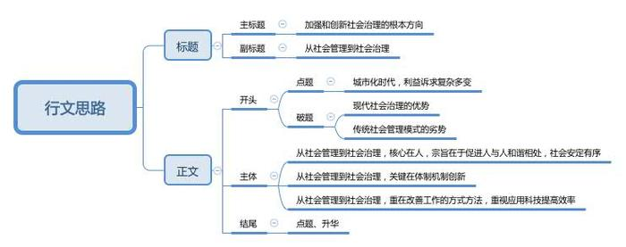

# 2015年河南省公考《申论》题

<!-- gwy:overview:start -->
> **河南 · 2015 · 申论 · 统考** ｜ 4 题 · 图片 4 处 · 答案随题折叠

导航：[题目](#题目) · [材料 1](#材料-1)
<!-- gwy:overview:end -->

> 候选采集稿。参考答案及解析来自粉笔页面，不代表官方答案或真实高分答卷；来源使用许可与原卷对应关系仍需人工核实。

## 给定材料

### 材料 1

党的十八届三中全会提出要创新社会治理体制、改进社会治理方式。李克强总理在2014年政府工作报告中提出：推进社会治理创新，要注重运用法治方式，实行多元主体共同治理。健全村务公开、居务公开和民主管理制度，更好发挥社会组织在公共服务和社会治理中的作用。习近平总书记在参加审议政府工作报告时强调：加强和创新社会治理关键在体制创新，核心是人，只有人与人和谐相处，社会才会安定有序。

现代“社会治理”强调行动主体的多元化与平等性，各主体在协商基础上形成合作，共同解决问题，最终实现共生共赢。而传统社会管理，主要体现为政府对社会的全方位管理，强调政府的权威性、管理责任的唯一性。所以，现代的社会治理，更强调政府、市场与社会的平等协作。

### 材料 2

一位公益研究领域专家在接受采访时指出：过去生活水平低，人均寿命只有60多岁，现在80多岁的人都超过了2000万，60岁以上的超过了两亿，一系列的社会问题随之产生。传统管理方式只是为了满足温饱，现在更多的是为了提升我们的生活质量，这个时候很多事情政府不好办，必须要有社会组织的参与。据专家介绍，我国现有几百万个社会组织，总体上正处于发展之中，但因为过去都有主管单位，导致这些社会组织的功能不太齐全，专业化程度不太高。谈到社会组织发展经验时，专家指出：将专业化服务引入社会组织，实现了对接，一些社会问题也开始通过社会组织来解决，比如这次天津滨海新区瑞海公司的爆炸事故发生后，很多社会组织马上参与了救援和心理疏导工作。

我国老龄化正以前所未有的速度推进，一些地方政府提出“9073”或“9064”的养老服务体系建设目标，倡导90％的老人居家养老，7％或6％的老人在社区日间照料所等机构养老，3％或4％的老人在养老院、护理院等机构养老。

2013年5月2日，北京市海淀区的相关部门与慈爱嘉公司正式启动了“社区养老助残服务体制创新试点”合作项目，试图探索建立一套更为完善的政府购买居家养老体制。2013年10月13日是第一个国家法定的老年节。这天，家住北京市海淀区北下关街道双榆树南里二区82岁的张奶奶，在家接受了一次政府买单的按摩服务。为她提供上门服务的正是北京慈爱嘉养老服务有限公司。慈爱嘉在南里二区开展的这类服务是北京市首个社会化居家养老试点。

北京市的这项政企合作的试点中，场地由北下关街道提供；康复器材由区残联提供；区民政局进行政策指导，同时为部分失能、困难老人出资购买服务；区卫生局提供社区医院、家庭医生服务；双榆树南里二区居委会负责社区宣传和监督；慈爱嘉公司负责专业化管理和服务。专家指出，“合作创新模式把来自民政、残联、卫生、街道办事处及居委会的资源聚集在服务中心内避免交叉管理和重复建设，节约了大量的社会资源。企业按市场竞争机制经营，自负盈亏。”慈爱嘉公司负责人告诉记者，在社区居住的老人可以享受的免费服务有：健康咨询、使用康复器材和多参数生命体征检测仪。收费项目有：保健按摩、日间托老、助浴洗浴、24小时老人紧急情况处理等。很多老人行动不便，到了冬天洗澡就是大问题。现在，中心就为老人们提供助浴服务，费用老人完全可以负担。在服务站以外，慈爱嘉公司还为社区老人提供了一些收费项目：家庭护士、康复锻炼、个人护理、就医服务等。另外，作为试点，海淀区民政局为南二及周边小区50位老人分别购买了每人200元的服务，200元可以享受一次入户评估，一次护士寻访，4次入户服务。

### 材料 3

在信阳市某区委书记王某看来，推进农村社会治理，要从村民最关心、最迫切的问题着手，既要解开村民思想上的“疙瘩”，又要化解发生在村民之间的矛盾纠纷。为此，该区以“民主法治村（社区）”创建活动为引领，突出法治宣传和矛盾纠纷常态化排查化解两个重点。

该区司法局牛局长说，通过落实村（社区）党务、政务公开制度和健全依法管理基层事务机制，对涉及与村民切身利益密切相关的重大事项，明确范围，及时公示，进行民主决策，有效进行民主监督。与此同时，加强法治宣传阵地建设，在全区各行政村（社区）建立固定法制宣传栏，定期更换宣传内容，村图书室建设正在有效推进，涉法类图书数量不断增加，让人民群众在家门口就能学到与自己密切相关的法律知识。

在矛盾化解中，该区司法局全面推进村级人民调解委员会建设，实现乡（镇）、村（居民委员会）人民调解委员会全覆盖的调解网络，真正让被誉为“东方一枝花”的人民调解工作开花结果。针对地方投入与实际需求差距大的实际，该局实行财政支付和社会捐助相结合的经费投入模式，保证专款专用，对法治宣传员和人民调解员给予一定的经济补偿。

### 材料 4

一些新兴领域的新兴市场主体，例如在IT领域的百度、阿里巴巴、腾讯等行业巨头，所提供的产品与服务广泛覆盖了数亿民众，其影响力早已超出经营活动本身，具有极大的参与社会治理的潜能。为了打击利用微信平台的各类犯罪活动，腾讯公司采取了封停黑色账号的行动，半年封停了3万个涉嫌销售假货公众账号、2000万个招嫖账号，每日封停1000万条违规、欺诈广告，这是非常惊人的数据。假如腾讯为了企业利润之私，消极对待这些黑色账号，默许放纵其在微信上泛滥成灾，将会造成多么巨大的社会危害？同时，<u>完全依靠政府部门去逐个打击，又将是怎样一个“不可能完成的任务”</u>？

### 材料 5

近些年来，佛山市某区罗村一直在探索“居民自治”。

“2010年，我们在全市率先成立‘社区参理事会’，它就相当于‘社区政协’。我们邀请各个社区的热心居民作为代表，鼓励他们提交‘社案’来反映问题和给出建议。”罗村社会工作办公室主任朱某介绍，目前罗村有16个社区参理事会。每年，各个参理事会将举行两次会议。“成立社区参理事会，为居民提供了参政议政、监督评议、资源整合及互惠共促的平台。这拓宽了居民监督社区事务的阳光渠道，拓宽了社区成员互惠互助的便利渠道。”

除了打造“社区参理事会”，罗村还与本地媒体合作，开展“市民议事厅”活动。每个月，主办方会设定议题，将个性问题通过与民对话的形式反映出来，并督促相关部门跟进解决。同时，也能通过“议事”的形式收集民间智慧，形成提案为政府决策提供依据。

2011年，罗村提出打造“邻里中心”，建设参与式社会自治的“基层服务站”。据介绍，“邻里中心”是一个公益性的社会服务组织，它由社区的居民组成，自发组织。根据社区情况，开展各类公共利益、慈善帮扶、培训帮教、文体娱乐类的服务。相关部门会定期请专业的社工对各“邻里中心”义工进行培训。此外，每年会拿出一小部分资金给予支持。自2012年起，“邻里中心”就开始推出“17点课堂”活动，专门针对本社区家庭困难或是双职工的子女。“由于放学之后，家里没人，这些小孩会先来我们‘邻里中心’写作业。每天我们都会有两位退休教师，来这里免费辅导小孩学习。‘17点课堂’从开办到现在已开展了六期。”

### 材料 6

2014年3月10日，有家长通过微博反映X市某幼儿园给孩子服用不明药物，白色药片上面写着“ABOB”字样，查询后才知道这是一种俗称“病毒灵”的抗病毒药物，并有消息称幼儿园负责人的爱人为某区政府领导。众多家长普遍表示不满。服药事件不断发酵，3月12日，该市另一家幼儿园也发生了服用该药造成家长聚集的情况。

3月12日19时30分，幼儿园的部分家长将该市科技路与丈八路十字路口封堵。市委书记赶到现场紧急处置，在现场积极调解和劝说，事态得以控制。

3月13日，X市政府通报称，经核实，网络所传幼儿园负责人的爱人为某区政府领导的消息不属实。两所幼儿园的法定代表人孙某及幼儿园执行院长赵某、幼儿园保健医生黄某、幼儿园园长梅某、副园长赵某等5人涉嫌非法行医罪。65个孩子出现了“出汗多”“食欲不振”等身体异常现象，未发现共性指标异常。

在喂药事件爆出后的一个月里，为了确认自己的孩子是否存在健康异常，数百名家长分别带着孩子在市里甚至外地的医院自行进行了体检。记者共搜集了500多份这样的体检报告并进行统计，发现有300多份体检报告中出现了指标异常。其中，某一个班30个孩子当中，4项检查全部正常的仅有5人。剩余的孩子均存在体检指标异常情况，问题集中在心肌酶偏高和隐尿，也就是俗称的尿血。从家长们掌握的材料来看，发现身体异常的孩子数量已经远远超过当初官方公布的65人，而且症状也不仅仅局限于当地政府通报的“出汗”“食欲不振”，因此官方此前通报“未发现共性指标异常”的结论自然遭受到质疑。

家长们的质疑并不仅仅依据自己的体检结果，同时他们也质疑事发之后当地政府部门对服药儿童组织的体检是否负责，体检结果是否准确。在一些家长给记者提供的当地孩子的B超报告中，有6份报告引起了记者的注意。这6份报告分属6个儿童，但报告内容却是一模一样。无论是B超的片子还是检查数据和检查结论。尤其值得注意的是，这6份报告的检测时间居然也完全一样，一秒都不差。一位家长告诉记者当时去指定医院检查时听到的情形：“我们带孩子去检查的时候，前面有个家长说，他的孩子还没到做B超的床上去，仅仅刚报了孩子的名字，医生就把B超拿出来了，还没检查就给了单子。”

对上述事件，省委书记、省长分别作出批示，要求X市政府要彻查并严肃追责。要从维护孩子健康出发，对此事进行妥善处理。

### 材料 7

安徽省某市10所医院从2007-2013年每年累计发生较大医疗纠纷均在100起以上，其中停尸闹事、严重威胁医务人员人身安全的纠纷占总数的15%-20%，80%以上“私了”解决，仅2009和2010两年，上述10家医院累计赔款达602万元。医患纠纷导致医患关系紧张，甚至引发大的社会矛盾和群体性事件。根据司法部等三部门发布的《关于加强医疗纠纷人民调解工作的意见》，该市政府于2011年7月提出建立并逐步推进完善调处医患纠纷的工作机制。其基本做法是，以贯彻“调解优先”为原则，成立独立于医方、患方之外的第三方中立组织，即医患纠纷人民调解委员会，医调委主任由市司法局副局长兼任；聘请6位懂医、懂法、热爱人民调解工作的专职调解员，实行坐班管理；精选上百名具有副高职称的医生和经验丰富的律师组成专家库，为医患双方提供医学和法律方面的咨询和帮助，指导医调委解决调解和理赔工作中的困难和问题。截至到2014年2月底，已受理调解286起医患纠纷，成功调解249起，调解成功率达87%，赔付到位率100%，医患双方满意率达到100%，取得了非常好的社会效果。

### 材料 8

社区是个缸，什么都往里装，还要滴水不漏，怎么办？在“互联网+”时代，余姚市某街道东江社区创新地推出“e线”工作法，让一条看不见的“e线”，成为辖区12个小区、2937户、7000多居民情感相连的纽带，成为快速高效解决居民急事难事、社区大事小事的“管家”。

“我们社区45周岁以下的居民占75%，‘e线’工作法的推出与我们社区人口年轻化这一特色密不可分。”东江社区党支部书记鲁女士说。于是，两年前，“e线”工作法应运而生——通过建立社区网站、QQ群、微信群等，开启社区O2O服务群众新模式。

说起“e线”工作法，鲁书记如数家珍：“居民足不出户，除了能通过掌上‘百事通’了解与自己生活息息相关的计生办证、劳动保障、医院门诊安排、气象预报等各类公共信息外，还能通过‘私人定制’网上预约社工一对一延时、错时服务，而‘双线行动’应急服务、‘报料人平台’‘网上议事厅’等线上线下互动，能及时地解决处理社区各类‘疑难杂症’。”

2013年“菲特”台风期间，社区通过QQ平台将商店信息、最新水情等信息发给各小区居民，并鼓励居民互相照应互通信息平稳度灾，不仅召集到本社区的志愿者，还吸引了来自慈溪等地的志愿者，第一时间给安置在东江社区的群众送去被褥、食物以及矿泉水。

今年3月13日是雾霾天，网名为“阳光水岸谷”的居民发现社区内工业幼儿园双河分园前面有人焚烧垃圾，使空气质量雪上加霜，她第一时间拍照片并在网上留言。鲁书记和社工及时赶赴现场，并会同消防人员、城管队员将火扑灭，还适时向居民开展环保宣传。

前几天，网友“春江花月19幢”在QQ群求助：“请问东江小学新生什么时候报名？户口不在这里怎么办？”很快，有社工详细解答问题，除此之外，还把了解到的最新招生信息公布在网上，以供有同样需要的居民查看。

经过两年的实践，如今，“相约东江”社区QQ群成员发展到将近400人，社区公众微信平台有1000多名“粉丝”。在社区QQ群内，社工信息一目了然，居民在网上互动频繁；135名法律咨询、文化教育、医疗保健、金融理财等各行各业“专家”亮相，为邻居网上答疑，其中由余姚市人民医院组成的专家医疗服务队每季度还定期开展义诊活动。

“社工下班不下‘线’，24小时全天候服务居民。大家的烦心事解决了，社区不文明的事曝光了，好人好事传开了。”在东江社区居住了7年的居民马大姐对“e线”工作法由衷赞叹，“没想到，一条看不见的‘e线’，将居民、社区、商家连接成一个互帮互助、温馨和谐看得见的大‘家’，让‘生人社区’变成‘熟人社区’，叫我怎么不爱自己的社区呢！”

### 材料 9

江苏省淮安市建立了“126”信访工作新模式。“1”是指“阳光信访”综合服务管理系统，是“126”新模式的中枢。该系统是淮安市2007年开始在全国率先自主研发并开通的，集信访投诉、查询、服务、督办、分析、管理等功能于一体，系统网络在纵向上市、县、乡三级贯通，在横向上职能部门联通。

“2”是指建设人民来访接待中心和电子网络信访服务中心。“两个中心”并轨运行、互为补充，形成“信、访、网、电”四位一体工作格局，成为信访部门和人民群众的“连心桥”，全面整合电话、短信、网上信访、视频等电子资源，设立投诉、查询、反馈、人民建议、分析、监督等六个服务平台，为人民群众提供全方位、高效率、无缝隙的优质信访服务。

“6”是指实现“六个全方位”。一是全方位受理投诉。二是全方位便民查询。三是全方位主动反馈。四是全方位征集建议。五是全方位排查矛盾。六是全方位监督管理。

“126”信访工作新模式的创新点主要体现在最大限度地畅通了信访渠道，最大限度地方便了群众信访，最大限度地促进了问题解决，最大限度地提高了工作效率。

### 材料 10

美国有联邦、州、地方政府三级行政管理层级。在有些地区，地方政府只到县一级，县以下就没有任何地方政府了，而是由民间自治组织负责管理。以马里兰州豪伍德县（Howard）哥伦比亚镇为例：该镇有10个居民小区，人口10万人，哥伦比亚协会是一个民间性质的自治组织，在这里起管理作用。其决策机构由11人的理事会组成，任期3年。其中10人是由10个住宅小区的居民分别直接选出来的代表，1人是开发公司的代表。10个住宅小区也各有社区协会，根据居民的多少，分别由3至5人组成，由本社区的居民直接选举产生，任期2年，成为住宅小区的决策机构。

哥伦比亚协会和豪伍德县政府之间通过合同划分彼此职责。县政府负责哥伦比亚镇的公共安全、消防、基础教育等公共服务项目和设施的建设维护。其余的公共服务例如：休闲娱乐健身，自然环境保护，停车服务以及各种庆祝活动等则由哥伦比亚协会来承担。

据统计，目前美国有150多种、140多万个非盈利性组织，几乎涵盖社会生活的方方面面，这些组织提供了大量政府做不到、做不好或不便做的社会服务。

## 题目

### 第 1 题

**近年来各地在推进社会治理创新方面，进行了体制机制、方式方法的多种有益探索，请结合给定资料对此进行梳理概括。（25分）**

关联材料：材料 1、材料 2、材料 3、材料 4、材料 5、材料 6、材料 7、材料 8、材料 9、材料 10

作答要求：准确，全面，有概括性，不超过400字。

第 1 题 · 答案与解析

**参考答案（粉笔题库参考内容）**

一、将专业化服务引入社会组织，通过社会组织解决社会问题。政府和企业合作，启动“社区养老助残服务体制创新试点”合作项目，建立政府购买居家养老体制。

二、建设民主法治村，重视法治宣传和矛盾纠纷常态化排查化解。落实村党务、政务公开制度，健全依法管理基层事务机制；加强法治宣传阵地建设。推进村级人民调解委员会建设。

三、探索居民自治。成立社区参理事会，与媒体合作开展市民议事厅，打造公益性“邻里中心”，建设参与式社会自治“基层服务站”。

四、建立并完善调处医患纠纷工作机制。以“调解优先”为原则，成立中立组织，医患纠纷人民调解委员会。

五、推出“e线”工作法。建立社区网站、社交平台，开启社区o2o服务群众新模式。

六、建立信访工作新模式。建立“阳光信访”综合服务管理系统，建设人民来访接待中心和电子网络信访服务中心，全方位受理投诉、便民查询、主动反馈、征集建议、排查矛盾、监督管理。

**解析**

**参考答案说明：**答案根据社会组织、农村民主法治、居民自治、医患纠纷、“e线”工作法、信访工作等六个不同的话题进行了分条撰写，且对每条要点提炼出了总括词并前置。每条要点之间内容上各自独立，没有交叉。

**考点**：概括措施类

**来源**：2015年河南省公考《申论》题

### 第 2 题

**请深入分析理解“给定资料4”中划线句“完全依靠政府部门去逐个打击，又将是怎样一个‘不可能完成的任务’？”的含义。（15分）**

关联材料：材料 1、材料 4

作答要求：分析深入，条理清晰，语言简练，不超过250字。

第 2 题 · 答案与解析

**参考答案（粉笔题库参考内容）**

完全依靠政府部门逐个打击犯罪，是不可能完成的任务。

体现在：一、犯罪活动数量多、形式多样，各类网络平台众多。二、新兴市场主体提供的产品与服务覆盖面广、影响力大，具有社会治理潜能。三、若按传统社会管理，政府对社会的全方位管理强调政府的权威性、管理责任的唯一性，但会因为政府人员、精力、资源有限，日显局限性。

因此，应运用法治方式，实行多元主体共同治理，强调政府、市场与社会平等协作。企业应发挥社会治理潜能，积极打击各类犯罪。

**解析**

**参考答案说明：**思路方面，本参考答案按照词句解释题“释义+分析相关要素+总结评价”的一般答题思路展开。内容方面，本参考答案先对题干给定句子的含义进行了解释；“分析相关要素”部分从“犯罪数量和条件”“新兴市场主体”“政府局限性”三个方面分析了“不可能完成”的原因；最后总结评价部分给出了对策。词句表达方面，本参考答案使用了“体现在……”“因此……”等连接语，使得答案各部分在逻辑上联系更紧密。

**考点**：词句解释类

**来源**：2015年河南省公考《申论》题

### 第 3 题

**请结合“给定材料6”，就X市政府该如何妥善处理“幼儿园喂药事件”，提出建议。（20分）**

关联材料：材料 1、材料 5、材料 6、材料 7、材料 10

作答要求：建议措施内容全面、可操作性强，条理清楚，不超过300字。

第 3 题 · 答案与解析

**参考答案（粉笔题库参考内容）**

1.依法惩处违法人员，及时汇报孩子身体情况。药品和教育主管部门严格规范幼儿园用药情况，设立监督举报方式，加大监管力度。

2.负责人赶到现场紧急处置，积极调解劝说。第一时间进行调查，及时公开处理情况。

3.核实信息，及时通报（公开）处理结果。把控舆情，惩处造谣者。

4.对体检负责，保证体检结果准确性。安排权威医疗机构、专家骨干重新免费全面体检、诊治，接受家长和媒体监督；严肃处理对体检不负责，造成结果不准确的组织和个人。

5.及时治疗身体出现异常情况的孩子，并与家长协商赔偿事宜。

**解析**

**参考答案说明：**答案从“加强监管”“前期处理”“把控舆情”“全面体检”“后期处理”等五个方面进行了分条撰写。且每条要点之间内容上没有交叉。

**考点**：提出对策类

**来源**：2015年河南省公考《申论》题

### 第 4 题

**参考给定资料，联系实际，以“从社会管理到社会治理”为副标题，自选角度，自拟题目，写一篇议论文。（40分）**

关联材料：材料 1、材料 2、材料 3、材料 4、材料 5、材料 6、材料 7、材料 8、材料 9、材料 10

作答要求：观点鲜明，内容充实，结构完整，逻辑合理，语言流畅。1000—1200字。

第 4 题 · 答案与解析

**参考答案（粉笔题库参考内容）**

**加强和创新社会治理的根本方向**

**——从社会管理到社会治理**

城市化时代，社会主体众多，价值观多样，利益诉求复杂多变。传统社会管理模式，管理效能日益低下，社会风险越来越大。如近年来最为突出的各类基层群体性事件、医患纠纷和养老难题等社会问题，政府都疲于应付。**为了避免政府公信力日益下降，亟须实现从社会管理到社会治理的思路和方法创新。**习近平总书记强调：加强和创新社会治理关键在体制创新，核心是人，只有人与人和谐相处，社会才会安定有序。这指出了从社会管理到社会治理创新的必要性和基本的方式方法。

**从社会管理到社会治理，核心在人，宗旨在于促进人与人和谐相处，社会安定有序。**传统的社会管理模式，强调政府管理权力的权威性和唯一性。政府部门既要处理自身内部矛盾，也要处理政府与各个社会主体之间的矛盾，以及各个社会主体之间的矛盾，势必无力顾及方方面面。这就会出现只管有利可图或上级重视的事务，其他事务则是以“门难进，脸难看，事难办”了之。这不但加剧了官民矛盾，也加剧了各个社会主体之间的矛盾。从国家治理实践和理念革新的角度来看，从社会管理到社会治理的创新意义在于强调政府、市场与社会的平等协作，多主体共同治理，实现共生共赢。这就有助于把各社会主体之间的矛盾纠纷化解于决策和执行之先，从根本上规避政策风险。

**从社会管理到社会治理，关键在体制机制创新。**体制机制创新首先要形成党委领导、政府负责、社会协同、公众参与的社会管理机制。比如某些地方进行了政府购买养老服务的有益尝试，既减少了政府管理中的具体事务，提高了工作效率，同时也激发了企业参与促进就业的热情，更使群众及时享受到专业、优质的服务。体制机制创新的根本在于确保群众的知情权、参与权、管理权和监督权，形成健康的官民共治格局。这样既能使政府更好地通达民情民意，也能更好地吸收民智，从而优化治理效能。这对改进村委会、居委会等基层治理组织的工作尤为重要。而美国在社区治理方面，县级政府和社会代表协会分工负责的方式就值得借鉴。

**从社会管理到社会治理，重在改善工作的方式方法，重视应用科技提高效率。**今天是互联网时代，是用户思维的时代，是群众呼唤法治思维和法治方式的时代。若政府部门仍然把其他社会主体和人民群众当作管理对象，而不是需要对其付出爱、尊重和全心全意服务的对象，那么管理主体和群众之间的隔阂势必会越来越深。因此，需要从两个方面改进社会治理。一方面是从思想上建立服务意识，创新服务方式，实现从“公务员”到“服务员”的转变。比如某地实践“民主法治村”建设，通过常态化的免费法律咨询、法律援助等活动，既帮助群众解决了实际问题，也很好地进行了法制宣传。另一方面是借助于互联网等科技力量，优化工作方法，提升工作效益。比如某社区实践了“e线”工作法，依托互联网随时随地帮助群众解决难题，得到了群众赞许。

总之，从社会管理到社会治理，是我国新形势下加强和创新社会治理的需要，也是实现国家治理能力和治理体系现代化的题中之义！

**文章二：学员高分文章**

**创新社会治理 实现共生共赢**

**——从社会管理到社会治理**

当下，我国正处在社会转型期，各种社会问题逐渐成为公众瞩目的焦点，如老龄化严重，医患关系紧张，基层群体性事件频发……这些无不牵动着国人敏感的神经。**究其原因，传统社会管理模式以政府为主导，强调管理权力的权威性和唯一性**，面对众多问题，政府疲于应付，群众难以满意。而现代“社会治理”重视行动主体的**多元化和平等性**，为缓解政府与社会群体之间的矛盾找到了出口。因此，**亟需转变管理方向，促成从社会管理到社会治理的质的飞跃。**

创新社会治理，**离不开社会多元主体的齐心协力，也离不开法治方式和互联网技术**，唯有三者相辅相成，形成社会治理的强大合力，才能构建良好的社会治理格局，达到共生共赢的效果。

**从社会管理到社会治理，必须依靠多元主体共同治理，做到以人为本，实现共赢。**所谓“水能载舟，亦能覆舟”，人民群众始终在社会的和谐稳定和国家的长治久安中提供最坚实的力量。在国内，众所周知的“西城大妈”“朝阳群众”“海淀网友”等，在公共安全治理中频频立功，他们以己之力，尽己之责，净化环境，守望相助，对社会维稳起到了重要作用。在国外，美国有众多的非营利性组织，几乎涵盖社会生活的方方面面，提供了大量政府做不到、做不好或不便做的社会服务。所以，政府应该转变行政理念，呼吁多元主体参与社会治理，还政于民，还权于社会，以此提高治理效益。同时，通过政策和经费支持等，激发社会组织活力，让其治理意识不断提高、治理热情充分涌流，从而推进国家治理体系和治理能力现代化。

**从社会管理到社会治理，应创新工作方法，注重运用法治思维。**“法者，治之端也”，通过法治方式处理和解决各种社会问题，达到“无不治之国，无不化之民”的境界，是社会治理的重要手段。一方面，政府自身需牢固树立“法无授权不可为，法定职责必须为”的意识，规范行使权力。另一方面，由于传统思维的根深蒂固，人们遇事习惯通过“找熟人”“走关系”进行社会资源互换，因此政府在依法行政的过程中需多措并举，积极引导，在全社会营造良好的法律氛围。例如某地在推进农村社会治理时，开设民主法治村创建活动，突出法治宣传，逐步培育人民群众崇尚法律、敬畏法律、遵守法律的坚定信仰，取得了很好的效果。

**从社会管理到社会治理，应创新工作方式，借助互联网技术，提高治理效率。**作为社会生活的重要领域，互联网的繁荣发展为社会治理理念创新提供了新的方向。政府应当与时俱进，借助互联网技术，优化工作方法，提升工作效益。某社区实践“e线”工作法，依托互联网随时随地解决群众难题；某市建立“126”信访工作新模式，利用互联网技术，畅通信访渠道，促进问题解决，提高工作效率。这些都是互联网时代，政府强化治理和服务实效的生动案例。

总之，创新社会治理，只有起点，没有终点。在新形势下，只有不断推动社会治理创新，全面建成小康社会的目标，中华民族的复兴蓝景才指日可待啊……

**解析**

> 粉笔页面在本题只提供参考答案与「考点 / 来源」，没有单独的文字解析。

**考点**：文章写作题

**来源**：2015年河南省公考《申论》题

